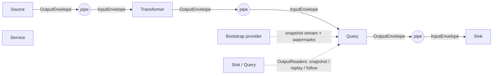
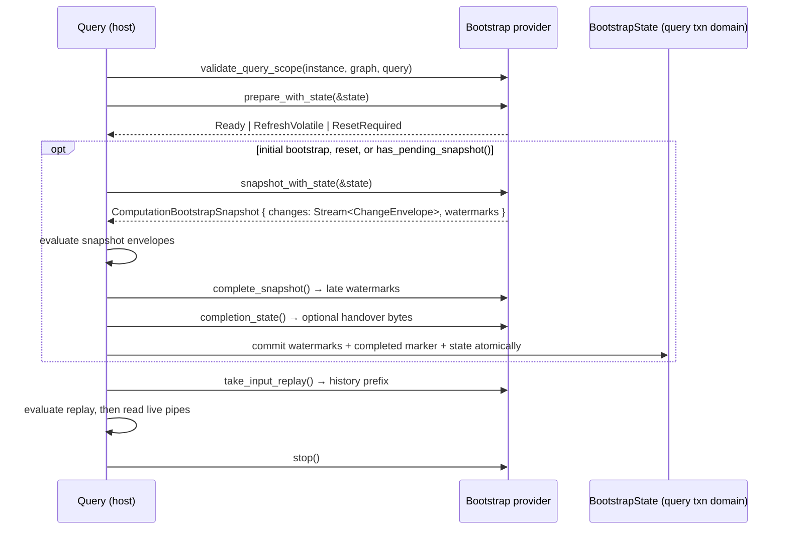

# Computation graph component contracts

This document is a reference for every contract that ComputationGraph
components use to talk to each other and to the host. It covers the data
envelopes, port negotiation, the standard graph and query codecs, output reads
(snapshot, replay and snapshot-follow), bootstrapping, source schema discovery,
progress and recovery, admission, delivery and source transactions.

The Rust source in `src/` is authoritative. Each section names the files that
define the contract so you can read the exact rules.

## Contents

1. [Component model](#1-component-model)
2. [Ports, schemas and pipe capabilities](#2-ports-schemas-and-pipe-capabilities)
3. [Envelopes](#3-envelopes)
4. [Records and change sets](#4-records-and-change-sets)
5. [The standard graph-change schema](#5-the-standard-graph-change-schema)
6. [Query output](#6-query-output)
7. [Output reads: snapshot, replay and snapshot-follow](#7-output-reads-snapshot-replay-and-snapshot-follow)
8. [Sinks: completion, batching and snapshot replacement](#8-sinks-completion-batching-and-snapshot-replacement)
9. [Bootstrap](#9-bootstrap)
10. [Source schema discovery](#10-source-schema-discovery)
11. [Progress, recovery and input positions](#11-progress-recovery-and-input-positions)
12. [Source transactions](#12-source-transactions)
13. [Admission](#13-admission)
14. [Delivery to external destinations](#14-delivery-to-external-destinations)
15. [Encodings and limits](#15-encodings-and-limits)
16. [Context and annotation keys](#16-context-and-annotation-keys)

---

## 1. Component model

A computation graph is a DAG of components connected by pipes between ports.
Data flows source → (transformers) → query → sinks.



### Roles and semantic kinds (`src/identity.rs`)

| `ComponentRole` | Ports | Behavior (plugin SDK trait) |
|---|---|---|
| `Source` | outputs only | `NativeSource::next() -> Option<OutputEnvelope>`; `None` means permanently exhausted |
| `Transformer` | inputs and outputs | `NativeTransformer::transform(InputEnvelope) -> Vec<OutputEnvelope>` |
| `Query` | inputs and one output, `out` | Hosted by the runtime and has no plugin trait |
| `Sink` | inputs only | `NativeSink::handle` / `handle_batch` |
| `Service` | none | `NativeService::run` / `quiesce` |

`ComponentSemanticKind` adds `Reaction` to the five roles. It is a descriptive
label (`ComponentDescriptor::with_semantic_kind`) and does not change ports,
execution or lifecycle. A reaction executes as a sink.

Bootstrap is **not** a role. It is a query-scoped provider family
(see [§9](#9-bootstrap)).

### Common component surface (`components/computation-plugin-sdk/src/component.rs`)

All native components implement `NativeComponent`:

| Method | Contract |
|---|---|
| `descriptor()` | Immutable `ComponentDescriptor` ([§2](#2-ports-schemas-and-pipe-capabilities)) |
| `configuration()` | Resolved configuration as JSON |
| `output_readers()` | Optional snapshot/replay/follow providers per output port ([§7](#7-output-reads-snapshot-replay-and-snapshot-follow)). Fixed at construction, performs no I/O, served only while started. |
| `consumer_progress_reader()` | Optional `ConsumerProgressView` ([§11](#11-progress-recovery-and-input-positions)) |
| `input_position_policy()` | Optional source-defined position comparator ([§11](#11-progress-recovery-and-input-positions)) |
| `start()` / `start_with_credentials()` / `stop()` | Lifecycle |

Role-specific additions:

- `NativeSource`: `source_schema_reader()` ([§10](#10-source-schema-discovery)),
  `recovery_reader()`, `replay_retention()`, `next()`.
- `NativeTransformer`: `transform()`, plus `has_pending_emissions()` /
  `continue_transform()` for continuation, `wakeup_source()` / `on_wakeup()` for
  timer-driven output (`WakeupSource` in `src/component_data.rs`), and
  `delivery_completed()`.
- `NativeSink`: `completion()`, `handle()`, optional `batching()` /
  `handle_batch()`, and `snapshot_consumer(port)` ([§8](#8-sinks-completion-batching-and-snapshot-replacement)).
- `NativeService`: `run()`, `quiesce()`.

---

## 2. Ports, schemas and pipe capabilities

Defined in `src/ports.rs`, `src/data.rs`, `src/port_formats.rs` and
`src/primary_ports.rs`.

### Descriptors

```text
ComponentDescriptor
├── id: ComponentId
├── ports: [PortDescriptor]           (port ids must be unique)
├── plugin_identity?: PluginIdentity { id, version }
└── semantic_kind?: ComponentSemanticKind

PortDescriptor
├── id: PortId
├── direction: Input | Output
├── schema: SchemaDescriptor          (one schema per port)
└── requirements: PipeRequirements    (set of PipeCapability)

SchemaDescriptor
├── id: SchemaId
├── version: SchemaVersion (u32)
├── encoding: String
├── definition: Bytes                 (non-empty, canonical)
└── fingerprint: u64                  (derived from the four fields above)
```

A `SchemaDescriptor` describes the wire format on a port. It does **not**
describe the graph labels or properties of the data. Those come from source
schema discovery ([§10](#10-source-schema-discovery)).

### Pipe capabilities

`PipeCapability` lists what a pipe provider promises:

| Capability | Meaning | Requires |
|---|---|---|
| `FifoPerStream` | FIFO per producer stream by authoritative sequence | |
| `RankedEventOrder` | Merge source heads by event time and query-local rank | |
| `Backpressure` | Capacity pressure waits or rejects rather than dropping | |
| `DurableAcceptance` | A successful enqueue survives the provider's crash boundary | |
| `ExplicitAcknowledgement` | Handling is acknowledged separately from delivery | |
| `Replay` | Retained data can be replayed from a supported position | `DurableAcceptance` |
| `RetainedHistory` | History is retained for its storage lifetime, not crash-durable | |
| `Transactions` | Atomic delivery/ack in a negotiated scope | `ExplicitAcknowledgement` |
| `ExactlyOnce` | Exactly-once within the transport's scope, not downstream effects | `DurableAcceptance`, `ExplicitAcknowledgement`, `Transactions` |

`PipeCapabilities::try_new` rejects declarations that are missing a dependency.
`PipeCapabilities::volatile_bounded(n)` is the in-process default and provides
only `FifoPerStream` and `Backpressure`.

### Edge negotiation

`validate_connection(output, input, pipe)` runs before the graph starts:

1. `output` must be an `Output` port and `input` an `Input` port.
2. The schema descriptors must match **exactly**. Matching on hashes alone is
   not allowed.
3. Unless the pipe offers `RankedEventOrder`, it must offer `FifoPerStream`.
4. The pipe must satisfy both endpoints' `requirements`.

`validate_sink_completion` additionally rejects `ExplicitAcknowledgement`,
`Transactions` or `ExactlyOnce` requirements at a sink whose completion is
`Accepted` ([§8](#8-sinks-completion-batching-and-snapshot-replacement)).

### Configurable port formats and primary ports

- `PortFormatCatalogue` holds each port's default schema plus alternatives
  selected through the `ports` configuration key. A format is named
  `<schema id>-v<version>`. Unknown ports or unsupported formats are rejected.
  Resolution never converts data.
- `PortPrimaries` resolves shorthand endpoints. An explicit port wins.
  Otherwise the configured primary is used, then the only port in that
  direction. Zero matching ports or an ambiguous choice is an error. Ports are
  never selected by declaration order.

### Graph-supplied bindings (`src/output_read.rs`)

```text
OutputEndpoint { component: ComponentId, port: PortId }
InputBinding   { input_port: PortId, output: OutputEndpoint, stream: StreamId }
```

The graph supplies `InputBinding`s from its validated topology. Consumers never
infer a producer port from a stream name.

---

## 3. Envelopes

Defined in `src/component_data.rs` and `src/envelope.rs`.

### Routing wrappers

```rust
pub struct InputEnvelope  { pub port: PortId, pub envelope: ChangeEnvelope }
pub struct OutputEnvelope { pub port: PortId, pub envelope: ChangeEnvelope }
```

- `InputEnvelope`: the host routed the envelope to this declared input port.
  The host validates port and schema membership.
- `OutputEnvelope`: a new emission on a declared output port. The producer owns
  the output stream and its monotonically increasing sequence.
- `emission_id(stream, sequence)` derives the `EnvelopeId` from the stream and
  the big-endian sequence.

### `ChangeEnvelope` anatomy

```text
ChangeEnvelope                               (the data-plane currency)
├── event: Arc<ChangeEvent>                  immutable, shared by every branch
│   ├── id: EnvelopeId
│   ├── changes: Arc<ChangeSet>              see §4
│   ├── system: Arc<SystemMetadata>
│   │   ├── stream: StreamId                 one producer output port per stream
│   │   ├── sequence: u64                    authoritative order
│   │   ├── timestamp?: DateTime<Utc>        observational, or event time for ranked merges
│   │   ├── source_position?: Bytes          opaque producer cursor
│   │   ├── control?: ControlMessage         { kind, payload: Bytes }
│   │   └── ordering: EventTime | ProducerSequence
│   └── lineage?: Arc<Lineage>               ancestry of a derived event
│       ├── envelope_id, system              parent identity and metadata only
│       ├── parent?: Arc<Lineage>
│       └── depth                            ≤ MAX_LINEAGE_DEPTH (1024)
└── context: ProcessingContext               branch-local, append-only
    └── [ContextEntry { contributor: ComponentId, key, value: ContextValue }]
        ContextValue = Bool | Signed(i64) | Unsigned(u64) | String | Bytes
```

### Rules

**Sequence**
- The sequence, not the timestamp, is authoritative.
- New emissions on a stream have strictly increasing sequences. Gaps are allowed.
- There is no ordering across different streams.

**Timestamp**
- It is observational for FIFO transports.
- Explicit ranked inputs may use it as event time.

**Source position**
- It is an opaque cursor.
- It does not prove durability or a checkpoint.

**Control**
- A control message applies only to its event.
- Derived outputs do not inherit it. A producer must attach a fresh control to
  each output that needs one.

**Ordering**
- Ordering defaults to `EventTime`.
- `ProducerSequence` is valid only when the receiver has validated the
  producer's identity, epoch and accepted sequence externally.
- Derived outputs do not inherit it.

**Context**
- Every component on a branch can append context entries.
- Duplicate keys are kept. Iteration is newest-first.
- Cloning an envelope shares its existing entries. Appending to one clone does
  not affect another branch.
- Context is for metadata such as query projection and producer progress
  ([§16](#16-context-and-annotation-keys)). It is not for transactions or
  acknowledgements.

**Lineage**
- A transformer creates outputs with `ChangeEnvelope::derive` / `try_derive`.
- The new event gets fresh metadata. Lineage keeps only the parent's identity
  and metadata, not its payload.
- Lineage is single-input. It is not a multi-input causal graph.
- Publication and encoding reject a lineage depth above 1024.

**Replay**
- `ChangeEnvelope::reemit(sequence)` assigns a new transport sequence and ID.
- It keeps the logical payload, metadata, control and provenance.

---

## 4. Records and change sets

Defined in `src/data.rs`.

```text
ChangeSet
├── id: ChangeSetId
├── schema: SchemaDescriptor                  one schema per batch
└── operations: [ChangeOperation]
    ├── Added   { ordinal, after: Record }
    ├── Updated { ordinal, before?: Record, after: Record, semantics: Patch | Replace }
    └── Deleted { ordinal, identity: RecordReference, before?: Record }

Record
├── reference: RecordReference { schema: SchemaDescriptor, identity: RecordId }
├── image: Full | Patch | Partial
└── payload: Bytes                            interpreted by the schema
```

### Image types

- `Full`: a complete image.
- `Patch`: an update delta. Omitted fields are unchanged.
- `Partial`: a known projection of the before-image. It is not a full image or
  a delta.

### Validation

- Every `Record` and `RecordReference` is checked by the schema's
  `RecordValidator` when it is constructed. Deserialization cannot bypass
  validation, and there is no permissive default.
- `ChangeSet::try_new` rejects invalid batches. It never sorts or repairs them.
- Operation ordinals must be unique and non-decreasing. They do not need to be
  contiguous.
- An operation's stable identity is `(change_set.id, ordinal)`.
- `Added` requires a `Full` after-image.
- `Updated` with `Replace` requires a `Full` after-image. `Patch` requires a
  `Patch` after-image.
- A before-image can never be a `Patch`.
- Every record must use the change set's schema.

---

## 5. The standard graph-change schema

Defined in `src/graph_codec.rs`, `src/element_image.rs`, `src/element_patch.rs`
and `src/graph_view.rs`.

Sources, transformers and query outputs all use one standard schema,
`GraphChangeCodec::schema()`:

| Field | Value |
|---|---|
| id | `drasi.graph-change` |
| version | `1` |
| encoding | `drasi-element-msgpack-v1` |
| definition | `ElementImage-v1;ElementReference-msgpack-key;add/full;replace/full;patch/ElementPatch;delete/ElementBeforeImage-or-identity;event-local-graph-controls-v1` |

### Record mapping

- **Identity:** the `RecordId` encodes an `ElementReference { source_id, element_id }`.
- **Full image:** an `ElementImage` encoded as bounded named MessagePack:
  - `Node { metadata, properties }`
  - `Relation { metadata, in_node, out_node, properties }`, with direction
    `(in_node)-[relation]->(out_node)`
  - `metadata` is `ElementMetadata { reference, labels, effective_from }`.
- **Patch image:** an `ElementPatch`:
  - It contains an `ElementImage` with only the properties to set, plus a
    `remove` set of property names.
  - Omitted properties are unchanged.
  - Setting a property to `Null` stores `Null`. Removing a property is
    represented only by the `remove` set.
  - A property cannot be both set and removed.
- **Delete:** the before-image is either a full element or metadata only
  (`ElementBeforeImage`). An identity-only delete requires an envelope timestamp.
- **Graph controls:** event-local controls use the `drasi.graph-control.v1`
  kind. One example is the futures-due tick produced by
  `encode_futures_due`, which has an empty change set.

### Producer-neutral sink view

`GraphChangeBatch::from_envelope` decodes a standard graph envelope into
`GraphChange` values with:

- a kind: `Add`, `Replace`, `Patch` or `Delete`
- labels
- typed properties
- removed property names
- an optional before-image

It also supports JSON projection. It **rejects** query snapshot and
progress-only frames and scheduling controls rather than treating them as data.
Sinks that need those frames must handle them explicitly
([§8](#8-sinks-completion-batching-and-snapshot-replacement)).

---

## 6. Query output

Defined in `src/query_codec.rs`, `src/snapshot.rs`,
`src/graph_codec/result_node.rs`, `src/query_identity.rs` and
`src/producer_identity.rs`.

A query output is an ordinary standard graph-change stream on port `out`. Each
result row is a **graph node**. Query-specific meaning is carried in
[context entries](#16-context-and-annotation-keys), so generic graph consumers
can ignore it.

### Row encoding (`ResultNodeProjector`)

| Node field | Value |
|---|---|
| `reference.source_id` | Output dataset: `drasi.output/<sha256 hex>` from `dataset_namespace(scope, graph, query, "out")` |
| `reference.element_id` | Opaque row identity as lowercase hex. For evaluator rows, this is the big-endian 8-byte row signature. |
| `labels` | Exactly one label: the configured result label, or `Result` |
| `properties` | The row's returned values (`QueryVariables`) |

Evaluator results map to operations as follows:

| Evaluator result | Operation |
|---|---|
| `Adding` | `Added` (full after) |
| `Updating` | `Updated` (full before and after, `Replace`) |
| `Aggregation` | `Updated` (optional before, full after, `Replace`) |
| `Removing` | `Deleted` (identity and full before) |
| `Noop` | Omitted. The ordinal is the evaluator index, so gaps are expected. |

### Query metadata in context

Each emitted query envelope carries these context entries:

- `drasi.query-output.v1`: JSON
  `QueryOutputMetadata { query_id, source_id?, timestamp, metadata, profiling? }`
- `drasi.query-projection.v1`: the `ResultNodeProjector` scope and one
  `ResultOperationMetadata { ordinal, row_identity, kind }` per operation.
  `kind` is `Row` or `Aggregation { grouping_keys, default_before, default_after }`.
- A query output sequence, an output generation and a
  `drasi.graph-producer-progress.v1` producer progress marker.

The query ID is **not** stored in rows. Read it from envelope context.

Use `QueryChangeCodec` to read query envelopes:

- `projection`
- `decode_row` → `DecodedQueryRow { dataset, label, identity, signature?, values }`
- `is_snapshot`, `is_progress_only`
- `query_generation`, `query_sequence`, `output_sequence`
- `to_legacy_result`

### Query result snapshots

```rust
pub struct QueryResultSnapshot {
    pub projector: ResultNodeProjector,      // output scope, also for empty snapshots
    pub as_of_sequence: u64,                 // last output sequence reflected in rows
    pub generation: u64,                     // output generation
    pub rows: im::HashMap<RecordId, Record>, // keyed by row identity
}
```

A snapshot contains results only. It does not contain query text or
configuration. It reaches consumers in two ways:

1. **As an output read:** `OutputSnapshot` through the query's `SnapshotProvider`
   ([§7](#7-output-reads-snapshot-replay-and-snapshot-follow)).
2. **In band:** `QueryChangeCodec::snapshot_envelope(projector, query_id,
   snapshot, component, system)` creates a **replace-all** envelope:
   - Every row is `Added` with a full image, sorted by identity.
   - The context includes `drasi.query-snapshot.v1 = true`, a generation and
     the query metadata.
   - Ordering is `ProducerSequence`.
   - An empty snapshot is still fully scoped by the projector.

`QueryChangeCodec::progress_envelope` creates a **progress-only** envelope
marked `drasi.query-progress-only.v1`. It has no operations and describes an
explicit recovery skip. It does not replace rows.

### Producer identity and epochs

```text
GraphProducerIdentity
├── construction_scope, graph_id
├── component_id: ComponentId
├── stream: StreamId
├── incarnation: Uuid      the epoch; never nil
└── persistent: bool
```

A query derives its output epoch from `QueryRecoveryIdentity`, which contains
the scope, graph, query ID, configuration hash and optional incarnation, plus
the output generation:

1. Compute a SHA-256 hash of `drasi.query-output-epoch.v1`, the identity and the
   generation.
2. Use that hash to create a version 8 UUID.

A reset or configuration change therefore produces a new epoch. Cursors from
different epochs are never comparable.

---

## 7. Output reads: snapshot, replay and snapshot-follow

Defined in `src/output_read.rs` and `src/output_follow.rs`. The host side is in
`lib/src/computation/v1/output_catalogue.rs` and `query_output.rs`.

Any component can expose readers for its declared output ports through
`NativeComponent::output_readers()`. Each capability is optional. A port's
capabilities are exactly the providers it registers. There are no separate
capability flags.

```text
OutputReaders: PortId → OutputPortReaders { snapshot?, replay?, snapshot_follow? }
```

The query registers all three providers on `out`.

### Cursor

```text
OutputCursor { producer: GraphProducerIdentity, sequence: u64 }
```

The cursor's epoch is `producer.incarnation`. Use `ensure_same_epoch` to reject a
cursor from another epoch, stream or scope with `EpochChanged`.

### Capabilities

| Capability | Call | Result |
|---|---|---|
| `Snapshot` | `SnapshotProvider::snapshot()` | `OutputSnapshot { cursor, dataset, schema, records }` |
| `Replay` | `ReplayProvider::committed_head()`, `replay_after(cursor)` | `OutputReplay { after, head, envelopes }` |
| `SnapshotFollow` | `SnapshotFollowProvider::snapshot_and_follow(limits)` | `OutputSnapshotFollow { snapshot, follow: Box<dyn OutputFollow> }` |

#### `OutputSnapshot`

- It is the complete output at `cursor`, using the port's declared schema.
- Every record must be a `Full` image, keyed by its own identity.
- `dataset` must be non-empty so an empty snapshot still identifies its scope.
- A provider that cannot answer must return a typed error, never an empty
  success.

#### `OutputReplay`

- It contains committed envelopes in `(after, head]`.
- Each envelope must carry the producer's progress marker for `head`'s
  producer and epoch.
- Logical sequences must increase strictly and reach `head` exactly.
- Positions are logical producer sequences. They are not transport sequences,
  so re-emitted history keeps its position.
- If retained history is missing, the provider must return `Gap` rather than
  silently omitting envelopes.

#### `snapshot_and_follow`

- Capture the snapshot and open the live tail atomically, with no window
  between them.
- `OutputFollow::next()` returns each subsequent committed envelope, or fails
  explicitly with `LeaseExpired`, `Gap`, `EpochChanged` or `Retired`.
- `OutputFollowLimits { max_envelopes, max_bytes, lifetime }` bounds the tail.
  Byte accounting includes complete binary envelopes.
- The lease does not renew.
- Cancelling `next()` must not consume an envelope.
- Dropping the handle releases retention synchronously.
- This guarantees no gap while the lease is alive. It is **not** crash-durable.

### Errors (`OutputReadError`)

| Error | Meaning |
|---|---|
| `NotReady` | The output cannot answer coherently yet |
| `Gap { requested, oldest, latest }` | History after `requested` is unavailable |
| `EpochChanged { requested, current }` | The cursor belongs to another epoch |
| `Retired` | The component generation stopped or was replaced |
| `LeaseExpired` | A follow lease expired |
| `UnknownOutput` / `UnknownComponent` | The endpoint is not in the current publication |
| `Absent { endpoint, capability }` | The output exists but does not provide this capability |
| `Invalid` | The provider violated this contract |
| `Failed` | Another failure occurred |

The host wraps every provider in a fenced handle. A read that spans a
component replacement or graph stop fails with `Retired`. The host also checks
that each snapshot's schema and cursor belong to the endpoint.

---

## 8. Sinks: completion, batching and snapshot replacement

Defined in `src/component_data.rs`, `src/snapshot_consumer.rs` and
`src/graph_view.rs`.

### Completion (`SinkCompletion`)

Each sink instance declares fixed completion semantics:

- `Accepted`: the sink or its queue accepted the input. It makes no durability,
  processing or effect claim.
- `Handled`: processing completed at the sink boundary. This is necessary for
  transactional guarantees, but it does not prove end-to-end exactly-once.

### Batching (`SinkBatching`)

A sink opts into batching through `batching()` and implements `handle_batch`.

| Limit | Range |
|---|---|
| `max_inputs` | 1–1024; hard count bound |
| `max_operations` | 1–65,536; flush target. The host never splits an envelope. |
| `max_bytes` | 1–64 MiB, measured as encoded binary frames |
| `max_delay_ms` | 1–60,000 |

A batch never crosses an input port or a **barrier**. A barrier is a batch of
its own. These envelopes are barriers:

- an envelope with no operations, such as a control or progress envelope
- a query snapshot envelope (`drasi.query-snapshot.v1`)
- a query progress-only envelope

### Snapshot replacement

```rust
fn snapshot_consumer(&mut self, port: &PortId) -> Option<&mut dyn SnapshotConsumer>;

trait SnapshotConsumer { async fn replace_snapshot(&mut self, input: InputEnvelope) -> Result<()>; }
```

A sink returns a handler only for input ports that can genuinely replace their
whole state. That set is fixed at construction and declared in factory
metadata. The host routes replace-all snapshot envelopes to this handler
instead of `handle`.

---

## 9. Bootstrap

Defined in `src/bootstrap.rs`. The host side is
`lib/src/computation/v1/query_bootstrap.rs`, `composite_bootstrap.rs` and
`output_bootstrap.rs`. The plugin side is
`components/computation-plugin-sdk/src/bootstrap.rs` and the ABI is
`components/computation-plugin-abi/src/bootstrap.rs`.

Bootstrap seeds a query's initial state before it consumes live input.

- A query has **one bootstrap slot**.
- `CompositeBootstrapProvider` combines several providers in that slot.
- When combined preparations disagree, `ResetRequired` wins over
  `RefreshVolatile`, which wins over `Ready`.

Snapshot data is a stream of ordinary `ChangeEnvelope`s. There is no separate
bootstrap row format.

### Lifecycle



### Preparation

| `BootstrapPreparation` | Meaning |
|---|---|
| `Ready` | Persisted query state can be reused |
| `RefreshVolatile` | A previously completed volatile view must be rebuilt, including removals that happened while the query was stopped |
| `ResetRequired` | Persisted state is incompatible and the query must reset |

During preparation, the provider must establish source subscription readiness.
It must not consume snapshot records.

### Watermarks

```text
BootstrapWatermark
├── stream: StreamId
├── sequence: u64
├── source_id?, position?: Bytes         source-driver position (≤ 64 KiB)
└── producer?: GraphProducerIdentity     upstream output epoch
```

A watermark tells the query where live input resumes after the snapshot. Live
input at or before the watermark is a duplicate.

- **Source-driver scope:** uses `source_id` and `position`.
- **Producer scope:** uses `producer`, typically from
  `BootstrapWatermark::from_output(&cursor)`.
- One watermark cannot mix scopes.

### Bootstrap state

`BootstrapState` provides `durability()`, `read()` and `write(bytes)`.

- The state is at most `MAX_BOOTSTRAP_STATE_BYTES` (64 KiB).
- It is stored in the query's own transaction domain.
- Writes complete before external initialization effects begin.
- It survives an explicit query reset so a connector can find unfinished
  resources.
- Query deprovisioning removes it.
- Providers must not retain the borrowed service.

The final `completion_state()` is committed **atomically** with all watermarks
and the completed-bootstrap marker. The end of the snapshot stream does not
commit anything.

### Plugin bootstrap

A plugin implements `BootstrapFactory` and `NativeBootstrapProvider`.

`BootstrapFactory` provides:

- `metadata() -> BootstrapFactoryMetadata { implementation, configuration_version, configuration, source_progress }`
- `create(request, progress)`
- optionally `create_with_source_bootstrap` when a bootstrapper must be paired
  with its source. One example is a database snapshot paired with a CDC source.

`NativeBootstrapProvider` mirrors the host trait without host-only details such
as retirement and `take_input_replay`.

The ABI carries bounded MessagePack DTOs:

- `Prepared { preparation, pending }`
- `Watermark`
- `SnapshotStarted { generation, watermarks }`
- `Completed { watermarks, state }`

ABI limits:

- control frames ≤ 1 MiB
- state 1–65,536 bytes
- ≤ 4,096 watermarks

### Bootstrapping from upstream outputs

`OutputBootstrapProvider` bootstraps a query from its upstream components'
output readers. A typical case is a query downstream of another query.

- **First start:** take each upstream `OutputSnapshot` and use producer-scope
  watermarks.
- **Resume:** call `replay_after(checkpoint)` against the saved producer epoch.
- **Changed outputs or missing checkpoint:** return `ResetRequired`.
- **Handover state:** store the version 1 JSON
  `{ outputs: [{ component, port, producer }] }`.

---

## 10. Source schema discovery

Defined in `src/source_schema.rs` and `core-types/src/schema.rs`. The host side
is `lib/src/inspection.rs` and `lib/src/computation/runtime/`.

The source **data** schema describes the graph labels and properties a source
produces. Use it to discover the graph shape without reading source-specific
configuration. It is unrelated to the port wire schema ([§2](#2-ports-schemas-and-pipe-capabilities))
and to the factory configuration schema.

```rust
// Obtaining the reader performs no I/O and does not take the source's processing lock.
fn NativeSource::source_schema_reader(&self) -> Option<Arc<dyn SourceSchemaReader>>;

trait SourceSchemaReader {
    // Bounded; must reject retired source state. Ok(None) = no schema available.
    async fn describe_schema(&self) -> anyhow::Result<Option<SourceSchema>>;
}
```

### Model

The model is best-effort and serializes as camelCase JSON:

```text
SourceSchema   { nodes: [NodeSchema], relations: [RelationSchema] }
NodeSchema     { label, properties: [PropertySchema] }
RelationSchema { label, from?: label, to?: label, properties: [PropertySchema] }
PropertySchema { name, dataType?: string|integer|float|boolean|timestamp|json, description? }

GraphSchema    { nodes: {label → GraphNodeSchema},
                 relations: {label → GraphRelationSchema},
                 sourcesWithoutSchema: [source id] }
```

### Host API (`InspectionAPI`)

| API | Behavior |
|---|---|
| `get_source_schema(id)` | Calls one source's reader. The read is fenced to the component generation, so a replaced or stopping source fails as stale. |
| `get_graph_schema()` | Merges every source schema into `GraphSchema`. It records sources without a schema and marks the node and relation labels each query references. |

Discovery covers **sources only**. There is no discovery API for query result
columns or transformer output shapes. Consumers learn result shapes by
decoding rows ([§6](#6-query-output)).

---

## 11. Progress, recovery and input positions

Defined in `src/progress.rs`, `src/consumer_progress.rs` and
`src/input_position.rs`.

These interfaces are **read-only observation**. They never acknowledge,
persist or reset anything. Persistence belongs to the owning query or durable
middleware.

### Source progress

```text
SourceProgressSnapshot
├── ready, admitting, recovered, bootstrap_complete, persistent: bool
├── reset_generation: u64
├── checkpoints: {SourceProgressKey(Source(id) | Stream(stream)) → SourceCheckpoint}
├── transport_sequences: {StreamId → u64}   consumed transport positions; not resume cursors
└── failure?: String
```

- `SourceProgressProvider` / `SourceProgressView` provide `snapshot()`,
  `subscribe()`, `wait_ready()` and `wait_recovered()`.
- Synchronous reads are bounded and perform no I/O.
- Revocation is reported as an error, never as a default snapshot.
- Updates can coalesce. Cancelling a wait does not consume an update.
- `same_owner` compares provider pointers. Matching IDs are not enough.
- `admitting` means live input can buffer. Evaluation still waits for bootstrap.

### Consumer progress

A producer that fans out uses `ConsumerProgressView`.

- `ConsumerProgressSnapshot` contains
  `{ consumers: ComponentId → SourceProgressSnapshot }` for 1–256 fixed members.
- It is `ready` or `recovered` only when every member is, and no member failed.
- There is **no** aggregate cursor. Producers must keep every member's opaque
  checkpoint.

### Input position policy

A source can provide `InputPositionPolicy { key, comparator }`.

- The host calls `is_after(event, handled)` to decide whether an event is
  already covered during replay or recovery.
- The comparator is source-defined. It does not need a total order and must
  return an error for incomparable positions.
- Positions are limited to `MAX_SOURCE_POSITION_BYTES` (64 KiB).

---

## 12. Source transactions

Defined in `src/source_transaction.rs`.

A complete upstream transaction is carried as **one standard graph-change
envelope** plus a completion marker scoped to that exact change set. The graph
schema alone never means that a transaction is complete.

### Building a transaction

`SourceTransactionBuilder::new(source_id, limits)` applies
`SourceTransactionLimits { max_changes, max_bytes, max_duration_ms }`.

`push(change)` rejects:

- limit or deadline violations
- mixed sources
- scheduled `Future` changes
- invalid changes

After any rejection, the builder is poisoned.

### Committing

- Use `commit(txid, position)` for an upstream commit that is already known.
- Use `prepare(txid, position)` to get a `PreparedSourceTransaction`:
  1. Store `encode()` atomically with the source's own database transaction.
  2. Call `confirm_committed()` only after that transaction commits.
- `SourceTransaction::into_envelope` / `into_replay_envelope` emit the envelope.
  Replay keeps the logical source sequence and assigns a new transport
  sequence.

### Decoding

- `SourceTransactionCodec::is_complete_transaction` / `metadata` / `decode`
  validate the marker.
- An inherited, duplicate, malformed or contradictory marker is not a complete
  transaction.

---

## 13. Admission

Defined in `src/admission_messages.rs` and
`components/computation-plugin-sdk/src/admission.rs`.

Admission lets a single-output source submit envelopes to the host's QoS pipe
with sequence-checked, receipt-based acceptance.

```text
ProducerSession  { incarnation: Uuid, producer: ComponentId, epoch: u64 }
AdmissionReceipt { session, sequence, position }   acceptance at the storage boundary only
ProducerStatus   { session, next_sequence?, earliest_receipt? }
```

A receipt proves **acceptance**. It does not prove that a query or destination
handled the envelope.

### Rejections (`AdmissionRejection`)

- `NotEnabled`
- `Busy`
- `SessionExpired`
- `Sequence { received, expected }`
- `ReceiptExpired`
- `PayloadConflict`: a replay used a different payload
- `PendingObligations`
- `IdentifierTooLong`: more than 256 bytes

### Pipe errors (`PipeError`)

`PipeError` distinguishes definite failures from **unknown** outcomes:

- `AcceptanceUnknown`
- `AcknowledgementUnknown`

Callers must not treat an unknown outcome as success or failure.

---

## 14. Delivery to external destinations

Defined in `src/delivery.rs` and
`components/computation-plugin-sdk/src/consumer.rs`.

Consumer-mode sinks implement `DeliveryHandler`:

```rust
trait DeliveryHandler {
    fn retryable(&self, error: &anyhow::Error) -> bool { false }
    async fn handle(&mut self, item: DeliveryItem<'_>) -> anyhow::Result<()>;
}

DeliveryItem { id: DeliveryId, position: DeliveryPosition, port, envelope, operation, content_digest: [u8; 32] }
```

The host builds every item in a `DeliveryBatch` from the actual input content.
The handler cannot choose the item's ID, position or digest.

- `DeliveryId` is `drasi-delivery-v1-<sha256>`. It is stable across restarts
  and serves as the operation's idempotency key.
- `DeliveryPosition` contains `{ stream, sequence, operation, operations }`.
  It is an ordered destination cursor.
- `content_digest` is a SHA-256 hash of normalized content. It is not an
  idempotency key.
- A successful `handle` means the effect **completed**.
- The same ID can be delivered again after cancellation or a failed progress
  commit. Delivery is therefore at-least-once, and handlers must deduplicate
  by `DeliveryId`.

---

## 15. Encodings and limits

| Codec | Use | Format | Bound |
|---|---|---|---|
| `EnvelopeCodec` (`src/codec.rs`) | Persisted storage | Versioned JSON frame (v1) with a registered-schema registry | Configured `max_bytes` |
| `BinaryEnvelopeCodec` (`src/binary_codec.rs`) | Native transport/ABI | Named MessagePack (v1), full fidelity including lineage and context | Configured `max_bytes` |
| `ElementImage` / `ElementPatch` | Record payloads on the standard schema | Bounded named MessagePack | Caller-supplied |
| Plugin ABI control DTOs | Bootstrap, admission, etc. | Bounded MessagePack, wire version 1 | Per extension (see `computation-plugin-abi/README.md`) |

Both envelope codecs encode the complete envelope:

- IDs
- schema descriptor
- operations
- metadata
- lineage
- context

Decoding rejects unknown schemas, version mismatches, lineage depth above 1024,
trailing data and invalid operations.

Key constants:

| Constant | Value |
|---|---|
| `MAX_LINEAGE_DEPTH` | 1024 |
| `MAX_SOURCE_POSITION_BYTES` | 65,536 |
| `MAX_BOOTSTRAP_STATE_BYTES` | 65,536 |
| `MAX_CONSUMER_PROGRESS_MEMBERS` | 256 |
| Delivery, admission and transaction identifiers | ≤ 256 bytes |

---

## 16. Context and annotation keys

Well-known `ProcessingContext` keys used by these contracts:

| Key | Written by | Meaning |
|---|---|---|
| `drasi.graph-producer-progress.v1` | Producers / host | `GraphProducerProgress { identity, sequence }`, the logical position used by replay and recovery |
| `drasi.query-output.v1` | Query | `QueryOutputMetadata` (JSON) |
| `drasi.query-projection.v1` | Query | Output scope and per-operation row metadata |
| `drasi.query-output-sequence.v1` | Query | Query output sequence |
| `drasi.query-generation.v1` | Query | Output generation |
| `drasi.query-snapshot.v1` | Query | `true` for a replace-all snapshot envelope; batch barrier |
| `drasi.query-progress-only.v1` | Query | `true` for a progress-only recovery envelope; batch barrier |
| `drasi.query-recovery-identity.v1` | Query | `QueryRecoveryIdentity` |
| `drasi.query-core-return-ns.v1`, `drasi.query-send-ns.v1` | Query | Profiling timestamps |
| `drasi.legacy-source.v1` | Legacy source adapter | `LegacySourceMetadata` (source ID, sequence, position, timestamp, profiling, schema) |

These entries are only meaningful when they belong to the current envelope.
Codecs check the contributor and change-set scope. A marker inherited from an
ancestor branch is ignored or rejected. Always use the owning codec
(`QueryChangeCodec`, `GraphProducerProgress`, `SourceTransactionCodec`) instead
of matching keys manually.
