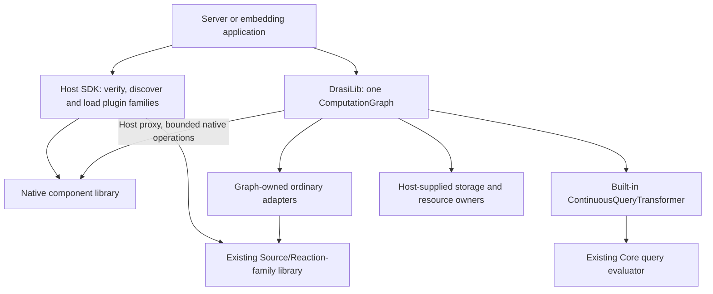

# Drasi Plugin Architecture

**Current development architecture, reviewed 17 October 2026.**

This guide explains which interfaces a component implements, what the host owns,
and how separately built libraries are loaded. Use matching Core and Server
sources when developing this branch; an arbitrary released plugin is not
automatically compatible with a modified local SDK.

## Overview

Drasi has **one execution engine, ComputationGraph**, and two plugin families:

| Family | Purpose | Authoring interface |
|---|---|---|
| Native computation | Sources, transformers, sinks and services with explicit ports and envelopes; optional bootstrap and handled-consumer services | `drasi-computation-plugin-sdk` |
| Ordinary Source/Reaction compatibility | Existing source, reaction, bootstrap, identity-provider and secret-store integrations | `drasi-plugin-sdk` and the corresponding public `drasi-lib` traits |

Both families execute through the instance graph. The older APIs are adapters,
not a second engine. New native components should use the native SDK rather than
importing the ordinary Source/Reaction implementation.

**Static linking and dynamic loading are packaging choices, not Server build
modes.** The current Server has no `builtin-plugins` or `dynamic-plugins` feature
switch. It loads selected libraries through the Host SDK and retains a small
set of statically registered application/bootstrap helpers. Embedding
applications may register statically linked implementations explicitly.

The singular `dynamic-plugin` feature belongs to each plugin crate and enables
its export entry points. It does not switch the graph runtime.

**Queries remain built in.** Ordinary and explicitly assembled native queries
use `ContinuousQueryTransformer` and the existing query engine in the main
graph. There is no extra query host/private graph. Independently loaded Query
plugins are still rejected because the complete storage/recovery/read interface
is unfinished. The
[CW-43 investigation](../lib/docs/computation-graph-remaining-work.md#cw-43-optional-native-query-plugin)
is not a released capability.

## Architecture Diagram



Native graph processing stays in graph-owned tasks. A plugin's auxiliary I/O
runtime does not become another graph scheduler.

## Crate Responsibilities

Paths below are relative to the Core repository unless noted otherwise.

| Package | Location | Responsibility |
|---|---|---|
| `drasi-core-types` | `core-types/` | Shared values and provider descriptions, without an evaluator |
| `drasi-computation-contracts` | `components/computation-contracts/` | Native messages, identities, schemas, codecs and worker primitives |
| `drasi-computation-plugin-abi` | `components/computation-plugin-abi/` | Versioned C-compatible native tables and extension entry points |
| `drasi-computation-plugin-sdk` | `components/computation-plugin-sdk/` | Plugin-side native traits, factories, exports and operation handling |
| `drasi-host-sdk` | `components/host-sdk/` | Loading both families and adapting their operations to host-owned services |
| `drasi-plugin-sdk` | `components/plugin-sdk/` | Existing Source/Reaction-family descriptors, exports and callbacks |
| `drasi-ffi-primitives` | `components/ffi-primitives/` | Dependency-free C-compatible types and declarative macros |
| `drasi-lib` | `lib/` | Graph ownership, query assembly, lifecycle, ordinary APIs and injected storage |
| `drasi-core` | `core/` | Shared query algorithms and transaction/index machinery |
| `drasi-server` | Sibling `drasi-server/` repository | Configuration, verified plugin installation, APIs, UI and process lifecycle |

Native plugin data/interfaces must not pull in `drasi-lib`, the evaluator,
parsers or the ordinary plugin SDK. Use
[`make check-native-dependencies`](../Makefile) to protect that separation.
The planned query plugin is a separate migration, not permission to weaken
dependency checks for the existing non-query components.

## Plugin Types

### Native components

A native library can expose factories for `NativeSource`, `NativeTransformer`,
`NativeSink` and `NativeService`. Each also implements `NativeComponent`.
The factory describes its configuration, ports, schemas, completion behavior
and actually implemented capabilities. Construction is configuration-only;
activation and I/O belong to lifecycle operations.

Native bootstrap providers are negotiated through the bootstrap extension,
not another graph processing role. Handled-consumer factories use the consumer
extension. An interface being available in the SDK does not prove that every
connector supports it.

Start with the [native SDK guide](computation-plugin-sdk/README.md), the
[independent component layout](computation-plugins/README.md), and the
[network contract and limits](computation-plugins/NETWORK.md).

### Source Plugins

The existing ordinary family implements `drasi_lib::sources::Source` and
`drasi_plugin_sdk::SourcePluginDescriptor`. Sources publish ordinary source
events through graph-owned adapters. See the [source authoring guide](sources/README.md).

### Reaction Plugins

The existing family implements `drasi_lib::reactions::Reaction` and
`drasi_plugin_sdk::ReactionPluginDescriptor`. A reaction's successful call does
not establish durable or exactly-once destination completion unless that
implementation supplies the required contract. See the
[reaction authoring guide](reactions/README.md).

### Bootstrap Plugins

Ordinary providers implement `drasi_lib::bootstrap::BootstrapProvider` and
`drasi_plugin_sdk::BootstrapPluginDescriptor`. They retain their own typed
configuration and receive the documented execution context/settings. Native
providers instead use `NativeBootstrapProvider` from the native SDK. See the
[ordinary bootstrap guide](bootstrappers/README.md).

### Identity, secret and storage providers

The ordinary descriptor family also loads identity-provider and secret-store
plugins; it is not limited to three plugin types.
Indexes, state stores and WAL implementations are supplied by the host and
statically linked in this workspace. Calling them providers or plugins does not
mean they are independently loaded native component libraries.

## How Dynamic Plugin Loading Works

### Loading Sequence

1. The application selects its plugin directory and dependencies. Server may
   install declared dependencies when `autoInstallPlugins` is enabled; loading
   does not itself authorize an unrequested download.
2. Server applies its verification policy before opening a library. Metadata
   discovery executes native code, so a metadata-only read is not a sandbox.
   Local directory discovery cannot be represented as verified OCI installation.
3. The Host SDK identifies the family and validates target, metadata, versions
   and capability tables. A malformed native declaration is an error; it must
   not silently fall back to ordinary registration.
4. The loader registers verified factory proxies and their configuration
   descriptions. Factories construct components when the graph needs them.
5. The instance graph owns activation, processing, observations and cleanup.
   Library handles stay pinned for process lifetime; removing a graph component
   does not unload its executable code.

See [family discovery](host-sdk/src/loader.rs),
[native loading](host-sdk/src/computation/loader.rs) and
[registry assembly](host-sdk/src/plugin_registry.rs).

### Plugin Entry Points

The entry points are family-specific; a plugin does not always export exactly
the same two symbols.

| Family | Base metadata / entry point | Additional interfaces |
|---|---|---|
| Native | `drasi_computation_plugin_metadata` / `drasi_computation_plugin_entry` | Separately negotiated configuration, admission, recovery, bootstrap, consumer, batching and query-snapshot extensions |
| Ordinary compatibility | `drasi_plugin_metadata` / `drasi_plugin_init` | The selected ordinary SDK's registration and callback interfaces |

Use the corresponding SDK export macro rather than writing these interfaces by
hand. Unknown versions or a malformed advertised extension must fail explicitly.

### Version Validation

Package versions, component configuration versions and binary interface versions
serve different purposes. Do not substitute one for another.

| Host interface | Accepted plugin interface |
|---|---|
| Native computation ABI 1.0.0 | Compatible native tables, matching target and wire version 2; supported extensions are validated separately |
| Ordinary ABI 0.17.x | Ordinary 0.17.x on the same target |
| Ordinary ABI 0.17.x loading 0.16.x | The explicitly supported older behavior/prefix; no automatic upgrade to new recovery capabilities |
| Missing metadata, wrong target, incompatible or unknown interface | Reject; never guess a compatible layout |

Native base tables and strict metadata are frozen. The older JSON-envelope wire
prototype is not accepted by wire version 2. New capabilities use the existing
extension pattern rather than changing an old table's layout.

In ordinary ABI 0.17, state-store listing can report failure rather than an
empty result. A versioned durability callback follows the 0.16 table prefix.
It describes the actual provider; unavailable evidence cannot satisfy a stronger
recovery assertion. The 0.17 proxy releases its transferred service ownership,
while loading 0.16 preserves the supported older lifetime behavior.
Bootstrap settings/properties are bounded and forwarded, and explicit source
replay from sequence zero is preserved. None of these facts alone establishes
atomic snapshot/live handover or exactly-once external effects.

## FFI Boundary Design

Here **FFI** means the checked C-compatible interface between independently
built libraries. Rust memory layouts are not part of that contract.

### Serialized Payload Pattern

Native metadata/configuration are JSON. Native wire version 2 carries typed
envelopes and bulk byte buffers as named MessagePack records. The persisted
envelope representation is a separate contract; changing transport encoding
does not authorize rewriting saved state.

Ordinary event payloads also cross as serialized bytes in C-compatible
envelopes. Configuration and bootstrap settings have their own documented
JSON formats and limits. A pointer to a `SourceChange`, trait object or
`bytes::Bytes` from another build is not a valid payload representation.

Use the shared codecs and preserve type, identity, before/after image and
source-progress information. Do not silently truncate, drop decode failures,
or reinterpret a damaged snapshot as empty.
The old cross-library Rust-layout failure is documented in
[issue #602](https://github.com/drasi-project/drasi-core/issues/602) and
[the ordinary payload implementation](plugin-sdk/src/ffi/payload.rs).

### Vtable Pattern

Tables contain a validated header and function pointers; opaque state remains
owned by its producer. The native SDK turns asynchronous work into an operation
handle with cooperative polling, wake, cancel and release operations. The Host
proxy adapts these operations to graph traits.

No Rust `Future`, `Arc`, trait object, storage owner or task-local representation
crosses the native interface. Copy one-call borrowed input before deferred work;
release transferred output through its producer even on decode failure.

### Cross-cdylib Ownership Contract (Shared System Allocator)

Native buffers and handles are retained/released by producer-side callbacks.
The Host's `ReceivedBytes` borrows the producer's immutable result allocation
and releases it exactly once. It does not free foreign Rust containers.

Some **ordinary compatibility** interfaces transfer fixed C-compatible tables
or envelopes using the shared System allocator. Preserve that family's specific
allocation/free rules. The workspace therefore forbids custom global allocators;
[cargo-deny](../deny.toml) guards known allocator dependencies.
A shared allocator never makes arbitrary Rust layouts or foreign `Bytes`
objects safe to exchange. See
[issue #378](https://github.com/drasi-project/drasi-core/issues/378).

### Reverse Vtables (Host → Plugin)

The Host can lend narrowly scoped services to a plugin, not the complete graph
or arbitrary storage owners. Current native extension contracts include:

| Service | What it provides | What it does not promise |
|---|---|---|
| Admission | Bounded publication through the actual outgoing journal, stable identity and uncertain outcomes | Arbitrary storage access or destination completion |
| Read-only source progress | Committed positions and cancellation-safe subscriptions | Permission for the plugin to advance another owner's progress |
| Bootstrap | Query-owned providers, bounded snapshot polling and borrowed initialization-state requests | A second bootstrap executor or partial snapshots treated as complete |
| Source/bootstrap coordination | One actual source-owned initialization engine and query-scoped bootstrap handles, with graph-owned resource lifetime | Application SQL access, a path-global registry or a separate copied database worker |
| Source data schema | Bounded reads of the active source's actual catalog, independent of pending data processing | SQL reads/writes or substitution of factory configuration metadata |
| Handled consumers | Existing delivery runner, retries and completion state; borrowed transactional state when selected | An independent plugin commit or atomic remote effects |

The current transactional participant has no commit operation. The actual
transaction owner controls commit/rollback. Managed consumer/bootstrap retirement
holds the verified existing owner through a configuration decision; successful
stop alone is not proof that all pending output was handled.
Explicit loss authorization does not delete processing data or bypass failed
cleanup. Detailed service contracts live in the [native SDK guide](computation-plugin-sdk/README.md).

## Runtime Model

### Multiple Tokio Runtimes

The native SDK owns one process-lifetime I/O runtime per loaded binary, entered
while the host polls plugin futures so timers/sockets have their own drivers.
It does not spawn a separate graph or processing scheduler.
The host controls when each component operation runs.

The ordinary family uses its own runtime and existing synchronous callback
bridges. Different compatible builds need not share Tokio's Rust layout.
Neither model permits host task-locals or runtime-owned Rust objects to cross
the boundary.

There is no universal "negligible" cost per plugin call. Serialization,
allocation, scheduling, work granularity and data locality all matter. Measure
the actual path; the optional-query experiment is not a production performance
guarantee.

### Async → Sync Bridge

An `extern "C"` entry point is synchronous, but a **native** call can return an
operation handle whose future is then polled asynchronously. It need not start
an OS thread and block until all work finishes.

The **ordinary compatibility** wrappers retain their thread/runtime bridging
where required. Their blocking behavior is not the native execution model.
Do not rely on asynchronous Rust trait syntax alone to establish cancellation
or nonblocking behavior across either interface.

## Lifecycle observations

The graph owns start, processing and stop. Normal stop waits for admitted work
and required delivery; a timeout does not authorize abandoning it. Explicit
cancellation or force has different recovery consequences.

Native SDK operations retain panic-damage state, reject further normal work on
a damaged component, and allow cleanup. The Host preserves typed failure causes.
The ordinary 0.17 initializer catches supported source/reaction initialization
panics and prevents reuse of that damaged instance. Loading an older binary does
not retrofit new safeguards into it. Neither family can contain `panic=abort`,
unsafe-memory corruption or arbitrary non-yielding code within the process.

Graph-supplied `ComponentUpdateSender` coalesces readiness, the first unobserved
failure and the latest status in a bounded mailbox. It is not an event history.
An ordinary MPSC sender converted to that wrapper retains queue semantics.
Revoking an observer prevents reuse; it does not join a plugin's background
tasks.

Use the shared owned-worker helpers: register before spawning, retain handles
through cancelled waits/timeouts, and await cleanup before replacement. The
helpers do not discover arbitrary private threads. An abort request or a dropped
future is not proof that all effects stopped. See
[worker primitives](computation-contracts/src/workers.rs) and
[the runtime ownership guide](../lib/AGENTS.md).

## Logging and Tracing

Report the component's actual native role and instance identity. Native control
and Host observation paths retain graph ownership; ordinary wrappers use their
existing log and lifecycle callbacks. No plugin should silently replace the
embedding application's global logging configuration.

### Plugin → Host Log Bridge

The ordinary `export_plugin!` setup installs its `FfiLogger` bridge and forwards
supported log records through the host callback. `tracing` to `log` fallback
depends on the configured subscriber/features; it is not a replacement for a
documented native tracing contract. Consult
[logging and worker guidance](../lib/docs/developer-guide/README.md#observing-the-application)
and the SDK's actual supported interfaces before adding instrumentation.

## Plugin Development Guide

### Creating a native plugin

Use a normal component package with explicit native metadata:

```toml
[lib]
crate-type = ["lib", "cdylib"]

[features]
dynamic-plugin = []

[package.metadata.drasi-plugin]
abi-family = "computation"
abi-version = "1.0.0"
kind = "example-native"
```

Implement `NativeComponent` plus the processing trait, then a configuration-only
`Factory`. Register executable schemas and factories in `PluginDefinition`.
Gate `export_computation_plugin!` behind `dynamic-plugin`. Include the actual
configuration persistence hook, not a placeholder success response.
The [counter](computation-plugins/sources/counter/src/lib.rs) and
[SSE sink](computation-plugins/sinks/sse/src/lib.rs) are concrete examples.

### Creating a New Source Plugin

For an **existing ordinary integration**, use the Source trait, descriptor and
`export_plugin!` conventions in the [source guide](sources/README.md). Gate its
export behind `dynamic-plugin`; keep source/bootstrap element identities
consistent. Do not use this older recipe as the starting point for a new native
source.

### Creating a Reaction Plugin

For an **existing ordinary integration**, use the Reaction trait, descriptor
and [reaction guide](reactions/README.md). Persist all required settings and keep
real queue/worker ownership. Native sinks and handled consumers use the native
SDK instead; merely renaming a reaction does not supply the new contracts.

## OpenAPI Schema Flow

Native factory metadata supplies a typed field schema. The optional
`configuration-v1` extension adds descriptions, defaults, limits and allowed
values. The shared Host schema is used by Server's kind-schema, plugin metadata
and OpenAPI surfaces. Constructors still validate relationships between fields
and actual resources.

Ordinary descriptors provide their configuration schema through the existing
JSON schema callbacks. Server merges these into its API schema separately from
native discovery. Do not advertise unsupported choices without their actual
restriction: for example, native gRPC currently permits only `batchSize=1`.
See [configuration descriptions](computation-plugin-sdk/README.md#configuration-descriptions).

## Build System

Run the following commands from **Core**:

```sh
cargo run -p xtask -- list-plugins
make check-native-dependencies
make build-native-standard-plugins
make build-native-network-plugins
```

`make build-native-plugins` combines the dependency check and those native build
targets. For generic discovery/build/staging, use `cargo run -p xtask --
build-plugins` (also available as `make build-plugins`). The generic builder stages
artifacts under the selected target/profile's `plugins` directory; the focused
native Cargo targets leave libraries in the target/profile directory.

### Static Build (default)

This heading is retained for old links, not as a Server mode. An embedding
application links component crates and registers their implementations
explicitly. A normal `cargo build` of Server does **not** link every connector.
Server's statically registered core helpers are the no-op/application bootstrap
providers and application reaction; native bridge/child-host factories are
registered in its native assembly path.

### Dynamic Build

Build one existing native plugin independently:

```sh
cargo build --lib -p drasi-computation-sink-sse \
  --features drasi-computation-sink-sse/dynamic-plugin
```

For a matching Server checkout, run from **Server**:

```sh
make prepare-build
cargo build
make build-local-plugins-debug
```

The Server's plugin-origin checks select matching local SDK builds on this
development branch. Rebuilding Server's Rust path dependency alone does not
rebuild a separately loaded plugin library. Do not mix local modified SDKs with
arbitrary registry binaries to avoid doing that build.

### Testing

Use the smallest checks covering the changed component, then real-library tests:

```sh
# Core: selected plugin's Rust behavior
cargo test -p drasi-computation-sink-sse

# Core: build the required libraries and exercise native network boundaries
make test-native-network

# Core: ordinary/native Host SDK and actual-library integration
make test-host-sdk
```

Some integration tests need an external service or a compatible container engine.
When using Podman, configure that engine's connection for the existing tools;
do not start Docker Desktop as an implicit fallback.
Cross-platform/plugin-version claims require corresponding binary tests.

## FAQ

### Why cdylib instead of dylib?

`cdylib` supports the checked C-compatible interface used here without requiring
Rust symbol/layout compatibility between independently built host and plugin.
Target and interface checks still apply; the library may also require platform
system libraries. "Self-contained" is not permission to skip dependency checks.

### Can plugins use different tokio versions?

Compatible plugins may contain their own Tokio build. Neither side may share
Tokio objects or assume the other runtime's internal layout. Polling, wake and
I/O ownership follow the chosen family's contract.

### What happens if a plugin panics?

Supported boundaries convert unwinding panics to explicit failures and preserve
damage/cleanup state. That is not protection against every possible native-code
failure. Reconstruct damaged components only after cleanup; use process isolation
when the application requires a stronger crash boundary.

### Can I debug plugins?

Use normal shared-library debugging tools such as LLDB/GDB and the supported
logging configuration. Record the actual loaded path, hash, target, SDK interface
and source revision. Debugging the rebuilt host with an old plugin file is not
debugging the new plugin implementation.

### How do I test a plugin in isolation?

Test the Rust implementation directly, then separately build the dynamic library
and exercise its real Host proxy, malformed input, cancellation and cleanup.
Direct Rust tests alone cannot prove interface compatibility. See
[native pipeline tests](host-sdk/tests/native_computation_pipeline.rs) and
[ordinary Host integration tests](host-sdk/tests/integration_test.rs).
