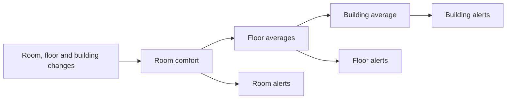

# ComponentGraph and ComputationGraph

This document explains what ComputationGraph improves, which problems it fixes,
and what applications can do with it. The comparison is against the pinned
[ComponentGraph-based implementation][old-core], not every historical Drasi
release. Current capabilities refer to the matching local Core and Server
implementation. Implemented features, local verification and remaining
qualification work are distinguished below.

## The main difference

**ComponentGraph described the application. ComputationGraph also runs it.**

ComponentGraph recorded components, their relationships and their status.
Separate source, query and reaction managers started the work and connected
their specialized processing paths. The usual application was
**source → query → reaction**.

ComputationGraph owns the running components, the connections carrying their
data, and the resources needed to start, stop and replace them. Queries remain
important, but are now one kind of processing step alongside other transformers,
sources, sinks and background services.

The main practical gains are:

- **Reuse a calculation.** One query or transformer can feed several later
  steps rather than making each consumer repeat the work.
- **Use one data contract.** Sources, queries and transformers use graph changes
  on their standard data ports, so a query can feed another query directly.
- **Choose delivery and recovery by connection and component.** Processing,
  buffering and destination work have explicit responsibilities.
- **Manage the whole running application.** Missing dependencies, failed
  cleanup, replacement and inspection use a common ownership model.

Continuous queries, Cypher/GQL, initial snapshots, persistent query state,
saved-output replay, supported query transactions, source sharing and
independently running queries **already existed**. ComputationGraph extends
their composition and makes their boundaries more consistent; it is not a
replacement query language or a second evaluator.

In this document, a **transformer** is a processing step with inputs and outputs,
a **sink** consumes data, and a **port** is a named connection point on a
component. A **pipe** carries data between ports. A **native component** uses
ComputationGraph's direct interfaces. Older Source and Reaction interfaces still
work through graph-owned adapters. Both query-authoring paths use
`ContinuousQueryTransformer` and the same evaluator.

The runtime graph describes the processing application. It is distinct from the
graph of rooms, products or other business entities that a query evaluates.

## Building and connecting applications

### Queries can reuse other queries' results

**Before:** sources emitted source changes, while queries emitted a different
result-notification representation. Feeding one query's result into another
required conversion or a custom source path.

**Now:** a query **emits graph changes**, just as a source does. Each result row
is represented by a node whose properties are the returned columns. Adding,
changing or removing a result produces graph operations on that node, not a
special row format hidden inside a graph-change wrapper. Query updates use full
replacement images.

**Example — Building Comfort:** calculate a room's comfort once, then connect
the maintained results:

The dashboard can subscribe to all six outputs, while a log independently
subscribes to the alert outputs. The floor and building queries do not repeat
the room formula or its table joins. A corrected room score updates the
appropriate averages; becoming comfortable removes the corresponding alert.

The building deliberately averages **floor averages**, not all rooms directly.
Chaining lets the application express that rule once without changing its
meaning when floors have different room counts.

Result labels such as `RoomComfort` and `FloorComfort` make the next query
readable. They do not change the shared `drasi.graph-change` v1 format. The
default label is `Result`, and `result.label` can select another. Opaque row
identities are scoped to the producing output, so equal-looking rows need not
be collapsed into one.

Connecting a live pipe is not, by itself, a request for existing state. The
supported query-input initialization path takes an upstream snapshot and
coordinates subsequent changes; a deliberately future-only input skips that
initial state. This distinction matters when adding a query after its producer
has already processed data.

### Shared preprocessing is no longer tied to a query

**Before:** middleware normally ran within each query's input path. Several
queries applying the same normalization could repeat that work.

**Now:** place a reusable transformer before the branch. Query-local middleware
remains useful when a rule belongs to just one query.

**Example:** normalize a sensor's units once, then feed a comfort query, a
threshold query and a native capture sink from the normalized output. A path
such as **source → normalizer → capture sink** needs no query at all.

This does not make every mapper a maintained view. The `map` and `jq` rules
operate on individual events. Ignoring an update that no longer matches does
not automatically delete a previously emitted row. Use a continuous query for
that maintained-result behavior. A dedicated stateful view-transform component
is still [remaining work][view-transform].

### Connection rules are explicit instead of implied by component type

**Before:** data formats, queue behavior and subscription rules were built into
the source/query/reaction paths.

**Now:** ports declare their formats and delivery requirements. A component can
have several inputs or outputs, and an output can have several subscribers.
Compatible custom formats remain supported; a format override can select only
an alternative the factory actually implements. The pipe does not invent a
conversion or silently accept an unknown format.

**Example:** a transformer can publish standard graph changes on one output and
a specialized representation on another. A consumer names the appropriate port.
When shorthand is used, resolution uses the single port or a declared primary,
not a guessed name such as `out`.

The common schema preserves typed values, full images, patches, explicit
property removals and available before-images. Setting a property to null,
leaving it unchanged and removing it remain different operations. Components
are not forced to store or process data in this representation internally.

Schema compatibility is not a promise that every consumer handles every special
event. **Native HTTP/gRPC/SSE graph sinks accept ordinary source, transformer
and query changes.** The ordinary Reaction adapter remains query-specific.
Scheduling controls and snapshot/progress recovery frames also have their own
handling requirements. Those distinctions are not different query-output data
formats.

### Independent work and component control have a common model

Queries already ran independently. ComputationGraph extends that scheduling
model to native sources, transformers, sinks and services. A blocked branch
need not stop unrelated work, although branches sharing a required producer or
capacity limit can still affect one another.

Control messages are separate from data queues. A component can receive a
supported control request even while its data path is busy, and handles for an
old component cannot silently act on a replacement with the same name.

**Example — Move-a-Wall:** scene changes feed a geometry-processing component
and continuous queries that maintain obstructions and affected journeys.
Moving the wall out of the way retracts the impact. Geometry processing is a
real graph step, not a query-shaped wrapper around unrelated application code.

## Saving work and recovering it

### Current state and live changes can be consumed without a second result store

**Before:** current-result reads, initial loading and replay were tied primarily
to source and query-specific interfaces.

**Now:** an output catalogue discovers the snapshot, replay and live-follow
capabilities a producer actually supplies. Queries expose their existing
maintained result state; other producers can supply their own implementation.
The catalogue is not another evaluator or a mandatory duplicate row store.

**Example:** a viewer obtains the current floor scores and follows later
changes. A combined snapshot-and-follow operation establishes the boundary
between the two, avoiding the gap possible when a change arrives between an
uncoordinated snapshot read and subscription.

The live-follow lease is bounded and volatile. If history is lost or a lease
expires, the viewer must handle the explicit gap and rebuild. A point snapshot
does not imply replay, and a live lease does not record durable business
completion. Snapshot replacement is also an optional per-input consumer
capability, not something every sink may silently treat as ordinary additions.

### Slow subscribers do not disappear from the recovery obligation

**Before:** source and query histories already supported subscribers, but their
coordination was specialized. The ordinary input-WAL restart path had a concrete
problem: cleanup could consider the fast subscriber before the slower one had
reattached.

**Now:** supported shared queues retain one message with separate reader
positions. Required membership is explicit: a disconnected subscriber still
counts until it is deliberately retired. Sources can use the actual progress
of their required query owners rather than treating matching names as proof.
The ordinary HTTP/gRPC startup path also waits for the subscription group and
protects replay registration from concurrent pruning.

**Example:** two queries share a source. One is caught up; the other restarts
from an earlier checkpoint. The fast query cannot release the slower query's
required history merely by reconnecting first. Missing required history is
reported, not returned as an apparently successful empty replay.

### Reusable services separate acceptance from completed work

“The queue accepted it,” “the query committed it,” and “the destination finished
it” are different claims. ComputationGraph supplies reusable mechanisms for
these boundaries rather than requiring every path to reinvent them.

| Boundary | Improvement | Example |
| --- | --- | --- |
| Input acceptance | An optional admission service stores an input and its retry identity together before confirming acceptance. | A client loses the response and retries the same request without appending a second input. |
| Query processing | Supported transactions retain input progress, query state and produced output together. Output replay does not rerun already committed evaluation. | After a crash, an aggregate resumes from its saved state and resends its pending result. |
| Producer-to-queue handoff | Supported receiving queues recognize previously accepted logical output; selected queues can also share the actual producer transaction. | Queue A accepted a batch but B failed. Recovery respects A's receipt rather than treating all branches as new work. |
| Destination work | A reusable delivery service records completed operations and resumes the remainder. Local effects and completion can share a transaction. | A saved application view updates its row, enumeration index and completion record atomically. |
| Volatile processing | Transformers and handled sinks can publish graph-owned in-memory handled-input progress. | A non-query processing branch reports what it finished without pretending to survive process loss. |

A remote effect still requires cooperation from its destination. If a remote
service performed an action but its response was lost, a local completion log
alone cannot prove whether repeating the action is safe. None of these
mechanisms grants universal exactly-once behavior.

### Transaction boundaries can follow the application's actual work

The old query engine already supported atomic query processing. The extension
is that supported source and processing boundaries can now be expressed and
connected explicitly.

**Example:** a database transaction updates two balances. A source configured
for complete transactions supplies both changes as one marked input, allowing
the query to publish the final answer instead of an intermediate half-transfer.
The transaction contains ordinary graph operations plus completeness metadata;
it is not a separate transaction data schema.

Selected linear processing steps can also share one actual transaction owner,
committing their state, input progress and final output together. With suitable
storage, outgoing journals can participate in the producer's commit too.
Declaring two stores with the same path or name is not evidence that they share
a transaction.

These are specific local boundaries, not a transaction spanning every query,
database, browser and external effect. A query's committed-input position can
advance before downstream handling; upstream pipe acknowledgement and
destination completion remain separate.

### Initial loading and ordering are less dependent on special-case paths

Several real initialization providers can be composed under the query's loading
and handover rules. Their snapshots, progress owners and completion records
remain distinct.

**Example:** a query combines a PostgreSQL snapshot with an HTTP-provided
snapshot, then follows their live inputs. Paired native SQLite components can
instead use the actual source-owned snapshot/journal engine. Standalone SQLite
file loading remains a different mode and requires quiescent writers.

Ordering also distinguishes **when a business fact took effect** from **which
revision a producer emitted**. A validated newer query revision can correct a
derived answer even when its contributing business event has an older timestamp.
This does not let an arbitrary timestamp or untrusted marker bypass staleness.

For applications that need to wait for out-of-order events, a dedicated time
merger provides explicit buffer, waiting and late-event policies. A sensor
aggregator can allow a bounded delay rather than assuming that an ordinary queue
has seen every earlier event. The merger cannot prove that no unseen event will
arrive, and downstream backpressure may still delay delivery.

## Managing, hosting and using applications

### Dependencies and failures remain visible while the application is managed

**Before:** each manager coordinated its component type, and status changes
flowed into ComponentGraph separately.

**Now:** the running graph publishes a coherent view of definitions, component
states, connections and dependencies. An accepted definition can wait for a
missing resource, factory, producer or connection. A genuine invalid definition
or processing error remains a failure, not a missing-dependency retry.

**Example:** declare a floor query before its room producer is available.
Inspection reports what it is waiting for. Adding the missing producer permits
eligible initialization to proceed without constructing another runtime or
overriding an explicit stop.

Created, started, readable and caught up are still different states. A ready
HTTP endpoint is not proof that an initial snapshot or every downstream effect
has finished.

### Stop and replacement preserve ownership instead of losing unfinished work

The graph retains the work, resource and join handles needed to finish cleanup.
Cancelling a caller that was waiting for stop does not discard an already
accepted stop operation. Failed cleanup stays visible and owned.

**Example:** a user stops a query and then closes the request. The query's
worker cannot become an untracked task merely because that waiter disappeared.
A replacement must not reuse an old resource while its previous owner is still
cleaning up.

Live changes check the expected definition version and coordinate the affected
components and resources. Protected recovery state requires verified retirement
or explicit, narrowly scoped loss authorization. This is not rollback of
external effects, automatic data deletion, or permission to reset a whole
database.

Startup, stop and shutdown now have explicit whole-operation budgets in addition
to component/resource limits. Defaults are ten minutes for instance startup and
one minute for stop/shutdown, configurable through Core and Server. Stop
supersedes an instance-owned startup waiter rather than depending on the original
caller to keep polling it. Managed construction waits and Server native resource
preparation do not retain their broad lifecycle/plugin-registry guards.
Accepted graph work and reconciliation results remain owned for cleanup or retry;
this is not force cancellation of business processing.

### Saved definitions can describe more than source/query/reaction settings

A rebuildable definition can include native components, explicit connections
and resource recipes. Configuration acceptance and its request receipt can be
saved before construction begins. A failing component therefore does not erase
the definition the user asked the system to run.

**Example:** after a response is lost, retry the same configuration request and
inspect whether it was accepted. Do not create a new request merely because the
new component is not running yet. Acceptance, reconstruction and readiness have
separate observations.

The store also supports encrypted definitions, version-checked administration,
receipt cleanup and key rotation. Those operations manage configuration; they
do not delete or rewind processing data.

Server uses explicit instances. Its convenient source/query/reaction
configuration and its native graph definitions enter the same runtime. Query
inputs can name other producers, and secrets can remain references. An empty
Server does not invent an implicit instance.

### Plugins and process hosts can reuse the same processing contracts

Native plugins can provide sources, transformers, sinks, services and
initial-data providers. They use shared data contracts without pulling in the
query evaluator just to exchange values. The host drives their operations;
loading a plugin does not create another graph executor.

**Example:** ship a normalization plugin independently, load it into a Server
instance, and connect its standard output to several queries. A native source
can expose a bounded asynchronous data-schema reader even while processing is
pending. That reader describes actual source data, not the factory's
configuration fields. Supported factories can also resolve credentials on
activation rather than reuse a stale constructor-time value.

The process host can own child and grandchild DrasiLib processes and connect
their permitted outputs through data/control links, including authenticated
encrypted links and selected retained-delivery modes. This supports explicit
process boundaries without making a process boundary a security sandbox or an
automatic durability guarantee.

**Example — GPU Lab:** telemetry, policy, placement and query-based views form
one application with non-query processing steps, direct query chains and a
native UI sink. The demonstration uses a simulated GPU domain; it does not
require physical GPUs or establish a general scheduling-performance claim.

### Inspection can distinguish no output from no progress

Query input and output progress, with the relevant producer/lifecycle identity,
are available for inspection and optional Server OTel export.

**Example:** a temperature update leaves a room inside the comfortable band.
The alert query may emit no result change, but its committed-input position
still advances. Monitoring can distinguish that from a stalled query instead
of treating a quiet output stream as proof of either success or failure.

These measurements are not every component's latency/throughput telemetry, and
query output progress is not evidence that a destination completed its work.

## Bugs in the old implementation that are resolved

These are concrete fixes in the runtime, evaluator and plugin hosting, not
benefits obtained merely by renaming a graph class. The old-code links identify
the compared implementation.

| Old problem | Current behavior and practical consequence |
| --- | --- |
| A saved-settings read failure could trigger rebuilding and clearing valid query state. | The read failure is reported rather than treated as authorization to discard state. A temporarily unreadable store does not silently become an empty application. |
| Timestamp-first sorting could process a later producer sequence before an earlier one and advance the checkpoint past unprocessed input. | Normal query input merging preserves each producer's admitted order while selecting among available heads. A later timestamp correction does not cause an unseen earlier sequence to be skipped. |
| Repeating an insert for an existing identity could add a second aggregate contribution. | Full upserts account for the prior contribution. Replaying the same product cannot increase a count from one to two merely because it arrived as another insert. |
| Older changes could overwrite newer facts or resurrect a deleted element. | Event-time admission and retained deletion information reject stale mutations; supported persistent storage retains the needed deletion state across restart. Valid producer-sequenced derived revisions have their own explicit admission rule. |
| A node and a relationship could collide on one live identity. | The incompatible kind is rejected before changing the existing object. |
| A cancelled query-stop waiter could lose the worker handle; a timeout could be followed by a reported Stopped state without completed cleanup. | Accepted work and joins stay owned. A failed or interrupted cleanup is not reported as successful graceful shutdown. |
| A failed instance stop could obstruct retry, while final shutdown hid failures. | Unfinished ownership and per-member causes remain available for retry and reporting. |
| An undecodable plugin source event could be skipped while later events continued. | The host reports the decoding error and ends that stream. It does not confirm progress past a lost change as though processing had succeeded. |

Evidence: [old saved-state recovery][old-hash-error] and [current query recovery][query-code];
[old ordering][old-ordering] and [current input queue][ranked-input];
[old mutation handling][old-mutations] and [mutation regressions][mutation-tests];
[old query stop][old-query-stop], [old instance shutdown][old-instance-stop] and
[current task ownership][execution];
[old event decoding][old-decoder] and [current event decoding][current-decoder].

## What the completed recovery check proves

The [versioned Building Comfort recovery evidence][completed-recovery] is a
specific earlier proof using the real Server, ordinary gRPC source/reaction
libraries hosted by ComputationGraph, and the external test-service. It is not
qualification of every native gRPC mode or the current tutorial's six-query
dashboard flow.

| Check | Recorded result |
| --- | --- |
| Uninterrupted reference | Both queries committed 100,000 inputs and receivers finalized complete output |
| Pending-input SIGKILL/restart | The aggregate query restored input 88,748 and replayed the remaining 11,252 |
| Exact delivery comparison | All 99,981 room and 49,860 aggregate outputs matched without missing, extra, duplicate, conflicting or reordered records |
| Independent final-state check | 12 room rows and three floor rows matched the captured source data |

That run used current-process OTel positions, complete producer batches and
awaited logger finalization—not a quiet period or record count alone. It used
macOS/Rust 1.95 debug builds and a 100,000-entry outbox per query. It is neither
a benchmark nor a universal exactly-once claim. The [strict workflow][completed-workflow]
requires a fresh matching-build reference and recovery run; its presence does
not establish that a later Linux CI run succeeded.

The unified-contract implementation has separately passed local strict lint,
the complete supported workspace command, and all 35 runtime profiles, including
the configured macOS-to-Linux ownership/reopen case. GPU Lab, Move-a-Wall and
Building Comfort also passed matching rebuilt-code live, browser and restart
checks. These close the earlier local acceptance work; they do not turn
pre-existing ignored external-service cases into executed tests or replace the
broader [qualification ledger][qualification].

Those recorded application and 35-profile results are not a fresh qualification
of every subsequently changed build. Current source-linked checks distinguish
the verified lifecycle, publication, dependency and native-input boundaries.

The pending-native-input boundary has an additional
[28-case SIGKILL matrix](../../lib-integration-tests/tests/native_input_crash_recovery.rs):
admission QoS, retained inputs and shared journals, eager/paged RocksDB storage,
and both Tokio runtimes. It checks exact accepted frames and retry identities
across query-commit and lost-admission-reply boundaries. This complements the
earlier Building Comfort run; it does not qualify every connector or power loss.

### Small status changes no longer rebuild the whole inspection state

Observed state, registry metadata and retained inspection history share unchanged
data. Explicit dirty captures refresh configurations and reader capabilities;
event translation compares changed members rather than searching every node.
Producer health/completion updates select their ordered outgoing-edge range.

For the same synthetic 4,096-component workload, 128 status publications took
about 256 ms before this change and 0.33 ms afterward. Native allocator samples
show substantially less retained publication memory, and live control/notification
measurements cover both runtimes. These measurements concern reporting overhead,
not a corresponding claim about end-to-end query throughput. The
[maintainer guide](computation-graph-maintainers-guide.md#inspection-and-diagnosing-a-running-system)
provides the repeatable diagnostics.

## Current limits

- **Recovery is opt-in and capability-specific.** A common data format does not
  require a state store, snapshot provider or durable journal. Persistent
  inputs, long disconnections, bootstrap and crash combinations must be qualified
  for the actual providers. The broader ledger remains 20 covered, 23 partial
  and five unqualified requirements.
- **There is no graph-wide transaction or universal completion counter.**
  Separate queries and remote effects do not commit together. Runtime processing
  layouts remain acyclic; scheduling controls are not permission to create
  arbitrary feedback loops.
- **Native conversion is not universal.** Supported ordinary adapters remain
  graph-owned. Native queries are still built in rather than independently
  loadable query plugins, and some advanced assembly needs Rust-level setup.
  SQL Server live qualification is deferred; recorded permission, large-batch
  and orphan-marker gaps remain open.
- **Database modes are not interchangeable.** MySQL positional/older-server
  modes do not gain the stronger modes' coordinated-snapshot or whole-transaction
  guarantees. Standalone SQLite file loading does not add a public DrasiLib SQL
  API. A parameterized stored-procedure call does not by itself make an external
  effect exactly once.
- **Some query and transformer capabilities remain unfinished.** Variable-length
  relationship execution is not established merely because syntax parses.
  Stateless event mappers do not maintain filtered datasets; the dedicated
  view-transform work is still open.
- **Lifecycle, security and scale still have boundaries.** Finite lifecycle
  budgets and incremental status publication are implemented. Cleanup may still
  fail, configuration acceptance must retain uncertain commits, and complete
  graph exports remain proportional to their output. Native
  process-host checks are not Windows qualification or a security sandbox.
  Arbitrary non-yielding native code cannot always be stopped safely in-process.
  Standard HTTP ingress still needs isolation or an authenticated, rate-limited
  proxy until the recorded ingress protection work is complete.
- **Dependency mitigation is not a zero-finding scan.** Patched dependency
  families and targeted legacy-Azure safeguards address the reviewed applicable
  paths. Retained Azure/XML, MySQL compression/RSA and build-tool findings have
  documented mitigations or unaffected usage. Raw audits remain nonzero; these
  results do not justify blanket ignores or arbitrary new uses of those APIs.
- **Builds must match.** The unreleased graph wire remains v1; the replaced
  earlier wire/query-row representations are not a second supported format.
  Rebuild the host and native libraries together. Custom formats must be
  deliberately implemented by both peers.
- **No universal speedup or production-readiness claim is made.** Sharing a
  calculation removes duplicated work in that application; it is not a measured
  throughput guarantee. Local passing tests and demonstrations are not complete
  CI, every connector, every failure combination or long-duration production
  qualification.

For engineering detail, use the [maintainers guide][maintainers] to map old
ownership and debugging paths to the new runtime, the [developer guide][developer]
to build an application, and the [data design][data-design] for the data and
recovery contracts. The [remaining-work list][remaining] keeps unresolved defects
and incomplete qualification visible.

[old-core]: https://github.com/drasi-project/drasi-core/tree/261b8d40d35ce203a7f4aaae0028956d76a8def4
[old-hash-error]: https://github.com/drasi-project/drasi-core/blob/261b8d40d35ce203a7f4aaae0028956d76a8def4/lib/src/queries/manager.rs#L1969-L2017
[query-code]: ../src/computation/v1/query.rs
[old-ordering]: https://github.com/drasi-project/drasi-core/blob/261b8d40d35ce203a7f4aaae0028956d76a8def4/lib/src/queries/priority_queue.rs#L47-L53
[ranked-input]: ../src/computation/v1/ranked_pipe.rs
[old-mutations]: https://github.com/drasi-project/drasi-core/blob/261b8d40d35ce203a7f4aaae0028956d76a8def4/core/src/query/continuous_query.rs#L298-L390
[mutation-tests]: ../../core/src/query/tests/mutation_integrity.rs
[old-query-stop]: https://github.com/drasi-project/drasi-core/blob/261b8d40d35ce203a7f4aaae0028956d76a8def4/lib/src/queries/base.rs#L215-L244
[old-instance-stop]: https://github.com/drasi-project/drasi-core/blob/261b8d40d35ce203a7f4aaae0028956d76a8def4/lib/src/lib_core.rs#L537-L630
[execution]: ../src/computation/v1/graph/execution.rs
[old-decoder]: https://github.com/drasi-project/drasi-core/blob/261b8d40d35ce203a7f4aaae0028956d76a8def4/components/host-sdk/src/proxies/change_receiver.rs
[current-decoder]: ../../components/host-sdk/src/proxies/change_receiver.rs
[completed-recovery]: https://github.com/drasi-project/test-infra/tree/13c24c57f5c0f4bd4fb56ae493d0bd9359e9cd57/e2e-test-framework/examples/recovery_comparison/goldens/building-comfort-small-v2
[completed-workflow]: https://github.com/drasi-project/test-infra/blob/13c24c57f5c0f4bd4fb56ae493d0bd9359e9cd57/.github/workflows/e2e-building-comfort-completion.yml
[qualification]: ../tests/runtime_parity/requirements.tsv
[view-transform]: computation-graph-remaining-work.md#cw-68
[remaining]: computation-graph-remaining-work.md
[maintainers]: computation-graph-maintainers-guide.md
[developer]: developer-guide/README.md
[data-design]: computation-graph-data-design.md
