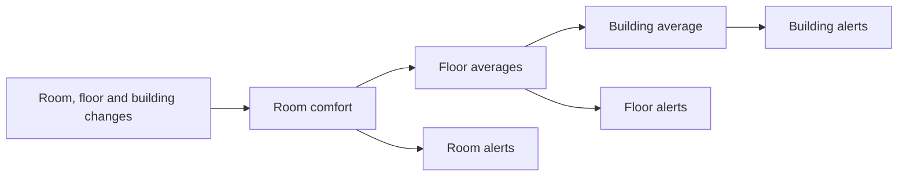
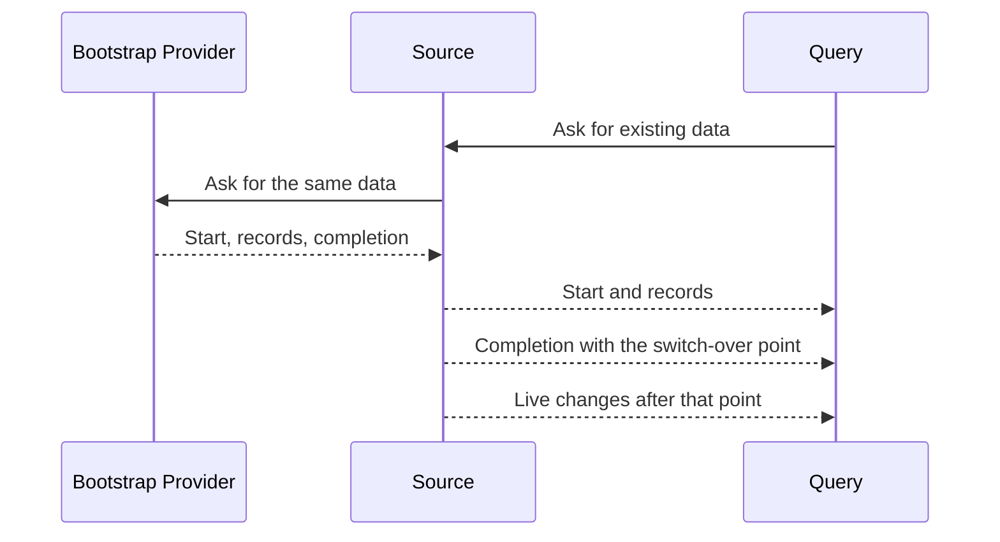

# Component Graph and Computation Graph

Drasi watches data for changes and acts when the answer to a question you care
about changes. **DrasiLib** is the form of Drasi that you build into your own
program. **Drasi Server** is a ready-made program that runs DrasiLib and that
you manage through settings files and a web interface.

A Drasi application is made of **components**, its working parts. **Sources**
bring changes in from outside systems, such as a database. **Continuous
Queries** (queries for short) are questions, written in the Cypher or GQL query
languages, that Drasi keeps answering as the data changes. **Reactions** act
when a query's answer changes, for example by sending a notification.

The **Component Graph** is the earlier design inside DrasiLib. It kept a record
of an application's components and the links between them, while separate
managers ran Sources, queries and Reactions, each in its own way. The
**Computation Graph** is the current design. It runs every component itself,
together with the connections between them, the storage they use, and their
starting and stopping.

This document compares the [Component Graph version of DrasiLib][old-core] with
the current DrasiLib and Drasi Server. It covers the benefits and improvements,
what works differently, what was removed, which problems are fixed, and the
limits that remain. Open work is tracked in the [remaining-work
list][remaining].

Some things stay the same. The same query engine answers queries written in
Cypher or GQL. Queries could already save their state so that it survives a
restart (that is, be **persistent**), and each change was already processed all
or nothing. Several queries could already share one Source, and each query
already ran on its own. Plugins written for the older plugin interfaces
(**ordinary plugins**) still work.

## Summary

The Computation Graph replaces separate managers for Sources, queries and
Reactions with one system that runs any mix of steps, checks every connection
before data flows, and treats starting data, delivery failures, saving and
recovery the same way everywhere. Running applications can be changed safely,
saved and rebuilt, and watched with standard monitoring tools. Moving from the
Component Graph needs a few changes, listed in
[What changes when you move](#what-changes-when-you-move-from-the-component-graph),
and some gaps remain, listed in [Current limits](#current-limits).

### At a glance

| What changed | What it means for you |
|---|---|
| **Queries feed other steps.** A query's results come out in the same form as a Source's changes. | Work out a figure once, such as each room's comfort, then reuse it for floor averages, alerts and a dashboard. |
| **Steps that are not queries.** **Transformers** work on changes as they pass through. **Sinks** deliver changes to destinations; a Reaction is one kind of Sink. **Services** do background work. | Cleaning, checking and calculating become reusable steps instead of being squeezed into a query or a Reaction. |
| **Connections are checked before data flows.** Each component states what it promises and what it needs. | A wrong connection is reported at once, naming both sides, instead of losing or repeating data later. Other components keep running. |
| **One way to handle delivery failures.** Every native Sink retries short outages and follows a chosen rule for a change that can never be delivered. | An outage at a destination heals by itself without losing or reordering changes, and you can see that the Sink is retrying. |
| **Loading existing data is part of the application.** **Bootstrap** (loading the data that already exists, then switching to live changes) runs over its own connections, and **Bootstrap Providers** (which supply that data) are components in their own right. | A query added later, or restarted, starts from a consistent copy of the data while live changes keep flowing to everyone else. A query can start from another query's results. |
| **Clear lines between accepted, processed and delivered.** Ready-made building blocks handle each line. | You choose the guarantee you need at each step, and recovery after a crash restarts at the first unfinished step. |
| **A safer component lifecycle.** Components can pause, every step has a time limit, and Drasi keeps track of unfinished cleanup. | A stop that cannot finish is reported, not hidden, and can be retried. A component that crashes is set aside until it is rebuilt. |
| **Planned changes that are safe to retry.** Changes are planned before they run, and requests can carry a revision number and a request ID. | You can repeat a request after losing its answer without applying it twice, and an edit based on out-of-date settings is refused. |
| **Saved, rebuildable definitions.** The whole application can be described, saved and rebuilt. | A restart, or a new copy of the application, rebuilds the same components, and a failing component does not erase its saved definition. |
| **Native plugins for every role.** **Native plugins** (plugins built for the Computation Graph) can supply any kind of component and are checked when they load. | Plugins can ship separately, and an incompatible plugin is refused when it loads instead of failing while it runs. |
| **Monitoring built in.** Standard measurements, a record of the path each change took, logs for every component, and a history of the application's state. | Operators can follow one change from its Source to its destination, and can tell a quiet application from a stuck one. |
| **Many defects fixed.** | Wrong totals, wiped saved state, silently skipped changes and hidden cleanup failures no longer occur. |

## Words used in this document

- **Drasi, DrasiLib, Drasi Server**: Drasi watches data for changes. DrasiLib
  is the form you build into your own program. Drasi Server is a ready-made
  program that runs DrasiLib.
- **Instance**: one running copy of DrasiLib, with its own components and
  settings. Drasi Server can run several instances.
- **Component**: a working part of an application, such as a Source, a query
  or a Reaction.
- **Component Graph, Computation Graph**: the earlier and the current design of
  DrasiLib, described above.
- **Source, Source Change**: a Source brings changes in from an outside system.
  Each change it reports is a Source Change: something was added, changed or
  deleted.
- **Element, node, relation, label, property**: Drasi sees data as **nodes**
  (things, such as a product or a room) and **relations** (links between them,
  such as "this room is on that floor"). Both are **elements**. A **label**
  names an element's type, such as Product. **Properties** are its named values,
  such as a quantity.
- **Query, result**: a query is a question that Drasi keeps answering as data
  changes. Each row of its answer is a **result**.
- **Cypher, GQL**: the two languages that queries are written in.
- **Reaction**: a component that acts when a query's results change.
- **Transformer**: a component that receives changes, works on them and passes
  changes on. Every query is a Transformer.
- **Middleware**: small ready-made steps that reshape incoming data, such as
  renaming a label or decoding a value.
- **Sink**: a component that delivers changes to a destination outside Drasi.
  A Reaction is a Sink.
- **Service**: a component that does background work and has no data inputs or
  outputs.
- **Bootstrap, Bootstrap Provider**: bootstrap means loading the data that
  already exists, then switching to live changes without missing or repeating
  any. A Bootstrap Provider is a component that supplies that existing data.
- **Snapshot**: a copy of data as it stood at one moment.
- **Replay**: sending saved changes again, for example after a restart.
- **Checkpoint**: a saved note of how far a component has got, so that it can
  continue from there after a restart.
- **Persistent, in memory only**: persistent data is saved so that it survives
  a restart. Data kept in memory only is lost when the program stops.
- **Transaction**: a group of changes that are saved together, all or nothing.
- **Port, Pipe**: a Port is a named connection point on a component, where
  changes go in or come out. A Pipe is the connection that carries changes from
  one Port to another.
- **Recovery policy (Strict, AutoReset)**: what a persistent query does when its
  saved data cannot be used as it is. Strict stops and reports the problem.
  AutoReset rebuilds the query from its starting data when that is safe.
- **At least once, exactly once**: delivery guarantees. At least once means a
  change is never lost but may arrive more than once. Exactly once means it
  arrives once.
- **Native plugin, ordinary plugin**: a native plugin is built for the
  Computation Graph; it can be built into your program or loaded from a separate
  file. An ordinary plugin is built for the older Source, Reaction and Bootstrap
  Provider interfaces. It still runs, through a compatibility layer that is
  planned for removal.
- **Identity Provider**: a component that supplies credentials, such as a
  password or a sign-in token, for connecting to other systems.
- **Inspection**: Drasi's built-in view of a running application: its
  components, connections, status and what each component is waiting for.
- **Producer, consumer**: along a connection, the producer is the component
  that sends changes and the consumer is the component that receives them.
- **Revision number, request ID**: an instance's settings carry a revision
  number that goes up with every change. A request ID is a name you give a
  request so that sending it again is safe: Drasi recognizes it and returns
  the first answer instead of acting twice.

## Building applications

### Queries can feed other queries and any other step

**Before:** A query could read only from Sources. Its results came out in a
separate format that only Reactions could read. To feed one query's results
into another query, you had to convert them or write your own Source.

**Now:** A query's results come out as node changes, the same form that Sources
use. Each result row is a node, and the values the query returns become its
properties. Adding, changing or removing a result is a change to that node. The
node's label is Result unless you choose another, such as RoomComfort. Two rows
with equal values are still two separate results. A query can read from a
Source, another query or a Transformer.

**What this means for you:** Work out a figure once and reuse it. Queries that
build on it do not repeat its formula or the way it combines data.

**Example (Building Comfort tutorial):** calculate each room's comfort once,
then build on it:

A dashboard can show all six outputs while a log shows only the alerts. A
corrected room score updates the floor and building averages, and a room that
becomes comfortable removes its alert. When one query reads another, it first
loads the other query's current results and then follows its changes; see
[Starting from existing data](#starting-from-existing-data). If you turn
bootstrap off for the query, it skips that first load and works only on the
changes that arrive after it connects.

### Steps that are not queries

**Before:** The Component Graph knew Sources, queries, Reactions, Bootstrap
Providers and Identity Providers. Middleware ran inside each query, so three
queries that needed the same cleanup each did it separately. Work that was
neither a query nor a Reaction had no place.

**Now:** Every component has one of five roles: Source, Transformer, Sink,
Service or Bootstrap Provider. A query is one kind of Transformer, and a
Reaction is one kind of Sink. A Transformer can sit anywhere: between a Source
and several queries, or between a Source and a Sink with no query at all.
Middleware still works inside a query, and it is also available as a
Transformer that many queries can share. Ready-made native Transformers include:

| Transformer | What it does |
|---|---|
| Middleware | Runs the decode, map, parse, promote and relabel Middleware steps once, for every reader |
| View | Keeps a reshaped copy of its input and takes back outputs that stop matching |
| Policy | Checks each input against rules written in Rego, a language for policy rules, and keeps one decision for each input |
| Optimization | Keeps the best answer to a planning problem you describe, such as which machine should run each job, up to date as inputs change |
| Geometry | Keeps a record for each pair of flat shapes that meet a rule you set, such as a cart's path crossing a barrier |
| Arithmetic | Adds to and multiplies a number in each change |
| Query | Runs Cypher and GQL queries; ordinary queries run on it too |

A Middleware step looks at one change at a time, so it cannot take back a row
it sent earlier when a later change no longer matches. The View Transformer
remembers its output, so it can.

**What this means for you:** Cleanup, enrichment, rule checks and calculations
become reusable steps with their own logs, status and settings.

**Example (Stockroom):** the developer guide's Stockroom application keeps a
live list of products that need restocking. It adds an audit step between its
inventory Source and its low-stock query. The step marks each change as checked
and passes it on; the query and its alerts do not change.

### Connection points and data formats

**Before:** The kinds of connection were fixed: Sources fed queries, and queries
fed Reactions.

**Now:** A component can have several named Ports for input and output, and one
output can feed many readers through separate Pipes. A connection that names
only a component uses its only output, or the output it marks as its main one;
Drasi never guesses. A component can offer more than one data format on a Port,
and its settings can choose one of them. Drasi never converts between formats by
itself.

**What this means for you:** Connections are explicit, and one that cannot work
is refused instead of quietly receiving the wrong data.

### Changes say exactly what changed

**Before:** A Source Change could add, update or delete an element. An update
could add or overwrite properties, but a property left out kept its old value,
so there was no way to remove one property or to replace a whole element.

**Now:** A Source can set some properties, remove named ones, or replace the
whole element. Setting a property to an empty value, leaving it unchanged and
removing it are three different changes.

**What this means for you:** When a product's seasonal note is removed in the
database, Drasi removes it too.

### Connections are checked before data flows

**Before:** A few checks ran when a component started: a persistent query
refused a Source that could not send its changes again after a restart, and a
Reaction that needed saved checkpoints refused storage kept in memory only.

**Now:** Every component describes what it promises and what it needs: whether
its progress survives a restart, whether its outputs can be replayed, which
delivery guarantee each input needs, and what storage it needs. Drasi compares
these descriptions when it connects two components, including bootstrap
connections, before any data flows. On a mismatch, Drasi blocks the receiving
component with a reason that names both sides. The settings change is still
accepted, other components keep running, and the problem clears when either
side changes or the connection is removed.

**What this means for you:** A wrong connection shows up at once, with a clear
reason, instead of losing or repeating data later.

**Example:** a Sink that needs exactly-once delivery is connected to a query
kept in memory only. That query's results get new identities each time it
restarts, so the Sink could not tell a repeated result from a new one. Drasi
blocks the Sink and says why. An at-least-once Sink on the same query works.

### Stating the guarantees you need

**Before:** Nothing similar.

**Now:** An application can state, for one destination, the guarantees it needs
after a chosen failure, such as a program restart: accepted input is kept, it
can be sent again, processing and progress are saved together, and results are
saved before they are released. Drasi checks the components and storage along
that path when it builds the application. Storage states which failures it
survives: a program restart, a power cut or the loss of its disk.

**What this means for you:** A missing guarantee is found before data is lost.
For example, a persistent query followed by a connection kept in memory only
cannot promise that its results survive a restart, and Drasi says so.

### Independent work and control

**Before:** Each query ran on its own; other components were run by their
managers.

**Now:** Every component runs on its own, under Drasi's control, so a blocked
branch does not stop unrelated work. Branches still affect each other when they
share a producer (a component that sends them changes) or a shared limit on how
much they can hold. Control requests, such as stop, travel separately from
data, so a busy component still receives them. Each control link your program
holds belongs to one copy of a component, so a link to a replaced copy cannot
control its replacement.

**What this means for you:** One stuck destination does not freeze unrelated
parts of the application, and you can still stop it.

### Order and timing

**Before:** A query took the change with the earliest timestamp from all its
Sources together, so a change could jump ahead of one that its own Source had
sent earlier.

**Now:**

- A query keeps each producer's changes in the order they were sent, and
  chooses between producers by comparing only the next change from each.
- Native components take changes in arrival order unless you ask them to compare
  times across inputs.
- Drasi keeps two facts apart: when an event happened, and which version of a
  result its producer sent. A newer version of a query's result can therefore
  correct an answer even when the event behind it happened earlier.
- A merging step that puts changes in the order they happened can wait for late
  events, by rules you set: how many to hold, how long to wait, and what to do
  with one that arrives too late. Its
  settings and storage can be saved and rebuilt like any other component.

**What this means for you:** Saved progress cannot skip an earlier change just
because two Sources' clocks differ, and a sensor application can allow a short
delay for late readings. A change marked with an older time than the one Drasi
already holds for that element is still ignored, and no merging step can know
about an event that has not arrived.

### Scheduled work outside queries

**Before:** Only queries could schedule work for later, for the time-based
conditions in their query text.

**Now:** A native Transformer can also ask for work to happen later, and change
or cancel that request. The request is saved with the Transformer's state, so
after a restart the work still happens on time without another incoming change.
This needs persistent storage that saves all or nothing.

**What this means for you:** Delayed notifications and reminders can live in an
ordinary processing step. This does not make delivery to an outside system
exactly once.

## Starting from existing data

**Before:** A Bootstrap Provider ran inside the one Source it belonged to, and
the Component Graph only recorded the link. Each query got existing data
through its subscription to its Sources, and only Sources could supply it.

**Now:** A Bootstrap Provider is a component with its own role and its own
bootstrap connections. These connections carry only existing data, never live
changes, and they appear in inspection (Drasi's view of the running application)
like any other connection. Each consumer, that is, each component that receives
the data, runs its own bootstrap session: it asks, the producer sends a start
marker and the records, then either a completion that says exactly which changes
the snapshot covers, or a failure with a reason. A Source passes each request on
to its own Bootstrap Provider and completes it with the point in its live
changes where the snapshot ends.

This makes several things possible:

- **Late arrivals.** A query added while its Source is running gets its own
  snapshot and switch-over point. Other consumers keep receiving live changes,
  and the new query skips the live changes its snapshot already includes.
- **Queries as starting points.** Every query offers its current results as a
  snapshot, so another query can start from its answer.
- **Providers for one query, or for several.** A Bootstrap Provider can be
  connected directly to a query, and one provider can serve several queries.
- **Combined providers.** Several providers can supply one query, for example a
  PostgreSQL database snapshot and a snapshot fetched over the web. Each keeps
  its own progress and completion.
- **Checked pairs.** A Source and Bootstrap Provider that work as a pair, such
  as SQLite's, state how they cooperate, and Drasi checks the pair when it
  connects them.
- **Restarts.** A persistent query that finished its bootstrap resumes from the
  state it saved; it does not take a new snapshot. A query kept in memory only
  rebuilds from a new snapshot, including deletions made while it was stopped.
- **Live changes keep flowing.** Only a Source that passes snapshots on and is
  tied to its consumers' saved progress holds back live changes, and only on its
  very first start, until its first snapshot completes.

**What this means for you:** You can add or restart a query at any time without
stopping changes to other queries. When its snapshot marks a switch-over point,
no change is missed or repeated.

**Example (Stockroom):** if ten products are already listed as low on stock
when a low-stock-count query is added to read the low-stock query, the new query
starts with a count of ten and then follows later changes.

Some Sources limit late arrivals. A paired SQLite Source and provider accept a
new consumer only across a stop, and a shared PostgreSQL Source pauses while a
newly added query takes its snapshot. Some snapshots carry no switch-over point
at all, for example one fetched over the web or read from a SQLite file. A
change made while such a snapshot is read can arrive twice, so keep writers
quiet until the load finishes.

## Delivering results

### One way to handle delivery failures

**Before:** Each Reaction had its own retry and error handling, and some had
none. Each reported failures in its own way.

**Now:** Every native Sink follows the same rules when it fails to deliver a
change. The Sink says whether a failure is temporary or permanent, and Drasi
handles what happens next:

| Failure | What Drasi does | What you see |
|---|---|---|
| Temporary, or not stated | Tries the same change again. The first wait is a random time between 0.1 and 0.2 seconds; after each failure both limits double, until waits are between 15 and 30 seconds. If the destination asks for a longer wait, Drasi waits as asked, up to 10 minutes. There is no limit on attempts. Pausing or stopping the Sink ends the wait without marking the change delivered; when it resumes, it tries the same change again. | The Sink is still running, its health is Degraded, and its latest error is shown. Both clear once the change is delivered. |
| Permanent, with the stall choice (the default) | Stops at that change and delivers nothing after it. | The Sink has failed, with the destination's reason. |
| Permanent, with the skip choice | Logs the change, marks it handled without delivering it, and carries on. | A count of skipped changes. |

If a group of inputs fails permanently, Drasi retries each input on its own, so
only the input that cannot be delivered is stalled or skipped. One input can
hold several changes that arrived together; those are kept together. A Sink that
saves its own progress records a skip together with that progress, so a replay
does not send the skipped change again. A crash inside a Sink still fails it.
Ordinary Reactions keep their own retry and failure handling.

**What this means for you:** A destination outage heals by itself, without
losing or reordering changes. A change that can never be delivered either stops
delivery where you can see it, or is skipped and counted. Choose skip only when
losing that change is acceptable and someone watches the count.

**Example (Stockroom):** Stockroom sends low-stock alerts to a web address that
receives notifications. Stop the receiver, and the Sink shows Degraded while it
retries. Start the receiver again, and the waiting alert arrives in order and
the Sink returns to Healthy. If the receiver rejects an alert as invalid, the
Sink stops with the receiver's reason.

The native HTTP Sink, which sends changes to a web address, follows these rules.
It retries a request a few times on its own, within limits you set, and then
reports the failure. Connection failures, timeouts, server errors and answers
that ask the sender to try again later are temporary. When an overloaded or
unavailable destination says how long to wait, the Sink waits that long. Other
rejections are permanent. A setting chooses stall or skip.

### Health is separate from running

**Before:** A component had only a lifecycle state, such as Running or Error.

**Now:** A component also has a health: Healthy, Degraded, Unavailable or
Unknown. A Sink that is retrying is Running and Degraded.

**What this means for you:** Monitoring can tell a component that is working
through a problem from one that has stopped. Retries never give up on their
own, so decide when a long Degraded period counts as an incident.

### Live readers no longer hold up a stop

**Before:** A reader that stopped reading, such as a stuck Reaction, could block
a query. Stopping the query then waited five seconds and cut its work off. A
reader that fell behind in the faster broadcast mode, where all readers share one
stream of changes, missed changes, with only a warning in the log.

**Now:** In the default mode, each live reader has a limited holding area that
slows the query down when full, so nothing is lost while the query runs. When
the query stops, Drasi releases its readers, so the stop never waits for one
that is not reading. A released reader that falls behind gets the changes
waiting for it and then a clear signal that it missed some. In broadcast mode,
and when reading every query at once, a slow reader gets the same signal instead
of slowing the query down.

**What this means for you:** A stuck dashboard cannot stop a query from
stopping. A reader that must never miss a change reads the query's saved results
or a shared saved queue.

### Read the current results, then follow them

**Before:** Code could read a query's current results, but with no position to
continue from. Only Reactions could read results with a position and then replay
saved results after it.

**Now:** An output can offer a snapshot of its current state, a replay of its
saved output, and a combined read-then-follow that fixes the boundary between
the two. Queries offer this for their results, and other components can too. A
reader may follow for a limited time (five minutes for a query) and a limited
amount of data, and Drasi keeps track of that in memory only. If the reader
falls too far behind or the time runs out, it gets a clear gap signal and starts
again from a new snapshot.

**What this means for you:** A viewer can show the current floor scores and keep
them up to date without losing a change made between the read and the follow.

### Native Sinks read any changes

**Before:** Reactions could read only query results.

**Now:** Native Sinks, such as the HTTP Sink, the gRPC Sink (which sends changes
to other programs) and the SSE Sink (which sends live updates to web browsers),
accept changes from Sources, Transformers and queries alike. Ordinary Reactions
still read query results only.

**What this means for you:** You can send a Source's changes, or a
Transformer's output, straight to a destination without writing a query.

## Saving work and recovering after a stop

### Separate promises for accepted, processed and delivered

"The queue accepted it", "the query saved it" and "the destination finished it"
are different promises. The Computation Graph has a ready-made building block
for each, so an application does not have to build its own.

| Boundary | Building block | Example |
|---|---|---|
| Accepting input | A Source can save each input together with its request ID before confirming it. When its storage is full it answers "busy", or waits for room. | A client loses the answer and sends the same request again; the input is not added twice. |
| Processing in a query | Query state, input progress and results are saved together. Saved results can be sent again without running the query again. | After a crash, a total resumes from its saved state and resends its unsent result. |
| Handing results to a queue | A receiving queue recognizes results it already accepted. Some queues can save as part of the producer's transaction. | Queue A accepted a batch but queue B did not. Recovery respects A's record of what it accepted instead of treating everything as new. |
| Finishing work at a destination | A delivery helper records each finished operation and resumes with the ones left. Local changes and the record of completion can be saved together. | A saved application view updates its row, its lookup list and its record of completion all or nothing. |
| Work kept in memory only | Transformers and Sinks can report what they finished without saving it. | A step reports its progress without promising that it survives a crash. |

None of these makes every outside effect exactly once. If a remote system
carried out an action but its answer was lost, a local record cannot show
whether repeating the action is safe. Make destination writes safe to repeat.

### Shared saved queues keep every reader's place

**Before:** Nothing similar for general use.

**Now:** A shared saved queue keeps one copy of each change and a separate
position for each reader. A reader that disconnects keeps its place, and its
backlog, until you deliberately retire it.

**What this means for you:** A fast reader cannot release changes that a slow or
restarting reader still needs. For example, if an alerts reader has handled
change 42 and an audit reader is at 39, the queue keeps changes 40 to 42 for the
audit reader.

### Transactions that follow your work

**Before:** A query already saved its state and results together for each
change.

**Now:**

- A Source can deliver one database transaction as one complete group. A stock
  transfer that takes 5 from one bin and adds 5 to another reaches the query as
  one group, so the query publishes the final totals, never a half-finished
  transfer.
- A straight line of Transformer steps can run as one transaction. Each step
  keeps its own separate state.
- A producer and its outgoing saved queues can save together, so a result cannot
  be saved by the producer but lost on its way to the queue.

**What this means for you:** You choose where all-or-nothing saving matters.
These are local boundaries, not one transaction across every query, database
and outside system. Two stores that share a name or a folder are not one
transaction.

### Persistent queries recover more safely

**Before:** When a persistent query started with a changed configuration,
DrasiLib cleared all of its saved state and rebuilt it, whatever its recovery
policy. It did the same when the saved record of the configuration could not be
read.

**Now:** Only a recognized problem with a query's own saved state can lead to an
automatic rebuild; storage errors and state owned by another component never do.
Under Strict, a changed configuration, an incomplete bootstrap, missing history
or inconsistent saved state stops the query and reports why. AutoReset, or an
explicit reset request, rebuilds the query from its starting data, and only
when the query has a way to load that data.

**What this means for you:** A temporary storage problem cannot turn into an
empty application. Plan configuration changes to persistent queries: choose
AutoReset, or rebuild deliberately.

### How recovery is tested

Drasi's tests stop the program abruptly while accepted input is still waiting,
reopen the saved data in a new program, and check that every accepted input is
processed exactly once. In a recorded crash test of the Building Comfort
tutorial, 100,000 changes went through Drasi Server and the program was killed
part-way. After the restart, one query resumed at change 88,748 and replayed the
remaining 11,252, and all of the roughly 150,000 results arrived with nothing
missing, repeated or out of order. Such tests show specific setups working, not
every combination of plugins, storage and failures.

## Changing a running application

### Six lifecycle steps, each with a deadline

**Before:** Source and Reaction plugins had a prepare step, which could not
report failure, plus start, stop, status and an optional clean-up step on
removal. There was no pause, and no step had a deadline or a way to cancel it.

**Now:** Every component goes through these steps:

| Step | Purpose |
|---|---|
| Prepare | Runs once before the first start. If it fails, the component is retired. |
| Start | Begins work. A failed start is followed by a stop. |
| Pause and resume | Hold work and continue it, without ending it. A component that cannot pause says so. |
| Stop | Ends work, either finishing what is in progress or abandoning it. The component can start again. |
| Retire | Releases the component for good, with a reason (shutdown, removal, replacement or failed preparation) and a choice to keep or erase its saved data. Only removal and replacement can erase. |

Each step gets a deadline and a way to cancel it. Native plugins use shared
pause tools, so a finished pause means that nothing in the plugin is reading,
writing or sending. You can also hold selected components still: Drasi parks them
at a safe point, and they keep everything they own.

**What this means for you:** You can pause a component to change it, and a step
that runs past its time limit is reported instead of hanging unnoticed. A native
plugin that never hands control back to Drasi can still hold a step up; see
[Current limits](#current-limits).

### Drasi owns cleanup

**Before:** A query stop that timed out was still reported as Stopped, and a
cancelled stop could lose track of the query's work.

**Now:**

- A failed or interrupted stop or retirement keeps the component and its
  unfinished work, and a retry receives the same reason and choice.
- If whoever waits for a stop gives up, the stop still finishes, and a
  replacement cannot use a resource until the previous owner has cleaned up.
- Work that a component runs in the background reports its failures, and Drasi
  fails the component promptly, as a failure it can retry.
- A crash inside a lifecycle step sets that copy of the component aside; only
  a newly built copy can run again.

**What this means for you:** Cleanup problems stay visible until they are fixed.
If you stop a query and close the request that asked for it, the query is still
stopped and tracked.

### Configuration changes are planned, then applied at a safe point

**Before:** Updating a Source, query or Reaction replaced the running component
with a new copy.

**Now:** Drasi first asks the component, or the plugin or code that creates it,
how a change can be made, without changing anything. The plan names one of three
ways:

| Plan | How it is applied | Same copy? |
|---|---|---|
| In place | Pause, apply, resume | Yes |
| Restart | Stop, apply, start | Yes |
| Recreate | Stop, retire for replacement, build a new copy | No: a new copy with the same ID |

The accepted plan is saved before anything changes, so an update interrupted by
a crash resumes as the same operation. Drasi checks the plan again just before
applying it and refuses a change that now needs a bigger step. A change refused
before it is applied leaves the component as it was. A failure while restarting
or replacing a component can leave it stopped or failed instead of bringing back
the old copy, and a damaged copy is set aside. You can preview a change first.
If the application changes between the preview and the request to apply it,
Drasi refuses the request, and you preview again.

**What this means for you:** Many changes apply without rebuilding the
component, and an update interrupted by a crash resumes as the same operation.

**Example:** updating a running query to keep more saved results applies in
place. Changing its query text builds a new copy, which reloads existing data
when bootstrap is on and otherwise starts empty. Changing its inputs, storage or
recovery policy this way is refused.

### Removal is safe to retry

**Before:** Removing a component was refused while others depended on it. A
removal could not depend on the current settings, and a retry after a lost
answer could not tell whether the first attempt had worked.

**Now:** You can remove a component by its ID with two optional checks: an
expected revision number refuses the removal if the settings have changed, and a
request ID makes the request safe to repeat, returning the original answer even
after the component is gone. The removal finishes once the component has stopped
and, when you ask, its saved data is erased. Removing a query always erases its
saved state. Stopping, pausing and shutting down never delete saved data. A
reset, AutoReset recovery, or an update that rebuilds a query can clear that
query's saved state.

**What this means for you:** Scripts and tools can retry a removal and know
exactly what happened.

### Names can change; IDs cannot

Each component has a permanent ID and a name. You can rename a running
component without affecting its connections or progress. A connection made by
name is tied to the component's ID when it is made, so a later rename, or reuse
of the old name, does not redirect it.

## Running, managing and hosting

### One consistent view of the whole application

**Before:** Each manager handled its own kind of component and reported status
changes separately; the Component Graph applied them a moment later.

**Now:** Drasi publishes one consistent picture of the application: its
definitions, each component's state, the connections and the dependencies.
Status and lifecycle events come from that picture, so they always agree.

### Components can wait for what they need

**Before:** Adding a query that named a missing Source was refused, and a query
whose Source was missing when it started failed.

**Now:** You can declare a component before the Source, query, storage or
plugin it needs exists. It waits, and inspection names what it is waiting for.
When the missing part arrives, it continues, without overriding an explicit
stop. An invalid definition, or a processing error, is still a failure, not a
wait. An ordinary Reaction started against a query that was explicitly stopped
fails at once with a clear error, instead of waiting until its start deadline.

**Example (Building Comfort):** declare the floor query before the room query
exists. Inspection shows that the floor query is waiting for the room query, and
adding the room query lets it continue.

### Time limits for whole operations

**Before:** Starting or stopping the whole application had no time limit.

**Now:** By default, starting an instance may take 10 minutes, and stopping or
shutting it down 1 minute. Each component's start may take 5 minutes, building a
component 5 seconds, creating a shared resource 30 seconds, and each owner's
cleanup 5 seconds. You can change all of these in DrasiLib, and per instance in
Drasi Server. When a limit runs out, the unfinished work stays tracked: a failed
stop leaves the unfinished components for a retry, and shutdown reports
separately whether cleanup finished and whether errors remain.

**What this means for you:** A start or stop that runs past its limit is
reported instead of waiting forever, and a timeout never hides unfinished
cleanup. A native plugin that never hands control back to Drasi can still hold
an operation up.

### Saved, rebuildable definitions

**Before:** DrasiLib's saved configuration covered only queries. A separate
snapshot also recorded the settings of Sources and Reactions, but your program
had to supply the plugins and recreate those components itself.

**Now:**

- An application can be described completely: native components, their
  connections, and instructions for creating the storage and other shared
  resources they use. When the description is exported, references to
  secrets stay references, but a password typed directly into a component's
  settings is exported as it is, so keep exports private.
- Drasi creates components from saved definitions, using the plugin or code
  registered for each kind. A component that fails to build stays visible, so
  you can fix it and retry.
- A definition, and a record of the request that changed it, can be saved
  before anything is built, so a component that fails to build does not erase
  the definition you asked for.
- Requests can carry an expected revision number and a request ID, so a repeated
  request is not applied twice and an edit based on out-of-date settings is
  refused.
- An optional store keeps definitions encrypted with a key your program
  supplies, can change that key, and can clean up old request records. It stores
  settings only; it never deletes or rewinds processed data.
- Shared resources, such as storage, Bootstrap Providers and saved queues, are
  declared with their owners and the order in which they depend on each other,
  and cleanup follows that order. Two components share a resource only when
  they are given the same owner, not because they use the same name or folder.

**What this means for you:** A restart, or a new copy of the application,
rebuilds exactly what was accepted. After losing an answer, repeat the same
request and check whether it was accepted, rather than sending a new one because
a component is not running yet: accepted, built and ready are separate facts.

### Instances in separate programs

**Before:** Nothing similar.

**Now:** A hosting tool can run DrasiLib instances as separate programs, in a
parent, child and grandchild arrangement. Bridge Sources and Sinks carry data
between them, including over encrypted connections where both sides prove who
they are, and with saved delivery where you choose it.

**What this means for you:** You can split an application across separate
programs, and bridges can also join instances on different machines. A separate
program is not a security barrier, and it does not save anything on its own.

### Drasi Server

**Before:** Drasi Server managed Sources, queries and Reactions, and could save
changes back to its settings file.

**Now:** Drasi Server runs the same Computation Graph:

- Configured Sources, queries and Reactions run alongside native components,
  and a query's inputs can name other queries and native components.
- Drasi Server shows each instance's live components, connections and status.
  It lets you add, start, stop and remove native components, read and replace an
  instance's whole desired configuration, look up earlier requests, and check
  an instance's live state.
- An optional per-instance store keeps accepted definitions encrypted, and
  create, update and delete requests can carry a request ID and an expected
  revision number.
- All six time limits can be set per instance.
- Drasi Server can send measurements and the record of each change's path to
  monitoring tools; see [Monitoring and diagnosis](#monitoring-and-diagnosis).

## Plugins

### Native plugins

**Before:** Separately built plugins could supply Sources, Reactions, Bootstrap
Providers, secret stores and Identity Providers. Each plugin started its own
private engine for background work.

**Now:**

- Native plugins can supply Sources, Transformers, Sinks, Services and
  Bootstrap Providers. They can use Drasi's data formats without including its
  query engine (the native query plugin does include it), and their work runs
  under Drasi's own scheduling: loading a plugin does not start a second engine
  for background work.
- Each native plugin carries a compatibility version. Until that version
  reaches 1.0, its first two numbers must match Drasi's, and Drasi checks this
  before it uses the plugin.
- Drasi refuses, at load time, a plugin that is incomplete, damaged, built for a
  different version or system, or that asks for a feature Drasi does not offer.
  It never falls back to loading it as an ordinary plugin.
- A native plugin states once which Drasi-provided services it uses, such as
  saved progress or snapshot reads. Drasi refuses a service the plugin did not
  state, and a required one that is missing.
- Shared standard tests check native Sources and Sinks: start, stop and restart,
  a real pause, finishing and abandoning stops, retried delivery, a repeated erase,
  settings that survive saving, and updates. They can test a plugin built into
  the program or one loaded from a separate file.
- A native component can receive fresh credentials from an Identity Provider at
  every start, instead of keeping the ones it was built with.
- A loaded native plugin stays loaded until the program ends.

**What this means for you:** Plugins can ship on their own schedule, and an
incompatible plugin fails clearly when it loads, not while it runs. For example,
you can ship a cleanup plugin on its own, load it into Drasi Server, and connect
its output to several queries.

Ready-made native plugins include:

- **Sources:** for PostgreSQL, MySQL, SQL Server and SQLite databases; the
  HTTP Source and the gRPC Source, which receive changes from other programs;
  an OpenTelemetry Source for monitoring data; and bridge and counter Sources.
- **Bootstrap Providers:** for the same four databases, and for data fetched
  from a web address.
- **Sinks:** the HTTP Sink, the gRPC Sink, the SSE Sink for live browser
  updates, and Sinks for logs, captured test output, timing measurements,
  saved database routines in PostgreSQL, MySQL and SQL Server, and bridges.
- **Transformers:** those listed in
  [Steps that are not queries](#steps-that-are-not-queries).

### Ordinary plugins

Ordinary Sources, queries and Reactions still run on the Computation Graph
through a compatibility layer. That layer is planned for removal once every
needed plugin has a native version.

## Monitoring and diagnosis

**Before:** Components sent lifecycle events, with a history. Sources, queries
and Reactions had their own logs. Counters for query results, Reaction
checkpoints and recovery were kept in memory, and an optional timing tool measured
the time between stages. Nothing was sent to outside monitoring tools.

**Now:**

- **Measurements and path records.** Drasi records measurements, and a record of
  the path each change took, in the format of OpenTelemetry, a common standard
  for monitoring data. It records each step: publishing from a Source,
  processing in a Transformer or query, handling in a Sink, bootstrap,
  lifecycle steps and control requests. The levels are off (the default),
  basic, debug and persistence. Your program chooses where the data goes, and
  Drasi Server can send it to monitoring tools.
- **A path record that travels with each change.** When a change arrives with a
  standard path record from an outside system, that record continues through
  Transformers and queries, including native plugins, to the Sink that handles
  the change. It is never saved with the data, so changes replayed after a
  restart start a new record.
- **Logs for every component.** Transformers, Sinks, Services and Bootstrap
  Providers have their own logs too, and native plugin logs keep their original
  times. Your program can combine Drasi's logs with its own logging. A logging
  setup that conflicts with your program's is reported as an error, not ignored.
- **Query progress.** Each query reports how far it has processed its input and
  how far it has produced output. Reading this is cheap, and Drasi Server can
  export it.
- **Queue measurements.** Queues report how full they are, their highest level,
  how often adding to them had to wait, and how many changes they dropped.
- **Health and history.** Each component has a health value, and inspection
  keeps the last 256 published pictures of the application, so a monitor can
  see a failure that was followed by cleanup instead of missing it between two
  reads.
- **Detailed errors.** Errors keep their original causes, and failures from
  several components during one cleanup are kept together.

**What this means for you:** An operator can follow one change from its Source
to its destination and can tell "no output" from "no progress".

**Example (Building Comfort):** a temperature change leaves a room inside the
comfortable range. The alert query produces no new result, but its processed
input position still moves forward, so monitoring can tell it from a stuck
query.
Query progress does not show that a destination finished its work.

## What changes when you move from the Component Graph

These changes need action, or behave differently in ways you will notice.

- **Register a query implementation.** Queries run on the native query plugin,
  which a DrasiLib application must register; an application without queries
  does not need it. Drasi Server registers the single suitable query plugin it
  has loaded. With none, creating a query fails with a clear error; Drasi never
  quietly picks another implementation.
- **Use IDs and names.** DrasiLib gives each component a permanent unique ID;
  its name is separate and can change. Each management action can find a
  component either by its name or by its ID. A name that looks like an ID is
  still a name. To supply your own IDs, or components already created with their
  own IDs, turn on the setting that allows it when you create the instance.
- **Update query definitions.** A query's inputs are listed under inputs; the
  old sources list and its source ID fields are refused. Each input names a
  component and, if needed, a Port, labels and Middleware steps. In DrasiLib
  settings a query needs a name. The setting for the holding area used during
  bootstrap is gone and refused; the query's input queue size covers it.
- **Update Sources and Reactions through definitions.** Updating a Source or
  Reaction takes a definition that Drasi can rebuild it from. A Source or
  Reaction that your program created and handed to Drasi directly cannot be
  updated in place: remove it and add the replacement.
- **Wait for readiness.** Adding a component returns once it is declared, not
  once it is running; wait for the component to report that it has started.
  Starting an instance can report that some components failed while others
  already run; stop the instance before trying again.
- **Expect safer recovery.** A persistent query that starts with a changed
  configuration no longer wipes its saved state silently. Under Strict it stops
  and reports the change; choose AutoReset, or reset it deliberately.
- **Saved state is not carried over.** Query state, saved positions and saved
  results written by the Component Graph are not reused. Plan for persistent
  queries to load their starting data again.
- **Rebuild plugins.** An ordinary plugin's compatibility version must match
  Drasi's in its first two numbers. It was 0.14 for the Component Graph and is
  0.19 now, so ordinary plugins must be rebuilt. Build native plugins from the
  same Drasi sources as the program that loads them.
- **Variable-length relation patterns are refused.** A query pattern that allows
  a variable number of hops, such as one to three hops between two nodes, now
  fails with a clear "unsupported" error. The Component Graph accepted such a
  pattern but ignored the number of hops, which could give wrong answers.
- **The Source that watched Drasi itself is gone.** The Component Graph added a
  Source to every instance that let queries watch Drasi's own components. Use
  inspection instead; Drasi Server shows each instance's live components.
- **The editable Component Graph record is gone.** Programs could change it
  directly; now they get a view that can only be read. Asking about something
  that is missing or cannot be read now returns an error, not an empty answer.
- **Drasi Server starts empty.** Drasi Server no longer creates a default
  instance. If its configuration lists no instances, it starts with none; create
  one before adding components.
- **Turn on monitoring.** Measurements and path records are off until you choose
  a level.

## Problems the Computation Graph fixes

| In the Component Graph | Now |
|---|---|
| If a persistent query's saved record of its configuration could not be read, all its saved state was cleared and rebuilt. | The failure is reported, and saved state is kept. |
| Changes were taken by earliest timestamp across all Sources, so a later change from one Source could be processed first and the saved position could skip a change. | Each producer's order is kept, so the saved position never skips a change. |
| Adding an element that already existed counted it twice in totals. | Adding an existing element replaces it, so replaying a product cannot raise a count from one to two. |
| An older change could overwrite a newer one or bring back a deleted element. | Older changes are ignored and deletions are remembered, also across restarts with persistent storage. |
| A change that gave a node and a relation the same identity could crash the query. | The change is refused before anything is changed. |
| A cancelled query stop could lose track of the query's work, and a stop that timed out still reported Stopped. | Unfinished work stays tracked, and an interrupted cleanup is never reported as a clean stop. |
| A failed instance stop still marked the instance stopped, so it could not be retried, and shutdown reported success despite failures. | Unfinished components stay available for a retry, and each component's error is reported. |
| An unreadable live change from an ordinary plugin was skipped, and later changes carried on. | Drasi reports the error and stops taking live changes from that plugin, without counting the lost change as processed. An unreadable record during bootstrap is still skipped. |
| After a restart, ordinary web and gRPC Sources could release saved input that a slower query still needed. | They keep it until every query that reads them has reconnected. |
| A reader that stopped reading could hold up a query's stop, and a lagging broadcast reader missed changes silently. | Stopping releases readers, and a lagging reader is told that it missed changes. |
| A query that returned a whole node, such as RETURN n, sent Reactions a block of internal text. | Reactions receive the node's properties and details. |
| A variable-length relation pattern was accepted but treated as a single hop. | It is refused with a clear error. |

## Current limits

- **Recovery is a choice, not a default.** Saving and recovering depend on the
  storage and plugins you choose. Test the combination you use; one working
  setup does not prove another.
- **No transaction across the whole application.** Separate queries and outside
  systems do not save together. Data connections cannot form a loop: results fed
  back in must go through a Source, and stopping such an application finishes
  only a limited amount of that returning work.
- **Query chains after an abrupt stop** ([CW-109][cw-109]). A persistent query
  that starts from another query's results over a bootstrap connection saves
  nothing to resume that connection from. From the code, after an abrupt stop
  it would lose changes it had received but not saved, and then fail on the
  next change from the query it reads, after every restart. AutoReset does not
  repair this. No test reproduces it yet. Queries kept in memory only are not
  affected.
- **Bootstrap through Transformers and into Sinks** ([CW-110][cw-110]). A query
  that reads a Source through a Transformer can load existing data only if that
  Transformer offers a snapshot of its own, and many do not. A query cannot
  pass starting data to a Middleware Transformer, the Arithmetic Transformer
  takes no starting data, and native Sinks get starting rows only by reading a
  snapshot, not as changes.
- **Component descriptions are not complete** ([CW-106][cw-106]). Shared saved
  queues that replay are not yet checked against the producer's promises, and
  saved progress is not compared along a connection. A persistent query that
  starts from a query kept in memory only is accepted when connected and fails
  only when its bootstrap runs. A Sink wrapped by the saved-progress helper
  declares nothing, so Drasi does not see its skip choice and applies stall.
- **Label choices on some query inputs** ([CW-114][cw-114]). Choosing node or
  relation labels on a query input that comes from another query, a
  Transformer or a native Source is accepted, but the query then fails when it
  is built, so Drasi Server reports success for a query that can never start.
- **Retrying Sinks at start and shutdown** ([CW-115][cw-115]). If a Sink is
  retrying while an instance starts, start reports a partial failure although
  the Sink is running and will recover. Shutting down during a retry reports the
  Sink's last temporary error, although cleanup completes. Stopping only that
  Sink reports a clean stop.
- **Ready-made Bootstrap Providers in batches** ([CW-116][cw-116]). A DrasiLib
  batch of components cannot add a Bootstrap Provider that your program has
  already created; Drasi must create the provider from its definition.
- **Not every connector is native yet** ([CW-44][cw-44], [CW-63][cw-63]). Kafka
  (a messaging system), Kubernetes (a platform for running programs) and several
  other Sources and Bootstrap Providers exist only as ordinary plugins, so the
  compatibility layer stays until they move.
- **Standard plugin tests** ([Source X-02][source-x-02]). Not every native
  plugin runs the standard tests yet, and few run them loaded from a separate
  file.
- **Rebuilding state during an update** ([CW-92][cw-92]). Only an ordinary query
  can rebuild its own state during a managed update. There is no
  application-wide reset that brings the components that read from it back in
  step.
- **SQL Server** ([MS-30][ms-30]). The native SQL Server Source has not been
  tested against a real SQL Server.
- **Very large single results** ([CW-76][cw-76]). The native query plugin can
  process an item up to 64 megabytes, but cannot read back a single result
  record larger than 16 megabytes.
- **Whole-node results** ([CW-108][cw-108]). The fix that returns a whole node's
  properties is in place; its full test run and a check through Drasi Server are
  still open.
- **Startup and stop timing** ([CW-104][cw-104], [CW-107][cw-107]). When a
  Source is linked to a query's saved progress late during startup, startup can
  take up to 5 seconds longer than needed. Stopping thousands of components at
  once can miss each component's 5-second cleanup limit; raise the limit if that
  happens.
- **Network input** ([NET-10][net-10], [NET-11][net-11]). The native HTTP Source
  and gRPC Source limit message size but not, for every format, how deeply data
  is nested, and they have no single limit on the memory held by waiting
  requests.
- **Separate programs and native code.** The hosting tool for separate programs
  does not run on Windows and is not a security barrier. Native code that never
  lets Drasi check on it cannot always be stopped safely inside the same
  program, and a loaded native plugin cannot be unloaded.
- **Matching builds.** The native plugin compatibility version is not yet
  final, and a plugin's first two version numbers must match Drasi's, so build
  Drasi and its native plugins from the same sources.
- **Snapshots without a switch-over point.** Some snapshots, such as one read
  from a SQLite file or fetched over the web, do not mark where live changes
  begin; keep writers quiet while they load.
- **Scheduled work in mixed applications** ([CW-82][cw-82]). Scheduled work in a
  query and in a non-query step has been tested separately, but not together in
  one persistent application.
- **Dependencies with security advisories** ([CW-66][cw-66]). A few outside
  libraries with published security warnings remain, used in ways the warnings
  do not affect, with safeguards where needed.
- **No general speed or production-readiness claim.** Sharing a calculation
  removes repeated work in that application; it does not promise a level of
  speed. Each native plugin also has its own open items, listed in the
  [remaining-work list][remaining].

## Where to learn more

- [Developer guide][developer]: builds the Stockroom application step by step,
  including [composing a processing pipeline][dg-compose],
  [the component lifecycle][dg-lifecycle],
  [monitoring and diagnosis][dg-observe],
  [loading existing data][dg-bootstrap],
  [saving and replaying results][dg-replay],
  [finishing work at destinations][dg-complete],
  [transactions][dg-transactions],
  [saving and restoring an application][dg-save],
  [changing a running application][dg-change] and
  [plugins and separate programs][dg-plugins].
- [Maintainers guide][maintainers]: how the Computation Graph is built, with a
  [map from the Component Graph design][mg-map],
  [component descriptions][mg-descriptions],
  [Sink delivery failures][mg-sinks],
  [the query chain limit][mg-chain],
  [recovery boundaries][mg-recovery] and
  [inspecting a running system][mg-inspection].
- [Remaining-work list][remaining]: every open item, with its evidence.

[old-core]: https://github.com/drasi-project/drasi-core/tree/261b8d40d35ce203a7f4aaae0028956d76a8def4
[remaining]: computation-graph-remaining-work.md
[developer]: developer-guide/README.md
[maintainers]: computation-graph-maintainers-guide.md
[dg-compose]: developer-guide/README.md#5-compose-a-processing-pipeline
[dg-lifecycle]: developer-guide/README.md#7-own-the-runtime-lifecycle
[dg-observe]: developer-guide/README.md#8-observe-and-diagnose-the-application
[dg-bootstrap]: developer-guide/README.md#10-join-snapshots-to-live-input
[dg-replay]: developer-guide/README.md#11-retain-input-and-replay-output
[dg-complete]: developer-guide/README.md#12-complete-business-work
[dg-transactions]: developer-guide/README.md#13-preserve-transactions
[dg-save]: developer-guide/README.md#16-save-and-restore-an-application
[dg-change]: developer-guide/README.md#17-change-a-running-application
[dg-plugins]: developer-guide/README.md#18-package-and-isolate-extensions
[mg-map]: computation-graph-maintainers-guide.md#appendix-map-from-the-componentgraph-based-design
[mg-descriptions]: computation-graph-maintainers-guide.md#component-descriptions-and-connection-checks
[mg-sinks]: computation-graph-maintainers-guide.md#sink-delivery-failures
[mg-chain]: computation-graph-maintainers-guide.md#known-limitation-chained-persistent-queries-do-not-replay-after-a-restart
[mg-recovery]: computation-graph-maintainers-guide.md#recovery-is-a-chain-of-completion-boundaries
[mg-inspection]: computation-graph-maintainers-guide.md#inspection-and-diagnosing-a-running-system
[cw-44]: computation-graph-remaining-work.md#cw-44
[cw-63]: computation-graph-remaining-work.md#cw-63
[cw-66]: computation-graph-remaining-work.md#cw-66
[cw-76]: computation-graph-remaining-work.md#cw-76
[cw-82]: computation-graph-remaining-work.md#cw-82
[cw-92]: computation-graph-remaining-work.md#cw-92
[cw-104]: computation-graph-remaining-work.md#cw-104
[cw-106]: computation-graph-remaining-work.md#cw-106
[cw-107]: computation-graph-remaining-work.md#cw-107
[cw-108]: computation-graph-remaining-work.md#cw-108
[cw-109]: computation-graph-remaining-work.md#cw-109
[cw-110]: computation-graph-remaining-work.md#cw-110
[cw-114]: computation-graph-remaining-work.md#cw-114
[cw-115]: computation-graph-remaining-work.md#cw-115
[cw-116]: computation-graph-remaining-work.md#cw-116
[ms-30]: computation-graph-remaining-work.md#ms-30
[net-10]: computation-graph-remaining-work.md#net-10
[net-11]: computation-graph-remaining-work.md#net-11
[source-x-02]: computation-graph-remaining-work.md#source-x-02
