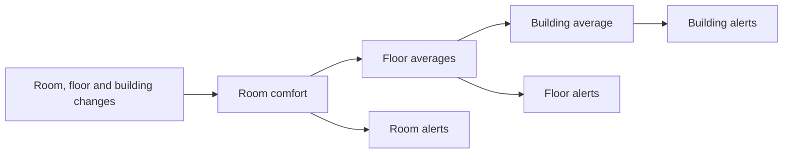

# ComponentGraph and ComputationGraph

This document compares the [ComponentGraph-based implementation][old-core] of
Drasi Core, pinned at one commit, with the current ComputationGraph-based Core
and Drasi Server. It explains what the computation graph improves for
applications, hosts and operators, and where its limits are. Improvements link
to their code, tests or design notes; open defects and missing qualification
are tracked in the [remaining-work list][remaining].

## Summary

**ComponentGraph is a registry.** A DrasiLib instance (the embeddable Drasi
library) runs **sources**, which bring in changes from external systems,
**continuous queries**, which keep the result of a Cypher or GQL query up to
date as those changes arrive, and **reactions**, which act on changes to the
results. ComponentGraph records these components, plus bootstrap providers
(initial data) and identity providers (credentials), with their relationships
and status. Separate source, query and reaction managers create and run the
components and connect their specialized processing paths. Applications have
the shape **source → query → reaction**.

**ComputationGraph is the runtime.** It owns the running components, the
connections that carry their data, the resources they use and their whole
lifecycle. A continuous query is one kind of processing step, beside sources,
other **transformers** (steps with inputs and outputs), **sinks** (steps that
deliver data to a destination), **services** (background work without data
ports) and bootstrap providers. The ordinary source, query and reaction
interfaces still work; they run as graph components through graph-owned
adapters.

The main improvements and what they give you:

| Improvement | Practical benefit |
| --- | --- |
| **One data format on every data port.** Sources, queries and transformers all publish graph changes: node and relationship changes in one standard schema. | A query feeds another query, a transformer or any graph sink directly, so one calculation can serve many consumers. |
| **Processing that is not a query.** Transformers and services are graph steps, and packaged native transformers cover policy, optimization, geometry, arithmetic and maintained views. | Normalization, enrichment, policy checks and solvers run as components instead of being disguised as queries or reactions. |
| **Declared compatibility, checked before data flows.** Components describe their progress persistence, output identity and input delivery guarantee, and the graph checks each connection when it binds it. | A wrong connection fails when it is made, on the consumer, with a reason that names both ends, instead of losing or duplicating data later. Unrelated components keep running. |
| **One delivery-failure model for every sink.** Transient failures are retried in place with bounded backoff; permanent failures follow a declared stall or skip policy. | A destination outage heals without losing or reordering input while the sink shows as degraded. An input that can never be delivered either stops delivery visibly or is skipped and counted. |
| **Bootstrap as part of the graph.** Bootstrap providers are graph components, and each consumer gets its own snapshot session and a precise handover to the live stream. | A consumer that is added later or restarted starts from a consistent snapshot while live changes continue for everyone else. A query can initialize from another query's results. |
| **An explicit lifecycle with live updates.** Six awaited hooks carry deadlines and cancellation, and configuration changes apply in place, across a restart or by replacement. | Cleanup is awaited and stays owned after a timeout, many changes apply without rebuilding the component, and a component that panics is isolated. |
| **Revision-checked, retry-safe management.** Additions, updates and removals go through one configuration owner, with request IDs and expected revisions. | A request can be retried after a lost response without being applied twice, and an edit based on stale state is rejected. |
| **Reusable recovery building blocks.** Durable admission, transactional processing, shared journals and a delivery runner separate acceptance from completed work. | An application chooses the guarantee per connection and component, and recovery resumes at the first unfinished step. |
| **Observability throughout.** OpenTelemetry-compatible traces and metrics, a trace context that travels with each change, consistent inspection snapshots with history, and per-component logs for every role. | An operator can follow one change from ingress to destination and can tell a quiet stream from a stalled one. |
| **A versioned native plugin interface.** Plugins can supply every component role; the ABI version must match exactly, capabilities are declared, and a shared conformance kit tests them. | Plugins ship independently, and an incompatible library is refused when it loads instead of failing while it runs. |

Continuous queries, Cypher/GQL, initial snapshots, persistent query state,
saved-output replay, supported query transactions, source sharing and
independently running queries all exist in ComponentGraph. The computation
graph changes how they compose and makes their boundaries consistent; it is not
a new query language or a second evaluator. Ordinary queries use an explicitly
registered native query factory built on the same Core evaluator and shared
query implementation. `ContinuousQueryTransformer` remains an explicit linked
reference constructor, never an automatic fallback.

### Terms

- A **component** is one node of the runtime graph, with one of the roles
  above. A continuous query is a transformer whose semantic kind is Query.
- A **port** is a named connection point on a component. Data ports carry
  changes; bootstrap ports carry initial snapshots.
- A **pipe** carries data from an output port to an input port. Its provider
  decides buffering, retention and acknowledgement. A **QoS channel** (pipe
  quality of service) is a shared journal that stores each message once and
  keeps a position for each reader; a persistent one survives restarts and
  can replay.
- A **graph change** is a record in the standard `drasi.graph-change` schema: a
  node or relationship with its identity and images. An **envelope** carries
  one ordered batch of changes with its stream, sequence, context and lineage.
- **Bootstrap** is initial loading: a consumer receives a snapshot of existing
  data, then continues from the live stream without gaps or duplicates.
- A **native component** implements the computation graph's interfaces
  directly. **Ordinary** sources, queries and reactions keep the older
  configuration and plugin interfaces and run through graph-owned adapters.

The runtime graph describes the processing application. It is separate from the
graph of rooms, products or other business entities that a query evaluates.

## Building and connecting applications

### Queries reuse other queries' results

**ComponentGraph:** sources emit source changes, while queries emit a separate
result-notification format (`QueryResult`) that reactions consume. Feeding one
query's results into another needs a conversion or a custom source.

**ComputationGraph:** a query emits graph changes, as a source does. Each
result row is a node whose properties are the returned columns. Adding,
changing or removing a result is a graph operation on that node, and updates
carry full replacement images.

**Example — Building Comfort:** calculate each room's comfort once, then
connect the maintained results:

A dashboard can subscribe to all six outputs while a log subscribes only to the
alerts. The floor and building queries do not repeat the room formula or its
joins. A corrected room score updates the averages, and a room that becomes
comfortable removes its alert. The building deliberately averages floor
averages rather than all rooms; chaining expresses that rule once.

Result labels such as `RoomComfort` and `FloorComfort` make the next query
readable without changing the shared schema. The default label is `Result`,
and `result.label` selects another. Row identities are opaque and scoped to the
producing output, so rows with equal values stay distinct.

Connecting a live pipe does not load existing state. A query that reads another
query through the query builder (`from_input_by_name`) initializes from the
upstream query's committed snapshot over a
[bootstrap edge](#bootstrap-is-part-of-the-graph), then follows its live
output. Disabling bootstrap makes the input future-only. Persistent chains have
a [recovery limit](#performance-and-qualification-boundaries).

### Non-query processing is a graph step

**ComponentGraph:** middleware runs inside each query's input path, so several
queries that apply the same normalization repeat it. Work that is neither a
query nor a reaction has no place in the graph.

**ComputationGraph:** a transformer can sit anywhere in a pipeline. A path such
as **source → normalizer → capture sink** needs no query, and one normalized
stream can feed several queries. Query-local middleware remains available when
a rule belongs to one query. Packaged native transformers cover common steps:

| Factory | What it does |
| --- | --- |
| [`drasi.standard/middleware`][middleware-transform] | Runs the stateless middleware pipeline (`decoder`, `map`, `parse_json`, `promote`, `relabel`) as a reusable step |
| [`drasi.standard/view`][view-transform] | Maintains a transformed dataset and retracts outputs that stop matching |
| [`drasi.standard/policy`][policy-transform] | Evaluates user-supplied Rego (Open Policy Agent) policies with the embedded regorus engine and maintains one decision record per input element |
| [`drasi.standard/optimization`][optimization-transform] | Re-solves a declarative mixed-integer/linear model over the current inputs in the background and maintains its solution rows |
| [`drasi.standard/geometry`][geometry-transform] | Maintains relation records between planar geometries that satisfy configured spatial predicates |
| [`drasi.standard/arithmetic`][arithmetic-transform] | Computes `(value + add) * multiply` with checked overflow, and can join a host-owned transaction |
| [`drasi.query/indexed`][query-transform] | Runs ordinary Cypher/GQL continuous queries as a loadable plugin; the Host SDK registers it for ordinary queries as `drasi.query/continuous` |

An event mapper is not a maintained view. `map` and `jq` rules look at one event
at a time, so ignoring an update that no longer matches does not delete a row
emitted earlier. The view transformer reconstructs complete input images, runs
the same stateless pipeline and records the outputs it emitted, so it can
retract a filtered-out product, a removed child or an old key. Its current
profile is memory-backed with coherent snapshots and volatile progress; it does
not offer durable recovery, replay, transaction participation or
snapshot-input initialization.

**Example — Obstacle Impact (Move-a-Wall):** scene changes feed the native
geometry transformer, which maintains `Obstruction` records between cart paths
and barriers; a continuous query joins them to the affected carts and tasks.
Moving the barrier away retracts the impact. **Example — GPU Cluster Lab:**
simulator, optimization and policy transformers, continuous queries and a
native SSE sink form one placement application over a simulated GPU fleet; it
needs no physical GPUs.

### Connections are explicit and checked before data flows

**ComponentGraph:** data formats, queue behavior and subscription rules are
built into the source, query and reaction paths. Its compatibility checks are
specific to those paths and run when a component starts: a persistent query
refuses a source that cannot replay, and a durable reaction refuses a volatile
state store or a volatile query.

**ComputationGraph:** each port declares its schema and pipe requirements. A
component can have several inputs and outputs, an output can have several
subscribers, and a consumer names the port it reads. Shorthand resolves to the
single port or a declared primary, never to a guessed name. A format override
can select only an alternative the factory implements, and a pipe never
invents a conversion.

Beyond schemas, every component declares a **description**
(`ComponentDescription`):

- whether its own progress survives a restart;
- for each output, the producer identity it carries (untracked, volatile or
  durable) and whether it can replay from a committed position;
- for each input, the delivery it requires: unkeyed, or at-least-once or
  exactly-once keyed on producer identity;
- the durability it requires of each bound resource, and bootstrap facts such
  as a pairing protocol and element identity.

A constructed component returns its description from
`ComputationComponent::description`. A factory returns it from a pure
`ComponentFactory::describe`, which sees bound resources only through their
declared capabilities. The graph compares declarations and never infers a
missing fact; an undeclared fact satisfies no requirement.

| Check | When | Result of a mismatch |
| --- | --- | --- |
| Producer output, pipe and consumer input | When the edge binds, before any data flows | The edge is `Failed`, and the consumer is `Blocked` with a terminal Binding failure (`GraphError::Incompatible`) that names both ends |
| Bootstrap provider and consumer: completion, pairing, served namespace and element identity | When the bootstrap edge binds | The same |
| Declared resource requirements and the bound resources' capabilities | Before a factory constructs the component | A terminal Binding failure; the component is `Blocked` |
| Factory declaration and constructed instance | After `create`, and after an update that keeps the object | A terminal Creation failure (`InstanceDescription`) |

A mismatch never rejects the configuration change. The producer and unrelated
components continue, and the failure clears when either side changes or the
edge is removed. For example, an exactly-once consumer connected to a query
with an in-memory index fails with the reason "input requires ExactlyOnce
delivery keyed on producer identity, but the producer's output identity is
Volatile", while an at-least-once consumer of the same query binds. The
[description tests][description-tests] cover these cases.

Schema compatibility does not mean that every consumer handles every special
event. The native HTTP, gRPC and SSE sinks accept ordinary source, transformer
and query changes; the ordinary Reaction adapter remains query-specific; and
scheduling controls and snapshot or progress frames have their own handling
rules. The common schema preserves typed values, full images, patches,
explicit property removals and before-images, so setting a property to null,
leaving it unchanged and removing it stay different operations.

### Independent work and component control have a common model

Queries run independently in ComponentGraph too. In the computation graph every
top-level node, including native sources, transformers, sinks and services,
runs in its own independently scheduled, graph-owned task. A blocked branch
does not stop unrelated work, although branches that share a required producer
or a capacity limit still affect each other.

Control messages travel separately from data queues, so a component can
receive a supported control request while its data path is busy. Handles are
bound to one constructed object, a **generation**, so a handle to a replaced
object cannot act on its successor.

### Non-query work can be scheduled with its state

A native transformer can request, replace or cancel delayed work through its
borrowed processing context. Requests commit with its state and retained
output; only committed deadlines wake the graph. Completion is explicit, and a
stale token cannot complete a replacement request.

**Example:** retain a delayed notification in a non-query component, restart
the process before it is due, and emit it later without another source event.
The standalone profile is qualified with atomic persistent RocksDB on both
Tokio runtimes. It reuses the query timer's shared wakeup policy rather than
another scheduler, and memory or non-atomic bundles reject the capability. It
does not make external delivery exactly once; the mixed query and non-query
application proof is [CW-82](computation-graph-remaining-work.md#cw-82).

## Bootstrap is part of the graph

**ComponentGraph:** a bootstrap provider is attached to a source object. Each
query subscription asks its source for initial data through the subscription
path, and the source combines that data with live changes.

**ComputationGraph:** bootstrap uses graph components and edges.

- A bootstrap provider is a component with the `BootstrapProvider` role and
  only bootstrap outputs, normally one named `snapshot`. Bootstrap ports are
  optional; bootstrap edges appear in inspection and take part in ordering and
  cycle checks.
- A consumer opens one session per bootstrap edge with a request over the
  control plane. The producer answers only on that edge: `begin`, the records,
  then `complete` with watermarks or `failed` with a reason.
- A source relays each session from its own provider and completes it with its
  live handover boundary. Every consumer, including one added later, gets its
  own snapshot while the live stream continues, and skips the live changes its
  snapshot covers. Only a source's first start, with no saved position, holds
  live data until the first boundary.
- A query serves its committed results on its `snapshot` output, so a
  downstream query initializes from an upstream query over an edge.
- Paired families, such as the SQLite source and its file snapshot, declare a
  coordination protocol and element identity, and the graph checks the pairing
  when the edge binds. See the [bootstrap provider standard][bootstrap-guide].
- On restart, a volatile consumer rebuilds its view from a fresh snapshot. A
  persistent consumer resumes from the state its providers saved at
  completion, where they supply one.

Query-scoped providers remain available. Several initialization providers can
be composed under one query's loading and handover rules, for example a
PostgreSQL snapshot combined with an HTTP-provided snapshot, while their
snapshots, progress owners and completion records stay distinct. Standalone
SQLite file loading is a separate mode and requires quiescent writers. The
[graph bootstrap tests][bootstrap-tests] cover per-consumer sessions, late
consumers, first-start holds and replies on the requesting edge only.

## Delivering to destinations

### One delivery-failure model for every sink

**ComponentGraph:** each reaction implements its own retry and error handling,
or none, and reports failures through its own status.

**ComputationGraph:** every sink node applies the same model to a failed
`handle` call. The sink classifies the failure with `DeliveryFailure`, and the
graph owns the retries.

| Failure | Graph behavior | What inspection shows |
| --- | --- | --- |
| Transient: `DeliveryFailure::transient`, `transient_after` or any unclassified error | Retries the same input in place. The delay starts at 200 ms and doubles to 30 s, with jitter, and is never shorter than the destination's retry-after hint (honored up to 10 minutes). Attempts are unlimited. Pause and Stop end the wait without acknowledging the input, and a resumed sink retries the same input. | Lifecycle stays `Running`, health is `Degraded`, and the failure is a retryable Processing failure. Both clear when the input is delivered, and the graph does not restart the sink meanwhile. |
| Permanent (`DeliveryFailure::permanent`) under `stall`, the default | Logs the failure and delivers nothing more until an operator acts | A terminal Processing failure with the destination's reason |
| Permanent under `skip` | Acknowledges and logs the input, then continues | `ObservedComponent::skipped_inputs` counts it; no failure is recorded |

A multi-input batch that fails permanently is retried one input at a time, so
only the undeliverable input stalls or is skipped. Panics, interruptions and
terminal lifecycle errors still fail the sink. Sinks that keep their own
destination progress, such as the stored-procedure sinks and the
`drasi.network/http-delivery` consumer, record a skip atomically with that
progress (`DeliveryFailure::skipped`), so a replay does not repeat it.

The native HTTP sink maps onto this model. `maxRetries` and `retryBudgetMs`
bound its own fast retries of one request, and what remains is returned
classified: connection, request and timeout errors and 5xx, 408, 409, 425 and
429 responses are transient, with the `Retry-After` delay of a 429 or 503
response; other responses are permanent. `onPermanentFailure` selects `stall`
or `skip`, and the policy is part of the sink's description. See the
[sink standard][sink-guide] and the [delivery-failure tests][sink-tests].

**Example:** stop a webhook receiver, and the sink becomes `Degraded` while it
retries. Restart the receiver, and the held change is delivered in order and
the sink returns to `Healthy`. A receiver that answers 400 under `stall` fails
the sink with "HTTP destination returned status 400 Bad Request" and the start
of the response body.

### Live subscribers are observers, not delivery obligations

Live query-result subscriptions, including those that ordinary reactions read,
are observers of the query's results outlet. In the default channel dispatch
mode each subscriber has a bounded buffer that backpressures the query while it
runs. When the outlet is asked to stop, the graph releases its observers, so
the stop never waits for a subscriber that is not reading. A released
subscriber that falls behind receives its buffered changes and then a typed
`RecvError::Lagged` gap, rather than silently missing changes. Broadcast
dispatch and the catalogue-wide `QueryResultsCatalog::subscribe` stream (256
envelopes) never backpressure; a slow reader lags instead. Consumers that must
not miss output recover from the query's retained output (its outbox) or a QoS
channel.

## Saving work and recovering it

### Current state and live changes come without a second result store

**ComponentGraph:** current-result reads, initial loading and replay belong to
source- and query-specific interfaces.

**ComputationGraph:** an output catalogue discovers the snapshot, replay and
live-follow capabilities that each producer supplies. Queries expose their
maintained result state; other producers can supply their own. The catalogue is
not another evaluator or a mandatory duplicate row store.

**Example:** a viewer reads the current floor scores and follows later changes
with one snapshot-and-follow operation. The operation fixes the boundary
between the two, so a change that arrives between the read and the
subscription is not lost.

The follow lease is bounded and volatile. If history is lost or the lease
expires, the viewer receives an explicit gap and rebuilds. A point snapshot
does not imply replay, and a live lease does not record durable completion.
Snapshot replacement is an optional per-input sink capability, not something
every sink may treat as ordinary additions.

### Slow subscribers stay part of the recovery obligation

**ComponentGraph:** source and query histories support subscribers, but their
coordination is specialized. When an ordinary source restarts from its input
write-ahead log (WAL), cleanup can consider a fast subscriber before a slower
one has reattached.

**ComputationGraph:** shared queues such as QoS channels keep one copy of each
message and a separate position for each reader. Required membership is
explicit: a disconnected subscriber still counts until it is deliberately
retired. Sources can use the committed progress of their required query owners
rather than matching names. The ordinary HTTP and gRPC sources also hold WAL
pruning until every initial subscription has restored its cursor, and protect
requested history while a subscription is registered.

**Example:** two queries share a source. One is caught up; the other restarts
from an earlier checkpoint. The fast query cannot release the slower query's
history by reconnecting first, and missing history is reported rather than
returned as an empty replay.

### Reusable services separate acceptance from completed work

"The queue accepted it", "the query committed it" and "the destination
finished it" are different claims. The computation graph supplies reusable
mechanisms for each boundary rather than requiring every path to reinvent them.

| Boundary | Mechanism | Example |
| --- | --- | --- |
| Input acceptance | An optional admission service stores an input and its retry identity together before confirming acceptance. | A client loses the response and retries the same request without appending a second input. |
| Query processing | Supported transactions retain input progress, query state and produced output together. Output replay does not rerun committed evaluation. | After a crash, an aggregate resumes from its saved state and resends its pending result. |
| Producer-to-queue handoff | Supported receiving queues recognize previously accepted logical output; selected queues can share the producer's transaction. | Queue A accepted a batch but B failed. Recovery respects A's receipt rather than treating all branches as new work. |
| Destination work | A reusable delivery runner records completed operations and resumes the remainder. Local effects and completion can share a transaction. | A saved application view updates its row, enumeration index and completion record atomically. |
| Volatile processing | Transformers and handled sinks can publish graph-owned in-memory handled-input progress. | A non-query branch reports what it finished without claiming to survive process loss. |

`SourceAdmission::admit` returns `Busy` when the journal is full, and
`admit_wait` waits for capacity without another queue or worker.
`admit_message` and `admit_message_wait` take a caller-supplied execution
context, for example one built from an incoming request's trace headers. A
graph whose own processing callbacks submit feedback to an admitted source can
opt into [feedback shutdown][feedback]: whole-graph stop fences external
submissions first, then drains same-graph feedback through `FeedbackAdmission`
up to a bounded, finite boundary.

A remote effect still needs its destination's cooperation. If a remote service
performed an action but its response was lost, a local completion log alone
cannot prove whether repeating the action is safe. None of these mechanisms
grants universal exactly-once behavior.

### Transaction boundaries follow the application's work

ComponentGraph already supports atomic query processing. The computation graph
lets supported source and processing boundaries be expressed and connected
explicitly.

**Example:** a database transaction updates two balances. A source configured
for complete transactions supplies both changes as one marked input, so the
query publishes the final answer instead of an intermediate half-transfer. The
transaction contains ordinary graph operations plus completeness metadata; it
is not a separate data schema.

Selected linear processing steps can share one transaction owner and commit
their state, input progress and final output together. With suitable storage,
outgoing journals can join the producer's commit. Two stores declared with the
same path or name are not evidence of a shared transaction.

These are specific local boundaries, not a transaction across every query,
database, browser and external effect. A query's committed-input position can
advance before downstream handling; pipe acknowledgement and destination
completion remain separate.

### Ordering separates business time from producer revisions

Ordering distinguishes **when a business fact took effect** from **which
revision a producer emitted**. A validated newer query revision can correct a
derived answer even when its contributing business event has an older
timestamp. This does not let an arbitrary timestamp or untrusted marker bypass
staleness checks.

For applications that must wait for out-of-order events, a dedicated
source-time merger provides explicit buffer, waiting and late-event policies.
A sensor aggregator can allow a bounded delay rather than assume that an
ordinary queue has seen every earlier event. The merger cannot prove that no
unseen event will arrive, and downstream backpressure can still delay
delivery.

## Lifecycle, updates and removal

### Components have an explicit, awaited lifecycle

**ComponentGraph:** sources and reactions implement `initialize`, which cannot
fail, `start`, `stop`, `status` and an optional `deprovision` for removal.
There is no pause hook, the hooks carry no deadline or cancellation, and an
update replaces the object.

**ComputationGraph:** every component implements six hooks. Each receives a
typed context with the operation identity, a deadline and a cancellation
token.

| Hook | Purpose |
| --- | --- |
| `initialize` | Runs once per object, after its mandatory bindings and before its first start. A failure disposes the object with `InitializationFailure`. |
| `start` | Begins an activation. A failed start is settled by `stop`. |
| `pause`, `resume` | Hold and release processing without ending the activation. A component that cannot pause returns `unsupported`. |
| `stop` | Ends the activation in `Drain` or `Abort` mode. The object stays restartable. |
| `dispose` | Final retirement, with a reason (shutdown, removal, replacement or initialization failure) and an intent (`Preserve` or `Erase`). Only removal and replacement can erase. |

- The graph owns cleanup. A failed or interrupted stop or dispose keeps the
  object and its unfinished work, and a retried dispose receives the same
  reason and intent.
- A component that runs its own workers reports their failures through
  `ComputationComponent::worker_failures`. The graph then fails the component
  promptly as a retryable processing failure, even when no operation is in
  flight.
- A panic inside an operation quarantines that generation. Its later stop uses
  `Abort`, and only a newly constructed object can run again.
- Native plugins use the SDK's `ActivationScope` and the shared pause gate
  (`PauseControl` and `PauseGate`), so a successful pause means that no worker
  is reading, writing or emitting.
- Startup, stop and shutdown have whole-operation budgets: by default ten
  minutes for startup and one minute for stop and shutdown, configurable in
  Core and Server. `DrasiLib::shutdown_with_outcome` reports whether cleanup
  completed separately from whether errors remain.

### Configuration changes are assessed, then applied at a boundary

**ComponentGraph:** `update_source`, `update_query` and `update_reaction`
replace the running component.

**ComputationGraph:** a change is assessed first, by the live object's optional
`ComponentManagement::assess` or else by the factory's pure `plan_update`, and
then applied at the boundary the plan names:

| Plan | Boundary | Same object? |
| --- | --- | --- |
| `InPlace` | `pause`, `apply`, `resume` | Yes |
| `Restart` | `stop`, `apply`, `start` | Yes |
| `Recreate` | `stop`, `dispose` with `Replacement`, then a new object | No: a new generation with the same ID |

The accepted plan, its operation ID and the current and proposed recipes are
stored before any effect, so an update interrupted by a crash resumes under the
same operation ID. The object is assessed again before `apply`, and a change
that now needs a stronger boundary is refused. `Refused` and `Failed` leave the
object unchanged; `Damaged` quarantines it.

### Stop and replacement keep ownership of unfinished work

The graph keeps the work, resources and join handles needed to finish cleanup.
Cancelling a caller that waits for stop does not discard the accepted stop, and
failed cleanup stays visible and owned.

**Example:** a user stops a query and then closes the request. The query's
worker does not become an untracked task because that waiter disappeared. A
replacement cannot reuse a resource while its previous owner is still cleaning
up.

Live changes check the expected definition version and coordinate the affected
components and resources. Protected recovery state requires verified
retirement or an explicit, narrowly scoped loss authorization. Neither rolls
back external effects, deletes processing data or resets a whole database.

### Removal is a revision-checked configuration change

**ComponentGraph:** `remove_source`, `remove_query` and `remove_reaction`
refuse a component that others depend on, tear its runtime down and then
deregister it. A removal cannot be made conditional on a configuration
revision, and a retry after a lost response cannot tell whether the first
attempt succeeded.

**ComputationGraph:** `DrasiLib::remove_component(id, ComponentRemoval)`
removes a source, query or reaction through the configuration owner:

- It is refused while other components depend on the target.
- `expected_revision` rejects the removal if the configuration has changed.
- A retry with the same `request_id` returns the original receipt, even after
  the component is gone.
- It returns once the component has stopped and, when requested, its data is
  erased. `erase_data` reaches the component's `dispose` as
  `StateIntent::Erase`; removing a query always erases its state.

The `remove_*_by_name` and `remove_*_by_id` calls use the same path without an
idempotency key or revision check; for sources and reactions, their `cleanup`
flag requests erasure. For ordinary source and reaction plugins, DrasiLib
erases the component's state-store partition after the plugin's
`delete_owned_resources` hook.

## Managing, hosting and using applications

### Dependencies and failures stay visible

**ComponentGraph:** each manager coordinates its own component type, and
status changes reach the graph separately.

**ComputationGraph:** the runtime publishes one consistent view of
definitions, component states, connections and dependencies. An accepted
definition can wait for a missing resource, factory, producer or connection;
an invalid definition or a processing error remains a failure, not a
dependency wait. An ordinary reaction started against an explicitly stopped
query fails at once with `DependencyStoppedError` instead of waiting for its
startup deadline.

**Example:** declare a floor query before its room producer exists. Inspection
names what it is waiting for, and adding the producer lets initialization
continue without another runtime and without overriding an explicit stop.

Created, started, readable and caught up remain different states. A ready HTTP
endpoint is not proof that an initial snapshot or every downstream effect has
finished.

### Saved definitions describe the whole application

A rebuildable definition can include native components, explicit connections
and resource recipes. Configuration acceptance and its request receipt can be
saved before construction begins, so a failing component does not erase the
definition the user asked the system to run.

**Example:** after a response is lost, retry the same configuration request
and inspect whether it was accepted. Do not create a new request merely
because the new component is not running yet: acceptance, reconstruction and
readiness are observed separately.

The configuration store also supports encrypted definitions, version-checked
administration, receipt cleanup and key rotation. These operations manage
configuration; they do not delete or rewind processing data.

Drasi Server uses explicit instances; an empty configuration starts an empty
Server. Its source, query and reaction configuration and its native graph
definitions enter the same runtime. Query inputs can name other producers, and
secrets can stay references. Native `add_source_from_factory` and
`add_reaction_from_factory` declarations keep a failed construction for
inspection and retry; the older object-based APIs remain supported.
`reconstructible_topology()` exports explicit component, resource and pipe
recipes with their secret references, not settings guessed from live objects.
The source-time merger has a versioned factory and a shared
`sourceTimeMergeStorage` resource recipe, so a clean instance can reconstruct
it with its storage.

Component names can change at runtime; IDs cannot. Ordinary reactions receive
a `ComponentDirectory` from the runtime to translate route names into the
permanent IDs carried by delivered results.

### Native plugins share the processing contracts through a versioned ABI

**ComponentGraph:** dynamic plugins provide sources, reactions, bootstrap
providers, secret stores and identity providers through the ordinary plugin
interface.

**ComputationGraph:** native plugins provide sources, transformers, sinks,
services and bootstrap providers through a separate C ABI and the
[native SDK][plugin-sdk]. They exchange the shared data contracts without
linking the query evaluator. The host drives their operations, and loading a
plugin does not create another executor.

- **Exact version match.** The [ABI][abi] is 0.1.0 with wire version 1. Before
  1.0 every minor version is breaking, so a host accepts only its own major and
  minor version and rejects anything else before calling the plugin.
- **Refusal at load time.** Loading returns an error for partial entry points,
  bad headers, missing metadata, incompatible versions, targets or schemas and
  unsupported capabilities, and never falls back to ordinary registration.
- **Declared host services.** A factory declares once which host services its
  components use: source or consumer progress, admission, output snapshot
  reads, host-owned delivery, sink batching, bootstrap coordination and
  activation credentials. The SDK refuses an undeclared binding and a missing
  required one ([host services][host-services]).
- **A shared conformance kit.** `SourceConformance` and `SinkConformance`
  drive a plugin through start, stop and restart, real pause, drain and abort
  stops, retried delivery, idempotent erase, configuration round trips and the
  update matrix, against the linked factory or a built library loaded through
  the C ABI.

A native source can also expose an asynchronous reader for its data schema, and
supported factories resolve credentials at activation rather than keeping a
constructor-time value.

**Example:** ship a normalization plugin independently, load it into a Server
instance, and connect its standard output to several queries.

The [instance host][instance-host] runs parent, child and grandchild DrasiLib
processes and connects their outputs through bridge sources and sinks,
including mutually authenticated TLS links and selected retained-delivery
modes. A process boundary is not a security sandbox or an automatic durability
guarantee.

## Observability

**ComponentGraph:** components publish lifecycle events on a broadcast channel,
per-component logs for sources, queries and reactions, snapshot counters for
query output, reaction checkpoints and recovery, and an optional profiler.

**ComputationGraph** keeps these and adds:

- **Traces and metrics.** The graph instruments its own operation boundaries:
  source publication, transformer and query processing, sink handling,
  bootstrap, lifecycle operations and control requests. `TelemetryProfile`
  selects `Off`, `Basic`, `Debug` or `Persistence` detail, with sampling and
  metric exclusions. The host installs exporters; Drasi Server exports traces
  over the OpenTelemetry Protocol (OTLP) and metrics over OTLP or Prometheus.
  See [telemetry foundations][telemetry] and the
  [observability demonstration][observability-demo].
- **Context that travels with each change.** Every envelope carries a
  transient `execution_context` beside its data. With a host-supplied trace
  context adapter, an incoming W3C trace continues through transformers and
  queries, including native plugins, to the sink that handles the change. The
  context is never persisted and does not change event codecs, query results
  or receipt digests; work restored from storage has none.
- **Logs for every role.** Every graph component, including transformers,
  sinks, services and bootstrap providers, has its own log stream
  (`subscribe_computation_logs_by_id` and `_by_name`). Native plugin logs keep
  their timestamps and trace context, and hosts compose log capture into their
  own `tracing` subscriber.
- **Consistent inspection with history.** The inspector publishes complete
  snapshots of desired and observed state and keeps the last 256
  publications, so a monitor can see a failure that was followed by cleanup
  instead of missing it between two reads. A status-only publication shares
  unchanged data and refreshes only changed entries; full exports remain
  proportional to the graph. The [maintainers guide][inspection-guide] lists
  the measurement diagnostics.

### Inspection distinguishes no output from no progress

Query input and output progress, with the relevant producer and lifecycle
identity, are available through inspection and the graph's metrics.

**Example:** a temperature update leaves a room inside the comfortable band.
The alert query emits no result change, but its committed-input position still
advances. Monitoring can tell that from a stalled query instead of treating a
quiet output stream as proof of success or failure.

Query output progress is not evidence that a destination completed its work.

## Defects that the computation graph resolves

These are concrete fixes in the runtime, evaluator and plugin hosting, not
benefits of renaming a graph class. The ComponentGraph links point to the
compared code.

| ComponentGraph behavior | ComputationGraph behavior |
| --- | --- |
| A failure to read a persistent query's saved configuration hash clears its persistent state and rebuilds it. | The read failure is reported and never authorizes discarding state, so a temporarily unreadable store does not become an empty application. |
| Timestamp-first input ordering can process a later producer sequence before an earlier one and advance the checkpoint past unprocessed input. | Query input merging keeps each producer's admitted order while choosing among available heads. |
| Repeating an insert for an existing identity can add a second aggregate contribution. | A full insert is an upsert that replaces the prior contribution, so replaying a product cannot raise a count from one to two. |
| An older change can overwrite a newer fact or resurrect a deleted element. | Event-time admission and retained deletion information reject stale mutations, also across restarts with persistent storage. Producer-sequenced revisions of derived data follow their own admission rule. |
| A node and a relationship can collide on one identity. | The incompatible change is rejected before the existing element changes. |
| A cancelled query-stop waiter can lose the worker handle, and a stop that times out is still reported as Stopped without completed cleanup. | Accepted work and joins stay owned, and interrupted cleanup is never reported as a graceful stop. |
| A failed instance stop still marks the instance stopped, so a retry is refused, and shutdown logs stop failures but returns success. | Unfinished ownership and per-member causes remain available for retry and reporting. |
| An undecodable plugin source event is skipped while later events continue. | The host reports the decoding error and ends that stream, without confirming progress past the lost change. |

Evidence: [ComponentGraph saved-state recovery][old-hash-error] and
[current query recovery][query-code];
[ComponentGraph ordering][old-ordering] and [current input queue][ranked-input];
[ComponentGraph mutation handling][old-mutations] and
[mutation regressions][mutation-tests];
[ComponentGraph query stop][old-query-stop],
[ComponentGraph instance stop and shutdown][old-instance-stop] and
[current task ownership][execution];
[ComponentGraph event decoding][old-decoder] and
[current event decoding][current-decoder].

## What the completed recovery check proves

The [versioned Building Comfort recovery evidence][completed-recovery] records
one end-to-end run with the real Server, ordinary gRPC source and reaction
libraries hosted by the computation graph, and the external test service. It
does not qualify every native gRPC mode or the current tutorial's six-query
dashboard.

| Check | Recorded result |
| --- | --- |
| Uninterrupted reference | Both queries committed 100,000 inputs, and the receivers finalized complete output |
| Pending-input SIGKILL and restart | The aggregate query restored input 88,748 and replayed the remaining 11,252 |
| Exact delivery comparison | All 99,981 room and 49,860 aggregate outputs matched, with no missing, extra, duplicate, conflicting or reordered records |
| Independent final-state check | 12 room rows and three floor rows matched the captured source data |

The run used current-process OpenTelemetry positions, complete producer batches
and awaited logger finalization, not a quiet period or a record count. It used
Rust 1.95 debug builds on macOS and a 100,000-entry outbox per query. It is not
a benchmark or a universal exactly-once claim. The
[strict workflow][completed-workflow] requires a fresh matching-build reference
and recovery run; the workflow's existence does not show that a Linux CI run
succeeded.

The pending-native-input boundary has its own
[28-case SIGKILL matrix][crash-matrix]: admission QoS, retained input and a
shared journal, each with eager and paged RocksDB storage on both Tokio
runtimes. It checks exact accepted frames and retry identities across the
query-commit and lost-admission-reply boundaries. It does not qualify every
connector or power loss.

Focused tests cover the newer contracts: [component descriptions][description-tests],
[sink delivery failures][sink-tests] and [graph bootstrap][bootstrap-tests]. The
[maintainers guide][qualification-evidence] lists the broader local runs and the
builds they apply to; a recorded run does not certify a later build.

## Current limits

- **Recovery is opt-in and capability-specific.** A common data format does
  not imply a state store, snapshot provider or durable journal. Persistent
  inputs, long disconnections, bootstrap and crash combinations must be
  qualified for the providers in use. The [qualification ledger][qualification]
  records the evidence and gaps for each requirement.
- **There is no graph-wide transaction or completion counter.** Separate
  queries and remote effects do not commit together. Data connections must
  form an acyclic graph; same-graph feedback goes through an admitted source,
  and [feedback shutdown][feedback] is a bounded, finite drain, not a promise
  to finish an arbitrary loop.
- **Persistent query chains do not replay over a bootstrap edge** ([CW-109][cw-109]). When a
  persistent query reads another persistent query's output (for example with
  `from_input_by_name`) with bootstrap enabled, the default, it initializes over
  the upstream query's `snapshot` bootstrap edge. That edge saves no resume
  state and replays no upstream output after the downstream's last commit,
  while the upstream confirms its output as soon as the edge accepts it. After
  an abrupt stop, output that the downstream received but had not committed is
  lost. The downstream then fails on the next upstream output with "graph input
  logical progress has a gap", and again after every restart. `AutoReset` does
  not apply, because the gap is a processing error rather than a startup
  recovery error. Volatile downstream queries rebuild from a fresh snapshot and
  are not affected. An explicitly attached `OutputBootstrapProvider`, as in the
  Host SDK's durable-chain test, does replay; no test covers a persistent chain
  over the edge.
- **Declared descriptions cover a first set of facts** ([CW-106][cw-106]). QoS
  replay pipes are not checked against the producer's description; progress
  persistence is declared but not compared along an edge; a native plugin's
  instance description is its factory's answer; and outside the graph, for
  example in the Host's ordinary query adapter, a resource handle created
  without declared capabilities satisfies no requirement. In addition:
  - `CheckpointedSink` declares nothing, so the graph does not see a wrapped
    sink's `skip` policy or keyed inputs. It applies `stall` and treats the
    input as unkeyed.
  - The in-process graph does not refuse a consumer that keys delivery on
    producer identity without declaring a keyed input; the Host SDK refuses
    such native consumers. An incompatible producer is then detected only when
    the delivery runner rejects a delivery, and the graph treats that
    unclassified error as transient and keeps retrying.
  - Dependency requirements, description validation and the factory comparison
    apply to factory-created components. An already-constructed component's
    description is used only for edge checks and its sink policy.
  - DrasiLib's `ComponentBatchBuilder` has no method for an already-constructed
    bootstrap provider ([CW-116][cw-116]), so within DrasiLib a provider node comes from a
    factory specification (`component`). The standalone `ComputationGraph`
    builder accepts constructed providers.
- **Sink retries interact with instance-wide start and shutdown** ([CW-115][cw-115]). If a sink is
  already retrying when `DrasiLib::start()` checks that managed components are
  ready, start returns `PartialStartError` ("managed components did not all
  become ready … failed during Processing") although the sink is running and
  will recover; the instance stays running. `DrasiLib::shutdown()` during a
  retry returns an error that carries the sink's last transient failure, while
  stopping only that sink with `GraphControl::stop_components` reports
  `Stopped`. Retry attempts are unlimited, so monitoring decides when
  `Degraded` becomes an incident.
- **Native conversion is not universal.** Kafka, Kubernetes and several other
  sources and initial-data providers exist only as ordinary plugins
  ([CW-44][cw-44]), and the ordinary plugin stack stays until they move
  ([CW-63][cw-63]). Not every native plugin runs the conformance kit both
  linked and loaded yet ([Source X-02][source-x-02]). Only an ordinary query can
  rebuild its state during a managed update; there is no graph-wide reset
  protocol ([CW-92][cw-92]). Live SQL Server qualification is deferred
  ([MS-30][ms-30]).
- **Database modes are not interchangeable.** MySQL positional modes do not
  gain the stronger modes' coordinated-snapshot or whole-transaction
  guarantees. Standalone SQLite file loading adds no public DrasiLib SQL API. A
  parameterized stored-procedure call does not by itself make an external
  effect exactly once.
- **Some query and transformer capabilities are unfinished.** Variable-length
  relationship patterns are rejected with an unsupported-feature error.
  Stateless event mappers do not maintain filtered datasets; the view
  transformer does, but it needs complete initial images and ordered lossless
  input and is not a durable or input-deduplicating materializer. A native
  query processes items up to 64 MiB but cannot return a single record or
  envelope larger than 16 MiB ([CW-76][cw-76]). Garnet is not a qualified
  native-query storage profile.
- **Lifecycle, security and scale have boundaries.** Cleanup can still fail,
  and configuration acceptance must retain uncertain commits. Each component's
  stop has its own cleanup deadline, which very large graphs can exceed
  ([CW-107][cw-107]), and a late consumer-progress binding delays startup by up
  to the cleanup timeout ([CW-104][cw-104]). Full graph exports stay
  proportional to the graph. The process host is not qualified on Windows and
  is not a security sandbox, and non-yielding native code cannot always be
  stopped safely in-process. Network ingress still lacks explicit nesting-depth
  limits for some formats ([NET-10][net-10]) and a total in-flight byte budget
  ([NET-11][net-11]).
- **Dependency mitigation is not a zero-finding scan.** Patched dependency
  families and targeted safeguards address the reviewed paths, and retained
  findings have documented mitigations or unaffected usage ([CW-66][cw-66]).
  Raw audits remain nonzero; these results do not justify blanket ignores.
- **Builds must match.** The native ABI is unreleased (0.1.0, wire version 1)
  and requires an exact version match, so rebuild the host and native
  libraries together. Custom formats must be implemented by both peers.
- **No universal speedup or production-readiness claim is made.** Sharing a
  calculation removes duplicated work in that application; it is not a
  measured throughput guarantee. Local tests and demonstrations are not CI on
  every connector, every failure combination or long-duration production
  qualification.

For engineering detail, use the [maintainers guide][maintainers] to map
ComponentGraph ownership and debugging paths to the new runtime, the
[developer guide][developer] to build an application, and the
[data design][data-design] for the data and recovery contracts.

[old-core]: https://github.com/drasi-project/drasi-core/tree/261b8d40d35ce203a7f4aaae0028956d76a8def4
[old-hash-error]: https://github.com/drasi-project/drasi-core/blob/261b8d40d35ce203a7f4aaae0028956d76a8def4/lib/src/queries/manager.rs#L1969-L2017
[query-code]: ../src/computation/v1/query.rs
[old-ordering]: https://github.com/drasi-project/drasi-core/blob/261b8d40d35ce203a7f4aaae0028956d76a8def4/lib/src/queries/priority_queue.rs#L58-L64
[ranked-input]: ../src/computation/v1/ranked_pipe.rs
[old-mutations]: https://github.com/drasi-project/drasi-core/blob/261b8d40d35ce203a7f4aaae0028956d76a8def4/core/src/query/continuous_query.rs#L298-L390
[mutation-tests]: ../../core/src/query/tests/mutation_integrity.rs
[old-query-stop]: https://github.com/drasi-project/drasi-core/blob/261b8d40d35ce203a7f4aaae0028956d76a8def4/lib/src/queries/base.rs#L215-L244
[old-instance-stop]: https://github.com/drasi-project/drasi-core/blob/261b8d40d35ce203a7f4aaae0028956d76a8def4/lib/src/lib_core.rs#L537-L630
[execution]: ../src/computation/v1/graph/execution.rs
[old-decoder]: https://github.com/drasi-project/drasi-core/blob/261b8d40d35ce203a7f4aaae0028956d76a8def4/components/host-sdk/src/proxies/change_receiver.rs#L100-L103
[current-decoder]: ../../components/host-sdk/src/proxies/change_receiver.rs
[completed-recovery]: https://github.com/drasi-project/test-infra/tree/13c24c57f5c0f4bd4fb56ae493d0bd9359e9cd57/e2e-test-framework/examples/recovery_comparison/goldens/building-comfort-small-v2
[completed-workflow]: https://github.com/drasi-project/test-infra/blob/13c24c57f5c0f4bd4fb56ae493d0bd9359e9cd57/.github/workflows/e2e-building-comfort-completion.yml
[crash-matrix]: ../../lib-integration-tests/tests/native_input_crash_recovery.rs
[description-tests]: ../tests/computation_component_description.rs
[sink-tests]: ../tests/computation_sink_delivery_failures.rs
[bootstrap-tests]: ../tests/computation_graph_bootstrap.rs
[middleware-transform]: ../../components/computation-plugins/transformers/middleware/README.md
[view-transform]: ../../components/computation-plugins/transformers/view/README.md
[policy-transform]: ../../components/computation-plugins/transformers/policy/README.md
[optimization-transform]: ../../components/computation-plugins/transformers/optimization/README.md
[geometry-transform]: ../../components/computation-plugins/transformers/geometry/README.md
[arithmetic-transform]: ../../components/computation-plugins/transformers/arithmetic/README.md
[query-transform]: ../../components/computation-plugins/transformers/query/README.md
[bootstrap-guide]: ../../components/computation-plugins/bootstrappers/NATIVE-BOOTSTRAP-PROVIDER-GUIDE.md
[sink-guide]: ../../components/computation-plugins/sinks/NATIVE-SINK-GUIDE.md#delivery-failures
[plugin-sdk]: ../../components/computation-plugin-sdk/README.md
[host-services]: ../../components/computation-plugin-sdk/README.md#host-services
[abi]: ../../components/computation-plugin-abi/README.md
[instance-host]: ../../components/instance-host/README.md
[feedback]: computation-graph-qos.md#coordinated-feedback-shutdown
[telemetry]: ../README.md#telemetry-foundations
[observability-demo]: ../examples/observability/README.md
[inspection-guide]: computation-graph-maintainers-guide.md#inspection-and-diagnosing-a-running-system
[qualification-evidence]: computation-graph-maintainers-guide.md#current-qualification-is-evidence-for-named-scopes
[qualification]: computation-graph-remaining-work.md#priorities-and-work-ownership
[cw-106]: computation-graph-remaining-work.md#cw-106
[cw-109]: computation-graph-remaining-work.md#cw-109
[cw-115]: computation-graph-remaining-work.md#cw-115
[cw-116]: computation-graph-remaining-work.md#cw-116
[cw-44]: computation-graph-remaining-work.md#cw-44
[cw-63]: computation-graph-remaining-work.md#cw-63
[source-x-02]: computation-graph-remaining-work.md#source-x-02
[cw-92]: computation-graph-remaining-work.md#cw-92
[ms-30]: computation-graph-remaining-work.md#ms-30
[cw-76]: computation-graph-remaining-work.md#cw-76
[cw-107]: computation-graph-remaining-work.md#cw-107
[cw-104]: computation-graph-remaining-work.md#cw-104
[net-10]: computation-graph-remaining-work.md#net-10
[net-11]: computation-graph-remaining-work.md#net-11
[cw-66]: computation-graph-remaining-work.md#cw-66
[remaining]: computation-graph-remaining-work.md
[maintainers]: computation-graph-maintainers-guide.md
[developer]: developer-guide/README.md
[data-design]: computation-graph-data-design.md
