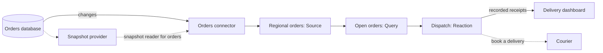
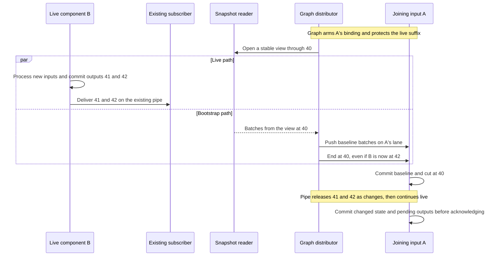

# Native bootstrap in ComputationGraph

**Status: implementation in progress on `agentofreality-parallel-computation-graph-recovery`; `agentofreality-native-bootstrap-chain` preserves the state before it.** A provider-backed source seeds three connected queries, then live changes reach the last query without another provider scan. If a durable middle component misses more history than its upstream retains, it can also repair a running downstream query without waiting for another live change. The query and the stateful middleware both do this, because they are two implementations on [one stateful transformer runtime](#one-runtime-for-every-stateful-transformer). Rebuild is implemented for a bounded, single-input, same-producer case, not for arbitrary configuration or producer changes. See [verified behavior and next steps](#next-steps). The [comparison below](#current-implementation-versus-proposal) describes the starting point at `fe005b97`, not the current working tree.

This design covers native **component-to-component** communication. It does not specify how a Reaction serves external clients. Old native binaries, double-wired subscriptions and migration of saved topologies are out of scope.

## The design in one minute

**Any component can be asked for its current state.** This is an ordinary read through an output port, not a special startup operation. The requester names the output, not the code that supplies it. By default it receives normal **item-added change events**, with many items allowed in one event. It can instead request [temporary-file transfer](#stream-or-file-transfer); neither component has to write or read a file.

**Bootstrap-and-follow adds one guarantee to that read.** A one-shot read finishes when the current state has been delivered. If A also needs future changes, the graph protects the live stream before capturing B's state, pushes that same state to A, then delivers the changes after the **cut**. If the snapshot includes change 40, A must still receive 41 and 42. This is not a snapshot call followed later by an independent subscribe call. A does not start B or pull batches through a chain.

- **On first start**, a component normally builds state from its connected inputs. A configured bootstrap provider can supply a special starting state instead. With `enableBootstrap: false`, the component starts from now. **On restart**, a component with recoverable state resumes from its saved position; it does not reload a snapshot.
- **Port declarations do not impose startup order.** A can start before B and report `A.in: waiting for B.out — B not registered`. When B becomes ready, delivery starts automatically. If no connection was configured at all, the port is simply `Unconnected`. Even with *every* port unconnected, DrasiLib loads the configuration and the component can start normally.
- **Capabilities, not role names, determine behavior.** An output supplies a committed view, derives a view by transforming upstream rows, uses a provider, or has no snapshot. Sources may consume graph inputs; reactions may expose graph outputs. An external source with no state, no upstream and no provider cannot supply initial data.
- **A Continuous Query is a stateful transformer.** Every component that maintains state has inputs, outputs, storage and bootstrap from a provider or its inputs; only the logic that updates its state and decides its output changes differs. They share one runtime, so anything a query does on a chain, any stateful transformer does.
- **Reading a snapshot is not sending it.** A provider reads a point-in-time view of an external store. A query can instead expose a read-only view of its own results. In either case the graph delivers the snapshot: the component keeps processing inputs and publishing to its existing subscribers while the new subscriber loads.



`regional-orders` filters snapshot rows and live changes using the same rule. `open-orders` builds its own results even if `dispatch` has not started. When a dashboard joins later, it receives the receipts that `dispatch` has already recorded. **Reading a receipt must never book the delivery again.**

**How big a change is this?** It is a breaking change to native plugins and to how the graph connects them, not a rewrite of the query engine, database connectors or pipe storage. Drasi can already load one native query from another. What it cannot promise today is that inserting a transform, restarting the middle query, or subscribing to a reaction's output will preserve that behavior. Putting the handoff on the connection covers those cases without requiring every transform to store a copy of its output. See [what changes](#current-implementation-versus-proposal) and [why this design](#why-this-design).

**Reuse decision:** standardize how a connection selects and runs a handoff, not a new algorithm for finding the cut or recovering a query. `main` already gates live delivery on a successful handover. The recovery branch already has snapshot-plus-follow for query outputs, retained replay and paired-provider crash fixtures. The [two-branch audit](#cutover-and-recovery-already-in-drasi) identifies what to keep and where the missing connection is.

## Next steps

**Verified on the branch:**

| Case | Evidence and outcome |
|---|---|
| First start and cutover | The [three-query chain](../tests/computation_graph_bootstrap.rs) initializes over ordinary data connections in both stream and file mode. The [loaded query–middleware–query fixture](../../components/host-sdk/tests/native_query_plugin/materialized_middleware.rs) transforms baseline rows, then applies live inserts, updates and deletes. |
| First input attached after startup | A [loaded query](../../components/host-sdk/tests/native_query_plugin/materialized_middleware.rs) starts with no connections and an empty result. Attaching its first input seeds it without a manual restart. Stream and file reads already open on the producer keep their original view. Across [three RocksDB openings](../../components/host-sdk/tests/native_query_plugin/durable_chain.rs), the first attachment installs the baseline; reattaching after processing real input instead restores the saved total of 32 and replays the missed change to 33, without a reset. |
| Slow and abandoned subscribers | With a late reader's scan paused and its live pipe limited to one envelope, the active subscriber receives three changes **before** the scan is released. If the late reader exceeds its separate retention budget, its start fails with the edge and the budget; the paused provider stops and the active subscriber continues. |
| Stop, rebind and spare ports | [Provider lifecycle tests](../src/computation/v1/graph_bootstrap.rs) hold a scan and its cleanup separately. Removing the binding cancels the scan even after its control callback is gone; a node stop does not succeed until cleanup finishes. A [durable reader](../tests/computation_graph_bootstrap.rs) binds its named input with an unconnected, same-schema spare. |
| Replacing a configured query | The [native application fixture](../../lib-integration-tests/tests/native_application_host.rs) replaces a query that names a graph seed. Both generations read the seed exactly once, the new result reflects the changed query, and the seed component is not replaced. A custom input pipe still cannot be silently rewritten as an ordinary query input. |
| Persistent restart and fan-out | The [query-edge restart](../../components/host-sdk/tests/native_query_plugin/durable_chain.rs) replays the missed update and delete without rescanning. After a [process exit partway through fan-out](../../components/host-sdk/tests/native_query_plugin/durable_fanout_crash.rs), an attempted rebuild is refused before it reads the replacement seed. Recovery delivers the original output to the second destination without duplicating the first journal entry. |
| History gap with a running dependent | With only one upstream result retained, a [stopped middle query](../../components/host-sdk/tests/native_query_plugin/durable_chain.rs) misses two writes. Its running leaf moves from 30 to 32 without another write. The middle keeps its output epoch. It sends net keyed additions, replacements and retractions, not a second baseline. An unchanged result advances the input cut without advancing the output sequence. A custom seed that cannot establish this handoff is refused with the affected dependent named. |
| Crash during that rebuild | Two [process-exit cases](../../components/host-sdk/tests/native_query_plugin/durable_rebuild_crash.rs) inspect the actual RocksDB rows, input cut, outbox and destination journals. Before installation, recovery sees 30, the old cut and no correction; it retries. After only one journal accepts, recovery sees 32, the new cut and one retained correction; the other journal receives it without a second entry in the first. A subsequent live change takes the recovered result from 32 to 34. This is not a guarantee about external business effects. |
| Durable provider intent | A provider's `state.write` now waits for the consumer's checkpoint commit, including through a source relay. A [two-input regression](../tests/computation_graph_bootstrap.rs) holds the second write open and injects a failed commit on the file path. The provider cannot create its external resource while the write is held or after it fails. This acknowledgement is not an acknowledgement of baseline installation or live delivery. |
| Reading a provider-backed output without subscribing | The [SQLite source test](../../components/host-sdk/tests/fixtures/native_sqlite/host_components.rs) opens two stream reads and a file read through `current_state` while there is **no data subscriber**. A later source write appears only on a fresh read. Stopping the provider retires an unfinished read. This passes with linked and loaded libraries; it does not create a replay cursor or run a paired handover. |
| Standalone PostgreSQL read | The [PostgreSQL one-shot fixture](../../components/host-sdk/tests/native_postgres_http_bootstrap.rs) attaches a real provider to a data port with no live driver, subscriber or checkpoint owner. A SELECT-only role reads one repeatable view in stream and file modes. A committed update, delete and insert appear on a fresh read only. Both linked and loaded providers leave zero replication slots. This is separate from the paired CDC crash cases below. |
| Reading through a transformer that stores no rows | In the [loaded middleware chain](../../components/host-sdk/tests/native_query_plugin/materialized_middleware.rs), the relabeler runs its ordinary mapping on a pinned query view. Stream and file reads opened at input change 4 still return `[3]` after an insert, update and delete. The joining query starts with `[3, 4]` and ends with `[9]`. No subscriber is restarted, and no snapshot or replay store is created on the transformer. |
| A join that needs a shared cut | A consumer can declare `with_shared_input_cut()`. [Binding](../tests/computation_bootstrap_binding.rs) refuses two independent snapshot inputs before either scan starts. An unused port or an explicitly live-only connection does not cause a refusal. This enforces the requested guarantee; it does not implement a distributed transaction. |
| Any stateful transformer, not only a query | The [stateful middleware](../../components/computation-plugins/transformers/middleware/README.md#stateful-middleware), the [view](../../components/computation-plugins/transformers/view/README.md) and [geometry](../../components/computation-plugins/transformers/geometry/README.md) each take the query's place in the [persistent chain](../../components/host-sdk/tests/native_query_plugin/durable_chain.rs): each initializes from its upstream query, replays a missed change in the same epoch, and after a history gap rebuilds for its running leaf (30 to 34) or refuses a reset that would strand it. Both [rebuild crash cases](../../components/host-sdk/tests/native_query_plugin/durable_rebuild_crash.rs) pass with each in the middle, and each [bootstraps from a SQLite provider](../../components/host-sdk/tests/native_query_plugin/middleware_bootstrap.rs). None has its own recovery code. |
| First input after a dependent subscribed | A [middle query, stateful middleware, view or geometry](../../components/host-sdk/tests/native_query_plugin/durable_chain.rs) starts with no input, and a leaf installs and follows its empty view. Connecting the first input moves the leaf from no rows to 30 with no further write, then follows live changes. The leaf's follow lease stays open while the graph pauses it to connect the input. |
| Paired external stores | The seven [real-connector crash cases](../../components/host-sdk/tests/native_paired_crash.rs) pass with rebuilt ABI `0.2.0` libraries. Killing the Drasi process before its first ownership checkpoint leaves **zero replication slots in PostgreSQL**, and the restarted graph recovers the expected rows. The other six cover handover and mid-transaction crashes for PostgreSQL, MySQL and SQLite. SQLite does not cover concurrent external writes; SQL Server is not in this matrix. |

**What is still missing, in priority order:**

1. **Extend projected reads beyond the single-input case.** The [`current_state` API](../src/computation/v1/output_catalogue.rs) can read materialized views, explicitly read-only providers and single-input projections. A volatile relabeler can also bootstrap a connected query because each input produces exactly one output envelope with a translatable logical position. This is not a standalone follow lease or durable replay. Qualify filtered and expanded images separately; event rules that invoke actions or depend on history cannot promise a view just because they accept inserts.
2. **Extend rebuild beyond one bounded, authoritative input.** Qualify changed producer epochs and changed configurations with demonstrably comparable output keys, and storage-backed staging for larger views. Keep explicit refusal for unsupported resets and for outstanding deliveries that a reset would discard.
3. **Move the remaining stateful transformers onto the shared runtime.** `policy` and `optimization` still maintain their own volatile views, without durable state, follow, replay or rebuild. `arithmetic` keeps no dataset of its own, only a batch counter, so it belongs with projected reads (item 1) rather than the runtime. DrasiLib's linked query (`lib/src/computation/v1/query.rs`) still keeps a second copy of the query output state in `drasi-query-common`.

| Order | Deliverable and code area | Done when |
|---|---|---|
| 1 | **Establish the baseline.** Reuse the ported `main` regressions and native crash fixtures in [G0](#release-cases). Extend them with a passive receiver, an independent ledger and a deterministic cut hook through the normal DrasiLib configuration path. | Record which existing path satisfies each case, fails, or lacks coverage. The driver distinguishes an unconnected port, a pending binding and a completed empty snapshot, and detects a skipped 41 or duplicated 42. A different API shape alone does not justify replacement. |
| 2 | **Change the native contracts.** Expose one current-state read on output ports, optionally followed by live data. Reuse normal batched `Added` operations. Declare input initialization, replay, progress and effect guarantees; replace role-based port-count validation and dispatch in the plugin and Host SDKs. | The same caller reads a loaded query, model, source or reaction port without knowing where its state lives. An event-only output returns `Unavailable`; an authoritative empty view succeeds. |
| 3 | **Deliver the first end-to-end path.** Adapt the existing readers and session sender. Implement streaming first, then the file option in the pipe alone. For follow mode, arm the suffix using `snapshot_and_follow` or the equivalent connector boundary. | With unchanged component binaries, both transfers install the same state and cut. A slow stream or file import does not stop the producer or existing subscribers. See [G7–G9](#release-cases). |
| 4 | **Implement resume and rebuild.** Map replay to applied checkpoints; commit state and pending output before publishing. Add subprocess kills at the commit, acknowledgement and fan-out boundaries. | A middle component that missed a delete forwards the retraction to its still-running downstream. A crash during rebuild does not repeat a committed effect or skip an output branch. An unrecoverable gap is explicit. |
| 5 | **Qualify the new contract and retire the old wiring.** Adapt the native factories and provider coordination. Reuse existing snapshot, session and replay implementations behind the subscription wherever they meet its guarantees; remove the separate public bootstrap edges and resource selection paths. Update configuration, inspection and guides. | The [release cases](#release-cases) pass through linked and loaded plugins and the supported real connector and Server paths. No old contract is needed to make a test pass. Close remaining-work entries only against that evidence. |

**Before freezing the native contract in step 2**, confirm three user-visible policies: initial external effects are opt-in; a custom seed may start from an explicitly chosen live boundary but never masquerades as an exact upstream snapshot; a shared cut across inputs is required only by consumers that declare that need. Those are proposed defaults, not claims about today's runtime.

**Reading further:** [current-state reads](#reading-current-state) · [stream or file transfer](#stream-or-file-transfer) · [startup and configuration](#startup-order-and-readiness) · [handoff and recovery](#the-switch-over) · [test strategy](#test-strategy) · [implementation references and prior art](#implementation-references-and-prior-art).

## Current implementation versus proposal

The table below describes the native [recovery branch at `fe005b97`](https://github.com/drasi-project/drasi-core/tree/fe005b97526a9453381a8f6b8785929ed7ef5996). **First start and restart are different claims.** The [loaded-query test](../../components/host-sdk/tests/native_query_plugin/upstream_snapshot.rs#L84-L111) wires two *volatile* queries and checks that the second initializes from the first. The [durable-chain test](../../components/host-sdk/tests/native_query_plugin/durable_chain.rs#L27) instead attaches an `OutputBootstrapProvider` for replay. Neither establishes that a persistent query can restart over a graph bootstrap edge: the upstream query's snapshot ends with a watermark but no saved resume state. [CW-109](computation-graph-remaining-work.md#cw-109) documents the missing replay path; its crash scenario is not yet reproduced by a test.

| Surface | What the native implementation does today | What changes |
|---|---|---|
| Graph and startup | The graph already records nodes before they are ready. Its [binding check](../src/computation/v1/graph/controller.rs#L1815-L1844) can also wait on a declared *data port* with no bound edge; [only bootstrap ports are optional by port kind](../../components/computation-contracts/src/ports.rs#L241-L245). | **Extend the existing controller.** Wait for a configured-but-missing peer, not an unused port. Use the same readiness publication to start delivery; no new scheduler or graph registry. |
| External sources and seeds | [Paired providers](../../components/computation-plugins/bootstrappers/NATIVE-BOOTSTRAP-PROVIDER-GUIDE.md#pairing) already share source settings and coordination. A local query provider already [takes precedence over inputs](../tests/computation_graph_bootstrap.rs#L572). A [source relay without a provider](../src/computation/v1/graph_bootstrap.rs#L1514-L1540) can finish a session with no rows. | **Keep pairing, connector-specific cuts and cleanup; broaden seed placement.** A startup seed can cover named inputs of any component. An external output with no baseline is `Unavailable`, not a successful empty snapshot. |
| Snapshot distribution | The native provider already [returns a snapshot stream](../../components/computation-plugin-sdk/src/bootstrap.rs#L238-L265), rather than sending to a recipient itself. Core has separate serving loops for [provider records](../src/computation/v1/graph_bootstrap.rs#L558-L587) and [committed output snapshots](../src/computation/v1/graph_bootstrap.rs#L611-L639). | **Generalize the sender, not the provider.** Use the same independently scheduled delivery session for all snapshot-capable ports and startup seeds. No live component callback waits for the scan or for a subscriber to accept rows. |
| Wiring and delivery | The Host [adds separate bootstrap ports](../../components/computation-plugin-sdk/src/metadata.rs#L449-L479). On those edges the consumer-side adapter initiates an addressed request; records already flow **downstream**. A query can [combine edge and resource providers](../src/computation/v1/query.rs#L516-L539). | **Replace the public wiring contract, not the direction of the rows.** One configured data connection describes the handoff. The graph arms the receiver and starts the producer session. A separate bounded lane can remain an internal implementation detail. |
| Plugin roles and chains | [SDK validation](../../components/computation-plugin-sdk/src/metadata.rs#L524-L532) forbids Source inputs and Sink outputs. [Middleware](../../components/computation-plugins/transformers/middleware/src/lib.rs#L80-L85) accepts quiescent bootstrap, so a durable query snapshot cannot seed it. A [sink's optional snapshot hook](../../components/computation-plugin-sdk/src/component.rs#L243-L258) replaces state; it is not a general subscription. | **Breaking SDK, Host and plugin change.** Validate and dispatch by input/output capabilities. Pure transforms can project a baseline; a reaction can publish receipts separately from performing effects. Affected native libraries must be rebuilt against the matching Host. |
| Pipes and restart | Existing pipes buffer or journal changes; the [output-resource path](../src/computation/v1/output_bootstrap.rs#L121-L145) can replay after a saved cursor. The [query-edge snapshot](../src/computation/v1/graph_bootstrap.rs#L611-L639) does not give the consumer that same replay contract. | **Reuse the pipes, journals, output readers and epochs; change how they are used together.** Resume from the consumer's committed state on the actual binding. Retained pipe or output history may supply the missing changes; its absence is a gap, not permission to skip. |
| Reconfiguration and effects | A native query factory can plan a rebuild for specific changes. [CW-92](computation-graph-remaining-work.md#cw-92) distinguishes that local operation from resynchronizing dependents or recovering an interrupted rebuild. | **New recovery guarantee, not a configuration switch.** For supported components, install rebuilt state and pending output together before publishing the difference. Refuse an unsafe rebuild; a durable pipe does not make a courier call transactional. |

The largest **surface change** is the native ABI and graph/Host assembly. The largest **correctness risk** is the handoff across two owners: the producer knows what its snapshot covers; the consumer knows what it committed. The new connection must join those facts across a crash. The evaluator's query semantics, SQL snapshot algorithms and journal storage engines are not the target. Their contracts still need qualification through the new path.

### Cutover and recovery already in Drasi

Compared with [`main` at `5ec0ed68`](https://github.com/drasi-project/drasi-core/tree/5ec0ed68c158ba7b654d6b26ccc70a183f941a48). `main` uses the source/query/reaction subscription runtime; the recovery branch uses ComputationGraph. `main` is a **behavioral reference**, not an implementation or plugin ABI to restore. The recovery branch [already ported the intent of `main`’s bootstrap-hardening tests](https://github.com/drasi-project/drasi-core/commit/5e5bef3d392223e5545a0090cad5017eda7ac482). The comparison is based on implementation and test assertions; the presence of a fixture is not an end-to-end qualification result.

| Handoff | What `main` already does | What to use on the recovery branch |
|---|---|---|
| **Current state without subscribing** | A reaction's [runtime snapshot fetcher](https://github.com/drasi-project/drasi-core/blob/5ec0ed68c158ba7b654d6b26ccc70a183f941a48/lib/src/reactions/snapshot_fetcher.rs#L43-L65) already lets it read a configured query's results on demand, not just at startup. | Reuse the output catalogue's separate [`snapshot()` and `snapshot_and_follow()`](../src/computation/v1/output_catalogue.rs#L470-L505). The current [snapshot record adapter](../src/computation/v1/output_bootstrap.rs#L301-L325) already emits an `Added` operation, one record at a time. Generalize to the port's schema and bounded multi-item envelopes. A pipe writing an outgoing snapshot to a temporary file is new transport work, not a file-backed source/provider. |
| **External snapshot → change stream** | The [source boundary](https://github.com/drasi-project/drasi-core/blob/5ec0ed68c158ba7b654d6b26ccc70a183f941a48/lib/src/sources/base.rs#L258-L289) can come from the provider or the source. The first initial cut can start capture; a resuming subscriber uses its saved position instead. | Keep the connector's cut and lifecycle. The [native PostgreSQL pair](../../components/computation-plugins/sources/postgres/src/bootstrap/snapshot.rs#L214-L247) records initialization intent and imports the slot's exported snapshot. Preserve the [conditional first-start hold](../src/computation/v1/graph_bootstrap.rs#L1472-L1488) where needed; it is not a reason to stop an already-running source for a late reader. |
| **No gap between backlog and live** | The [WAL subscription](https://github.com/drasi-project/drasi-core/blob/5ec0ed68c158ba7b654d6b26ccc70a183f941a48/lib/src/sources/base.rs#L1035-L1076) captures the head and registers the live receiver under the dispatch lock, releases the lock, then reads only the missing prefix through that head. Replay drains before live. | Use the [query output reader](../../components/query-common/src/query_output.rs#L215-L226): it captures the view and opens its follow lease under the same state lock. The [follow hub](../../components/computation-contracts/src/output_follow.rs#L182-L232) bounds each reader without making the producer wait for it. This solves *live attachment*, not crash recovery. When switching to a normal pipe, protect overlap through its verified position; do not close the lease and subscribe across an unprotected interval. |
| **A durable baseline is complete only on commit** | The [query handover](https://github.com/drasi-project/drasi-core/blob/5ec0ed68c158ba7b654d6b26ccc70a183f941a48/lib/src/queries/manager.rs#L1016-L1077) stages the supplied per-source positions, live-result snapshot and result sequence zero, then writes the config marker after commit. The [supervisor](https://github.com/drasi-project/drasi-core/blob/5ec0ed68c158ba7b654d6b26ccc70a183f941a48/lib/src/queries/manager.rs#L3265-L3319) requires all provider completions; a failed or dropped provider never releases the queued tail. | Keep the [native completion transaction](../../components/computation-plugins/transformers/query/src/durable.rs#L745-L813): watermarks, producer bindings, optional provider state and completion marker are staged before output activation. Rows can load incrementally; `End` is not a commit. Preserve [per-child state, rearming and awaited cleanup](../src/computation/v1/composite_bootstrap.rs#L178-L189) for multi-input initialization. |
| **Restart from applied input, not last emitted result** | On a matching configuration, [checkpoint restore](https://github.com/drasi-project/drasi-core/blob/5ec0ed68c158ba7b654d6b26ccc70a183f941a48/lib/src/queries/manager.rs#L2285-L2315) restores each source's framework sequence and optional opaque cursor. A filtered change can advance input while the result sequence remains zero. | Generalize [output-resource replay](../src/computation/v1/output_bootstrap.rs#L86-L145) to the graph binding: validate the producer and applied cursor, replay the retained suffix before buffered live input, or report a gap. Keep `RefreshVolatile`, `ResetRequired` and the [guards against unsafe reset](../src/computation/v1/query_recovery.rs#L246-L317). A component-wide “complete” flag cannot invent another input's checkpoint. |
| **State synchronization versus external effects** | A [fresh reaction](https://github.com/drasi-project/drasi-core/blob/5ec0ed68c158ba7b654d6b26ccc70a183f941a48/lib/src/reactions/manager.rs#L555-L608) either uses the snapshot's `as_of_sequence` or starts at the head captured **at subscription**. Its [live forwarder](https://github.com/drasi-project/drasi-core/blob/5ec0ed68c158ba7b654d6b26ccc70a183f941a48/lib/src/reactions/manager.rs#L1151-L1193) suppresses overlap after bootstrap/outbox catch-up. A late trigger need not fire for historical rows. | Keep the [consumer recovery decisions](../src/computation/v1/consumer_recovery.rs#L718-L826) and [durable destination obligations](computation-graph-qos.md#remembering-where-pending-output-must-go). Preserve pending output identity across partial fan-out. Skipping a gap is explicitly lossy, never an exact bootstrap. |

**The remaining experiment is narrow.** For a persistent `Q1 → Q2` edge, adapt the retained-output reader and consumer checkpoint to that edge rather than write another cutover engine. Compare it with the output-resource path after stopping only Q2 and committing an update and a delete at Q1. Reuse the adapter if both match the independent source history, including downstream retractions and outstanding deliveries. Projected paths, multi-route tokens and atomic rebuild-with-difference still need their own evidence; neither branch proves those generalizations.

## Why this design

The deciding case is a consumer joining or restarting **in the middle of a running chain**. It must receive the output of its *immediate upstream*, including any filtering or aggregation, and then the changes after the cut. It cannot rely on a terminal subscriber, a particular startup order, or an external effect being safe to repeat. The graph knows the bindings, an output knows its data, and a pipe knows what it retained. The proposal gives each of them that job once, rather than making each plugin pair negotiate it independently.

| Alternative | When it is a good choice | Why it is not the default here |
|---|---|---|
| **Patch today's bootstrap edges.** Add saved positions and replay to `PipeBootstrapProvider`. | Smallest change if the goal is only to fix the persistent query-to-query case. Existing sessions, pairing and late-join tests remain useful. | It does not make `query → middleware` compatible, let a Source consume a graph input, or let a Reaction expose an output. Those still need contract changes. Keep the session implementation if it meets the new contract; do not retain two public ways to subscribe. |
| **Have each consumer pull its ancestors' snapshots.** | Simple for an isolated reader of one stable database or view. | In a chain, each consumer must coordinate readiness, routing and the switch to live data across components it does not own. The requirement is the opposite: a passive receiver must initialize on graph readiness, with no descendant driving its upstream. |
| **Require every output to maintain a readable snapshot** and use the existing output catalogue. | A good fit for expensive computations with frequent late readers. Keep `snapshot_and_follow` where it is offered; the proposal supports materialized output as `Own`. | Requiring a stored copy at every filter adds state and recovery even when the filter can project its upstream snapshot exactly. A snapshot plus a live feed also does not by itself retain the changes a restarting subscriber missed. |
| **Replay everything from a durable log.** | Simple and exact when a complete history is available and rebuilding from it is cheap. The proposal uses retained history for resume. | A pruned journal is not a baseline, an external database may predate Drasi's log, and a replay must not reissue historical bookings. Making it universal would require retention and replay work on every path. |
| **Always take a coordinated graph checkpoint.** | Worth the coordination cost for a join or effect that must see several inputs at one transaction boundary. | Independent inputs and late subscribers usually need only a cut on their own bindings. Synchronizing unrelated branches adds latency and failure dependencies. Require the shared boundary only where the consumer needs it, and refuse it if unavailable. |

**Trade-off accepted:** one subscription is simpler for plugin authors, not cheaper for the runtime. Drasi must protect a bounded replay window, translate positions and clean up interrupted sessions. It buys independent startup and late joins without forcing storage on every transform or promising exactness a provider cannot deliver. [G2](#release-cases) (changes during snapshot) and [G5](#release-cases) (middle-component restart) are the first evidence that this extra machinery earns its cost.

## Startup order and readiness

The existing [graph controller](computation-graph-design.md#a-node-appears-before-initialization) owns the desired topology. Adding A records its configuration and start intent; admission is not proof that A has finished loading. Look at the current registry publication **and** listen for subsequent changes so readiness cannot be missed. Never block unrelated components or admissions on this wait.

| Configuration or observation | What DrasiLib must do |
|---|---|
| No edge on a declared input or output | Report `Unconnected`, not a warning. Create no pipe, subscriber, wait or empty bootstrap for that absent edge. Other connected ports work normally. An explicitly configured local seed is independent. |
| `A.in <- B.out` is configured but B is absent, starting, or waiting for its configured provider | Keep the binding pending; report the input, the missing peer/provider and the reason. No polling, bootstrap timeout or manual restart merely because a peer is absent. If B failed, expose its cause. |
| Both declarations are known but incompatible | Refuse delivery on that binding with the failing path and reason. An output that **declares no snapshot** is not the same as a provider that **has not arrived yet**. |
| Binding becomes ready | Open one current session for that binding. Duplicate notifications do not open a second one. Report `Bootstrapping`, `Resuming` or live-only as appropriate. Mark a stateful component ready only after its configured handoffs and its other startup work complete. |
| A is removed, or B disappears during loading | Cancel and clean up the old session; its late rows, `End` and acknowledgements cannot affect a replacement. If the connection is still desired, show the wait and rebind automatically. Temporarily offline is not lost history. |

A component can initialize without any outgoing connections. Adding a subscriber later establishes a new subscription, not a new startup of the producer. A disconnected *configured* durable subscriber can still be owed work; do not treat that obligation like a port that was never connected.

### Status changes between connected peers

Reuse the existing [neighbour control channel](computation-graph-reference.md#control-messages-and-startup); no new status bus is needed. The [controller already publishes availability in both directions](../src/computation/v1/graph/controller.rs#L4733-L4755). For `B.out → A.in`, B can notify A downstream with `Available` or `Unavailable { reason }`, and A can notify B upstream with `Ready` or `NotReady`. Each notice describes **the sender**. It is a reason to recheck the current binding, not a request from A to fetch data or a requirement that B wait for A to finish bootstrapping.

Graph-generated status notices can coalesce and are not durable. Before A and B are connected there is no peer to notify: registry reconciliation must still discover B, check the current state on bind, and ignore notices from a replaced binding. Neither an availability notice nor a readiness notice establishes the snapshot cut, confirms a commit, or acknowledges a delivery. Those guarantees remain with the subscription and the pipe.

## Component and port contracts

### Reading current state

An internal requester addresses a component's output port and chooses **current state only** or **current state and follow**. It may make a one-shot read while the graph is running, regardless of whether bootstrap was enabled at startup. That read returns a point-in-time view, completes, and releases its session; it neither establishes a live subscription nor changes an existing subscriber's checkpoint. For *and follow*, the graph secures the live suffix at capture time; only after the baseline is installed may the input deliver that suffix. A port that can read state but cannot guarantee an exact handoff may support the first operation and refuse the second.

| Component being asked | What “current state” means on its output |
|---|---|
| Continuous Query or Continuous Model (stateful Transformer) | The query's current result set or the model's current state as exposed on that port, not private indexes, history or pending side effects. |
| Source representing an external store | Its Bootstrap Provider reads the represented data at a point in time. Without a provider or another declared way to supply state, the read is unavailable. |
| Stateless Transformer | The graph arranges delivery of current state from its contributing inputs. It applies the same transformation as for live changes and supplies the **transformed** items, not the raw upstream snapshot. |
| Sink / Reaction | A snapshot-plus-stream Reaction can expose the upstream query's current result as its baseline. An action-only Reaction can explicitly offer no state; reading it must never invoke the external action. If it maintains a different view, such as receipts, that output represents that view. |

The requester sees the port's schema, its result or failure, and the boundary needed for follow. Whether the port materializes, derives or delegates the read to a provider is internal. **Unavailable is not empty:** a state-bearing port with zero items completes successfully; a component with no state-bearing output reports that fact without inventing a port, an empty baseline or a startup error. The internal contract does not dictate an external Reaction's API, wire format or delivery mechanism.

### How an input starts

Apply these choices in order. `enableBootstrap` governs **this component's initialization**, not whether someone else may subscribe to its output. For a pure transformer with no local state to initialize, the flag does not disable its ability to project a subscriber's baseline.

| Condition | Starting state | What follows |
|---|---|---|
| Valid completed checkpoint for this configuration, state and inputs | Restore it; do not call a startup provider. A cursor without matching state, or a partial load, is not such a checkpoint. | Replay **changes** strictly after the applied checkpoint, then live changes. Check actual history before declaring success. |
| Fresh state, bootstrap enabled, startup provider configured | Install the provider's seed once per initialization. A component-wide provider identifies the inputs it covers; do not open it once per input. An input-specific seed replaces only that input's baseline. | Follow from the declared boundaries on covered inputs. Other connected inputs use their own policy. |
| Fresh state, bootstrap enabled, no seed | The graph obtains each connected upstream output's current state and pushes baseline rows to this input. | Keep changes after each cut. No consumer-plugin polling or upstream traversal. |
| Fresh state, bootstrap disabled | Start empty, at an explicitly registered live boundary. | Future changes only. Inspection identifies this as a view *since that boundary*, not a full copy of upstream. |

**Proposed defaults:** enable initialization for state-building inputs; require explicit opt-in to performing external effects for initial rows. Allow per-input overrides (for example, bootstrap an orders table but take only future clicks). A startup seed is never rerun merely to answer a downstream subscriber.

For example, these selected configuration fields give `open-orders` existing orders but only *new* clicks. This is illustrative, not a complete DrasiLib configuration:

```yaml
name: open-orders
enableBootstrap: true
inputs:
  - { component: regional-orders }
  - { component: clicks, enableBootstrap: false }
```

Setting `bootstrapProvider` on the component changes where its initial data comes from, not where future changes come from. A provider that covers multiple inputs must identify their records and boundaries; the graph does not duplicate its dataset onto every input.

### How an output supplies state

| Declared capability | What the graph delivers to this subscriber |
|---|---|
| **Materialized (`Own`)** | A consistent read of the component's committed output at its own position. Wait for a complete view; an authoritative empty view is a successful snapshot. |
| **Projected (`Derived`)** | Rows pushed from the port's named upstream inputs through its normal, deterministic, side-effect-free change transformation. This is how a component without stored output supplies initial data. No global rebroadcast on a late join. |
| **Provider-backed** | Rows from the provider associated with this output. A database connector usually pairs with a provider reading the same database/log. A different provider is allowed under the handoff rules below. |
| **Unavailable** | No baseline. The port may still stream live data. Refuse only a connected input that actually needs this snapshot; do not fail component creation. |

Declare **replay, persistence, reconciliation and destination replacement separately**. Being able to read current rows does not mean that a port retains change history, that two generations can be compared, or that a component can repeat an external action. Feeds to other components, including feeds inside a reaction, must be declared as edges or subgraph dependencies. Reject a circular snapshot dependency with no independently ready starting view; an invisible callback or an indefinite wait is not a solution.

### One runtime for every stateful transformer

The SDK's [`transformer` module](../../components/computation-plugins/transformers/NATIVE-TRANSFORMER-GUIDE.md#stateful-transformers) is the native component for every transformer that maintains state. It owns the storage profiles, configuration identity and producer epoch, committed input progress, bootstrap from a provider or the connected inputs, first input, restart replay, rebuild with a keyed difference, crash-safe installation and refusal, the materialized output with its snapshot, follow and replay readers, delivery confirmation and scheduled work. An implementation supplies only its logic: how a batch updates its private state and which output changes it produces.

| Transformer | Logic it supplies |
|---|---|
| Continuous Query | Core evaluator and indexes, result projection, scheduled futures, query read API |
| Stateful middleware | Its pipeline; the output rows are its only state |

The graph applies its state rules to any such component, not to a semantic kind: a factory that rebuilds its components' state may reconstruct one on an update, and reconstruction is refused while a downstream transformer follows the output. A stateless transformer keeps no state and keeps its [projected current state](#how-an-output-supplies-state).

### Snapshot readers and distribution

**The reader owns what is read; the distributor owns who receives it.** A bootstrap provider opens a consistent external read, yields rows in bounded batches, reports the position those rows cover, and releases the read transaction or slot. It may need the source's coordinator, credentials and selection scope. It does **not** need a subscriber address, pipe sender, delivery acknowledgements or retry policy.

Separating delivery must not strip a durable reader of its recovery hooks. Keep its query-owned initialization intent (written **before** external effects), its final watermarks and its optional opaque completion state. Pass those facts back to the consumer's completion transaction; do not store the only copy in the distributor or treat a dropped stream as successful completion. The existing [handover-intent regression](../tests/computation_query_recovery.rs#L1450) exercises this distinction across a reset.

For a materialized output, the component hands off a handle to a committed version, not a lock on its current state. For a projected output, the session uses the same pure transformation on the upstream reader with the bound configuration, not the live component's mutable processing loop. Neither requires a second external provider. Capture may briefly synchronize with a commit; opening an external scan, enumerating or projecting rows, and waiting for pipe capacity must not occupy the component's live task or hold its mutable lock.

The **snapshot distributor** is a reusable part of the graph's connection machinery, not a plugin, a new user-configured node or one global sending queue. For a read it drives the reader and writes bounded batches to the pipe. A one-shot read then ends; for follow, the connection protects the live suffix until the installed checkpoint takes over. A blocked read or send suspends that session, not the component. On cancellation, rebind or failure, fence stale frames, close the reader and release temporary holds without advancing the checkpoint or waiving existing durable obligations.

### Stream or file transfer

The request has two independent choices: **whether to follow** and **how the pipe transports current state**. Both transports carry ordinary `ChangeEnvelope`s in the output port's declared schema. A current item is a full [`ChangeOperation::Added`](../../components/computation-contracts/src/data.rs#L438-L495); one change set can contain several additions with distinct ordinals. Batch by item count and encoded bytes. There is no bootstrap payload schema, file-reference record type, or requirement to materialize the whole view in RAM. Completion and the cut are session metadata, not items or invented live positions.

| Requested transfer | What crosses the connection | What the receiving component sees |
|---|---|---|
| **Stream** (default) | The pipe delivers each bounded batch as it becomes available. | Ordinary item-added events, then completion. An empty view completes with no added items. |
| **File** | The sending end serializes **the entire captured view** incrementally into a pipe-owned temporary file using the port's envelope codec. Only after it is complete does it send a scoped file reference to the requesting end of the pipe. That end validates the reference and contents, then reads the file back in bounded batches. | The same item-added events, identities and completion as streaming. Neither the producer/provider nor the receiving plugin receives a path, chooses a file format or implements file handling. |

Bind the file reference to the read session, binding generation, schema and captured boundary. Publish it only after the file is sealed; reject truncated, corrupt, stale or over-quota transfers rather than installing partial state or silently substituting another mode. The pipe owns access, disk limits and cleanup after consumption, cancellation, expiry or process failure. The file is **not a recovery checkpoint**. For follow, keep the live suffix protected throughout file creation **and import**: receiving the reference is not completion, and completing file I/O is not the consumer's commit.

## The switch-over

The graph opens one subscription **from current state, after a checkpoint, or from now**. The control plane sets up the route. The distributor pushes the baseline; the pipe delivers changes. The consumer drives neither the scan nor its transport.



**Establish the cut and the ability to follow it together.** Register live capture before reading the snapshot, or pin a committed snapshot and the retained suffix after its cursor. A paired provider must map its external transaction position (for example a PostgreSQL LSN) to the output prefix it actually covers. Do not sample a later head, split a source transaction at the cut, or wait for one more event on a quiet source. Suppress only changes proven covered by the installed baseline.

**Keep special seeds without making a false promise.** A provider may supply deliberately different starting data. Register a live boundary for every covered binding, install the seed, then apply changes after that boundary. This guarantees the chosen seed plus subsequent changes; it does **not** prove the seed matched upstream at that instant. If an input requires an exact upstream snapshot, an uncoordinated scan (for example a changing HTTP feed without a position) cannot satisfy it. Use a paired snapshot, establish quiescence, explicitly choose the weaker seed semantics, or refuse the binding. Do not silently label a guessed position exact.

**Session protocol.** Tie each delivery to its session and binding generation. Baseline and delta are **phases, not schemas**: baseline envelopes carry ordinary additions; replayed and live envelopes retain their original adds, updates, deletes and transaction boundaries. `End(cut)` follows the last decoded baseline batch, including for file transfer. The input releases the live tail only after the component has installed the complete baseline and its input boundaries (durably for a persistent consumer). Replaying a missed delete must publish the same retraction as live processing. `Gap`, `EpochChanged`, unsupported capability, cancellation and provider failure are distinct from successful empty completion. Await cleanup on every exit.

**Pipe behavior.** A loading subscriber must not become a blocking destination on the live fan-out. Use an independent retained cursor or a bounded catch-up buffer for that binding; bound active sessions, pinned history and bytes. If the reader stalls or its lane fills, pause only that session. If its budget runs out, recover from retained history or fail the bootstrap visibly and release its temporary resources. Never skip an uncovered change or let a new reader pin the live producer indefinitely. Switch to the configured live pipe only when it can take over without a gap. Existing live subscribers retain their ordinary QoS guarantees, including backpressure; isolating bootstrap does not waive an existing delivery obligation.

### Chains, fan-in and fan-out

- **Source → transformers → query.** The graph arms a route to the nearest materialized or provider-backed port. Each projected port transforms incoming baseline and live rows with the same meaning. For a filter, an update moving a previously included row outside the predicate emits a deletion. If that cannot be computed from the input, the transform needs state.
- **Positions identify work, not just messages.** Store a resume token for the stable binding, producer epoch and relevant transform/configuration identity. A projection can carry its upstream progress rather than mint a new epoch on each restart. Filtering to zero must still allow progress to advance; for one input expanding to several outputs, commit them as a group or checkpoint the position within the group.
- **Fan-in and diamonds.** Track a boundary per contributing binding/route, including two routes from the same origin that meet again behind a single port. Do not merge their positions just because the origin ID matches. Independent cuts give per-input coverage, **not** a global snapshot. A join or reaction requiring transaction-consistent visibility across inputs must use a common cut for those inputs or be refused that stronger guarantee.
- **Fan-out and late joiners.** Each subscriber has its own session and cut. Taking a baseline from a query, a transformer or a reaction cannot replay it into existing consumers or perform external effects. Independent subscribers do not need to acknowledge each other's work.

## Persistence and restarts

A durable consumer commits its state, applied input positions and recoverable pending outputs together, then acknowledges the pipe. On restart, validate the checkpoint against the binding and producer epoch. Prefer the retained pipe's suffix, otherwise the output's replay or a projected replay from its inputs. **A delivery attempt, a journal offset and an applied position are different.** A crash after commit and before acknowledgement can cause redelivery; it must not apply the same logical change twice. If the journal cursor is ahead of restored application state, recover the missing suffix or surface a gap.

| Situation | Outcome |
|---|---|
| Consumer kept no state | Initialize according to its flag and seed policy again. A volatile view is rebuilt, including deletions. |
| Persistent consumer, same upstream epoch and sufficient history | Resume without a baseline scan, even if the pipe itself was volatile but the output can replay. Restarting *only* the consumer does not change the upstream epoch. |
| Upstream absent | Wait visibly with the checkpoint intact. Test coverage and epoch when it returns. |
| History pruned, epoch changed or configuration invalidates state | `Strict`: stop with the reason and preserve state. `AutoReset`: rebuild **only** if all required state can be reconstructed and outstanding downstream obligations preserved. Otherwise stop visibly. Today's rows cannot recreate missed event-only actions. |

### Rebuild

Keep the old state visible until a replacement is complete. Record the operation ID and configuration, protect incoming changes, and build the new generation privately from the chosen inputs or seed. Where output keys, schema and meaning are comparable, compute the difference against the old output. **Atomically install the replacement state, its cuts and the pending difference with stable output IDs before publishing anything.** Then deliver/retry the difference and continue after the cuts. Keep any older unacknowledged outputs owed to consumers. A retry resumes the same operation; a stale completion cannot install another generation.

A destination may instead declare atomic or idempotent snapshot replacement. An arbitrary webhook or courier call is neither: an unknown external outcome requires a stable idempotency key and destination receipt, a transaction, or an explicitly weaker guarantee. An input opted into initial effects may perform them; a downstream snapshot read never authorizes them. If the new output cannot be reconciled, require an explicit new epoch and dependent recovery or refuse the update before discarding state.

**Implemented path.** For an atomic persistent stateful transformer in `auto_reset`, first try ordinary replay. If retained history is insufficient on its one graph input and a dependent has a state-bearing connection, the connection can offer a new view of the **same authenticated producer epoch**. The transformer stages at most 1,024 encoded batches / 16 MiB privately. After the final cut is known, it uses the existing output transaction to rebuild its private state (a query's evaluator indexes), compare keyed rows and retain one ordinary batched difference alongside the new cut. The same path, without `auto_reset`, publishes a first input's rows to a dependent that installed the empty view. The graph supplies the actual bound destinations before installation; their fingerprint, pending-output checks, shared reservation rules and normal confirmation protocol still apply. The old durable state remains intact if the scan, binding or transaction fails. `strict` still reports the gap. A custom seed, an epoch change, a multi-input transformer, a non-atomic store, a query's input middleware or source-transaction processing does not acquire this guarantee. A clean replay never opens a replacement scan.

## Test strategy

The release question is not “did the graph finish?” It is **“at this known cut, do the committed rows, output identities and destination receipts match the source history?”** Count attempted deliveries separately: a retry can be correct; a second business effect need not be.

### Release cases

**G0 — Establish parity before replacing a path.** Use `main`’s [failed-handover rollback](https://github.com/drasi-project/drasi-core/blob/5ec0ed68c158ba7b654d6b26ccc70a183f941a48/lib/src/queries/e2e_checkpoint_tests.rs#L245-L255) and [idle/filtered reopen cases](https://github.com/drasi-project/drasi-core/blob/5ec0ed68c158ba7b654d6b26ccc70a183f941a48/lib/src/queries/e2e_checkpoint_tests.rs#L1017-L1115) as reference outcomes. Start with their [ported reopen](../src/queries/e2e_checkpoint_tests.rs#L2399-L2418) and [rollback](../src/queries/e2e_checkpoint_tests.rs#L2850-L2875) cases, the [slow follower](../../components/host-sdk/tests/native_query_plugin/shared_output.rs#L123-L147), and the [paired database crash matrix](../../components/host-sdk/tests/native_paired_crash.rs#L4-L52). That matrix includes exits mid-snapshot, either side of the completion commit and mid-transaction; it checks PostgreSQL WAL acknowledgement against **committed consumer progress**. SQLite is not a concurrent-external-writer test, and SQL Server is not in that matrix.

Run the existing path and the candidate with the same source history, cut and failure point. Compare committed rows, per-input progress, output sequence/epoch, pending destinations and receipts—not just final counts. Include no live event after completion, a filtered event with no output, a failed provider while another is pending, and a crash after commit before acknowledgement. Record **pass, fail, unsupported or not run** for each path. If existing code meets the requirement, use it. Retire a path only after the candidate preserves its guarantees and passes the specific new gate that justified the change. This is a behavioral comparison, not a requirement to read old state or ship two runtimes.

**Observed baseline at `fe005b97`:** all 10 `output_follow::tests` cases passed, as did all 15 DrasiLib RocksDB cases selected by `bootstrap_snapshot_reopens` and `bootstrap_handover_failure_cancels_tail_and_rolls_back`. These runs establish a reference for bounded live tails, reopening completed snapshots and rejecting failed handovers. They did not run `main`, the paired database crash matrix or the persistent `Q1 → Q2` graph-edge experiment.

| Gate | Force this case | Pass condition |
|---|---|---|
| G1 — Admission | Load a normal DrasiLib config with zero edges, then with one spare input and an unsubscribed output. Start A before B, B before A, and concurrently. Delay a configured provider. Once bound, exercise downstream availability and upstream readiness, including duplicate or coalesced notices. | Unconnected ports cause no wait or session. An explicit missing peer/provider is named; unrelated work commits. Current binding state starts one handoff even if the peer was ready before connection. No notice advances an applied position. Incompatibility is not an indefinite wait. |
| G2 — Exact cut | Baseline through 40; send 41 and 42 during the scan. Repeat with an empty snapshot, no subsequent event, and capacity one. Try an external provider without a consistent position. | Correct baseline plus suffix, no hang and no guessed cut. A custom seed follows its registered boundary; an exact request rejects an unprovable handoff. |
| G3 — Chaining | Run at least three native query/transform stages; filter to zero, expand to two, crash between outputs. Split and rejoin two routes from one origin; test query fan-in and fan-out. | Every required logical contribution appears once per route, with correct retractions. A coordinated join never triggers an effect on an impossible intermediate state; unsupported consistency is refused. |
| G4 — Role independence | Run the Source → Query → Reaction example through a loaded library. Use a component-local seed and add two late dashboards while a courier call is in flight. | One seed per initializing owner, receipt snapshots for both readers, no repeated booking or reseeding of existing consumers. A dependency cycle without a starting view is refused. |
| G5 — Recovery | Stop just the middle persistent component while upstream updates and deletes and downstream stays live. Kill after commit but before pipe acknowledgement. Repeat with a new epoch, lost retention, and a required event-only input. | Resume publishes the missed retraction without reapplying committed work; pipe and port replay agree. On a real gap, rebuild safely or report why that is impossible. |
| G6 — Replacement and cleanup | Fail mid-scan, cancel/rebind, then deliver an old peer notice and the old `End`. Kill during rebuild before install, and after one fan-out branch accepts the diff. Repeat during a configuration change. | Neither stale message activates or completes the replacement. No partial generation is visible; retry preserves receipts/obligations and releases temporary holds. Other subscribers remain correct. |
| G7 — Live progress during snapshot delivery | Give B an active subscriber and a joining subscriber A at cut 40. In separate runs pause the reader mid-scan and block A's capacity-one lane. Keep the pause in place while supplying B with inputs that produce 41 and 42. Run against provider-backed, materialized and projected outputs. | **Before releasing A**, B commits both inputs and the active subscriber commits both outputs, without baseline rows. After release, A gets the view at 40 and both changes exactly once. In the over-budget/cancel variant only A's session ends; no partial baseline is installed, temporary pins are reclaimed, and live delivery continues. |
| G8 — Current state is an ordinary read | Use the same one-shot caller against a query, a model, a provider-backed source, a stateless projection, a pass-through Reaction and an action-only Reaction. Change the input after the captured boundary. | At the boundary the caller gets the expected full records as ordinary additions (including a multi-item envelope), then completion and **no later change**. Empty succeeds; unavailable is explicit. The caller needs no knowledge of the supplier and the read performs no external action. |
| G9 — File is transport only | At the same cut, run one-shot and follow in both transfer modes with identical plugins. Use empty and multi-batch views. Pause file import while changes 41 and 42 arrive; interrupt a write, corrupt a completed file, cancel or replace the binding. | Stream and file yield equivalent ordinary events, item identities and boundaries. Only follow delivers 41 and 42, after install and exactly once logically. No plugin sees a path. Failure never publishes a partial view or advances progress; temporary files and holds are reclaimed and existing subscribers continue. |

### Build one driver and independent evidence

Use a non-published `components/computation-testkit` with scripted fixtures: a versioned source and provider; a configurable multi-port component (identity, filter, expansion, keyed state, join, optional effect recorder); a passive ledger destination; and a fault-injecting pipe. Build the same native factories linked and as loaded libraries. Add production-plugin conformance cases to the existing [SDK test support](../../components/computation-plugin-sdk/src/testing.rs), rather than adding test modes to production plugins.

A scenario specifies topology, declarations, source history, startup order and actions. Under `test-support`, pause at binding readiness, capture of the cut, the Nth baseline batch, `End`, state commit, pipe acknowledgement, destination receipt and rebuild install. The driver can change data, remove a node, fail an operation or abort a real child process at those points. Await registry and commit events, never sleeps or exported spans. A failure saves the scenario, seed, **actual schedule**, binding identities and the first divergent record; shrink generated failures into permanent cases.

Use three independent observations: what the fixture/database contained at a named commit, what the graph durably applied, and what the destination actually accepted as a business effect. A pure batch model and small hand-calculated cases supply expected results. A fresh query is a useful additional check, **not** the sole oracle: two queries using the same faulty snapshot can agree. Compare legal per-input orders, not wall-clock ordering across independent inputs. Record both negative configuration cases and correct redeliveries.

In the generated matrix vary the output's snapshot capability independently of replay and epoch persistence; vary seed coverage, consumer durability, `Strict`/`AutoReset`, pipe family and prune/backpressure policy. Include fan-in, fan-out, diamonds, late joins, empty and large snapshots and simultaneous updates/deletes. Protocol hooks must prove the intended path ran: a resume case that secretly loaded a new snapshot does not count. Reject invalid combinations explicitly rather than dropping them from the report.

| When | Coverage and evidence |
|---|---|
| Every pull request | Unit/property checks for cut comparison, session fencing, zero/many outputs and keyed diff. Run the deterministic release cases on small fixtures, pairwise capability/pipe combinations, and both Tokio runtime flavours. Gate native-contract changes on a loaded mixed-role case and a real process-kill case. |
| Nightly | Extended topology, retention, policy and kill-point matrices; concurrent late joiners, slow/full pipes, provider failures, repeated restarts and seeded schedules. Report which paths were exercised. Skipped cases are not coverage. |
| Before claiming support for a plugin or release | Real paired PostgreSQL, MySQL, SQLite and approved SQL Server environments: write during snapshot, break connections, lose history and verify against the database. Run representative native Server configurations through `test-infra/e2e-test-framework`. Measure time to live, rows/second, peer latency and peak queue/journal bytes for a large snapshot; set regression limits from measured baselines. Run sustained recovery/soak schedules. |

### Observability

Use DrasiLib's [existing span and metric telemetry](../README.md#telemetry-foundations); do not invent a parallel test tracing system. Inspection reports waiting reasons even with telemetry Off. Proposed session spans cover component initialization, input handoff, output/provider delivery and rebuild. Record mode, outcome, cut and replay path on the span; link work across branches. Proposed metrics count sessions, baseline rows versus replay batches, dropped overlap, active sessions, hold lag, gaps and rebuild differences. Keep session IDs, positions and unbounded paths out of metric labels. Keep per-row tracing out of the hot path.

Capture spans and metrics in memory for linked/loaded tests (`InMemorySpanExporter`, `RecordingMetrics`); use per-process evidence and the Server's OpenTelemetry collector for integration runs. Cross-check counters on the **same hop and in the same units**: `drasi.query.events_processed` counts input envelopes, not rows. An expanding transformer legitimately changes row counts. Use telemetry to explain *which* path ran; use protocol hooks, commits and receipts to establish that it ran correctly. Repeat representative cases with Off, Basic, Debug and Persistence. Sampling, a missing gauge or an unflushed exporter after a kill is not evidence of data loss or success.

| Proposed signal | Question it answers |
|---|---|
| `component.bootstrap`, `bootstrap.input`, `bootstrap.answer`, `bootstrap.provider` | Which binding loaded, from where, at which cut? One span per operation or session, not per row. |
| `drasi.bootstrap.sessions`, `drasi.bootstrap.duration`, `drasi.bootstrap.dropped_at_cut`, `drasi.bootstrap.held_changes` | Did the handoff finish, how long did it take after activation, and how much overlap or backlog was there? |
| `component.rebuild`, `drasi.recovery.resumes`, `drasi.recovery.gaps`, `drasi.recovery.rebuild_changes` | Did recovery replay or rebuild, for what reason, and how much output actually changed? |

## Implementation references and prior art

For the ABI work, start with the [native execution hooks](../../components/computation-plugin-sdk/src/component.rs) and [export dispatch](../../components/computation-plugin-sdk/src/export.rs). For the connection work, use the [port/pipe contracts](computation-graph-schemas-ports-pipes.md), [QoS journals](computation-graph-qos.md) and [output readers and typed gap errors](../../components/computation-contracts/src/output_read.rs). Use `snapshot_and_follow` where offered for a current view plus bounded live tail; use retained replay and applied checkpoints for crash recovery. QoS `SubscriptionStart::After` is a journal offset for a new subscriber, not an instruction to move an existing consumer to an arbitrary logical cut.

Reuse [graph bootstrap scenarios](../tests/computation_graph_bootstrap.rs), [binding tests](../tests/computation_bootstrap_binding.rs) and the [loaded native query suites](../../components/host-sdk/tests/native_query_plugin/). Integrate focused gates into `make test` and `make test-host-sdk`; use `make test-native-paired-crash` for the matching real-service cases.

**Work this targets, not work already closed:** [CW-106](computation-graph-remaining-work.md#cw-106) for capability validation; [CW-109](computation-graph-remaining-work.md#cw-109) for durable chains; [CW-110](computation-graph-remaining-work.md#cw-110) and [CW-111](computation-graph-remaining-work.md#cw-111) for chaining and qualification; [CW-92](computation-graph-remaining-work.md#cw-92) for safe rebuilds; [CW-103](computation-graph-remaining-work.md#cw-103) and [CW-116](computation-graph-remaining-work.md#cw-116) for provider conformance and construction. A passing mock does not close a connector-specific issue.

| Prior art | Decision it informs |
|---|---|
| [PostgreSQL logical decoding](https://www.postgresql.org/docs/current/logicaldecoding-explanation.html), [Debezium](https://debezium.io/documentation/reference/stable/connectors/postgresql.html) and [DBLog](https://arxiv.org/abs/2010.12597) | Establish a real snapshot/log boundary. Transaction snapshots and reconciled watermark windows are connector techniques, not extra graph protocols. |
| [Materialize `SUBSCRIBE`](https://materialize.com/docs/sql/subscribe/) and [RisingWave backfill](https://docs.risingwave.com/processing/backfill) | A new view can start from upstream materialized state and follow changes instead of rescanning the original source. |
| [Noria](https://pdos.csail.mit.edu/papers/noria:osdi18.pdf) | Reuse projection logic between a stateful ancestor and its descendants. Drasi uses graph-driven push, not consumer-driven upqueries. |
| [Flink checkpoints](https://nightlies.apache.org/flink/flink-docs-stable/docs/concepts/stateful-stream-processing/) and [Flink CDC](https://nightlies.apache.org/flink/flink-cdc-docs-stable/docs/connectors/flink-sources/mysql-cdc/) | Restore state with positions; align boundaries when a multi-input operation needs coordinated visibility. |
| [Kafka Streams](https://kafka.apache.org/42/streams/architecture/) and [Feldera](https://docs.feldera.com/pipelines/modifying/) | Replaying retained changes and rebuilding from materialized data are different operations. Keep that distinction visible on restart. |
