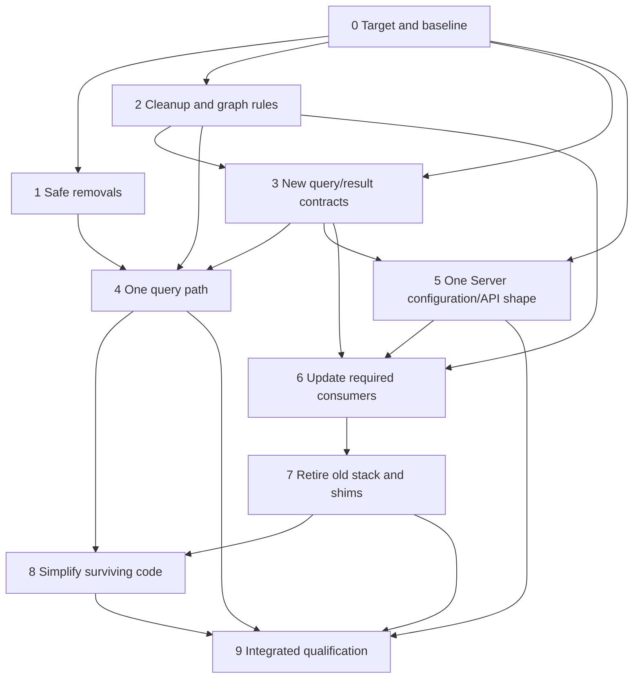

# ComputationGraph breaking-release cleanup plan

**Status: stages 0-5 are complete for their stated scope, including the
controlled performance comparison and Server configuration/API consolidation.
Stage 6 remains in progress: the named HTTP/gRPC/SSE/PostgreSQL, generic fan-out
and real-consumer slices are qualified, but the full native-only inventory and
old-consumer cutover are not complete. Stages 7-9 remain pending.**
**Updated: 20 October 2026.**
**Code baseline:** Core `e900b70d932e350d4d1ec7acb36ae2ba3cbf913c`
(guide refresh over implementation `54735c056ca45bd784462cd462c14f0a514de442`),
Server `15dafa225ac76ba9868452a7082f693027621ad7`, plus the current
[remaining-work inventory](computation-graph-remaining-work.md).
Test-infra is at `e4636204982a461fbfefd637ade22be9ac617071`; Learning is at
`5320f0b8ae06fa8789edf7ec4c763939ebb599d6`.

**Priority change - user directed, 19 October:** complete the HTTP source,
reaction and bootstrap, gRPC source and reaction, existing SSE reaction/sink,
and PostgreSQL source, bootstrap and stored-procedure reaction end to end.
Review and reuse the legacy implementations and their behavioral assertions.
Preserve static linking and dynamic loading inside the hosting instance's
ComputationGraph. Other connector families, application/SQLite migration and
general cleanup are paused unless strictly required by these components.
This overrides the earlier execution order and explicitly includes SSE.

## Execution record

| Stage | Current outcome |
|---|---|
| 0 | Completed: baseline/callers recorded; dependency waiting, the first-release component set and later four-family priority including SSE were explicitly selected. New interface/scope decisions still require approval. |
| 1 | Completed: retired helpers/cache/aliases, the empty DrasiLib feature, the ineffective bootstrap-buffer setting and the redundant query wrapper are removed. Consumers across all four checkouts use the current interfaces. |
| 2 | Completed: management close retains its reply/driver join and resource observation has explicit lifetime tracking. The agreed dependency policy was subsequently implemented in stage 3. |
| 3 | Completed: explicit dependency waits, deferred query/resource construction, automatic activation, explicit-stop preservation, waiting-graph startup/reconstruction, Server diagnostics and live native-factory registration. Named lifecycle, recovery, public-API and real-library checks pass. This is not qualification of every connector or deployment profile. |
| 4 | Completed: query/pipeline/source-subscription mode switches, old namespace/hash support and provider/cleanup fallbacks are removed. Functional, recovery, real-plugin, Server, responsiveness, lint and controlled performance checks pass; architecture artifacts are refreshed. |
| 5 | Completed: one explicit `instances` layout, no first-instance routes or configuration DTO aliases, canonical persistence, store-owned generated IDs, and updated consumers. The full Server matrix, current client builds and selected real browser/dataflow checks pass, with the pre-existing Learning Trading unused-local limitation recorded below. |
| 6 | Partly complete. Prioritized native network/PG implementations, generic fan-out, composed bootstrap and selected real consumers have recorded static/dynamic proof. Remaining selected families, native source-schema discovery, MySQL/SQLite live/coordinated packaging and old consumers still prevent full closure. Other families remain paused under the last execution priority. Kafka/SQLite reactions and functional gRPC bootstrap remain excluded. |
| 7-9 | Pending: old-stack retirement, surviving-code cleanup, and integrated qualification. |

**Current four-family status, 20 October:** HTTP/gRPC now have independent native
source/sink libraries and HTTP bootstrap, reusing the legacy authentication,
mapping, rendering and protocol helpers. Actual static/dynamic graph flows and
the external Server/test-service legacy/native comparison pass, with exact
ordered output equivalence and independently identified native libraries.
Their opt-in batching retains inputs and acknowledgements through cancellation
without changing the default bridge receive path.
This closes the named transport/template/batching profiles, not every old
recovery mode: native sinks still reject snapshot/progress-only recovery-control
messages, and HTTP completion helpers are not automatically negotiated by their
factories. The family contracts and
[remaining connector work](computation-graph-remaining-work.md#cw-44)
retain those limits explicitly.

The SSE slice now reuses the legacy renderer for query/default templates and
static/dynamic paths. Its bounded `query_snapshots` capability reads the actual
host catalogue; it creates neither another evaluator nor a second result cache.
Static and rebuilt dynamic libraries pass both-runtime graph/lifecycle checks,
including path limits, stop/restart and foreign-catalogue rejection. Server's
`nativeQuerySnapshots` recipe preserves JSON/YAML configuration and exact
resource dependencies. The rebuilt stock Server and Move-a-wall plugin pass the
real scene/API/SSE/browser checks, including empty/insert/update/delete snapshot
equivalence between Server and native SSE for the configured queries. All
isolated processes shut down; existing demo state was not reset. This endpoint
is a point-in-time read, distinct from the snapshot-first live subscription
contract below, and SSE remains a volatile notification sink.

PostgreSQL's native transaction source, coordinated bootstrap and stored-procedure
sink are implemented and qualified against real PostgreSQL and rebuilt native
libraries. Ordinary per-row delivery, SELECT-only standalone snapshots,
coordinated row bootstrap and bounded same-worker reconnect also pass their
focused real-database cases. Shared row CDC now retains every actual query
owner and safely handles different snapshot/WAL positions, partial transactions,
reconnect, explicit group replacement and memory-owner re-enrollment. The shared
bootstrap exports through a separate temporary slot without resetting the
configured live slot. Static and rebuilt dynamic libraries cover both Tokio
flavors. Fresh isolated GPU live qualification also covers concurrent
snapshot/CDC, atomic multi-table writes, rollback exclusion, graceful restart,
offline writes and abrupt runtime loss without changing the managed slot.
The seven selected PostgreSQL Server configurations and actual Trading conversion
are complete, as recorded below; runtime source-schema discovery remains open.
Cold reconstruction with undrained
persistent input-pipe frames is not established by the successful reconciled-drain
scenarios. Stage 6 is not complete.

**Completed execution decision - user directed, 19 October:** commit and push the native
family implementation before changing the shared recovery model. Then fix
fan-out generically: one source must support multiple subscribing transformers
(including queries), and one transformer must support multiple subscribing
transformers and sinks. Preserve every required subscriber's processing/replay
obligations, independent progress and lifecycle; do not remove ownership guards
or replace one producer with a separate producer per subscriber. This is an
existing graph requirement, not a PostgreSQL-only feature or optional scope.

The pre-fix implementation snapshot is published at Core `859ad07d`, Server
`e720b1d` and Test-infra `e463620`. The subsequent generic fan-out implementation
and real-consumer integration are complete for the scope recorded here, published
at Core `54735c05` and Server `15dafa2`. The later guide/comparison/PDF refresh is
published at Core `e900b70d`. These publications are complete, not pending worker
handoffs or uncommitted implementation work. The
shared contract and separate native consumer-progress extension
now retain bounded, independent observations of every actual consumer's progress,
readiness, failure and persistence. No aggregate query checkpoint is manufactured.
Graph binding proves the actual owner and data path, waits for missing
dependencies, installs source-specific replay comparisons, and awaits producer
stop before changing a required consumer or path.

The native transformer matrix now includes two direct handled sinks, two real
queries and two sinks per query in one hosting instance. Static/dynamic libraries
and both Tokio flavors preserve exact effects and one invocation per input.
Optional graph-owned `input_progress` records completed inputs for ordinary
transformers and handled sinks, including output continuations and batching,
without claiming persistence or external atomicity. Accepted sinks and
untracked required branches remain rejected. WAL replay uses the slowest actual
persistent owner, and validated stateless paths preserve logical producer
identity separately from original and immediate transport counters.

The combined Core query, transaction, middleware, replay, batching and
reconciliation regression selections pass; the Host/SDK extension and direct
native sink integration are qualified. The SDK bootstrap retry needed for
memory re-enrollment is also fixed. The existing native MySQL and SQLite Rust
replay/bootstrap/factory paths now use actual consumer sets and have passed
their real-database/file-backed integration selections. MySQL qualification also
fixed snapshot/live timestamp ordering and isolated finite binlog verification
from the live replication identity. This is shared-recovery adoption, not new
dynamic packaging or the full SQLite migration.

PostgreSQL whole-transaction fan-out is now also qualified through the distinct
`shared-transactions` and `shared-transaction-bootstrap` factories. They preserve
complete source transactions for actual persistent atomic queries; row mode is
not used as a substitute. Old single-owner/row positions remain distinct from the
new whole-commit/configured-snapshot positions. Static/dynamic and both-runtime
cases cover different counters and snapshots, slow feedback, drained restart,
third-owner replacement and interrupted initialization with explicit recovery.

Native bootstrap composition is now implemented in Core, Host and Server. Actual
joined PostgreSQL/HTTP queries pass through static and rebuilt dynamic providers
on both Tokio flavors, preserving per-provider handover metadata, watermarks,
retirement holds and cleanup. The proof includes a PostgreSQL write while the
HTTP snapshot is paused, no premature configured-slot feedback, live updates,
rollback exclusion and mixed-preparation restart.

Trading's canonical bundle now uses all 11 actual app queries, two shared
PostgreSQL sources and one HTTP source; the app provisions that bundle in one
canonical batch instead of creating per-query sources or omitting initial prices.
The fresh real
Server proof now passes through the actual app provisioning path: original
50-price initialization, joined snapshots, portfolio/watchlist API writes, live
price fan-out and aggregates, rollback exclusion, SSE output and idempotent repeat
setup. Both configured slots remain intact and inactive after shutdown, temporary
slots are removed, and the isolated processes, container and state are cleaned up.
Local startup tooling, safe tutorial setup, documentation and the final consumer
handoff are complete. All seven PostgreSQL configurations and Trading's canonical
bundle reproduce exactly from their recipe/query inputs and actual factory
metadata. Tooling passes 69 cases; the full serial Trading app suite passes 310
cases plus 41 policy cases. The untouched lazy-modal accessibility case can time
out in parallel runs; its assertions/timeouts were not weakened. This closes the
current fan-out/consumer work, not the broader stage-6 migration inventory.
The batch does not imply one atomic cross-source snapshot or atomic external
effects; HTTP snapshots/live prices retain their non-durable replay boundary.

**Dependency policy - user decision during execution:** a valid node may be
declared before its dependencies are available. The node must say what it is
waiting for and begin working automatically when the required dependencies
arrive, subject to its startup policy. Missing dependencies are not terminal
configuration errors. This replaces the proposed choice between strict live
changes and temporarily incomplete graphs.

**Stage 5 empty-server policy - user decision:** an absent or empty `instances`
list starts an empty Server. Instances are created explicitly through the API;
startup does not invent a default instance. Instance-level component routes
require an explicit instance ID.

**Stage 5 identity and authority policy - user decision:** missing IDs are
generated on each file-only load. `configurationStore` seeds an uninitialized
stored instance from the file once, then retains accepted definitions and the
generated ID across restarts. An accepted empty definition is initialized state,
not permission to import again. Explicit IDs retain keyed instance namespaces;
ambiguous generated-ID selection in a shared store fails rather than choosing
the first entry. `persistConfig` remains the separate YAML-saving feature.
Host settings and store locators still come from a syntactically valid file.

Stage 5 removes the Server's root-to-instance normalization, single-instance
save promotion, default-instance router/middleware and configuration-module DTO
aliases. Persistence retains one Server-settings value and one per-instance
settings map. Missing metadata and save failures stay explicit; provider/secret
references and atomic writes remain. Startup retains its resolved configuration
instead of loading a file twice and generating another identity.

The UI makes no component HTTP/SSE requests without a valid selection. It clears
stale scoped results/events, ignores late metadata from prior selections, and
offers first-instance creation from the empty selector. The unused duplicate
SSE modules and Playground's development-only injection proxy are removed.
Playground now uses the existing instance-scoped Server push endpoint. Both SSE
CLI copies require an instance ID. VS Code uses the Server's own configuration
schemas rather than another hand-maintained root/instance model.

Stage-5 evidence: the complete Server test run has **948 passing tests, no
failures and 36 existing ignored cases across 45 targets**. Those ignored cases
are not claimed as qualified. Server and redb all-target Clippy pass. UI tests
(13), React SDK resource tests (62), Trading tests (305 plus 41 tooling cases),
SSE CLI addressing tests, native-comparison generation tests (8), scripted
recovery self-checks, and the relevant builds pass. The VS Code bundle builds;
this is not a claim of full VS Code UI acceptance.

Real-browser checks prove empty startup, rejection of stale/missing selections,
first-instance creation, canonical YAML persistence and scoped SSE reconnection.
The actual Playground client sends insert/update events through the new Server
using rebuilt HTTP/SSE libraries; query rows change from `value: 7` to `value: 8`.
The rebuilt SSE CLI receives the update and deletes only its own reaction.
All temporary Server/browser/CLI processes are stopped. Tutorial documents are
regenerated; historical captures and solution-template schemas are unchanged.

Learning Trading's normal build still reports the previously recorded unused
`createdReaction` field. Its types and Vite build pass with only that existing
unused-local lint excluded; a successful normal build is not claimed.
Full connector replacement and containerized tutorial/demo qualification remain
in stages 6-9. Logs are retained as `cleanup-stage5-*.log` and browser evidence
under `cleanup-stage5-browser-iASEt7/` in session artifacts. This dated stage-5
evidence predates the later publication snapshot recorded above.

This requires more than changing `allow_incomplete`. The earlier query/reaction
paths retained a missing-dependency error but required an explicit start/retry,
and query assembly could fail before its helper bindings existed. Stage 3 now
declares those helpers and resources before resolving them. No second graph,
unowned retry worker or periodic retry loop is added. Genuine construction and
processing failures still require their normal explicit recovery action.

Stage-3 evidence so far includes both-runtime resource/factory waiting and
reconstruction cases, exact query/reaction insert-update-delete results when
components are added in reverse dependency order, disabled auto-start and
explicit-stop preservation, and dependency-ordered query cleanup/update checks.
Normal source/query/reaction data-flow cases also pass. The full library run
has 1,096 passing tests and two existing ignored cases; focused control,
resource, QoS, recovery and both-runtime suites pass. Server declaration,
configuration and catalogue suites pass, including an actual rebuilt native
plugin loaded after its nodes were declared. Documentation examples, scoped
Clippy and native dependency-isolation checks pass.

Server's readable shorthand still requires factory metadata to describe an
interface, and host resource declarations still require reconstructible
recipes. These are current-contract safeguards, not compatibility shims.
The broader connector matrix and final Podman demo qualification remain in
later stages.

**Stage 4 timestamp decision - user approved:** the main result timestamp
means the time Drasi produces the result, including scheduled results. The
graph envelope retains the logical event/due time separately. This matches
live-input results and removes the path-dependent interpretation; it does not
change the scheduled time or the query's row values.

Stage 4 now uses the actual instance/graph/query storage identity and one native
configuration record. Memory source progress is an explicit provider capability,
not a fallback; persistent queries require complete output resources and real
transaction ownership for atomic publication. Reset failures remain fenced by
the current marker. Unsupported records and missing producer identities are not
adopted, and old namespace data is neither translated nor deleted.

The removed public hash helper's semantic assertions were ported to the native
fingerprint, not discarded. Ordinary result metadata is projected at its API
boundary; scheduled and live results share production-time timestamps. Source
recovery and bootstrap no longer depend on admission mode. Actual source-owner
dependencies remain protected without inventing graph nodes for resource-owned
source hosts. Explicit persistent query updates retain their output-generation
and sequence behavior through both admission paths.

The latest expanded library run has 1,102 passing tests and two existing ignored
cases. Focused query faults, actual WAL/shared-source reconstruction, ordering,
source/query/reaction arrival, persistent reset and atomic-output suites pass.
Matching-artifact Server/SDK checks now pass: nine native libraries were rebuilt,
HTTP/gRPC query execution and metadata agree, and Server configuration,
persistence, catalogue and selected native load/restart/clone cases pass.
Native bootstrap boundary checks preserve initial snapshots and clean restart
without resnapshotting. Both-runtime responsiveness and final scoped lint pass;
architecture artifacts and requirement validation are refreshed.
Controlled performance comparison also passes for the measured profiles; this
is not final integrated or connector qualification.

The comparison used a freshly built, user-approved detached baseline at
`cb155557e59cbe89b5929120ec6ab57f58762353`, not an older saved executable.
Both versions used unchanged benchmark sources, Rust 1.95.0, identical release
settings and the same dependency lockfile. All 243 normalized dependency/feature
rows matched, including explicitly matched Tokio features. Seven interleaved
repetitions independently checked the result values in every process.

| Workload | Median outcome relative to the pre-cleanup baseline |
|---|---|
| Ordinary fast path, windows 1 and 32, 100,000 inputs | Throughput +18.0% / +10.3%; allocations per input -6.1%; allocated bytes per input -1.8%. |
| Four-query ordinary projection, both Tokio flavors | Throughput +4.3% / +4.1%; p99 latency -4.7% / -6.4%; shutdown time -6.3% / -4.6%. |
| Four-query native projection, both Tokio flavors | Throughput -0.1% / +0.5%; latency and shutdown differences were small and within local run variation. |

The four-query cases used 10,000 inputs, window 32 and 64-byte payloads.
Peak process memory remained approximately flat across the measured cases.
The native current-thread case had a small, repeatable increase of 192 KiB
(1.1%); other peak-memory medians ranged from -1.7% to +0.3%. This difference is
recorded rather than classified as timing noise.
Raw binaries, build provenance, dependency features and results are retained
in session artifacts under `cleanup-stage4-performance/`. These comparisons
cover the cumulative local cleanup changes, not an isolated estimate of one
individual edit.

Stage 1 preserves direct query delivery tracking, actual snapshot/outbox types,
linear transactions and independent source-order assertions. Only tests of
retired helpers, aliases and the no-op setting were retired; query fault,
replay, ordering, persistent restart and linear-transaction checks remain.
Removed query settings now fail parsing instead of being ignored.

Recorded checks include the full Core workspace all-target check, 1,094 library
tests (two existing ignored cases), 101 passing documentation examples, focused
query fault/linear transaction/QoS/replay/ordering suites, Core library lint,
native dependency isolation, Server all-target/configuration/API checks and
React SDK/Trading checks and builds. Generated architecture artifacts were
refreshed. Historical React response captures were not rewritten.

The Learning Trading build has an existing `TS6133` error for the unchanged
`createdReaction` field in `src/services/DrasiClient.ts`. With only that existing
unused-local lint excluded, its current types and Vite bundle pass. This is a
recorded baseline limitation, not a successful normal tutorial build.

The cancelled management-close regressions failed on both Tokio flavors before
the fix and pass afterward. Tests cover cancellation before admission, during
store close and after acknowledgement but before the driver joins; concurrent
callers; retained store/driver failures; and actual redb lease release/reopen.
The existing restore-error and graph-driver cause-preservation checks also pass.
No shutdown deadline or plugin-private worker guarantee is added by this fix.

Resource-name regressions failed before the ownership fix on both runtime
flavors. They now preserve declared borrowed and graph-owned resources through
observer detachment, removal and replacement; graph-owned cleanup occurs once
at its actual boundary. Observation-only bindings still disappear when their
last user is gone. An explicit rebind can promote an observed binding into a
declared resource without leaving it subject to observation cleanup. Resource,
reconciliation, configuration-snapshot and metadata-retirement suites pass.

Raw run logs are saved in the session artifacts as
`cleanup-stage0-baseline.log`, `cleanup-stage1-*.log` and
`cleanup-stage2-*.log`. Changes remain uncommitted.

## Goal and release policy

Remove unwanted compatibility code, simplify the paths that remain, and update
all affected consumers without losing required functionality.

This is an intentional **breaking release**. No migration facility, old-API
wrapper, previous-format reader, dual-version deployment or rollback to older
binaries is required. Consumers will use the new interfaces and be rebuilt.
Tests may adopt new names, request formats and response shapes; they must not
lose the meaningful behavior they previously checked.

Breaking compatibility does not authorize deleting user data or weakening
current-version correctness. Normal bootstrap, transactions, source progress,
same-version restart, pending-output replay, snapshots, explicit reset and safe
cleanup remain required where the selected application uses them. Unsupported
binaries or data must fail clearly, not be silently reinterpreted as current.

The scope is CW-62/63/64/65, old-stack retirement under CW-44/45, and focused
controller/warning cleanup under CW-34/61. Only the necessary slices of
CW-08/09/10/18/36/37/41/43/46/47 are prerequisites or checks here.
This plan does not claim to close every broader item under those numbers.

## Working constraints

- Work in the existing checkouts and their current branches. Do not create
  additional sessions/worktrees or switch branches without authorization.
- Preserve concurrent work, including the current library README,
  developer-guide and Stockroom example edits. Do not overwrite or remove them
  as cleanup; coordinate any overlapping change.
- Keep the optional query-plugin performance investigation isolated. Removing
  the redundant query wrapper does not require dynamic query loading.
- Commit or push only when requested. Every completed stage must leave a
  coherent, buildable set of affected repositories.
- Use Podman for container-dependent checks. Use disposable, specifically
  identified fixtures rather than a presenter's database or running demo.

## Sequence and real dependencies

The numbered stages give the recommended working order. Dependencies below
identify what must actually be ready, rather than treating every earlier stage
as a prerequisite for every later one.

| Stage | Work | Required before starting |
|---|---|---|
| 0 | Agree the target and record behavior/consumers | Nothing |
| 1 | Remove retired helpers/settings and the redundant query wrapper | Stage 0 |
| 2 | Fix cleanup ownership and settle the dependency policy | Stage 0; independent of stage 1 |
| 3 | Establish query/resource/result contracts and automatic dependency waiting | Stage 0 and stage 2's ownership foundation and agreed policy |
| 4 | Consolidate the full query compatibility mode | Stages 1, 2 and 3 |
| 5 | Simplify Server configuration and routes | Stage 3 and the target choices from stage 0; normally after stage 4 to reduce rework |
| 6 | Replace required old-stack consumers one at a time | Stages 2, 3 and 5 for the affected path |
| 7 | Delete the old plugin stack and remaining binary/decoder shims | Stage 6 for every consumer of the code being deleted |
| 8 | Simplify surviving controller code and expand unused warnings | Relevant deletions from stages 4 and 7 |
| 9 | Run integrated qualification and reconcile the inventory | All selected implementation stages |

Small CW-63 removals may be pulled forward after stage 0 when they are
independent and worthwhile. Do not spend heavily redesigning an old SDK that
stage 7 will delete.



## Common checks at every stage

Before removing a path, record what useful work it performs, who calls it,
what replaces it, and which assertions demonstrate that replacement.
Do not use a file's name, age or lack of compiler warnings as proof it is unused.

Every stage must include:

- Compilation of the changed packages and affected consumers, including the
  supported feature combinations. Remove a no-op feature only from its owning
  package; a feature with the same name elsewhere may enable real functionality.
- Targeted tests with exact expected results or effects, not just successful
  startup or absence of a crash. Where fixing a defect, demonstrate the failing
  case before the fix.
- Current-thread and multi-thread coverage for changed asynchronous ownership
  or processing behavior.
- Formatting, relevant lint, generated-documentation checks and searches for
  production/build references to the removed interfaces.
- A removal ledger: deleted code, updated callers, retained assertions, remaining
  dependencies and any intended behavior change. Save run evidence outside
  tracked source unless it is deliberately part of a reproducible test.

Do not delete a test wholesale merely because it uses an old API. Port its
functional assertions. Remove tests whose sole purpose is preserving an
obsolete alias or old binary/format. Preserve native/shared type-identity checks,
malformed-input rejection, ownership and current-version recovery checks.

## Stage 0 - Agree the replacement target and establish the baseline

**Work items:** scope for CW-18/44/45/65; supporting CW-36/40.

### Work

Inventory production callers, examples, CLI/UI clients, tests, CI commands,
plugin build scripts and dependency manifests for the removal targets.
Include the four repositories and the independently loaded libraries they use.
Record the starting source revisions and existing uncommitted changes.

Create a required-functionality checklist with concrete expected outcomes:
sources and initial snapshots; Cypher/GQL queries; joins/aggregation/time-driven
queries; selected storage and recovery profiles; result snapshots/live feeds;
destination behavior; component management; identity/secrets; and the demos.
Separate required features from optional future features.

Review relevant changes on current upstream `main` before claiming complete
replacement coverage. Missing required fixes/features need an explicit
disposition; this is not authorization to merge, rebase or overwrite the current
branch. Do not freeze a stale branch's omissions into the feature checklist.

Agree the new public surfaces. The proposed Server target is an explicit
`instances` configuration and instance-scoped component routes. Decide whether
any short form has a genuine new-release usability purpose rather than keeping
it for old clients. Choose the current binary/wire contract and useful query
API independently of obsolete aliases.

### Checks

- Record baseline results for representative memory and persistent queries,
  independent query lifecycle, snapshots/live subscriptions and required
  connector effects. Use expected values, not only old serialized bytes.
- Confirm the matching host/plugin provenance and baseline feature flags.
- Record existing failures separately; they cannot be relabelled passes later.
- Use the existing exact-output workload approach to capture query/control
  costs relevant to the changed paths. Agree acceptance limits before judging
  a regression acceptable; no universal numeric allowance is assumed.

**Exit:** the required feature set, target interfaces, baseline and removal
dependencies are explicit. Unresolved product choices are settled before code
that depends on them is removed.

## Stage 1 - Remove the safe leftovers

**Work items:** CW-62 and the narrow wrapper-removal slice of CW-64.

### Work

Remove retired `QueryBase`, `SequenceDedup`, the old query-output cache,
forwarding modules, duplicate type/import aliases and deprecated tracing
initializers. Keep the actual result exchange, inspection and logging
implementations. In particular, do not delete `queries/output_state.rs` merely
because it contains the retired cache: it also contains active read types.

Remove the empty DrasiLib `computation` feature and the ineffective
`bootstrapBufferSize` setting, including affected Server mappings, builders,
examples, commands and documentation. Do not remove real Core/SDK features or
real input-queue capacity controls with similar names.

Remove `TransactionTransformer::query/from_query` and its query variant once
callers use the existing direct query/factory path. Preserve delivery tracking:
replacing a wrapper with an untracked raw constructor is not equivalent.
Keep the linear transaction implementation unchanged.

### Checks

- Search for each removed symbol/setting in production, examples, manifests,
  feature guards, build scripts and documentation; every remaining occurrence
  must be an intentional historical reference or rejection check.
- Compile all affected consumers; run the new canonical import/examples.
- Confirm removed settings are not silently accepted as if they work. Confirm
  the real queue-capacity setting still controls buffering.
- Exercise ordinary/direct-native queries, both languages, query-result reads
  and pending-output replay through the replacement constructor.
- Run the linear transaction tests to prove the removed query variant did not
  remove multi-step atomic processing.

**Exit:** the retired surface is gone without a replacement compatibility shim;
useful behavior is available through the chosen current APIs. The full mode
removal and its qualification are recorded separately under stage 4.

## Stage 2 - Fix ownership and settle the dependency policy

**Work items:** remaining cancelled-close slice of CW-08; relevant CW-09 rules.

### Work

Keep the management close operation and task handle owned until completion,
including when a caller stops waiting. A retry must observe/join the same
operation rather than losing the task or blindly sending another request to
an already-closed driver. Preserve the completed restore-error fix.

Replace cleanup decisions based only on an `attached/` name prefix with the
actual declaration origin and cleanup ownership.

The selected graph policy is now declaration first, dependency resolution
later. Its implementation spans query/helper assembly, provider bindings and
readiness diagnostics, so complete it with the common contracts in stage 3
rather than making a partial strict/incomplete flag change here.

These are bounded fixes, not a new lifecycle framework or the full CW-06
startup/shutdown deadline project.

### Checks

- Cancel close before request acceptance, while storage close is held, after
  the response and before the task is joined. Retry and check actual completion,
  once-only resource release and retained errors.
- Exercise concurrent close callers, storage-close failure and driver failure.
  A timeout or cancellation must not report successful cleanup or permit unsafe
  reuse of the resource.
- Repeat the load/validation-plus-close error tests; both causes must remain
  inspectable.
- In stage 3, exercise add-before-source and other missing dependencies,
  automatic activation, export/rebuild and removal under the selected policy.
- Use caller-chosen resource names, including `attached/`-like names, to prove
  names do not cause borrowed resources to be closed or owned resources leaked.
- On both runtime flavors, keep an unrelated component doing useful work while
  the selected operation is held or retried.

**Exit:** cleanup remains owned and retryable, resource lifetime does not depend
on a name, and the dependency policy needed by stage 3 is explicit. Automatic
dependency convergence is not claimed complete by this stage.

## Stage 3 - Establish the new query and result-access contracts

**Work items:** necessary CW-18, CW-10 and reconstruction/result-wiring CW-43.
**Not included:** making the evaluator a dynamic plugin.

### Work

Accept well-formed declarations without requiring every dependency to be
available immediately. Report exactly what blocks each node: for example a
named source, query, resource, factory or unconnected port. Re-evaluate affected
nodes when those dependencies change, using the existing graph owner and its
tracked operations. Start eligible nodes automatically; keep `auto_start: false`
and explicitly stopped nodes stopped. Do not turn arbitrary processing,
storage or plugin failures into an automatic retry loop.

Query helper construction must follow this same contract. Adding a missing
source must not require the user to re-add the query or manually invoke its
retry path. Preserve the logical component identity and correctly retire/fence
any replaced construction generation. Do not silently weaken cleanup to avoid
the reassembly work.

Apply the same rule to building, live changes, saved definitions and
reconstruction. A waiting graph must reopen as a waiting graph, not be rejected
or silently relabelled by an inconsistent completeness flag. Intrinsically
invalid definitions, duplicate identities, incompatible supplied interfaces
and unsafe topology changes must still produce clear errors.

Define the new release's query configuration, storage namespace, producer/output
identities and record versions. Identify what must remain stable across a
same-version restart or retry. No old namespace/hash translator or data converter
is needed.

Make the existing direct query path provide the required catalogue, snapshot,
retained-output and live-result connections. Keep it in the single instance
graph. Explicit processing-only graphs may omit a result outlet; a normal
application needing subscriptions cannot silently get such a graph.

Keep actual provider capabilities explicit. A memory profile and a persistent
atomic profile can have different capabilities; neither should masquerade as
the other because of a compatibility fallback.

### Checks

- Add queries before sources, reactions before queries, and factory components
  before required resources/implementations. Assert the exact missing dependency
  is visible, then supply it and verify actual processing without a manual
  start/retry or re-add. Cover both runtime flavors.
- Save and reopen an unresolved graph, then complete its dependencies and
  verify the same results. Keep unrelated nodes processing while others wait.
- Check multiple missing dependencies, removal/replacement during a wait,
  disabled auto-start, explicitly stopped nodes and genuine processing failures.
  None may be hidden by a broad retry or success-shaped fallback.
- Round-trip current records and reject unsupported/malformed versions without
  deleting or rewriting data. No positive previous-release reader test is needed.
- Verify exact additions, updates, removals and aggregate/default-row behavior
  using current query and result APIs.
- Check complete and empty initial snapshots, live updates during snapshot
  attachment, retained-history gaps and rejection of readers from a replaced
  query generation.
- Export, stop, reopen and reconstruct the new definitions, then confirm actual
  result reads and live subscriptions work.
- Keep input checkpoints, result sequence and replay transport identity distinct;
  diagnostics must not change retry identity.
- Demonstrate a clear error for missing catalogue/outlet/provider capabilities,
  rather than a success-shaped empty result.

**Exit:** there is a concrete new path with complete required behavior to which
the remaining query and Server callers can move.

## Stage 4 - Collapse the query compatibility mode

**Work item:** the full remaining CW-64.

### Work

Remove the old `runtime_compatibility` branching, `legacy_hash` support and
legacy-namespace rules, using stage 3's chosen contract. Eliminate provider
relaxations and unsupported-clear allowances that exist only for the old path.
Update active callers/providers rather than retaining another compatibility flag.

Explicitly account for every behavior formerly hidden behind that flag:
startup, source subscriptions, no-source queries, scheduling, profiling,
checkpoint setup, output persistence, reset and cleanup.

### Checks

- Compare required outcomes before/after using fresh fixtures for the new
  format, including both languages and supported memory/persistent profiles.
- Run multiple queries sharing sources; stop/update/remove one query and verify
  its helpers finish while the source and sibling queries remain correct.
- Exercise zero-input and empty-result cases and time-driven work with no new
  source input.
- Hold real storage commits, inject write/rollback failures and cancel at
  controlled points. Check saved rows and source positions after reopen.
- Crash/reopen after commit but before delivery; replay pending output without
  recomputing it or advancing past unfinished delivery.
- Interrupt explicit reset and verify incomplete state is rejected; an ordinary
  stop must not become a reset.
- Run the relevant shared-storage/journal checks: reservations, state,
  checkpoints and output still obey the actual transaction owner.
- Compare matched query/control workloads. Removing code is not a justification
  for a performance or memory regression.

**Exit:** one documented query path covers the selected behavior, with no
compatibility-only branch or implicit provider downgrade.

## Stage 5 - Simplify Server configuration and routes

**Work item:** CW-65 and the directly affected CW-45 consumers.

### Work

Implement the agreed canonical Server layout and explicit instance selection.
Update UI, CLI, templates, demos, learning material and test infrastructure
before removing their old calls.

Remove duplicate root-level instance fields, root-to-instance persistence
conversion, first-instance convenience-route middleware and compatibility-only
DTO re-exports. Keep real per-instance identity/secret/bootstrap settings and
atomic configuration saves.

### Checks

- Start one-instance and multi-instance configurations using the new shape.
  Confirm changes to one instance never affect another.
- Save/reload all supported settings, including secret references, provider
  configuration, memory limits and managed definitions.
- Exercise create/read/update/start/stop/remove and result/SSE operations through
  the chosen routes, including explicit missing-instance errors.
- Confirm removed routes/layouts reject clearly rather than targeting the first
  instance or dropping unrecognized settings.
- Run Server configuration/API tests, UI tests/type-check/build and plugin
  installation/tooling checks. Generated OpenAPI must match the new routes.
- Smoke-test the updated demos and selected tutorial/test-infra clients against
  the actual new Server, not mocked routes.

**Exit:** consumers use one intentional Server surface and no automatic old
configuration conversion remains.

## Stage 6 - Replace old-stack consumers in complete vertical slices

**Work items:** CW-44/CW-45; relevant CW-47 applications and providers.

**Current exit status, 20 October:** see the
[remaining connector work](computation-graph-remaining-work.md#cw-44)
for missing native surfaces. The priority network/PG and
generic fan-out/composition work is not an unstarted task. Native runtime schema
discovery, remaining families/services/packaging and ordinary callers still
prevent native-only closure. Stock-Server GPU hosting is still absent despite
the embedded GPU proofs. Cold undrained persistent input-pipe reconstruction is
not qualified by the completed drain-barrier cases.

The progress subsections below are successive execution records. Their counts
describe named checkpoints, not one additive or freshly repeated full-suite
total. Other families remain paused unless selected for execution.

**Initial inventory, 18 October 2026:** direct old-SDK dependencies include
22 source packages, 19 bootstrap packages, 18 non-fixture reaction packages,
two non-fixture identity packages and three secret-store packages. Reaction and
identity test fixtures bring the manifest total to 66. This is a dependency
count, not a claim that each package needs an independent implementation.
Hosted application-source helpers and ordinary API/adaptation users were
additional dependencies. At that checkpoint the native network template/batching
coverage was incomplete; the later priority slice added those implementations
and their real-service assertions. This initial dependency count is historical,
not the current feature-completion count.

**Current dependency inventory, 20 October:** 64 tracked
source/bootstrap/reaction/identity/secret-store manifests still directly depend
on the old SDK through normal/target dependencies: 22 sources, 18 bootstrappers,
17 non-fixture reactions, two non-fixture identity providers, three secret stores
and two reaction/identity fixtures. Host SDK plus two index providers bring the
broader component-manifest total to 67. A dependency declaration is not a request
to rewrite every package or delete shared protocol/provider code. The selected
scope and its consumers govern retirement.

**User-selected first-release scope, clarified after checking the reference:**

| Family | Required components |
|---|---|
| Application | Source, reaction, bootstrapper |
| gRPC | Source, reaction |
| HTTP | Source, reaction, bootstrapper |
| Kafka | Source, bootstrapper |
| Kubernetes | Source, bootstrapper |
| MSSQL | Source, stored-procedure reaction, bootstrapper |
| MySQL | Source, stored-procedure reaction, bootstrapper |
| PostgreSQL | Source, stored-procedure reaction, bootstrapper |
| SQLite | Source, bootstrapper |

This is **23 existing components**. The user explicitly excluded new Kafka and
SQLite reactions and functional gRPC bootstrap from this first release.
There is no standalone gRPC bootstrapper; the source's existing
`RequestBootstrap` handler is only an empty-response stub and must not be counted
as implemented bootstrap support. The SQL reaction references are the existing
`storedproc-mssql`, `storedproc-mysql` and `storedproc-postgres` packages.

**Implementation and coverage requirement - user directed:** use the existing
components as the reference. Reuse or extract their connection, read/write,
conversion and protocol logic instead of independently rewriting it just to
change SDKs. New implementations must have equivalent levels of test coverage.
Map and retain the existing functional/error/recovery assertions, supplement
them with native interface/lifecycle checks, and exercise actual services where
the reference tests do. A matching test count alone is not equivalent coverage.

**Application slice progress:** an existing native application reaction is
reused. The application source now has a graph-polled channel constructor that
reuses the existing input handle/value builders without SourceBase, dispatcher
or a processing task. It preserves bounded input across stop/start and assigns
an explicitly volatile producer incarnation rather than impersonating durable
progress. Application bootstrap now implements the native snapshot interface
over its existing application-owned data and filtering logic.

The new snapshot/channel/reaction path runs end to end in one graph on both
Tokio flavors. Initial rows are read from the query snapshot; live insert,
update and delete results reach the native application reaction. Source and
reaction stop/start remain covered. A previously hanging lifecycle test now
inspects the retained per-node failure, preserves the same typed-error assertions,
and explicitly cancels the graph under a deadline.

**Durable application decision - user directed:** use native durable admission;
reject sends before activation and while stopped. Keep volatile channel buffering
as a separate, explicit contract. `NativeApplicationSource::durable` now delegates
to the existing `SourceAdmission` and persistent QoS channel. Producer sessions,
retry receipts, replay and retention reuse that service; no application-specific
WAL, publication worker or pruning runtime was added. A receipt proves durable
input acceptance for the configured failure scope, not downstream completion.

Current component checks cover 79 tests and 21 documentation examples, with
26 existing documentation examples ignored, plus all-target component lint.
Seven application integration cases exercise both Tokio flavors: the volatile
native trio, durable lifecycle/receipts/binding validation, unhandled-input
reopen/retry, safe removal/producer retirement, durable input through a persistent
query, and relationship direction/aggregation inside DrasiLib. The 15 existing
admission cases also cover reused capacity, corruption,
cancellation and process-restart services. The old application WAL tests remain
baseline evidence only; native durability is exercised through admission, not
inferred from those tests.

**Application helper retirement:** the application bootstrap provider now uses
only `ComputationBootstrapProvider`. Removed its count-only callback, descriptor,
empty legacy configuration variant and unused database/serialization/plugin-SDK
dependencies. The two tests of that unsupported empty configuration were retired;
the real builder, data, filtering, failure and native snapshot assertions remain.
Its README now describes actual application-owned data rather than nonexistent
automatic Source caching.

Server's unused application bootstrap/reaction registrations and normal application
dependencies are removed. The reaction descriptor that discarded its receiver is
also removed; Server metadata tests use an explicit metadata-only fixture. The
application source/reaction packages shed unused copied dependencies, and the test
host no longer depends on application bootstrap without using it.

`computation_runtime` now demonstrates native application source/query/reaction
nodes inside the DrasiLib-owned graph, with cleanup even on failure. The new
`native_application_host` cases retain the existing relationship-direction and
aggregation assertions, exercise late query creation and bootstrap, and run on both
runtimes. The reverse-direction assertion now receives populated snapshot data
rather than merely observing an unseeded query.

The removal contract is intentionally strict: an attempted live removal with
unhandled journal input does not commit. After the consumer handles the pending
input, removal succeeds, old component/admission handles are fenced, and a borrowed
journal and its receipts remain usable. Producer retirement rejects pending
obligations; re-registering a retired name does not revive the old session.
No drain safeguard was weakened.

Qualified after these removals: all 79 application package tests and 21 doctests,
the native application integrations, the original two application-source E2E
cases, 11 remaining library bootstrap tests, 21 Server factory/runtime tests,
33 selected Server integration tests, package/Server Clippy, and the embedded
test-host build. The latter retains one existing unused `ProfilerSummary` warning.
The lockfile refresh added the already-required local `drasi-core-types` and
`drasi-computation-contracts` packages without changing registry package versions.

The old Rust application Source/Reaction interfaces still have active test and
performance-example users. Those consumers and their required behavior must move before the remaining application interfaces can be deleted;
the application slice and stage 6 are not complete.

**Source-sharing provenance correction:** the former `computation_instance.rs` used an
ApplicationSource named `orders`, owned by its first DrasiLib instance. The second
instance borrowed its `SourcePluginHost` through `borrow_computation_source`.
The example was added by ComputationGraph-branch commit `61343ccf`; neither that
example nor the borrow API exists in current `main` (`207ef6f3`). It is not an
independently running source or evidence of a pre-existing main-branch sharing
contract. Review this branch-specific adapter example during adapter retirement;
do not make a new native sharing service or a bridge decision a cleanup prerequisite
on its account. Ordinary one-source/many-queries use within an instance remains
required and is a separate capability.

**Native input and embedded-host cutover:** the shared query pipeline builder now
accepts actual native source endpoints and explicit native bootstrap providers.
It preserves the common evaluator, ranked input, middleware, indexes, scheduling
and result outlet without Source-plugin reader nodes. Query updates retain native
endpoints/bootstrap and fence source generations without taking source ownership.
Invalid native bootstrap declarations, explicit Source-plugin selectors and
custom input rewiring are rejected rather than ignored.

Required native connection declarations now survive a missing endpoint, including
static construction and desired-topology reconstruction. The existing
revision/event-driven dependency binder resolves them after node-first addition;
no new polling worker or retry runtime was added. Malformed pipes/known endpoints
remain errors. Reconstructible pipe recipes survive live query replacement.
Update planning reads actual activation deferrals from the coherent graph
publication, preserving both pending starts and explicit stops. An explicit
`start_query` still reports missing readiness; accepted configuration updates can
retain dependency waiting without falsely claiming a running query.

The embedded test host's initial/programmatic application sources, queries and
reactions now use native nodes. Its channel/callback observers share one owned
worker, preserve their respective JSON/profiling shapes, retain paused input and
backpressure full output. Startup registration precedes asynchronous work;
failed/cancelled shutdown retains ownership and can be awaited again. The host
also preserves application metadata, real auto-start values and one-time receiver
ownership. Removing unused bootstrap dependencies eliminated its old SDK/FFI
dependency closure without updating registry package versions.

Qualified so far for this follow-up: 15 focused native source/reaction cases;
7 both-runtime native hosted cases, including six late-source/update/stop-intent
combinations; 71 existing/new topology, addition, dependency, reconciliation and
pipeline cases; the library suite (1101 passed, 2 existing ignored); and the entire
test-host library suite (127 passed). Real native input was compared against
channel, batch and profiling projections with bounded output and pause/resume.
The test host retains its existing unused `ProfilerSummary` warning. Evidence:
`cleanup-stage6-native-input-intent-and-host.log`,
`cleanup-stage6-native-dependency-convergence.log` (including the explicit-start
contract failure subsequently fixed), and
`cleanup-stage6-native-host-full-regressions.log`.

The `computation_instance` example now demonstrates native one-source/multiple-query
use in one instance instead of branch-only cross-instance adapter sharing. Its
actual run verifies equal results, continued primary-query delivery while the
observer query is stopped, and delivery of the buffered change after restart.
Core/application/integration all-target Clippy passes with warnings denied.
The test-service consumer compiles. Test-host Clippy also exposes existing
warnings in unrelated code (including its `test-data-store` dependency); those
are not a clean whole-workspace lint claim. The broader component/SDK retirement
and integrated qualification remain open.

**Input dispatcher follow-up:** the embedded producer no longer keeps the
test-run registry read guard while forwarding. It uses the shared owned-worker
primitives and graceful join; cancelled close and a blocked queued-input flush
retain their work for retry. Conversion validates whole batches before acceptance,
uses shared graph value types, supports relation updates/nested properties and
CDC deletes, and preserves logical source time in core units. Native-channel
failure is retained and surfaced on later calls, not logged as successful
delivery. Seven focused cases cover these contracts, including a real native
source/query/reaction delivery while the host registry remains writable.
The expanded test-host library suite now passes all 134 cases and test-service
still compiles. Package-scoped Clippy reports only the previously identified
unrelated warnings after fixing the new handler's constructor naming.
Evidence: `cleanup-stage6-native-input-dispatcher.log` and
`cleanup-stage6-test-host-native-final.log`.

Relevant evidence includes `cleanup-stage6-application-retirement-contract.log`,
`cleanup-stage6-native-application-host.log`,
`cleanup-stage6-native-bootstrap-retirement.log`,
`cleanup-stage6-application-sdk-removal.log`,
`cleanup-stage6-server-application-retirement-after.log` and
`cleanup-stage6-test-host-bootstrap-dependency.log`.

**Query-reader cutover:** `DrasiLib::subscribe_query_results` now reads the existing
native result catalogue directly. Server SSE attachment no longer creates a
temporary application reaction or spawns an unowned drop-cleanup task. The
connection keeps bounded Channel backpressure and uses the existing outbox to
recover Broadcast gaps; missing history is an error, not a skipped result.
Readers are scoped to their instance and query generation and return a coherent
snapshot plus changes strictly after its sequence. They unregister synchronously
even when never polled. They add no graph
node, output edge, journal member or worker and do not claim a durable consumer
checkpoint or confirmation of application-side effects.

Six new both-runtime reader cases cover isolation/snapshot boundaries, multiple
readers, stop/start, bounded publication and unpolled drop, gap replay without
duplicates, unavailable history, stale buffered replay after replacement,
missing/stopped queries, removal, shutdown and concurrent snapshot/live handoff.
The 35 existing Server API,
creation and attachment cases pass with exact result delivery and no temporary
reaction/node assertions. This removes one application consumer; it does not
complete every application Source/Reaction user or the whole slice.
The follow-up quality run passed 121 existing runtime/reaction cases, eight
runtime-flavor cases, 17 Server catalogue/OpenAPI cases, the application/reader
integrations, and Core/Server all-target plus integration lint.

**Snapshot/update contract - user directed:** each SSE connection, including
reconnects, begins with a named `snapshot` event containing current rows, then
changes strictly after that snapshot. The reader registers before capture and
uses its sequence as the live/replay cutoff. This does not synthesize bootstrap
rows as live graph output or change evaluator behavior.

The UI's separate initial REST fetch and unguarded reconnect state are removed.
It replaces rows on every snapshot, keeps its row/index state together, ignores
disposed connections and surfaces malformed frames. Its 19 tests and build pass;
the attempted ESLint check is unavailable because this UI package has no ESLint
configuration, which was not introduced by this change. The VS Code watcher also
consumes snapshot events and no longer races an initial REST fetch; its existing
polling path refreshes after a closed stream. Fourteen tests now exercise its
actual SSE decoder instead of copied test logic, and its bundle builds.
Scoped type-checking of the changed VS Code query modules passes. Full extension
type-checking still reports errors in `codelens-provider.ts`,
`component-yaml-generator.ts` and `yaml-diagnostic.ts`; this is not a claim of
a passing whole-extension type-check.

The rebuilt Server and matching HTTP source library also passed a real-browser
check: initial value 7, live update to 8, an intentionally disconnected SSE
connection missing an update to 99, and another disconnected connection missing
a deletion. Reconnect snapshots replaced the stale value and then cleared the
table. There were three attachments, no separate UI results requests, no temporary
reactions and no browser errors. The fixture Server completed awaited shutdown.
The final snapshot version also passes 52 selected Server tests, six both-runtime
reader cases, and Core/Server all-target lint. Evidence is in
`cleanup-stage6-snapshot-browser-9jNyPt/result.json`,
`cleanup-stage6-server-snapshot-stream.log`,
`cleanup-stage6-snapshot-subscriptions.log` and
`cleanup-stage6-snapshot-final-core-lint.log`.
Relevant logs include `cleanup-stage6-application-baseline-after.log`,
`cleanup-stage6-native-application-bootstrap.log`,
`cleanup-stage6-application-identity.log`,
`cleanup-stage6-application-admission-after.log`,
`cleanup-stage6-durable-application-query.log`,
`cleanup-stage6-application-components-final.log`,
`cleanup-stage6-query-subscriptions.log` and
`cleanup-stage6-query-subscription-quality.log`.

### Work

For each required connector/provider, implement the selected new interface,
update its consumers, demonstrate the complete path, then remove the old
implementation that no longer has users. Keep the sequence small and explicit;
do not delete the entire old SDK while required integrations still depend on it.

**SQLite identity prerequisites:** the existing native source and paired snapshot
now share explicit key overrides and physical-rowid fallback. Invalid/duplicate
key declarations, missing columns and null configured keys fail explicitly.
Changes to an element key or rowid emit delete-plus-insert, and snapshots choose
an unshadowed physical-rowid alias rather than a same-named application column.
Tables shadowing all rowid aliases require explicit keys. Existing primary-key
encoding and default current-version journal bindings remain unchanged; custom
key bindings fence incompatible reuse without dropping retained records.

The SQLite source/bootstrap suites grew from 69 to 78 passing cases, including
custom/keyless snapshot-live/reopen checks and both-runtime capture cases.
Source/bootstrap all-target Clippy passes. The Stockroom persistence example
needed one empty `table_keys` initializer; its actual sources compile through a
temporary validation manifest with corrected checkout paths, leaving the book's
standalone-layout manifest and lockfile untouched. Evidence:
`cleanup-stage6-sqlite-baseline.log`, `cleanup-stage6-native-sqlite-keys.log`,
`cleanup-stage6-native-sqlite-rowids.log`, and
`cleanup-stage6-stockroom-native-keys-check-after.log`.

**Native SQLite REST:** the native source now reuses the existing routes and SQL
generation with its actual SQL worker, including CRUD, atomic batches, configured
keys/table filters and physical rowids. Journal tables stay private. Bind failures
precede database admission; generation-bound REST clients cannot target a
replacement worker. Stop first drains accepted HTTP requests, then stops the
database, retaining both owners after cancellation/timeout. Factory-created
configuration exposes the actual endpoint. The source/bootstrap suites reached
85 passing cases and strict all-target Clippy passed; evidence:
`cleanup-stage6-native-sqlite-rest-final.log`.

**Ordinary native SQLite file bootstrap:** a query-scoped, read-only provider now
streams a consistent transaction without requiring a replay journal or persistent
query storage. The new `drasi-sqlite-common` data library owns key/schema/type/rowid
mapping used by live capture and both native snapshot paths. Existing native
identities and default journal bindings are unchanged. File bootstrap has explicit
table/schema/row/channel/deadline bounds, retained cleanup ownership, stale-reader
fencing, and real errors for missing files/tables, incompatible schema and
oversized rows. It returns no fabricated source watermark or handover state.
Applications must keep live writers (including REST ingress) quiescent until
startup finishes; coordinated persistent initialization retains its existing
stronger contract.

All 94 SQLite source/bootstrap cases pass, plus a hosted integration covering six
identity/empty-data scenarios with two ordinary in-memory queries sharing one
source on each Tokio runtime flavor. The integration verifies initial rows, live
rekeys/deletes, independent query removal and absence of an invented source
journal. Shared-library/source/bootstrap strict all-target Clippy passes.
Evidence: `cleanup-stage6-sqlite-shared-mapping.log` and
`cleanup-stage6-native-sqlite-file-bootstrap-qualified.log`.
At this checkpoint file-bootstrap ABI packaging/Server wiring were still open;
that sub-slice was completed below. Live-source/coordinated-snapshot packaging
and full old-interface retirement remain open.

**Standalone SQLite bootstrap ABI:** the implementation now lives in the
independent `drasi-computation-bootstrap-sqlite` package; the direct Rust graph
binding delegates to it without Source-plugin event conversion. SDK/Host
catalogue handling accepts an actual bootstrap-only library instead of requiring
a dummy processing component. Empty operational catalogues still fail; ABI 1.0
and wire 2 are unchanged, and metadata-only scans still do not call plugin entry.
The independently rebuilt library passed discovery/registration, missing-file
error, drop/stop/replacement fencing, and two-query initial-load/live-rekey/delete
checks on both Tokio flavors, including continued delivery after one query is
removed. Its dependency closure contains shared contracts and values, not the
query runtime or old SDK. The native package has 11 passing cases, and the native
SDK has 29. Evidence: `cleanup-stage6-native-bootstrap-sdk.log` and
`cleanup-stage6-sqlite-bootstrap-native-abi-final.log`.

Server's existing native-bootstrap resource resolver also accepts the real
library without special SQLite production code: the catalogue exposes the
bootstrap-only factory, JSON/YAML recipes round-trip, memory-backed queries load
actual file rows, another instance reads fresh data, and configuration snapshots
retain the recipe without a source-progress dependency. Final qualification:
96 SQLite-family cases; the hosted six-scenario test on both runtimes; 189 Host
unit and 17 native-pipeline passes (two existing ignored); and 48 Server native
passes (two existing ignored). Native SDK/Host/SQLite and Server all-target
Clippy, isolated native dependencies, plugin discovery, publish-dependency
ordering and the protected requirement ledger pass. Evidence:
`cleanup-stage6-bootstrap-packaging-regressions.log`,
`cleanup-stage6-bootstrap-packaging-quality.log`,
`cleanup-stage6-server-sqlite-bootstrap.log`, and
`cleanup-stage6-server-bootstrap-final.log`.

This closes the standalone bootstrap implementation, packaging and Server-recipe
sub-slice, not native live SQLite source/coordinated-snapshot packaging, complete
SQLite Server deployment or old-interface retirement.

Inventory all users of ordinary source/reaction/bootstrap hosts, factory
registrations, `Legacy*Resource` wrappers and old message conversions. Include
Server's statically registered application/bootstrap helpers and identity/secret
services. Storage providers can remain host-linked; they do not all need to
become dynamic plugins.

If a required replacement needs a new service/interface design, stop for that
decision rather than silently omitting the capability or adding another bridge
to keep the old system indefinitely.

### Checks for each slice

- Exercise the real source-to-query-to-destination path with exact expected
  rows/effects, not only component construction.
- Check required payload/header/routing behavior, batching, authentication,
  initial loading and error reporting. Do not turn an unsupported feature into
  a silently ignored setting.
- Use real independently built plugin libraries where dynamic loading is part
  of the product. Verify target/interface mismatches fail before use.
- Test slow/full destinations, dropped replies, disconnect/reconnect and
  source-history loss with the promised acceptance/completion semantics.
- Check stop/start, held work, cancellation, failure/replacement and current-version
  persistent reopen. An accepted request is not proof its destination completed.
- Update the required-functionality checklist with the new implementation and
  evidence, then search for remaining callers of the retired code.

**Exit for each slice:** its required functionality is provided by the new
interfaces, affected consumers work, and no active dependency on that old slice
remains. Unsupported optional features are not silently counted as completed.

## Stage 7 - Delete the remaining old stack and binary/decoder shims

**Work items:** final CW-44/CW-45 retirement and CW-63.

### Work

After stage 6 has covered every required user, remove the unused old SDK family,
Host proxies, ordinary graph adapters/factories and their build/registration paths.
Delete obsolete ABI 0.16 support, SDK 0.6/0.12 field gates, bare-row snapshot
fallback and descriptor-schema guessing with their containing code where possible.

For surviving plugin boundaries, retain one explicit supported contract and its
strict validation. Keep useful optional native services, producer-owned memory
release and process-lifetime library ownership. No hot-unload feature is added.

### Checks

- Search the complete selected dependency graph, exports, manifests, build
  scripts and production registrations for the removed family and shims.
- Rebuild every selected host/plugin from the new interface; reject old,
  missing or malformed metadata without reading the wrong layout.
- Reject malformed keyed snapshots; do not fall back to signature zero, empty
  state or end-of-stream success.
- Verify current schema names exactly; bad names must not be guessed.
- Exercise native buffer release, operation cancellation, stale handles,
  late callbacks, panic quarantine and cleanup-before-replacement.
- Port independent assertions from old-family tests, then delete compatibility-only
  fixtures and obsolete profile entries. Do not retain duplicate SDK code just
  to keep an old test compiling.

**Exit:** no selected consumer or production path needs the retired stack.
Remaining plugin validation protects the current contract, not old compatibility.

## Stage 8 - Simplify the code that remains

**Work items:** bounded CW-34 and the remaining selected CW-61 rollout.

### Work

Now separate surviving controller responsibilities and consolidate genuine
duplication in history/progress/reset/lifecycle code. Choose shared helpers
around actual ownership and operations, not another framework. Do not introduce
a new graph, evaluator, scheduler or asynchronously maintained result model.

Enable unused-code warnings package by package. Delete real leftovers exposed
by the prior removals. Keep only narrow justified exceptions for current
platform/test requirements, not deleted API compatibility.

### Checks

- Keep the exact lifecycle, cancellation, failure, ordering and shared-resource
  assertions used before the extraction.
- Confirm unrelated components and control operations still progress while
  another component is held.
- Run current-thread and multi-thread checks for each changed execution path.
- Compare matched workload, allocation and control-latency measurements.
  Moving code between files must not add per-event work.
- Run relevant all-target/feature lint and document each remaining exception.
  Verify public interfaces are intentionally retained, not merely unreferenced
  inside this repository.
- Regenerate architecture artifacts and verify they still show one runtime
  owner with the intended dependencies.

**Exit:** the surviving implementation is easier to follow and has fewer
duplicated paths. File count is not the acceptance metric; required behavior,
clear ownership and absence of obsolete code are.

## Stage 9 - Integrated qualification and final completion record

**Supporting items:** CW-36/37/41/46/47, not blanket completion of those packages.

Rebuild the selected Core, Server and actual plugin artifacts. Run the updated
runtime/connector profiles, public API workflows and demos against that exact
build. Use fresh disposable data in the new format, then verify same-version
stop/restart and crash recovery. No old-data migration run is required.

The final record must show:

- Every required checklist capability has an implementation and an actual
  passing outcome, or an explicit user-approved change in scope.
- Exact query rows, source positions, saved output and completed destination
  effects agree after failure/reopen. No quiet-period or received-count proxy
  is substituted for completion.
- Current configurations and plugin packages are self-consistent across all
  updated consumers; no obsolete feature/route/alias remains accidentally in use.
- GPU Lab full acceptance and Move-a-Wall query/API/SSE/browser behavior work
  with matching rebuilt binaries, without mutating the original demo data.
- Formatting, lint, public docs/examples, dependency isolation and generated
  architecture are current.
- Existing failures, excluded profiles and environment limitations are stated
  plainly. An unrun or inconclusive scenario is not marked passed.

Update the remaining-work inventory with exact completed slices, deleted paths,
new contracts and remaining gaps. Do not mark the broad deadline, graph-size,
optional-query-plugin or whole production-qualification packages complete
merely because this cleanup finished.

**Exit:** the selected removals and simplifications are complete, all required
new-release functionality has the stated evidence, and any unresolved failure
or excluded capability is reported rather than hidden by a completion claim.

## Existing check entry points

These are starting points in the current checkout, not promises that their old
package/profile selections will remain unchanged. Update commands and test
inventory in the same stage that removes an alias or old plugin package.
Do not run a deleted old-family profile just to claim backward compatibility.

From **Core**:

```sh
# Stage 2: management errors, close/retry and resource ownership
cargo test --locked -p lib-integration-tests \
  --test computation_management --test computation_managed_resources \
  -- --test-threads=1

# Stage 2: graph policy, resource dependencies and reconstruction
cargo test --locked -p drasi-lib \
  --test computation_addition_control --test computation_topology \
  --test computation_resource_dependencies --test computation_configuration_snapshot

# Stages 3/4: selected public query and transaction entry points
cargo test --locked -p drasi-lib --test component_api_parity \
  --test computation_query_configuration --test computation_queries \
  --test computation_transaction_transformer
cargo test --locked -p lib-integration-tests \
  --test computation_transaction_query --test query_output_atomicity \
  --test query_output_wipe --test runtime_flavor_tests -- --test-threads=1

# Build real libraries before their Host checks
make test-host-sdk
make test-native-network
make check-native-dependencies

# Final shared gates; preserve supported profiles rather than stale API names
python3 lib/tests/runtime_parity/check_requirements.py
bash lib/tests/run-runtime-parity.sh
cargo fmt -- --check
make clippy
cargo doc --locked -p drasi-lib --no-deps
```

Some query/recovery tests need the existing persistent-test features and some
profiles need real services. Use their documented profile settings; a binary
with no matching tests is not a successful substitute. The current full parity
runner has no profile-filter argument and sets `CARGO_BUILD_JOBS=3` internally;
use targeted Cargo commands during stages and schedule the full run with that
resource use understood.

From **Server**:

```sh
make test-tooling
make test
make test-all
cd ui && npm test && npm run build
```

`make test-all` currently builds plugins and runs Rust/real-plugin checks; run
the UI checks explicitly rather than assuming that target covers them.
When old-family packages are retired, update its build/selection logic.
The obsolete `tests/run_working_tests.sh` mentioned in older guidance is not
present in this checkout and is not a check entry point.

Demo checks:

- GPU Lab, from `examples/gpu-cluster-lab/embedded/`:
  `./demo check --acceptance`, using rebuilt images through the configured
  Podman connection. It creates isolated input/recovery/scenario projects.
- Move-a-Wall: use its documented `./demo test`, `./demo check` and browser
  commands on an owned disposable run. Live checks reset/edit the scene.
- Run the updated learning/test-infra workflows selected in stage 0 against
  this same Server. Their old configuration/API assertions must be updated,
  but their required end results remain checked.

## Stop and ask rather than silently expand

Stop if a removal would lose a required capability without a ready replacement,
requires a new major service/ownership design, exposes an unresolved product
decision, or needs deleting user data to make the new path start.

Also stop before accepting an unexplained performance regression, dropping a
provider/recovery profile, weakening an exact assertion, introducing another
runtime, or importing the isolated query-plugin experiment into production.
An intentional API/format break is allowed; an unreported behavior loss is not.

Full CW-06 deadline policy, CW-31 graph-size optimization, CW-57 host packaging
and dynamic query loading are not prerequisites for safe alias/helper deletion.
Keep them separately tracked rather than turning this cleanup into the entire
backlog.

## References

- [Prioritized remaining work](computation-graph-remaining-work.md)
- [Release policy](#goal-and-release-policy)
- [Core runtime profile runner](../tests/run-runtime-parity.sh)
- [Protected behavior inventory](../tests/runtime_parity/computation-contracts.tsv)
- [Management and resource tests](../../lib-integration-tests/tests/computation_management.rs)
- [Query API behavior tests](../tests/component_api_parity.rs)
- [Query/recovery integration](../../lib-integration-tests/tests/computation_transaction_query.rs)
- [Core build/test commands](../../Makefile)
- [Server build/test commands](../../../drasi-server/Makefile)
- [Server UI scripts](../../../drasi-server/ui/package.json)
- [GPU Lab operation and acceptance](../../../drasi-server/examples/gpu-cluster-lab/embedded/README.md)
- [Move-a-Wall operation and acceptance](../../../drasi-server/examples/move-a-wall/README.md)
