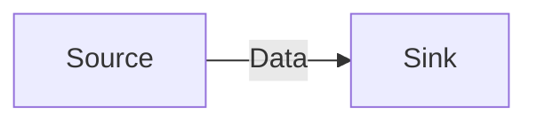
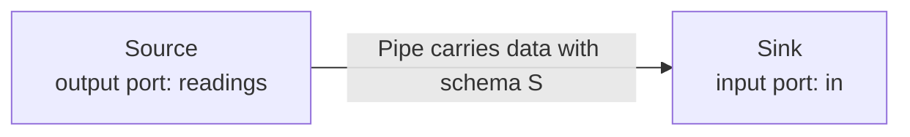
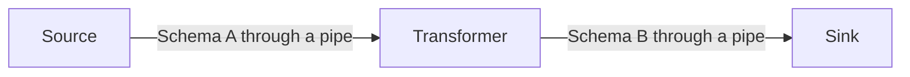
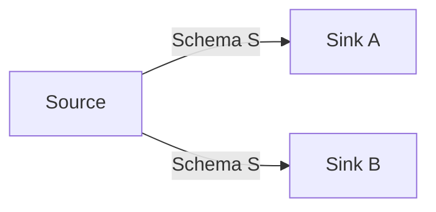
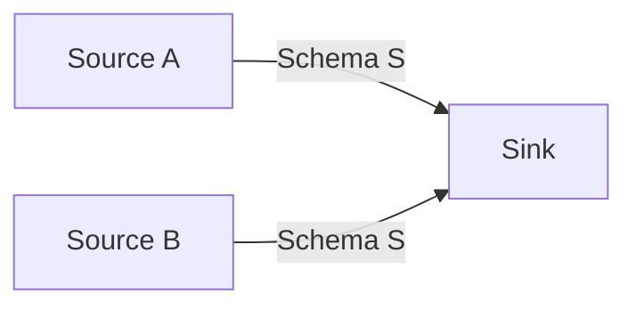
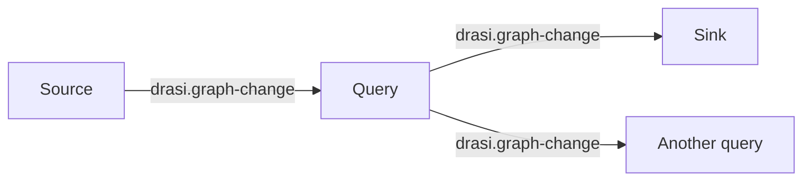
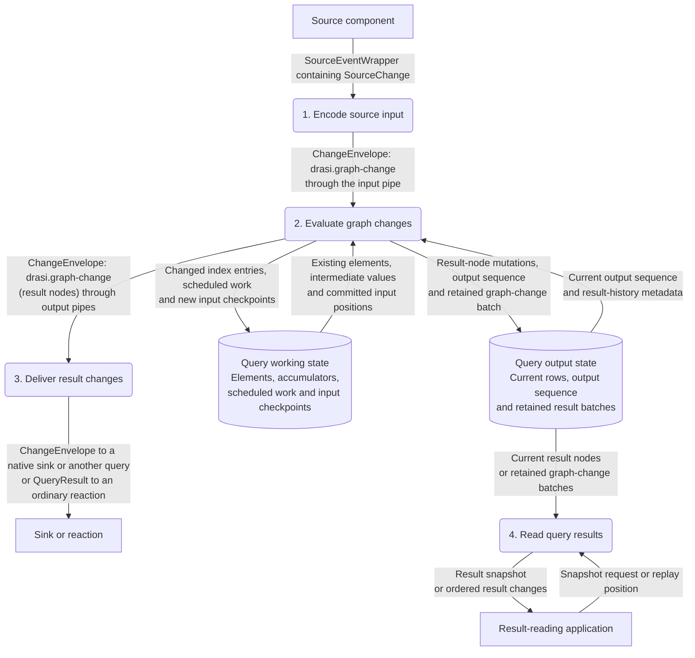

# ComputationGraph internal data design

This document explains what happens to data **inside DrasiLib**: its Rust
representations, the schemas carried between components, how processing changes
those representations, and what is stored and replayed. It is for Rust developers
who already use Drasi and want to understand the implementation.

The boundary starts when a source supplies Drasi data and ends at the internal
input of a sink or reaction. External database schemas, network request formats,
destination protocols, plugin authoring, component lifecycle management and
application configuration are outside its scope. Recovery is covered because it
determines which data is read and processed after an interruption.

## Contents

1. [Source and sink](#1-source-and-sink)
2. [Ports and schemas](#2-ports-and-schemas)
3. [Records, change sets and envelopes](#3-records-change-sets-and-envelopes)
4. [Pipes and delivery](#4-pipes-and-delivery)
5. [Identity, sequence, time and context](#5-identity-sequence-time-and-context)
6. [Transformers and schema changes](#6-transformers-and-schema-changes)
7. [Fan-out and fan-in](#7-fan-out-and-fan-in)
8. [Queries](#8-queries)
9. [Initial data and the live-data boundary](#9-initial-data-and-the-live-data-boundary)
10. [Result snapshots, retained output and readers](#10-result-snapshots-retained-output-and-readers)
11. [Persistence and transaction boundaries](#11-persistence-and-transaction-boundaries)
12. [Recovery and duplicate handling](#12-recovery-and-duplicate-handling)
13. [An input followed through processing and replay](#13-an-input-followed-through-processing-and-replay)
14. [Reading progress correctly](#14-reading-progress-correctly)
15. [Implementation map](#15-implementation-map)

## 1. Source and sink

Start with two components:



The **source produces data**. The **sink consumes it**. Everything in the first
five sections can be understood using this connection alone.

Three mechanisms define the connection:

| Mechanism | What it determines |
|---|---|
| Port | Where data leaves the source or enters the sink |
| Schema | What the data means and how its bytes are represented and checked |
| Pipe | How data travels between the ports, including buffering and delivery behavior |

Inside ComputationGraph, the unit being transported is a `ChangeEnvelope`.
It contains an ordered set of changes, their schema and identifying metadata.
The source's output and the sink's input must agree on that representation.

Neither a port nor a pipe changes the data's meaning. The source supplies valid
data; the pipe transports it; the sink handles it. Buffering and persistent
storage can be added to this same connection without introducing another
processing component.

External input and output are outside this diagram. The source and sink shown
here are DrasiLib components, and the arrow describes their internal data flow.

## 2. Ports and schemas

### 2.1 Ports name the endpoints

Give the source an output port called `readings` and the sink an input port
called `in`:



The boxes still represent the same two components. Port names identify the
endpoints inside those components; the arrow remains the pipe carrying data.

A `PortDescriptor` contains:

| Field | Meaning |
|---|---|
| `id: PortId` | Name within the component |
| `direction: PortDirection` | Input or output |
| `schema: SchemaDescriptor` | The one data representation accepted or produced here |
| `requirements: PipeRequirements` | Required delivery properties, such as backpressure |

Port names must be unique within a component. Connected names need not be equal:
`Source.readings` can connect to `Sink.in`. An output must connect to an input,
their complete schema descriptors must match, and the pipe must meet the
requirements of both ports.

A port is not a queue, stream cursor or storage object. It describes a boundary.
When the graph invokes the sink, `InputEnvelope.port` identifies which of its
input ports received the data.

### 2.2 A schema describes the data, not its transport

The schema answers what a record's key, image and payload mean. It does not say
whether the data was delivered, saved or handled.

`SchemaDescriptor` contains:

- A `SchemaId` and positive `SchemaVersion`.
- An encoding name describing the payload representation.
- Nonempty definition bytes supplied in the schema's canonical form.
- A calculated, noncryptographic fingerprint.

The connection compares the **complete descriptor**, not just its name,
version or fingerprint. Two definitions that look equivalent to a person but
have different definition bytes are not automatically compatible.

For the simple source/sink connection, both ports use schema S. The source
cannot emit a differently encoded record and expect the pipe to convert it.
The sink must receive exactly the representation it agreed to consume.

### 2.3 Validation checks the records

`Schema` pairs the descriptor with an executable `RecordValidator`. The
descriptor is descriptive data; the validator supplies the rules that actually
check record identity, image kind, payload encoding and content.

For example, an application-defined reading schema could require a nonempty
sensor key and a numeric measurement. That rule must exist in its validator.
Definition bytes are not automatically interpreted as JSON Schema, and attaching
a familiar field name does not establish its type or meaning.

`Record::try_new` checks the key and payload through that validator.
`RecordReference::try_new` checks a key without requiring a payload, which is
useful for an identity-only deletion. `ChangeSet::try_new` then checks the
relationships between the operations and their images.

Records are immutable after construction. Normal in-process routing need not
decode their payloads again just to forward them, but the graph still checks
the envelope's schema against the port at emission and delivery. Decoding
serialized envelopes reconstructs and validates their records.

Different providers of the same schema descriptor must implement the same
validation meaning. Descriptor equality cannot prove that arbitrary validation
code is correct.

Sources: [port contracts][ports], [schemas and checked records][records].

## 3. Records, change sets and envelopes

The source and sink exchange the same checked data structure. The envelope,
schema and record types are defined in `drasi-computation-contracts` and
re-exported through `drasi_lib::computation::v1`.

### 3.1 The nested structure

The graph's message representation is:

```text
InputEnvelope or OutputEnvelope
  port: PortId
  envelope: ChangeEnvelope
    event: Arc<ChangeEvent>
      id: EnvelopeId
      changes: Arc<ChangeSet>
        id: ChangeSetId
        schema: SchemaDescriptor
        operations: Arc<[ChangeOperation]>
          ordinal
          record identity
          optional before record
          after record, where applicable
      system: Arc<SystemMetadata>
        stream, emission sequence
        optional timestamp and source position
        ordering: EventTime | ProducerSequence
        control: Option<ControlMessage { kind, payload }>
      lineage: Option<Arc<Lineage>>
    context: ProcessingContext
```

The port address is outside the shared event. A receiving component gets its
own local input-port name without changing the producer's event.

A `Record` is a validated combination of:

- `RecordReference`: schema descriptor plus `RecordId`.
- `RecordImage`: whether the bytes are a full image, patch or partial image.
- `payload: Bytes`: immutable schema-defined bytes.

The payload is not necessarily UTF-8, JSON or a Rust struct in memory. The
schema's codec determines how to decode it. For the standard graph schema
(section 8.5) it is a MessagePack-encoded element image, patch or before-image.
The operation kind (add, update or delete, and its update semantics) belongs to
the `ChangeOperation`, not to the payload bytes.

### 3.2 Before/after images and operations

`RecordImage::Partial` and `RecordImage::Patch` are different:

- **Full:** complete record in that schema.
- **Patch:** instructions/data for updating the record under that schema's rules.
- **Partial:** known values from a before-image; not a complete record and not
  an update instruction.

The generic change-set rules are:

| Operation | After image | Before image |
|---|---|---|
| `Added` | Required, `Full` | None |
| `Updated`, `Replace` | Required, `Full` | Optional `Full` or `Partial` |
| `Updated`, `Patch` | Required, `Patch` | Optional `Full` or `Partial` |
| `Deleted` | None; a validated `RecordReference` is required | Optional `Full` or `Partial` |

`ChangeSet::try_new` checks that all records use its exact schema, before/after
identities agree, and operation ordinals are unique and increasing. Ordinals need
not be consecutive. Construction does not sort an invalid batch into validity.
The codecs may assemble operations in a temporary collection and explicitly
order them before calling that constructor.

Repeated **record identities** are not forbidden across different operations:
one batch can describe several changes to the same record. An operation's stable
identity is the change-set ID together with its ordinal.

An empty change set is valid. It can carry metadata without record changes,
including a separately marked control message. Empty data alone does not
identify its intended meaning.

### 3.3 Record encoding versus envelope encoding

There are two outer envelope codecs:

| Codec | Outer representation | Format version |
|---|---|---:|
| `EnvelopeCodec` | Explicit JSON frame; opaque record/identity bytes remain encoded byte data | 1 |
| `BinaryEnvelopeCodec` | Named MessagePack frame with binary payloads | 1 |

The records inside either frame retain their schema-defined payload encoding.
For example, a MessagePack-encoded graph record stays encoded bytes inside a JSON
envelope; its fields are not automatically converted into untyped JSON properties.

Both frames preserve the complete event: stream, sequence, timestamp, source
position, ordering policy, the current event-local control, lineage (including
historical controls) and context. The native plugin boundary carries these
binary frames with native wire version 1 and ABI layout 1.0. There is no reader
for an earlier native wire or for earlier query-row records; build the host and
every native library from matching sources.

Both codecs reconstruct checked records/change sets using explicitly registered
executable schemas. Unknown schema versions, conflicting definitions and
unsupported outer versions fail. A serialized descriptor does not carry an
executable validator.

Codec limits apply to the encoded frame. `BinaryEnvelopeCodec::encoded_size`
measures the full binary envelope, including metadata, lineage and context,
without allocating the encoded output. This is the measure used by relevant
byte-budget mechanisms; it is not a measure of Rust heap use.

Source positions used by the shared progress contracts are bounded to 65,536 bytes.
Other bounds belong to their specific reader, journal or transaction rather
than one universal maximum for all data. A frame-size check does not itself
prove that every nested value or custom validator is safe at arbitrary depth.

Sources: [records][records], [envelopes][envelopes],
[JSON envelope codec][json-codec], [binary envelope codec][binary-codec].

## 4. Pipes and delivery

### 4.1 Following one envelope

At the graph's envelope boundary, the source returns an `OutputEnvelope`
containing its output-port name and a `ChangeEnvelope`. The graph checks the
emission and passes it to the bound pipe.
The pipe receiver supplies that envelope to the graph, which invokes the sink
with an `InputEnvelope` naming the sink's input port.

The port address changes from the source's local name to the sink's local name.
The shared event, records and schema do not change merely because the data
crossed the pipe.

`EnvelopeSender::send` returns an `EnqueueReceipt`: confirmation that the pipe
accepted the envelope, optionally with a journal position. It does not say that
the sink handled it.

`EnvelopeReceiver::receive` returns a `Delivery`. This contains the envelope and
an optional `Box<dyn Acknowledgement>`. The graph holds the acknowledgement
separately while passing the data to the sink.

### 4.2 Acceptance and handling are separate

Consider a source that successfully sends an envelope while the sink is busy
with an earlier one. Acceptance succeeded; handling has not happened yet.

The sink's completion contract makes the distinction explicit:

| `SinkCompletion` | What a successful sink call establishes |
|---|---|
| `Accepted` | The sink accepted or queued the data at its own boundary |
| `Handled` | Processing finished at the sink's declared handling boundary |

For a pipe with explicit handling acknowledgements, the graph completes the
acknowledgement only after the required handling succeeds. It will not connect
an acceptance-only sink as though that sink confirms handling.

`Acknowledgement::complete(Handled)` advances the pipe's handled position.
Dropping the handle does not acknowledge the data. A failed outcome leaves
retained input unacknowledged rather than erasing the obligation.

`Delivery` is neither cloneable nor serializable. The envelope is ordinary
shareable data; the one-shot acknowledgement is a local capability, not a field
to encode into that data.

### 4.3 Buffering and retention on one connection

The same source and sink can use different transport behavior:

| Transport | Data held between source and sink | Full/slow behavior |
|---|---|---|
| `BoundedPipe` | Volatile FIFO queue | Waits for capacity; no persistent replay or handling acknowledgement |
| Byte-bounded pipe | Volatile FIFO with envelope-count and byte reservations | Waits for capacity under both bounds |
| `BroadcastPipe` | Bounded volatile history | Does not wait for a slow receiver; missing history is reported or explicitly skipped with notification |
| `RetainedPipe` | Journal plus consumer handled position | Retains unacknowledged data; backpressures or explicitly prunes according to its retention policy |

A retained store can be in memory or persistent. **Retention is not the same
as crash durability.** Retained history in memory can support another read while
that store exists, but not recovery after losing the process.

With `RetentionPolicy::Backpressure`, the source must wait when required data
cannot be safely reclaimed. With `PruneOldest`, older entries can be removed,
and the receiver must detect when its requested position is no longer available.
An explicit skip is different from handling the missing records successfully.

Capabilities describe these properties separately. `FifoPerStream` concerns
order; `Backpressure` concerns capacity; `DurableAcceptance` concerns survival of
accepted data; `ExplicitAcknowledgement` concerns handling; `Replay` concerns
reading saved data again. The graph checks required capabilities rather than
inferring all of them from the word "persistent."

### 4.4 Ordering and failures

One output stream belongs to one source/output port. New emissions have
increasing sequences. A FIFO pipe preserves that stream's emission order;
wall-clock timestamps cannot reorder it.

An idle pipe suspends its receiver. `receive()` returning `None` means closed
and drained, not "no data available right now."

A send failure returns the envelope and identifies definite nonacceptance or
uncertain durable acceptance. If a send was cancelled without a result, the
caller cannot assume that nothing was stored. Replay or receipt lookup must
resolve an uncertain outcome before it is treated as new input.

### 4.5 Batching does not change the data contract

Even with one source and one sink, there are two different batches:

- A `ChangeSet` groups operations in **one envelope**.
- Pipe/sink batching groups **several complete envelopes** for one invocation.

`send_batch` reports the accepted prefix, the failed envelope and the unattempted
remainder. It is not an all-or-nothing transaction.

For sink batching, `max_inputs` is a hard envelope count. The operation count is
a flush target; the host does not split an envelope to meet it. Each envelope
retains its identity and operation ordinals. Batching alone neither combines
their schemas nor makes their effects atomic.

### 4.6 Count and byte limits

Queue capacity counts envelopes, not records or bytes. An envelope containing
one operation and an envelope containing a thousand operations each occupy one
envelope slot.

Byte accounting uses the complete encoded binary envelope, including metadata,
context and lineage. Some paths allow one oversized envelope alone rather than
wait forever for a reservation that could never fit. That behavior is not a
hard maximum on an individual payload.

Buffered-byte quotas do not include every pending sender, already received
message, component-private allocation or stored business value. Paged history
can limit payload reads and caches while still retaining accounting metadata
per stored entry. A pipe capacity is not a total process-memory limit.

Sources: [pipe interfaces][pipes], [bounded transports][bounded],
[broadcast][broadcast], [retained delivery][retained-pipe],
[retained storage][retained-store], [sink processing contract][component-dataflow].

## 5. Identity, sequence, time and context

These distinctions already matter in the direct source/sink case. They do not
require an intervening transformation.

### 5.1 Which record, operation and delivery?

| Identity or position | Question it answers |
|---|---|
| `RecordId` | Which record does this change address? |
| `ChangeSetId` plus operation ordinal | Which operation in this batch is it? |
| `EnvelopeId` | Which emitted event is it? |
| `StreamId` plus emission sequence | Where does it occur on this source output? |
| Pipe journal position | Where did the pipe store it? |
| Consumer handled position | How much of that stored data has the sink finished? |

`RecordId`, `ChangeSetId` and `EnvelopeId` contain a namespace and nonempty opaque
`Bytes`. They are supplied identities, not content hashes. Named IDs such as
`PortId` and `StreamId` wrap shared strings and reject empty names, whitespace
and control characters.

A source can update the same record in several events. Its `RecordId` remains
the same; the events and individual operations have different identities.
A pipe may store an event at a journal position unrelated to the source's
sequence. Neither number should be substituted for the other.

The general emission rule allows gaps in increasing stream sequences. Specific
admission or recovery contracts can impose stricter continuity requirements.

### 5.2 Time and source positions

`SystemMetadata` holds the stream, emission sequence, optional
`DateTime<Utc>` timestamp and optional source-position bytes.

The timestamp describes time associated with the event. FIFO transport is
ordered by emission, not by assuming every later event has a later timestamp.
Application-specific times inside records are interpreted by their payload
schema.

A source position is an opaque resume token. Its presence alone proves neither
persistence nor completed handling. The source defines how the bytes are
interpreted; the transport must not invent an ordering by comparing them as
strings.

### 5.3 Context accompanies the event

`ProcessingContext` is an append-only sequence of `ContextEntry` contributions.
Each entry contains a contributor ID, key and a value: `Bool`, `Signed`,
`Unsigned`, shared `String` or shared `Bytes`.

Appending an entry does not alter the event or overwrite earlier entries.
Iteration is newest first, and duplicate keys remain visible. Code must use
the applicable reader's lookup rules rather than assume context is a mutable
last-write-wins map.

The immutable event and record bytes can be shared through `Arc` and `Bytes`.
Cloning an envelope preserves that sharing; appending context to the clone
changes only its annotation chain.

Acknowledgements, transactions and index handles are not context values.
They remain local capabilities outside the serializable envelope.

### 5.4 Ordering policy and event-local control

`SystemMetadata` carries two further facts that belong to one event and are not
record data:

| Field | Meaning |
|---|---|
| `ordering: ChangeOrdering` | How a receiving query decides that a change is stale |
| `control: Option<ControlMessage>` | An event-local instruction: a checked `kind` and an uninterpreted `payload` |

`ChangeOrdering::EventTime` is the default for source data. Business time
(`ElementMetadata::effective_from`) is authoritative and a strictly older
change is skipped. `ChangeOrdering::ProducerSequence` is stated by a producer
whose output sequence is the authority, which is how queries publish derived
data. It is honored only after the receiver has validated the producer's
identity, output epoch and accepted sequence (section 8.14). Business times
still travel unchanged inside the records; they stop deciding admission for that
event.

A control is a directive about this event, such as "scheduled work is due" or
"reevaluate these scheduled elements" (section 8.15). It is not a record, an
annotation or a checkpoint. `ChangeEnvelope::derive` does not inherit the input's
control or ordering: a producer states them for its own output. For example,
`GraphChangeCodec::derive_changes` carries the input's ordering policy forward
explicitly and attaches a control only when the new output needs one. `reemit`
of the same logical output and a relay that forwards an event unchanged keep
both. An input's control stays visible in lineage as provenance and is never
treated as a command by a later consumer.

Sources: [identity types][records], [metadata, controls and context][envelopes].

## 6. Transformers and schema changes

A **transformer** is a component between source and sink. It consumes input
envelopes and produces output envelopes.



All boxes are components and all arrows carry data through pipes. Schema A and
schema B can be different. The source output must match the transformer's
input; the transformer's output must separately match the sink's input.
The pipe on neither side performs the conversion.

### 6.1 Each side has its own data contract

For example, an application might define:

| Boundary | Illustrative schema | Record payload |
|---|---|---|
| Source output / transformer input | `example.reading-text` | A measurement encoded as text |
| Transformer output / sink input | `example.reading-number` | A validated numeric representation |

These example names are not built-in Drasi schemas. The transformer decodes
according to the first schema, converts and validates the value, then constructs
a record using the second schema. It can preserve the record's business identity
if that identity is valid under the output schema, but it must emit a new event
describing the transformed data.

A transformer can also keep the same schema. Filtering, normalization and
expansion need not change the representation contract.

### 6.2 Zero, one or many outputs

`Transformer::transform(InputEnvelope)` returns `Vec<OutputEnvelope>`.
The input-port name identifies where data arrived; each output names its
destination port within the transformer.

A transformer can:

- Produce no output because it filtered the input.
- Produce one transformed envelope.
- Expand the input into multiple ordered operations or multiple envelopes.
- Retain input for later output, if its processing contract supports that.

Output events use the transformer's own stream and increasing emission
sequences. Reusing an input's sequence for several new emissions is not valid.
An empty output change set can explicitly carry progress when filtering removes
all records; no output at all and an empty progress-bearing envelope are different.

### 6.3 Derivation preserves provenance, not mutable input

`ChangeEnvelope::derive` creates a new event with the transformer's output
identity, schema-consistent change set and system metadata. It shares the
existing context and adds the input's identity/system metadata to lineage.
The input's event-local control and ordering policy are not copied into the new
event; they remain historical provenance in lineage until the producer states
its own.

Lineage does not retain the parent's record payload. It follows a single chain;
it is not a complete record of every input that a component has processed.
The transformer cannot mutate an input record merely because it received an
owned envelope value: the underlying data is immutable and may be shared.

For recoverable stateful transformations, `GraphProducerIdentity` and
`GraphProducerProgress` identify logical output separately from transport
emissions. Replaying already committed output can assign a new emission number
without making that output new business work. Inherited source metadata is
provenance, not automatically this transformer's own checkpoint.

### 6.4 When is the input considered handled?

With one downstream sink, the graph:

1. Receives the input and keeps its pipe acknowledgement separately.
2. Invokes the transformation.
3. Validates and forwards the returned emissions.
4. Calls `delivery_completed` after the outgoing pipe accepted that batch.
5. Finishes any bounded continuations before processing the next input.
6. Confirms applicable handled-input progress and completes the input's
   acknowledgement.

`delivery_completed` means completed **outgoing handoff**, not that the
downstream sink finished its own processing. If recovery depends on that
handoff surviving a crash, the outgoing pipe must actually provide durable
acceptance.

Stateful transformations also have to preserve the relationship between their
input position, changed state and outgoing data. Returning an output vector
does not establish that those pieces committed together; the persistence
section explains the transaction boundaries.

Sources: [transformer contract][component-dataflow], [derivation][envelopes],
[producer identities][producer-progress], [forwarding][graph-routing].

## 7. Fan-out and fan-in

The previous rules apply to every connection when there is more than one
producer or consumer. Multiple connections do not introduce a different
envelope format.
The processing graph allows branching and merging, but data paths cannot
contain cycles.

### 7.1 Fan-out: one output, several consumers



When these branches use the same source output port, both sinks must accept
its schema. The graph forwards the emitted envelope to each required branch.
A transformer output can fan out in exactly the same way.

Envelope clones share the immutable event, records and payload bytes. Each
branch can append its own context without modifying its sibling's context.
Sharing payload memory does not merge delivery obligations: each sink still
has its own handling progress.

Independent pipes are sent to separately. If one branch accepts before another
fails, the first acceptance is not rolled back. Recoverable producers retain
their output and use destination-aware replay; they cannot assume fan-out was
an atomic all-or-nothing send.

A slow required branch can backpressure the producer and therefore delay later
output on other branches. Independent branches are not a promise that the
producer can always ignore the slowest one.

### 7.2 Shared retained fan-out

`QosChannel` stores one producer stream with independent named subscriber
cursors. `QosPipe` connects one of those subscribers to a consumer.
The graph recognizes branches using that same channel and appends once rather
than store one copy per reader.

Each subscriber has an independent position and acknowledgement. A disconnected
required subscriber retains its obligation. Safe reclamation follows the
required consumers' progress, not the fastest one.

`SubscriptionStart` defines a new reader's initial cut: earliest retained data,
latest, or after a position. Reopening an existing subscriber retains its saved
cursor instead of silently applying a new start point.

For independent byte-bounded pipes, each branch charges the complete envelope
even when its Rust allocations are shared. A shared journal has its own
single-copy accounting and per-reader progress.

### 7.3 Fan-in: several outputs, one consumer



Two source outputs may connect to the same sink input when they satisfy that
port's schema and delivery requirements. Each output retains its own stream
identity and order.

If the sources use different schemas, they cannot both feed that one
single-schema input. The consumer needs separate appropriately typed input
ports, or explicit transformations that bring the data into a common schema.

Fan-in does not automatically combine records by key or produce a relationship
between them. The receiving component defines any such processing. The
transport only determines which available input is supplied next.

### 7.4 Choosing among inputs

The default `InputMergePolicy::Arrival` uses available arrival order.
`EventTimeAcrossStreams` compares the currently available stream heads without
reordering the admitted sequence within a producer. It does not wait for an
idle source; untimed heads preserve their arrival boundary.

This is not proof that an earlier timestamp cannot arrive later. A
`SourceTimeMergeTransformer` supplies explicit bounded reordering:

- It retains data, orders buffered events by source time and emits them on its
  own output stream.
- Reorder windows, maximum residence time and optional idle-source treatment
  determine when events become eligible.
- Envelope-count and full-envelope-byte bounds limit buffered and pending data.
- Late input is failed-and-retained, routed separately, or explicitly discarded.
- Its persistent form retains the buffered/pending data, identities and progress
  needed to recover that ordering work.

Reordering cannot undo arbitrary processing already performed downstream.
The distinction between merging available heads and deliberately waiting for
more data matters even when both components use the same payload schema.

### 7.5 Retained admission uses the same channel

`SourceAdmission` can publish into an actual QoS channel through a bounded,
graph-driven handle rather than through the source's `next()` method.
It does not create another journal; all of that source's outputs use the bound
channel.

Admission identifies a request using `ProducerSession { incarnation, producer,
epoch }` and a producer request sequence. Accepted data and a retry receipt are
saved together. `AdmissionReceipt` contains the session, request sequence and
journal position, not the downstream handled positions.

The same session/sequence and content can resolve to the prior receipt.
Conflicting payloads, expired sessions/receipts and unexpected sequences are
rejected. Admission receipts and replay receipts for an already identified
persistent producer output are separate modes; neither creates an end-to-end
processing transaction.

Sources: [forwarding][graph-routing], [shared envelopes][envelopes],
[QoS channels][qos], [pipe merge policy][pipes], [time merger][time-merge],
[admission handle][admission], [admission types][admission-data].

## 8. Queries

A continuous query specializes the transformer model: it consumes changes to
elements, maintains indexed state, and publishes its answer as changes to
result nodes.



Source, transformer and query outputs all use the **same** data contract: one
canonical graph-change schema. A query's result row is an ordinary node, so a
sink that understands graph changes, a middleware stage or a second query can
consume it directly. No adapter component sits between two queries, and there
is no separate query-row wire format. Facts that only a result reader needs (the
row kind, grouping keys and ordinals) travel beside the records rather than
inside them (section 8.10).

"Graph data" here means the nodes and relationships evaluated inside the query.
Those are data records, not the processing components or their pipe connections.

### 8.1 Representations along the query path

The implementation deliberately uses different types for stored graph data,
messages between components, evaluator values and ordinary API results.

| Layer | Principal types | Purpose |
|---|---|---|
| Business-data graph | `Element`, `ElementMetadata`, `ElementReference`, `ElementPropertyMap`, `ElementValue` | Represent the nodes and relationships a query indexes |
| Source mutation | `SourceChange` | Describe an insert, replacement, property update (with explicit removals), delete or scheduled reevaluation for the evaluator |
| Canonical graph data | `ElementImage`, `ElementPatch`, `ElementBeforeImage`, `DataValue` | The MessagePack payloads of `drasi.graph-change` records, preserving rich values and set/null/remove distinctions |
| Ordinary source exchange | `SourceEvent`, `SourceEventWrapper` | Pair a change/control message with source sequence, time, position and profiling |
| Computation data | `Record`, `ChangeOperation`, `ChangeSet`, `ChangeEvent`, `ChangeEnvelope` | Carry immutable, schema-checked data between components |
| Port-addressed data | `InputEnvelope`, `OutputEnvelope` | Associate an envelope with a component's input or output port |
| Pipe delivery | `Delivery`, `EnqueueReceipt`, `Acknowledgement` | Distinguish queued data from the local capability to confirm handling |
| Query evaluation | `VariableValue`, `QueryVariables`, `QueryPartEvaluationContext` | Maintain typed bindings and before/after changes while evaluating a query |
| Result projection | `ResultNodeProjector`, `QueryProjection`, `ResultOperationMetadata`, `DecodedQueryRow` | Turn evaluator results into result nodes and read them back, with the query-facing row facts kept separate |
| Result state | `QueryResultSnapshot`, `QueryRecoveryView` | Describe the current set of result nodes and their retained change history |
| Ordinary query exchange | `ResultDiff`, `QueryResult`, `SnapshotResponse`, `OutboxResponse` | Project query data into the ordinary result-reading and reaction interfaces |
| Recovery progress | `SourceCheckpoint`, `SourceProgressSnapshot`, `ConsumerCheckpoint`, `DeliveryProgress` | Record distinct input, query-output and consumer completion positions |

The model types are defined in `drasi-core-types`. Shared envelope types and
codecs are defined in `drasi-computation-contracts` and re-exported through
`drasi_lib::computation::v1`. Query execution, pipes and state ownership reside in
DrasiLib and Core.

The ordinary source and result boundaries also use private typed-change
intermediates. Those are conversion helpers, **not another representation
carried on graph edges**. For example, the private `drasi.internal.graph-change`
descriptor is not the public `drasi.graph-change` port schema.

### 8.2 Graph elements

`ElementReference` consists of two `Arc<str>` fields:

```text
ElementReference
  source_id
  element_id
```

Both fields participate in identity. Two sources can use the same `element_id`
without referring to the same element. Conversely, changing a label or property
does not give an element a new identity.

`Element` has two variants:

```text
Node
  metadata: ElementMetadata
  properties: ElementPropertyMap

Relation
  metadata: ElementMetadata
  in_node: ElementReference
  out_node: ElementReference
  properties: ElementPropertyMap
```

`in_node` is the reference at the incoming end of the relationship and
`out_node` is the reference at its outgoing end. Endpoints are full
source-qualified references, not unqualified names. A relationship has its own
identity and properties independently of its endpoints.
For `(a)-[r]->(b)`, `r.in_node` addresses `a` and `r.out_node` addresses `b`.

`ElementMetadata` contains the reference, an `Arc<[Arc<str>]>` of labels and
`effective_from: u64`. `effective_from` is **milliseconds since the Unix epoch**,
not the time when a pipe accepted the envelope. Mutation admission checks its
range; zero is allowed as an unknown-time value used by initial loading.

These elements are indexed per query. A source serving two queries supplies
changes to two processing owners; it does not create a shared mutable business
graph that all evaluators modify.

### 8.3 Property values and evaluator values

`ElementValue` has compact variants for common properties:

- Null, Boolean, signed 64-bit integer and floating-point value.
- Shared string, list and nested property object.
- Local date-time and fixed-offset zoned date-time.

Everything else is carried by its `Typed` variant, which holds a validated
`DataValue`: unsigned integers above the signed range, dates, local/zoned times,
durations, ranges, complete elements, metadata, references, expressions and the
`Awaiting` marker. A property is therefore not forced into primitive JSON.

`DataValue` (in `drasi-core-types`) is the one lossless value representation
shared by element properties, canonical graph records and query results. It
stores floating-point values as their `f64` bits (so signed zero, infinities and
NaN payloads survive), keeps unsigned and signed integers distinct, and keeps a
zoned date-time's optional time-zone name and a duration's calendar and elapsed
parts. Expressions and `Awaiting` are inert data: decoding or forwarding them
never evaluates them. A malformed value is rejected by validation, not coerced.

`VariableValue`, used during evaluation, covers the same values and converts to
and from `DataValue` without loss (`DataValue::encode` / `decode`).
`QueryVariables` is a `BTreeMap<Box<str>, VariableValue>`. Its keys are bindings
or projected column names, not element-property identities.

One limit remains: a JSON projection (such as `row_values_to_json` or an
ordinary `QueryResult`) renders dates and other typed values as strings or tagged
objects. A JSON round trip is a presentation, not a lossless conversion; use the
typed value when the type matters.

### 8.4 Source mutation semantics

| `SourceChange` variant | Evaluator meaning |
|---|---|
| `Insert { element }` | Supply a full element. If that identity already exists, replace its prior contribution rather than count another copy |
| `Replace { element }` | Supply a full element as an explicit **replacement**. It replaces the existing version of the identity (properties the new element omits are dropped) in one change, and records that the producer asked for a replacement rather than an addition |
| `Update { element, removed_properties }` | Set every property of `element` (a supplied `Null` is a value), delete only the names in `removed_properties`, and leave every other property of the current element unchanged. Without a current element it creates one from the properties it sets. A name cannot be both set and removed |
| `Delete { metadata }` | Remove the addressed element using its identity and effective time; a full property image is unnecessary |
| `Future { future_ref }` | Reevaluate scheduled work for an element, retaining its original time and due time |

Update merging is defined by the graph model, not by the pipe. It is not a
generic JSON Patch program. Labels and relationship endpoints are fields of the
incoming element. `SourceChange::validate` rejects an update that both sets and
removes a property, and every admission boundary calls it.

Before changing an index, the evaluator reads the current element and any saved
deletion-time marker:

- A change older than the current element/deletion marker is skipped when the
  event's ordering is `EventTime` (the default for source data).
- For data published under `ProducerSequence` ordering (a derived output, such as
  another query's result nodes), the validated producer's accepted output
  revision decides admission. A correction whose business time is older than the
  node's current version is still applied, because the producer, not the clock,
  says it is newer. Business times are preserved unchanged in the records.
- An identical current element contributes no new result.
- A node and relationship cannot replace each other under one live identity.
- A deletion leaves a tombstone recording its effective time, preventing an
  older insert from resurrecting it.

A skipped stale mutation can still count as **handled input**. Its source
checkpoint must not remain behind merely because it produced no result change.

A query evaluates one input batch with the same evaluator whichever way the
batch arrived. `QueryInputBatch` pairs the decoded changes with the event's
ordering policy and passes it to `QueryEvaluator`; there is no second evaluation
engine for derived data.

Sources: [model types][elements], [property values][element-values],
[mutations][source-changes], [mutation admission and evaluation][evaluator].

### 8.5 Standard query-path schemas

There is a common **envelope structure**. One standard data schema carries
continuous-query data:

| Schema ID | Version | Record encoding | Record meaning |
|---|---:|---|---|
| `drasi.graph-change` | 1 | `drasi-element-msgpack-v1` | Canonical element images, element patches and before-images, from sources, transformers, query results **and complete source transactions** |

`SourceTransactionCodec::schema()` returns this same descriptor; there is no
separate transaction data schema.

`QueryChangeCodec::schema()` returns the `GraphChangeCodec` schema. A query's
input port and its output port use the same descriptor, so any graph-change
output can connect to any graph-change input that meets the port's delivery
requirements. A query configured for complete source transactions has the same
input descriptor and selects atomic handling explicitly; it then requires every
input to carry its own current completeness marker (section 8.13). Its output
remains `drasi.graph-change`.

Custom schemas use the same record/envelope/pipe machinery. Ports whose complete
schema descriptors match connect directly, including a custom schema that a
factory explicitly declares and implements for both producer and consumer; the
pipe neither converts nor needs to. Only formats that genuinely differ (for
example a custom record and the standard graph-change schema) need an
intentional conversion transformer. A factory that really implements several
formats on a port declares them in a `PortFormatCatalogue`; configuration then
selects one per port with `ports: {<port>: {format: "<schema id>-v<version>"}}`.
Selection is pure and happens before construction: unknown ports or formats are
rejected, never defaulted or converted, and the specification's ports must equal
the resolved ones. The standard factories declare no alternatives. The resolver
is not a prerequisite for connecting matching schemas.

A sink that accepts the graph-change schema accepts the data, but may still
interpret it more narrowly. The ordinary result-notification sinks (HTTP, gRPC,
SSE) require the envelope to be a current query output (section 8.10) and reject
plain source or transformer changes. The capture sink writes any graph-change
envelope, including query output.

### 8.6 Graph-change records

`GraphChangeCodec` uses the record identity:

```text
namespace = "drasi.graph-element"
value     = canonical named-MessagePack encoding of ElementReference
```

The payload depends on the record's image and is always one bounded MessagePack
value:

| Record image | Payload | Meaning |
|---|---|---|
| `Full` | `ElementImage` | `Node { metadata, properties }` or `Relation { metadata, in_node, out_node, properties }`, each property a `DataValue` |
| `Patch` | `ElementPatch` | An `ElementImage` of properties to **set**, plus a separate set of property names to **remove** |
| `Partial` | `ElementBeforeImage` | Either `Metadata(ElementMetadata)` or a full `Element(ElementImage)` known before the change |

The operation (`Added`, `Updated` with `Patch` or `Replace` semantics, or
`Deleted`) is carried by the `ChangeOperation`, outside the payload. The payload
holds only the element data.

A patch distinguishes three outcomes for a property: **set** to a value, set to
`Null` (the property exists and holds null), and **remove** (the property
absent). A property cannot be both set and removed; validation rejects the
patch. `ElementPatch::apply_to` produces the element after the patch, given an
optional base of the same identity and kind. It does not claim that the result
is a complete record when no base is supplied.

The normal mapping from a source mutation is:

| Source value | Envelope operation | Image |
|---|---|---|
| Insert | `Added` | Full `ElementImage` |
| Replace | `Updated` with `Replace` semantics | Full `ElementImage` |
| Update | `Updated` with `Patch` semantics | `ElementPatch` setting every supplied property and removing the names in `removed_properties` |
| Delete | `Deleted` | Partial before-image holding the delete metadata |
| Future reevaluation | No record | An event-local control listing the scheduled elements (section 8.15) |

`decode_changes` is the inverse mapping and is lossless for these variants: an
`Added` operation becomes `Insert`, a `Replace` update becomes `Replace`, and a
patch becomes `Update` with its removal set intact. A replacement is not
interpreted as a patch and is not a delete followed by an insert, and it is no
longer folded into an `Insert`. The query evaluator treats `Insert` and `Replace`
alike as a full-row upsert that retracts the prior contribution.

Consumers that apply `ElementPatch` directly (`ElementPatch::apply_to`) and
consumers that work through `SourceChange` therefore see the same removals and
replacements.

An identity-only delete is permitted. When no delete metadata supplies its time,
the decoder requires a nonnegative envelope timestamp and derives the effective
milliseconds from it. It does not invent a current timestamp.

The graph validator decodes the record and checks that its embedded reference
matches the external `RecordId` and that the image kind matches the payload.
The key must be the canonical encoding of its reference. Decoders apply a size
limit derived from the supplied payload, check collection lengths against the
remaining input before allocating, and reject truncated or trailing bytes and
invalid values.

### 8.7 Query input processing

All continuous queries are implemented by `ContinuousQueryTransformer`, using
`ComputationQuery` and `QueryEvaluator`. The wrapper owns input/output progress;
the evaluator works with graph changes and query indexes.

Ordinary query inputs use `RankedInputQueue`. It chooses among available source
heads using timestamp and source rank, without moving a later admitted source
sequence ahead of an earlier one. Source dispatch mode determines whether this
input path waits for capacity or uses the explicitly lossy full-queue behavior.
Query output dispatch is separate. This is the query-specific use of the fan-in
ordering described above, not a new data representation.

For one input envelope, the query:

1. Determines its logical producer/source position and validates it against
   the saved input owner. If the event's ordering is `ProducerSequence`, the
   envelope must carry an explicit, validated immediate-producer identity;
   otherwise the input is rejected.
2. Checks whether the input was already handled. A configured position comparator
   can interpret an opaque source cursor; otherwise the appropriate sequence
   watermark is used.
3. Decodes the graph changes (including any scheduling control), or the complete
   source transaction.
4. Evaluates changes under the event's ordering policy and produces
   `QueryPartEvaluationContext` values.
5. Projects result differences as result nodes and stages the input checkpoint
   and output state.
6. Commits through its processing owner.
7. Updates the public result view, then confirms input progress and forwards
   resulting envelopes.

A duplicate can advance a consumed **transport** position without reevaluating
the logical input. A new but filtered input can commit with no outgoing result
envelope. Query output sequence advances for actual result output, not once per
source message. The same path handles input whose producer is another query:
its envelopes are ordinary graph changes stamped with that query's producer
progress.

### 8.8 From source mutations to row differences

The compiled query has MATCH slots and a path solver. The element index maintains
which stored elements can occupy those slots and their relationships.

For an insert/update, evaluation determines the old solutions involving the
element, merges patch properties if appropriate, updates indexed data and
determines the new solutions. Deletes compare the old contributions against
their absence. These changes are projected through the query parts, filters
and expressions.

The result is not a fresh full query result set for every input. It is a
collection of typed differences:

```text
Adding      { after, row_signature }
Updating    { before, after, row_signature }
Removing    { before, row_signature }
Aggregation { before?, after, grouping_keys,
              default_before, default_after, row_signature }
Noop
```

The evaluator suppresses unchanged projected updates. Aggregation results for
one mutation are collapsed before output. Internal grouping transitions still
need their default/current state even when terminal visible values do not change.

### 8.9 Query working indexes

The query's resource bundle contains several distinct indexes:

| Resource | Data held |
|---|---|
| `ElementIndex` | Current graph elements, slot membership, relationship lookups and supported synthetic joins |
| `ElementArchiveIndex` | Historical element versions where supplied by the provider |
| `ResultIndex` | Aggregation accumulators, current/default intermediate parts, time state and element tombstones |
| `FutureQueue` | Deferred reevaluation records |
| `CheckpointStore` | Handled input positions and query/recovery markers |
| `OutboxWriter` | Retained emitted result batches (canonical graph-change envelopes) and relevant metadata records |
| `LiveResultsWriter` | Current materialized result nodes as canonical graph records |

`ResultIndex` is **not** the same thing as `LiveResultsWriter`. The former is
working state needed to evaluate subsequent changes; the latter is the current
answer exposed to readers.

`ResultKey` distinguishes grouping values, input hashes and element references.
`ResultOwner` separates function accumulators, current/default parts, transaction
time, real time and tombstones. Grouping equality/hashing uses its own
`eq_for_groupby`/`hash_for_groupby` semantics; arbitrary JSON equality is not an
equivalent index key.

Synthetic joins are maintained through element-index join support. They provide
query relationships between matching elements; they are not computation-graph
edges.

### 8.10 Query results are ordinary graph nodes

A query publishes each result row as one **node** using the same
`drasi.graph-change` records as a source. There is no query-specific record
format:

```text
record key  = "drasi.graph-element" + canonical ElementReference
ElementReference
  source_id  = the output's dataset namespace (section 8.12)
  element_id = lowercase hex of the opaque row identity
node
  labels     = ["Result"]            (default; see below)
  properties = the RETURN aliases, each a DataValue
  effective_from = the event's business time in milliseconds
```

The properties are exactly the columns of the `RETURN` clause, keyed by alias.
Nothing else is written into the node: no query ID, signature, row kind or
grouping flag. A generic graph consumer, including another query, needs nothing
from the query codec. `MATCH (r:Result) RETURN r.total AS total` reads another
query's `total` column directly.

`ResultNodeProjector` is the helper that builds and reads these nodes for one
output scope (dataset and label). `ResultNodeProjector::try_new(dataset, label)`
defaults the label to `Result`; a caller of the helper can supply another label.
It is stateless: it owns no rows, output cursor, epoch or publication policy.
The query itself currently publishes with the default label.

Adding, updating and removing a result use the ordinary operations:

| Evaluator difference | Envelope operation |
|---|---|
| `Adding` | `Added` with a full node |
| `Updating` | `Updated` with `Replace` semantics, a full after node and a full before node |
| `Removing` | `Deleted` whose before image is the full node |
| `Aggregation` | `Updated` with `Replace` semantics; the before node is present only when the evaluator supplied one |
| `Noop` | No operation; an evaluation that yields only `Noop` publishes nothing |

Operations keep their position in the evaluator's result slice as their ordinal,
so a skipped `Noop` leaves a gap. Every image's effective time is the event's
business time, never an output sequence.

**Query-facing facts travel beside the records.** The row kind (`Row` or
`Aggregation { grouping_keys, default_before, default_after }`), the original row
identity bytes and the ordinal for each operation are written into one
**projection-context annotation**, `drasi.query-projection.v1`. It is scoped to
the logical change set it was written for, so an annotation inherited from an
upstream output is never mistaken for the current output's.
`QueryChangeCodec::projection` reads it, and `is_query_output` is true only when
the newest projection was written for this envelope's own change set and agrees
with its operations. A matching schema alone does not make an envelope a query
output.

Aggregation flags describe the evaluator's default/current group handling. They
are not general instructions to delete a row. In particular, a default-before
value need not be an already-applied contribution, and a default-after value does
not independently prove that the group has no contributors.

Reading results:

- `QueryChangeCodec::decode_row` reads any result node and returns a
  `DecodedQueryRow { dataset, label, identity, signature, values }`. `signature`
  is present only when the opaque identity is exactly an eight-byte evaluator
  signature. `decode_row_in` additionally requires a particular scope.
- `QueryChangeCodec::decode_evaluation` rebuilds evaluator differences from a
  current query output and its projection. It is a query-facing capability, not a
  wire format.
- `QueryChangeCodec::row_values_to_json` and `to_legacy_result` project typed
  rows into the ordinary JSON `QueryResult`. These are presentations for
  readers; the stored form is the typed record.

The query's own sequence, generation, output metadata and snapshot/progress
markers are separate annotations on the envelope (section 8.17).

### 8.11 Shared values in result nodes

Result properties use the same `DataValue` as every other graph record
(section 8.3), not a query-specific tagged format and not JSON:

- Integers are signed or unsigned; floating-point values keep their `f64` bits,
  including nonfinite values and signed zero.
- Lists and objects recursively hold values.
- Temporal values retain their specific kind; a zoned date-time keeps its
  optional time-zone name and a duration keeps its calendar and elapsed parts.
- Elements, metadata, references, expressions, ranges and `Awaiting` have
  explicit variants and cross unevaluated.

`QueryChangeCodec::row_values_to_json` is a **projection for readers**, not the
stored format. Dates and other typed values can become strings or tagged
objects. Code that needs type fidelity should decode the typed row instead of
round-tripping its rendered JSON.

A downstream consumer that needs an `Element` (such as another query) converts
the node with `Element::try_from(ElementImage)`. A property that has no element
property form is reported by name rather than substituted.

### 8.12 Row identity, dataset namespace and output generation

Query row signatures are `u64` values produced by the evaluator:

- Nonaggregating rows use the MATCH binding identity.
- Grouped rows use the grouping identity.

The opaque row identity written into the node's `element_id` is the signature's
eight big-endian bytes, in lowercase hex. It is the evaluator's identity for the
row, supplied by the query, and not inferred from a returned column. The identity
bytes are opaque to consumers: they must not parse them or recompute them from
values. Two rows with equal projected values can have different identities and
remain **separate rows**. Comparing only the visible column values loses that
distinction. Conversely, changing a value under one identity updates that row
rather than introducing an unrelated one.

The node's `source_id` is the output's **dataset namespace**, so two outputs
never share row identities even when their signatures coincide:

```text
drasi.output/<SHA-256 over: "drasi.output-dataset.v1",
              construction scope, graph ID, component ID, output port>
```

(`output_identity::dataset_namespace`; each part is length-prefixed in the hash.)
The namespace is stable and bounded. Output epochs and sequence numbers are
deliberately **not** part of it: a persistent output keeps the same node
identities across restart and after a reset, while the epoch and sequence
identify the history. The construction scope is the enclosing instance or storage
scope selected when the query is registered, so the same query ID in a different
instance or scope has a different dataset.

`QueryRecoveryIdentity` combines the construction/instance scope, graph ID,
query ID, configuration hash and optional volatile incarnation. Persistent
queries omit the volatile incarnation and can retain identity when the same
stored query is reopened. Output generation separately distinguishes a reset
result history from the previous one.

Every query output envelope is also stamped with `GraphProducerProgress`: the
query's `GraphProducerIdentity` and its logical output sequence, distinct from
the emission sequence. A persistent output's epoch is stable across
reconstruction and changes when the output is reset; a volatile component gets a
new incarnation each start, which downstream persistent owners do not accept as a
restart-stable stream. This is what lets a downstream query validate the
producer and admit the output under `ProducerSequence` ordering.

These are scoped identities used by the implementation, not cryptographic
proofs of data uniqueness. Row signatures and configuration hashes must not be
replaced with hashes of rendered JSON.

### 8.13 Complete source transactions

A complete source transaction is one ordinary graph-change envelope. Its
operations are the standard records, in order: `Added` full images, `Updated`
patches (with removed property names) or full replacements, and `Deleted`
partial before-images. Nothing about the data is transaction-specific.

Completeness is a separate version-1 annotation, `drasi.source-transaction.v1`,
scoped like a query projection to the envelope's own logical `ChangeSetId`. It
states the source ID, transaction ID, commit position, operation count and
`complete`. Readers positively recognize it with
`SourceTransactionCodec::metadata`/`decode`; the schema alone never implies a
transaction, and an annotation inherited by a different change set (a transform
or any fresh derive) is history, not completeness. `reemit` and an unchanged
relay of the same change set keep it. The commit position must agree with the
envelope's source position, the operation count with the change set, and the
envelope must carry no event-local control. Only a validated
`SourceTransaction::into_envelope` writes the marker.

All changes must belong to that source. Scheduled `Future` changes cannot appear
inside the group. Assembly and decoding enforce change-count, byte and time
bounds. An incomplete or rejected assembly cannot publish its successful prefix
as a complete transaction.

This is not ordinary batching. A vector of graph-change operations does not
become a complete source transaction merely because it arrived together; without
its own current marker, a transaction-mode reader rejects it. Byte limits count
the operation records' identity and payload plus the source ID, transaction ID
and position; the private prepared-storage encoding (graph records with fixed
framing) is bounded by the same limit.

Ordinary graph-change batches are evaluated in order. They may contain
intermediate row differences even when their storage changes are committed in
one query operation.

Complete-source-transaction processing additionally collapses the transaction's
result transitions by row signature. It keeps the first before-state and final
after-state, removes insert-then-delete/no-net-change outcomes, and rejects
discontinuous row transitions or incompatible grouping metadata.

This gives the query's downstream reader the transaction's final result
changes, rather than each intermediate update. It does not make two different
queries or arbitrary sinks share the source transaction.

Transaction data uses the same records and value limits as any other
graph-change data. A query that accepts transactions publishes ordinary
`drasi.graph-change` result nodes, exactly like any other query.

### 8.14 Logical data and replay transport

A replay can transport previously committed output under a **new emission
sequence**. `ChangeEnvelope::reemit` creates the new envelope identity and
transport sequence while retaining its change set, annotations, lineage and
event-local metadata (ordering and control).

For query output, the logical output position is retained in
`drasi.query-output-sequence.v1`. For stateful graph-change producers,
`GraphProducerProgress` carries a producer identity and logical sequence.
Consumers that perform durable deduplication use this identity and logical
sequence, not whichever transport number was assigned to the retry.

Queries publish with `ChangeOrdering::ProducerSequence`. A downstream query
admits that output by the producer's validated identity, output epoch and
revision, not by comparing business times. This is why a result node whose
business time is older than its previous version can still be applied when the
producer says it is the newer revision. For example, a first query's aggregate
can correct 20 to 30 because an older-timestamped room arrived late, and a second
query reading the aggregate node updates to 30 rather than discarding the
correction as stale. An output without a validated producer identity cannot be
admitted under this policy.

An ordinary source adapter also has two positions: the source's original
sequence and the adapter's output-stream sequence. Original source metadata
is preserved in `drasi.legacy-source.v1`. That name is an internal annotation
key; it does not imply another runtime.

After a transformer creates a new logical output, inherited source metadata is
provenance. It is **not automatically the transformer's own recovery cursor**.
Progress resolution considers the immediate producer marker and any validated
identity-preserving path before using an ancestor's position.

### 8.15 Time and scheduled reevaluation

| Time | Meaning |
|---|---|
| `ElementMetadata.effective_from` | Business mutation time, in Unix milliseconds; preserved unchanged through derived outputs |
| `SourceEventWrapper.timestamp` | Source-exchange event time carried into adapter metadata |
| `SystemMetadata.timestamp` | Optional envelope time; used by explicit ordering paths |
| Query output metadata timestamp | Time the query result is produced |
| `FutureElementRef.original_time` / `due_time` | Original transaction time and scheduled reevaluation time |
| Profiling nanoseconds | Measurements of elapsed pipeline stages |

Sequence controls per-stream emission order. A timestamp cannot move a later
source sequence ahead of an earlier admitted sequence and thereby justify
skipping the earlier input.

Profiling is observational. Immediate-query completion timings are attached
after its transaction commits; those fields cannot already be in the committed
outbox bytes. Replay identity normalization excludes those immediate completion
timings but preserves inherited context.

`FutureElementRef` stores an element reference, original time, due time and group
signature. Query functions can arrange reevaluation by writing to the query's
future queue.

Scheduled work is carried by **event-local control**, not by fake element
patches. `GraphChangeCodec` uses the control kind `drasi.graph-control.v1` with
two payloads:

| Control | Use |
|---|---|
| `FuturesDue` | An empty graph-change batch announcing that scheduled work is due (`encode_futures_due`, `is_futures_due`). It cannot also carry data operations |
| `Reevaluate` | A batch of `SourceChange::Future` values: each future reference and its ordinal travel in the control, and the data operations carry the rest. The ordinals must be increasing and, together with the data operations, form one complete ordered batch |

`decode_changes` merges the listed futures back into their original positions.
A reevaluation control is meaningful only on its own envelope: a consumer that
receives one it does not understand rejects it rather than ignoring it, and a
historical control kept in lineage is provenance, never a command.

`QueryScheduledSource` reads a committed scheduling view and emits a
`FuturesDue` control when work is due. It does not remove the future record
itself. The query pops/processes due work under its own transaction and
publishes resulting result nodes through its ordinary output path. That output
does not inherit the input's control; fresh derived data is not accidentally
marked as scheduling, and a control is not copied from annotations or lineage.

The due-work marker is distinct from a business source ID. Scheduled
reevaluation also distinguishes original transaction time from due/realtime.
Reaching the final ordinary input sequence therefore does not prove that all
future work has finished.

### 8.16 Graph-change middleware

`MiddlewareTransformer` decodes graph changes into `SourceChange` values, runs
the selected `SourceMiddlewarePipeline`, and encodes the resulting changes back
into `drasi.graph-change` with `derive_changes`. A pipeline can filter, rewrite
or expand changes.

For a newly processed input, this transformer produces one logical output
change-set batch, including an empty batch for a fully filtered input.
Its producer-progress marker lets downstream owners advance through filtered
input without pretending that a data record was emitted. In persistent mode,
it saves its processing state, logical input/output progress and unconfirmed
output under its transaction owner.

Because it works through `SourceChange`, the stage now carries `Replace` and
`Update` with `removed_properties` end to end. The built-in `relabel`, `decoder`,
`parse_json` and `promote` stages forward removals and replacements, with derived
properties following the removal of their source.

**Event mappers are stateless.** The `map` and `jq` stages are *event mappers*:
each configured rule is applied to the meaningful content of one incoming event,
using only that event's data. They retain no input or output view, so an event
that makes no sense for a rule is ignored by that rule. Concretely:

- A `Replace` maps to a `Replace` by default (and `"op": "Replace"` can be
  configured), using the `update` rules.
- A removal patch cannot in general be translated into a mapped update without
  prior context, so that update rule is skipped with a debug diagnostic instead
  of failing. Explicit rules that map to `Insert`, `Replace` or `Delete` can still
  run for the same event.
- Missing selections and unmatched rules produce no mapped event. Malformed
  changes and configured processing failures remain errors.
- `Future` changes are not mapped and pass through, so scheduling is preserved.

This is the behavior to keep for these stages. A different component, a
**view transform** that maintains an output dataset as a transformation of the
current input dataset (retracting outputs that stop passing a filter, deleting
children of one-to-many mappings and removing old identities when a mapped key
changes), would need retained input and emitted-output state. It is a separate,
future component tracked as
[CW-68](computation-graph-remaining-work.md#cw-68), not a mode of `map`/`jq`, and
it does not exist yet. Storage for it would be that component's own choice.

Query-local middleware follows the evaluator's input pipeline instead. The host
selects that pipeline from the declared input binding, not from an element's
namespace or an incoming annotation. Ordinary source subscription helpers retain
their configured source name as the pipeline scope; query and native component
inputs use their upstream component name. Snapshot initialization, live events
and replay apply the same scope without rewriting element identities. Direct
evaluator calls that supply no input scope retain namespace-based selection.
Shared preprocessing outside queries and query-local preprocessing therefore
run at different positions in the data path; shared preprocessing can avoid
doing the same transformation separately for each query.

### 8.17 Standard source and query metadata

Payload schema and metadata answer different questions. The following
annotations retain source provenance, identify produced results or describe a
query's projection. They are not application columns. (Event-local controls are
part of `SystemMetadata`, not annotations.)

| Annotation key | Data and interpretation |
|---|---|
| `drasi.legacy-source.v1` | Original source ID, optional source sequence/position, source timestamp, profiling and optional source-description metadata |
| `drasi.graph-producer-progress.v1` | Immediate graph producer identity and logical sequence, separate from emission sequence |
| `drasi.query-projection.v1` | The current output's scope (dataset, label) and, per operation, ordinal, opaque row identity and row kind; scoped to its own change set |
| `drasi.query-output.v1` | Query ID, optional contributing source ID, production timestamp, metadata map and profiling |
| `drasi.query-output-sequence.v1` | Logical query result sequence, preserved when output is reemitted |
| `drasi.query-generation.v1` | Query output generation |
| `drasi.query-recovery-identity.v1` | Scoped query identity and persistent/volatile incarnation information |
| `drasi.query-snapshot.v1` | Whether the envelope is a replace-all recovery snapshot of result nodes |
| `drasi.query-progress-only.v1` | An explicit recovery-progress decision rather than a row replacement |
| `drasi.source-transaction.v1` | Complete-transaction marker scoped to its own change set (source, transaction ID, position, operation count) |
| `drasi.source-transaction-replay.v1` | Stable source-transaction replay sequence where supplied |

Readers do not use one universal dictionary rule for these keys. For example,
source metadata preserves the original source contribution, while query-output
readers locate the appropriate current query metadata and verify its identity.
Everything older than the current projection annotation is inherited and is
never read as the current output's metadata. Producer-progress resolution checks
which output stream a marker belongs to; it cannot treat any matching annotation
found in an ancestor as current progress.

`GraphChangeCodec::derive_changes` preserves the input ordering policy. A
transformer deriving a new output from producer-sequenced input must therefore
stamp its own `GraphProducerProgress`, not reuse an upstream marker. Volatile
components own one output epoch while retaining their state, and create a new
epoch on reconstruction. This does not claim persistent replay or require
persisting the component's internal representation.

Application/context annotations and the advisory change hashes can travel with
the same event without becoming checkpoint authority. Append-only context
preserves their history; schema-specific readers establish their meaning.

### 8.18 Query-path identity reference

| Identity/position | Identifies |
|---|---|
| `ElementReference` or `RecordId` | The business element or result node being changed; for a result node, the dataset namespace plus opaque row identity |
| `ChangeSetId` + operation ordinal | One operation within a logical batch |
| `EnvelopeId` | One emitted event |
| `SystemMetadata.stream` + `sequence` | Emission order on a producer's output stream |
| Source checkpoint sequence + optional position bytes | The source input that a processing owner has committed |
| `GraphProducerIdentity` + logical sequence | A producer's stable output across transport replay |
| `QueryRecoveryIdentity` + output generation + query output sequence | A particular query result history |
| Pipe journal position | Where the pipe stored an accepted envelope |
| Consumer checkpoint or delivery-ledger position | What that consumer actually finished |

The general identities retain the meanings established for Source/Sink.
Queries add input checkpoints, opaque result-node identities and an
independently numbered result history; none replaces the transport's own
position.

Sources: [graph codec][graph-codec], [element image][element-image],
[element patch][element-patch], [result nodes][result-node],
[query codec][query-codec], [shared values][data-value],
[source transactions][source-transactions],
[ranked input][ranked], [middleware][middleware], [query wrapper][query],
[Core query adapter][query-adapter], [evaluator][evaluator],
[transaction-result collapse][transaction-results], [working indexes][result-index],
[scheduled inputs][scheduling], [input progress][input-progress],
[query identity][query-identity], [output identity][output-identity].

## 9. Initial data and the live-data boundary

Initial loading uses the same graph-change representation as live evaluation,
but has a separate completion boundary.

`ComputationBootstrapSnapshot` contains:

- An asynchronous stream of `Result<ChangeEnvelope>`.
- A list of `BootstrapWatermark` values: stream, sequence and either a
  source-driver identity/opaque position or a generic output producer identity.
  The latter binds the epoch even for an empty snapshot; it cannot be mixed
  with source-driver position fields.

The query establishes source preparation/recovered progress before consuming
initial rows. Live input may be admitted and buffered while initial loading
finishes, but it must not be evaluated as if that loading were complete.

Initial rows update the query indexes and materialized result rows. They do not
become an ordinary live outbox batch for each initial record. After the snapshot
stream finishes, the provider can return final watermarks and bounded handover
state that were not available earlier.

The final input watermarks, completed-bootstrap marker and applicable completion
state are committed together. Generic producer ownership is staged with its
watermark, so a new epoch cannot be mistaken for an old duplicate sequence.
Only then is the initial result view ready for normal readers and live processing.

`BootstrapState` is bounded opaque initialization metadata kept in the query's
transaction domain. It is not another source stream and is not the snapshot
rows themselves. The current bound is 65,536 bytes.

Several initial-data providers can be composed. Their watermarks and
initialization state remain separate within the containing query's preparation.
A query-level "bootstrap complete" marker does not invent a checkpoint for an
individual source that never supplied one.

If loading is interrupted, existing partial data is not declared a completed
snapshot. Recovery examines the incomplete marker; it does not infer completion
from a nonempty index.

Ordinary `inputs` declarations can select source, query or transformer outputs.
For native inputs with bootstrap enabled, the runtime binds a lossless live pipe
and waits for upstream initialization before reading the actual registered
`SnapshotProvider`. `OutputBootstrapProvider` captures that output's full
records and cursor, not query-row JSON. Multiple source-driver and generic
initializers use the existing composite bootstrap owner.

A volatile query restart requests a full refresh, removing stale input state
before loading current contents. A persistent query checks the saved output
identity and requests the suffix after its committed input cursor through
`ReplayProvider`. Those envelopes run through normal query processing and
publication before queued live inputs; replay is never treated as bootstrap rows.
Strict preserves typed gap/epoch errors. Only explicit AutoReset permits the
logged reset and new snapshot. None of this implies a globally atomic snapshot
across independent outputs.

Sources: [bootstrap data contracts][bootstrap-data],
[query bootstrap interface][query-bootstrap], [bootstrap processing][query-recovery],
[generic output bootstrap](../src/computation/v1/output_bootstrap.rs).

## 10. Result snapshots, retained output and readers

### 10.1 One current result view

`QueryResults` exposes one query-owned `QueryOutputState`. The important fields
are:

```text
projector: ResultNodeProjector      (the output's dataset and label)
rows: im::HashMap<RecordId, Record>
sequence: u64
outbox: VecDeque<ChangeEnvelope>
capacity: NonZeroUsize
generation: u64
identity: Option<QueryRecoveryIdentity>
```

The rows and the retained outbox are both canonical graph records: the rows are
the current result nodes, and the outbox holds the published graph-change
envelopes. Applying committed output changes the keyed rows and appends the
result envelope to retained output. Add/replace installs the full after-image;
delete removes its `RecordId`. Equal-valued rows with different identities
remain separate.

`QueryResultSnapshot` contains the `projector`, shared immutable rows,
`as_of_sequence` and generation. The projector is always present, so an empty
snapshot still names its output scope instead of leaving the scope to be
guessed from a first row. Cloning the persistent map shares structure; it is not
a deep copy of every record payload. A snapshot is a current set of result
nodes, not a replay log and not a promise that every source input has been
processed.

Retained output is an ordered suffix of emitted batches. Its capacity is
independent of the number of current result rows.

### 10.2 Reading ordinary results

`QueryApi` and `QueryResultsCatalog` are read access to that same query state;
they do not evaluate the query again. `QueryResultsOutlet` forwards query-output
envelopes into catalog subscriptions.

At the ordinary boundary, typed result nodes become `ResultDiff` and
`QueryResult`. The row signature accompanies the projected JSON data.
`SnapshotResponse` retains keyed rows and exposes both ordinary row iteration
and keyed iteration, together with sequence, configuration hash and output
generation.

The JSON projection is deferred to this boundary where possible. A consumer
reading native records need not construct an ordinary `QueryResult`; it can
decode the nodes with `GraphChangeCodec::decode_element` or
`QueryChangeCodec::decode_row`.

### 10.3 Joining a snapshot to live output

Reading a snapshot and subscribing later can lose changes that occur between
those actions. `subscribe_query_results` instead establishes the live reader
before taking the snapshot, then filters out output already represented by that
snapshot's sequence.

The reader keeps the output generation with its position. A reset/replacement
cannot be interpreted as the continuation of an old sequence space. If a live
broadcast reader lags, retained history can fill the gap; unavailable history is
an explicit error.

This subscription is connection-local. It is not itself a durable consumer
checkpoint.

### 10.4 Snapshot and progress-only envelopes

Recovery-aware query-output paths distinguish:

- **Snapshot envelope:** a complete set of full result-node additions plus the
  `drasi.query-snapshot.v1` marker, the explicit output scope and its query output
  boundary (`QueryChangeCodec::snapshot_envelope`). It means "replace the view".
- **Ordinary change envelope:** differences to apply after the current boundary.
- **Progress-only recovery envelope:** an explicit authorized skip decision,
  without claiming to replace rows or execute missing operations.

`QueryReplayTransformer` and `CheckpointedSink` combine a source result view
with a `ConsumerProgressStore`. `ConsumerCheckpoint` retains sequence,
generation and actual query recovery identity. A normal checkpoint advance and
an explicit snapshot/skip recovery decision are different store operations.

A consumer must not identify a snapshot simply by seeing many additions, or a
skip by seeing an empty batch. The markers and recovery decision establish the
meaning.

Snapshot consumption is optional and **per input port**. An `EnvelopeSink`
returns a `SnapshotConsumer` (whose required method is `replace_snapshot`) from
`snapshot_consumer(port)` for each input that can really replace its state, and
returns `None` for the others; a snapshot sent to a port without one is rejected,
never silently accepted. For a native plugin, the factory metadata
`snapshot_inputs` must list exactly the ports whose handlers exist. It cannot be
a boolean promise. Multi-port sinks, custom schemas and several subscribers
remain supported.

`DrasiLib::output_catalogue()` exposes the common producer-read path.
`SnapshotProvider`, `ReplayProvider` and `SnapshotFollowProvider` are independent,
per-output registrations, not booleans inferred from a schema or component role.
Snapshots contain full records and an explicit dataset even when empty.
`OutputCursor` binds their committed logical position to the producer's epoch.
Replay validates that same epoch and the current progress marker on every
envelope, and reaches its reported head; re-emission transport numbers do not
change logical positions. Missing capabilities, unavailable history and retired
generations are explicit errors.

`OutputHandle::catch_up` reads a snapshot and then its replay suffix; it detects
gaps but does not capture subsequent live output. Use `snapshot_and_follow`
for a coherent snapshot/live transition. Its provider opens retention with
snapshot capture, so changes during snapshot consumption remain in a bounded
tail. The query uses its existing result map and a shared `OutputFollowHub`;
the hub retains only subsequent envelopes, not another copy of current rows.
Each lease has count, full-envelope byte and non-renewing time limits. A slow
reader receives `Gap` on overflow or `LeaseExpired` on expiry; it does not stall
the query. Stop/reset retires its leases. Cancellation of a pending read does
not consume an event, and dropping a lease releases retention synchronously.
The consumer must install the snapshot and its cursor together before applying
the tail. A volatile lease is not a durable checkpoint or historical replay.

Storage remains deliberately private: no component is required to keep state
or a materialized view, and each chooses its own representation and durability.

Sources: [query output state][query-state], [catalog/outlet][catalog],
[ordinary result exchange][query-exchange], [live reader][native-query],
[consumer recovery][consumer-recovery].

## 11. Persistence and transaction boundaries

### 11.1 The stores answer different questions

| Stored data | Question it answers |
|---|---|
| Source WAL/journal | Which accepted source changes remain available for replay? |
| Query element/working indexes | What state is needed to evaluate the next mutation? |
| Query input checkpoints | Which logical input has this query committed? |
| Query live-result store | What rows currently make up the answer? |
| Query outbox | Which produced result batches can be read or handed off again? |
| Pipe journal and subscriber cursors | Which accepted envelopes still have transport/handling obligations? |
| Consumer checkpoint or delivery ledger | Which query outputs or individual operations did this consumer complete? |

A generic byte state store is not automatically a transaction spanning these
objects. Saving input progress independently before saving query state would
permit recovery to skip work that was never committed.

**Query data flow with storage**

This diagram expands the ordinary source/query/sink path introduced earlier.
Square boxes are producers/consumers at its boundary, rounded boxes are
operations on data, and cylinders are logical stores. Operations need not be
separate components or tasks. Stores may be in memory or persistent; their
shape does not promise durability. Every arrow names data being transferred.



Processes 1 and 3 include ordinary API data adaptation. Native sources already
produce checked envelopes and do not need the `SourceEventWrapper` conversion.
Process 2 is `ContinuousQueryTransformer` using `ComputationQuery` and
`QueryEvaluator`. Process 4 reads existing output state rather than evaluating
the query again.

In the atomic persistent path, the relevant working-state mutations, output
mutations and input checkpoint commit together before output is published.
Arrows describe data dependencies, not a separate transaction per arrow.
Handling acknowledgements and replay are separate flows, described in
[pipe delivery](#41-following-one-envelope) and
[recovery](#12-recovery-and-duplicate-handling).

### 11.2 Atomic query publication

`ComputationIndexes` supplies the evaluator's `IndexSet` and optional checkpoint,
outbox and live-result resources. An `AtomicResultTransaction` exists only when
those resources participate in the same actual `TransactionDomain` and session
control. Matching filenames or a "durable" label do not prove that participation.

The persistent atomic path stages:

```text
one query transaction
  element / archive / aggregation / future-queue changes
  input checkpoint and transport progress, where required
  encoded output batch, if the answer changed
  materialized result-node mutations
  query output sequence and applicable handoff metadata
commit
  publish in-memory result view
  publish committed input progress
  hand output to downstream pipes
```

The query outbox stores the versioned envelope representation. Live result rows
store the canonical result-node records (the same `drasi.graph-change` records
that are published), keyed by their record identity. Recovery validates them
as records again instead of trusting an untyped JSON object.
The query's retained-output `EnvelopeCodec` has a 64 MiB encoded-frame limit.

The in-memory result view is updated **after** commit and before reporting
committed input progress. A read of input progress followed by the result
position therefore does not intentionally expose committed input ahead of its
published answer. It is still not an atomic snapshot of every component in the
graph.

### 11.3 Memory-only and non-atomic processing

In-memory providers do not gain crash recovery by exposing a checkpoint
interface. Ordinary memory queries have volatile checkpoints for coordination;
a fresh independent memory store does not retain them.

The explicit non-atomic publication path separates evaluation from output
publication. When output storage is persistent, a pending-publication marker
records the unsafe interval. Recovery rejects an unfinished publication rather
than presenting the old output as current.

Failure or cancellation is not proof of rollback. An interrupted computation
with uncertain storage state cannot simply continue as a healthy evaluator.
Persistent recovery must reestablish what actually committed. In-memory
processing does not promise transactional rollback merely because it uses the
same wrapper types.

### 11.4 Saving processing and outgoing queues together

`SharedStorageGroup` can bind one processor and its QoS journals to one actual
`ComputationTransactionGroup`.

The producer reserves outgoing capacity before processing, then stages the
query/transformer state and participating journal appends in the shared
transaction. Committed journal state becomes visible after the common commit.
This closes the gap between committing processing and persisting those outgoing
handoffs.

It does not create a transaction around the entire computation graph. A
downstream query's later evaluation, an unrelated store and a remote effect do
not join simply because they consume that output.

### 11.5 Several transformations in one transaction

`TransactionTransformer` runs an ordered, linear set of
`TransactionalTransformer` steps using a borrowed `TransactionContext`.
Each step returns one envelope: filtering yields an empty change set, and
expansion yields more ordered operations.

Intermediate results stay inside the container. The common transaction commits
the steps' state and final output together. Mutable business state must use the
borrowed transaction; an ordinary transformer with independent writes cannot
become transactional merely by being placed between two such steps.

This is distinct from a source-transaction envelope. One groups internal
processing steps; the other preserves the boundary of already grouped input.

### 11.6 Durability is a stated failure boundary

`StorageDurability` records separate guarantees for process restart, power loss
and storage loss. Each can be guaranteed, not guaranteed or unknown.
"Persistent," "transactional" and "replicated" are not interchangeable.

When a guarantee depends on several stores, it is limited by their common
guarantee. A local atomic commit does not make the data survive permanent loss
of its storage.

Sources: [resource/transaction bundle][indexes], [transaction owner][transactions],
[query publication][query], [shared storage][shared-storage],
[linear transformations][transaction-transformer], [durability types][durability].

## 12. Recovery and duplicate handling

### 12.1 Recovering the source input

The query records `SourceCheckpoint { sequence, source_position }` under either
`SourceProgressKey::Source` or `SourceProgressKey::Stream`. The optional position
is bounded opaque bytes, not a string to compare lexicographically by default.

`InputPositionPolicy` can supply a source-specific comparator. A partitioned
position may compare only the relevant partition; it need not have one total
order across all partitions.

`QuerySourceProgress` publishes committed progress through a coalescing watch
snapshot. The watch is not persistence; its values come from the processing
owner's real checkpoint state. `transport_sequences` remains separate from
logical source checkpoints because replay transport can advance without new
business input.

For one source with several required consumers, `ConsumerProgressSet` retains
the actual owners and their individual snapshots. A fast consumer's checkpoint
does not replace the slower consumers' positions.

For ordinary WAL-backed input, replay preserves original source sequences:

1. Read the committed WAL head.
2. Establish the subscriber's resume position and register it for live data.
3. Read the retained suffix after its checkpoint through that captured head.
4. Deliver that suffix before subsequent live data.

The redb WAL head comes from committed metadata, not an in-memory sequence
reservation. A positive head with an empty requested suffix can mean data was
pruned; it cannot be treated as successful empty replay. The ordinary source
replay path also checks that the required suffix reaches the captured head
without gaps.

WAL cleanup waits for the initial required subscriptions on a retained log.
Their actual positions are established before a faster restored query can
authorize pruning. Replay registration and pruning share exclusion around the
position handles and actual prune operation.

This source-WAL recovery path is separate from reconstructing arbitrary
undrained native persistent input-pipe frames. Having saved consumer checkpoints
alone is not a universal description of every queued transport frame.

### 12.2 Reconstructing query state

Before exposing recovered output, the query checks:

- Input ownership and stored query identity.
- Completed initial loading and absence of an unfinished reset/publication.
- Output generation and committed result sequence.
- Valid live-row encodings and identities.
- Consistency of retained output, including its tail against the committed
  output sequence.
- Saved output destinations and outstanding handoff progress, where tracked.

Rows without an identifying committed sequence, malformed records, a missing
required suffix or a conflicting identity are errors. A storage read error is
not evidence that the store is empty.

Recovered output is loaded into `QueryOutputState`, and unconfirmed handoffs
are queued for replay before new input is processed.

### 12.3 Replaying committed output

A persistent query can commit result sequence 8 and fail before confirming all
outgoing acceptance. Recovery must resend that result, **not reevaluate its
source mutation to invent result 9**.

Tracked query output keeps a delivered-output position and a separate emission
counter. Replay uses `reemit` to produce a valid new transport emission while
preserving logical query sequence, output generation, result nodes, ordering
policy, control and provenance.
Retention cannot evict output still required for unconfirmed handoff.

`OutputBindings` records the actual receipt-tracked destinations and their
identities. Pending output cannot silently be considered delivered to a changed
set of destinations.

QoS output-replay receipts identify the immediate persistent producer and
canonical content. A matching retry resolves to its previous acceptance;
conflicting data or an expired receipt fails. This output-replay mode is
different from client admission receipts and does not redefine original source
identity.

### 12.4 Consumer completion inside Drasi

For a `Handled` sink, successful handling states that its declared processing
boundary finished. An `Accepted` sink only states that it queued/accepted work.
The graph will not treat an acceptance-only sink as a completed-handling
acknowledger.

`DeliveryRunner` adds persistent operation-level progress where required:

1. Identify the persistent producer and logical input batch.
2. Save/validate its content digest and operation count.
3. Invoke the handler for unfinished operations in order.
4. Advance the completed prefix only after the actual operation succeeds.
5. Retain the batch until every operation finishes.

`DeliveryId` combines consumer scope/port, producer identity, logical sequence
and operation ordinal. It does not depend on retry transport identity.
The ledger also stores a content digest to reject different data presented as
the same logical operation.

With `TransactionalDeliveryHandler`, one operation's local business state and
completion record can commit together under the runner's transaction.
That atomicity is **per operation**, not automatically the complete input batch.

For nontransactional handling, an effect can succeed before its completion record
is saved. The same operation ID may be delivered again. The internal ledger
does not remove that uncertainty by itself.

### 12.5 Reset is a new output history

A reset/removal of processing state is represented with an explicit generation
and an in-progress marker. Recovery must reject partly cleared state.
Completed reconstruction has a newer output generation so old consumer
positions cannot match a fresh sequence space accidentally.

This document does not prescribe when to reset. At the data level, the important
rule is that resetting rows, indexes, progress and output inconsistently cannot
be made safe by changing only a counter or clearing a result cache.

Sources: [source progress][source-progress], [position comparison][position-policy],
[consumer sets][consumer-progress], [ordinary WAL replay][source-base],
[WAL provider][wal-provider], [query recovery][query-recovery],
[handoff tracking][query-delivery], [replay identity][output-identity],
[delivery ledger][delivery-runner].

## 13. An input followed through processing and replay

Consider the query:

```cypher
MATCH (p:Product)
WHERE p.quantity < 10
RETURN elementId(p) AS id, p.quantity AS quantity
```

The following positions are illustrative independent counters, not required
numeric relationships between stages.

### 13.1 Before the change

The query's element index contains product `inventory/P-7` with quantity 12.
It does not appear in the current low-stock result set. The query has committed
source input 41 and produced output sequence 7.

### 13.2 Input becomes an envelope

The next source change is a patch setting quantity to 8:

```text
SourceChange::Update
  element: Element::Node
    reference: ("inventory", "P-7")
    labels: ["Product"]
    effective_from: a valid millisecond time
    properties: {"quantity": Integer(8)}
  removed_properties: {}
```

Other existing properties remain because this is an update patch that removes
nothing. The ordinary source wrapper records source sequence 42 and its
optional replay position. The source adapter emits transport sequence 15 on its
own stream.

The graph-change envelope contains an `Updated/Patch` operation, a
`drasi.graph-element` record key for `inventory/P-7`, and an `ElementPatch`
payload that sets `quantity` and removes no property. Its source annotation still
identifies source sequence 42. Transport sequence 15 is not written as source
checkpoint 42.

### 13.3 Evaluation changes the answer

The query decodes the patch, finds the prior element, updates its indexed state
and compares the old/new MATCH contributions. Quantity 12 did not satisfy the
filter; quantity 8 does.

The evaluator produces an `Adding` result for a row signature, say `R`.
`R` is an opaque evaluator identity, not the string `P-7` and not a hash the
consumer should recompute from the JSON.

The result is published as an `Added` operation holding a full node:

```text
record key: drasi.graph-element
  ElementReference
    source_id:  drasi.output/<hash of scope, graph, "low-stock", "out">
    element_id: hex of R's eight bytes
ElementImage::Node
  labels: ["Result"]
  properties:
    id:       String("P-7")
    quantity: Unsigned(8)
projection annotation: operation 0 is a Row
```

Its record key is scoped to the query's output dataset and `R`, not to the
product. The query atomically commits source checkpoint 42, the updated query
indexes, this materialized node and output sequence 8. It then publishes the
result view and committed input progress. A second query reading
`MATCH (r:Result) RETURN r.quantity AS quantity` would receive this same envelope
unchanged.

### 13.4 Handoff and consumer progress

Tracked output might use transport emission 21 for logical query output 8.
A durable pipe might store it at journal position 103.

These are now four separate numbers:

```text
source committed input     42
query produced output       8
query transport emission   21
pipe journal position     103
```

The sink handles the operation, records its completion where applicable, and
the graph completes the pipe acknowledgement. Another branch has its own
handling obligation even if it received the same immutable envelope.

### 13.5 Failure after query commit

If the process fails after output 8 commits but before its handoff is confirmed:

- Input recovery does not apply source change 42 as new business work.
- The current row is reconstructed from committed query state.
- Output recovery replays logical result 8 under a new transport emission.
- A receipt-aware destination compares logical identity and content, not the
  new envelope ID, to recognize a previous acceptance.

If a consumer previously completed the effect but its completion write was
uncertain, the operation may be retried with the same delivery ID. The query
transaction cannot decide that consumer's outcome.

### 13.6 An input that changes no result

A later patch changing an unprojected description while quantity stays 8 can
advance source input to 43 without advancing output beyond 8. A duplicate
replay of input 42 similarly must not manufacture another visible addition.
This is why "number of source changes" and "latest query result sequence" are
not interchangeable completion measures.

## 14. Reading progress correctly

`DrasiLib::get_query_progress_metrics` reads actual query input/output
publications without storage or network I/O. It returns source/stream input
sequences, output sequence, persistence information and component/output
identity. Missing/unready observations are not fabricated zeros.

The same values can feed telemetry, but telemetry is not a recovery store.
A collector's old sample does not prove the current process reached that
position.

To establish completion for a finite, time-independent workload:

1. Know the actual final accepted input boundary.
2. Observe every required query committed that input under the correct
   producer/query identities.
3. Identify the output boundaries resulting from that completed input.
4. Verify each required consumer completed its data through those boundaries.
5. Read final state at a boundary where further input cannot invalidate the
   comparison.

An empty pipe, zero recent output, a completed source sender or a flushed logger
does not independently establish those facts. Time-dependent queries additionally
need an explicit boundary for future work.

Useful invariants when reading the implementation:

- A property key, row signature, operation ID and stream position solve
  different identity problems.
- A port validates the data contract; a pipe does not change the payload schema.
- An envelope is a batch of operations, not necessarily one business event or
  one transaction.
- An inherited source annotation is not automatically the immediate producer's
  checkpoint.
- Full result rows and incremental output history are different stored data.
- Committed input may advance without output.
- An acceptance receipt is not a handling acknowledgement.
- Successful query commit does not imply successful destination work.
- Retention must account for every required consumer, not only the fastest one.
- Missing or uncertain data must not become an empty, apparently complete view.

## 15. Implementation map

These links follow the internal data path rather than the component-management
or plugin-authoring structure.

| Topic | Main implementation |
|---|---|
| Element identity, metadata, properties and mutations | [Element][elements], [ElementValue][element-values], [SourceChange][source-changes] |
| Source/query exchange wrappers | [exchange.rs][exchange] |
| Schema, record images and ordered changes | [data.rs][records] |
| Envelope metadata, derivation and context | [envelope.rs][envelopes] |
| Standard payload codecs | [graph_codec.rs][graph-codec], [element_image.rs][element-image], [element_patch.rs][element-patch], [result_node.rs][result-node], [query_codec.rs][query-codec], [source_transaction.rs][source-transactions] |
| Shared lossless values | [data_value.rs][data-value]; [value_codec.rs][value-codec] for the ordinary JSON boundary |
| Outer envelope serialization | [codec.rs][json-codec], [binary_codec.rs][binary-codec] |
| Port contracts and forwarding | [ports.rs][ports], [component.rs][component-dataflow], [graph.rs][graph-routing] |
| Pipe delivery and acknowledgement | [pipe.rs][pipes], [retained_pipe.rs][retained-pipe], [qos_pipe.rs][qos] |
| Graph-driven retained admission | [SourceAdmission][admission], [session and receipt types][admission-data] |
| Input ordering and preprocessing | [ranked_pipe.rs][ranked], [middleware.rs][middleware], [time_merge.rs][time-merge] |
| Query processing and result transitions | [query.rs][query], [query_adapter.rs][query-adapter], [evaluator.rs][evaluator], [query_results.rs][transaction-results] |
| Query working state | [element_index.rs][element-index], [result_index.rs][result-index], [indexes.rs][indexes] |
| Initial data and scheduled data | [bootstrap.rs][bootstrap-data], [query_recovery.rs][query-recovery], [query_scheduling.rs][scheduling] |
| Current rows, output history and read access | [query_state.rs][query-state], [query_catalog.rs][catalog], [native_query.rs][native-query] |
| Logical producer and input identities | [producer_identity.rs][producer-progress], [producer_progress.rs][input-progress], [query_identity.rs][query-identity], [output_identity.rs][output-identity] |
| Input/consumer progress | [source_progress.rs][source-progress], [consumer_progress.rs][consumer-progress], [input_position.rs][position-policy] |
| Query handoff, consumer recovery and operation completion | [query_delivery.rs][query-delivery], [consumer_recovery.rs][consumer-recovery], [delivery.rs][delivery-runner] |
| Source WAL storage and replay | [SourceBase][source-base], [redb WAL][wal-provider] |
| Shared transaction state | [transaction.rs][transactions], [shared_storage.rs][shared-storage], [transaction_transformer.rs][transaction-transformer] |

[elements]: ../../core-types/src/models/element.rs
[element-values]: ../../core-types/src/models/element_value.rs
[source-changes]: ../../core-types/src/models/source_change.rs
[exchange]: ../../components/computation-contracts/src/exchange.rs
[records]: ../../components/computation-contracts/src/data.rs
[envelopes]: ../../components/computation-contracts/src/envelope.rs
[graph-codec]: ../../components/computation-contracts/src/graph_codec.rs
[query-codec]: ../../components/computation-contracts/src/query_codec.rs
[value-codec]: ../../components/computation-contracts/src/internal/typed_change/value_codec.rs
[element-image]: ../../components/computation-contracts/src/element_image.rs
[element-patch]: ../../components/computation-contracts/src/element_patch.rs
[result-node]: ../../components/computation-contracts/src/graph_codec/result_node.rs
[data-value]: ../../core-types/src/data_value.rs
[source-transactions]: ../../components/computation-contracts/src/source_transaction.rs
[json-codec]: ../../components/computation-contracts/src/codec.rs
[binary-codec]: ../../components/computation-contracts/src/binary_codec.rs
[ports]: ../../components/computation-contracts/src/ports.rs
[component-dataflow]: ../src/computation/v1/component.rs
[graph-routing]: ../src/computation/v1/graph.rs
[pipes]: ../src/computation/v1/pipe.rs
[bounded]: ../src/computation/v1/bounded_pipe.rs
[broadcast]: ../src/computation/v1/broadcast_pipe.rs
[ranked]: ../src/computation/v1/ranked_pipe.rs
[retained-store]: ../src/computation/v1/retained_store.rs
[retained-pipe]: ../src/computation/v1/retained_pipe.rs
[qos]: ../src/computation/v1/qos_pipe.rs
[admission]: ../src/computation/v1/qos_pipe/ingress.rs
[admission-data]: ../../components/computation-contracts/src/admission_messages.rs
[time-merge]: ../src/computation/v1/time_merge.rs
[middleware]: ../src/computation/v1/middleware.rs
[query]: ../src/computation/v1/query.rs
[query-adapter]: ../../core/src/computation/query_adapter.rs
[evaluator]: ../../core/src/query/evaluator.rs
[transaction-results]: ../../core/src/computation/query_results.rs
[element-index]: ../../core/src/interface/element_index.rs
[result-index]: ../../core/src/interface/result_index.rs
[scheduling]: ../src/computation/v1/query_scheduling.rs
[bootstrap-data]: ../../components/computation-contracts/src/bootstrap.rs
[query-bootstrap]: ../src/computation/v1/query_bootstrap.rs
[query-recovery]: ../src/computation/v1/query_recovery.rs
[query-state]: ../src/computation/internal/query_state.rs
[catalog]: ../src/computation/v1/query_catalog.rs
[query-exchange]: ../src/queries/output_state.rs
[native-query]: ../src/computation/runtime/native_query.rs
[consumer-recovery]: ../src/computation/v1/consumer_recovery.rs
[indexes]: ../../core/src/computation/indexes.rs
[transactions]: ../../core/src/computation/transaction.rs
[shared-storage]: ../src/computation/v1/shared_storage.rs
[transaction-transformer]: ../src/computation/v1/transaction_transformer.rs
[durability]: ../../core-types/src/interface/durability.rs
[producer-progress]: ../../components/computation-contracts/src/producer_identity.rs
[input-progress]: ../src/computation/v1/producer_progress.rs
[query-identity]: ../../components/computation-contracts/src/query_identity.rs
[source-progress]: ../src/computation/v1/source_progress.rs
[position-policy]: ../../components/computation-contracts/src/input_position.rs
[consumer-progress]: ../src/computation/v1/consumer_progress.rs
[source-base]: ../src/sources/base.rs
[wal-provider]: ../../components/wals/redb/src/provider.rs
[query-delivery]: ../src/computation/v1/query_delivery.rs
[output-identity]: ../../components/computation-contracts/src/output_identity.rs
[delivery-runner]: ../src/computation/v1/delivery.rs
