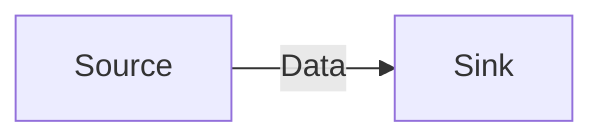
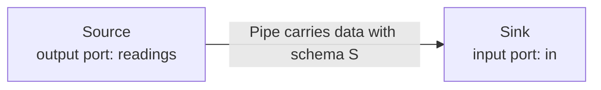
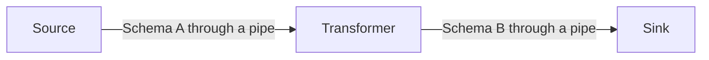
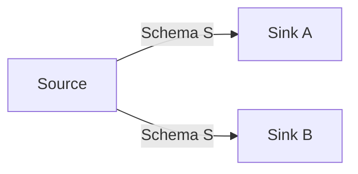
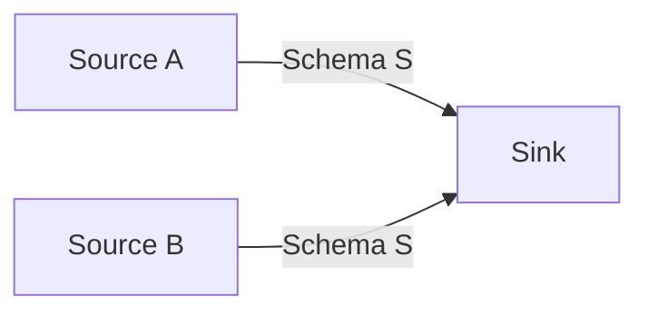
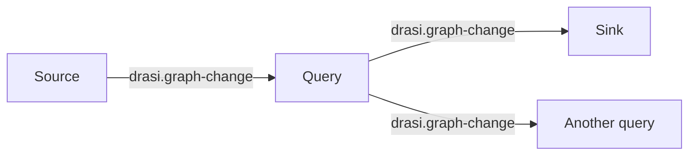
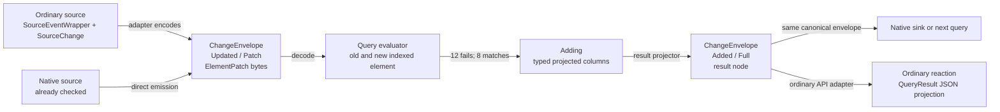
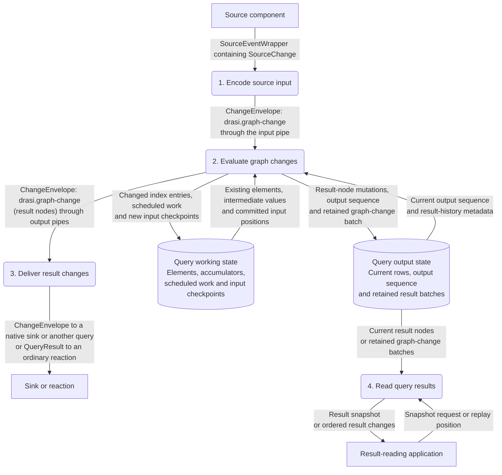

# ComputationGraph internal data design

This document explains what happens to data **inside DrasiLib**: its Rust
representations, the schemas carried between components, how processing changes
those representations, and what is stored and replayed. It is for Rust developers
who already use Drasi and want to understand the implementation.

It assumes familiarity with a source, a continuous query and a reaction, and
with a simple `MATCH`/`RETURN` query. It does not assume knowledge of internal
record types, producer identities, query indexes or recovery protocols.
`DrasiLib` owns the ComputationGraph that executes the components; Core supplies
the query evaluator and its index interfaces. The **ordinary APIs** adapt source
events and query results at that graph's boundary. **Native components** exchange
checked envelopes directly. These are entry points into the same processing
runtime, not different query engines.

The boundary starts when a source supplies Drasi data and ends at the internal
input of a sink or reaction. External database schemas, network request formats,
destination protocols, plugin authoring, component lifecycle management and
application configuration are outside its scope. Recovery is covered because it
determines which data is read and processed after an interruption.

## Contents

1. [Source and sink](#1-source-and-sink)
2. [Ports and schemas](#2-ports-and-schemas)
3. [Records, change sets and envelopes](#3-records-change-sets-and-envelopes)
4. [Pipes and delivery](#4-pipes-and-delivery)
5. [Identity, sequence, time and context](#5-identity-sequence-time-and-context)
6. [Transformers and schema changes](#6-transformers-and-schema-changes)
7. [Fan-out and fan-in](#7-fan-out-and-fan-in)
8. [Graph data and a query example](#8-graph-data-and-a-query-example)
9. [Incremental evaluation and result nodes](#9-incremental-evaluation-and-result-nodes)
10. [Logical identity and metadata authority](#10-logical-identity-and-metadata-authority)
11. [Time, ordering and mutation admission](#11-time-ordering-and-mutation-admission)
12. [Query publication and transaction boundaries](#12-query-publication-and-transaction-boundaries)
13. [Result views, snapshots and reader protocols](#13-result-views-snapshots-and-reader-protocols)
14. [Initial data and the live-data boundary](#14-initial-data-and-the-live-data-boundary)
15. [Recovery and duplicate handling](#15-recovery-and-duplicate-handling)
16. [Specialized processing and integration contracts](#16-specialized-processing-and-integration-contracts)
17. [Reading progress correctly](#17-reading-progress-correctly)
18. [Implementation map](#18-implementation-map)

Sections 1–7 establish the generic data path. Sections 8–15 follow one query's
data through evaluation, publication, reading and recovery. Section 16 is a
second pass over optional services and integration details; its mechanisms are
not prerequisites for an ordinary source/query/consumer path.

## 1. Source and sink

Start with two components:


External input and output are outside this diagram. The source and sink shown
here are DrasiLib components, and the arrow describes their internal data flow.

The **source produces data**. The **sink consumes it**. Everything in the first
five sections can be understood using this connection alone.

Three mechanisms define the connection:

| Mechanism | What it determines |
|---|---|
| Port | Where data leaves the source or enters the sink |
| Schema | What the data means and how its bytes are represented and checked |
| Pipe | How data travels between the ports, including buffering and delivery behavior |

Inside ComputationGraph, the unit being transported is a `ChangeEnvelope`.
It contains an ordered set of changes, their schema and identifying metadata.
The source's output and the sink's input must agree on that representation.

Neither a port nor a pipe changes the data's meaning. The source supplies valid
data; the pipe transports it; the sink handles it. Buffering and persistent
storage can be added to this same connection without introducing another
processing component.

## 2. Ports and schemas

### 2.1 Ports name the endpoints

Give the source an output port called `readings` and the sink an input port
called `in`:



The boxes still represent the same two components. Port names identify the
endpoints inside those components; the arrow remains the pipe carrying data.

A `PortDescriptor` contains:

| Field | Meaning |
|---|---|
| `id: PortId` | Name within the component |
| `direction: PortDirection` | Input or output |
| `schema: SchemaDescriptor` | The one data representation accepted or produced here |
| `requirements: PipeRequirements` | Required delivery properties, such as backpressure |

Port names must be unique within a component. Connected names need not be equal:
`Source.readings` can connect to `Sink.in`. An output must connect to an input,
their complete schema descriptors must match, and the pipe must meet the
requirements of both ports.

A port is not a queue, stream cursor or storage object. It describes a boundary.
When the graph invokes the sink, `InputEnvelope.port` identifies which of its
input ports received the data.

### 2.2 A schema describes the data, not its transport

The minimum representation needed here is:

```text
Record
  reference: schema + record key       which record?
  image: Full | Patch | Partial        what do the bytes describe?
  payload: immutable bytes             the schema-defined representation
```

A full image is complete data in its schema; a patch describes an update; a
partial image is known prior data. A change operation wraps these images to say
add, update or delete. An envelope carries an ordered batch of operations.
[Section 3](#3-records-change-sets-and-envelopes) gives the complete nesting and
the allowed before/after combinations.

The schema answers what a record's key, image and payload mean. It does not say
whether the data was delivered, saved or handled.

`SchemaDescriptor` contains:

- A `SchemaId` and positive `SchemaVersion`.
- An encoding name describing the payload representation.
- Nonempty definition bytes supplied in the schema's canonical form.
- A calculated, noncryptographic fingerprint.

The connection compares the **complete descriptor**, not just its name,
version or fingerprint. Two definitions that look equivalent to a person but
have different definition bytes are not automatically compatible.
The schema provider is responsible for choosing deterministic definition bytes.
For example, adding whitespace to a textual definition changes those bytes;
the graph does not normalize it into compatibility. This is separate from a
payload codec's canonical encoding of an individual record key.

For the simple source/sink connection, both ports use schema S. The source
cannot emit a differently encoded record and expect the pipe to convert it.
The sink must receive exactly the representation it agreed to consume.

### 2.3 Validation checks the records

`Schema` pairs the descriptor with an executable `RecordValidator`. The
descriptor is descriptive data; the validator supplies the rules that actually
check record identity, image kind, payload encoding and content.

For example, an application-defined reading schema could require a nonempty
sensor key and a numeric measurement. That rule must exist in its validator.
Definition bytes are not automatically interpreted as JSON Schema, and attaching
a familiar field name does not establish its type or meaning.

`Record::try_new` checks the key and payload through that validator.
`RecordReference::try_new` checks a key without requiring a payload, which is
useful for an identity-only deletion. `ChangeSet::try_new` then checks the
relationships between the operations and their images.

Records are immutable after construction. Normal in-process routing need not
decode their payloads again just to forward them, but the graph still checks
the envelope's schema against the port at emission and delivery. Decoding
serialized envelopes reconstructs and validates their records.

Different providers of the same schema descriptor must implement the same
validation meaning. Descriptor equality cannot prove that arbitrary validation
code is correct.

Sources: [port contracts][ports], [schemas and checked records][records].

## 3. Records, change sets and envelopes

The source and sink exchange the same checked data structure. The envelope,
schema and record types are defined in `drasi-computation-contracts` and
re-exported through `drasi_lib::computation::v1`.

### 3.1 The nested structure

The graph's message representation is:

```text
InputEnvelope or OutputEnvelope
  port: PortId
  envelope: ChangeEnvelope
    event: Arc<ChangeEvent>
      id: EnvelopeId
      changes: Arc<ChangeSet>
        id: ChangeSetId
        schema: SchemaDescriptor
        operations: Arc<[ChangeOperation]>
          ordinal
          record identity
          optional before record
          after record, where applicable
      system: Arc<SystemMetadata>
        stream, emission sequence
        optional timestamp and source position
        ordering: EventTime | ProducerSequence
        control: Option<ControlMessage { kind, payload }>
      lineage: Option<Arc<Lineage>>
    context: ProcessingContext
```

The port address is outside the shared event. A receiving component gets its
own local input-port name without changing the producer's event.

A `Record` is a validated combination of:

- `RecordReference`: schema descriptor plus `RecordId`.
- `RecordImage`: whether the bytes are a full image, patch or partial image.
- `payload: Bytes`: immutable schema-defined bytes.

The payload is not necessarily UTF-8, JSON or a Rust struct in memory. The
schema's codec determines how to decode it. For the
[standard graph schema](#84-standard-query-path-schemas) it is a
MessagePack-encoded element image, patch or before-image.
The operation kind (add, update or delete, and its update semantics) belongs to
the `ChangeOperation`, not to the payload bytes.

### 3.2 Before/after images and operations

`RecordImage::Partial` and `RecordImage::Patch` are different:

- **Full:** complete record in that schema.
- **Patch:** instructions/data for updating the record under that schema's rules.
- **Partial:** known values from a before-image; not a complete record and not
  an update instruction.

The generic change-set rules are:

| Operation | After image | Before image |
|---|---|---|
| `Added` | Required, `Full` | None |
| `Updated`, `Replace` | Required, `Full` | Optional `Full` or `Partial` |
| `Updated`, `Patch` | Required, `Patch` | Optional `Full` or `Partial` |
| `Deleted` | None; a validated `RecordReference` is required | Optional `Full` or `Partial` |

`ChangeSet::try_new` checks that all records use its exact schema, before/after
identities agree, and operation ordinals are unique and increasing. Ordinals need
not be consecutive. Construction does not sort an invalid batch into validity.
The codecs may assemble operations in a temporary collection and explicitly
order them before calling that constructor.

Repeated **record identities** are not forbidden across different operations:
one batch can describe several changes to the same record. An operation's stable
identity is the change-set ID together with its ordinal.

An empty change set is valid. It can carry metadata without record changes,
including a separately marked control message. Empty data alone does not
identify its intended meaning.

### 3.3 Record encoding versus envelope encoding

There are two outer envelope codecs:

| Codec | Outer representation | Format version |
|---|---|---:|
| `EnvelopeCodec` | Explicit JSON frame; opaque record/identity bytes remain encoded byte data | 1 |
| `BinaryEnvelopeCodec` | Named MessagePack frame with binary payloads | 1 |

The records inside either frame retain their schema-defined payload encoding.
For example, a MessagePack-encoded graph record stays encoded bytes inside a JSON
envelope; its fields are not automatically converted into untyped JSON properties.

Both frames preserve the complete event: stream, sequence, timestamp, source
position, ordering policy, event-local control, lineage and context. These
metadata fields are introduced in [section 5](#5-identity-sequence-time-and-context).
The [integration reference](#166-native-wire-and-port-format-selection) gives
native-plugin wire and ABI compatibility requirements.

Both codecs reconstruct checked records/change sets using explicitly registered
executable schemas. Unknown schema versions, conflicting definitions and
unsupported outer versions fail. A serialized descriptor does not carry an
executable validator.

Codec limits apply to the encoded frame. `BinaryEnvelopeCodec::encoded_size`
measures the full binary envelope, including metadata, lineage and context,
without allocating the encoded output. This is the measure used by relevant
byte-budget mechanisms; it is not a measure of Rust heap use.

Source positions used by the shared progress contracts are bounded to 65,536 bytes.
Other bounds belong to their specific reader, journal or transaction rather
than one universal maximum for all data. A frame-size check does not itself
prove that every nested value or custom validator is safe at arbitrary depth.

Sources: [records][records], [envelopes][envelopes],
[JSON envelope codec][json-codec], [binary envelope codec][binary-codec].

## 4. Pipes and delivery

### 4.1 Following one envelope

At the graph's envelope boundary, the source returns an `OutputEnvelope`
containing its output-port name and a `ChangeEnvelope`. The graph checks the
emission and passes it to the bound pipe.
The pipe receiver supplies that envelope to the graph, which invokes the sink
with an `InputEnvelope` naming the sink's input port.

The port address changes from the source's local name to the sink's local name.
The shared event, records and schema do not change merely because the data
crossed the pipe.

`EnvelopeSender::send` returns an `EnqueueReceipt`: confirmation that the pipe
accepted the envelope, optionally with a journal position. It does not say that
the sink handled it.

`EnvelopeReceiver::receive` returns a `Delivery`. This contains the envelope and
an optional `Box<dyn Acknowledgement>`. The graph holds the acknowledgement
separately while passing the data to the sink.

### 4.2 Acceptance and handling are separate

Consider a source that successfully sends an envelope while the sink is busy
with an earlier one. Acceptance succeeded; handling has not happened yet.

The sink's completion contract makes the distinction explicit:

| `SinkCompletion` | What a successful sink call establishes |
|---|---|
| `Accepted` | The sink accepted or queued the data at its own boundary |
| `Handled` | Processing finished at the sink's declared handling boundary |

For a pipe with explicit handling acknowledgements, the graph completes the
acknowledgement only after the required handling succeeds. It will not connect
an acceptance-only sink as though that sink confirms handling.

`Acknowledgement::complete(Handled)` advances the pipe's handled position.
Dropping the handle does not acknowledge the data. A failed outcome leaves
retained input unacknowledged rather than erasing the obligation.

`Delivery` is neither cloneable nor serializable. The envelope is ordinary
shareable data; the one-shot acknowledgement is a local capability, not a field
to encode into that data.

### 4.3 Buffering and retention on one connection

The same source and sink can use different transport behavior:

| Transport | Data held between source and sink | Full/slow behavior |
|---|---|---|
| `BoundedPipe` | Volatile FIFO queue | Waits for capacity; no persistent replay or handling acknowledgement |
| Byte-bounded pipe | Volatile FIFO with envelope-count and byte reservations | Waits for capacity under both bounds |
| `BroadcastPipe` | Bounded volatile history | Does not wait for a slow receiver; missing history is reported or explicitly skipped with notification |
| `RetainedPipe` | Journal plus consumer handled position | Retains unacknowledged data; backpressures or explicitly prunes according to its retention policy |

A retained store can be in memory or persistent. **Retention is not the same
as crash durability.** Retained history in memory can support another read while
that store exists, but not recovery after losing the process.

With `RetentionPolicy::Backpressure`, the source must wait when required data
cannot be safely reclaimed. With `PruneOldest`, older entries can be removed,
and the receiver must detect when its requested position is no longer available.
An explicit skip is different from handling the missing records successfully.

Capabilities describe these properties separately. `FifoPerStream` concerns
order; `Backpressure` concerns capacity; `DurableAcceptance` concerns survival of
accepted data; `ExplicitAcknowledgement` concerns handling; `Replay` concerns
reading saved data again. The graph checks required capabilities rather than
inferring all of them from the word "persistent."

### 4.4 Ordering and failures

One output stream belongs to one source/output port. New emissions have
increasing sequences. A FIFO pipe preserves that stream's emission order;
wall-clock timestamps cannot reorder it.

An idle pipe suspends its receiver. `receive()` returning `None` means closed
and drained, not "no data available right now."

A send failure returns the envelope and identifies definite nonacceptance or
uncertain durable acceptance. If a send was cancelled without a result, the
caller cannot assume that nothing was stored. Replay or receipt lookup must
resolve an uncertain outcome before it is treated as new input.

### 4.5 Batching does not change the data contract

Even with one source and one sink, there are two different batches:

- A `ChangeSet` groups operations in **one envelope**.
- Pipe/sink batching groups **several complete envelopes** for one invocation.

`send_batch` reports the accepted prefix, the failed envelope and the unattempted
remainder. It is not an all-or-nothing transaction.

For sink batching, `max_inputs` is a hard envelope count. The operation count is
a flush target; the host does not split an envelope to meet it. Each envelope
retains its identity and operation ordinals. Batching alone neither combines
their schemas nor makes their effects atomic.

### 4.6 Count and byte limits

Queue capacity counts envelopes, not records or bytes. An envelope containing
one operation and an envelope containing a thousand operations each occupy one
envelope slot.

Byte accounting uses the complete encoded binary envelope, including metadata,
context and lineage. In `ByteBoundedPipeConfig`, an envelope larger than
`max_bytes` is admitted only when no other byte reservations exist. It occupies
the entire byte budget until received or discarded. Thus `max_bytes` bounds
buffered reservations; it is not a hard maximum on an individual payload.
Do not infer that exception for another service: the query outbox's encoded
frame limit and the source-transaction assembly limit are rejection bounds
([publication](#122-atomic-query-publication),
[complete transactions](#161-complete-source-transactions)).

Buffered-byte quotas do not include every pending sender, already received
message, component-private allocation or stored business value. Paged history
can limit payload reads and caches while still retaining accounting metadata
per stored entry. A pipe capacity is not a total process-memory limit.

Sources: [pipe interfaces][pipes], [bounded transports][bounded],
[broadcast][broadcast], [retained delivery][retained-pipe],
[retained storage][retained-store], [sink processing contract][component-dataflow].

## 5. Identity, sequence, time and context

These distinctions already matter in the direct source/sink case. They do not
require an intervening transformation.

### 5.1 Which record, operation and delivery?

| Identity or position | Question it answers |
|---|---|
| `RecordId` | Which record does this change address? |
| `ChangeSetId` plus operation ordinal | Which operation in this batch is it? |
| `EnvelopeId` | Which emitted event is it? |
| `StreamId` plus emission sequence | Where does it occur on this source output? |
| Pipe journal position | Where did the pipe store it? |
| Consumer handled position | How much of that stored data has the sink finished? |

`RecordId`, `ChangeSetId` and `EnvelopeId` contain a namespace and nonempty opaque
`Bytes`. They are supplied identities, not content hashes. Named IDs such as
`PortId` and `StreamId` wrap shared strings and reject empty names, whitespace
and control characters.

A source can update the same record in several events. Its `RecordId` remains
the same; the events and individual operations have different identities.
A pipe may store an event at a journal position unrelated to the source's
sequence. Neither number should be substituted for the other.

The general emission rule allows gaps in increasing stream sequences. Specific
admission or recovery contracts can impose stricter continuity requirements.

### 5.2 Time and source positions

`SystemMetadata` holds the stream, emission sequence, optional
`DateTime<Utc>` timestamp and optional source-position bytes.

The timestamp describes time associated with the event. FIFO transport is
ordered by emission, not by assuming every later event has a later timestamp.
Application-specific times inside records are interpreted by their payload
schema.

A source position is an opaque resume token. Its presence alone proves neither
persistence nor completed handling. The source defines how the bytes are
interpreted; the transport must not invent an ordering by comparing them as
strings.

### 5.3 Context accompanies the event

`ProcessingContext` is an append-only sequence of `ContextEntry` contributions.
Each entry contains a contributor ID, key and a value: `Bool`, `Signed`,
`Unsigned`, shared `String` or shared `Bytes`.

Appending an entry does not alter the event or overwrite earlier entries.
Iteration is newest first, and duplicate keys remain visible. Code must use
the applicable reader's lookup rules rather than assume context is a mutable
last-write-wins map.

The immutable event and record bytes can be shared through `Arc` and `Bytes`.
Cloning an envelope preserves that sharing; appending context to the clone
changes only its annotation chain.

Acknowledgements, transactions and index handles are not context values.
They remain local capabilities outside the serializable envelope.

### 5.4 Event metadata is not transport policy

Two further `SystemMetadata` fields travel with an event:

| Field | Meaning at this boundary |
|---|---|
| `ordering: ChangeOrdering` | The policy a data-processing consumer uses to decide whether a mutation is newer than its stored state |
| `control: Option<ControlMessage>` | An instruction about this event, with a checked kind and opaque payload |

Neither field changes a pipe's FIFO behavior. A control is not a record or a
context annotation; a consumer must understand an instruction it processes.
For now, these are fields the direct source/sink connection preserves.
The query-specific staleness policies need the graph-element and producer
identity models, so they are explained in
[section 11](#11-time-ordering-and-mutation-admission). Derivation's treatment
of these fields is explained next to
[transformers](#63-derivation-preserves-provenance-not-mutable-input).

Sources: [identity types][records], [metadata, controls and context][envelopes].

## 6. Transformers and schema changes

A **transformer** is a component between source and sink. It consumes input
envelopes and produces output envelopes.



All boxes are components and all arrows carry data through pipes. Schema A and
schema B can be different. The source output must match the transformer's
input; the transformer's output must separately match the sink's input.
The pipe on neither side performs the conversion.

### 6.1 Each side has its own data contract

For example, an application might define:

| Boundary | Illustrative schema | Record payload |
|---|---|---|
| Source output / transformer input | `example.reading-text` | A measurement encoded as text |
| Transformer output / sink input | `example.reading-number` | A validated numeric representation |

These example names are not built-in Drasi schemas. The transformer decodes
according to the first schema, converts and validates the value, then constructs
a record using the second schema. It can preserve the record's business identity
if that identity is valid under the output schema, but it must emit a new event
describing the transformed data.

A transformer can also keep the same schema. Filtering, normalization and
expansion need not change the representation contract.

An **event filter** decides what to emit for the current change; it does not
necessarily maintain a filtered dataset. Suppose it emits a product while
`quantity < 10`, then ignores a later update to quantity 12. The earlier output
is not automatically retracted. A **maintained view transform** would remember
that output and emit its deletion. The same distinction matters when a mapping
changes a key or expands one input into several children. Query evaluation
maintains its answer; a stateless event mapper does not gain that behavior just
because its schema is unchanged. The built-in middleware rules and their
limits are described in [section 16.5](#165-graph-change-middleware).

### 6.2 Zero, one or many outputs

`Transformer::transform(InputEnvelope)` returns `Vec<OutputEnvelope>`.
The input-port name identifies where data arrived; each output names its
destination port within the transformer.

A transformer can:

- Produce no output because it filtered the input.
- Produce one transformed envelope.
- Expand the input into multiple ordered operations or multiple envelopes.
- Retain input for later output, if its processing contract supports that.

Output events use the transformer's own stream and increasing emission
sequences. Reusing an input's sequence for several new emissions is not valid.
An empty output change set can explicitly carry progress when filtering removes
all records; no output at all and an empty progress-bearing envelope are different.
For example, a middleware producer can emit logical output 12 with no operations
after filtering its next input. A downstream owner can then commit having seen
that producer's output 12 without changing its rows. Emitting nothing supplies no
such output boundary. This is an explicit producer contract, not a rule that every
filter must manufacture a progress message.

### 6.3 Derivation preserves provenance, not mutable input

`ChangeEnvelope::derive` creates a new event with the transformer's output
identity, schema-consistent change set and system metadata. It shares the
existing context and adds the input's identity/system metadata to lineage.
The input's event-local control and ordering policy are not copied into the new
event; they remain historical provenance in lineage until the producer states
its own.

`GraphChangeCodec::derive_changes` explicitly carries the input ordering policy
forward and attaches a control only when the new output needs one. In contrast,
`ChangeEnvelope::reemit` retries the same logical output and keeps its ordering
and control; a relay forwarding the event unchanged keeps them too. A control
found in a parent's lineage is historical provenance, never a command for the
derived event. The producer-identity requirements of a new derived output are
covered in [section 10](#10-logical-identity-and-metadata-authority).

Lineage does not retain the parent's record payload. It follows a single chain;
it is not a complete record of every input that a component has processed.
Graph publication and both envelope codecs accept at most 1,024 lineage entries
(`MAX_LINEAGE_DEPTH`). `try_derive` rejects the next derivation at that limit;
the infallible in-memory `derive` remains available, but an oversized result
cannot be published or encoded. Encoding-size calculation enforces the same
limit. Shared ancestry is released iteratively, including after rejected decode
or publication, and diagnostic formatting does not recursively traverse it.
The transformer cannot mutate an input record merely because it received an
owned envelope value: the underlying data is immutable and may be shared.

For recoverable stateful transformations, `GraphProducerIdentity` and
`GraphProducerProgress` identify logical output separately from transport
emissions. Replaying already committed output can assign a new emission number
without making that output new business work. Inherited source metadata is
provenance, not automatically this transformer's own checkpoint.

### 6.4 When is the input considered handled?

With one downstream sink, the graph:

1. Receives the input and keeps its pipe acknowledgement separately.
2. Invokes the transformation.
3. Validates and forwards the returned emissions.
4. Calls `delivery_completed` after the outgoing pipe accepted that batch.
5. Finishes any bounded continuations before processing the next input.
6. Confirms applicable handled-input progress and completes the input's
   acknowledgement.

**Continuations** are further bounded processing/output steps the transformer
has retained for this input instead of returning all work in one output vector.
They finish before the graph starts the next input. The graph retains the
input's acknowledgement through those steps; returning one vector is not alone
proof that the input is fully handled.

`delivery_completed` means completed **outgoing handoff**, not that the
downstream sink finished its own processing. If recovery depends on that
handoff surviving a crash, the outgoing pipe must actually provide durable
acceptance.

Stateful transformations also have to preserve the relationship between their
input position, changed state and outgoing data. Returning an output vector
does not establish that those pieces committed together;
[section 12](#12-query-publication-and-transaction-boundaries) explains the
transaction boundaries and distinguishes committed progress from pipe acknowledgement.

Sources: [transformer contract][component-dataflow], [derivation][envelopes],
[producer identities][producer-progress], [forwarding][graph-routing].

## 7. Fan-out and fan-in

The previous rules apply to every connection when there is more than one
producer or consumer. Multiple connections do not introduce a different
envelope format.
The processing graph allows branching and merging, but data paths cannot
contain cycles.

### 7.1 Fan-out: one output, several consumers



When these branches use the same source output port, both sinks must accept
its schema. The graph forwards the emitted envelope to each required branch.
A transformer output can fan out in exactly the same way.

Envelope clones share the immutable event, records and payload bytes. Each
branch can append its own context without modifying its sibling's context.
Sharing payload memory does not merge delivery obligations: each sink still
has its own handling progress.

Independent pipes are sent to separately. If one branch accepts before another
fails, the first acceptance is not rolled back. Recoverable producers retain
their output and use destination-aware replay; they cannot assume fan-out was
an atomic all-or-nothing send.

A slow required branch can backpressure the producer and therefore delay later
output on other branches. Independent branches are not a promise that the
producer can always ignore the slowest one.

### 7.2 Shared retained fan-out

`QosChannel` stores one producer stream with independent named subscriber
cursors. `QosPipe` connects one of those subscribers to a consumer.
The graph recognizes branches using that same channel and appends once rather
than store one copy per reader.

Each subscriber has an independent position and acknowledgement. A disconnected
required subscriber retains its obligation. Safe reclamation follows the
required consumers' progress, not the fastest one.
Here, **required** means a consumer whose membership/progress participates in
the retention obligation, not every transient observer. Disconnecting a named
required subscriber is not retiring that membership.

`SubscriptionStart` defines a new reader's initial cut: earliest retained data,
latest, or after a position. Reopening an existing subscriber retains its saved
cursor instead of silently applying a new start point.

For independent byte-bounded pipes, each branch charges the complete envelope
even when its Rust allocations are shared. A shared journal has its own
single-copy accounting and per-reader progress.

### 7.3 Fan-in: several outputs, one consumer



Two source outputs may connect to the same sink input when they satisfy that
port's schema and delivery requirements. Each output retains its own stream
identity and order.

If the sources use different schemas, they cannot both feed that one
single-schema input. The consumer needs separate appropriately typed input
ports, or explicit transformations that bring the data into a common schema.

Fan-in does not automatically combine records by key or produce a relationship
between them. The receiving component defines any such processing. The
transport only determines which available input is supplied next.

### 7.4 Choosing among inputs

The default `InputMergePolicy::Arrival` uses available arrival order.
`EventTimeAcrossStreams` compares the currently available stream heads without
reordering the admitted sequence within a producer. It does not wait for an
idle source; untimed heads preserve their arrival boundary.
The [timed/untimed example](#111-three-different-ordering-decisions) shows that
selection explicitly and gives the buffered merger's release rules.

This is not proof that an earlier timestamp cannot arrive later. A
`SourceTimeMergeTransformer` supplies explicit bounded reordering:

- It retains data, orders buffered events by source time and emits them on its
  own output stream.
- Reorder windows, maximum residence time and optional idle-source treatment
  determine when events become eligible.
- Envelope-count and full-envelope-byte bounds limit buffered and pending data.
- Late input is failed-and-retained, routed separately, or explicitly discarded.
- Its persistent form retains the buffered/pending data, identities and progress
  needed to recover that ordering work.

Reordering cannot undo arbitrary processing already performed downstream.
The distinction between merging available heads and deliberately waiting for
more data matters even when both components use the same payload schema.

Sources: [forwarding][graph-routing], [shared envelopes][envelopes],
[QoS channels][qos], [pipe merge policy][pipes], [time merger][time-merge].

<a id="8-queries"></a>

## 8. Graph data and a query example

A continuous query specializes the transformer model: it consumes changes to
elements, maintains indexed state, and publishes its answer as changes to
result nodes.



On this standard query path, source, transformer and query outputs use the
**same canonical graph-change schema**. Custom schemas remain valid on other
matching ports. A query's result row is an ordinary node, so a
sink that understands graph changes, a middleware stage or a second query can
consume it directly. No adapter component sits between two queries, and there
is no separate query-row wire format. Facts that only a result reader needs (the
row kind, grouping keys and ordinals) travel beside the records rather than
inside them ([section 9.3](#93-query-results-are-ordinary-graph-nodes)).

"Graph data" here means the nodes and relationships evaluated inside the query.
Those are data records, not the processing components or their pipe connections.

The next subsections define the business data and follow one input into an
answer. The detailed type inventory follows that example rather than serving
as a prerequisite for it.

### 8.1 Graph elements

`ElementReference` consists of two `Arc<str>` fields:

```text
ElementReference
  source_id
  element_id
```

Both fields participate in identity. Two sources can use the same `element_id`
without referring to the same element. Conversely, changing a label or property
does not give an element a new identity.

`Element` has two variants:

```text
Node
  metadata: ElementMetadata
  properties: ElementPropertyMap

Relation
  metadata: ElementMetadata
  in_node: ElementReference
  out_node: ElementReference
  properties: ElementPropertyMap
```

`in_node` is the reference at the incoming end of the relationship and
`out_node` is the reference at its outgoing end. Endpoints are full
source-qualified references, not unqualified names. A relationship has its own
identity and properties independently of its endpoints.
For `(a)-[r]->(b)`, `r.in_node` addresses `a` and `r.out_node` addresses `b`.

`ElementMetadata` contains the reference, an `Arc<[Arc<str>]>` of labels and
`effective_from: u64`. `effective_from` is **milliseconds since the Unix epoch**,
not the time when a pipe accepted the envelope. Mutation admission checks its
range; zero is allowed as an unknown-time value used by initial loading.

These elements are indexed per query. A source serving two queries supplies
changes to two processing owners; it does not create a shared mutable business
graph that all evaluators modify.

### 8.2 Property values and evaluator values

`ElementValue` has compact variants for common properties:

- Null, Boolean, signed 64-bit integer and floating-point value.
- Shared string, list and nested property object.
- Local date-time and fixed-offset zoned date-time.

Everything else is carried by its `Typed` variant, which holds a validated
`DataValue`: unsigned integers above the signed range, dates, local/zoned times,
durations, ranges, complete elements, metadata, references, expressions and the
`Awaiting` marker. A property is therefore not forced into primitive JSON.

`DataValue` (in `drasi-core-types`) is the rich-value representation shared
by element properties, canonical graph records and query results. It
stores floating-point values as their `f64` bits (so signed zero, infinities and
NaN payloads survive), keeps unsigned and signed integers distinct, and keeps a
zoned date-time's optional time-zone name and a duration's calendar and elapsed
parts. Expressions and `Awaiting` are inert data: decoding or forwarding them
never evaluates them. A malformed value is rejected by validation, not coerced.

`VariableValue`, used during evaluation, covers the same values.
`DataValue::encode` / `decode` preserve their numeric and typed meaning, but not
every input enum tag: encoding an evaluator integer uses `Unsigned` for a
nonnegative value and `Signed` for a negative one. Thus the compact element
`Integer(8)` can appear as canonical `Unsigned(8)` after evaluation. This
normalization is not a floating-point conversion or a loss of integer precision.
`QueryVariables` is a `BTreeMap<Box<str>, VariableValue>`. Its keys are bindings
or projected column names, not element-property identities.

One limit remains: a JSON projection (such as `row_values_to_json` or an
ordinary `QueryResult`) renders dates and other typed values as strings or tagged
objects. A JSON round trip is a presentation, not a lossless conversion; use the
typed value when the type matters.

A result node can be converted with `Element::try_from(ElementImage)`, including
rich properties through `ElementValue::Typed`. A malformed value or failed
validation is reported with the property's name, not silently substituted.
This error reporting does not mean valid rich variants are omitted from the
element model. `Awaiting` is an evaluator marker, carried opaquely here; a data
consumer does not need to implement its evaluator behavior to preserve it.

### 8.3 Source mutation semantics

| `SourceChange` variant | Evaluator meaning |
|---|---|
| `Insert { element }` | Supply a full element. If that identity already exists, replace its prior contribution rather than count another copy |
| `Replace { element }` | Supply a full element as an explicit **replacement**. It replaces the existing version of the identity (properties the new element omits are dropped) in one change, and records that the producer asked for a replacement rather than an addition |
| `Update { element, removed_properties }` | Set every property of `element` (a supplied `Null` is a value), delete only the names in `removed_properties`, and leave every other property of the current element unchanged. Without a current element it creates one from the properties it sets. A name cannot be both set and removed |
| `Delete { metadata }` | Remove the addressed element using its identity and effective time; a full property image is unnecessary |
| `Future { future_ref }` | Reevaluate scheduled work for an element, retaining its original time and due time |

Update merging is defined by the graph model, not by the pipe. It is not a
generic JSON Patch program. Labels and relationship endpoints are fields of the
incoming element: an update takes its metadata and endpoints from the patch,
while merging existing properties except for explicit removals. For example,
changing the incoming labels changes the element's labels; omitting an existing
property does not remove that property. `SourceChange::validate` rejects an
update that both sets and removes a property, and every admission boundary calls it.

An identical current element contributes no new result. A node and relationship
cannot replace each other under one live identity. Whether a mutation is too old
to apply depends on business time or validated producer revision; those admission
rules follow the identity model in
[section 11](#11-time-ordering-and-mutation-admission).

Sources: [model types][elements], [property values][element-values],
[mutations][source-changes], [mutation admission and evaluation][evaluator].

### 8.4 Standard query-path schemas

There is a common **envelope structure**. One standard data schema carries
continuous-query data:

| Schema ID | Version | Record encoding | Record meaning |
|---|---:|---|---|
| `drasi.graph-change` | 1 | `drasi-element-msgpack-v1` | Canonical element images, element patches and before-images, from sources, transformers, query results **and complete source transactions** |

`SourceTransactionCodec::schema()` returns this same descriptor; there is no
separate transaction data schema.

`QueryChangeCodec::schema()` returns the `GraphChangeCodec` schema. A query's
input port and its output port use the same descriptor, so any graph-change
output can connect to any graph-change input that meets the port's delivery
requirements. A query configured for complete source transactions has the same
input descriptor and selects atomic handling explicitly; it then requires every
input to carry its own current completeness marker
([section 16.1](#161-complete-source-transactions)). Its output
remains `drasi.graph-change`.

Custom schemas use the same record/envelope/pipe machinery. Ports whose complete
schema descriptors match connect directly, including a custom schema that a
factory explicitly declares and implements for both producer and consumer; the
pipe neither converts nor needs to. Only formats that genuinely differ (for
example a custom record and the standard graph-change schema) need an
intentional conversion transformer. Optional format selection is described in
the [integration reference](#166-native-wire-and-port-format-selection);
it is not a prerequisite for connecting matching schemas.

There are three separate contracts:

1. **Record representation:** the complete schema descriptor at the ports.
2. **Event meaning:** ordinary data, a query projection, a complete transaction,
   a replace-all snapshot, a recovery skip or a scheduling control.
3. **Consumer capability:** which of those meanings the receiver implements.

Matching schema descriptors permits representation-compatible connections; it
does not erase event-level checks. The same record schema supports these cases:

| Event/API family | Additional meaning or requirement |
|---|---|
| Ordinary graph changes | Standard operations; no query projection is required |
| Current query output | A projection annotation for this change set allows query-aware readers to reconstruct row differences |
| Complete source transaction | A validated, current completeness annotation; a transaction-mode query rejects an unmarked batch |
| Replace-all recovery snapshot | A snapshot marker and scope/cursor; the receiving input must support state replacement |
| Progress-only recovery | An explicit recovery decision, not “an empty batch means handled” |
| Scheduled reevaluation | An event-local control understood by the processing consumer |

Native HTTP/gRPC/SSE **graph-data** notification sinks handle source, transformer
and query data through their common network path; they do not require a current
query projection. That ordinary-data path rejects scheduling controls and
snapshot/progress recovery frames. The **ordinary reaction adapter** instead
uses `QueryChangeCodec::to_legacy_result`, requires current query projection and
checks the subscribed query identity. Do not transfer that reaction restriction
to native graph sinks. The capture sink can record graph-change envelopes,
including query output.

### 8.5 Graph-change records

`GraphChangeCodec` uses the record identity:

```text
namespace = "drasi.graph-element"
value     = canonical named-MessagePack encoding of ElementReference
```

The payload depends on the record's image and is always one bounded MessagePack
value:

| Record image | Payload | Meaning |
|---|---|---|
| `Full` | `ElementImage` | `Node { metadata, properties }` or `Relation { metadata, in_node, out_node, properties }`, each property a `DataValue` |
| `Patch` | `ElementPatch` | An `ElementImage` of properties to **set**, plus a separate set of property names to **remove** |
| `Partial` | `ElementBeforeImage` | Either `Metadata(ElementMetadata)` or a full `Element(ElementImage)` known before the change |

The operation (`Added`, `Updated` with `Patch` or `Replace` semantics, or
`Deleted`) is carried by the `ChangeOperation`, outside the payload. The payload
holds only the element data.

A patch distinguishes three outcomes for a property: **set** to a value, set to
`Null` (the property exists and holds null), and **remove** (the property
absent). A property cannot be both set and removed; validation rejects the
patch. `ElementPatch::apply_to` produces the element after the patch, given an
optional base of the same identity and kind. It does not claim that the result
is a complete record when no base is supplied.

| Base supplied to `apply_to` | Result and completeness |
|---|---|
| Existing element of the same identity and kind | Merge its properties with sets/removals; use the patch's metadata/endpoints |
| No base | Construct an `Element` from the properties the patch sets; absent prior values cannot be recovered |
| Different identity or kind | Reject the incompatible base |

The evaluator's “create when absent” policy uses that constructible element.
An `Element` value is not itself an authoritative `RecordImage::Full`: a
transformer lacking the prior image cannot assert that its known properties
represent every property at the source. This separates local state construction
from the producer's full-image promise.

The normal mapping from a source mutation is:

| Source value | Envelope operation | Image |
|---|---|---|
| Insert | `Added` | Full `ElementImage` |
| Replace | `Updated` with `Replace` semantics | Full `ElementImage` |
| Update | `Updated` with `Patch` semantics | `ElementPatch` setting every supplied property and removing the names in `removed_properties` |
| Delete | `Deleted` | Partial before-image holding the delete metadata |
| Future reevaluation | No record | An event-local control listing the scheduled elements ([section 16.4](#164-scheduled-reevaluation)) |

`decode_changes` is the inverse mapping and is lossless for these variants: an
`Added` operation becomes `Insert`, a `Replace` update becomes `Replace`, and a
patch becomes `Update` with its removal set intact. A replacement is not
interpreted as a patch, a delete followed by an insert, or an `Insert`.
The query evaluator treats `Insert` and `Replace` alike as a full-row upsert
that retracts the prior contribution.

Consumers that apply `ElementPatch` directly (`ElementPatch::apply_to`) and
consumers that work through `SourceChange` therefore see the same removals and
replacements.

An identity-only delete is permitted. When no delete metadata supplies its time,
the decoder requires a nonnegative envelope timestamp and derives the effective
milliseconds from it. It does not invent a current timestamp.

The graph validator decodes the record and checks that its embedded reference
matches the external `RecordId` and that the image kind matches the payload.
The key must be the canonical encoding of its reference. Decoders apply a size
limit derived from the supplied payload, check collection lengths against the
remaining input before allocating, and reject truncated or trailing bytes and
invalid values.

### 8.6 Following a product update into a result

Consider the query:

```cypher
MATCH (p:Product)
WHERE p.quantity < 10
RETURN elementId(p) AS id, p.quantity AS quantity
```

The element index contains product `inventory/P-7` with quantity 12. It does not
appear in the low-stock answer. A new source change sets quantity to 8:

```text
SourceChange::Update
  element: Element::Node
    reference: ("inventory", "P-7")
    labels: ["Product"]
    effective_from: a valid millisecond time
    properties: {"quantity": Integer(8)}
  removed_properties: {}
```

Other existing properties remain: this is a patch that removes nothing. The
ordinary source wrapper records source sequence 42 and its optional replay
position. Its adapter can emit transport sequence 15 on its own stream. These
are illustrative independent counters, not a required numeric relationship.



The input envelope contains an `Updated/Patch` operation, a
`drasi.graph-element` key for `inventory/P-7`, and an `ElementPatch` setting
`quantity`. Its original-source annotation identifies source sequence 42;
transport sequence 15 does not replace that source position.

The evaluator reads the old element, applies the patch and compares old/new
MATCH contributions. Quantity 12 did not satisfy the filter; quantity 8 does.
It produces an `Adding` difference for a row identity, say `R`. That identity
belongs to the matching row, not the visible string `P-7`; consumers must not
recompute it from returned columns.

The result projector constructs an ordinary full graph node:

```text
Added operation
  record key: drasi.graph-element + ElementReference
    source_id:  the query output's dataset namespace
    element_id: lowercase hex of R's eight bytes
  ElementImage::Node
    labels: ["Result"]
    effective_from: this event's business time
    properties:
      id:       String("P-7")
      quantity: Unsigned(8)
  projection annotation: operation 0 is a Row
```

`Integer(8)` becomes canonical `Unsigned(8)` under the numeric normalization
described in [section 8.2](#82-property-values-and-evaluator-values), without
changing its value. The node's identity is distinct from the source product;
its `id` property is just a projected column. A second query can read
`MATCH (r:Result) RETURN r.quantity AS quantity` from this same envelope.

This example explains representation, not a durability guarantee. In the atomic
persistent path, the updated indexes, committed input, current result node and
retained output commit together before publication
([section 12](#12-query-publication-and-transaction-boundaries)).

## 9. Incremental evaluation and result nodes

### 9.1 From source mutations to row differences

The compiled query has MATCH slots and a path solver. The element index maintains
which stored elements can occupy those slots and their relationships.
A slot is a position in the compiled MATCH pattern; solving the path finds
combinations of indexed elements satisfying that pattern. Query **parts** are
successive projection/filter stages, such as a `WITH` followed by `RETURN`.

For an insert/update, evaluation determines the old solutions involving the
element, merges patch properties if appropriate, updates indexed data and
determines the new solutions. Deletes compare the old contributions against
their absence. These changes are projected through the query parts, filters
and expressions.

The result is not a fresh full query result set for every input. It is a
collection of typed differences:

```text
Adding      { after, row_signature }
Updating    { before, after, row_signature }
Removing    { before, row_signature }
Aggregation { before?, after, grouping_keys,
              default_before, default_after, row_signature }
Noop
```

The evaluator suppresses unchanged projected updates. Aggregation results for
one mutation are collapsed before output. Internal grouping transitions still
need their default/current state even when terminal visible values do not change.

For a concrete terminal aggregation:

```cypher
MATCH (p:Position)
RETURN sum(p.value) AS total
```

| Input transition | Evaluator meaning | Published result |
|---|---|---|
| First contributor has value 10 | Snapshot the prior aggregate default, then apply the contribution; `default_before = true` | An aggregation replacement whose full after row has total 10 |
| That contributor changes to 20 | Retract the old contribution and apply the new one | Replace the same result row with total 20 |
| Delete the last contributor | Revert its contribution; `default_after = true` accompanies the resulting default total | The terminal aggregate retains its identity-valued row, now total 0; this is not a delete |

The flags identify how a query part must interpret its before/after aggregate
snapshot. A `default_before` snapshot may not be a contribution previously
applied to the following part. The evaluator records default/current signatures
so it retracts only an applied before-state and compares a default-after state
with the saved default. `default_after` is therefore not an unconditional
"this group is empty, delete it" command.

The distinction is visible with `WITH sum(p.value) AS total RETURN total`.
Adding a sole zero-valued contributor can produce an added row with total 0;
deleting it produces a removed row with total 0 after the intermediate part's
default/current transition. In the terminal `RETURN sum(...)` form, deleting a
zero-valued contributor leaves the existing zero row and suppresses a visible
0-to-0 update. Internal state transitions still matter even when numeric values
are equal. Grouped queries apply the same bookkeeping per grouping identity.
Consumers should apply the projected graph operations, not reinterpret these
internal flags as their own row-lifecycle algorithm.

### 9.2 Query working indexes

The query's resource bundle contains several distinct indexes:

| Resource | Data held |
|---|---|
| `ElementIndex` | Current graph elements, slot membership, relationship lookups and supported synthetic joins |
| `ElementArchiveIndex` | Historical element versions where supplied by the provider |
| `ResultIndex` | Aggregation accumulators, current/default intermediate parts, time state and element tombstones |
| `FutureQueue` | Deferred reevaluation records |
| `CheckpointStore` | Handled input positions and query/recovery markers |
| `OutboxWriter` | Retained emitted result batches (canonical graph-change envelopes) and relevant metadata records |
| `LiveResultsWriter` | Current materialized result nodes as canonical graph records |

`ResultIndex` is **not** the same thing as `LiveResultsWriter`. The former is
working state needed to evaluate subsequent changes; the latter is the current
answer exposed to readers.

`ResultKey` distinguishes grouping values, input hashes and element references.
`ResultOwner` separates function accumulators, current/default parts, transaction
time, real time and tombstones. Grouping equality/hashing uses its own
`eq_for_groupby`/`hash_for_groupby` semantics; arbitrary JSON equality is not an
equivalent index key.
For example, grouping an element uses its element identity rather than treating
every property change as a new JSON object identity; numeric grouping also uses
the evaluator's grouping equality rather than the spelling of a JSON number.

Synthetic joins are maintained through element-index join support. They provide
query relationships between matching elements; they are not computation-graph
edges.

### 9.3 Query results are ordinary graph nodes

A query publishes each result row as one **node** using the same
`drasi.graph-change` records as a source. There is no query-specific record
format:

```text
record key  = "drasi.graph-element" + canonical ElementReference
ElementReference
  source_id  = the output's dataset namespace (section 10.1)
  element_id = lowercase hex of the opaque row identity
node
  labels     = ["Result"]            (default; see below)
  properties = the RETURN aliases, each a DataValue
  effective_from = the event's business time in milliseconds
```

The properties are exactly the columns of the `RETURN` clause, keyed by alias.
Nothing else is written into the node: no query ID, signature, row kind or
grouping flag. A generic graph consumer, including another query, needs nothing
from the query codec. `MATCH (r:Result) RETURN r.total AS total` reads another
query's `total` column directly.

`ResultNodeProjector` is the helper that builds and reads these nodes for one
output scope (dataset and label). `ResultNodeProjector::try_new(dataset, label)`
defaults the label to `Result`; a caller of the helper can supply another label.
It is stateless: it owns no rows, output cursor, epoch or publication policy.
Queries use `Result` unless their `result.label` configuration selects another
label. The query passes that selection to its projector; downstream queries
match the selected label without changing the shared graph-change schema.

Adding, updating and removing a result use the ordinary operations:

| Evaluator difference | Envelope operation |
|---|---|
| `Adding` | `Added` with a full node |
| `Updating` | `Updated` with `Replace` semantics, a full after node and a full before node |
| `Removing` | `Deleted` whose before image is the full node |
| `Aggregation` | `Updated` with `Replace` semantics; the before node is present only when the evaluator supplied one |
| `Noop` | No operation; an evaluation that yields only `Noop` publishes nothing |

Operations keep their position in the evaluator's result slice as their ordinal,
so a skipped `Noop` leaves a gap. Full replacements can install a row even when
there is no prior row, as with the first terminal aggregation. Every image uses
the event time (or supplied production time when absent), never an output
sequence; [section 11.3](#113-time-fields-and-result-images) distinguishes the clocks.

**Query-facing facts travel beside the records.** The row kind (`Row` or
`Aggregation { grouping_keys, default_before, default_after }`), the original row
identity bytes and the ordinal for each operation are written into one
**projection-context annotation**, `drasi.query-projection.v1`. It is scoped to
the logical change set it was written for, so an annotation inherited from an
upstream output is never mistaken for the current output's.
`QueryChangeCodec::projection` reads it, and `is_query_output` is true only when
the newest projection was written for this envelope's own change set and agrees
with its operations. A matching schema alone does not make an envelope a query
output.

Aggregation flags describe the evaluator's default/current group handling. They
are not general instructions to delete a row. In particular, a default-before
value need not be an already-applied contribution, and a default-after value does
not independently prove that the group has no contributors.

Reading results:

- `QueryChangeCodec::decode_row` reads any result node and returns a
  `DecodedQueryRow { dataset, label, identity, signature, values }`. `signature`
  is present only when the opaque identity is exactly an eight-byte evaluator
  signature. `decode_row_in` additionally requires a particular scope.
- `QueryChangeCodec::decode_evaluation` rebuilds evaluator differences from a
  current query output and its projection. It is a query-facing capability, not a
  wire format.
- `QueryChangeCodec::row_values_to_json` and `to_legacy_result` project typed
  rows into the ordinary JSON `QueryResult`. These are presentations for
  readers; the stored form is the typed record.

Result properties use the shared values and numeric normalization of
[section 8.2](#82-property-values-and-evaluator-values), not a query-specific
tagged value format. The query's sequence, generation and snapshot/progress
markers are separate annotations
([section 10.4](#104-standard-source-and-query-metadata)).

### 9.4 Representation map

The example above uses different types for storage, edge messages, evaluation
and ordinary API presentation:

| Layer | Principal types | Purpose |
|---|---|---|
| Business-data graph | `Element`, `ElementMetadata`, `ElementReference`, `ElementPropertyMap`, `ElementValue` | Nodes and relationships a query indexes |
| Source mutation | `SourceChange` | Insert, replacement, property update/removals, delete or scheduled reevaluation for the evaluator |
| Canonical graph data | `ElementImage`, `ElementPatch`, `ElementBeforeImage`, `DataValue` | MessagePack payloads of `drasi.graph-change` records |
| Ordinary source exchange | `SourceEvent`, `SourceEventWrapper` | Change/control plus original source sequence, time, position and profiling |
| Computation data | `Record`, `ChangeOperation`, `ChangeSet`, `ChangeEvent`, `ChangeEnvelope` | Immutable schema-checked data between components |
| Port-addressed data | `InputEnvelope`, `OutputEnvelope` | An envelope with a component-local port |
| Pipe delivery | `Delivery`, `EnqueueReceipt`, `Acknowledgement` | Accepted data versus a local handling capability |
| Query evaluation | `VariableValue`, `QueryVariables`, `QueryPartEvaluationContext` | Typed bindings and before/after differences |
| Result projection | `ResultNodeProjector`, `QueryProjection`, `ResultOperationMetadata`, `DecodedQueryRow` | Result-node construction and query-aware reading |
| Result state | `QueryResultSnapshot`, `QueryRecoveryView` | Current result nodes and retained change history |
| Ordinary query exchange | `ResultDiff`, `QueryResult`, `SnapshotResponse`, `OutboxResponse` | Ordinary result/reaction presentation |
| Recovery progress | `SourceCheckpoint`, `SourceProgressSnapshot`, `ConsumerCheckpoint`, `DeliveryProgress` | Distinct input, output and completed-consumer positions |

Model types are in `drasi-core-types`; shared envelope types/codecs are in
`drasi-computation-contracts`, re-exported through `drasi_lib::computation::v1`.
Query execution, pipes and state ownership reside in DrasiLib and Core.

The ordinary source/result adapters also use private typed-change intermediates.
These are conversion helpers, **not another edge format**. In particular,
`drasi.internal.graph-change` is not the public `drasi.graph-change` port schema.

## 10. Logical identity and metadata authority

### 10.1 Row identity and dataset namespace

Query row signatures are `u64` values produced by the evaluator:

- Nonaggregating rows use the MATCH binding identity.
- Grouped rows use the grouping identity.

The opaque row identity written into the node's `element_id` is the signature's
eight big-endian bytes, in lowercase hex. It is the evaluator's identity for the
row, supplied by the query, and not inferred from a returned column. The identity
bytes are opaque to consumers: they must not parse them or recompute them from
values. Two rows with equal projected values can have different identities and
remain **separate rows**. Comparing only the visible column values loses that
distinction. Conversely, changing a value under one identity updates that row
rather than introducing an unrelated one.

The node's `source_id` is the output's **dataset namespace**, so two outputs
never share row identities even when their signatures coincide:

```text
drasi.output/<SHA-256 over: "drasi.output-dataset.v1",
              construction scope, graph ID, component ID, output port>
```

(`output_identity::dataset_namespace`; each part is length-prefixed in the hash.)
The namespace is stable and bounded. Output epochs and sequence numbers are
deliberately **not** part of it: a persistent output keeps the same node
namespace across an equivalent restart or reset, while the epoch and sequence
identify the history. This does not promise that every reevaluated row receives
the same signature after every reset. The construction scope is the enclosing
instance or storage scope selected when the query is registered, so the same query ID in a different
instance or scope has a different dataset.

### 10.2 Producer authority and lifecycle

`QueryRecoveryIdentity` combines the construction/instance scope, graph ID,
query ID, configuration hash and optional volatile incarnation. Persistent
queries omit the volatile incarnation and can retain identity when the same
stored query is reopened. Output generation separately distinguishes a reset
result history from the previous one.

Every query output is stamped with `GraphProducerProgress`: its
`GraphProducerIdentity` and logical output sequence, not its emission sequence.
For queries, the producer epoch is derived from the complete query recovery
identity and reset generation. A persistent publication requires a nonvolatile
provider and persistent checkpoint, outbox and live-result resources; otherwise
the query uses a publication incarnation retained by that object.

| Identity or position | Owner and authority |
|---|---|
| Dataset namespace + row identity | Identifies business result nodes; not the lifetime of a reader or transport |
| Query recovery identity | Scope/configuration of the stored query, including volatile incarnation when applicable |
| Query output generation | Distinguishes reset result histories |
| Graph producer identity/epoch | Names the immediate output history; for queries its epoch incorporates recovery identity and reset generation |
| Logical query output sequence | Advances for produced result batches; the query stamps this same sequence into graph producer progress |
| Emission sequence | Orders transmissions on an output stream, including retransmission of old logical output |
| Component replacement generation | Fences runtime component handles; not itself a durable output epoch |

| Event | What stays stable and what may change |
|---|---|
| Reemit an already committed query output | Logical change set, output sequence, producer identity and generation stay; envelope ID/transport emission change |
| Reopen a persistent query with the same scope, configuration, stores and reset generation | Recovery identity and producer epoch remain compatible with that stored history |
| Reset query output | Reset generation and therefore producer epoch change; the dataset namespace need not change |
| Stop/start the same retained volatile object | Does not by itself require a new publication incarnation; a bootstrap reset can still change its reset generation |
| Construct a new volatile query object | Gets a new publication incarnation; it is not restart-stable input for a persistent downstream owner |
| Replace a runtime component | Runtime replacement generation changes; durable output identity depends on its actual recovered identity/state, not merely that generation |

The receiver binds progress to the **actual input producer**, not any source-like
annotation in the event. In outline, it resolves the trusted input binding,
selects the immediate producer marker or validated source-driver position,
checks that it belongs to that output and saved owner, then compares its logical
position with the committed position. Source-driver progress uses a configured
source-position comparator where available; otherwise the relevant sequence
watermark is used. A watermark here means a committed position through which
that owner has processed input, not a timestamp-based estimate.

Source-facing checkpoints and generic stream/producer checkpoints have different
keys (`SourceProgressKey::Source` and `SourceProgressKey::Stream`); callers must
use the owner's published binding/key rather than manufacture one from a record's
`source_id`. An identity-preserving path must be validated by the runtime's
binding/progress contracts. An inherited annotation alone cannot prove one.

These are scoped identities used by the implementation, not cryptographic
proofs of data uniqueness. Row signatures and configuration hashes must not be
replaced with hashes of rendered JSON.

### 10.3 Logical data and replay transport

A replay can transport previously committed output under a **new emission
sequence**. `ChangeEnvelope::reemit` creates the new envelope identity and
transport sequence while retaining its change set, annotations, lineage and
event-local metadata (ordering and control).

For query output, the logical output position is retained in
`drasi.query-output-sequence.v1`. For stateful graph-change producers,
`GraphProducerProgress` carries a producer identity and logical sequence.
Consumers that perform durable deduplication use this identity and logical
sequence, not whichever transport number was assigned to the retry.

For example, logical query output 8 can travel first as emission 21 and then as
emission 22 after a retry. A receiver may consume transport 22 while recognizing
that logical output 8 is already committed. It must not apply output 8 again or
call it output 9. A new derivation, unlike reemission, must name its own producer
and logical output.

An ordinary source adapter also has two positions: the source's original
sequence and the adapter's output-stream sequence. Original source metadata
is preserved in `drasi.legacy-source.v1`. That name is an internal annotation
key; it does not imply another runtime.

After a transformer creates a new logical output, inherited source metadata is
provenance. It is **not automatically the transformer's own recovery cursor**.
Progress resolution considers the immediate producer marker and any validated
identity-preserving path before using an ancestor's position.

### 10.4 Standard source and query metadata

Payload schema and metadata answer different questions. The following
annotations retain source provenance, identify produced results or describe a
query's projection. They are not application columns. (Event-local controls are
part of `SystemMetadata`, not annotations.)

| Annotation key | Data and interpretation |
|---|---|
| `drasi.legacy-source.v1` | Original source ID, optional source sequence/position, source timestamp, profiling and optional source-description metadata |
| `drasi.graph-producer-progress.v1` | Immediate graph producer identity and logical sequence, separate from emission sequence |
| `drasi.query-projection.v1` | The current output's scope (dataset, label) and, per operation, ordinal, opaque row identity and row kind; scoped to its own change set |
| `drasi.query-output.v1` | Query ID, optional contributing source ID, production timestamp, metadata map and profiling |
| `drasi.query-output-sequence.v1` | Logical query result sequence, preserved when output is reemitted |
| `drasi.query-generation.v1` | Query output generation |
| `drasi.query-recovery-identity.v1` | Scoped query identity and persistent/volatile incarnation information |
| `drasi.query-snapshot.v1` | Whether the envelope is a replace-all recovery snapshot of result nodes |
| `drasi.query-progress-only.v1` | An explicit recovery-progress decision rather than a row replacement |
| `drasi.source-transaction.v1` | Complete-transaction marker scoped to its own change set (source, transaction ID, position, operation count) |
| `drasi.source-transaction-replay.v1` | Stable source-transaction replay sequence where supplied |

Readers do not use one universal dictionary rule for these keys. For example,
source metadata preserves the original source contribution, while query-output
readers locate the appropriate current query metadata and verify its identity.
Everything older than the current projection annotation is inherited and is
never read as the current output's metadata. Producer-progress resolution checks
which output stream a marker belongs to; it cannot treat any matching annotation
found in an ancestor as current progress.

For a query B consuming query A, the codec first derives B's event (inheriting
A's context), then appends B's projection, then B's output metadata/sequence
annotations. Newest-first iteration therefore has this shape:

```text
B's current output metadata / snapshot flag / logical sequence
B's projection, scoped to B's change set       <-- current-query boundary
A's output metadata and projection            <-- inherited provenance
older source/context contributions
```

Current query readers inspect entries newer than the matching projection, not
everything with a familiar key anywhere in the chain. The projection itself
checks its change-set scope, operation count, ordinals and row identities.
Use the codec/producer helpers to establish this ordering; appending metadata
before a new projection would leave it on the inherited side of that boundary.

`GraphChangeCodec::derive_changes` preserves the input ordering policy. A
transformer deriving a new output from producer-sequenced input must therefore
stamp its own `GraphProducerProgress`, not reuse an upstream marker. Volatile
components retain their publication incarnation while retaining that object;
reconstruction or a reset can change the output epoch as described in
[section 10.2](#102-producer-authority-and-lifecycle). This does not claim
persistent replay or require persisting the component's internal representation.

Application/context annotations and the advisory change hashes can travel with
the same event without becoming checkpoint authority. Append-only context
preserves their history; schema-specific readers establish their meaning.

### 10.5 Query-path identity reference

| Identity/position | Identifies |
|---|---|
| `ElementReference` or `RecordId` | The business element or result node being changed; for a result node, the dataset namespace plus opaque row identity |
| `ChangeSetId` + operation ordinal | One operation within a logical batch |
| `EnvelopeId` | One emitted event |
| `SystemMetadata.stream` + `sequence` | Emission order on a producer's output stream |
| Source checkpoint sequence + optional position bytes | The source input that a processing owner has committed |
| `GraphProducerIdentity` + logical sequence | A producer's stable output across transport replay |
| `QueryRecoveryIdentity` + output generation + query output sequence | A particular query result history |
| Pipe journal position | Where the pipe stored an accepted envelope |
| Consumer checkpoint or delivery-ledger position | What that consumer actually finished |

The general identities retain the meanings established for Source/Sink.
Queries add input checkpoints, opaque result-node identities and an
independently numbered result history; none replaces the transport's own
position.

## 11. Time, ordering and mutation admission

### 11.1 Three different ordering decisions

| Decision | Authority | What it does not establish |
|---|---|---|
| Per-stream transport order | Increasing emission sequence on one output | Global timestamp order or new business work on replay |
| Choice among available inputs | Arrival or the configured cross-stream time merge | That an idle source cannot later send an older timestamp |
| Mutation admission in an indexed query | Business time or validated immediate-producer revision | Downstream handling or a pipe acknowledgement |

For available heads arriving as `A(time=30), U(untimed), B(time=10)`,
`EventTimeAcrossStreams` selects A first: U is an arrival barrier, so B cannot
jump across it. With `A(time=30), B(time=10), U(untimed)`, B is selected first.
Only the timed heads before the first untimed boundary compete by timestamp.
Within A, a later emission cannot overtake its earlier admitted head even if
its timestamp is smaller.

`SourceTimeMergeTransformer` goes further by retaining input and deliberately
waiting. Its earliest buffered key is ordered by source time, declared source
rank and logical sequence. Before a residence deadline expires, release requires
every active source to have an observed maximum time and the earliest time to
fall at or before each maximum minus the reorder window. An unseen active
source blocks that early release until its idle grace expires; having no active
sources does not itself make early release possible. An expired residence
deadline makes the earliest buffered event eligible, so older buffered events
still drain first. Backpressure can delay actual delivery beyond that deadline.
A new source maximum never moves backward; an input is late only when its time
is strictly less than the last emitted time. Reordering cannot undo an effect
already performed downstream.

### 11.2 Business time versus producer revision

`ChangeOrdering::EventTime` is the default for source data. Before changing an
index, the evaluator reads the current element and its saved deletion-time
marker. A mutation strictly older than that element/marker is skipped; a delete
leaves a tombstone so an older insert cannot resurrect it. Equality is not
rejected by the strictly-older comparison. Zero is the unknown-time value used
by initial loading, not an instruction to bypass this comparison.

Queries publish derived output with `ChangeOrdering::ProducerSequence`.
After the receiver validates the immediate producer identity, epoch and logical
sequence as described in [section 10](#10-logical-identity-and-metadata-authority),
that revision determines admission instead of business time. An unvalidated
event cannot obtain this treatment just by setting the ordering enum.

For example, one query's aggregate can correct 20 to 30 when an older-timestamped
room arrives late. Its next logical result revision is newer even though its
business timestamp is older. A downstream query applies the correction to 30,
rather than discarding it as stale. This does not reorder either query's
transport stream.

A skipped stale mutation can still count as **handled input**. Its committed
input checkpoint need not remain behind just because the answer did not change.
`QueryInputBatch` carries decoded changes with their ordering policy to the same
`QueryEvaluator`; derived input does not use a second evaluation engine.

### 11.3 Time fields and result images

| Time | Meaning |
|---|---|
| `ElementMetadata.effective_from` | Business mutation time in Unix milliseconds |
| `SourceEventWrapper.timestamp` | Source-exchange event time retained in adapter metadata |
| `SystemMetadata.timestamp` | Optional envelope event time used by explicit ordering paths |
| Query output metadata timestamp | Time the result is produced |
| `FutureElementRef.original_time` / `due_time` | Original transaction time and scheduled reevaluation time |
| Profiling nanoseconds | Observed elapsed pipeline stages |

Source record business times are not replaced with transport sequences.
Result projection stamps **both** before and after result-node images with the
envelope event time, or the supplied production time if no event time exists.
A before image describes prior column values for this transition, not an
archived node retaining its previous publication
time. The query-output production timestamp is separate. Scheduled original/due
time and active controls are covered in
[section 16.4](#164-scheduled-reevaluation).

Sources: [graph codec][graph-codec], [element image][element-image],
[element patch][element-patch], [result nodes][result-node],
[query codec][query-codec], [shared values][data-value],
[source transactions][source-transactions],
[ranked input][ranked], [middleware][middleware], [query wrapper][query],
[Core query adapter][query-adapter], [evaluator][evaluator],
[transaction-result collapse][transaction-results], [working indexes][result-index],
[scheduled inputs][scheduling], [input progress][input-progress],
[query identity][query-identity], [output identity][output-identity].

<a id="11-persistence-and-transaction-boundaries"></a>

## 12. Query publication and transaction boundaries

### 12.1 Processing owners and stored data

All continuous queries use `ContinuousQueryTransformer`, `ComputationQuery` and
`QueryEvaluator`. The wrapper owns input/output progress; the evaluator owns
work against the supplied query indexes. A **processing owner** is the actual
component/transaction path responsible for committing that work, not a name
in the envelope.

| Stored data | Question it answers |
|---|---|
| Source WAL/journal | Which accepted source changes remain available for replay? |
| Query element/working indexes | What state is needed to evaluate the next mutation? |
| Query input checkpoints | Which logical input has this query committed? |
| Query live-result store | What rows currently make up the answer? |
| Query outbox | Which produced result batches can be read or handed off again? |
| Pipe journal and subscriber cursors | Which accepted envelopes still have transport/handling obligations? |
| Consumer checkpoint or delivery ledger | Which outputs or individual operations did this consumer complete? |

A generic byte store is not automatically a transaction spanning these objects.
Saving input progress before independently saving the work it claims would let
recovery skip uncommitted changes.

The diagram expands [the product example](#86-following-a-product-update-into-a-result).
Rounded boxes are operations, not necessarily separate components/tasks;
cylinders are logical stores, which may be volatile or persistent:



Native sources already produce checked envelopes and omit operation 1's ordinary
wrapper conversion. Operation 3 adapts to `QueryResult` only for ordinary
reactions. Reading output state in operation 4 does not evaluate the query again.
Arrows describe data dependencies, not one transaction per arrow.

### 12.2 Atomic query publication

`ComputationIndexes` supplies the evaluator's `IndexSet` and checkpoint, outbox
and live-result resources where supported. `TransactionDomain` identifies their
actual common transaction participation; session control owns begin/commit/
rollback for that domain. `AtomicResultTransaction` is available only when the
required resources participate in that same domain/session:

```text
query processing owner
  common transaction session
    element / archive / aggregation / future-queue changes
    input checkpoint and transport progress, where required
    encoded output batch, if the answer changed
    materialized result-node mutations
    output sequence and applicable handoff metadata
  commit
  publish in-memory result view
  publish QuerySourceProgress committed input
  return output for graph forwarding
```

Matching filenames, resource names or a "durable" label do not establish that
shared session. A borrowed transaction context grants operations access to an
existing transaction; it is not another independent commit owner.

The outbox stores versioned envelopes; live-result rows store canonical
`drasi.graph-change` records keyed by record identity. Recovery validates them
as records, not untyped JSON. The retained-output `EnvelopeCodec` has a **64 MiB
encoded-frame limit**. The in-memory current view is updated after commit and
before reporting committed input progress. Reading that progress and then the
result position therefore does not intentionally expose committed input ahead
of its published answer, but is not an atomic whole-graph snapshot.

### 12.3 From admitted input to upstream acknowledgement

Ordinary query inputs use `RankedInputQueue`: timestamp and source rank choose
among available heads without moving a later source sequence before its earlier
admitted input. Source dispatch mode determines blocking capacity versus the
explicitly lossy full-queue path; query output dispatch is separate.

For one envelope, the query resolves the trusted producer/source position,
validates its saved owner and checks committed logical progress. It decodes
graph changes/control or a complete source transaction, evaluates them under
the event ordering policy, projects result differences, then awaits the actual
processing/transaction hook. After a successful commit it publishes its result
view and **QuerySourceProgress**. The graph then performs the remaining handoff:

| Boundary, in order | What is established | What is not established |
|---|---|---|
| Query transaction commits | Its input checkpoint, working state and output are committed together on the atomic path | Outgoing acceptance or consumer effects |
| Query publishes rows and committed input progress | Readers can observe the committed answer/progress | All pending replay, outgoing work or queues drained |
| Graph forwards every output batch | Each required outgoing branch accepts its batch | Downstream business handling |
| Graph awaits `delivery_completed` | Transformer handoff confirmation; the query confirms its tracked delivery | A remote destination's effect |
| Graph drains bounded continuations for the same input | Further retained emissions finish before another input | A global transaction across the chain |
| Graph confirms optional handled-input progress and completes upstream `Handled` acknowledgement | The graph's processing/handoff obligation for that input is complete | Every downstream consumer's later handling |

Thus **committed query progress can precede outgoing handoff, but the upstream
delivery acknowledgement does not**. The two progress publications have different
owners and meanings. A crash after commit but before handoff leaves committed
output to replay; it must not cause the source mutation to be evaluated as new
work. An outgoing send failure prevents that input's final graph acknowledgement.
The pipe's durability still determines whether accepted handoff survives a crash.

A duplicate can advance consumed transport progress without reevaluating logical
input. New filtered input can commit with no result envelope. Output sequence
advances only for actual result output, not once per source message.

### 12.4 Memory-only, non-atomic and failure guarantees

Ordinary memory queries have volatile checkpoints for coordination; a fresh
independent memory store does not retain them. Exposing a checkpoint interface
does not create crash recovery.

The explicit non-atomic path separates evaluation from output publication.
Persistent output storage records the unsafe interval with a pending-publication
marker. Recovery rejects unfinished publication instead of presenting old output
as current: this is a fail-closed condition, not a promise to finish or roll back
the operation automatically. Any reset/recovery policy must respect the stored
state and output obligations.

Failure/cancellation is not proof of rollback. Uncertain storage state must be
resolved through recovery before processing continues as healthy. Memory
processing does not promise rollback merely because it uses the same wrappers.

`StorageDurability` states separate guarantees for process restart, power loss
and storage loss: guaranteed, not guaranteed or unknown. A multi-store guarantee
is limited by what they actually share. Local atomic commit does not survive
permanent storage loss by itself. Optional
[shared outgoing transactions](#162-shared-storage-and-linear-transformations)
can include journal handoff, not the entire graph.

Sources: [resource/transaction bundle][indexes], [transaction owner][transactions],
[query publication][query], [forwarding][graph-routing],
[transformer contract][component-dataflow], [durability types][durability].

<a id="10-result-snapshots-retained-output-and-readers"></a>

## 13. Result views, snapshots and reader protocols

### 13.1 One current result view

`QueryResults` exposes one query-owned `QueryOutputState`. The important fields
are:

```text
projector: ResultNodeProjector      (the output's dataset and label)
rows: im::HashMap<RecordId, Record>
sequence: u64
outbox: VecDeque<ChangeEnvelope>
capacity: NonZeroUsize
generation: u64
identity: Option<QueryRecoveryIdentity>
```

The workspace's `im` dependency name refers to the maintained `imbl` package.
This changes the collection implementation, not the canonical graph-change
encoding or record identity. Native snapshot exchange serializes sorted records
and reconstructs the receiving process's local map; it does not transmit that
Rust collection's memory layout.

The rows and the retained outbox are both canonical graph records: the rows are
the current result nodes, and the outbox holds the published graph-change
envelopes. Applying committed output changes the keyed rows and appends the
result envelope to retained output. Add/replace installs the full after-image;
delete removes its `RecordId`. Equal-valued rows with different identities
remain separate.

`QueryResultSnapshot` contains the `projector`, shared immutable rows,
`as_of_sequence` and generation. The projector is always present, so an empty
snapshot still names its output scope instead of leaving the scope to be
guessed from a first row. Cloning the immutable, structurally shared map is not
a deep copy of every record payload. A snapshot is a current set of result
nodes, not a replay log and not a promise that every source input has been
processed.

Retained output is an ordered suffix of emitted batches. Its capacity is
independent of the number of current result rows.

### 13.2 Choosing a reader

Choose the boundary before choosing a recovery mechanism:

| Need | Interface/path | Boundary and limits |
|---|---|---|
| One current query answer | `QueryApi` / `QueryResultsCatalog` snapshot | Current scoped rows at an output sequence/generation; no new evaluation |
| Future notifications only | Connected output/outlet subscription | New events; connecting alone supplies no prior state |
| Current query answer plus live changes | `subscribe_query_results` | Opens live before snapshot, filters overlap, uses retained history for recoverable lag; connection-local |
| Generic producer snapshot plus available history | `OutputHandle::catch_up` | Snapshot then replay suffix; detects gaps but does not follow later events |
| Disposable current-plus-live generic view | `snapshot_and_follow` through a registered provider | Coherent snapshot/cursor plus bounded volatile tail; expiry/overflow are errors |
| Durable query-result consumer | `QueryReplayTransformer` / `CheckpointedSink` with `ConsumerProgressStore` | Persists query identity/generation/position and explicit recovery decisions |
| Operation-level business handling | `DeliveryRunner` and an actual completion-capable handler | Tracks unfinished operations; local ledger alone does not make external effects atomic |

These services are not interchangeable. A browser view does not need durable
effect bookkeeping merely to display current rows. A volatile follow lease is
not a durable consumer checkpoint. Initializing another query uses the bootstrap
protocol in [section 14](#14-initial-data-and-the-live-data-boundary), not an
assumption that attaching a live pipe replays current state.

### 13.3 Reading ordinary results

`QueryApi` and `QueryResultsCatalog` are read access to that same query state;
they do not evaluate the query again. `QueryResultsOutlet` forwards query-output
envelopes into catalog subscriptions.

At the ordinary boundary, typed result nodes become `ResultDiff` and
`QueryResult`. The row signature accompanies the projected JSON data.
`SnapshotResponse` retains keyed rows and exposes both ordinary row iteration
and keyed iteration, together with sequence, configuration hash and output
generation.

The JSON projection is deferred to this boundary where possible. A consumer
reading native records need not construct an ordinary `QueryResult`; it can
decode the nodes with `GraphChangeCodec::decode_element` or
`QueryChangeCodec::decode_row`.

### 13.4 The snapshot cut and live overlap

Reading a snapshot and subscribing later can lose changes that occur between
those actions. `subscribe_query_results` instead establishes the live reader
before taking the snapshot, then filters out output already represented by that
snapshot's sequence.

A snapshot through logical output 42 already represents changes through 42.
If the live reader queued outputs 41, 42 and 43 while it was captured, install
the snapshot, suppress queued 41/42 and apply 43. The cursor belongs to that
snapshot's producer identity/epoch; it is not a fresh independent read of a
counter after scanning rows. Even an empty snapshot carries the same explicit
scope/cut. Independent producers do not thereby share one atomic snapshot.

The reader keeps the output generation with its position. A reset/replacement
cannot be interpreted as the continuation of an old sequence space. If a live
broadcast reader lags, retained history can fill the gap; unavailable history is
an explicit error.

This subscription is connection-local. It is not itself a durable consumer
checkpoint.

### 13.5 Recovery envelopes and replacement capability

Recovery-aware query-output paths distinguish:

- **Snapshot envelope:** a complete set of full result-node additions plus the
  `drasi.query-snapshot.v1` marker, the explicit output scope and its query output
  boundary (`QueryChangeCodec::snapshot_envelope`). It means "replace the view".
- **Ordinary change envelope:** differences to apply after the current boundary.
- **Progress-only recovery envelope:** an explicit authorized skip decision,
  without claiming to replace rows or execute missing operations.

`QueryReplayTransformer` and `CheckpointedSink` combine a source result view
with a `ConsumerProgressStore`. `ConsumerCheckpoint` retains sequence,
generation and actual query recovery identity. A normal checkpoint advance and
an explicit snapshot/skip recovery decision are different store operations.

A consumer must not identify a snapshot simply by seeing many additions, or a
skip by seeing an empty batch. The markers and recovery decision establish the
meaning.

Snapshot consumption is optional and **per input port**. An `EnvelopeSink`
returns a `SnapshotConsumer` (whose required method is `replace_snapshot`) from
`snapshot_consumer(port)` for each input that can really replace its state, and
returns `None` for the others; a snapshot sent to a port without one is rejected,
never silently accepted. For a native plugin, the factory metadata
must describe the actual handlers
([integration reference](#166-native-wire-and-port-format-selection)).
Multi-port sinks, custom schemas and several subscribers remain supported.

### 13.6 Generic output snapshots, replay and follow

`DrasiLib::output_catalogue()` exposes the common producer-read path.
`SnapshotProvider`, `ReplayProvider` and `SnapshotFollowProvider` are independent,
per-output registrations, not booleans inferred from a schema or component role.
Snapshots contain full records and an explicit dataset even when empty.
`OutputCursor` binds their committed logical position to the producer's epoch.
Replay validates that same epoch and the current progress marker on every
envelope, and reaches its reported head; re-emission transport numbers do not
change logical positions. Missing capabilities, unavailable history and retired
generations are explicit errors.

`OutputHandle::catch_up` reads a snapshot and then its replay suffix; it detects
gaps but does not capture subsequent live output. Use `snapshot_and_follow`
for a coherent snapshot/live transition. Its provider opens retention with
snapshot capture, so changes during snapshot consumption remain in a bounded
tail. The query uses its existing result map and a shared `OutputFollowHub`;
the hub retains only subsequent envelopes, not another copy of current rows.
Each lease has count, full-envelope byte and non-renewing time limits. A slow
reader receives `Gap` on overflow or `LeaseExpired` on expiry; it does not stall
the query. Stop/reset retires its leases. Cancellation of a pending read does
not consume an event, and dropping a lease releases retention synchronously.
The consumer must install the snapshot and its cursor together before applying
the tail. A volatile lease is not a durable checkpoint or historical replay.

The generic component contract does not require every component to maintain
state or a materialized view. A component offering one of these capabilities
must implement its promised boundary, while its underlying representation and
durability remain its own choice. Query-specific state requirements described
above still apply.

Sources: [query output state][query-state], [catalog/outlet][catalog],
[ordinary result exchange][query-exchange], [live reader][native-query],
[consumer recovery][consumer-recovery].

<a id="9-initial-data-and-the-live-data-boundary"></a>

## 14. Initial data and the live-data boundary

### 14.1 A starting view is different from a live connection

A query attached to an output that already has state needs a starting view or
a valid saved resume position. Connecting a live pipe alone supplies neither.
Initial loading uses canonical graph changes but has a separate completion
boundary from ordinary live evaluation.

For generic output bootstrap, live pipes are bound before the snapshot query
starts. `OutputBootstrapProvider` obtains full graph records and their matching
`OutputCursor` from the registered `SnapshotProvider`, not query-row JSON.
Suppose the snapshot represents output through 42 while live 41–43 is buffered.
The snapshot's records initialize the query; its watermark commits that same
cursor/producer identity. Covered live positions are not applied as new work;
43 is beyond the starting cut and runs through normal processing. An empty
snapshot still needs its cursor/epoch to make that distinction.

Unlike a disposable follow lease, this path is preparing a query's input state.
A persistent downstream query rejects a volatile producer snapshot as a
restart-stable base. Several independent outputs have separate cuts; this is
not a globally atomic snapshot.

### 14.2 Watermarks, preparation and completion

`ComputationBootstrapSnapshot` contains:

- An asynchronous stream of `Result<ChangeEnvelope>`.
- `BootstrapWatermark` values: stream and sequence, plus either a source-driver
  identity/opaque position or a generic producer identity. Generic identity binds
  the epoch even for an empty snapshot and cannot be mixed with source-driver
  position fields.

Here a **watermark** identifies the snapshot's completed input boundary, not a
guess about future event time. The query establishes source preparation/recovered
progress before consuming rows. Live input may queue, but must not be evaluated
as though initial loading were complete.

Initial rows update indexes and materialized results without creating one normal
live outbox batch per initial record. After the stream finishes, the provider
can supply final watermarks and bounded handover state unavailable earlier.
Final watermarks, the completed-bootstrap marker and applicable completion state
commit together. Generic ownership is staged with its watermark so a new epoch
cannot masquerade as an old duplicate.

`BootstrapState` is bounded opaque initialization metadata in that same query
transaction domain, not snapshot rows or a second source stream. Its current
bound is **65,536 bytes**. Composed providers keep separate watermarks/state
inside one query preparation. A whole-query completion marker never invents a
checkpoint for an individual source that supplied none.

Interrupted loading leaves an incomplete marker; nonempty indexes do not prove
completion. Restart examines that marker rather than exposing partial rows as a
completed starting view.

### 14.3 Refresh, durable resume and readiness

Ordinary `inputs` can select source, query or transformer outputs. Generic native
bootstrap waits for upstream initialization and uses the actual registered
providers; source-driver and generic initializers share the composite owner.

| Consumer state | Initialization/recovery behavior |
|---|---|
| Fresh consumer | Load a current snapshot and commit its cut before normal live evaluation |
| Completed volatile state being refreshed | `RefreshVolatile` rebuilds the input view while stopped, including removal of stale rows; this volatile refresh is possible under Strict |
| Durable resume | Check saved producer identity and request `ReplayProvider`'s suffix after the committed cursor, rather than scan a fresh snapshot |
| Durable Gap/EpochChanged under Strict | Surface the typed error; do not silently reset |
| Durable Gap/EpochChanged with AutoReset | Permission to reset the **consumer query** and bootstrap again, subject to actual bootstrap availability and reset safety |

AutoReset is not an upstream reset or a catch-all for storage failures. It
requires a bootstrap provider and refuses reset of persistent output with bound
durable destinations (`ResetRequiresUnboundDestinations`). Replay suffixes run
through normal query evaluation/publication before queued live input; replay is
not treated as bootstrap rows.

**Ready is not caught up.** Query startup initializes recovery/bootstrap and
prepares pending delivery/input replay before publishing ready state. Pending
replay can still remain. `QueryResults::wait_ready` permits reading the shared
result view; it does not prove all current input, outgoing handoffs or consumer
effects completed. Likewise, graph creation/activation observations describe
that component generation, not drained queues. Completion needs the explicit
boundaries in [section 17](#17-reading-progress-correctly).

Sources: [bootstrap data contracts][bootstrap-data],
[query bootstrap interface][query-bootstrap], [bootstrap processing][query-recovery],
[generic output bootstrap](../src/computation/v1/output_bootstrap.rs).

<a id="12-recovery-and-duplicate-handling"></a>

## 15. Recovery and duplicate handling

### 15.1 Recovering the source input

The query records `SourceCheckpoint { sequence, source_position }` under either
`SourceProgressKey::Source` or `SourceProgressKey::Stream`. The optional position
is bounded opaque bytes, not a string to compare lexicographically by default.

`InputPositionPolicy` can supply a source-specific comparator. A partitioned
position may compare only the relevant partition; it need not have one total
order across all partitions.

`QuerySourceProgress` publishes committed progress through a coalescing watch
snapshot. The watch is not persistence; its values come from the processing
owner's real checkpoint state. `transport_sequences` remains separate from
logical source checkpoints because replay transport can advance without new
business input.

For one source with several required consumers, `ConsumerProgressSet` retains
the actual owners and their individual snapshots. A fast consumer's checkpoint
does not replace the slower consumers' positions.

For ordinary WAL-backed input, replay preserves original source sequences:

1. Read the committed WAL head.
2. Establish the subscriber's resume position and register it for live data.
3. Read the retained suffix after its checkpoint through that captured head.
4. Deliver that suffix before subsequent live data.

The source holds its dispatcher write lock while capturing the committed head
and registering the live receiver. Where a retention position is requested,
it establishes that position before releasing setup and reading history.
For checkpoint 47 and captured head 50, replay supplies 48–50; events arriving
after setup enter the registered live receiver, which is consumed after that
suffix. Reading the WAL is bounded by the captured head even if its head has
advanced meanwhile. Registration/pruning must preserve the requested history;
an unavailable suffix is an error, not a reason to skip straight to live input.

The redb WAL head comes from committed metadata, not an in-memory sequence
reservation. A positive head with an empty requested suffix can mean data was
pruned; it cannot be treated as successful empty replay. The ordinary source
replay path also checks that the required suffix reaches the captured head
without gaps.

WAL cleanup waits for the initial required subscriptions on a retained log.
Their actual positions are established before a faster restored query can
authorize pruning. Replay registration and pruning share exclusion around the
position handles and actual prune operation.

This source-WAL recovery path is separate from reconstructing arbitrary
undrained native persistent input-pipe frames. Having saved consumer checkpoints
alone is not a universal description of every queued transport frame.

The native admission QoS, retained-input and shared-journal implementations have
separate [process-crash coverage](../../lib-integration-tests/tests/native_input_crash_recovery.rs).
Twenty-eight SIGKILL cases cover eager/paged RocksDB storage on both Tokio
runtimes, including input beyond a committed consumer cursor, pre/post-query
commit and a committed admission whose reply never reached its caller. Fresh
processes compare receipts, producer identities, payloads, input progress,
outbox, projection and output against an uninterrupted reference.

That evidence applies to those actual storage/processing combinations. It is
not a power-loss guarantee, does not make a memory-only query recoverable, and
does not prevent an external effect from repeating without a destination
deduplication or transaction contract.

### 15.2 Reconstructing query state

Before exposing recovered output, the query checks:

- Input ownership and stored query identity.
- Completed initial loading and absence of an unfinished reset/publication.
- Output generation and committed result sequence.
- Valid live-row encodings and identities.
- Consistency of retained output, including its tail against the committed
  output sequence.
- Saved output destinations and outstanding handoff progress, where tracked.

Rows without an identifying committed sequence, malformed records, a missing
required suffix or a conflicting identity are errors. A storage read error is
not evidence that the store is empty.

Recovered output is loaded into `QueryOutputState`, and unconfirmed handoffs
are queued for replay before new input is processed.

### 15.3 Replaying committed output

A persistent query can commit result sequence 8 and fail before confirming all
outgoing acceptance. Recovery must resend that result, **not reevaluate its
source mutation to invent result 9**.

Tracked query output keeps a delivered-output position and a separate emission
counter. Replay uses `reemit` to produce a valid new transport emission while
preserving logical query sequence, output generation, result nodes, ordering
policy, control and provenance.
Retention cannot evict output still required for unconfirmed handoff.

`OutputBindings` records the actual receipt-tracked destinations and their
identities. Pending output cannot silently be considered delivered to a changed
set of destinations.

QoS output-replay receipts identify the immediate persistent producer and
canonical content. A matching retry resolves to its previous acceptance;
conflicting data or an expired receipt fails. This output-replay mode is
different from client admission receipts and does not redefine original source
identity.

### 15.4 Consumer completion inside Drasi

For a `Handled` sink, successful handling states that its declared processing
boundary finished. An `Accepted` sink only states that it queued/accepted work.
The graph will not treat an acceptance-only sink as a completed-handling
acknowledger.

`DeliveryRunner` adds persistent operation-level progress where required:

1. Identify the persistent producer and logical input batch.
2. Save/validate its content digest and operation count.
3. Invoke the handler for unfinished operations in order.
4. Advance the completed prefix only after the actual operation succeeds.
5. Retain the batch until every operation finishes.

`DeliveryId` combines consumer scope/port, producer identity, logical sequence
and operation ordinal. It does not depend on retry transport identity.
The ledger also stores a content digest to reject different data presented as
the same logical operation.

With `TransactionalDeliveryHandler`, one operation's local business state and
completion record can commit together under the runner's transaction.
That atomicity is **per operation**, not automatically the complete input batch.

For nontransactional handling, an effect can succeed before its completion record
is saved. The same operation ID may be delivered again. The internal ledger
does not remove that uncertainty by itself.

### 15.5 Reset is a new output history

A reset/removal of processing state is represented with an explicit generation
and an in-progress marker. Recovery must reject partly cleared state.
Completed reconstruction has a newer output generation so old consumer
positions cannot match a fresh sequence space accidentally.

This document does not prescribe when to reset. At the data level, the important
rule is that resetting rows, indexes, progress and output inconsistently cannot
be made safe by changing only a counter or clearing a result cache.

Sources: [source progress][source-progress], [position comparison][position-policy],
[consumer sets][consumer-progress], [ordinary WAL replay][source-base],
[WAL provider][wal-provider], [query recovery][query-recovery],
[handoff tracking][query-delivery], [replay identity][output-identity],
[delivery ledger][delivery-runner].

<a id="13-an-input-followed-through-processing-and-replay"></a>

### 15.6 The product example: commit, handoff and retry

Continue [the product update](#86-following-a-product-update-into-a-result)
through the atomic persistent path. Before source input 42, the query had
committed source input 41 and produced result sequence 7. It now commits input
42, its changed indexes, the new result node and retained output 8 together,
then publishes the result view and committed input progress.

Tracked output might use transport emission 21 for logical query output 8.
A durable pipe might store it at journal position 103.

These are now four separate numbers:

```text
source committed input     42
query produced output       8
query transport emission   21
pipe journal position     103
```

The sink handles the operation, records its completion where applicable, and
the graph completes the pipe acknowledgement. Another branch has its own
handling obligation even if it received the same immutable envelope.

**Failure after query commit**

If the process fails after output 8 commits but before its handoff is confirmed:

- Input recovery does not apply source change 42 as new business work.
- The current row is reconstructed from committed query state.
- Output recovery replays logical result 8 under a new transport emission.
- A receipt-aware destination compares logical identity and content, not the
  new envelope ID, to recognize a previous acceptance.

If a consumer previously completed the effect but its completion write was
uncertain, the operation may be retried with the same delivery ID. The query
transaction cannot decide that consumer's outcome.

For two receipt-aware branches, consider A accepting output 8 before B fails.
A's acceptance is not rolled back. Output 8 remains a pending handoff obligation;
recovery must preserve its destination bindings. If A sees a retry, its matching
logical-identity/content receipt resolves to the earlier acceptance instead of
creating a new input; B must still obtain acceptance. This is separate from
either branch's later business handling and does not imply atomic fan-out.

**An input that changes no result**

A later patch changing an unprojected description while quantity stays 8 can
advance source input to 43 without advancing output beyond 8. A duplicate
replay of input 42 similarly must not manufacture another visible addition.
This is why "number of source changes" and "latest query result sequence" are
not interchangeable completion measures.

## 16. Specialized processing and integration contracts

These mechanisms extend the preceding data path. They do not change the
record/envelope model and should not be assumed enabled merely because a
component is persistent or uses the graph-change schema.

### 16.1 Complete source transactions

A complete source transaction is **one envelope/change set of ordinary graph
operations**, not one special transaction payload record. It uses the same
`drasi.graph-change` descriptor: `Added` full images, `Updated` patches with
removals or full replacements, and `Deleted` partial before-images.
`SourceTransactionCodec::schema()` returns that shared descriptor.

Completeness is a version-1 annotation, `drasi.source-transaction.v1`, scoped to
the envelope's own logical `ChangeSetId`. It contains source ID, transaction ID,
commit position, operation count and `complete`. Readers recognize it through
`SourceTransactionCodec::metadata`/`decode`; a matching schema or a vector of
operations alone is not completeness. Only validated
`SourceTransaction::into_envelope` writes the marker.

The commit position must agree with the envelope source position and the count
with its change set. All changes belong to that source, and no event-local
control or scheduled `Future` change is allowed. A fresh derivation inherits
the old annotation only as history; `reemit` or unchanged relay of the same
change set retains its current meaning.

Assembly/decoding enforce change-count, byte and time bounds. A rejected or
incomplete assembly cannot publish its successful prefix as a complete
transaction. Byte bounds include operation identities/payloads and source ID,
transaction ID and position; private prepared-storage graph records with fixed
framing are bounded by the same limit.

Ordinary batches evaluate operations in order and may expose intermediate row
differences even when storage changes commit in one query operation.
Transaction-mode query processing additionally collapses transitions by row
signature: first before-state, final after-state, and no output for
insert-then-delete or other no-net-change transitions. Discontinuous transitions
or incompatible grouping metadata are rejected. For example, a row changing
quantity 8 → 7 → 6 produces one final replacement from 8 to 6 rather than both
intermediate updates.

A transaction-mode reader rejects input without its own current marker.
Its output is still ordinary graph-change result nodes; it does not preserve a
source transaction around downstream queries or arbitrary sinks. Data uses the
same graph records/value limits, while final-result visibility is the extra
processing guarantee.

### 16.2 Shared storage and linear transformations

`SharedStorageGroup` binds one processor and its QoS journals to one actual
`ComputationTransactionGroup`. The producer reserves outgoing capacity before
processing, then stages processor state and participating journal appends in
that shared transaction. Committed journal state becomes visible after the
common commit. This closes the gap between processing commit and persistent
outgoing handoff, not the gap between handoff and downstream business effects.
Unrelated stores or another query's later evaluation do not join the transaction.

`TransactionTransformer` instead contains an ordered **linear** set of
`TransactionalTransformer` steps using a borrowed `TransactionContext`.
Each step returns one envelope: filtering gives an empty change set, expansion
adds ordered operations. Intermediate results remain inside the container;
the common transaction commits the steps' state and final output.

All mutable business state must use that borrowed transaction. An ordinary
transformer making independent writes does not become transactional by being
placed between these steps. This container groups internal processing steps;
a complete source transaction preserves a grouped input boundary. Neither is
a transaction over the entire computation graph.

### 16.3 Retained source admission and retry receipts

A pull-style ComputationGraph source supplies emissions through `next()`.
`SourceAdmission` optionally publishes through a bounded graph-driven handle
into the **actual bound QoS channel** instead. It does not add another journal;
all of that source's outputs use that channel.

Admission identifies a request using
`ProducerSession { incarnation, producer, epoch }` and a request sequence.
The service-issued session distinguishes a producer's admitted request history;
its epoch is an admission-session fence, not a query output generation.
Clients retain/use that session and its required request sequence rather than
constructing one from record identity. Accepted input and the retry receipt are
saved together. `AdmissionReceipt` contains session, request sequence and
journal position, never downstream handled positions.

Matching session/sequence/content can return the previous receipt. Conflicting
content, expired sessions/receipts or unexpected sequences fail. Admission and
output replay receipts are separate modes:

| Mode | Logical identity already available | What the receipt confirms |
|---|---|---|
| Client/source admission | Service session + request sequence | This request was accepted into the channel |
| Persistent producer output replay | Immediate producer identity + committed logical output | This already identified output was accepted before |

Neither creates an end-to-end transaction or upgrades a network response into
business completion. For output retry comparison, immediate-query completion
profiling is excluded because it is attached after transaction commit and cannot
already be in the committed outbox bytes. Inherited context remains part of the
comparison; profiling is observation, not checkpoint authority.

### 16.4 Scheduled reevaluation

`FutureElementRef` stores an element reference, original time, due time and group
signature. Query functions arrange reevaluation by writing to the query's future
queue. Original transaction time and due/realtime are different clocks.

Scheduled work uses **event-local control**, not fake element patches.
`GraphChangeCodec` uses `drasi.graph-control.v1` with these payloads:

| Control | Meaning |
|---|---|
| `FuturesDue` | Empty graph-change batch announcing due work (`encode_futures_due`, `is_futures_due`); cannot also carry data operations |
| `Reevaluate` | Future references and ordinals alongside any ordinary record operations in the same logical input batch |

Future ordinals must increase. Combined with record-operation ordinals they
must form the consecutive positions of the original batch, starting at zero.
For example, record 0, future 1, record 2 decodes back into that order. This
control-specific completeness check is stricter than a generic change set,
whose operation ordinals may have gaps. `decode_changes` restores those positions.
An unsupported current control is rejected rather than ignored; a historical
control in lineage is never executed as a new directive.

`QueryScheduledSource` reads a committed scheduling view and emits `FuturesDue`.
It does not remove the future record. The query pops/processes due work in its
own transaction and publishes result nodes through its normal output. That new
output does not inherit the control accidentally from the event or its lineage.
The due marker is not a reserved business source ID. Reaching the final ordinary
input position therefore does not prove all future work has finished.

### 16.5 Graph-change middleware

`MiddlewareTransformer` decodes graph changes to `SourceChange`, runs the
selected `SourceMiddlewarePipeline`, and reencodes with `derive_changes`.
It can filter, rewrite or expand changes. Each new processed input produces
one logical output batch, including an empty batch when fully filtered; its
producer marker lets downstream owners commit that empty progress.

Persistent middleware saves processing state, logical input/output progress and
unconfirmed output under its transaction owner. This **wrapper recovery state**
does not make an individual mapper rule a stateful maintained view.

`Replace` and `Update` with `removed_properties` survive this path. Built-in
`relabel`, `decoder`, `parse_json` and `promote` forward removals/replacements,
with derived properties following removal of their source property.

The `map` and `jq` stages are stateless **event mappers**, as distinguished from
maintained views in [section 6.1](#61-each-side-has-its-own-data-contract):

- `Replace` maps to `Replace` by default through the `update` rules; explicit
  `"op": "Replace"` is also supported.
- A removal patch generally lacks enough prior context for a mapped update.
  That update rule is skipped with a debug diagnostic rather than failing.
  Explicit Insert/Replace/Delete output rules can still run on the same event.
- Missing selections/unmatched rules emit nothing. Malformed changes and
  configured processing failures remain errors.
- `Future` changes pass through unmapped so scheduling is preserved.

A maintained view transform would retain input/output state to retract filtered
rows, delete one-to-many children and remove old mapped identities. That separate
component is tracked as [CW-68](computation-graph-remaining-work.md#cw-68); it does
not exist as a `map`/`jq` mode. Its storage would be its own design choice.

Query-local middleware runs inside the evaluator input pipeline. The runtime
selects its scope from the actual connected `(input port, stream)` binding:
API-owned source helpers map back to the declared input's component alias;
native/query inputs use the immediate producer component. An unmapped binding
is an error, not permission to trust an arbitrary annotation or element namespace.

For `source → normalize → query`, that query input's middleware scope is
`normalize`, even if normalized elements retain the source's business namespace.
Snapshot, live input and replay use the same bound scope without rewriting
element identity. Direct Core evaluator calls without an explicit scope retain
namespace-based selection. Shared preprocessing outside queries can avoid
repeating the same work per query; it runs at a different position from each
query's local preprocessing.

### 16.6 Native wire and port format selection

The native plugin boundary carries binary envelope frames with native wire
version 1 and ABI layout 1.0. There is no reader for an earlier native wire or
earlier query-row records: build the host and native libraries from matching
sources. These are deployment compatibility constraints, not another record schema.

A factory implementing several actual formats on a port declares a
`PortFormatCatalogue`; configuration selects one with
`ports: {<port>: {format: "<schema id>-v<version>"}}`. Selection is pure and
pre-construction: unknown ports/formats fail rather than default or convert,
and specification ports must equal resolved ports. Standard factories declare
no alternatives. Matching schemas do not otherwise require this resolver.

For a native plugin's snapshot-capable sink inputs, factory metadata
`snapshot_inputs` must list exactly the ports with actual `SnapshotConsumer`
handlers. It is not a boolean promise. Schema selection alone cannot create a
replace-all handler or authorize interpreting a recovery frame as ordinary data.

Sources: [source transactions][source-transactions], [shared storage][shared-storage],
[linear transformations][transaction-transformer], [admission handle][admission],
[session/receipt types][admission-data], [scheduled inputs][scheduling],
[middleware][middleware], [ports][ports], [binary frames][binary-codec].

<a id="14-reading-progress-correctly"></a>

## 17. Reading progress correctly

`DrasiLib::get_query_progress_metrics` reads actual query input/output
publications without storage or network I/O. It returns source/stream input
sequences, output sequence, persistence information and component/output
identity. Missing/unready observations are not fabricated zeros.

The same values can feed telemetry, but telemetry is not a recovery store.
A collector's old sample does not prove the current process reached that
position.

For a **finite, quiescent, time-independent workload**, an owner-specific
completion procedure is:

1. Establish a fixed accepted-input boundary using the actual source/admission
   owner, and prevent later input. Resolve uncertain acceptance first. Exclude
   active timers or other autonomous producers; merely stopping a sender task
   does not establish its accepted boundary.
2. For the first query, wait until its actual committed input publication reaches
   that boundary under the expected source/producer identity. Read its published
   result/output frontier after that observation. With no further work capable
   of producing output, this is a stable frontier, not an inferred input/output
   sequence equality.
3. For each downstream query, use that immediate producer's stable logical
   frontier as the next input boundary. Wait for its actual committed input and
   read its resulting stable output frontier. Repeat over the required acyclic
   paths; keep independent source/branch owners separate.
4. Wait for each required consumer's **actual handling** progress through its
   applicable frontier, including pending handoff obligations. Enqueue receipts
   alone cannot establish business completion.
5. Read final state while those quiescence and identity conditions still hold.

For example, source input 43 may be the final input to query A but leave A's
output at 8 because it changes no result. Query B must commit A's logical output
through 8, not source 43. B's output may independently remain at 3; its consumers
must finish B through 3. These are observed owner-specific frontiers, not a
formula translating 43 into 8 into 3.

There is no generic public API mapping every input to every output or an atomic
snapshot of an arbitrary chain. If the application cannot establish a fixed
accepted boundary, quiescence and the necessary owners' progress, this procedure
does not apply; sampling a current output counter is not a replacement.

An empty pipe, zero recent output, a completed source sender or a flushed logger
does not independently establish those facts. Time-dependent queries additionally
need an explicit boundary for future work.

Useful invariants when reading the implementation:

- A property key, row signature, operation ID and stream position solve
  different identity problems.
- A port validates the data contract; a pipe does not change the payload schema.
- An envelope is a batch of operations, not necessarily one business event or
  one transaction.
- An inherited source annotation is not automatically the immediate producer's
  checkpoint.
- Full result rows and incremental output history are different stored data.
- Committed input may advance without output.
- An acceptance receipt is not a handling acknowledgement.
- Successful query commit does not imply successful destination work.
- Retention must account for every required consumer, not only the fastest one.
- Missing or uncertain data must not become an empty, apparently complete view.

<a id="15-implementation-map"></a>

## 18. Implementation map

These links follow the internal data path rather than the component-management
or plugin-authoring structure.

| Topic | Main implementation |
|---|---|
| Element identity, metadata, properties and mutations | [Element][elements], [ElementValue][element-values], [SourceChange][source-changes] |
| Source/query exchange wrappers | [exchange.rs][exchange] |
| Native graph notifications versus ordinary query reactions | [network wire](../../components/computation-plugins/common/network/src/wire.rs), [ordinary reaction adapter](../src/computation/v1/plugin_reaction.rs) |
| Schema, record images and ordered changes | [data.rs][records] |
| Envelope metadata, derivation and context | [envelope.rs][envelopes] |
| Standard payload codecs | [graph_codec.rs][graph-codec], [element_image.rs][element-image], [element_patch.rs][element-patch], [result_node.rs][result-node], [query_codec.rs][query-codec], [source_transaction.rs][source-transactions] |
| Shared lossless values | [data_value.rs][data-value]; [value_codec.rs][value-codec] for the ordinary JSON boundary |
| Outer envelope serialization | [codec.rs][json-codec], [binary_codec.rs][binary-codec] |
| Port contracts and forwarding | [ports.rs][ports], [component.rs][component-dataflow], [graph.rs][graph-routing] |
| Pipe delivery and acknowledgement | [pipe.rs][pipes], [retained_pipe.rs][retained-pipe], [qos_pipe.rs][qos] |
| Graph-driven retained admission | [SourceAdmission][admission], [session and receipt types][admission-data] |
| Input ordering and preprocessing | [ranked_pipe.rs][ranked], [middleware.rs][middleware], [time_merge.rs][time-merge] |
| Query processing and result transitions | [query.rs][query], [query_adapter.rs][query-adapter], [evaluator.rs][evaluator], [query_results.rs][transaction-results] |
| Query working state | [element_index.rs][element-index], [result_index.rs][result-index], [indexes.rs][indexes] |
| Initial data and scheduled data | [bootstrap.rs][bootstrap-data], [query_recovery.rs][query-recovery], [query_scheduling.rs][scheduling] |
| Current rows, output history and read access | [query_state.rs][query-state], [query_catalog.rs][catalog], [native_query.rs][native-query] |
| Logical producer and input identities | [producer_identity.rs][producer-progress], [producer_progress.rs][input-progress], [query_identity.rs][query-identity], [output_identity.rs][output-identity] |
| Input/consumer progress | [source_progress.rs][source-progress], [consumer_progress.rs][consumer-progress], [input_position.rs][position-policy] |
| Query handoff, consumer recovery and operation completion | [query_delivery.rs][query-delivery], [consumer_recovery.rs][consumer-recovery], [delivery.rs][delivery-runner] |
| Source WAL storage and replay | [SourceBase][source-base], [redb WAL][wal-provider] |
| Shared transaction state | [transaction.rs][transactions], [shared_storage.rs][shared-storage], [transaction_transformer.rs][transaction-transformer] |

[elements]: ../../core-types/src/models/element.rs
[element-values]: ../../core-types/src/models/element_value.rs
[source-changes]: ../../core-types/src/models/source_change.rs
[exchange]: ../../components/computation-contracts/src/exchange.rs
[records]: ../../components/computation-contracts/src/data.rs
[envelopes]: ../../components/computation-contracts/src/envelope.rs
[graph-codec]: ../../components/computation-contracts/src/graph_codec.rs
[query-codec]: ../../components/computation-contracts/src/query_codec.rs
[value-codec]: ../../components/computation-contracts/src/internal/typed_change/value_codec.rs
[element-image]: ../../components/computation-contracts/src/element_image.rs
[element-patch]: ../../components/computation-contracts/src/element_patch.rs
[result-node]: ../../components/computation-contracts/src/graph_codec/result_node.rs
[data-value]: ../../core-types/src/data_value.rs
[source-transactions]: ../../components/computation-contracts/src/source_transaction.rs
[json-codec]: ../../components/computation-contracts/src/codec.rs
[binary-codec]: ../../components/computation-contracts/src/binary_codec.rs
[ports]: ../../components/computation-contracts/src/ports.rs
[component-dataflow]: ../src/computation/v1/component.rs
[graph-routing]: ../src/computation/v1/graph.rs
[pipes]: ../src/computation/v1/pipe.rs
[bounded]: ../src/computation/v1/bounded_pipe.rs
[broadcast]: ../src/computation/v1/broadcast_pipe.rs
[ranked]: ../src/computation/v1/ranked_pipe.rs
[retained-store]: ../src/computation/v1/retained_store.rs
[retained-pipe]: ../src/computation/v1/retained_pipe.rs
[qos]: ../src/computation/v1/qos_pipe.rs
[admission]: ../src/computation/v1/qos_pipe/ingress.rs
[admission-data]: ../../components/computation-contracts/src/admission_messages.rs
[time-merge]: ../src/computation/v1/time_merge.rs
[middleware]: ../src/computation/v1/middleware.rs
[query]: ../src/computation/v1/query.rs
[query-adapter]: ../../core/src/computation/query_adapter.rs
[evaluator]: ../../core/src/query/evaluator.rs
[transaction-results]: ../../core/src/computation/query_results.rs
[element-index]: ../../core/src/interface/element_index.rs
[result-index]: ../../core/src/interface/result_index.rs
[scheduling]: ../src/computation/v1/query_scheduling.rs
[bootstrap-data]: ../../components/computation-contracts/src/bootstrap.rs
[query-bootstrap]: ../src/computation/v1/query_bootstrap.rs
[query-recovery]: ../src/computation/v1/query_recovery.rs
[query-state]: ../src/computation/internal/query_state.rs
[catalog]: ../src/computation/v1/query_catalog.rs
[query-exchange]: ../src/queries/output_state.rs
[native-query]: ../src/computation/runtime/native_query.rs
[consumer-recovery]: ../src/computation/v1/consumer_recovery.rs
[indexes]: ../../core/src/computation/indexes.rs
[transactions]: ../../core/src/computation/transaction.rs
[shared-storage]: ../src/computation/v1/shared_storage.rs
[transaction-transformer]: ../src/computation/v1/transaction_transformer.rs
[durability]: ../../core-types/src/interface/durability.rs
[producer-progress]: ../../components/computation-contracts/src/producer_identity.rs
[input-progress]: ../src/computation/v1/producer_progress.rs
[query-identity]: ../../components/computation-contracts/src/query_identity.rs
[source-progress]: ../src/computation/v1/source_progress.rs
[position-policy]: ../../components/computation-contracts/src/input_position.rs
[consumer-progress]: ../src/computation/v1/consumer_progress.rs
[source-base]: ../src/sources/base.rs
[wal-provider]: ../../components/wals/redb/src/provider.rs
[query-delivery]: ../src/computation/v1/query_delivery.rs
[output-identity]: ../../components/computation-contracts/src/output_identity.rs
[delivery-runner]: ../src/computation/v1/delivery.rs
