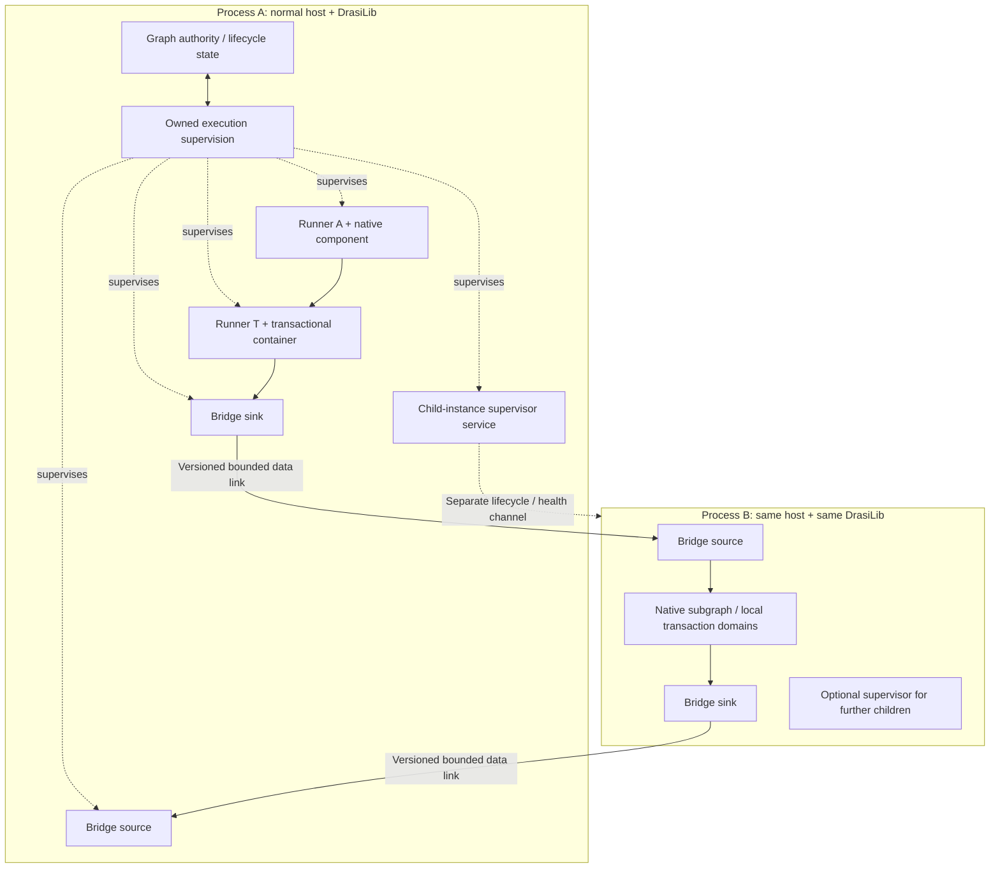
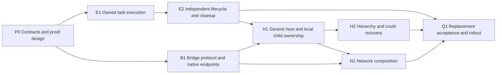

# Independent execution and isolated DrasiLib instances

**Detailed implementation plan - selected implementation and acceptance complete;
broader inventory and production qualification remain open.**
**Authorized: 12 October 2026. Qualified checkpoint: 13 October 2026.
Implementation baseline: `4587bd5e`.**

This plan specifies how to implement the direction agreed in the architecture discussion:
independent component execution inside each DrasiLib, and optional isolation by
hosting another complete DrasiLib in another process. Native sources and sinks
connect the instances. There is no remote-component execution backend.

The [work inventory](computation-graph-remaining-work.md) remains the authority
for CW status. This document defines the selected scope, contracts, sequencing
and acceptance evidence. Completing a selected slice does not close unrelated
work in the same CW package. The user authorized implementation on 12 October
after confirming the separate source/sink data flow and process-supervisor
approach. No combined child-transformer facade or remote component-method
execution is selected. Unresolved protocol/limit details remain explicit review
gates; a phase is complete only with its required evidence.

## Current checkpoint - 13 October 2026

The selected E1/E2/B1/H1/H2/N1/Q1 work is implemented and qualified within the
boundaries below. This is a development-branch checkpoint, not a release,
complete native connector migration or closure of every referenced CW package.

| Area | Implemented/evidenced | Still open |
|---|---|---|
| E1/E2 | Owned processing, reconfiguration, preparation, pipe/metadata retirement and rejected-resource disposal; shared reconciliation command servicing, weak physical-domain reservations, scoped force and retained joins. Both runtime flavors protect force with idle never-started peers. Final default/no-default profiles each passed 1,685 cases; extra capabilities passed 1,838; selected integration passed 143. Workspace Clippy and protected-runner checks passed. | Non-yielding synchronous work, started blocking I/O, native abort and unsafe memory faults are not forcibly preemptible in-process. Broader graph-size/resource/production qualification remains separate. |
| Native SDK/Host boundary | Current separately rebuilt libraries: 22 plugin SDK units, 185 Host SDK units and 14 native pipeline cases passed, including subprocess-driven recovery helpers. | Universal abort/memory-fault protection is not an in-process guarantee. |
| B1 | Native source/sink links, explicit admission profiles, identity/receipt persistence, bounded portable decoding, seal/cut capabilities and shared Host/Server mutual-TLS recipe; 18 package cases and Clippy passed. | Windows, physical production cross-machine partitions and production performance qualification. |
| H1/H2 | Normal Unix host/supervisor, accepted-definition readiness, parent/child/grandchild lifecycle, child-only plugin loading, control, cuts and namespace ownership. macOS/Linux each passed 7 units and 10 local process cases. Both passed 51 query/merger cases, including actual child deaths and real RocksDB reopen. | Windows, hard kernel resource containment, all providers/reset boundaries and production-duration qualification. |
| N1 | Complete prepared macOS Host profile passed 7 units and 11 process cases. Actual mutual-TLS Linux-VM traffic exercised receipt loss/delay, version/authentication failure, exact output, RocksDB/encrypted-redb reopen and independent remote-child ownership using the same normal runtime source. | VM networking is not physical production cross-machine qualification. No remote provisioning, distributed lease or unfenced replacement guarantee. |
| Performance | Fresh final-source 8-query CPU-heavy reference, three repetitions: two workers 1.926x and four workers 3.478x median throughput; measured full-process CPU use was 1.971/3.711 cores. Twelve processes verified 480,000 measured results, including current-thread correctness. Earlier 108 lighter and 24 persistent-aggregate processes passed independent oracles. | Local reference acceptance is not production SLO, allocation-traffic, full connector or sustained soak qualification. |
| Q1/demo gates | Matching native plugins rebuilt; Server passed 448 unit/selected integration cases. Strict storage-fixture lint, 14 Python checks and runner self-check passed. Rebuilt GPU functional/native-input/recovery/browser and Move-a-Wall live/SSE/browser/awaited shutdown passed. Guides, inventory and artifact provenance reconciled. | At this checkpoint, GPU full `--acceptance` still rejected its unsupported policy-context marker. See the later update below. Full replacement qualification in the wider ledger remains open. |

**Later update (16 October 2026):** GPU Lab now reports its implemented native
policy-context transaction contract and runs native-input checks in full
acceptance. Atomic configuration and stale-policy completion regressions protect
that claim. The separate durable network stop investigation also resolved its
force/graceful test mismatch and repaired pause bookkeeping after a timeout.
These targeted changes do not close the broader deadline, graph-size,
stock-Server packaging or production-qualification items in the work inventory.

The real-process cases required corrections to fixture plugin provenance,
readiness interpretation and cancellation cleanup. A prior compiling host
checkpoint was not a functioning deployment and is not counted as acceptance.

Final integration exposed a generic force-settlement hang: selected idle
peer-control observers were being awaited even though force had not interrupted
them. Paired failing regressions preceded the fix; the controller now waits only
for reported interrupted control work, keeping idle observers owned and usable.
The revised runtime was requalified on both flavors/platforms and in rebuilt
Host/plugins/demos. No child/transport-specific engine branch was introduced.
Server retirement still rejects force-damaged generations: a fresh normal owner
must actually recover the producer before changing its output bindings. Exact
pending output, loss authorization and replay remain protected.

Runtime-source fingerprints, actual plugin/binary hashes, compiler versions,
logs and measurement JSON are retained in the completing session's artifacts.
The final Core Rust/Cargo source fingerprint is
`d74ec28f63f1ec792deece4f233683baa793f93909e3e692d9072d6f9da10530`.
The rebuilt GPU runtime image is
`1d958823413c011d243956689c106147c7c7130c674dc276ce94b807cd661c99`.
See the [prepared-peer recipe](../../components/instance-host/README.md#qualified-unix-platforms-and-prepared-network-peer)
for the actual network and child-storage gates; ignored child workers count
only through their passing parent drivers.

## Contents

- [Outcomes and constraints](#1-outcomes-and-non-negotiable-constraints)
- [Architecture](#2-architecture)
- [Scope and inventory mapping](#3-scope-and-inventory-mapping)
- [Contracts and decisions](#4-contracts-to-settle-before-implementation)
- [Delivery phases](#5-delivery-phases-and-dependencies)
- [Fault and acceptance matrix](#6-fault-and-acceptance-matrix)
- [Performance and resources](#7-performance-and-resource-qualification)
- [Implementation surfaces](#8-implementation-surfaces-and-repository-boundaries)
- [Compatibility and rollout](#9-compatibility-rollout-and-stop-conditions)
- [Review checkpoints](#10-review-checkpoints)

## 1. Outcomes and non-negotiable constraints

| Requirement | Required outcome |
|---|---|
| Independent execution | Each top-level component or transactional container has framework-owned, independently scheduled execution. Multiple heavy native nodes in one instance can use multiple cores. |
| Identical DrasiLib | Parent, child and grandchild use the same library implementation and public contracts. No child-only runtime, proxy-only evaluator or `is_child` branch in the engine. |
| Autonomous data plane | A component runner pulls its inputs, executes its component and forwards outputs. The graph controller does not dispatch a method call for every input. |
| One graph authority per instance | Each instance owns its own graph. Hosting can aggregate observations, but cannot create a competing mutable registry for another instance's components. |
| Placement through composition | An isolated subgraph is a normal native deployment with bridge sources/sinks. Isolation is not a special component execution mode inside DrasiLib. |
| Hierarchy | The same hosting facility can launch children at multiple levels. Identity, state, observation and shutdown remain unambiguous. |
| Transport independence | Local IPC and network adapters use the same link semantics. Adding hierarchy levels or substituting network transport requires no new DrasiLib execution model. |
| Transaction integrity | A transaction container and its actual shared transaction domain remain within one instance/process. Independent instances do not share an implicit transaction. |
| Failure containment | A failed execution remains represented by a logical node. Task failures cannot silently terminate the controller; child failure cannot silently terminate the parent or healthy sibling instances. |
| Honest outcomes | Acceptance, committed processing, publication, delivery and external effects remain distinct. Disconnect or timeout never proves rollback or successful completion. |
| No functionality loss | Preserve required result access, ordering, recovery, configuration and lifecycle behavior. Unsupported combinations fail explicitly and block affected migration; they are not silently downgraded. |
| Native-only target | Do not introduce ordinary/native bridges, a fork of the evaluator or a new plugin-author helper project. Existing retiring paths receive regression protection, not new features. |

The independent-task model must also work on a current-thread Tokio runtime.
That mode provides concurrency, not multicore execution. No design may require
`block_in_place` or a dedicated OS thread for every component.

## 2. Architecture



### 2.1 Graph authority and execution supervision

The controller retains logical definitions, topology, generations, operation
intent, resource dependencies and coherent inspection. It performs short
metadata/commit operations and schedules work; it does not execute component
business logic or await a slow lifecycle operation inline in the command loop.

Execution supervision owns task handles and the component's ownership slot
before work can run. It observes normal completion, cancellation and panic,
correlating each outcome with component ID, generation and operation epoch.
Ownership must survive cancelled callers, driver failure and incomplete cleanup.

Use existing slot/lease and worker-ownership mechanisms where appropriate.
Do not merely move component values into detached tasks and hope their Drop
implementations recover ownership after panic.

### 2.2 Framework-owned component runner

The runner owns the mutable component instance and its bound pipe endpoints.
It waits for input or scheduled work, validates the admitted input, executes the
component, drains continuations, forwards outputs and applies the negotiated
completion rules. Preserve existing input-merge and per-stream ordering policies.

Lifecycle and mutable data calls cannot overlap on an instance. Control intent
must still be receivable while asynchronous processing is pending. Retain the
same in-flight future when observing control intent; do not repeatedly recreate
or drop it in a `select!` loop. A graceful stop requests a safe boundary rather
than cancelling a partially completed transaction.

The current separate `ControlHandler` contract can remain concurrently
serviceable where supported. Its faults belong to the same supervised
generation, including quarantining the generation after a panic.

### 2.3 Transactional execution units

`TransactionTransformer` remains one graph node/runner. Its linear steps are
not independently queued or scheduled; the container invokes opted-in
participants in order within its existing transaction. Its distinct query-body
arrangement retains the complete evaluator/index interface, not a reduced
key/value approximation.

`SharedStorageGroup` remains one processing owner plus participating journals
using one actual transaction domain. Preserve independent journal lifetime after
a healthy producer stop. Matching paths or names never prove shared ownership.

Place a complete container and every resource that must share its transaction
within the same DrasiLib instance. Reject a configuration that tries to cut that
domain across instances. Do not invent cross-process transaction-context RPC,
distributed commit or cross-instance atomic visibility.

### 2.4 Normal hosting and child supervision

Provide reusable hosting code and a thin generic executable outside `drasi-lib`.
The executable embeds ordinary, unmodified DrasiLib APIs with native factories,
resources and configuration. The same executable can be used at every hierarchy
level; an application may instead embed the same library and hosting facility.

Recommended integration: a graph-owned native service factory supervises each
owned local child. The implementation lives in a hosting/component package, not
the engine. It uses normal lifecycle, readiness, health and inspection contracts.
The service is responsible for the process, not for processing the child's data.

A child may run any supported native subgraph and its own local storage. Its
plugin set is explicit: discovery, loading and validation of child-only plugin
code must never occur in the parent process.

### 2.5 Data links are native components

Implement a bridge sink and bridge source using normal native interfaces.
The sink consumes local graph output; the source supplies input to the receiving
instance. They exchange typed envelopes through a bounded, versioned protocol.
They do not send `transform`, `next` or Rust `poll` requests to remote components.

Data links and supervision relationships are distinct. A supervisor may own
several local children; a data link can connect independently hosted instances
without implying ownership of either process.

## 3. Scope and inventory mapping

All references below are to the [inventory](computation-graph-remaining-work.md).
"Selected slice" deliberately does not mean the entire existing package.

| Work | Scope in this plan |
|---|---|
| CW-50 | Owned independent execution for native components/containers; actual multicore evidence in one instance. |
| CW-17 | Ownership before task/process execution, retained joins, auxiliary-work ownership and generation fencing. |
| CW-03 | In-process unwind containment/quarantine and truthful driver exits; child-instance crash containment through the new hosting package. |
| Remaining CW-05 | Component/recovery-domain force escalation while preserving completed graceful-drain behavior. Process escalation targets the whole chosen child instance. |
| CW-06/CW-07 | Independent lifecycle operations, conflict scoping, phase budgets and a responsive command loop. |
| CW-08 | Runner/host shutdown, dependency-aware fair cleanup and retained ownership after failure/cancellation; not every unrelated management-store defect. |
| CW-10/CW-22 | Truthful execution/readiness/cleanup state, preserved causes and operator-visible task/process/link outcomes. |
| CW-31 | Publication paths touched by supervision: local updates must not cause unacceptable graph-wide work. General idle-WAL/future improvements remain separate. |
| CW-33 | Retired task/process/generation bookkeeping and bounded restart churn; wider topology compaction only where this work exposes a defect. |
| CW-34/CW-35 | Explicit execution/lifecycle states and actual ownership/lock invariants in changed code; no general refactoring or helper-library programme. |
| CW-09/CW-43 | Valid native child definitions, local resource ownership, stable reconstruction and required query-result outlets. |
| CW-18 | Bridge wire/configuration versions, stable identities, namespace mapping and replay/content compatibility. Broader format modernization is not implied. |
| CW-19 | Bounded bridge decoding, validation and destruction so malformed child input cannot abort/exhaust the parent. |
| Relevant CW-21 | Bridge admission, receipt, retry and acknowledgement edge cases. Reuse existing mechanisms; do not claim unrelated merger cases are closed. |
| Relevant CW-29 | Count/byte/in-flight bounds for links and supervision; no automatic expansion to every outbox/merger capacity feature. |
| CW-23 | Hierarchical last-known observations, gaps/resynchronization and stable instance/generation identity. |
| Minimal CW-25 | Cross-task/process correlation and valid timing without changing business identity. No full telemetry/exporter project. |
| Selected CW-20 | Child termination during supported reset/deprovision and safe reconstruction for the initial providers. |
| CW-36/CW-37/CW-39/CW-40/CW-41 | Contract-based correctness, concurrency, crash, ABI, ownership and scaling evidence throughout delivery. |
| Selected CW-38 | A native merger in a real child process, killed at actual persistence/handoff boundaries. |
| Selected CW-44/CW-45/CW-46/CW-47 | Bridge/host registration, minimal native Server integration, representative workflows and updated developer/maintainer guidance. Not full connector/UI migration. |
| CW-56 | Explicit new package: isolated DrasiLib instance hosting and native inter-instance links. |

**Preserve rather than rebuild:** CW-01/CW-02/CW-04/CW-11, completed graceful
drain, actual transaction ownership, retained journals, producer admission,
consumer completion, managed acceptance and recovery-domain protection.

**Outside this scope:** transparent remote component execution; remote arbitrary
Rust resources; distributed transactions; automatic graph partitioning or live
stateful migration; arbitrary remote machine provisioning; full OTLP work;
unrelated query-language changes; broad storage optimization; every connector
feature; and the full Server/UI replacement. Those remaining migration blockers
are not waived by this plan.

## 4. Contracts to settle before implementation

The following are recommended decisions, not existing configuration fields or
implemented APIs. P0 must approve exact interfaces and parameters. Any required
change to these decisions must be raised explicitly, not introduced mid-build.

| Decision | Recommended starting point | Approval must establish |
|---|---|---|
| D1 - Execution unit | One owned runner per top-level component/transaction container, with serial mutable calls and independently serviceable control. | Ownership/state transitions, callback fault boundaries and compatibility with existing scope/lifecycle APIs. |
| D2 - Delivery profile | Durable admission/replay for production qualification; explicit volatile mode; initially one outstanding envelope per link stream. | Exact acknowledgement point, sender-state/receipt reuse, retention/expiry and throughput budget. |
| D3 - Platforms/transports | UDS on Unix, named pipes on Windows, and the same link semantics over an authenticated TLS network transport. | Initial supported platforms, network binding, authentication/authorization and minimum containment guarantees. |
| D4 - Initial persistent providers | Reuse native RocksDB processing/journals and redb configuration where appropriate, with separate instance ownership/paths; memory only for explicit volatile cases. | Actual failure scopes, provider matrix and whether any other provider is required for the initial release. |
| D5 - Hosting ownership | Owned local children with verified parent-death policy; remote peers independently hosted unless external ownership is explicitly supplied. | Process-tree behavior, resource limits and clear boundaries around remote provisioning/fencing. |
| D6 - Recovery policy | Retain terminal crashes for explicit repair; bounded transport reconnection/retry using stable identities. | Any automatic child restart policy, budgets/backoff and prevention of conflicting owners. |
| D7 - Performance/resource budgets | Fixed CPU-heavy, light-node, storage and link workloads with exact result oracles. | Numerical throughput, control/shutdown latency, queue, process, metadata and allocation budgets before qualification. |
| D8 - Portable boundary data | Standard graph-change, query-row and complete-transaction schemas; explicit namespace mapping. | Supported validators/version compatibility, mapping stability and rejection of nonportable plugin code requirements. |
| D9 - Composition shutdown | Host-level quiesce/drain/stop ordering over normal local APIs, keeping return/control paths alive. | Bidirectional-link behavior, deadlines, retained obligations and distinction from a local-only library stop. |

### 4.1 Execution and ownership state

- Distinguish desired lifecycle intent, observed lifecycle, readiness, health,
  active operation and cleanup ownership. A finished start hook is not readiness.
- Use one component generation plus operation correlation; a task ID, process
  ID or socket identity is not the logical component identity.
- Preserve per-component request ordering and supersession rules. Compute
  conflicts from actual components, edges and resource/recovery dependencies.
- Accepted work outlives a cancelled caller where the existing contract requires
  it. Report accepted/applied/incomplete outcomes; never silently replay stale intent.
- Preserve finite `GraphRun::start()` behavior, explicit long-lived `run()`,
  clean restart and retained failures. A parked runner task is not evidence that
  data processing is still active.
- Dropping a run requests cancellation and marks cleanup required. It does not
  join tasks, prove rollback or release resources for overlapping reuse.

### 4.2 Panic and cancellation boundaries

Put extension calls outside the controller's execution stack. Cover future
construction, polling, control/metadata callbacks and cleanup/destruction where
an unwind boundary is meaningful. Keep bounded panic diagnostics and the
original typed cause where available; do not install a competing global panic
hook or invoke a damaged component to inspect it.

The supervisor must retain component/cleanup ownership after abnormal execution.
Successful stop does not clear a "panicked generation is damaged" condition.
Reconstruction needs a new generation and proven cleanup/storage eligibility.

In-process cancellation cannot forcibly preempt arbitrary synchronous code,
started blocking work, a double-panic abort or unsafe native memory faults.
Do not claim otherwise. A child process provides a larger containment boundary;
its failure can affect every component inside that child, not only the suspected
offender. Resource limits and security sandboxing are separate from crash isolation.

### 4.3 Bridge profiles and acknowledgement

Provide explicitly different profiles:

| Profile | Success/retention contract |
|---|---|
| Volatile bounded link | Configured bounded transport acceptance only; no process-restart survival claim. Loss/disconnection behavior must be explicit. |
| Durable admission/replay link | Sender retains the obligation until receiver durable admission is proven; receiver atomically stores payload and retry receipt in its actual ingress journal. Scope must match the selected storage's real survival guarantee. |

Recommended production qualification starts with durable admission/replay.
Volatile mode remains valid where deliberately selected; do not force persistence
onto every DrasiLib or silently upgrade its guarantee.

For the initial durable implementation, prefer an actual retained/acknowledged
sender input pipe and hold its completion until the remote admission receipt is
resolved. If a separate sender outbox is needed, use existing transactional
storage/journal machinery and make the transfer of responsibility explicit.
Do not add a second general-purpose durable delivery engine.

Reuse `SourceAdmission`/QoS producer receipts where their contracts fit. P0 must
resolve the sender's durable mapping from upstream logical identity to receiver
session/client sequence: an upstream stream can have gaps, and reconnect cannot
assign a new identity to a previously submitted input. Persist the mapping before
first transmission and retain enough receipt evidence to resolve lost replies.
Expiry or incompatible content must fail explicitly, not become fresh input.

Start with one outstanding envelope per logical link stream unless the approved
throughput budget requires a wider, explicitly specified completion window.
An envelope may already contain multiple operations or a complete source
transaction. Never fragment those atomic frames into independently acknowledged
changes. Broader CW-51 window semantics are not silently included.

Link success proves the declared admission boundary, not completion of the
receiver's entire subgraph or external effects. An optional end-to-end completion
protocol is separate work unless explicitly selected at P0.

### 4.4 Protocol, identity and schema

- Version the bridge protocol independently of the native in-process C ABI.
  Negotiate capabilities before accepting data; do not transmit C pointers,
  Rust objects, futures or callback addresses.
- Identify link, sender/receiver instance, endpoint, session/incarnation, logical
  input and content. Keep process generation and retry attempt out of business
  identity. Persist supported identity/configuration fingerprints.
- Preserve source provenance, positions, timestamps, transaction framing and
  upstream logical output identity. Define valid local emission/transport
  identities separately; do not simply copy a remote stream into an incompatible
  local output binding.
- Define explicit source/element namespace mapping when different instances can
  produce overlapping source IDs. Version that mapping and forbid changing it
  invisibly beneath pending data or saved state.
- Initial portable boundary schemas should include graph changes, query-row
  changes and complete source-transaction envelopes. Reject unsupported schemas.
  Custom executable validators must not cause child-only plugin code to load in
  the parent; support additional portable validators deliberately.
- Bound frame bytes, operations, decoded structure, identifiers, annotations,
  lineage and queues before allocation/recursion. Qualify failure and Drop paths,
  not just successful decode.
- Preserve FIFO/logical ordering per declared stream. No new global ordering
  across independent links or instances is implied.
- Use distinct, independently serviceable control and data paths. Saturated data
  buffers cannot prevent health, stop or receipt-resolution traffic.

### 4.5 Hosting, hierarchy and state

Use a generic native host with the same DrasiLib build at every level.
Configuration selects factories, resources, links, child definitions and runtime
budgets; the engine has no parent/child-specific processing logic.

Recommended local ownership is a graph-owned supervisor service outside
`drasi-lib`. A pending launch already has an owner. Startup requires version/
capability handshake, correct instance/configuration identity and the specified
readiness conditions, not merely a PID or listening socket.

Keep stable instance/link/state identities across process restarts, with separate
execution generations. Assign distinct storage/configuration namespaces and
paths. A namespaced redb file is not automatically safe to open independently in
several processes; choose storage providers/ownership that actually support the
deployment. Restart must not implicitly delete or reinitialize state.

For local owned children, require a documented parent-death policy that also
works with grandchildren. Implement it through the host/platform process-owner
layer, not an ordinary graph task that a noncooperative component can starve.
Select supported OS mechanisms or an independent host watchdog at P0. Verify
descriptor inheritance and process-tree termination; `kill_on_drop` alone is
not proof of joined cleanup or parent-death containment.

Default terminal crashes should remain failed for explicit repair. Any automatic
restart policy must have declared limits/backoff, preserve stopped intent and
refuse overlapping storage owners. Killing/reaping a process does not undo
external effects or prove the outcome of a prior commit.

Bound process count, runtime worker count, memory/CPU use where supported,
in-flight bytes and diagnostic output. Several child hosts must not each
unconditionally claim every CPU. Publish actual platform support; fail unsupported
hard-isolation policies rather than pretend they were enforced.

### 4.6 Network and control boundaries

Recommended reference transports are local Unix-domain sockets/Windows named
pipes and one authenticated, encrypted network adapter using the same bridge
semantics. P0 chooses the network binding, preferably the same framed protocol
over TLS unless existing networking machinery supplies a simpler equivalent.
Protocol differences must not change ordering, replay or acknowledgement meaning.

Support connections to independently hosted remote instances without core
changes. The initial scope does not provision arbitrary remote machines.
Distinguish owned local children from referenced remote instances: closing the
parent must not kill an independently owned peer. Remote unreachable is not proof
of process death; do not automatically create a competing replacement without
an explicit external ownership/fencing mechanism.

Expose lifecycle, accepted configuration/revision, readiness, health and
observations through hosting adapters over normal DrasiLib APIs. Use bounded
correlation/idempotency where retries can repeat commands. Validate peer identity
and command authority; data credentials must not grant arbitrary management access.

Each child remains authoritative for its own graph. The supervisor retains
desired child definitions and bounded last-known observations for crash
diagnosis, marking them stale/unavailable when appropriate. Hierarchy is not
necessarily the data-flow topology. No cross-instance atomic configuration
commit, global cycle validation or distributed recovery proof is implied.

Define a host-level graceful tree-stop protocol separately from local
`DrasiLib::stop`/shutdown. With parent-to-child and child-to-parent data links,
closing parent return ingress before the child drains can create a circular
wait. Quiesce external producers, establish explicit link cuts/receipts, and
keep required returning data and control paths alive until their obligations
are drained or explicitly retained for recovery. Use normal local management
APIs; the core must not acquire special knowledge of child processes.
No local empty queue proves whole-composition drain. A partition or failed
cleanup must produce a bounded, truthful incomplete outcome.

### 4.7 Observability minimum

Correlate instance, graph, component, generation, operation, link and process
outcomes. Include counters needed to establish in-flight obligations, connection
state, restart attempts, queue pressure and observation gaps.

Carry bounded trace/correlation metadata across tasks and links without changing
deduplication identity. Separate source time, queue wait, transfer, processing and
completion timing. Never subtract unrelated process-local monotonic timestamps
or manufacture a duration across restart. The host owns logging/telemetry setup;
full OTLP/exporter work is not a prerequisite for these diagnostics.

## 5. Delivery phases and dependencies



Evidence is part of each phase, not deferred until Q1. B1 contract/component work
can proceed independently after P0, but its full integration relies on E2.
This diagram does not authorize new sessions, worktrees or parallel agent work.

### P0 - Freeze contracts and acceptance before coding

**CW:** 50/03/05/06/07/08/10/17/18/19/21/23/29/36/40/43/56.

Deliver:

- A reviewed execution/operation state machine, ownership diagram and conflict
  rules, including normal completion, panic, caller cancellation and graph drop.
- An API compatibility matrix for finite scopes, long-lived instances, query
  reads, dynamic changes, graceful/forced stop and restart.
- A bridge protocol/state specification covering the contracts in section 4.
  Choose receipt/mapping reuse, exact profiles, supported schema/namespace mapping,
  version negotiation, control authority and recovery behavior.
- A child-host manifest/lifecycle specification, package boundaries, OS support,
  parent-death policy and initial storage providers.
- Fixed workload inputs, exact output oracles and agreed throughput/control/
  shutdown/resource budgets. Record the earlier behavior being preserved.
- A small feasibility review of public extension points. Identify any generic
  engine hooks needed before freezing the core; do not discover a requirement for
  a special child engine after the hosting work has begun.

**Gate:** user/design approval of contracts, defaults, limits and scope. Mark
unresolved decisions explicitly; no implementation on unstated assumptions.

### E1 - Framework-owned independent component execution

**Depends on:** P0. **CW:** 50/17/03, relevant 10/22/34/35.

Work:

- Extract/reuse the current processing loop as a runner with owned endpoints,
  instance slot, control intent and completion reporting. Do not fork evaluator
  or pipeline semantics.
- Replace controller-polled business execution with owned independent tasks.
  Preserve readiness, scheduled work, continuations and negotiated completion.
- Keep construction, lifecycle and data ownership explicit. Protect extension
  callbacks; publish abnormal task/driver exits with identity and bounded causes.
- Retain damaged generations for diagnosis and guarded cleanup. Do not reuse a
  panicked instance after a successful stop.
- Preserve finite execution and restart semantics, with ownership returned or
  retained safely when tasks finish. No detached handles on scope/driver drop.

**Evidence/gate:** exact native output parity on both runtime flavors; multiple
heavy native nodes demonstrably execute CPU work concurrently in one instance;
one task panic does not stop independent traffic or control; pending work and
cleanup remain owned after caller/run cancellation.

### E2 - Independent lifecycle, selective recovery and fair cleanup

**Depends on:** E1. **CW:** remaining 05, 06/07/08/10, targeted 31/33/34/35.

Work:

- Replace graph-global lifecycle exclusion with per-affected-domain conflict
  tracking. Keep the command loop active while operations await other tasks.
- Preserve same-component ordering, start supersession, revision/generation
  checks and accurate committed reconciliation reports.
- Define graceful versus explicit forced cancellation. Quarantine/fence only
  the necessary owners and preserve the original fault plus cleanup outcomes.
- Introduce fair per-owner/phase and overall deadlines, with dependency-aware
  concurrency for independent cleanup.
- Publish state changes proportionally; avoid per-message supervisory traffic
  and whole-graph rebuilding as the new throughput bottleneck.
- Retire completed task/generation metadata safely without evicting live cleanup
  obligations or erasing required diagnostics.

**Evidence/gate:** B can be managed while A is held at an unreleased I/O/lifecycle
gate; conflicting changes remain serialized; selective cancellation and restart
preserve exact state; slow cleanup does not starve independent owners; churn
retains bounded metadata; all completed CW-01/02/04/11 and graceful-drain contracts
remain valid.

**Core freeze:** after E2 and B1's public-extension integration gate, record the
engine revision used for hosting/hierarchy/network qualification. This avoids
freezing an API that the bridge has not actually exercised. H1/H2/N1 must not add
parent/child or transport-specific branches to `drasi-lib`. A genuine generic
gap requires explicit review before changing this freeze.

### B1 - Native bridge protocol and source/sink implementations

**Depends on:** P0; integration acceptance also needs E2.
**CW:** 56, selected 18/19/21/29, minimum 22/23/25.

Work:

- Implement native link endpoints over the approved local transport and
  transport-neutral protocol. Reuse envelope, receipt and storage contracts
  rather than translating through legacy source/reaction APIs.
- Implement explicit volatile and durable profiles, persistent sender/session
  mapping where required, duplicate/content validation and bounded retry behavior.
- Preserve complete transaction frames and declared stream ordering; distinguish
  origin identity from local emission/transport identity.
- Enforce bounded decoding/queues and independent data/control service.
- Fail explicitly on unknown acceptance, expired history, incompatible schemas,
  state loss and unexpected disconnect. Unexpected EOF is not source exhaustion.

**Evidence/gate:** two independently started normal DrasiLib instances exchange
exact typed results; saturation backpressures; duplicate/reordered/conflicting
requests behave as specified; sender/receiver interruption cannot falsely
acknowledge or reapply admitted input; malformed frames cannot take down the host.

### H1 - Generic native host and local child supervision

**Depends on:** E2 and B1. **CW:** 56, relevant 17/08/09/10/22/23/43.

Work:

- Add the reusable hosting facility and generic executable outside the engine,
  reusing Host SDK native discovery/management and registered providers.
- Add a native supervisor service/resource recipe for owned local children.
  Construction is configuration-only; actual launch has explicit ownership,
  readiness and failure reporting.
- Instantiate the child from its own normal native configuration with its own
  stable instance identity and local resources.
- Implement a separate bounded control endpoint, process monitoring, truthful
  failure publication, graceful shutdown and explicit termination/reaping.
- Implement the composition-stop ordering approved in P0, including bidirectional
  links. Do not shut down a control/receipt or return-data endpoint that is still
  needed to complete the chosen drain boundary.
- Load child-only plugins only inside the child. Make diagnostics available even
  if child initialization fails before the graph becomes ready.

**Evidence/gate:** same DrasiLib build in parent and child; no isolated-component
execution backend; actual native libraries load only in intended processes;
failed initialization/exit remains inspectable; healthy parent branches continue;
stopped intent is not undone by an automatic restart.

### H2 - Hierarchy, persistent reconstruction and parent-death behavior

**Depends on:** H1. **CW:** 56, selected 20/21/23/33/38/39/41/43.

Work:

- Qualify an A-to-B-to-C supervision hierarchy using the same hosting facility.
  Give every instance/link distinct stable identity and every execution a new
  generation; do not use PIDs or temporary paths as persistent identity.
- Implement/qualify the approved owned-child parent-death policy on each
  advertised platform, including noncooperative child work and grandchildren.
- Preserve retained link obligations, local processing state and desired child
  definitions through restart. Resolve outcomes from actual receipts/checkpoints.
- Exercise child death during reset/deprovision and configuration acceptance.
  Keep partial/uncertain state explicit and prevent overlapping storage owners.
- Publish hierarchical observations with clear stale/unreachable/failed state;
  a dead child cannot still appear healthy because of a cached snapshot.

**Evidence/gate:** parent death, child death and grandchild death have distinct,
correct scoped outcomes; no unintended orphan or duplicate instance; real
storage/process-crash cases preserve exact outputs, receipts and generations.
Run the selected merger case as an actual child-process workload.

### N1 - Network composition without another engine

**Depends on:** B1 and H1. **CW:** 56, relevant 18/19/21/22/23/25/29/41.

Work:

- Add the approved authenticated/encrypted network adapter for the same protocol
  and native endpoint contracts. No business identity or acknowledgement changes
  merely because the transport changes.
- Connect separately hosted instances across a real network boundary and qualify
  protocol mismatch, authentication failure, disconnect, reconnect, delay and
  lost acknowledgement.
- Keep remote liveness uncertainty distinct from confirmed local process exit.
  Do not kill or replace independently owned remote instances on parent shutdown.
- Demonstrate an intermediate instance can participate in network links and host
  its own local child using ordinary configuration.

**Evidence/gate:** use the core build frozen after E2/B1, changing only hosting,
adapters and configuration; run the same data/recovery contracts over local and
network transports. A loopback-only smoke test is not complete network-failure
qualification. No arbitrary remote provisioning or distributed lease service is
claimed.

### Q1 - Integrated acceptance, native registration and documentation

**Depends on:** E2, H2 and N1; test development accompanies earlier phases.
**CW:** 36/37/39/40/41, selected 38/44/45/46/47.

Work:

- Bind meaningful cases into the existing requirement/protected-contract
  machinery; record exact binaries, plugin artifacts, providers and outcomes.
- Add native Server/embedding registration and configuration for the new bridge
  and supervisor facilities, without a Server-only execution path.
- Provide a reproducible standalone, nested-local and cross-network example.
  Preserve query snapshots/outboxes/live subscriptions in the tested deployments.
- Update the developer guide, maintainer/reference guides, SDK/host/bridge docs
  and inventory with implemented behavior and explicit remaining limits.
- Evaluate the approved performance/resource budgets and capability matrix.
  Do not close all of CW-44/45/46 merely because the new facilities load.

**Gate:** every selected requirement has executable evidence or an explicitly
approved exclusion. No unexplained functionality loss, hidden ordinary fallback,
unjoined execution, unsupported isolation claim or silent recovery downgrade.

## 6. Fault and acceptance matrix

| Scenario | Observable proof required |
|---|---|
| Multiple CPU-heavy native nodes | Actual concurrent CPU execution and improved throughput where independent; exact outputs on one/two/four-worker configurations and current-thread correctness. |
| Heavy/pending A, independent control on B | B's operation completes while A remains gated; no reliance on cached inspection alone. |
| Conflicting operations on A | Correct ordering/supersession and generation/revision checks; no overlapping mutable calls or stale completion applying newer intent. |
| Panic in construction/start/data/control/cleanup | Original node retained with useful fault identity; damaged generation cannot silently restart; independent work and controller survive supported unwinding cases. |
| Cancel caller or drop graph run | Work/cleanup ownership is retained; no detached task or resource reuse before actual termination. |
| Stop during transaction/continuation/ack | Graceful path preserves the whole admitted boundary; forced path reports exact known outcome or uncertainty and fences as needed. |
| Slow cleanup early/late in traversal | Independent owners receive cleanup opportunity; original and subsequent failures remain visible and retryable. |
| Kill child before durable admission | Sender retains the obligation; no successful receipt or upstream completion falsely claims receiver acceptance. |
| Kill child after admission before reply | Same identity resolves to the existing receipt; no duplicate journal append. |
| Kill after query/group commit before publication | Reconstruct and replay committed output without applying state changes again. |
| Lose receipt after receiver commit | Persisted sender/session mapping resolves the same input, not a fresh sequence/content identity. |
| External effect before lost completion | No universal exactly-once claim; stable keys/destination cooperation or declared at-least-once behavior remain explicit. |
| Full data queue/link outage | Count/byte bounds hold; intended backpressure occurs; control and health remain serviceable. |
| Bidirectional links during tree shutdown | Host-level drain ordering keeps required return/control paths alive; no circular wait, false global-drain claim or lost persistent obligation. |
| Malformed/deep/oversized child frame | Typed bounded rejection including cleanup/destruction; parent remains alive and responsive. |
| Stale worker/connection messages | Old generations/capabilities cannot mutate new state, release new ownership or advance new receipts. |
| Child graph fails while PID lives | Supervision reports graph failure/unavailability; PID existence is not readiness. |
| Parent killed with child/grandchild | Approved local ownership policy is enforced and observed; no false claim that Drop performed awaited cleanup. |
| Network partition | Remote state is unknown/unreachable, not invented as stopped; no unfenced duplicate replacement. |
| Same component IDs in different instances | No state, source-identity, receipt, log or inspection collision under the configured namespace policy. |
| Reset/deprovision interrupted | Partial state is not resumed as valid; retry/recovery completes the explicit marker/generation protocol. |
| Child configuration/library mismatch | Retained intended deployment and explicit reason; no parent loading of child-only executable code. |
| Local versus network transport | Same supported schemas and outcome contract using the same DrasiLib core implementation. |
| Repeated start/replace/reconnect/remove | Bounded tasks, processes, descriptors, buffers and retired metadata; durable obligations are not pruned to obtain a flat graph. |

Use independent expected-result/effect ledgers, actual storage reopen and real
process exit where required. A panic in a detached fixture, an async barrier,
successful startup, quiet receiver or process-count snapshot is not sufficient.
Blocking CPU probes need an external watchdog so a failed experiment cannot
hang the entire test runner.

## 7. Performance and resource qualification

P0 must approve numerical workload-specific budgets before claiming performance
completion. Do not invent a universal linear-speedup or production latency SLO.

The resumed implementation's reference CPU-heavy thresholds were explicitly
approved: exact results and at least three repetitions must achieve median
throughput of at least 1.25 times the one-worker result with two workers and
1.5 times with four. The selected reference workload uses eight native queries
with the evaluator's 256-step reduction.
The workload, window, payload, build and result oracle stay identical across
worker counts. These are local reference acceptance targets, not production
capacity or latency SLOs; light and storage workloads are reported separately.

The final memory-only release reference passed with median inputs/second of
264.343, 509.011 and 919.286 for one/two/four workers, respectively. Its binary
SHA-256 is `937726150b62e8f70c8bdc2cc1f0efe1254dc92197b8feb56e478b4db7c03163`.
The earlier 1.920x/3.385x measurement remains historical evidence, not the final
runtime's binary provenance. Reproduce the selected reference from the Core root:

```sh
cargo build --locked --offline --release -p drasi-lib \
  --no-default-features --example core_workload
python3 lib/tests/measure-core-workloads.py \
  target/release/examples/core_workload target/native-cpu-scaling.json \
  --events 5000 --repetitions 3 --queries 8 --windows 32 --payload-bytes 0 \
  --executions native --runtimes multi-thread current-thread --workers 1 2 4 \
  --workloads cpu-heavy
```

Run after other CPU-heavy builds finish. The driver requires exact arithmetic
results in every isolated process; compare medians against the approved
thresholds, not a single best run or worker-thread names.

Measure native single-node, balanced multi-node, pipelined and independent-branch
workloads. Separate CPU-heavy evaluation from I/O waits and intentionally shared
transaction contention. Compare one/two/four available cores with fixed inputs,
matching features, exact outputs and recorded provider/plugin provenance.
Account for CPU time as well as elapsed time; worker names or migration between
threads are not proof of parallel execution.

Measure command tail latency during processing, drain and reconstruction,
publication/update cost versus graph size, link throughput/latency versus
payload/batch size, and hierarchy restart behavior. Account for CPU and memory
across all child processes, not just the parent's RSS.

Keep transport batching/window changes within their declared contract.
If one-in-flight durable links cannot meet the agreed workload, stop and
explicitly select the necessary window/batching work; do not quietly change
completion semantics or declare a throughput regression acceptable.

Use existing focused tests/builds first and broaden at phase gates. Reuse normal
target directories; do not regenerate multiple full coverage/build trees for
every iteration. Keep measurement output bounded and preserve exported evidence.
Do not delete caches, state or previous baselines without explicit scope.

## 8. Implementation surfaces and repository boundaries

The selected packages below are implemented; this table also preserves the
repository boundaries for any subsequent work.

| Surface | Work location / rule |
|---|---|
| Execution/lifecycle | `lib/src/computation/v1/graph.rs`, `graph/controller.rs`, `graph/reconcile.rs`, `lifecycle.rs`, `computation/instance.rs`, and existing ownership helpers. Keep evaluator logic shared. |
| Read/inspection publications | Existing graph registry/inspection, query API/catalogue and event surfaces. Keep one authoritative publication per local graph. |
| Native host reuse | `components/host-sdk/` native loader, factory/management integration and configuration resolution. Do not teach `drasi-lib` to load libraries or launch processes. |
| Host package | Reusable hosting/supervision library plus thin `components/instance-host` executable, outside `lib`. It depends on DrasiLib/Host SDK, never the reverse. |
| Bridge packages | Independent native factories in `components/computation-plugins/sources/bridge/` and `sinks/bridge/`; shared protocol/transport in `common/bridge/`. Transport support does not change the graph executor. |
| Persistent link state | Existing Core transaction/index/journal/admission primitives plus explicitly owned protocol-specific state; no invented duplicate delivery engine. |
| Qualification | Existing `lib/tests`, `lib-integration-tests`, Host SDK/native fixtures and applicable backend scenarios. Rebuild real cdylibs when exercising changed SDK/Host boundaries. |
| Server | Register supported native factories/resources/configuration and expose truthful hosting/link outcomes. Reuse the hosting facility; no forked Server-only DrasiLib. |
| Test infrastructure/examples | Add bounded native local/hierarchical/network scenarios with exact terminal outcomes. Preserve existing user work and stable deployment identities. |

Work stays in the existing checkouts and branches. Do not create sessions,
worktrees, clones, branches or an agent workflow without explicit authorization.
Use small reviewable implementation increments; commit/push only when requested.

## 9. Compatibility, rollout and stop conditions

- Introduce the task model as the common native execution foundation. Do not
  use child processes to conceal a still-serialized default native executor.
- Preserve existing in-process assembly and current-thread support. Do not make
  process hosting a mandatory dependency for ordinary embedding.
- Keep the existing query semantic/storage identity boundary explicit. This work
  must not cause an additional silent reset or reinterpretation of saved data.
- New child deployments are explicit native configurations. Moving an existing
  stateful subgraph to a different instance/storage scope is not automatic;
  it needs an approved migration or reset/rebootstrap procedure that preserves
  required delivery obligations.
- A supervision hierarchy is not an atomic distributed deployment. Persist
  intent/receipts at the proper owner and reconcile partial application truthfully.
- Local and network examples must demonstrate identical core behavior. Unsupported
  schemas, durability, OS containment or resource layouts reject before claiming
  a stronger guarantee.
- Preserve required connector and query-result behavior. This plan does not
  authorize dropping batching/templates/recovery features still needed for
  complete native migration.

Stop and review before expanding implementation if a requirement appears to
need remote component methods, cross-process transaction ownership, an alternate
evaluator, unbounded buffering, detached cleanup, a mutable shadow graph, or a
transport/child-specific branch in the frozen core. Also stop if a proposed fix
only makes assertions weaker or changes output/recovery semantics to obtain a
passing result.

## 10. Review checkpoints

| Checkpoint | Decision/evidence |
|---|---|
| Before implementation | Approve architecture, phase scope, state/protocol contracts, hosting ownership, initial profiles/providers/platforms and acceptance budgets. |
| After E1 | Inspect ownership and panic paths; verify independent CPU execution without losing finite/current-thread behavior. |
| After E2/B1 | Inspect conflict handling, cancellation, cleanup and publication; prove public bridge extension points and freeze the generic core contract. |
| After B1/H1 | Inspect durable handoff and process ownership; verify the parent does not execute isolated plugin code. |
| After H2/N1 | Demonstrate hierarchy, parent death, partition/reconnect and same-core transport substitution with exact durable outcomes. |
| Before cutover | Review the capability matrix, remaining CW gaps, actual qualification results, operational documentation and explicit migration decisions. |

Progress reports should state completed scope, current blockers, changed behavior
and remaining evidence. Do not report "multithreaded", "isolated", "durable" or
"replacement-qualified" merely because the corresponding configuration or
process exists.
