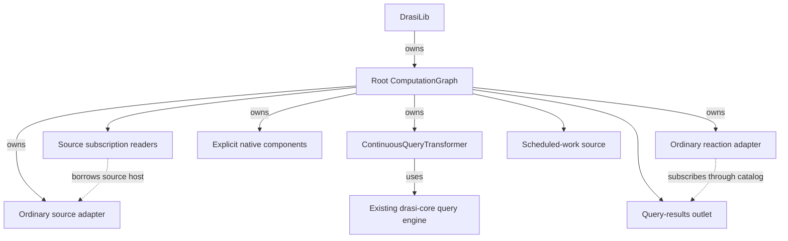
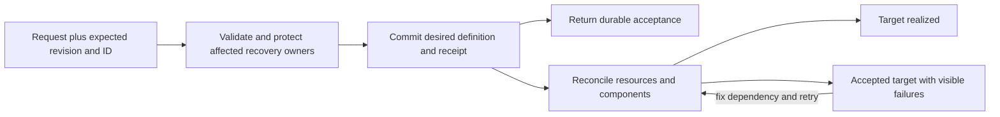

# Maintaining ComputationGraph

**Development snapshot: 27 October 2026, `agentofreality-parallel-computation-graph`.**

This guide is for a Drasi engineer who knows the ComponentGraph-based
`drasi-lib`: source/query/reaction managers, source subscriptions, the query
worker, result channels, plugin callbacks and component status. It explains
where those responsibilities now live, what stayed the same, and how to
investigate a problem without recreating the old execution paths.

The implementation described is the current Core checkout, based on
[`3b22333e`](https://github.com/drasi-project/drasi-core/commit/3b22333e56b46c9682366799cf055890ce07f500),
and its matching Server integration. This is a development description, not
a claim that every deployment or plugin has been release-qualified.

**The central change is ownership, not a new query language.** Previously,
ComponentGraph largely recorded metadata, relationships, runtime references and
status while managers coordinated execution. ComputationGraph owns the
components, their connections, resources, execution tasks and lifecycle.
The familiar managers are now facades over that one runtime, not second
registries or executors. Both ordinary and explicitly composed queries run
`ContinuousQueryTransformer` and use the same Core evaluator.

Here, **ordinary** means the familiar Source/Query/Reaction authoring and plugin
interfaces. **Native** means implementing the computation component contracts
directly. These are two assembly paths into one graph, not runtime modes.
Read the ownership, input and worked-flow sections first; the later sections
explain the detailed lifecycle, storage and hosting contracts.

Two different meanings of "graph" matter here. The **ComputationGraph** is the
runtime topology, including ordinary queries and their helpers. It is not the
**data graph** of nodes and relationships evaluated by Cypher/GQL. Changing
runtime wiring does not require reimplementing graph matching.

For building a solution rather than changing Drasi, use the
[application developer guide](developer-guide/README.md). Use the
[data design](computation-graph-data-design.md) for record-by-record examples,
the [implementation reference](computation-graph-reference.md) for signatures,
and the [capability comparison](componentgraph-vs-computationgraph.md) for the
problems and scenarios this architecture addresses. The
[remaining-work list](computation-graph-remaining-work.md) is the single backlog
for known issues, qualification and improvements, including the broader
native-only target. That target is not a prerequisite for using supported
ordinary plugins.

## Reading map

1. [What changed from ComponentGraph](#what-changed-from-componentgraph)
2. [Ownership and the two assembly paths](#ownership-and-the-two-assembly-paths)
3. [Inputs, result nodes and query chains](#inputs-result-nodes-and-query-chains)
4. [Following one change through the runtime](#following-one-change-through-the-runtime)
5. [Scheduling, readiness and lifecycle](#scheduling-readiness-and-lifecycle)
6. [Data contracts, identity and ordering](#data-contracts-identity-and-ordering)
7. [Query execution, bootstrap and scheduled work](#query-execution-bootstrap-and-scheduled-work)
8. [Reading state without running another query](#reading-state-without-running-another-query)
9. [Stateful processing outside a query](#stateful-processing-outside-a-query)
10. [Recovery is a chain of completion boundaries](#recovery-is-a-chain-of-completion-boundaries)
11. [Resource ownership and cancellation-safe cleanup](#resource-ownership-and-cancellation-safe-cleanup)
12. [Live changes and persisted desired state](#live-changes-and-persisted-desired-state)
13. [Plugin hosting without a second executor](#plugin-hosting-without-a-second-executor)
14. [Inspection and diagnosing a running system](#inspection-and-diagnosing-a-running-system)
15. [Making and validating a change](#making-and-validating-a-change)

Code links point into this checkout; named symbols identify useful entry points
without relying on line numbers that move with edits. Historical links are
pinned to the inspected ComponentGraph-based revision.

## What changed from ComponentGraph

The old ComponentGraph was already a shared source of component metadata,
relationships, runtime-instance references and lifecycle history. Its managers
already used registry-first registration. Do not attribute those ideas, or
continuous queries and recovery in general, exclusively to ComputationGraph.
Ordinary query workers were already independently spawned; multicore execution
is not itself new. The [capability comparison](componentgraph-vs-computationgraph.md#new-built-in-capabilities)
distinguishes new native contracts from preserved or generalized behavior.

The structural change is **who coordinates the work**:

| Concern | ComponentGraph-based arrangement | ComputationGraph arrangement |
|---|---|---|
| Execution | Source, Query and Reaction managers coordinated their respective runtime paths around the shared graph | A graph controller owns component operations and connection lifecycles; ordinary APIs adapt to it |
| Composition | Runtime paths were specialized around sources, continuous queries and reactions | Typed ports and pipes compose sources, arbitrary transformers, queries, sinks and portless services |
| Status | Managers and components sent updates to an asynchronous graph-update task | The controller publishes execution state; compatibility status/events are derived at that publication boundary |
| Connection guarantees | Subscription and queue behavior was implemented within the specialized paths | Connections declare and negotiate schema, flow-control and completion requirements |
| Replacement | Manager-specific lifecycle orchestration | Revision-, generation- and operation-checked changes coordinated with affected components and resources |
| Recovery reasoning | Primarily source/query/reaction-specific recovery contracts | Those paths remain supported; native components can also expose processing, publication, replay and destination obligations |

This enables reusable processing without a query, transactional transformer
sequences, durable multicast, explicit source-time merging and capability-checked
recovery paths. It also gives maintainers one ownership model to extend instead
of adding a new manager/executor for each processing shape.

Fan-out is a general graph capability, not something missing from the old
source/query subscription model. A source can feed several transformers/queries;
a transformer can feed several transformers and sinks. One producer is reused,
while each required consumer keeps its own progress owner and recovery boundary.
This is separate from choosing a multicast journal for the connecting pipes.

Continuous queries, persistent indexes, source checkpoints, transactions inside
supported providers and multiple subscribers already existed. The new graph
makes execution and recovery boundaries explicit across more component shapes.
It does not make every path durable, turn all branches into one transaction,
or make an external effect exactly-once.

For the previous design, read the pinned
[ComponentGraph module](https://github.com/drasi-project/drasi-core/blob/261b8d40d35ce203a7f4aaae0028956d76a8def4/lib/src/component_graph/mod.rs),
[manager-owned query path](https://github.com/drasi-project/drasi-core/blob/261b8d40d35ce203a7f4aaae0028956d76a8def4/lib/src/queries/manager.rs)
and [status-update loop in `lib_core.rs`](https://github.com/drasi-project/drasi-core/blob/261b8d40d35ce203a7f4aaae0028956d76a8def4/lib/src/lib_core.rs).
The current [`component_graph/graph.rs`](../src/component_graph/graph.rs) is
deliberately different: its `ComponentGraphView` holds a weak runtime reference
and provides read-only views. It is not a second mutable runtime.
The former `ComponentGraph` alias has been removed.

### Translate the old code map before following a bug

| Familiar place or responsibility | Current owner and first files to inspect |
|---|---|
| Manager registration and object lookup | [`runtime/mod.rs`](../src/computation/runtime/mod.rs) assembles declarations; [`graph/registry.rs`](../src/computation/v1/graph/registry.rs) publishes the authoritative objects and state |
| Query worker, subscription forwarders and future-queue reader | [`pipeline.rs`](../src/computation/v1/pipeline.rs) assembles helpers; [`graph.rs`](../src/computation/v1/graph.rs) runs nodes; [`query.rs`](../src/computation/v1/query.rs) owns query processing |
| Query-language evaluation | [`core/src/computation/query_adapter.rs`](../../core/src/computation/query_adapter.rs) calls the shared [`QueryEvaluator`](../../core/src/query/evaluator.rs), not a new evaluator |
| Source and result channels | [`ranked_pipe.rs`](../src/computation/v1/ranked_pipe.rs) adapts ordinary admission; native pipes own per-connection acceptance/handling; [`query_catalog.rs`](../src/computation/v1/query_catalog.rs) serves ordinary result subscriptions |
| Component start/stop and asynchronous status updates | [`graph/controller.rs`](../src/computation/v1/graph/controller.rs) owns operations; coherent registry publication drives [`runtime/events.rs`](../src/computation/runtime/events.rs) synchronously |
| Source/Reaction plugin callbacks | [`plugin_source.rs`](../src/computation/v1/plugin_source.rs) and [`plugin_reaction.rs`](../src/computation/v1/plugin_reaction.rs) keep adapters graph-owned; plugin workers still need real cleanup |
| Query persistence and output cache | Query indexes, checkpoints, current result nodes and outbox have explicit owners; [`query_recovery.rs`](../src/computation/v1/query_recovery.rs) and [`query_delivery.rs`](../src/computation/v1/query_delivery.rs) coordinate recovery and handoff |

For example, fixing a missing source subscription still requires understanding
the source plugin. But adding a new worker loop to QueryManager would now bypass
the graph's lifecycle, progress and cancellation rules rather than fix them.

## Ownership and the two assembly paths

### One instance owner, directly hosted queries

Each DrasiLib instance has one root ComputationGraph. Ordinary component
registrations and native component batches share that instance namespace.
Adding a batch does not create a competing runtime.

The graph's vocabulary names responsibilities you previously found scattered
through managers:

| Term | Meaning |
|---|---|
| Component | A lifecycle-owned unit: source, transformer, query, sink or portless service |
| Port | A named input/output with a declared data schema |
| Pipe | A connection carrying envelopes between ports, with its own capacity and delivery policy |
| Resource | An actual storage, bootstrap, identity or other service needed by an owner |
| Declaration / factory | Intended configuration / the code that constructs it from declared resources |
| Controller / node task | The graph's lifecycle coordinator / owned execution of one component's work |

`ResourceSpecification` declares what must be resolved.
`ResourceHandle` supplies the actual typed service. A resource name, matching
database path or capability label is not proof of a shared storage owner.

Do not collapse these three relationship types:

| Relationship | Example | Runtime consequence |
|---|---|---|
| Data | Query output feeds a sink input | Schema, routing, capacity and acknowledgement rules |
| Ownership/resource dependency | Journal uses a storage group; a producer reads actual consumer-progress owners | Create prerequisites first, retain them until users finish cleanup |
| Control/readiness | A connected component reports availability or exchanges a control request | Bounded control delivery independent of a full data pipe |

Data paths are acyclic. Resource dependencies have their own validation and
cleanup order; they are not inferred from every data edge. Control
relationships do not turn readiness notifications into data records.

Ordinary Source and Reaction objects appear as graph-owned service
adapters at the root. Their semantic kinds remain Source and Reaction;
"service" describes their execution interface, not how users should see them.
Ordinary query APIs assemble a `ContinuousQueryTransformer` and its subscription,
timer and output helpers directly in the same graph. The query uses the existing
Core evaluator. There is no separate `QueryInstance` execution host or private
query graph.



Solid arrows here mean ownership, not event delivery. The source plugin can
serve multiple query subscriptions without each query becoming an owner of
that plugin's lifecycle. Query-local subscriptions and storage still have
their own cleanup obligations.

Read [`instance.rs`](../src/computation/instance.rs) for the root driver and
graph leases; [`runtime/component.rs`](../src/computation/runtime/component.rs)
for ordinary component realization; and
[`runtime/query_assembly.rs`](../src/computation/runtime/query_assembly.rs) for
ordinary query declarations and assembly. Generation-fenced lifecycle groups
start/stop the query and its exclusive helpers; the existing root task registry
retains all processing and cleanup when a caller stops waiting.
Stop decisions must inspect every group member: a stopped evaluator can still
have active subscription or output helpers. Ordinary stop APIs must finish those
helpers before reporting completion, without stopping a shared source.

Failed definitions remain inspectable rather than disappearing. The declaration
resource contains configuration-related metadata and any typed preparation
error; it does not run the query. Missing dependencies are waits, while genuine invalid
definitions remain failures requiring correction. The
[lifecycle section](#declaration-construction-and-readiness-are-different-facts)
explains that distinction; the
[identity section](#event-time-and-progress-sequence-answer-different-questions)
explains reconstruction.

### Ordinary APIs are assembly, not a fallback engine

The ordinary APIs preserve familiar configuration and plugin interfaces.
ComputationGraph is the only engine, including in `--no-default-features`
builds; there is no DrasiLib runtime-selection feature.
[`runtime/mod.rs`](../src/computation/runtime/mod.rs) translates those
registrations into graph declarations and retrieves current objects from
registry publications. The retained
[`sources/manager.rs`](../src/sources/manager.rs),
[`queries/manager.rs`](../src/queries/manager.rs) and
[`reactions/manager.rs`](../src/reactions/manager.rs) are facades.
Do not add authoritative component maps or new processing loops to them.

[`pipeline.rs`](../src/computation/v1/pipeline.rs),
`ComputationPipelineBuilder::build_with_subscriptions`, is the main wiring
point for the ordinary query path. It selects the actual index provider,
creates the ranked inbox and query resources, and connects subscription,
evaluation, timer and outlet components. A bug in how ordinary queries are
assembled usually belongs here or in their runtime adapter, not in the core
evaluator.

### Native assembly shares execution and ownership

Native components implement the graph contracts directly. Their data paths
can connect source to transformer to sink without an ordinary Query object.
Ordinary and explicitly assembled queries use the same native query component.
Explicit assembly can omit ordinary configuration metadata and API adapters;
neither path creates a private query graph or an additional execution host.
An explicitly supplied source-host resource need not have a same-named graph
component. A host borrowed from an actual instance source retains that source's
dependency edges; source names in query metadata alone do not prove ownership.

Factories describe reconstructible components and resolve declared resources;
supplied objects provide already-constructed instances. Both enter the same
graph ownership model. An opaque supplied object does not become reconstructible
merely because inspection can display it.

Start with [`component.rs`](../src/computation/v1/component.rs) for execution
boundaries and [`graph/specification.rs`](../src/computation/v1/graph/specification.rs)
for construction and resource contracts. The
[ordinary/native pipeline parity tests](../tests/computation_pipeline_parity.rs)
protect the shared behavior.

## Inputs, result nodes and query chains

### Learn the shared data boundary first

The old ordinary path exchanged source changes on one side of the query and
query-row differences on the other. Those public presentations remain useful.
Inside the new graph, standard sources, transformers and queries exchange the
same **`drasi.graph-change` version-1 data**. A query result is an ordinary graph
node, so another query can consume it without a query-to-source adapter.

```text
ChangeEnvelope                 one delivery's data and metadata
  ChangeSet                    an ordered collection of operations
    ChangeOperation            add, update or delete; identifies the record
      Record image             full element, property patch or partial before-image
```

The envelope also identifies its producer/stream and ordering policy. Handling
acknowledgements and storage transactions stay outside this immutable data.
The business element's identity is `(source_id, element_id)`; that is not the
same thing as an envelope's delivery identity.

For a source node initially `{quantity: 8, note: "seasonal"}`:

| Change | Resulting properties |
|---|---|
| Patch sets `quantity: 3` | `{quantity: 3, note: "seasonal"}` |
| Patch sets `note: null` | `{quantity: 8, note: null}`; null is a value |
| Patch removes `note` | `{quantity: 8}`; an explicit removal |
| Full replacement `{quantity: 3}` | `{quantity: 3}`; omitted properties are gone |

Each row is an independent change to the initial node. A partial before-image
contains only known old fields; it is not a complete replacement or a removal
list. A patch can construct known state without a previous element, but that
does not make it a producer-authoritative full image.

A query returning `RETURN p.name AS name, p.quantity AS quantity` publishes
nodes labeled `Result` by default, with those aliases as properties. Its
dataset namespace identifies the producing output; its element ID is an
opaque row identity supplied by the evaluator. Equal projected values can
still be different rows. **Key a result view by identity, not by its JSON
values.** Add installs a full node, update replaces the full node, and delete
removes it. Query-facing grouping information travels in a checked annotation,
not as hidden business properties.

See [the detailed data contract](#one-graph-change-contract-for-source-transformer-and-query-data)
for rich typed values, exact operations, authority and wire rules.

### Query inputs name producer outputs, not only sources

The ordinary query configuration now uses `inputs`, replacing `sources` and
the old `sourceId` entries. `QueryInputConfig` names a `component`, an optional
output `port`, and optional node/relation selections and middleware `pipeline`.
An input can be an ordinary source or an output of a native source,
transformer or query.

This ordinary builder creates a second query over an existing query's rows:

```rust
let count = drasi_lib::Query::cypher("low-stock-count")
    .query("MATCH (r:Result) RETURN count(r) AS Items")
    .from_input("low-stock")
    .with_result_label("LowStockCount")
    .build();
```

The corresponding configuration fields are:

```yaml
inputs: [low-stock]
result:
  label: LowStockCount
```

`from_input_port(component, port)` or
`inputs: [{component: low-stock, port: out}]` selects a particular port.
Without a port, resolution uses the producer's declared primary output, or
its only output. Several outputs without a primary are an error. **Never
guess `out` when the producer is not yet present.** Retain the unresolved
declaration and resolve it against the producer's actual descriptor when it
arrives. `result.label` changes the result-node label, not the port schema.
Both endpoint selection and result label participate in query configuration
identity.

Read [`config/schema.rs`](../src/config/schema.rs),
[`builder.rs`](../src/builder.rs),
[`runtime/query_assembly.rs`](../src/computation/runtime/query_assembly.rs) and
[`pipeline.rs`](../src/computation/v1/pipeline.rs). Deferred binding is part
of existing graph reconciliation, not a manager-owned retry worker.

### A query chain needs a starting view as well as a live edge

Suppose `low-stock` already contains ten result nodes when `low-stock-count`
is added. A live pipe alone supplies later changes, not those ten nodes.
Starting both components successfully cannot repair that missing initial state.

| Situation | Required behavior |
|---|---|
| Both explicit queries are empty before the first event | Bind and ready the downstream path before admitting initial input |
| Add downstream after upstream has state | Bind live input first, capture a real snapshot/cursor, then suppress buffered changes covered by that cut |
| Restart a volatile downstream query | Refresh its input view, including deletions that occurred while it was stopped |
| Resume persistent downstream state | Validate the saved producer epoch and replay after its committed input cursor |
| Intentionally read future changes only | Explicitly disable bootstrap; do not turn unavailable snapshot support into an empty snapshot |

Ordinary query assembly can supply `OutputBootstrapProvider` for selected
outputs. It uses the output catalogue's actual snapshot/replay providers and
the downstream query's actual progress owner. A persistent downstream query
cannot bootstrap from a volatile producer snapshot. A hand-wired native
`ComponentBatch` establishes transport only; bind an appropriate query-scoped
bootstrap provider when initial state is needed.

Strict recovery reports gaps or changed epochs. Explicit `AutoReset` can reset
the **receiving query** and bootstrap it for supported reset conditions; it
requires a real bootstrap provider and refuses persistent reset with bound
durable destinations. It neither resets upstream nor catches every error as
permission to start empty.

The implementation is [`output_bootstrap.rs`](../src/computation/v1/output_bootstrap.rs)
with [`query_recovery.rs`](../src/computation/v1/query_recovery.rs).
The same evaluator processes the snapshot, replay and subsequent live changes.
Query readiness means initialization completed, not that every queued replay
item or output handoff has finished.

## Following one change through the runtime

Start with the path familiar from ComponentGraph:

```text
Before: source subscription -> query-owned worker -> result channel -> reaction
        managers coordinate start/stop; ComponentGraph records shared state

Now:    source adapter -> graph-owned reader/pipe -> query component
                                                    -> outlet -> reaction adapter
        one graph owns the components, tasks, bindings and lifecycle

Native: source output -> transformer/query input -> sink or another query
        the same graph loop; no ordinary wrapper conversion where unnecessary
```

Consider a source update that makes a product enter the low-stock result:

1. The source produces a `SourceEventWrapper`, including source-change time,
   sequence and any resumable source position. Its owned subscription supplies
   the event to a graph-owned, query-local reader.
2. The reader converts it to a native graph-change envelope. A ranked pipe
   admits it to that query's shared bounded inbox, applying the source's
   backpressure or drop policy. An explicitly selected native producer already
   supplies a graph envelope and does not need this source-wrapper conversion.
3. The graph selects an available input and invokes the query transformer.
   The transformer interprets source/progress metadata and calls the shared
   evaluator through its actual storage owner. Input-local middleware uses the
   host-resolved component/port/stream binding as its scope, including the
   configured source name behind an ordinary subscription helper. Snapshot
   providers supply trusted origins too. Preserve element namespaces and never
   select a pipeline from an incoming producer annotation.
4. With atomic publication, index mutations, input progress, result projection
   (canonical result nodes) and output history are committed together. The query
   then publishes its in-memory result view, confirms `QuerySourceProgress`
   (the query's committed input), and returns output to the graph. This progress
   publication can precede outgoing delivery. Ordinary downstream sends are not
   part of the transaction; a proven shared-storage group can include its
   participating journal appends.
5. The graph forwards emitted envelopes through the selected output pipes.
   When every required branch has accepted a batch, it invokes the transformer's
   `delivery_completed` hook and drains bounded continuations: further emissions
   belonging to the same input. Only after that work succeeds does it publish
   optional graph-owned handled-input progress and complete the upstream
   `Handled` acknowledgement.
6. The query-results outlet/catalog exposes committed results to ordinary
   subscriptions. The reaction adapter applies its declared handling/recovery
   contract. Acceptance into a reaction's own queue is not proof that an
   external effect completed.

For a fully native pipeline, replace steps 1-2 and 6 with the source and sink's
direct envelope contracts. The query's output is the same graph-change data, so
step 5 can equally feed another query's input without an adapter. Graph-owned processing tasks enforce routing,
validation and confirmation; the controller coordinates their lifecycle and
owned cleanup rather than polling their business futures inline.

[`graph.rs`](../src/computation/v1/graph.rs), `run_node`, is the best single
place to understand this loop. It keeps at most one pending receive per input
edge, validates output batches before forwarding, and completes an input's
acknowledgement only after the relevant processing/forwarding/continuation
work succeeds. A buffering transformer can return no output; if that return
acknowledges recoverable input, the transformer must already have persisted it.

The compatibility boundaries are in
[`plugin_source.rs`](../src/computation/v1/plugin_source.rs),
[`graph_codec.rs`](../../components/computation-contracts/src/graph_codec.rs),
[`query_catalog.rs`](../src/computation/v1/query_catalog.rs) and
[`runtime/reaction.rs`](../src/computation/runtime/reaction.rs).
Follow those when data arrives correctly at one interface but disappears or
changes meaning at another.

**Case: the input advanced but the result did not.** Product quantity changes
from 8 to 7 and the query selects quantities below 5. The query can commit the
new input position without emitting a result batch. Its output sequence need
not advance. This is normal processing, not proof of a stalled worker.
Conversely, observing that input checkpoint does not prove that an earlier
output has finished downstream handling. Use the
[completion boundaries](#recovery-is-a-chain-of-completion-boundaries), not
a guessed one-input/one-output counter.

**Fan-out is not a transaction.** Independent branches are sent sequentially;
a slow branch backpressures the producer, and earlier branches may have
accepted an emission when a later send fails. Forwarding errors retain that
partial-acceptance information. The exception is one append shared by several
subscribers of the same QoS channel, not arbitrary graph-wide atomic delivery.

## Scheduling, readiness and lifecycle

### Owned native tasks and independent query work

Native processing, lifecycle/control and supported resource operations run in
graph-owned Tokio tasks. The controller observes completions rather than polling
their business futures inline. Graph-owned task/result registries outlive
cancelled waiters and the controller future until cleanup joins the actual work.
Mutable operations on an instance remain serialized.

Ordinary queries use these same per-component tasks, not private graph drivers.
On a multithreaded Tokio runtime, independent query and other native component
operations can use different workers.
Current-thread operation remains supported but is not CPU parallelism. A
transaction container's inner steps remain within its one transaction/runner.
Measured capacity still depends on contention, work size and transport.

See [`execution.rs`](../src/computation/v1/graph/execution.rs) and
[`resource_tasks.rs`](../src/computation/v1/graph/resource_tasks.rs) for retained
task/result ownership. Initial factory deployment is dependency-aware. Factory
and provider preflight, pipe construction, in-place reconfiguration, superseded
resource metadata and retired object destruction use retained task boundaries
too. A retirement failure fences the affected replacement before construction
or activation; cleanup success cannot clear generation damage.

Scoped force validates the complete actual resource domain before interruption
and joins the processing/control work it reports as interrupted. A selected
never-started or already-quiesced member can still have an idle graph-owned
peer-control observer. Force does not falsely report that observer as interrupted
or wait for its unrequested termination; it remains owned for later lifecycle
use and is joined when the graph is disposed. Both runtime flavors protect this
case in `computation_task_execution`.

Successful force cleanup does not repair a damaged generation. Recovery
retirement must still reject it. Reconstruct a fresh normal owner from the
accepted configuration and actually recover the producer before changing its
output bindings; construction alone is not recovery. The Server held-Handled
sink tests preserve pending output through that sequence instead of aborting
handling under a successful graceful-stop claim.

Awaited reconciliation phases service the same bounded command dispatcher.
Reservations reject conflicting structural changes while disjoint lifecycle
operations continue. Resource reservations include exact provider aliases and
use weak identities so they cannot keep retired storage alive. Resource/plugin
notifications are generation-fenced and deferred until reconciliation finishes,
keeping only the latest notification of each kind per registered component.
This prevents an inventory update from invalidating or being overwritten by
an owned preflight.

[`graph/controller.rs`](../src/computation/v1/graph/controller.rs) manages
active operations and their completions. `NodeWorkBudget` in
[`graph.rs`](../src/computation/v1/graph.rs) bounds continuously ready work
per poll and requeues the **node's** waker. Suspension resets the budget.
This prevents a ready producer or timer burst from monopolizing its data-runner
poll and executor worker without imposing periodic extra yields on paths already
waiting for I/O. It is not a budget around arbitrary service/plugin code and
cannot preempt a component that never yields.

The [query responsiveness tests](../tests/computation_query_responsiveness.rs)
and [graph dataflow tests](../tests/computation_graph_dataflow.rs) are useful
when changing fairness, continuation or fan-in behavior.

### Idleness is not exhaustion

A source with no current event must wait in `next`, not return `None`.
`None` means true exhaustion and allows downstream draining to finish. A
stopped or failed source is not automatically an exhausted source.

Transformers can request timer wakeups without receiving input, and pending
continuations run before another input is processed. This lets a merger drain
buffered events even after finite sources end. Keep those paths in `run_node`
when modifying its receive loop; "no input ready" does not always mean
"no work remains."

### Declaration, construction and readiness are different facts

An accepted declaration reserves an identity and can remain visible even when
construction fails. A constructed component may still be waiting for required
connections or readiness. A start hook can finish before an asynchronously
starting plugin is actually ready.

Consequently, the graph tracks creation state, execution state and health
separately. Do not treat "the graph is running" as "every component is healthy,"
or successful addition as successful startup. Caller-side failure to construct
a supplied object remains outside graph registration.

Strict construction rejects cycles, role/port/schema mismatches and unmet
connection capabilities before execution. Valid declarations can retain
unresolved dependencies until they arrive. This distinction lets a
live system describe an incomplete intended topology without pretending that
it is already executable.

**Case: late dependency versus invalid configuration.** A query declared before
its named producer should expose the missing producer/output as a
`DependencyWait`. When that producer arrives, the existing graph resumes
construction and resolves its actual primary port. A malformed identifier,
incompatible schema or ambiguous multi-output producer is instead a validation
failure; waiting longer or repeatedly constructing it cannot fix the definition.
Do not convert such failures into dependency waits.

The creation, start and query-ready waits answer different questions:

| Wait or observation | Establishes | Does not establish |
|---|---|---|
| `ComponentHandle::wait_created` | The requested generation was constructed and coherently published | Required connections, activation or initial query state |
| `ComponentHandle::wait_started` | That generation reached its running/activation boundary | Queue drain or consumer completion |
| `QueryResults::wait_ready` | Recovery/bootstrap initialization and output-delivery preparation completed | Pending input replay, pending output or business effects all finished |

The registry publishes public configuration/read facets together with observed
state. A private observation arriving earlier must not release a public wait.
Dependency notifications preserve disabled auto-start and explicit stops;
they do not grant a fresh start request.

**Case: a stopped wait is cancelled.** A caller starts a query whose input is
missing, then stops it and drops its readiness wait. Dropping the wait must not
own or erase the declaration. Later arrival of the source must not undo the
explicit stop. Conversely, dropping a caller while an accepted stop joins a
worker must not lose that join. The graph retains the operation and reports its
outcome through the same generation-fenced state.

Readiness and neighbor notifications use separate bounded control channels.
They need not wait behind a full data pipe. Components can address connected
neighbors, not arbitrary graph members. Requiring readiness on both sides can
still create an application-level startup deadlock.

[`lifecycle.rs`](../src/computation/v1/lifecycle.rs) defines the state model;
[`control.rs`](../src/computation/v1/control.rs) owns control-message rules.
The controller's `begin_start`, `advance_start` and `complete` paths connect
them. Use [addition/control tests](../tests/computation_addition_control.rs)
when changing acceptance, readiness or reported failures.

### Returned failures belong to nodes, not the controller

`GraphError::failure_disposition` is the common classification policy.
`ComponentOperationError` carries an explicit disposition and the original
typed cause through `anyhow` context. Recognized transient I/O is retryable;
unclassified errors, invalid output/protocol, corruption, failed rollback,
uncertain acceptance/acknowledgement and partial fan-out are terminal.
Retryable is eligibility for recovery, not proof of rollback or permission to
reuse an owner whose transaction or cleanup is fenced.

A returned component error leaves its generation failed and inspectable.
Independent branches and management continue. Both `run()` and an automatically
started scope retain failed nodes; `start()` completes naturally only when the
finite work ends without remaining failures. Observe the failure or await a
lifecycle report rather than expecting `GraphRun` to terminate on a node error.
Explicit stop/start or reconstruction remains subject to cleanup and recovery
checks. No implicit retry restarts an unchanged terminal failure.

Managed reconciliation attempts a retryable member at most once per explicit
reconciliation request. There is no background reconstruction retry scheduler.
`DeliveryRunner` separately applies its configured attempt limit and delay
(one attempt by default); an exhausted handling budget becomes terminal instead
of implicitly resetting the budget through graph reconciliation.

Control-handler errors are recorded with `FailurePhase::Control` and degraded
health; the inbox is rearmed so a rejected custom message cannot disable later
requests. Graph-generated readiness/availability notices use a separate
latest-state slot per connected peer, direction and category, so a full custom
queue cannot suppress them. They are not an event history. Public command
fan-out still reserves every recipient atomically or accepts none. Rebind and
replacement invalidate both kinds of stale messages.

`ComponentPanic` marks damaged generations; protected operation and destruction
boundaries retain the instance for diagnosis/cleanup and refuse same-generation
restart. SDK `PANICKED` results preserve that marker through normal,
transactional, consumer and bootstrap Host calls. Start completion racing a
control panic must take the local quarantine path, never unwind the controller.
Native abort/memory-fault isolation and complete coverage of every synchronous
callback are not implied.

### Stale work cannot act on a replacement

Several identities solve different races. A graph revision identifies the
declaration being changed; a component generation identifies the constructed
instance; an operation epoch identifies a particular operation on that instance.
Connections also have binding generations.

For example, a slow readiness callback from generation 7 must not mark a
replacement generation 8 ready. A completed stop from an earlier operation
must not finish a newer restart request. `Operations::complete` checks the
captured generation and epoch before publishing the completion.

Quiescence pauses processing without running a fresh start hook. Stop runs
cleanup needed for the component's supported restart behavior. Permanent
deprovisioning is a separate, explicit state-erasure operation. These are not
interchangeable implementations of "make it inactive."

Stopping the whole instance is a sweep, not a transaction. `DrasiLib::stop()`
stops consumers before producers and attempts every component even when one
fails, then reports all failures together. A record that a concurrent
configuration change replaced or removed is skipped, because that change now
owns the component's lifecycle. An incomplete stop is remembered, so calling
`stop()` again retries the remaining components instead of reporting "already
stopped." See `stop_all` in [`runtime/mod.rs`](../src/computation/runtime/mod.rs)
and [`lib_core.rs`](../src/lib_core.rs).

Component processing failures, invalid emissions and failed outgoing delivery
are recorded on the affected component; relationship policy determines the
impact on dependents. They do not by themselves terminate the graph controller
or unrelated runnable branches. Preserve partial-acceptance information when
one destination accepted before another failed. Actual graph-driver/internal
defects are a separate failure boundary and can end that run; report them as
such rather than conflating them with a plugin failure. Preserve phase,
generation and typed cause instead of converting all outcomes to one status string.

## Data contracts, identity and ordering

### Envelopes carry data; resource capabilities stay outside them

A native envelope contains an immutable change set, producer metadata,
annotations and lineage. A change set preserves operation order and distinguishes
full, partial and patch record images. Its schema includes exact identity,
version, encoding and definition bytes; executable validators check records.
A matching schema name or fingerprint is not sufficient compatibility proof.
Schema compatibility also does not convert arbitrary records into Cypher data:
the standard graph-change codec supplies the semantic mapping for graph data.
Ports whose complete schema descriptors match connect directly, including a
custom schema that a factory explicitly declares and implements on both ends.
Only formats that genuinely differ need an intentional conversion transformer.
The next subsection describes the one standard contract.

Immutable payloads are shared on in-process fan-out. Appending an annotation
creates branch-local history without mutating another branch. A transformer
derives a new envelope with its own stream/sequence and retains the input's
context and lineage. Lineage records ancestry; it is not a multi-input commit
protocol or a checkpoint authority.

This is not end-to-end zero-copy: compatibility conversion, decoding,
persistence and FFI still allocate or serialize. Keep transactions,
acknowledgements and storage handles out of annotations; those are local
capabilities with ownership rules, not ordinary immutable data.

The shared implementations live in `drasi-computation-contracts`; runtime
imports re-export the same types. Read
[`data.rs`](../../components/computation-contracts/src/data.rs) for validation,
[`envelope.rs`](../../components/computation-contracts/src/envelope.rs) for sharing/derivation and
[`ports.rs`](../../components/computation-contracts/src/ports.rs) for connection compatibility.
[`codec.rs`](../../components/computation-contracts/src/codec.rs) is the persisted JSON envelope
format; [`binary_codec.rs`](../../components/computation-contracts/src/binary_codec.rs) is the
full-fidelity binary boundary. Changing one does not silently migrate the other.
Tests in [computation_codec.rs](../tests/computation_codec.rs) and
[computation_graph_codec.rs](../tests/computation_graph_codec.rs) protect
round trips and meaning, not just successful deserialization.

### One graph-change contract for source, transformer and query data

Standard sources, middleware and queries publish `drasi.graph-change` version 1
(encoding `drasi-element-msgpack-v1`). Custom formats are still supported on
ports whose factories implement them. For standard graph data, a query's
output can feed a compatible sink, middleware or another query directly,
without a separate query-row decoder. When maintaining this path, keep these
rules:

- **Records are canonical element data.** A record is an `ElementImage`
  (full), an `ElementPatch` (set values plus a separate removal set) or an
  `ElementBeforeImage` (partial), encoded as bounded MessagePack with shared
  `DataValue` properties. The operation kind lives in `ChangeOperation`, outside
  the payload. Null, set and removed are three different outcomes. The model
  mirrors this: `SourceChange::Update { element, removed_properties }` sets every
  supplied property (null is a value) and removes only the listed names, and
  `SourceChange::Replace { element }` is an explicit full replacement that
  `decode_changes` returns as `Replace` rather than folding into `Insert`. Keep
  the set and removal names disjoint (`SourceChange::validate`). Rich values,
  including temporal/spatial values, collections, expressions, ranges and
  `Awaiting`, cross through validated shared values. Values outside the compact
  `ElementValue` variants use its `Typed` route; they are not unsupported merely
  because the compact variants cannot express them. Expressions remain inert
  data at the codec/transport boundary. Canonical positive integers use the
  unsigned representation and negative integers the signed representation;
  preserve numeric meaning rather than assuming every internal enum tag stays
  unchanged. Do not replace the canonical path with a lossy JSON round trip.
- **A query result is a node.** `ResultNodeProjector` builds it: label `Result`
  by default (or configured `result.label`), properties named by the `RETURN`
  aliases, the opaque row identity as the hex `element_id`, and the output's
  dataset namespace as `source_id`.
  Nothing query-specific is stored in the node. Row kind, grouping flags and
  ordinals live in the scoped `drasi.query-projection.v1` annotation, which is
  trusted only when it was written for the envelope's own change set;
  `QueryChangeCodec::is_query_output` is the check. There is no adapter component
  between queries and no fallback decoder for the old query-row wire. Consumers
  that materialize results, including the dashboard, keep aggregate groups in the
  same identity-keyed row collection as other results. A separate latest-aggregate
  slot leaves snapshot rows stale and loses independent groups and deletions.
- **Result updates are full replacements.** Added rows carry full nodes;
  updates use `Updated` with `Replace` semantics and a full after-image.
  Ordinary row updates also carry the full before-image; aggregation has one
  only when the evaluator supplied it. Removals use `Deleted` with the old
  full node. A `Noop` produces no operation. Aggregation/default flags are
  query-facing context, not generic commands to delete a row. These rules
  justify a simple keyed replacement view for query results, but not for
  arbitrary source patches.
- **Row identity is opaque and the dataset is scoped.** The identity comes from
  the evaluator signature, so equal values can be separate rows. The dataset
  namespace (`output_identity::dataset_namespace`) hashes the construction scope,
  graph, component and output port into a bounded `drasi.output/<hash>` string;
  epochs and sequences are deliberately outside it. Anything that authorizes or
  routes by element namespace, such as the bridge allowlist, must list the exact
  derived namespace. Query metadata alone never grants wider authority.
- **Ordering is explicit.** `SystemMetadata.ordering` is `EventTime` (default
  source behavior; business time rejects stale changes) or `ProducerSequence`
  (derived query output). The second is valid only after the receiver validated
  the producer's identity, output epoch and accepted sequence, so a query rejects
  it without a current `GraphProducerProgress`. Business times travel unchanged.
  Queries stamp their output with that progress. A persistent output epoch is
  stable across equivalent reconstruction and changes on reset; a newly
  constructed volatile object gets a new incarnation. A stop/start of the
  same retained object does not by itself require one. `QueryInputBatch`
  carries the ordering into the same
  `QueryEvaluator` for both policies; do not add a second evaluator for
  derived data.
- **Control is event-local.** `SystemMetadata.control` carries a checked kind
  and an opaque payload; scheduled `Future`/`FuturesDue` work is a
  `drasi.graph-control.v1` control, not a fake patch. `derive` does not copy
  control or ordering, and annotations or lineage never become a control, so
  fresh derived data is not mistaken for scheduling. `reemit` and an unchanged
  relay keep both. A historical control is provenance only.
- **Clocks keep their meaning.** Result-node images use business event time,
  falling back to supplied production time when it is absent;
  the ordinary result's timestamp is production time, including scheduled
  output. Envelope logical event/due time remains separate from transport
  counters and local wait clocks. Ordinary result metadata is projected at
  the result API boundary, not duplicated throughout native execution.
- **One wire.** Native/binary envelope wire is version 1 and ABI layout 1.0. All
  matching hosts and libraries must be rebuilt; there is no reader or migration
  for an earlier wire or for query-row records, so a mismatch is a build error to
  fix rather than data to convert.

Code: [`graph_codec.rs`](../../components/computation-contracts/src/graph_codec.rs),
[`result_node.rs`](../../components/computation-contracts/src/graph_codec/result_node.rs),
[`query_codec.rs`](../../components/computation-contracts/src/query_codec.rs),
[`element_image.rs`](../../components/computation-contracts/src/element_image.rs),
[`element_patch.rs`](../../components/computation-contracts/src/element_patch.rs),
[`data_value.rs`](../../core-types/src/data_value.rs) and
[`output_identity.rs`](../../components/computation-contracts/src/output_identity.rs).
The [data design](computation-graph-data-design.md#8-graph-data-and-a-query-example) explains the
records and their consequences.

The receiving component's protocol matters as well as its schema:

| Boundary | What it accepts |
|---|---|
| Native HTTP/gRPC/SSE notification sinks | Ordinary source, transformer or query graph-change data; output identity comes from declared input bindings |
| Ordinary Reaction adapter | Current query projection converted to ordinary `QueryResult`, for a subscribed query |
| Query input | Graph changes plus its explicitly supported control, bootstrap and complete-transaction protocols |
| Snapshot-replacing sink input | Recovery snapshots only when that particular input exposes a real replacement handler |

The native network path does not require a query annotation. It also does not
treat scheduling controls or snapshot/progress recovery frames as ordinary
notifications. Check
[`common/network/src/wire.rs`](../../components/computation-plugins/common/network/src/wire.rs)
and [`graph_view.rs`](../../components/computation-contracts/src/graph_view.rs)
separately from the ordinary reaction's `QueryChangeCodec::to_legacy_result`
boundary.

**Intentional design choice.** There is no mandatory state store or materializer.
Each component owns whatever storage, if any, it needs (a query keeps indexes and
result nodes; a stateless transformer or sink may keep none), and durability is
declared per component rather than imposed by the framework. Do not add a
framework-wide materialized view as a prerequisite for a node.

Output readers are available in-process and through the native v1 read/follow
extensions; see [reading state](#reading-state-without-running-another-query)
for their ownership and bounds.

`PortFormatCatalogue`, `ComponentFactory::port_formats` and native
`Capabilities::port_formats` resolve only formats a factory implements. A factory
opts into the `ports` configuration field; factories that do not declare it
reject that field. Standard factories expose graph-change, not a second query-row
format. Matching custom-schema ports connect directly; differing formats need an
intentional conversion. See
[Choosing a port format](computation-graph-schemas-ports-pipes.md#choosing-a-port-format).

**Extensions not provided:**

- A stateful **view transform** component, tracked as
  [CW-68](computation-graph-remaining-work.md#cw-68) (see
  [the middleware note](#standalone-middleware-retains-the-state-needed-to-interpret-changes)).
  It is a new, separate component, not a mode of `map`/`jq` and not part of
  current acceptance.
- New query syntax: `ORDER BY`, `LIMIT` and `SKIP` stay unsupported.

### Event time and progress sequence answer different questions

**Business time describes when a fact applies; validated progress describes
which producer revision was processed.** For `EventTime` inputs, source-change
time also rejects stale mutations. For `ProducerSequence` inputs, the validated
producer revision admits corrections even when their business time is older.
Neither policy permits substituting receipt time or an arbitrary record
property for the required authority.

For example, a late source contribution may correct a query's total at business
time 90 after that query already published a total at time 100. The downstream
query must apply the later **output revision**, not reject it as stale source
data or rewrite time 90 to 100.

| Identity / position | Scope and purpose |
|---|---|
| Element reference | Business node/relationship: source or output dataset plus element ID |
| Query row identity | Opaque evaluator row/group identity; not a hash of displayed columns |
| Query recovery identity | Instance/construction scope, graph, query, configuration and optional volatile incarnation |
| Producer epoch + logical sequence | The immediate output history and revision accepted by a downstream owner |
| Transport emission sequence | Transmissions on one stream, including replay of older logical output |
| Component generation / operation epoch | Runtime replacement and lifecycle races; not durable data-history identities |
| Source position | Source-specific replay position, such as WAL/binlog/commit-and-row position |

For query outputs, the producer epoch is derived from the complete
`QueryRecoveryIdentity` plus the output reset generation:

| Event | Identity consequence |
|---|---|
| Reemit saved output | Same logical change/output identity; new transport delivery may be assigned |
| Reopen persistent query with the same scope, configuration, stores and reset generation | Compatible recovery identity and producer epoch |
| Reset output history | New reset generation and producer epoch; dataset namespace need not change |
| Stop/start the same volatile object | Incarnation can remain; a bootstrap reset can still change reset generation |
| Construct a new volatile query object | New incarnation; cannot silently resume persistent downstream input |
| Replace runtime component | New component generation; durable epoch follows recovered state, not this counter |

Ordinary and directly constructed queries use the actual graph/query IDs under
the enclosing instance scope. Catalog transport counters survive replacement.
There is no old hash reader or adoption of the retired `lib-query/<hex ID>`
namespace; current-release reconstruction must keep the current identities
stable. That incompatibility does not authorize deleting old storage.

Every output stream has one producer and increasing transport emission
sequences. A replay can emit the same logical output again with a new transport
sequence. Persistent queries additionally carry query identity/generation and
logical result positions. Stateful graph producers carry their own logical
progress.

This distinction becomes essential after transformation. Suppose source events
1 and 2 become merger outputs 2 and 1 because event 2 has an earlier source
time. A downstream query must checkpoint the **merger's** output sequence,
not inherited raw source sequence 2 and then incorrectly suppress event 1.

[`producer_progress.rs`](../src/computation/v1/producer_progress.rs),
`GraphInputProgress::from_envelope`, distinguishes immediate producer progress
from inherited provenance. [`query_identity.rs`](../src/computation/v1/query_identity.rs)
re-exports the shared [query identity contract](../../components/computation-contracts/src/query_identity.rs).
[`output_identity.rs`](../src/computation/v1/output_identity.rs) canonicalizes
retry comparisons for replay and delivery. Reuse these rules rather than
inventing an identity from just a timestamp, record key or transport envelope ID.
Current query outputs exclude their own post-commit profiling timings from that
comparison even when they use the common graph-producer identity. Inherited
timings remain part of the content. Otherwise a shared journal's atomic append
and the query's later live forwarding disagree about the same logical output.
The [producer-provenance tests](../tests/computation_producer_provenance.rs)
cover the distinction through derived streams.

For a validated stateless path to an actual consumer-progress owner,
`GraphInputProgress::with_consumer_boundary` can restore the original producer
boundary. `GraphProducerProgress::read_boundary` reads its actual metadata
from the envelope lineage; matching a source name or copying an annotation is
not proof. Retained paths preserve already queued input through supported
replacement.

Carry the actual producer role for normal and batched inputs, including the
validated original boundary. An ordinary transformer that expands one query
result into two envelopes must not label both outputs as the ancestor query's
same logical result and discard the second as a duplicate. Conversely, a
validated stateless relay must preserve an original query's logical result
position rather than substitute its transport counter. Original and immediate
transport progress advance independently. The
[handled-input regressions](../tests/computation_input_progress.rs) cover both
cases and completion after continuations.

### Ordinary ordering preserves each producer's progress

The ordinary query inbox is a `RankedInputQueue` shared across its inputs.
It compares the earliest admitted sequence from each producer by source time,
configured input rank and sequence. It does not move a later sequence ahead of an
earlier outstanding event from that producer, even if timestamps go backwards.
Otherwise a simple high-water checkpoint could skip unprocessed input.

The source's dispatch mode chooses blocking versus drop-on-full admission to
this inbox; the query's dispatch mode governs its output subscribers. Changing
input-list order changes query configuration identity. Inspect
[`ranked_pipe.rs`](../src/computation/v1/ranked_pipe.rs) and the shared
[`channels/priority_queue.rs`](../src/channels/priority_queue.rs) before changing
these rules.

Direct native fan-in defaults to arrival selection. Its
`EventTimeAcrossStreams` policy compares currently available stream heads.
Neither mechanism waits for unseen events or establishes a cross-source
watermark.

### Explicit source-time merging owns the reorder problem

`SourceTimeMergeTransformer` is the opt-in component for actual buffering and
within-source reordering. Every input must carry a source-change timestamp.
The source must supply it; the generic envelope type being able to represent
an absent timestamp does not authorize a fallback in this transformer.

The merger keeps a time-ordered buffer and a separate residence-deadline index.
An event becomes eligible when every active source has progressed far enough
beyond it, or when a residence deadline expires. Optional idleness removes a
quiet source from the early-release calculation. The component emits the
earliest eligible buffered event, one per continuation, under downstream
backpressure.

An expired residence deadline makes the ordered prefix through that event
eligible; maximum wait is not a downstream delivery deadline. Idleness is
not proof of completeness: when all sources are idle, residence deadlines
still govern release. Local monotonic time controls waiting, never event order.

For example, with outputs already advanced to source time 100, an arriving
event at 90 cannot enter the main output without breaking order. The default
policy retains it and fails. Explicit alternatives route it to a separate
late port or discard it with a warning/counter. Equal times are allowed;
configured source rank breaks ties among events buffered together.

Count and binary-input-byte limits include buffered, held and unconfirmed
events. Full capacity rejects a new input rather than silently evicting one.
Durable mode saves buffer, progress, frontier and pending output in an atomic
bounded snapshot. Reopen conservatively restarts residence waits. Snapshot
writes grow with buffer size; this is not a paged large-window reorder engine.

The design is in [`time_merge.rs`](../src/computation/v1/time_merge.rs) and
[`time_merge/recovery.rs`](../src/computation/v1/time_merge/recovery.rs);
[time-merge tests](../tests/computation_time_merge.rs) cover both time behavior
and graph integration. The [feature guide](computation-graph-time-merge.md)
defines exact policies and administrative held-event resolution. There is no
explicit source-watermark protocol, retroactive query correction, or standard
Server/factory recipe for this component.

## Query execution, bootstrap and scheduled work

### The runtime wraps the evaluator; it does not replace it

`ContinuousQueryTransformer` handles graph input/output, query configuration,
progress, recovery and result publication. The standard `ContinuousQueryFactory`
constructs that component directly with output-delivery tracking enabled.
Direct query constructors opt in with `with_delivery_tracking()`, so do not
assume their default output-handoff configuration matches the factory.
`TransactionTransformer` is only the linear transaction container; it is not
a second query host or a query execution mode.

The bridge to the engine is
[`core/src/computation/query_adapter.rs`](../../core/src/computation/query_adapter.rs).
`ComputationQuery::try_build` binds the evaluator to the supplied resource
bundle. Evaluation uses
[`QueryEvaluator`](../../core/src/query/evaluator.rs), reached through the
shared [query builder](../../core/src/query/query_builder.rs). Cypher and GQL
still feed shared evaluation logic; the runtime does not have a private
implementation of matching, aggregation or change detection.

This gives a practical debugging split: wrong matching/aggregation with a
correct input belongs in the evaluator and its indexes; missing/repeated input,
wrong progress or bad publication belongs in the computation adapter/runtime.
Do not compensate for an evaluator bug by adding query-language logic to
`run_node`.

In [`query.rs`](../src/computation/v1/query.rs), follow `process` from input
progress validation through the evaluator's pre-commit hook. That hook stages
result changes, materialized result rows and source checkpoints while the
index transaction is still open. The local ready result view is updated after
successful commit. The projection answers "what are the current rows?";
the outbox answers "what result changes can a consumer replay?" They are not
interchangeable storage.

The query output's logical position also differs from its retry transport
position. [`query_delivery.rs`](../src/computation/v1/query_delivery.rs)
restores unconfirmed output, assigns replay transport sequences and confirms
handoff. A crash after commit must replay output rather than reevaluate the
same input against already-updated state.

Use [query fault tests](../tests/computation_query_faults.rs) and
[query recovery tests](../tests/computation_query_recovery.rs) when changing
these boundaries, not only happy-path result tests. For the data contract itself,
[computation_queries.rs](../tests/computation_queries.rs) covers direct
query-to-query chaining (including an aggregate corrected by a late,
older-timestamped input), and the codec tests under
[`graph_codec`](../../components/computation-contracts/src/graph_codec) and
[`query_codec.rs`](../../components/computation-contracts/src/query_codec.rs)
cover the canonical records and projection.

Accepted syntax is not an execution guarantee. `VariableLengthMatch` in the
[AST](../../query-ast/src/ast.rs) carries hop bounds accepted by both parsers,
but [match-path planning](../../core/src/path_solver/match_path.rs) currently
reduces the relationship to a single slot without those bounds. Keep
[CW-13](computation-graph-remaining-work.md#cw-13) open until unsupported forms
are rejected or the requested bounds are executed correctly; do not present
this as a native graph capability or a fixed ComponentGraph defect.

<a id="mutation-integrity-uses-source-time"></a>

### Mutation integrity follows the admitted ordering policy

For `EventTime` input, the shared evaluator admits mutations by source-scoped
element identity and `ElementMetadata.effective_from` (epoch milliseconds).
This is not receipt time,
transport sequence, a property, or the source-time merger's arrival policy.
Strictly older inserts, updates and deletes are skipped with a structured warning
containing the identity and incoming/stored timestamps. Processing continues and
the native query commits input progress even when no result changes. This is the
`EventTime` ordering used by source data. Data published under `ProducerSequence`
(another query's result nodes) is admitted by the validated producer's revision
instead, so a correction with an older business time still applies; the
business times themselves are never rewritten.

Equal-time distinct changes follow admitted order; an identical full element is
a no-op. `Insert` and `Replace` against an existing identity are a full-row
upsert: retract the old contribution before adding the new one, removing omitted
properties. `Update` sets every supplied property (null is a value), removes only
the names in `removed_properties`, and leaves other properties unchanged. A live identity cannot change between
node and relationship; a typed error rejects the mutation. A deletion, including
deletion of an absent element, writes a source-time tombstone. Newer recreation
clears it in the same index transaction. Equal-time recreation follows the same
admitted-order rule.

Deletion frontiers use the appended `ResultOwner::ElementTombstone` namespace,
not a separate volatile map. They survive reconstruction, participate in actual
rollback and bypass caches that have no rollback hooks. There is no automatic
frontier garbage collection: one record per deleted identity remains until
recreation or explicit state reset. Safe pruning needs a source watermark/
retention contract; elapsed wall time is not sufficient.

Query configuration fingerprints include input endpoint selection, result label,
execution mode and shared mutation semantics. Increasing transaction admission
limits does not change grouped processing semantics or require resetting committed
state. Input and middleware order remain meaningful; label sets and join
declarations are canonicalized. Capacity/startup settings alone do not invalidate
processing identity. Both assembly paths share this native configuration and
fingerprint; there is no query compatibility switch. Incompatible stored
identities fail as `ConfigurationChanged`; there is no automatic migration.
Explicit reset/rebootstrap must still preserve pending
delivery obligations. Changing source clocks or correcting a value with an older
timestamp requires an explicit upstream ordering policy, not bypassing the guard.

[Mutation integrity tests](../tests/computation_mutation_integrity.rs) exercise
real RocksDB rollback/reopen, input checkpoints, independent result models and
rejection of incompatible stored identities.

### A source transaction is more than a vector of changes

An ordinary batch preserves its per-change evaluation behavior. An explicitly
complete source transaction carries framing, identity, a commit position and
admission limits. `SourceTransactionBuilder` cannot publish an unfinished or
failed assembly. It produces **one graph-change envelope containing ordinary
operations plus a checked completeness marker**, not one special transaction
payload record or a different graph-data schema. The query must opt into
complete-transaction processing and atomic publication.

The engine evaluates the group under one transaction and consolidates its final
row changes. For example, moving value between two records need not expose an
intermediate total that exists only halfway through the source transaction.
This boundary stops at that query's publication; it does not atomically update
every downstream query or external consumer.

Read the shared [`source_transaction.rs`](../../components/computation-contracts/src/source_transaction.rs)
for framing and limits, then `evaluate_source_transaction` in the core adapter and
[`query_results.rs`](../../core/src/computation/query_results.rs) for result
consolidation. [Source-transaction tests](../tests/computation_source_transactions.rs)
cover incomplete input and final-result semantics.

### Bootstrap establishes a cut between snapshot and live input

Bootstrap is not simply "insert some initial rows." The provider must establish
subscription readiness, load the snapshot, and identify the source positions
from which live/replayed input continues without a gap.

The query-scoped bootstrap contract separates preparation, snapshot streaming
and completion watermarks. Initial rows can be loaded incrementally; the
completed-bootstrap marker and final source boundaries are committed only
when the handover is complete. A partial load remains incomplete. No marker
for one source may invent a checkpoint for another source with no saved progress.

Some connectors need external initialization, such as creating a capture
resource. Borrowed `BootstrapState` stores bounded initialization intent in
the query's actual transaction domain before those effects begin. Final
handover state commits with the completion marker/watermarks. It survives
explicit query reset so unfinished connector work can be recognized, but
deprovisioning removes it.

[`query_bootstrap.rs`](../src/computation/v1/query_bootstrap.rs) defines this
boundary; [`query_recovery.rs`](../src/computation/v1/query_recovery.rs) applies
it during recovery. Dropping a snapshot stream requests cancellation, but
query cleanup must still await the provider's stop hook before releasing storage.
The rows are not one fictitious source transaction.

Completed bootstrap is reused when the recovery contract permits it; a clean
restart does not unconditionally rescan. `has_pending_snapshot` requests an
additional prepared snapshot, such as an ordinary subscription without a
checkpoint, and defaults to false in Rust and the native SDK. Initial bootstrap
and explicit reset can still request a snapshot. Generic output inputs refresh
volatile views as described in the [chain startup case](#a-query-chain-needs-a-starting-view-as-well-as-a-live-edge).
Native preparation permits one snapshot and retains cleanup ownership across
cancellation.

### Paired bootstrap borrows the source's actual engine

SQLite's separately loaded source and paired bootstrap libraries use the narrow
`bootstrap_coordination_v1` extension. One graph-owned
`NativeSourceBootstrapResource` holds the actual source-factory coordinator.
Its role is Bootstrap, but its concrete type is not `QueryBootstrapResource`.
There is no path-global registry, copied coordinator, forwarding worker or
application SQL service.

`SourceBootstrapProgress` supplies the actual single owner or fixed group and all
actual member readers. Those bootstrap bindings are active under the resource
lifecycle before live-source readiness. `SourceBootstrapLiveProgress` is the
source's separate normally activated binding. The Host checks actual owner/group
identity; the SDK checks that the source and provider return their negotiated
views. Matching IDs, paths or reconstructed member maps are insufficient.

The source's `source_bootstrap` slot and each paired `nativeBootstrap` resource
depend on that coordinator. The latter also names the query's actual
`sourceProgress`. Source ID, implementation, resolved configuration and
instance/graph scope must agree. A new component generation may legitimately
retain the same coordinator resource; generation zero on a resource is not a
reason to accept a foreign source or reject every replacement.

The source library constructs the provider. The independent bootstrap library
validates its pairing and transfers that original bootstrap handle, preserving
PREPARE/SNAPSHOT/NEXT/COMPLETE/STOP and query-owned initialization state.
Constructors do no reads/subscriptions/network I/O.

Exported-instance ownership belongs to the SDK; real worker/client/snapshot/live
leases remain in the family engine. Cleanup obligations survive dropped handles
in bounded state records without owner-reference cycles. Failed or cancelled
START/STOP cannot authorize a new source/provider. A stopped provider can be
superseded while its old handle remains, but only after replacement construction
and reader/scope validation succeed; a rejected replacement leaves the original
usable. A retired old handle cannot restart or cancel the replacement.

See the [SDK coordination contract](../../components/computation-plugin-sdk/src/bootstrap_coordination.rs),
[exported lifetime guards](../../components/computation-plugin-sdk/src/export/bootstrap_coordination.rs),
[Host resource](../../components/host-sdk/src/computation/bootstrap_coordination.rs)
and [recipe validation](../../components/host-sdk/src/management/bootstrap_coordination.rs).
Do not add a second family export-token map that can retire the old provider
before SDK validation finishes.

### Composite bootstrap retains the actual child lifecycles

[`CompositeBootstrapProvider`](../src/computation/v1/composite_bootstrap.rs)
combines 1 through 32 ordered, distinct provider resources for one real query.
Each child validates the instance/graph/query scope, and recovery-bearing
children must share the same actual local progress owner. Neither same-named
readers nor the same provider under two resource IDs are valid substitutes.

The composite streams children through the existing snapshot interface without
buffering every snapshot. Its version-1 record namespaces optional child state
by ordered resource ID within the existing 65,536-byte initialization bound.
Changed membership/order cannot reinterpret a retained record. Completion state
and at most 256 distinct watermarks enter the existing query transaction;
partial snapshots publish no completed handover.

Preparation aggregates `ResetRequired` before `RefreshVolatile` before `Ready`.
A non-Ready result stops and rearms **all** children before retry, including
siblings that returned Ready. Otherwise a memory PostgreSQL refresh combined
with an already-prepared HTTP child would violate that child's sealed native
lifecycle. The query's recovery policy still decides whether a persistent
incomplete initialization may be reset.

Cancelled streams and failed operations retain cleanup ownership until awaited
stop succeeds. Retirement holds the actual child leases, not sampled stopped
flags; partial acquisition must resume acquired children on rejection and
retain any unresolved cleanup. Do not replace this with a list of factory names
or release children when a caller stops waiting.

Host/Server `CompositeBootstrapConfig` supplies the canonical
`{kind: "compositeBootstrap", component: <query>, providers: [<ordered IDs>]}`
recipe. It must be a graph-owned Bootstrap resource with exactly those child
Bootstrap dependencies, bound to the query's unchanged single `bootstrap` slot.
See the [Host resolver and validators](../../components/host-sdk/src/management/native.rs)
and [real static/dynamic PG/HTTP composition](../../components/host-sdk/tests/native_postgres_http_bootstrap.rs).
This adds no execution ABI, envelope schema or extra executor, and does not
upgrade an HTTP snapshot to a durable or globally atomic snapshot protocol.

### Timer notifications do not own scheduled work

Temporal evaluation stores due work in the query's future queue.
`QueryScheduledSource` observes a read-only committed view and emits a hint
that work is due. It never removes the work itself.

The query transaction pops actual due work, evaluates it, and commits its
removal with resulting state/output. If the notification is lost, the work is
still stored; if duplicated, it cannot by itself repeat a committed removal.
If evaluation rolls back, the due work must remain recoverable.

Scheduled hints have their own kind and transport progress. They must not
advance live source checkpoints. Source time, timer due time and local time
used to wait are distinct. Timer sleeps periodically recheck the wall clock;
this is not a general deterministic clock-injection framework.

Start in [`query_scheduling.rs`](../src/computation/v1/query_scheduling.rs),
then the core adapter's `evaluate_due_future` and the query's `on_wakeup`.
[Temporal-retraction tests](../tests/computation_temporal_retractions.rs)
and the scheduling mutation cases in
[query fault tests](../tests/computation_query_faults.rs) protect this ownership.

## Reading state without running another query

The old ordinary result API remains a presentation over the query's owned
state. Generic output readers extend that idea to any source, transformer or
query output that actually supplies a provider. Reading does not start another
evaluator, and providing a port does not require a second materialized view.

### Choose the reader by the promise it makes

| Need | Interface | What not to infer |
|---|---|---|
| One current query answer | `QueryApi` / `QueryResultsCatalog` snapshot | All source input or downstream work is complete |
| Future notifications only | Connected output/outlet subscription | Existing rows are automatically loaded |
| Current query answer and live changes | `subscribe_query_results` | A durable consumer checkpoint or completed external effects |
| Generic snapshot followed by available retained history | `OutputHandle::catch_up` | A gap-free subscription to future output |
| Disposable generic current-plus-live view | `OutputHandle::snapshot_and_follow` | Crash-durable retention |
| Durable query-result consumer | `QueryReplayTransformer` / `CheckpointedSink` plus `ConsumerProgressStore` | Destination business effects are automatically atomic |
| Per-operation handling recovery | `DeliveryRunner` plus a completion-capable handler | Whole-batch or remote exactly-once execution |

`config::QueryConfigurationSnapshot` describes query configuration/status.
`computation::v1::QueryResultSnapshot` contains current full result nodes, the
projector (dataset and label, present even when empty), sequence and generation.
Use the explicit type; the old `QuerySnapshot` aliases are gone. The query's
current row map answers "what is true now?" Its retained outbox answers "which
result changes remain available?" Their capacities and lifetimes are different.

### Snapshot first is not automatically snapshot plus live

**Case: a viewer connects while output changes.** Reading rows and only then
subscribing loses updates between those actions. The ordinary
`subscribe_query_results` path subscribes first, captures a snapshot and filters
the overlap. A snapshot through logical output 42 already covers queued output
41 and 42; the viewer installs that snapshot/cursor and starts applying 43.
Retained history can repair supported lag; missing history is an error, not
permission to ignore it.

The generic catalogue exposes independent per-port `SnapshotProvider`,
`ReplayProvider` and `SnapshotFollowProvider` registrations through
`ComputationComponent::output_readers()`. One does not imply another or imply
persistence. A provider reads its own state; an output with no registered
snapshot must not appear as an empty dataset.

`DrasiLib::output_catalogue()` resolves an `OutputHandle` for a selected source,
query or transformer output. Each successful read carries an `OutputCursor`:
the `GraphProducerIdentity` epoch and committed logical sequence. Snapshots
contain full records; replayed envelopes carry current producer progress for
that epoch. `NotReady`, `Gap`, `EpochChanged` and `Retired` are typed failures.
`catch_up` takes a snapshot and replays after its cursor, detecting gaps and
epoch changes. It does not keep following later events.

`snapshot_and_follow(limits)` uses an actual follow provider to capture the
snapshot and exclusive follow position together. The query opens its
`OutputFollowHub` lease under the same state lock as snapshot capture and
publishes committed output under that lock. The hub retains only the tail, not
another copy of the result table. Install the snapshot and cursor coherently
before applying the tail.

### Follow leases are bounded and owned, not durable subscriptions

Each follow lease has count, full encoded-envelope byte and non-renewing
lifetime limits. Queries allow 64 active leases, each bounded by at most the
configured outbox capacity, 16 MiB and 300 seconds. A slow reader receives
`Gap` on overflow or `LeaseExpired` on expiry without backpressuring the
producer. Drop releases retention synchronously; cancelling `next` does not
consume an item. Stop/reset/replacement retire old leases.

**Case: a slow subscriber restarts.** A dashboard with an expired volatile
lease should obtain a fresh snapshot and rebuild its disposable view. A
required durable subscriber must instead resume its persisted cursor and honor
retained-output/recovery rules. Disconnecting that subscriber does not retire
its obligation. Choosing the first mechanism cannot provide the second one's
restart guarantee.

### Reader publication uses the same graph ownership rules

The graph captures providers at construction/reconfiguration and publishes weak,
generation-fenced references. Undeclared output ports fail registration;
changing registrations during processing damages the generation. Every read is
re-fenced against current publication, so an old handle cannot read a
replacement's state. Queries register over their existing output state/outbox,
and ordinary APIs retain their configured outlet semantics.

The catalogue holds existing registry/state watch receivers, not a
command-capable `GraphControl` or component owners.
`ConstructionContext::output_catalogue()` gives factories that read-only view.
`resolve_component` captures primary-port selection and providers from one
publication; resolving them independently could cross a replacement.

Start with [`output_catalogue.rs`](../src/computation/v1/output_catalogue.rs),
[`query_output.rs`](../src/computation/v1/query_output.rs),
[`query_catalog.rs`](../src/computation/v1/query_catalog.rs) and
[`runtime/native_query.rs`](../src/computation/runtime/native_query.rs).
[Native read transport limits](#native-output-read-services) are separate
from the in-process provider's limits.

## Stateful processing outside a query

### Input-local middleware trusts bindings, not event claims

Ordinary middleware selections still identify the input pipeline they apply to.
Now that a query can consume arbitrary producer outputs, the immediate producer
is not necessarily the element's original source. `bind_inputs` captures the
trusted `(input port, stream) -> producer scope` mapping. An ordinary subscription
helper resolves to its configured source alias; a native edge resolves to its
actual immediate component. Snapshot providers supply trusted origins too.

For example, `inventory -> normalize -> query` may still carry elements whose
`source_id` is `inventory`. Query-local middleware for `normalize` must not be
selected by that field or by an inherited annotation claiming to be a different
producer. Preserve element namespaces while selecting the pipeline from the
host-resolved binding. Follow `bind_inputs` and `process` in
[`query.rs`](../src/computation/v1/query.rs), then the shared Core input scope.

### Standalone middleware retains the state needed to interpret changes

`MiddlewareTransformer` reuses the existing middleware registry and runner.
It is not a second implementation of unwind, mapping or relabeling. It can
retain previous elements so state-dependent transforms can produce the right
updates and deletions.

That state creates a recovery obligation. Running an input through middleware
again after a crash can produce a different answer if the previous-element
state already advanced. Durable mode therefore commits previous-element state,
input progress and transformed output together, then replays unconfirmed output
without executing middleware again.

Keep two behaviors distinct. The `map` and `jq` stages are **stateless event
mappers**: their rules see only the data in the incoming event and ignore events
that make no sense in that context. They map `Replace` to `Replace` by default,
skip a `map`/`jq` *update* rule when the incoming update carries removals (a
removal cannot in general be mapped without prior context) with a debug
diagnostic, still run explicit `Insert`/`Replace`/`Delete` rules, and leave
`Future` changes unmapped so scheduling passes through. Malformed changes and
configured processing failures still error. `relabel`, `decoder`, `parse_json` and
`promote` forward removals and replacements, and `unwind` is the stage that uses
retained previous elements. Do not add retained input/output state to `map` or
`jq`. A **view transform**, which maintains an output dataset and retracts or
re-keys outputs as input changes, is a different, future component
([CW-68](computation-graph-remaining-work.md#cw-68)); it would own its own
storage and recovery, and it does not exist today.

For example, a `map` rule emits an event when `quantity < 5`. It can emit an
update at quantity 3 and ignore a later event at quantity 8. Ignoring that
event does **not** emit a deletion of the earlier output. A continuous query
maintaining `WHERE quantity < 5` can retract the result because it owns the
indexed prior state. Do not document event filtering as maintained-view
filtering or add hidden view storage to `map`/`jq` to imitate it.

Read [`middleware.rs`](../src/computation/v1/middleware.rs) alongside
[`middleware_recovery.rs`](../src/computation/v1/middleware_recovery.rs).
[Middleware recovery tests](../tests/computation_middleware_recovery.rs)
exercise storage faults as well as output shape.

### Linear transactions are one component, not a graph inside a transaction

A linear `TransactionTransformer` invokes opted-in transactional steps directly,
without intermediate pipes or independently scheduled child nodes. Each step
receives an isolated view of state through a borrowed `TransactionContext`.
Only the container commits. Filtering is an empty change set; expansion is
multiple operations in the one returned batch.

For example, a normalize step and a stateful expansion step can either both
commit their state/output or neither commit. Connecting two ordinary stateful
transformers with a durable pipe gives two recoverable commits, not that same
atomic boundary.

Participants cannot put mutable business state in fields on `self`, start
workers, perform external effects or independently commit. A step error can
roll back indexed state; it cannot roll back an already-sent HTTP request.
Ordinary transformers do not become safe participants through a configuration
flag alone.

[`transaction_transformer.rs`](../src/computation/v1/transaction_transformer.rs)
contains the linear container, not a separate query-body arrangement;
[`transaction_state.rs`](../src/computation/v1/transaction_state.rs) scopes
step state. [Transaction-transformer tests](../tests/computation_transaction_transformer.rs)
cover rollback, output replay and interrupted replacement.

## Recovery is a chain of completion boundaries

ComponentGraph-based queries already had persistent indexes and source
checkpoints. The maintainer's new task is to follow **each actual owner** across
a general graph path. Persistence of one owner does not establish another
owner's completion or replay contract.

| State or progress | What it proves |
|---|---|
| Source WAL/journal and source position | Source-defined accepted/replayable history, subject to its retention contract |
| Query indexes and committed input checkpoint | This query processed that logical input; the answer may be unchanged |
| Query live-result state and output sequence | Current rows and produced logical result batches |
| Query outbox and pending delivery | Committed output available for replay/handoff without reevaluation |
| Pipe journal and subscriber cursor | That channel's retained acceptance/handling obligations |
| Graph-owned handled-input progress | Successful local processing, forwarding, continuations and completion hooks |
| Consumer checkpoint / `DeliveryRunner` ledger | That consumer's explicitly recorded result/operation completion |

These positions can advance at different rates and have different identities.
There is no universal cross-query completion counter. To prove completion for
a test or operation, first establish a finite input boundary, then inspect the
actual query and required consumer owners at their respective boundaries.

### A storage provider must prove a usable transaction boundary

A `ComputationIndexes` bundle contains the evaluator indexes and optional
checkpoint, output-history and live-result writers. The provider explicitly
identifies which resources participate in its actual session transaction.
Putting unrelated writers behind similarly named resources does not make
their updates atomic.

[`core/src/computation/indexes.rs`](../../core/src/computation/indexes.rs)
validates participation and constructs the atomic-result capability.
[`operation.rs`](../../core/src/computation/operation.rs) owns serialized
transactions, rollback and fencing. Backend implementations remain responsible
for honoring their participation and storage-survival declarations.

An interrupted operation or failed commit acknowledgement may have changed
storage even though the caller did not receive success. **Fencing** means
rejecting further work on that owner until cleanup/reconstruction resolves
the uncertainty. It is safer than treating every error as confirmed rollback.
This is also why stateful components need cancellation guards, not just an
`if result.is_err()` branch after an awaited operation.

Default inline-memory queries avoid persistent machinery by using direct
memory indexes and a no-op session controller. Source-facing memory queries
also have volatile checkpoints for coordination; the minimal processing-only
Core memory provider does not acquire that capability automatically.
Persistent queries require persistent checkpoints, an outbox and live results,
with actual shared participation for atomic publication. The interfaces alone
are insufficient.

Explicit non-atomic publication cannot satisfy an atomic-output claim. Its
persistent output path marks pending publication and refuses unfinished state
on recovery rather than presenting a stale answer as current. Reset and
deprovisioning propagate unsupported cleanup errors; stored output must carry
its producer identity and reset markers must carry their generation.
Preserve these distinctions when extending
[`pipeline.rs`](../src/computation/v1/pipeline.rs) or
[`legacy_index.rs`](../src/computation/v1/legacy_index.rs).

### Queue acceptance, processing and effects are separate

For one durable producer, the important crash cuts are:

| Interruption point | Owner that must retain enough information |
|---|---|
| Before processing commits | Upstream source/journal must replay unacknowledged input |
| After processing commits, before output acceptance | Producer's saved output must replay without recomputation |
| After one output branch accepts, before all are confirmed | Producer retains the batch; accepted branches need replay deduplication if duplicates are unacceptable |
| After an external effect, before consumer progress commits | Destination-side idempotency or a destination transaction must prevent repeating the effect |

`delivery_completed` is the graph's all-branches-accepted callback. It does not
mean all sinks finished their business work. A component that clears persistent
pending output there must require an appropriate durable acceptance boundary.

Likewise, a sink's completion declaration describes what its successful handler
actually proves. A retained pipe cannot upgrade an acceptance-only plugin to
completed handling. [Recovery-contract tests](../tests/computation_recovery_contracts.rs)
exercise those mismatches.

### A shared producer observes independent actual owners

[`ConsumerProgressSet`](../src/computation/v1/consumer_progress.rs) binds one
producer to 1 through 256 actual `Arc<QuerySourceProgress>` owners in the same
graph. It preserves each member's readiness, persistence, failure, reset
generation and checkpoint map. It does not synthesize an aggregate checkpoint,
sequence, source cursor or persistence flag. Read-only views cannot replace
local owner proof, and dropping a reader does not retire an obligation.

[`graph/consumer_progress.rs`](../src/computation/v1/graph/consumer_progress.rs)
checks the actual required downstream paths and exact owner resources.
Missing prerequisites remain dependency waits; invalid owners or uncovered
branches are errors. Capture contracts at construction/activation and supported
reconfiguration, not per envelope. Readiness is an observation, not a lease
authorizing a concurrent reset or member replacement.

`ComponentRecovery::with_consumer_progress` exposes the actual set;
`with_consumer_positions` additionally retains a source-defined
`InputPositionPolicy`. Source positions may describe a WAL commit, a row within
a commit, a binlog boundary or a journal epoch. Every input/checkpoint pair must
be comparable in that source's domain. Invalid or incomparable positions fail;
they never fall back to numerical query-sequence comparison.

Replay and retention use each owner's actual physical coverage, including
independently captured snapshots. Emission floors separately include the
relevant logical and transport counters and retained allocations. Taking the
minimum or maximum of all counters as one cursor is incorrect. Queries,
durable middleware and transaction transformers filter physically covered
input per owner while retaining truthful transport progress.

This remains one producer with independent consumers. It is not one source per
query, a shared query transaction, or an acknowledgement inferred from queue
acceptance. Source-specific history retention remains an additional contract;
the progress set alone neither retains WAL nor makes volatile owners durable.

### The graph can own volatile handled-input progress

[`graph/input_progress.rs`](../src/computation/v1/graph/input_progress.rs) owns
the optional `ComponentRecovery::with_volatile_input_progress` publication for
standalone transformers and ordinary Handled sinks. This is a separate field
from atomic `committed_progress`, so incompatible owner claims are rejected
rather than overwritten. Accepted sinks, sources, services, atomic participants
and consumer wrappers are ineligible. A factory's ability to create transactional
steps does not exclude its separately constructed standalone transformer.

Publish only after handler success, all output acceptances, continuations and
completion hooks. Batched preflight computes prospective duplicate decisions
without publishing; only completed handling confirms them. Covered replay may
advance transport without replacing the handled cursor. Failure/cancellation
fences the owner, and restart requires successful cleanup; an unclean drop is
not release of writer ownership.

Same-instance clean stop/start retains the volatile handled prefix. A replacement
writer advances the generation and clears it. This is not persistent replay or
an external-effect transaction. Keep the large optional tracking state boxed
and off the default path. The
[normal, batched and interrupted-input tests](../tests/computation_input_progress.rs)
protect these boundaries.

### Retained and multicast pipes make obligations explicit

A bounded FIFO releases queue capacity on receipt. A lossless retained journal
must keep data until handling is acknowledged. QoS multicast extends that idea
to one append with independent subscriber cursors: the slowest required
subscriber can keep old data retained.

Temporary disconnection is not subscriber retirement. Otherwise reconnecting a
slow consumer would silently lose its backlog. Lossy retention and gap skipping
are explicit policies; skip diagnostics must follow confirmed cursor advancement,
not a cancelled attempt to advance it.

For example, alerts has handled output 42 but audit is still at 39. A lossless
shared journal may have to retain 40-42 for audit and eventually block new
publication. Restarting audit resumes its cursor; removing its socket or read
handle does not authorize pruning that backlog. This differs from an expiring
dashboard follow lease, which can fail and rebuild from a snapshot.

Read [`retained_pipe.rs`](../src/computation/v1/retained_pipe.rs) and
[`retained_store.rs`](../src/computation/v1/retained_store.rs) for a single
consumer, and [`qos_pipe.rs`](../src/computation/v1/qos_pipe.rs) for multicast.
[`journal_budget.rs`](../src/computation/v1/journal_budget.rs) handles optional
full-envelope byte accounting. Persistent page limits bound the payload cache,
not total startup validation: the owner still checks all retained history.

With page limits, a journal's in-memory entries hold only the cached page.
Retention and capacity decisions must therefore come from the journal's
metadata (oldest retained position and retained count), never from the cached
entries; otherwise an append can trim records that a subscriber has not
acknowledged. `retain_from` in [`qos_pipe.rs`](../src/computation/v1/qos_pipe.rs)
is the single place that plans this, for both private and shared journals.

Byte quotas are not a universal RSS bound. Metadata, in-flight envelopes,
component state and backend buffers are additional costs. Some pipe budgets
permit a lone oversized event; the source-time merger does not. Check the
specific owner's admission rule rather than generalizing from another queue.
Capacity/backpressure is also not an events-per-second rate limiter.

### Admission receipts and output replay receipts solve different retries

Source admission records a client session, consecutive client sequence and
content with the journal append. A retry returns the same bounded receipt
instead of appending again. `SourceAdmission` delegates through the graph's
mailbox to the actual outgoing channel, not a source-private worker or queue.
Call `wait_active` after startup to fence actual mailbox binding; lifecycle
`Running` is not that fence. Activation waits are event-driven, cancellation-safe
and cannot succeed on a superseding processing generation.

Output replay tracking instead recognizes an existing persistent producer's
logical output. It must not assign a fresh source identity to a replayed query
result. Receipt windows are bounded; an expired or content-conflicting identity
fails explicitly rather than becoming new input.

The two services live in [`qos_pipe/admission.rs`](../src/computation/v1/qos_pipe/admission.rs),
[`qos_pipe/ingress.rs`](../src/computation/v1/qos_pipe/ingress.rs) and
[`qos_pipe/replay.rs`](../src/computation/v1/qos_pipe/replay.rs).
They are alternative channel modes. Use
[QoS integration tests](../../lib-integration-tests/tests/computation_qos.rs)
for persistent receipt and membership behavior.

Tracked producers also persist destination membership. While an output is
pending, silently changing a port, subscriber or journal would erase an
obligation. [`output_bindings.rs`](../src/computation/v1/output_bindings.rs)
pins those identities. Replacing consumer configuration under the same
destination identity does not create a new obligation or erase the old one.

### Shared storage removes one commit gap, not every gap

`SharedStorageGroup` places one processing owner and participating QoS journals
in one proven storage transaction. The producer reserves journal capacity
before entering the transaction, then commits state, input progress, saved
output and journal appends together.

Waiting for capacity must not hold the transaction gate: consumers may need
that gate to acknowledge and release capacity. Once processing begins, the
lock order is **group transaction gate, then channel state**, including paged
reads/refills. Reversing it introduces a deadlock that ordinary functional
tests may miss.

An uncertain shared transaction fences the group and wakes blocked users with
errors. Healthy producer quiescence is different: subscribers may still drain.
The group is not a transaction across arbitrary queries, providers or remote
systems; separately stored branches still have their separate handoff gap.

Read [`shared_storage.rs`](../src/computation/v1/shared_storage.rs),
[`qos_pipe/shared.rs`](../src/computation/v1/qos_pipe/shared.rs) and
[`core/src/computation/transaction_group.rs`](../../core/src/computation/transaction_group.rs).
[Journal-budget tests](../tests/computation_journal_budgets.rs) include
shared paging and recovery. The time merger currently requires a standalone
transaction owner rather than joining this group.

### Consumer completion closes a different boundary

`DeliveryRunner` remembers exact input identity/content and the completed
operation prefix. If a batch contains A, B and C and B fails, C must not run
and the upstream batch must not be acknowledged. On retry, previously
confirmed operations remain confirmed.

For external handlers, an effect can succeed before its progress commit;
the stable operation ID allows destination-side deduplication. Transactional
handlers instead commit local business state and one operation's completion
together through the borrowed transaction context. Neither mode implies
whole-batch remote atomicity.

The implementation is [`delivery.rs`](../src/computation/v1/delivery.rs),
with ownership protection in
[`delivery/retirement.rs`](../src/computation/v1/delivery/retirement.rs).
It shares output identity rules with journal replay. Do not put this ledger
on ordinary fast sinks that did not request it.

Finally, [`graph/recovery.rs`](../src/computation/v1/graph/recovery.rs),
`assess`, walks the contributing paths to a requested consumer and checks
actual contracts, transport policy, progress ownership and storage survival.
This validates a requested guarantee; it does not activate absent recovery
services. A durable index alone cannot repair an unreplayable upstream source.

## Resource ownership and cancellation-safe cleanup

Data edges describe event flow. Resource dependencies describe which owners
must remain alive for other owners to work. They are related but not the same
graph.

For a journal using a shared storage group, the storage must be created first
and remain alive until the journal and its users are cleaned up. Dependencies
must be declared so the controller can enforce that order. A host-side cache
holding a matching path is not a substitute.

[`graph/resources.rs`](../src/computation/v1/graph/resources.rs) calculates
construction and reverse cleanup order, validates ownership combinations and
includes transitive dependents in changes. Borrowed resources retain their
external owner; they cannot retain a graph-owned prerequisite whose lifetime
the external owner does not control.

Cancellation is the difficult case. Dropping a future requests no magic undo
of a socket bind, blocking write, nested task or external effect. Owners must
retain enough state to finish cleanup and prevent overlapping reuse.

In particular, do not remove a worker's join handle from its owner before an
await that can be cancelled. If the caller disappears at that await, there
must still be an owned handle to join on retry. Use
[`context/workers.rs`](../src/context/workers.rs): ownership is acquired
before spawn, and handles are removed after observed completion. An abort
request is not a completed join. Some I/O/draining workers must not be aborted
on timeout at all.

The same principle appears in graph instance leases, node-task registries,
storage I/O scopes and controller cleanup. A failed cleanup leaves an owned,
retryable obligation, not permission to open a replacement against the same
resources. `GraphRun` drop can mark cleanup required; only awaited async
cleanup can finish it. DrasiLib stop permits supported restart, whereas
shutdown is terminal.

Graceful graph/component stop first quiesces selected producers upstream to
downstream and drains selected edges. Once an input is admitted to a transformer
or sink, its call, continuations, forwarding and required acknowledgement finish
before stop hooks run. Graph-owned source admission similarly finishes a
submitted journal/registration transaction; quiescence cancels only the wait
for another request, then rejects queued requests without claiming acceptance.
Pending activations remain represented in their original start report until
the stop explicitly supersedes them.

A graceful boundary timeout is an explicit failure, not a forced abort or
successful stop. The in-flight operation remains owned; eligible paused members
are resumed, every resume failure retains its component identity, and a later
stop can retry after work completes. `GraphControl::force_cancel_components`
offers explicit selected-domain escalation. It requires every registered user
of the actual shared resource domain and required propagation boundaries;
unfinished resource construction/cleanup or deferred resource metadata rejects
the request before cancellation. `ForceCancellationReport` separates interrupted
work from its subsequently joined cleanup. Completed cleanup is not rollback,
and an interrupted generation requires explicit reconstruction with a changed
specification rather than stop/start reuse.

Terminal instance shutdown must preserve that graceful boundary before final
driver cancellation once deployment is complete. Cancelling query processing
first can fence an actual progress owner while an upstream database worker still
needs it. Interrupted deployment keeps its cancellation path and all startup/
cleanup causes; it is not converted into a successful graceful shutdown.

Cleanup ordering uses captured **actual progress-owner dependencies**, not every
data edge or all same-named resources. Stop the producer before retiring the
query/consumer owners it reads. A failed or timed-out producer stop retains those
owners and its original typed cause, while unrelated hooks can still run even
under a small cleanup budget. Do not launch all stop hooks concurrently or
serialize unrelated cleanup behind one failed branch.

At the native boundary, `NativeComponentProxy` retains the accepted STOP
operation across cancelled/timed-out waits and fences new component/control
work. Retry polls that operation rather than starting another stop. Its reader
bindings remain active while accepted SQL/HTTP work drains, and retire only
after confirmed successful cleanup. A CLOSED capability or malformed nonempty
unit reply is an error, not proof of drain. Coordinator cleanup follows the
same rule for its separate bootstrap readers.

`GraphControl::cancel()` and dropping a run force the whole graph; they can
interrupt writes, fence owners and require reconstruction. Idle `next`/receive/service waits still have
their cancellation contract, and unfinished construction/start may be cancelled.
No graceful deadline can preempt a plugin blocking the executor thread.

Use [graceful-stop tests](../tests/computation_graceful_stop.rs) for blocked
handlers, real durable continuations and deadline/retry behavior. Native
admission tests also compare graceful drain with forced cancellation on both
sides of the actual journal commit.

Use [runtime lifecycle tests](../tests/computation_runtime_lifecycle.rs),
[resource dependency tests](../tests/computation_resource_dependencies.rs)
and [`core/src/computation/io_scope.rs`](../../core/src/computation/io_scope.rs)
when modifying ownership. Test cancellation *during* cleanup, not only before
cleanup starts.

## Live changes and persisted desired state

### Reconciliation changes an owned topology

A preview computes affected components, bindings and resources at a specific
revision and set of generations/epochs. Reconciliation rechecks that evidence,
quiesces or stops affected work, performs supported replacement/rebinding, and
retains unrelated instances.

The goal is controlled change, not an all-or-nothing deployment transaction.
If cleanup fails, already-stopped components can remain stopped. If a new
factory fails, its declaration/failure remains visible. An in-place update is
valid only when the factory supports it and the component contract permits it.

[`graph/reconcile.rs`](../src/computation/v1/graph/reconcile.rs) owns impact
calculation and reconciliation rules;
[`graph/controller.rs`](../src/computation/v1/graph/controller.rs) executes
the lifecycle work. [Reconciliation tests](../tests/computation_reconciliation.rs)
exercise stale previews, partial outcomes and unaffected components.

Committing the desired topology is the dividing line for errors. Counter,
slot-ownership, prepared ordering and peer-attachment checks finish before the
first live mutation. The commit holds every required slot lease and the actual
peer-topology lock, then mutates without a fallible return. Plugin-backed
transports, handlers and retired objects are released only after that lock is
released. One inspection publication contains the new desired/observed revision.
Precommit rejection preserves the old topology; this does not roll back earlier
draining, stop hooks or external cleanup.

After commit, `execute` always returns
the `ReconciliationReport` with `committed` set; only cancellation returns an
error. Realization, recovery-validation, settle and startup failures are
recorded in `report.failures`. Resumption attempts every eligible paused producer,
aggregates failures and leaves unsuccessful members visibly quiesced/unavailable.
If the graph has not settled, or another lifecycle operation owns the
controller, components marked for automatic start are queued in
`pending_auto_start` and the controller starts them once it is free. A caller
must therefore read the report, not just the `Result`, to learn whether the
change was applied in full.

Disjoint start, stop and drain groups can progress concurrently; a conflicting
stop may supersede a start. Single-component starts and stops from
`ComponentHandle` that conflict with an in-flight group are queued in
`handle_requests` rather than failed. Each component's requests begin in
arrival order, are revalidated against its current generation, and are
dropped if their caller has gone. Any stop that reaches the controller rejects
the same component's queued starts with `StartSuperseded`, so a completed stop
is never undone by an older start. Conflicting group, structural and
recovery-freeze commands still return `OperationInProgress`.

Consumer-progress membership and validated paths are immutable for a live
binding. A change that resets/replaces an owner or alters that required path
must await the producer's actual `stop`, not merely park graph polling:
source-owned I/O may otherwise acknowledge upstream data during the change.
Drain admitted input before replacing the set, retain unchanged actual owners,
initialize enrolled members, then restart with new subscriptions only after
all required boundaries are ready. A source-specific removal rule can be
stronger than graph drain; SQLite requires the departing owner to cover the
current journal head.

The shared-source qualification covers drained reconstruction and reconciliation
with the drain barrier. It does not establish cold reconstruction with undrained
persistent input-pipe frames: handled progress does not reveal every queued
transport allocation. Do not infer those counters, discard frames or reset
source state to hide that missing recovery evidence.

### Durable acceptance precedes realization

Optional management persists *what the instance should contain*. Its
configuration store is separate from query indexes, event journals and
consumer completion state.



A listener port may be unavailable after the definition is accepted. That is
a realization failure, not evidence that acceptance was rolled back. The
client resolves the same request ID and the runtime retries the retained
target instead of pretending it has an empty configuration.

The management driver in [`management/runtime.rs`](../src/management/runtime.rs)
serializes these requests and owns configuration acceptance/reconciliation.
[`management/store.rs`](../src/management/store.rs) defines the external store
contract. Resource resolution uses supplied resolvers and recipes; the library
does not become a plugin loader or depend on a particular encrypted store.

Persistently managed members reject configuration writes outside that path.
Unmanaged objects and externally supplied resources are not silently absorbed
or removed. A configuration snapshot records reconstructible definitions,
not a snapshot of processing state. Restoring it cannot rewind a database,
restore pruned events or undo an external effect.

### Removing durable state needs more than a stopped status

Replacing a persistent resource can destroy the only remaining path to
unconfirmed work. Before accepting such a change, supported retirement paths
require the instance to be successfully stopped and its applied topology
equivalent to the accepted desired topology. They verify pending obligations
under the real storage gates and hold actual owners against restart/rebinding
through the decision.

The race to prevent is: inspect "empty," release the lock, accept new work,
then replace the resource based on the stale empty observation. Retirement
holds the proof stable instead.

For a managed query, output journal and consumer, the positive procedure is:

1. Stop admitting application input at a known boundary; account for scheduled
   work and let required consumers finish pending output.
2. Await `DrasiLib::stop()` successfully and verify accepted/applied topology
   agreement. A timeout is not a stopped instance.
3. Read the desired revision and submit the complete changed definition with
   `apply_desired_state(expected_revision, request_id, desired)`.
4. Management obtains graph freezes and storage/journal/consumer/bootstrap
   retirement guards **internally**. The application does not build a public
   proof object.
5. Management commits desired configuration and the receipt, then loads
   authoritative state to decide whether to retire or resume the held owners.
   Resolve the same request ID after uncertainty; do not issue an unrelated
   replacement or restart old owners merely because a call returned an error.

If configuration commit is uncertain, those protections remain held until
authoritative resolution. Confirmed rejection can resume old owners; accepted
retirement requires the affected generations to be reconstructed/removed.
Dropping an unresolved lease does not automatically resume them.

Query reset/deprovisioning starts a new output history, not a reused one. It
records an in-progress reset before clearing anything, so an interrupted wipe
is refused at recovery rather than resumed from partial state. The restarted
sequence numbers are published under a strictly newer output generation, so a
consumer that deduplicates on identity, generation and sequence cannot mistake
new results for old ones. Recovery treats only a readable, absent or different
configuration hash as a configuration change: a storage error while reading it
fails recovery instead of authorizing an automatic reset. See
[`query_recovery.rs`](../src/computation/v1/query_recovery.rs) and `recover` in
[`query.rs`](../src/computation/v1/query.rs).

`AutoReset` is a receiving-query recovery policy requiring bootstrap, not a
general exception handler or source reset. In particular it cannot discard
bound durable output destinations. Resolve their actual obligations first;
a new query configuration or directory name cannot erase them.

Explicit data-loss authorization is revision-bound and names a complete
recovery domain. It permits removal, not in-place reuse, data deletion or
fabricated handling acknowledgements. It cannot excuse incomplete cleanup.

Read [`management/transitions.rs`](../src/management/transitions.rs) with
[`graph/retirement.rs`](../src/computation/v1/graph/retirement.rs) and the
relevant storage/delivery retirement owner.
[Managed-resource integration tests](../../lib-integration-tests/tests/computation_managed_resources.rs)
and [management tests](../../lib-integration-tests/tests/computation_management.rs)
cover failures that a successful configuration round trip would miss.

## Plugin hosting without a second executor

Ordinary Source/Reaction/Bootstrap plugins and native ComputationGraph plugins
are different, independently versioned families. The former enter through
graph-owned adapters preserving their existing interfaces. The latter expose
native sources, transformers, sinks and services directly.

Native hosting transports operations as opaque handles with poll, wake,
cancel and release behavior. The host drives those operations under the same
graph lifecycle rules. The SDK supplies an owned I/O runtime for timer/socket
drivers; it does not run another graph executor or spawn processing futures.

An ordinary source change event the host cannot decode ends that change stream
with `UndecodableSourceEvent` (see
[`proxies/change_receiver.rs`](../../components/host-sdk/src/proxies/change_receiver.rs)).
Skipping it would let the source confirm later positions past the lost change,
so a restart could never replay it. Fail the stream instead of confirming past
it; any supported source replay must use the last confirmed position.

**Case: invalid plugin data.** A native source emits a malformed canonical
record, an undeclared output port or an unowned stream. Decode validated data
at the Host boundary and check output schema, port, stream and emission sequence
before graph forwarding. A receiving query additionally validates its input's
producer progress before accepting its ordering authority. Record the affected
component/generation's typed failure; silently dropping bad data or converting
it to an empty batch can falsely advance progress. Independent branches and the
controller remain available. This is a component/protocol failure, not
automatically a graph-driver failure.

Rust futures, trait objects, `Arc`s, allocator ownership and runtime internals
do not cross the C ABI. Producer-owned buffers are released by their producer.
Native envelope decoding reconstructs validated owned objects; a temporary
borrow of wire bytes must not escape its buffer owner. Libraries remain pinned
for process lifetime. These are trusted in-process plugins, not sandboxed
workers or hot-unloadable code.

Optional transaction, source admission, bootstrap/progress and consumer services
are mediated by host-owned, revocable capabilities. For example, a transactional
plugin step sends storage requests through a mailbox serviced within the real
borrowed transaction. The host does not extend a borrowed Rust context to an
invented static lifetime. Late callbacks after cancellation must fail rather
than reach a replacement's storage.

Snapshot consumption is a per-input optional capability. A sink returns a
`SnapshotConsumer` (required method `replace_snapshot`) from
`EnvelopeSink::snapshot_consumer(port)` only for an input whose handler really
replaces state; presence is fixed at construction and performs no I/O. For a
native plugin, factory metadata `snapshot_inputs` must list exactly the ports that
return a handler, and the SDK validates that at export and activation; it is not
a boolean promise. A snapshot to any other port is rejected. Multi-port sinks,
custom schemas and several subscribers keep working.

The separate `drasi_computation_plugin_consumer_progress_v1` symbol adds
producer consumer-progress inspection and an optional retained position
comparator. Base ABI `1.0.0`, wire `1` and recovery-v1 are unchanged.
Opt-in source/transformer factories require one `consumer_progress` Checkpoint
dependency containing the actual `Arc<ConsumerProgressSet>`; it cannot coexist
with single-owner progress or admission on that producer.

`NativeConsumerProgress` exposes immutable member IDs and read-only observations,
not storage writers. Constructors retain it without reading or subscribing
before start. Bounds include 256 members, 4,096 checkpoint/transport entries,
a 1-MiB encoded progress frame and 16 retained subscriptions. Failed encoding
must not consume an observation; a cancelled wait must not consume a publication.
Accepted STOP retains readers needed for drain; successful owned cleanup
precedes revocation and new subscriptions. Cancelling the caller's wait does not
revoke the capability underneath still-running work.

The source returns one stable immutable position-policy handle. Comparisons
can run outside the component's mutable-operation lock, including while an I/O
operation is pending. Both arguments use the source's checkpointable position
format, bounded by 65,536 bytes. Preserve comparator errors; a panic quarantines
the native instance and wakes waiters. Queued input can retain the comparator
after component removal, so the producer-owned handle and library pin must
outlive every such use.

The optional `input_progress` slot has a different direction: it binds an
eligible component's own upstream-facing handled-input owner. The Host attaches
the volatile contract, but the handle never enters the plugin and direct proxy
calls never publish it. A transformer can have both its own input owner and a
set of downstream owners. Reject conversion of an actually tracked instance
into a transactional participant.

Managed `ConsumerProgressConfig` resolves
`{kind: "consumerProgress", producer: <ID>, consumers: {<component>: <resource>}}`.
Declare exactly one distinct Checkpoint dependency per consumer, using its
actual `sourceProgress` resource. The producer binds the set to
`consumer_progress`; a query binds its member to `source_progress`, while an
eligible standalone transformer/Handled sink binds its member to `input_progress`.
The [Host SDK recipe guide](../../components/host-sdk/README.md#native-producer-consumer-progress)
also distinguishes canonical secret references from literal Server graph config.

For scheduling and lifetime changes, start with the
[native SDK design](../../components/computation-plugin-sdk/README.md), then
[`host-sdk/computation/proxy.rs`](../../components/host-sdk/src/computation/proxy.rs)
and [`factory.rs`](../../components/host-sdk/src/computation/factory.rs).
For capability changes, follow
[`transaction.rs`](../../components/host-sdk/src/computation/transaction.rs),
[`admission.rs`](../../components/host-sdk/src/computation/admission.rs),
[`bootstrap.rs`](../../components/host-sdk/src/computation/bootstrap.rs) or
[`consumer.rs`](../../components/host-sdk/src/computation/consumer.rs).
Shared producer capabilities live in
[`consumer_progress.rs`](../../components/host-sdk/src/computation/consumer_progress.rs)
and [`input_position.rs`](../../components/host-sdk/src/computation/input_position.rs);
data-only contracts remain in
[`drasi-computation-contracts`](../../components/computation-contracts/src/consumer_progress.rs).
Keep the [native ABI](../../components/computation-plugin-abi/src/lib.rs) and
ordinary SDK wire contracts separate.

### Native input bindings and component-owned resources

A native sink or transformer opts into `Capabilities::binds_inputs` when it
needs producer identity. The Host supplies `CreateRequest::inputs` from the
actual declared edges: input port, output component/port and stream. It holds
construction until the streams are bound and reconstructs on relevant binding
changes. The plugin must not infer identity from a stream's spelling, record
namespace or inherited annotation. Multi-output producers use explicit aliases
through the shared `SinkOutputs` helper.

This is how native HTTP/gRPC/SSE sinks consume ordinary graph data from sources,
transformers and queries without pretending they all are query results.
The ordinary Reaction adapter remains a separate query-facing boundary.

Plugin-private clients, sockets and workers remain owned by the component.
Declared storage, progress, bootstrap and identity services retain the graph's
explicit ownership/borrowing and dependency rules. For independent native
libraries, use
the worker ownership helpers in `drasi-computation-contracts::workers`;
host/ordinary code uses `drasi_lib::context::workers`. A plugin should not
depend on the query runtime merely to spawn and join an owned I/O worker.

### Native output read services

Native `output_reads_v1` and `output_follow_v1` expose registered per-output
providers independently of pending `next`/`transform` work. Factory metadata
must match actual snapshot/replay/follow registrations, captured without I/O at
construction. An unsupported extension is not an empty read result.

Reads are available only while the component is started. The v1 provider-export
transport bounds replies to 16 MiB, snapshots to 16,384 records, replay to
1,024 envelopes, and each component to 16 reads and 16 leases. Exceeding a
limit fails explicitly; results are not truncated. Stop, replacement and
release synchronously retire leases. A follow item stays owned until the Host
acknowledges returning it, so cancellation of a completed-but-unobserved reply
cannot lose it. These are bounded volatile handovers, not durable consumers or
streamed large-snapshot exports.

A different, read-only **`output-snapshots-v1` sink service** lets an opted-in
factory read an allowed set of outputs through `NativeOutputSnapshots`.
`NativeOutputSnapshotsResource` supplies the Host's endpoint allow-list and
limits; construction binds it to the actual output catalogue. The service
streams validated full records from one captured snapshot, one bounded
operation at a time. It grants neither graph ownership nor writes and does not
establish atomic snapshot/live follow. The native SSE sink uses this service.
Do not confuse it with exporting a component's providers or accepting incoming
recovery snapshot envelopes.

See the [SDK read and binding contracts](../../components/computation-plugin-sdk/README.md#optional-per-output-snapshot-replay-and-follow-providers)
and [in-process reader model](#reading-state-without-running-another-query).
All services use the current base ABI 1.0 and envelope wire v1; optional
negotiation does not imply every loaded library implements every service.

### Activation credentials preserve per-start identity behavior

`activation_credentials_v1` is an optional extension over the frozen base
ABI `1.0.0` and envelope wire `1`. An opted-in factory describes its hostname/
port context without I/O. The Host binds an actual `NativeIdentityResource`
under `identity`; it keeps ordinary identity-provider traits and provider
construction outside the native library.

`nativeIdentity` recipes use the existing loaded provider catalogue and
`PluginConfiguration`/descriptor validation. Injected providers take precedence
over configured providers; errors never fall through to a lower-priority
provider or literals. Without the binding, literal-only behavior is unchanged.
Configured provider construction, secret resolution and credential acquisition
occur on each activation. Constructor-resolved component configuration references
alone do not implement refresh.

The separately negotiated construction envelope sets
`CreateRequest::activation_credentials_bound`; the Rust marker is serde-skipped
and cannot be enabled through the base wire request. Bound construction may omit
literal credentials, but cannot substitute dummy values or perform a credential
read. Host resolution supplies exactly hostname/port; generation/scope checks
remain internal rather than changing custom providers' context.

`NativeComponent::start_with_credentials` receives bounded ephemeral
username/password or token data through the normal START operation. Preserve its
busy, panic, progress-activation, schema-generation and cleanup guards. Rejected,
oversized or certificate credentials fail before native startup; cancelled
resolution cannot later start a replacement. Credential fields are bounded to
64 KiB, diagnostics are redacted, and acquired values belong only to private
activation state, never immutable `configuration()` or saved recipes.

The same actual Identity resource is required for a coordinated source and its
coordinator. This does not add bootstrap authentication to a connector by itself.
Consumer-wrapper factories currently reject the binding; do not advertise a
capability that a different creation path would silently ignore.

See the [SDK contract](../../components/computation-plugin-sdk/src/activation_credentials.rs),
[Host resolution](../../components/host-sdk/src/computation/activation_credentials.rs)
and [shared recipe](../../components/host-sdk/src/management/identity.rs).
Prove rotation against a real database after changing its password/token source
on the same stopped/restarted component, not merely by constructing a new object.

A trait implemented by an in-process Rust component does not automatically
exist across FFI. Test separately built libraries and actual capability
negotiation, not just Rust mocks in one binary.

### Server and process hosting keep the same instance boundary

Server configures explicit entries in `instances`, each owning its own
DrasiLib/ComputationGraph. There is no runtime selector or hidden ComponentGraph
fallback. Familiar source/query/reaction configuration still uses the ordinary
assembly path; it does not select a separate engine.

For explicit native composition, an instance's `computation.graph` is the
authoring form with factory kinds, resources and connections.
`computation.definition` is the expanded Core version-1 `DesiredTopology`
used for persisted/exported topology and advanced settings. Both resolve through
the same construction and validation path; use one form, not both. Literal
factory settings in the authoring form are not automatically secret references.
Keep reconstruction recipes distinct from opaque supplied objects.

Instance-scoped `/api/v1/instances/{instanceId}/computation` inspection and
ordinary query APIs read the real graph. Native queries can be visible through
ordinary read APIs; ordinary reactions/live subscriptions additionally require
the actual query-results outlet/catalog connection. An instance's `running`
flag is not every node's readiness, and separate instances do not produce one
atomic inventory or progress snapshot. The
[Server guide](https://github.com/drasi-project/drasi-server/blob/agentofreality-parallel-computation-graph/README.md#native-computation-components)
documents those authoring and API boundaries.

For process separation, the
[instance host](../../components/instance-host/README.md) runs a normal
DrasiLib in each process, while
[bridge components](../../components/computation-plugins/common/bridge/README.md)
carry data between them. This is actual process hosting, not a special remote
node executor. Child-process ownership, bridge delivery and storage recovery
remain distinct. Native in-process plugins are trusted code; an ABI panic
guard is not isolation from aborts or memory faults.

The bridge carries one `GraphChange` format for source, transformer and query
data, including complete source transactions. Its element-namespace allow-list
must name the exact derived output datasets as well as permitted physical
source prefixes; query metadata grants no broader authorization. There is no
separate query-change selector or `query_prefixes` setting.

### Current source adoption and consumer boundaries

| Surface | Implemented scope and limit |
|---|---|
| [PostgreSQL shared rows](../../components/computation-plugins/sources/postgres/README.md#shared-ordinary-row-queries) | Independent memory/persistent owners, row-position filtering and per-query configured-slot snapshots; memory mode makes no process-restart promise |
| [PostgreSQL shared transactions](../../components/computation-plugins/sources/postgres/README.md#shared-complete-transactions) | Whole committed inputs for actual atomic persistent transaction-enabled queries; distinct source/bootstrap identities and whole-commit positions |
| [MySQL named/transaction modes](../../components/computation-plugins/sources/mysql/README.md) | Independent source/bootstrap/sink libraries; actual single/fixed-member owners, ordinary/whole-transaction modes, partial-row recovery, standalone loading, schema and per-start sink identity |
| [MySQL positional modes](../../components/computation-plugins/sources/mysql/README.md#mysql-57-and-limited-metadata) | Explicit 5.7 `@N` projection and distinct checkpoint bindings; finite history/catalog preflight before effects, without fabricated FULL metadata, commit clocks, coordinated snapshots or whole-transaction query visibility |
| [SQLite](../../components/computation-plugins/sources/sqlite/README.md) | Independent source/file/paired-bootstrap factories reuse the actual bounded worker, journal and serialized snapshot engine; original Rust callbacks/REST remain, with no public DrasiLib SQL API |
| [SQL Server](../../components/computation-plugins/sources/mssql/README.md) | Source/bootstrap/sink implementations and bounded paging/streaming compile; real-database qualification is explicitly deferred and permission, large sink-batch and orphan-marker gaps remain |
| [WAL replay](../src/computation/v1/wal_source.rs) | Actual shared-owner resume and typed factory binding; no new WAL pruning/deletion policy |

PostgreSQL's shared bootstrap providers use temporary export/import resources,
not ownership of the configured live slot. Never reset/drop/recreate that slot
to enroll a member. Old single-owner, row and whole-transaction positions remain
distinct; a new factory identity is not permission to reinterpret stored state.
Strict interrupted persistent bootstrap remains fenced unless an explicit
recovery policy permits the supported reset.

Coordinated FULL-metadata MySQL snapshots use a server clock sampled before
acquisition; live events use precise immediate commit timestamps where required.
Regressing to coarse statement seconds can silently reject valid post-snapshot
updates. Positional mode instead uses its documented processing-time/profile
contract and does not pretend those stronger clocks exist. Historical charset,
signedness and name changes must be rejected before query sequences, output or
procedure effects; unlogged selected-data DDL is outside that profile.
SQLite cannot prune a lagging member's history or remove its enrollment merely
because a reader disappeared.

Remote SQL cleanup needs positive session ownership. MySQL verifies a fresh
handshake nonce through account-scoped connection attributes before KILL on the
same control connection; reconnect repeats the proof. A persistent server UUID
and saved numeric connection ID are insufficient after a same-data-directory
restart. Missing or denied proof is rejected before accepting SQL work, not
treated as permission to kill another session.

Selected PostgreSQL, MySQL and SQLite paths have static/dynamic native hosting,
actual-owner progress and bootstrap integration. Their Server recipes use
factory metadata and retain secret references as references. SQL Server's
generator/metadata checks are not database qualification. The
[native inventory](../../components/computation-plugins/README.md) links the
role-specific libraries and supported modes.

Native source/reaction conversion is not universal, and the continuous query
implementation is built into the runtime rather than an independently loadable
query plugin. Ordinary adapters remain supported on the same graph. Remaining
native persistent-input-pipe reconstruction combinations need their own proof;
working source-WAL/query/journal reopen cases do not qualify every combination.
HTTP snapshots/live prices gain no durable or atomic replay guarantee, and a
handled procedure call is not an exactly-once external effect.

## Inspection and diagnosing a running system

The controller publishes desired topology and observed state coherently.
[`graph/registry.rs`](../src/computation/v1/graph/registry.rs) adds weak
in-process bindings used by ordinary facades and native query read APIs.
Weak bindings prevent inspection from extending storage/component lifetime
or keeping a replaced generation alive.
`ComponentHandle::wait_created` and `wait_started` wait for this same registry
publication, with generation fencing. The internal observation channel can wake
before public configuration/read facets are published; it must not make these
waits report readiness early on a different executor thread.

[`inspection.rs`](../src/computation/v1/inspection.rs) provides read-only
snapshots, coalesced observations and bounded history. The compatibility
translator in [`runtime/events.rs`](../src/computation/runtime/events.rs)
derives old-style events synchronously from publication changes; it does not
maintain a second lifecycle state machine.

Query discovery is based on semantic role and captured read capabilities,
not a hard-coded factory name. Inspect
[`runtime/native_query.rs`](../src/computation/runtime/native_query.rs) and
[`query_api.rs`](../src/computation/v1/query_api.rs) when a native query is
missing from ordinary query APIs. Result reads do not create another evaluator;
live ordinary subscriptions require the actual outlet/catalog connection.

Source data discovery has its own asynchronous `SourceSchemaReader`, shared
through `drasi-computation-contracts`. Capture its stable reader at component
construction without I/O; populate the actual catalog/worker view at activation.
Returning a reader only after startup is too late for SDK capability capture.
The graph owns the reader and publishes weak generation-fenced references;
`DrasiLib::get_source_schema`, `get_graph_schema` and the SourceManager facade
use it without locking a pending `next()` operation.

The optional `source_schema_v1` ABI bounds the complete MessagePack reply to
1 MiB and a read to 30 seconds, with one active read slot per activation.
Stop/removal wakes retired reads; an old guard cannot clear a new activation's
slot or retarget its worker. Unsupported/no-schema and an actual failed read are
different outcomes. Never substitute a factory configuration schema or empty
success for a catalog error. See the
[SDK read lifecycle](../../components/computation-plugin-sdk/src/export/source_schema.rs),
[Host reader](../../components/host-sdk/src/computation/source_schema.rs) and
[Core inspection](../src/computation/runtime/inspection.rs).

Generic output reads use the same weak registry ownership and per-read
generation fencing; see [reading state](#reading-state-without-running-another-query)
before choosing snapshot, catch-up or live follow. The catalogue validates
schema, stream, epoch and logical progress on pending tail reads as well as
initial resolution. [Native read services](#native-output-read-services) have
additional ABI limits; do not diagnose a bounded-read rejection as missing
query rows.

Public errors preserve internal causes through
[`error.rs`](../src/error.rs), rather than reducing them to formatted strings.
Use the public classification for broad error categories and the typed cause
for specific failures. Cleanup can fail in several owners: inspect the retained
aggregate or lifecycle report, not only its primary source chain. Otherwise a
second resource still requiring cleanup can disappear from the diagnosis.

An instance inventory comes from one coherent root publication. Separate DrasiLib
instances or child processes still do not form one global transactional snapshot.
A resource link shows a binding/ownership relationship,
not proof that every event used that resource. Private plugin resources are
visible only when reported. Topology-as-data excludes configuration values,
secrets and failure text; privileged configuration exports have different
exposure rules.

Use failure phase, generation and the relevant progress boundary together:

| Symptom | First useful investigation |
|---|---|
| Node exists but never starts | Creation failure, missing binding/resource, or unmet readiness in the controller; not just the instance's running flag |
| Query reads work but live subscription is empty | Outlet/catalog wiring and output generation, then subscriber progress |
| A replayed event is skipped or applied twice | Immediate producer/query identity, logical versus transport sequence, receipt retention and handoff confirmation |
| Temporal result disappears after restart | Committed future queue, bootstrap state and due-work transaction; not only the timer notification |
| A slow consumer causes apparent upstream inactivity | Pipe capacity, subscriber cursors and pending output; distinguish backpressure from a dead worker |
| Shared CDC will not start or acknowledge further history | Every actual member's readiness, failure, reset generation and source cursor; then owner/path validation and source cleanup |
| A mixed bootstrap will not restart | Each child's preparation outcome, same-query owner binding, namespaced state and retained cleanup; do not silently reset persistent state |
| Replacement cannot acquire storage or a port | Previous generation's cleanup/retirement owner and retained worker joins |
| Native schema is missing or stale | Construction-time reader capture, actual catalog generation, and read-side stop/replacement fencing; not configuration-schema metadata |
| Restart still uses an expired credential | Negotiated `identity` resource and per-start provider/context resolution, not a construction-only password reference |

Logs and metrics complement these publications. The relevant paths are
[`observability/tracing_layer.rs`](../src/observability/tracing_layer.rs),
[`metrics/`](../src/metrics) and
[`pipe_metrics.rs`](../src/computation/v1/pipe_metrics.rs).
Profiling intervals can include queueing, waits and storage, so do not interpret
every elapsed interval as evaluator CPU time. Bounded history/watch channels
are diagnostic tools, not a lossless audit ledger.
Logging and event-history implementations live in `observability`. The old
`managers` forwarding module has been removed; use the supported observability
imports directly.

Query progress measurements use `QueryApi` and its actual `QuerySourceProgress`
and result publications. `get_query_progress_metrics` fences component generation
and lifecycle operation and rejects an output-reset mismatch; it does not create
a metrics-owned query cache. Publish the result view before confirming its input
position, so a reported committed input never leads the corresponding result
view. This is the query's processing boundary, before the graph's outgoing
acceptances and final handled-input acknowledgement. Missing or unready owners
are absent, not zero-valued observations.

Server's optional OTLP exporter samples that read path away from query execution,
with process, instance, query and output identities. It owns its SDK provider and
retains shutdown across cancellation without changing a global provider. These
measurements identify processing progress, not completed external effects or a
finished future queue. Recovery checks still need actual receiver records and a
known final input boundary; a retained collector sample is not fresh proof.
Do not subtract independent queries' output counters or expose their maximum as
a universal "graph caught up" result. Query input, query output, replay transport
and consumer handled progress require their own scopes and evidence.

Ordinary HTTP/gRPC WAL cleanup must not use the first restored subscriber as the
whole recovery group. `SourceBase::begin_wal_subscriptions` holds cleanup for a
retained log until actual required subscriptions exist. The runtime checks
subscription readiness and notifies each completed subscription batch once,
including late binding, without requiring ordinary configuration from opaque
native query roles. Direct plugin hosts own the equivalent completion signal.

Replay registration and pruning share the position-handle lock. Register the
resume position before reading history and retain pruning ownership through the
actual storage operation; cancellation of a stop waiter must not abandon a prune.
WAL heads describe committed storage, not an allocated-but-uncommitted sequence.
A positive head with no requested history is a gap, never successful empty replay.

## Making and validating a change

### Keep the change in its owning layer

A queue-ordering fix belongs in the queue/scheduling path, a matching fix in
the shared evaluator, a snapshot-to-live handover fix in bootstrap/recovery,
and a replacement race in the controller and actual cleanup owner. Follow
the data once across adapters before deciding the engine lost it.

When extending a native component, first decide which state it owns, what
successful processing proves, and whether a cancelled call can leave an
obligation. Then decide how that state is reconstructed. A new method or
capability flag is not the design by itself.

The essential review questions are:

- Can a component, binding or callback from an old generation act on the new one?
- If cancellation happens at each await, who still owns cleanup and pending work?
- Does every acknowledgement follow the boundary it claims?
- Do retries retain logical identity and reject conflicting or expired content?
- Are configuration intent, processing state and external effects kept distinct?
- Does the ordinary memory-only path acquire work or allocations for an unused feature?
- Does a shared producer cover every actual required owner without merging their cursors or assuming unrelated counters are comparable?
- Can membership, reset or bootstrap retirement race source-owned I/O after graph polling is paused?

### Measure the path actually changed

The fast path should not allocate durable receipt ledgers, shared journal
reservations or management machinery unless selected. Large opt-in async
branches can enlarge every future even when disabled; boxing just those
branches avoids charging all ordinary processing for them.

Use [`fast_path.rs`](../examples/fast_path.rs) for ordinary in-process work,
[`core_workload.rs`](../examples/core_workload.rs) for projection/aggregation/join
workloads, and the
[native Host benchmark](../../components/host-sdk/examples/native_fast_path.rs)
for the dynamic-plugin boundary. The
[interleaved measurement driver](../tests/measure-fast-path.py) helps separate
real regressions from run-to-run noise. Compare the same dependency features,
storage, queue bounds, payloads and runtime flavor; a debug test duration is
not a production throughput claim.

The CPU-scaling reference uses eight native queries, the evaluator's 256-step
reduction, a window of 32 and identical inputs on one, two and four workers.
Its acceptance thresholds are median throughput of at least 1.25 times the
one-worker result with two workers and 1.5 times with four, with at least three
repetitions and exact result checks in every process. These are local reference
targets, not production SLOs or a comparison against the old runtime.

From the Core repository root:

```sh
cargo build --locked --offline --release -p drasi-lib \
  --no-default-features --example core_workload
python3 lib/tests/measure-core-workloads.py \
  target/release/examples/core_workload target/native-cpu-scaling.json \
  --events 5000 --repetitions 3 --queries 8 --windows 32 --payload-bytes 0 \
  --executions native --runtimes multi-thread current-thread --workers 1 2 4 \
  --workloads cpu-heavy
```

Run without competing CPU-heavy builds. Record binary/plugin/provider provenance
and CPU time as well as elapsed time; worker names alone do not prove parallel
execution. Keep light, I/O-heavy and persistent workloads separate, and account
for the whole process tree when measuring isolated hosting.

### Test the boundary, then the adjacent paths

Run focused tests for the subsystem first. Scheduling/lifecycle changes need
current-thread and multithreaded coverage. Recovery changes need reopen with
real storage and failures before mutation, after mutation, before commit,
after commit and during cleanup. Cancellation after commit but before its
acknowledgement is a different case from rollback before commit.

For example, from the repository root:

```bash
# Routing, independent execution, lifecycle and control ownership.
cargo test --locked -p drasi-lib \
  --test computation_graph_dataflow --test computation_runtime_lifecycle \
  --test computation_controller --test computation_task_execution

# Actual shared owners, normal/batched handling, and composed initialization.
cargo test --locked -p drasi-lib \
  --test computation_input_progress --test computation_queries \
  --test computation_wal_source
cargo test --locked -p drasi-lib --lib computation::v1::composite_bootstrap::tests

# Real RocksDB query reset/deprovision and merger child-crash reconstruction.
cargo test --locked -p drasi-lib --no-default-features \
  --features computation-rocksdb-tests \
  --test computation_query_recovery --test computation_time_merge \
  -- --test-threads=1
```

These commands are examples of targeted selection, not the complete CI gate.
Empty graphs and valid declarations waiting for connections are supported.
Keep their positive construction checks separate from invalid-topology
preflight checks. Duplicate ports, incompatible connections, cycles and invalid
cleanup limits must still reject before creating pipes or starting components.
Tests involving source/reaction crates that depend on drasi-lib belong in
[`lib-integration-tests`](../../lib-integration-tests), avoiding dependency
cycles. Backend injection can be tested from `lib` with its existing backend
test features.

For native progress/position interfaces, include the
[Host consumer-progress suite](../../components/host-sdk/src/computation/consumer_progress_tests.rs)
with freshly built independent libraries. For composition, include the
[Host recipe tests](../../components/host-sdk/src/management/composite_bootstrap_tests.rs)
and [real PG/HTTP test](../../components/host-sdk/tests/native_postgres_http_bootstrap.rs)
on both Tokio flavors. The latter exercises static and rebuilt dynamic providers,
a held HTTP snapshot with concurrent PG writes and a feedback fence, live input,
rollback exclusion, restart, and actual retirement hold/resume. Follow its
database/plugin prerequisites; a Rust-only mock is not equivalent evidence.

Use the connector-specific suites for shared source behavior: PostgreSQL
[row, snapshot and transaction cases](../../components/sources/postgres/tests/native_transactions),
MySQL [shared recovery](../../components/sources/mysql/src/native/tests/shared.rs),
and SQLite [consumer enrollment](../../components/sources/sqlite/tests/native/consumers.rs).
Check unequal snapshot positions and unrelated counters, the slow member's
retention floor, exact transaction effects, failure/cancellation, and explicit
replacement. Passing row fan-out does not qualify whole-transaction fan-out.

Database migration qualification is per role and capability, not package count.
MySQL requires source, bootstrapper and stored-procedure sink; SQLite requires
source/bootstrapper and has no legacy reaction to port. Compare original
builders/configuration, keys/types, initialization, progress, effects and cleanup
assertions with the actual new path. A safer explicit failure or new profile is
not permission to silently omit a working legacy mode.

Use [MySQL Host cases](../../components/host-sdk/tests/native_mysql_components.rs),
[SQLite Host cases](../../components/host-sdk/tests/native_sqlite_components.rs),
the [activation tests](../../components/host-sdk/src/computation/activation_credentials_tests.rs)
and [coordination cases](../../components/host-sdk/src/computation/bootstrap_coordination_tests.rs).
Rebuild actual libraries before dynamic runs and record their hashes. Cover both
Tokio flavors and real Server result/effect routes, secret rotation, partial
history, stale handles and failed/cancelled cleanup. Keep SQL Server's enabled
but unrun database scenarios explicitly unqualified under its deferral; unit,
metadata and compile-only checks do not replace them.

Test infrastructure is owned work too. Record exact container/mount/anonymous-
volume ownership before removal; final normal and failed-start disposal must
remove and verify only those owned resources. Intermediate restart fixtures keep
their data until final scope cleanup. Never prune unknown/shared/demo volumes to
make a test pass. Disk exhaustion and database readiness failures remain failed
environment evidence until the complete gate reruns successfully.

Before a cross-cutting change is considered qualified, consult
[`run-runtime-parity.sh`](../tests/run-runtime-parity.sh) and its
[contract inventory](../tests/runtime_parity/computation-contracts.tsv).
They cover default/no-default builds, additional capabilities, separately built
plugins and backend profiles. An ignored process-crash worker does not count
as coverage without its passing parent crash driver. Keep assertions about
ordering, exact output and retained obligations; "the graph did not panic" is
not a sufficient oracle.

The query and merger parent drivers run the same normal DrasiLib in a separate
process, check that its live RocksDB cannot be opened by another owner, externally
SIGKILL it at selected persistence boundaries, and verify actual reopen. Query
cases cover reset/deprovision intent and partial wipes, strict refusal of
incomplete state, and explicit retry with exact rows/high-water/generation.
Merger cases cover admission, emission, journal handoff and confirmation with
exact buffered/output/receipt recovery. These selected cases passed on macOS
and an init-enabled Linux container; they are not every provider's wipe or
production fault matrix.

For the actual mutual-TLS macOS/Linux-VM profile, use the
[prepared-peer instructions](../../components/instance-host/README.md#qualified-unix-platforms-and-prepared-network-peer).
Do not count an unprepared ignored network case as acceptance or substitute an
injected loopback error for the required real receipt fault.

Use [the qualification ledger](../tests/runtime_parity/requirements.tsv) and
[current limitations](componentgraph-vs-computationgraph.md#performance-and-qualification-boundaries)
when making release claims. Framework support, one backend test and
production-duration operational evidence are different levels of confidence.

### Current qualification is evidence for named scopes

Recorded local validation for the current functionality includes strict Core
lint, all 35 runtime profiles (8,625 successful repeated execution records), and
the separate workspace run (4,922 passed, zero failed, 233 existing ignores).
Repeated profile executions are not unique-test counts; many ignored workers
are executed through their parent/profile paths.

The actual macOS-to-Linux TLS/reopen/ownership profile and enabled
subscribe/drop stress were executed. GPU Lab, Move-a-Wall and Building Comfort
passed rebuilt-code live/browser/restart checks; GPU's UI suite passed 376
tests. The revised Stockroom companion also passed its default/optional and
network lessons. These are scoped local proofs, not a newer CI result,
universal release qualification or a performance comparison.

The broader requirements ledger still records **20 covered, 23 partial and
5 unqualified** requirements. SQL Server live qualification remains explicitly
deferred. Remaining connector conversions, external-effect gaps, native
persistent-input-pipe combinations, bounded-read limits and other open work
must be assessed for the deployment actually being changed. Do not describe
all native persistent replay as missing when specific reopen cases work, or
describe every combination as complete because one profile passed.

For a future cross-cutting data-contract change, rerun the supported profiles
and matching-built demonstrations affected by that change. An older recorded
run or a targeted result alone is not evidence for new binaries. A docs-only
edit does not require rerunning runtime builds.
