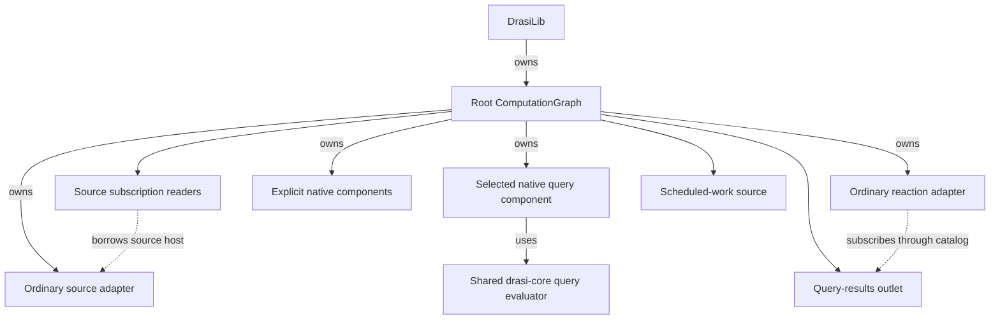
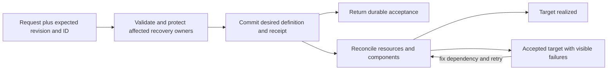

# Maintaining ComputationGraph

This guide is for engineers who change the ComputationGraph implementation in
`drasi-lib` and the contracts it shares with the Host and native plugins. It
explains how the runtime is organized, which owner is responsible for each piece
of state and work, and how to make and validate a change without breaking those
ownership rules. It describes this Core checkout and its matching Server
integration. It is a development description, not a claim that every deployment
or plugin is release-qualified.

**ComputationGraph is the only runtime in `drasi-lib`.** Each `DrasiLib`
instance owns one graph. The graph owns the components, the connections between
them, the resources they use, the tasks that run their work and their
lifecycle. Two assembly paths lead into that one graph:

- **Ordinary** components use the familiar Source, Query and Reaction APIs and
  plugin interfaces. The runtime translates them into graph declarations.
- **Native** components implement the computation-graph contracts directly,
  either in-process or as separately built plugin libraries.

Queries on both paths run as native query components that call the shared
query evaluator in `drasi-core`. There is no second executor, no per-query graph
and no fallback engine.

Two meanings of "graph" matter here. The **ComputationGraph** is the runtime
topology of components and connections. The **data graph** is the nodes and
relationships that Cypher and GQL queries match. Changing runtime wiring does not
require changing graph matching.

Read the first five sections in order: they cover the code layout, ownership,
the shared data boundary and one change followed end to end. Each later section
is a reference for one subsystem: descriptions, lifecycle, sink failures,
bootstrap, reads, recovery, cleanup, configuration changes, plugin hosting,
observability and diagnosis. [Making and validating a change](#making-and-validating-a-change)
explains how to test and measure a change, and an appendix maps the
ComponentGraph-based design onto this one.

Related documents:

- the [application developer guide](developer-guide/README.md), for building a
  solution rather than changing Drasi;
- the [data design](computation-graph-data-design.md), for record-by-record
  examples;
- the [implementation reference](computation-graph-reference.md), for
  signatures and state tables;
- the [runtime architecture review](runtime-architecture.md), for a generated
  type inventory and dependency matrix;
- the [capability comparison](componentgraph-vs-computationgraph.md), for the
  problems and scenarios this architecture addresses;
- the [remaining-work list](computation-graph-remaining-work.md), the single
  backlog of known issues, qualification work and improvements.

## Reading map

1. [How the code is organized](#how-the-code-is-organized)
2. [Ownership and the two assembly paths](#ownership-and-the-two-assembly-paths)
3. [Inputs, result nodes and query chains](#inputs-result-nodes-and-query-chains)
4. [Following one change through the runtime](#following-one-change-through-the-runtime)
5. [Data contracts, identity and ordering](#data-contracts-identity-and-ordering)
6. [Component descriptions and connection checks](#component-descriptions-and-connection-checks)
7. [Scheduling, readiness and lifecycle](#scheduling-readiness-and-lifecycle)
8. [Sink delivery failures](#sink-delivery-failures)
9. [Query execution, bootstrap and scheduled work](#query-execution-bootstrap-and-scheduled-work)
10. [Reading state without running another query](#reading-state-without-running-another-query)
11. [Stateful processing outside a query](#stateful-processing-outside-a-query)
12. [Recovery is a chain of completion boundaries](#recovery-is-a-chain-of-completion-boundaries)
13. [Resource ownership and cancellation-safe cleanup](#resource-ownership-and-cancellation-safe-cleanup)
14. [Live changes and persisted desired state](#live-changes-and-persisted-desired-state)
15. [Plugin hosting without a second executor](#plugin-hosting-without-a-second-executor)
16. [Observability](#observability)
17. [Inspection and diagnosing a running system](#inspection-and-diagnosing-a-running-system)
18. [Making and validating a change](#making-and-validating-a-change)
19. [Appendix: map from the ComponentGraph-based design](#appendix-map-from-the-componentgraph-based-design)

Code links point into this checkout. Named symbols identify entry points without
relying on line numbers, which move with edits.

## How the code is organized

### Crates

| Crate | Path | Responsibility |
|---|---|---|
| `drasi-lib` | [`lib/`](../README.md) | `DrasiLib`, the graph runtime, ordinary Source/Query/Reaction adapters, managed configuration and observability |
| `drasi-computation-contracts` | [`components/computation-contracts/`](../../components/computation-contracts/src/lib.rs) | Contracts shared by the runtime, the Host and plugins: envelopes, codecs, ports, component descriptions, delivery failures, lifecycle errors, the pause gate, owned-worker helpers and telemetry definitions. It owns no graph, storage or transaction. |
| `drasi-core-types` | [`core-types/`](../../core-types/src/lib.rs) | Shared values: `ComponentId`, `ComponentName`, `StreamId`, element models and `DataValue` |
| `drasi-core` | [`core/`](../../core/src/lib.rs) | The query evaluator, indexes and the [computation adapter](../../core/src/computation/query_adapter.rs) that binds an evaluator to transactional storage |
| `drasi-query-common` | [`components/query-common/`](../../components/query-common/src/lib.rs) | Query execution, publication, recovery and output state shared by the native query plugin and the linked reference query |
| `drasi-computation-transformer-query` | [`components/computation-plugins/transformers/query/`](../../components/computation-plugins/transformers/query/src/lib.rs) | The native query transformer that ordinary queries use when it is registered |
| `drasi-computation-plugin-abi` | [`components/computation-plugin-abi/`](../../components/computation-plugin-abi/src/lib.rs) | The C ABI of native plugin libraries: versions, tables and extension symbols |
| `drasi-computation-plugin-sdk` | [`components/computation-plugin-sdk/`](../../components/computation-plugin-sdk/README.md) | The traits plugin authors implement, the export machinery and the conformance kit |
| `drasi-host-sdk` | [`components/host-sdk/`](../../components/host-sdk/README.md) | Loading native libraries, the proxies that drive them, Host services and managed recipes |
| Native plugins | [`components/computation-plugins/`](../../components/computation-plugins/README.md) | Native sources, bootstrap providers, transformers and sinks |
| `drasi-instance-host` | [`components/instance-host/`](../../components/instance-host/README.md) | Running a `DrasiLib` instance in a separate process |

Dependencies point one way. Plugins and the Host SDK may depend on `drasi-lib`
and the contracts; `drasi-lib` never depends on a plugin or on the Host SDK, so
tests that need those crates live in
[`lib-integration-tests`](../../lib-integration-tests).

### Modules inside `drasi-lib`

| Module | Owns |
|---|---|
| [`lib_core.rs`](../src/lib_core.rs), [`lib_core_ops/`](../src/lib_core_ops) | The public `DrasiLib` type: start, stop, shutdown and per-component operations, each available by ID and by name |
| [`builder.rs`](../src/builder.rs) | `DrasiLibBuilder` and the `Query` configuration builder |
| [`computation/instance.rs`](../src/computation/instance.rs), [`instance_ops.rs`](../src/computation/instance_ops.rs) | The instance's root graph, its driver, startup and shutdown coordination, component lookup and renaming |
| [`computation/runtime/`](../src/computation/runtime) | Ordinary APIs: translating Source/Query/Reaction registrations into graph declarations, lifecycle events and ordinary removal |
| [`computation/v1/graph.rs`](../src/computation/v1/graph.rs) | `ComputationGraphBuilder`, `GraphControl` and `run_node`, the processing loop of one node |
| [`computation/v1/graph/`](../src/computation/v1/graph) | The controller, reconciliation, the registry, factory contracts ([`specification.rs`](../src/computation/v1/graph/specification.rs)), resources, task ownership, sink delivery and batching, retirement and recovery assessment |
| [`component.rs`](../src/computation/v1/component.rs), [`hooks.rs`](../src/computation/v1/hooks.rs), [`lifecycle.rs`](../src/computation/v1/lifecycle.rs) | Component traits, lifecycle hook contexts and the observed state model |
| [`query.rs`](../src/computation/v1/query.rs) and the other `query_*.rs` files, [`pipeline.rs`](../src/computation/v1/pipeline.rs) | The query component and its recovery, bootstrap, scheduling, catalogue and API; assembly of ordinary queries |
| [`graph_bootstrap.rs`](../src/computation/v1/graph_bootstrap.rs), [`bootstrap_ports.rs`](../src/computation/v1/bootstrap_ports.rs), [`output_bootstrap.rs`](../src/computation/v1/output_bootstrap.rs), [`composite_bootstrap.rs`](../src/computation/v1/composite_bootstrap.rs) | Bootstrap sessions and bootstrap providers |
| [`bounded_pipe.rs`](../src/computation/v1/bounded_pipe.rs), [`ranked_pipe.rs`](../src/computation/v1/ranked_pipe.rs), [`retained_pipe.rs`](../src/computation/v1/retained_pipe.rs), [`qos_pipe.rs`](../src/computation/v1/qos_pipe.rs), [`shared_storage.rs`](../src/computation/v1/shared_storage.rs) | Connections between components and their retention |
| [`producer_progress.rs`](../src/computation/v1/producer_progress.rs), [`source_progress.rs`](../src/computation/v1/source_progress.rs), [`consumer_progress.rs`](../src/computation/v1/consumer_progress.rs), [`delivery.rs`](../src/computation/v1/delivery.rs) | Progress owners, their readers and completion ledgers |
| [`middleware.rs`](../src/computation/v1/middleware.rs), [`transaction_transformer.rs`](../src/computation/v1/transaction_transformer.rs), [`time_merge.rs`](../src/computation/v1/time_merge.rs) | Stateful processing outside queries |
| [`plugin_source.rs`](../src/computation/v1/plugin_source.rs), [`plugin_reaction.rs`](../src/computation/v1/plugin_reaction.rs) | Graph-owned adapters for ordinary Source and Reaction plugins |
| [`management/`](../src/management) | The configuration owner: desired state, acceptance receipts, updates and removal |
| [`observability/`](../src/observability) | Logs, traces, metrics and lifecycle-event history |
| [`context/workers.rs`](../src/context/workers.rs) | Cancellation-safe ownership of spawned workers |
| [`error.rs`](../src/error.rs) | Public errors that keep their typed causes |

Shared types live in `drasi-computation-contracts` or `drasi-core-types` and are
re-exported from `drasi_lib::computation::v1`, so there is one type identity. Do
not copy an encoding, hash or contract back into `drasi-lib`, and do not move a
graph, storage or transaction owner into the contracts crate.

## Ownership and the two assembly paths

### One instance owner, directly hosted queries

Each `DrasiLib` instance has one root ComputationGraph. Ordinary registrations
and native component batches share that instance's namespace. Adding a batch
adds members to the same root; it does not create a competing runtime. Cloning
a `DrasiLib` value or a control handle does not create another graph.

The graph's vocabulary:

| Term | Meaning |
|---|---|
| Component | A lifecycle-owned unit with one execution role (`ComponentRole`): `Source`, `Transformer`, `Sink`, `Service` or `BootstrapProvider`. Its semantic kind (`ComponentSemanticKind`) says what it means to users, such as `Query` for a transformer or `Reaction` for a sink. |
| Port | A named input or output with a declared schema. Data ports carry the live change stream; bootstrap ports carry addressed bootstrap sessions (`PortKind`). |
| Edge | A declared connection from an output port to an input port |
| Pipe | The object that carries envelopes along an edge, with its own capacity and delivery policy |
| Resource | A storage, bootstrap, identity or other service that a component needs. `ResourceSpecification` declares it; `ResourceHandle` supplies the typed service and its declared capabilities. |
| Factory | Code that constructs a component from a declared specification and its resolved resources (`ComponentFactory`) |
| Controller | The graph's lifecycle coordinator ([`graph/controller.rs`](../src/computation/v1/graph/controller.rs)) |
| Node task | The graph-owned task that runs one component's processing |
| Revision, generation, epoch | The version of the declared topology; one constructed instance of a component; one lifecycle operation on that instance |

A resource name, a matching database path or a capability label is not proof
that two users share one storage owner. Only the resolved `ResourceHandle` is.

Keep three relationship types apart:

| Relationship | Example | Runtime consequence |
|---|---|---|
| Data | A query output feeds a sink input | Schema, routing, capacity and acknowledgement rules |
| Ownership or resource dependency | A journal uses a storage group; a producer reads its consumers' progress owners | Create prerequisites first; keep them until their users finish cleanup |
| Control or readiness | A connected component reports availability or sends a control request | Bounded control delivery that does not wait behind a full data pipe |

Data paths are acyclic. Resource dependencies have their own validation and
cleanup order and are not inferred from data edges. Control relationships do not
turn readiness notifications into data records.

Ordinary Source and Reaction objects appear as graph-owned service adapters at
the root. Their semantic kinds stay Source and Reaction; "service" describes
their execution interface. Ordinary query APIs assemble the registered native
query component and its subscription, timer and output helpers directly in the
same graph. The implementation is always selected explicitly, with
`with_query_factory`, `register_query_factory` or the pipeline's
`query_factory`; Drasi Server registers the unique eligible loaded factory. A
missing factory is an error, not a reason to fall back to another
implementation. The plugin owns its evaluator, while graph resources own
transactions and cleanup. Queries have no separate execution host, private query
graph or Host evaluator call.



Solid arrows show ownership, not event delivery. A source plugin can serve
several query subscriptions without any query owning the plugin's lifecycle.
Query-local subscriptions and storage still have their own cleanup obligations.

Read [`instance.rs`](../src/computation/instance.rs) for the root driver and
graph leases, [`runtime/component.rs`](../src/computation/runtime/component.rs)
for ordinary component realization and
[`runtime/query_assembly.rs`](../src/computation/runtime/query_assembly.rs) for
ordinary query declarations. Generation-fenced lifecycle groups start and stop a
query together with its exclusive helpers, and the root task registry keeps all
processing and cleanup when a caller stops waiting. Stop decisions must inspect
every member of the group: a stopped evaluator can still have active
subscription or output helpers. Ordinary stop APIs finish those helpers before
reporting completion, without stopping a shared source.

Failed definitions stay inspectable. The declaration resource holds
configuration metadata and any typed preparation error; it does not run the
query. Missing dependencies are waits, while invalid definitions are failures
that need correction. The
[lifecycle section](#declaration-construction-and-readiness-are-different-facts)
explains that distinction.

### Components have a permanent ID and an editable name

Every component has two identities:

- a `ComponentId`, an immutable UUID shared by the component instance and its
  graph node. Storage scopes, progress, lineage and routing use it;
- a `ComponentName`, a unique, case-sensitive name within the instance, which
  users choose and can change.

Both types live in
[`core-types/src/component_identity.rs`](../../core-types/src/component_identity.rs).
The type system keeps them apart: a UUID-shaped name is still a name.

| Rule | Code |
|---|---|
| `DrasiLib` assigns UUIDs and checks that a constructor used the assigned ID. Supplying a preconstructed object or an explicit UUID requires `with_allow_external_component_ids(true)`, which is fixed when the instance is built. | [`builder.rs`](../src/builder.rs), [`computation/creation.rs`](../src/computation/creation.rs) (`ComponentIds`) |
| Framework helpers, such as subscription readers, the scheduled-notification helper and the query-results outlet, get IDs derived from their owner's UUID and a fixed key (`ComponentId::derive_owned`), never from the owner's name. | [`pipeline.rs`](../src/computation/v1/pipeline.rs) |
| In configuration, a string selects a component by name and `{"id": "<uuid>"}` selects it by ID (`ComponentReference`). Execution settings, fingerprints and plugin settings contain only resolved IDs. | [`config/input.rs`](../src/config/input.rs) |
| A name reference waits as `DependencyWait::ComponentName` until a component with that name exists, then binds to that component's ID. A later rename, or reuse of the old name by another component, does not retarget it. | [`component_creation_identity.rs`](../tests/component_creation_identity.rs) |
| `rename_component_by_id` and `rename_component_by_name` change graph-owned metadata and publish a new revision. No plugin callback or lifecycle operation runs, and running components keep their wiring and progress. | [`instance_ops.rs`](../src/computation/instance_ops.rs), [`graph/identity.rs`](../src/computation/v1/graph/identity.rs) |
| Public operations come in pairs, such as `start_query_by_id` and `start_query_by_name`. The `_by_name` form resolves the current name, then calls the `_by_id` form. | [`lib_core_ops/`](../src/lib_core_ops) |

`ComponentDirectory`, in [`context/mod.rs`](../src/context/mod.rs), answers
`name_of(id)` and `id_of(name)` from the latest published graph
(`GraphComponentDirectory`). The runtime gives it to ordinary reactions in
`ReactionRuntimeContext::component_directory`, and `query_bindings()` pairs each
bound query ID with its current name. A reaction uses it to translate
user-facing names, such as route keys, into the IDs carried by delivered
results. Dynamic reaction plugins get the same lookup through an FFI bridge
([Host side](../../components/host-sdk/src/component_directory_bridge.rs),
[plugin side](../../components/plugin-sdk/src/ffi/component_directory_proxy.rs)).
Answers change after a rename, so a plugin should resolve names once and keep
the IDs.

The [component-identity tests](../tests/computation_component_identity.rs) and
[public selector tests](../tests/public_component_selectors.rs) cover renames,
name reuse and concurrent additions.

### Ordinary APIs are assembly, not a fallback engine

The ordinary APIs keep the familiar configuration and plugin interfaces.
ComputationGraph is the only engine, including in `--no-default-features`
builds; there is no runtime-selection feature.
[`runtime/mod.rs`](../src/computation/runtime/mod.rs) translates registrations
into graph declarations and reads current objects from registry publications.
[`sources/manager.rs`](../src/sources/manager.rs),
[`queries/manager.rs`](../src/queries/manager.rs) and
[`reactions/manager.rs`](../src/reactions/manager.rs) are facades. Do not add
component maps or processing loops to them.

[`pipeline.rs`](../src/computation/v1/pipeline.rs) assembles ordinary queries
(`ComputationPipelineBuilder::build` and, inside an ID allocation scope,
`build_owned`). It selects the index provider, creates the ranked input queue
and the query's resources, and connects subscription, evaluation, timer,
bootstrap and outlet components. A bug in how ordinary queries are wired usually
belongs here or in their runtime adapter, not in the core evaluator.

### Native assembly shares execution and ownership

Native components implement the graph contracts directly. Their data paths can
connect a source to a transformer to a sink without an ordinary Query object.
Ordinary and explicitly assembled queries use the same native query component.
Explicit assembly can omit ordinary configuration metadata and API adapters;
neither path creates a private query graph or another execution host. An
explicitly supplied source-host resource does not need a graph component with
the same name. A host borrowed from an instance source keeps that source's
dependency edges; source names in query metadata alone do not prove ownership.

Factories construct reconstructible components from declared specifications;
supplied objects are already constructed. Both enter the same ownership model.
An opaque supplied object does not become reconstructible because inspection can
display it.

Start with [`component.rs`](../src/computation/v1/component.rs) for execution
boundaries and
[`graph/specification.rs`](../src/computation/v1/graph/specification.rs) for
construction and resource contracts. The
[ordinary/native pipeline parity tests](../tests/computation_pipeline_parity.rs)
protect the shared behavior.

## Inputs, result nodes and query chains

### Learn the shared data boundary first

The ordinary APIs present source changes on one side of a query and result-row
differences on the other. Inside the graph, standard sources,
transformers and queries exchange the same **`drasi.graph-change` data** (schema
version 2). A query result is an ordinary graph node, so another query can
consume it without a query-to-source adapter.

```text
ChangeEnvelope                 one delivery's data and metadata
  ChangeSet                    an ordered collection of operations
    ChangeOperation            add, update or delete; identifies the record
      Record image             full element, property patch or partial before-image
```

The envelope also identifies its producer, stream and ordering policy. Handling
acknowledgements and storage transactions stay outside this immutable data. A
business element's identity is its element reference, a dataset namespace plus
an element ID. It is not the same thing as an envelope's delivery identity.

For a source node that starts as `{quantity: 8, note: "seasonal"}`:

| Change | Resulting properties |
|---|---|
| Patch sets `quantity: 3` | `{quantity: 3, note: "seasonal"}` |
| Patch sets `note: null` | `{quantity: 8, note: null}`; null is a value |
| Patch removes `note` | `{quantity: 8}`; an explicit removal |
| Full replacement `{quantity: 3}` | `{quantity: 3}`; omitted properties are gone |

Each row is an independent change to the initial node. A partial before-image
contains only known old fields; it is not a complete replacement or a removal
list. A patch can construct known state without a previous element, but that
does not make it a full image that the producer vouches for.

A query returning `RETURN p.name AS name, p.quantity AS quantity` publishes
nodes labeled `Result` by default, with those aliases as properties. The node's
namespace is the producing output's dataset namespace, and its element ID is an
opaque row identity supplied by the evaluator. Equal projected values can still
be different rows. **Key a result view by identity, not by its JSON values.** An
add installs a full node, an update replaces the full node and a delete removes
it. Query-facing grouping information travels in a checked annotation, not as
hidden business properties.

See [the detailed data contract](#one-graph-change-contract-for-source-transformer-and-query-data)
for typed values, exact operations, authority and wire rules.

### Query inputs name producer outputs, not only sources

Ordinary query configuration lists `inputs`. Each `QueryInputConfig` names a
`component` (a string selects a name, `{id: <uuid>}` selects an ID), an optional
output `port`, optional node and relation selections and a middleware
`pipeline`. An input can be an ordinary source or an output of a native source,
transformer or query.

This builder creates a second query over an existing query's rows:

```rust
let count = drasi_lib::Query::cypher(drasi_lib::ComponentName::try_new("low-stock-count")?)
    .query("MATCH (r:Result) RETURN count(r) AS Items")
    .from_input_by_name(drasi_lib::ComponentName::try_new("low-stock")?)
    .with_result_label("LowStockCount")
    .build()?;
```

The corresponding configuration fields are:

```yaml
inputs: [low-stock]
result:
  label: LowStockCount
```

`from_input_port_by_name(component, port)` (or `from_input_port_by_id`), or
`inputs: [{component: low-stock, port: out}]`, selects a particular port.
Without a port, resolution uses the producer's declared primary output, or its
only output. Several outputs without a primary are an error. **Never guess `out`
when the producer is not yet present.** Keep the unresolved declaration and
resolve it against the producer's descriptor when the producer arrives.
`result.label` changes the result-node label, not the port schema. Both the
selected endpoint and the result label are part of the query's configuration
identity.

Read [`config/schema.rs`](../src/config/schema.rs),
[`config/input.rs`](../src/config/input.rs),
[`builder.rs`](../src/builder.rs),
[`runtime/query_assembly.rs`](../src/computation/runtime/query_assembly.rs) and
[`pipeline.rs`](../src/computation/v1/pipeline.rs). Deferred binding is part of
graph reconciliation, not a manager-owned retry worker.

### A query chain needs a starting view as well as a live edge

Suppose `low-stock` already contains ten result nodes when `low-stock-count` is
added. A live pipe alone supplies later changes, not those ten nodes. Starting
both components successfully cannot repair that missing initial state.

| Situation | Required behavior |
|---|---|
| Both explicit queries are empty before the first event | Bind and ready the downstream path before admitting initial input |
| Add the downstream after the upstream has state | Bind live input first, capture a snapshot and its cursor, then suppress buffered changes covered by that cut |
| Restart a volatile downstream query | Rebuild its input view, including deletions that happened while it was stopped |
| Restart a persistent downstream query | Validate the saved producer epoch and replay after its committed input cursor. Only `OutputBootstrapProvider` does this; see the [known limitation](#known-limitation-chained-persistent-queries-do-not-replay-after-a-restart). |
| Intentionally read future changes only | Disable bootstrap explicitly; do not turn unavailable snapshot support into an empty snapshot |

When bootstrap is enabled and a query has neither a local provider
(`bootstrapProvider`) nor an application-supplied one (`query_bootstrap`),
ordinary assembly chooses one of two paths for each input:

| Input component | Bootstrap path |
|---|---|
| Declares a bootstrap output (`snapshot`): every query and native source, and native transformers that register output snapshots | A bootstrap edge from that output to the downstream's `bootstrap` input. An upstream query serves its committed result snapshot through `BootstrapSnapshotServer`. |
| Any other graph output | `OutputBootstrapProvider`, which reads the output catalogue's snapshot and replay providers and binds the downstream query's progress owner |

A persistent query refuses input from a volatile producer:
`OutputBootstrapProvider` checks this during bootstrap, and input processing
checks it for every envelope (`GraphInputProgress::validate_durability`). A
hand-wired `ComponentBatch` gets only the edges it declares. Add a bootstrap edge
or attach a query-scoped provider when the downstream needs initial state.

Strict recovery reports gaps and changed epochs. Explicit `AutoReset` can reset
the **receiving query** and bootstrap it again for supported reset conditions.
It requires a bootstrap provider or a connected bootstrap input, and it refuses a
persistent reset while durable output destinations are bound. It neither resets
the upstream nor treats every error as permission to start empty.

See [`output_bootstrap.rs`](../src/computation/v1/output_bootstrap.rs),
[`graph_bootstrap.rs`](../src/computation/v1/graph_bootstrap.rs) and
[`query_recovery.rs`](../src/computation/v1/query_recovery.rs). The same
evaluator processes the snapshot, the replay and later live changes. Query
readiness means initialization completed, not that every queued replay item or
output handoff has finished.

### Known limitation: chained persistent queries do not replay after a restart

A persistent downstream query that reads a persistent upstream query over a
bootstrap edge, the default path for ordinary query-to-query chains, gets no
replay of upstream output after a restart. Output that the downstream had
accepted but not committed before an abrupt stop is lost to it, and after every
restart the query fails on the next upstream output. The chain of causes is:

1. The upstream confirms an output as delivered once every outgoing branch has
   accepted it: `run_node` in [`graph.rs`](../src/computation/v1/graph.rs) calls
   `delivery_completed` after forwarding. The chain's input pipe is an in-memory
   ranked queue, so acceptance means queued, not processed. A restarted upstream
   replays only unconfirmed output.
2. On restart, the downstream's `PipeBootstrapProvider` sees a completed
   bootstrap and returns `Ready`. It resumes only producers that saved bootstrap
   state, and an upstream query's snapshot completion (`serve_output_snapshot`)
   saves none. It does not implement `take_input_replay`
   ([`query_bootstrap.rs`](../src/computation/v1/query_bootstrap.rs)), so the
   query receives no replay prefix.
3. The next upstream output skips the lost logical sequences. The downstream's
   check for a persistent producer (`GraphInputProgress::validate_owner` in
   [`producer_progress.rs`](../src/computation/v1/producer_progress.rs))
   requires consecutive sequences and fails with "graph input logical progress
   has a gap".
4. Because preparation still returns `Ready`, `AutoReset` never runs: it reacts
   only to `OutputReadError::Gap` or `EpochChanged` during bootstrap
   preparation. Every restart reaches the same gap.

Chains bootstrapped through `OutputBootstrapProvider` and volatile downstream
queries are not affected. A persistent chain with bootstrap disabled has no
replay either. Clearing the failure requires discarding the downstream query's
state, for example by removing and recreating the query. A likely fix, not yet
validated, gives `PipeBootstrapProvider` a resume path like
`OutputBootstrapProvider`'s: replay retained upstream output after the committed
cursor (`replay_after`) and report `Gap` or `EpochChanged` so that strict
recovery fails at startup and `AutoReset` can act. The work is tracked as
[CW-109](computation-graph-remaining-work.md#cw-109).

## Following one change through the runtime

Two paths carry a change from a source to its consumers:

```text
Ordinary: source adapter -> graph-owned reader/pipe -> query component
                                                     -> outlet -> reaction adapter
Native:   source output -> transformer/query input -> sink or another query
          the same graph loop, without ordinary wrappers where none are needed
```

Consider a source update that makes a product enter the low-stock result:

1. The source produces a `SourceEventWrapper`, including source-change time,
   sequence and any resumable source position. Its subscription supplies the
   event to a graph-owned, query-local reader.
2. The reader converts it to a native graph-change envelope. A ranked pipe
   admits the envelope to the query's shared bounded inbox, applying the
   source's backpressure or drop policy. A native producer already supplies a
   graph envelope and needs no conversion.
3. The graph selects an available input and calls the query transformer. The
   transformer interprets source and progress metadata and calls the shared
   evaluator through its storage owner. Input-local middleware uses the
   host-resolved component, port and stream binding as its scope, including the
   configured source behind an ordinary subscription helper; snapshot providers
   supply trusted origins too. Preserve element namespaces, and never select a
   pipeline from an incoming producer annotation.
4. With atomic publication, index mutations, input progress, the canonical
   result nodes and output history commit together. The query then publishes
   its in-memory result view, confirms `QuerySourceProgress` (the query's
   committed input) and returns output to the graph. This progress publication
   can happen before outgoing delivery. Ordinary downstream sends are not part
   of the transaction; a proven shared-storage group can include its journal
   appends.
5. The graph forwards the emitted envelopes through the selected output pipes.
   When every required branch has accepted a batch, it calls the transformer's
   `delivery_completed` hook and drains bounded continuations, which are further
   emissions for the same input. Only after that work succeeds does it publish
   optional graph-owned handled-input progress and complete the upstream
   `Handled` acknowledgement.
6. The query-results outlet and catalogue expose committed results to ordinary
   subscriptions. The reaction adapter applies its declared handling and
   recovery contract. Acceptance into a reaction's own queue is not proof that
   an external effect completed.

For a fully native pipeline, replace steps 1, 2 and 6 with the source's and
sink's direct envelope contracts. The query's output is the same graph-change
data, so step 5 can feed another query's input without an adapter. Every
envelope also carries a transient execution context (trace context) beside the
data; a transformer copies its input's context to its outputs (see
[Observability](#observability)). Graph-owned processing tasks enforce routing,
validation and confirmation; the controller coordinates their lifecycle and
owned cleanup rather than polling their business futures inline.

`run_node` in [`graph.rs`](../src/computation/v1/graph.rs) is the best single
place to understand this loop. It keeps at most one pending receive per input
edge, validates output batches before forwarding, and completes an input's
acknowledgement only after the relevant processing, forwarding and continuation
work succeeds. A buffering transformer can return no output; if that return
acknowledges recoverable input, the transformer must already have persisted it.
Sinks take a separate path through
[`graph/sink_batching.rs`](../src/computation/v1/graph/sink_batching.rs), which
retains each unacknowledged input until it is delivered (see
[Sink delivery failures](#sink-delivery-failures)).

The compatibility boundaries are in
[`plugin_source.rs`](../src/computation/v1/plugin_source.rs),
[`graph_codec.rs`](../../components/computation-contracts/src/graph_codec.rs),
[`query_catalog.rs`](../src/computation/v1/query_catalog.rs) and
[`runtime/reaction.rs`](../src/computation/runtime/reaction.rs). Follow them
when data arrives correctly at one interface but disappears or changes meaning
at another.

**Case: the input advanced but the result did not.** A product's quantity
changes from 8 to 7, and the query selects quantities below 5. The query commits
the new input position without emitting a result batch, and its output sequence
does not advance. This is normal processing, not a stalled worker. Conversely,
observing that input checkpoint does not prove that an earlier output has
finished downstream handling. Use the
[completion boundaries](#recovery-is-a-chain-of-completion-boundaries), not a
one-input/one-output counter.

**Fan-out is not a transaction.** Independent branches are sent one after
another. A slow branch backpressures the producer, and earlier branches may have
accepted an emission when a later send fails. Forwarding errors keep that
partial-acceptance information. The exception is one append shared by several
subscribers of the same QoS channel, not graph-wide atomic delivery.

## Data contracts, identity and ordering

### Envelopes carry data; resource capabilities stay outside them

A native envelope contains an immutable change set, producer metadata,
annotations and lineage. A change set preserves operation order and
distinguishes full, partial and patch record images. Its schema includes exact
identity, version, encoding and definition bytes, and executable validators
check records. A matching schema name or fingerprint is not sufficient proof of
compatibility. Schema compatibility also does not turn arbitrary records into
Cypher data: the standard graph-change codec supplies the mapping for graph
data. Ports whose complete schema descriptors match connect directly, including
a custom schema that a factory declares and implements on both ends. Only formats
that differ need an intentional conversion transformer. The next subsection
describes the one standard contract.

Immutable payloads are shared on in-process fan-out. Appending an annotation
creates branch-local history without mutating another branch. A transformer
derives a new envelope with its own stream and sequence and keeps the input's
context and lineage. Lineage records ancestry; it is not a multi-input commit
protocol or a checkpoint authority. Lineage depth is bounded (`MAX_LINEAGE_DEPTH`,
1,024), and emission validation and both codecs enforce the bound.

This is not end-to-end zero-copy: compatibility conversion, decoding,
persistence and FFI still allocate or serialize. Keep transactions,
acknowledgements and storage handles out of annotations; those are local
capabilities with ownership rules, not immutable data.

The shared implementations live in `drasi-computation-contracts`, and runtime
imports re-export the same types. Read
[`data.rs`](../../components/computation-contracts/src/data.rs) for validation,
[`envelope.rs`](../../components/computation-contracts/src/envelope.rs) for
sharing and derivation and
[`ports.rs`](../../components/computation-contracts/src/ports.rs) for
connection compatibility.
[`codec.rs`](../../components/computation-contracts/src/codec.rs) is the
persisted JSON envelope format;
[`binary_codec.rs`](../../components/computation-contracts/src/binary_codec.rs)
is the full-fidelity binary format. Changing one does not migrate the other.
Tests in [computation_codec.rs](../tests/computation_codec.rs) and
[computation_graph_codec.rs](../tests/computation_graph_codec.rs) check round
trips and meaning, not only successful deserialization.

### One graph-change contract for source, transformer and query data

Standard sources, middleware and queries publish `drasi.graph-change` schema
version 2, encoded as `drasi-element-msgpack-v2`. Custom formats are supported
on ports whose factories implement them. For standard graph data, a
query's output can feed a compatible sink, middleware or another query directly,
without a separate query-row decoder. When maintaining this path, keep these
rules:

- **Records are canonical element data.** A record is an `ElementImage` (full),
  an `ElementPatch` (set values plus a separate removal set) or an
  `ElementBeforeImage` (partial), encoded as bounded MessagePack with shared
  `DataValue` properties. The operation kind lives in `ChangeOperation`, outside
  the payload. Null, set and removed are three different outcomes. The model
  mirrors this: `SourceChange::Update { element, removed_properties }` sets every
  supplied property (null is a value) and removes only the listed names, and
  `SourceChange::Replace { element }` is an explicit full replacement that
  `decode_changes` returns as `Replace` rather than folding it into `Insert`.
  Keep the set and removal names disjoint (`SourceChange::validate`). Rich
  values, including temporal and spatial values, collections, expressions,
  ranges and `Awaiting`, cross through validated shared values. Values outside
  the compact `ElementValue` variants use its `Typed` route. Expressions remain
  inert data at the codec and transport boundary. Canonical positive integers use
  the unsigned representation and negative integers the signed one; preserve
  numeric meaning rather than assuming internal enum tags stay unchanged. Do not
  replace the canonical path with a lossy JSON round trip.
- **A query result is a node.** `ResultNodeProjector` builds it: label `Result`
  by default (or the configured `result.label`), properties named by the
  `RETURN` aliases, the opaque row identity as the hex element ID, and the
  output's dataset namespace as the element namespace. Nothing query-specific is
  stored in the node. Row kind, grouping flags and ordinals live in the scoped
  `drasi.query-projection.v1` annotation, which is trusted only when it was
  written for the envelope's own change set; `QueryChangeCodec::is_query_output`
  is the check. There is no adapter component between queries and no decoder for
  any other query-row format. Consumers that materialize results, including the
  dashboard, keep aggregate groups in the same identity-keyed row collection as
  other results. A separate latest-aggregate slot leaves snapshot rows stale and
  loses independent groups and deletions.
- **Result updates are full replacements.** Added rows carry full nodes; updates
  use `Updated` with `Replace` semantics and a full after-image. Ordinary row
  updates also carry the full before-image; aggregation has one only when the
  evaluator supplied it. Removals use `Deleted` with the old full node. A `Noop`
  produces no operation. Aggregation and default flags are query-facing context,
  not commands to delete a row. These rules justify a simple keyed replacement
  view for query results, but not for arbitrary source patches.
- **Row identity is opaque and the dataset is scoped.** The identity comes from
  the evaluator signature, so equal values can be separate rows. The dataset
  namespace (`output_identity::dataset_namespace`) hashes the construction
  scope, graph, component and output port into a bounded `drasi.output/<hash>`
  string; epochs and sequences are deliberately outside it. Anything that
  authorizes or routes by element namespace, such as the bridge allow-list, must
  list the exact derived namespace. Query metadata alone never grants wider
  authority.
- **Ordering is explicit.** `SystemMetadata.ordering` is `EventTime` (the
  default for sources; business time rejects stale changes) or
  `ProducerSequence` (derived query output). `ProducerSequence` is valid only
  after the receiver has validated the producer's identity, output epoch and
  accepted sequence, so a query rejects it without a current
  `GraphProducerProgress`. Business times travel unchanged. Queries stamp their
  output with that progress. A persistent output epoch is stable across
  equivalent reconstruction and changes on reset; a newly constructed volatile
  object gets a new incarnation. A stop and start of the same retained object
  does not by itself require one. `QueryInputBatch` carries the ordering into
  the same `QueryEvaluator` for both policies; do not add a second evaluator for
  derived data.
- **Control is event-local.** `SystemMetadata.control` carries a checked kind
  and an opaque payload. Scheduled `Future`/`FuturesDue` work is a
  `drasi.graph-control.v1` control, not a fake patch. `derive` does not copy
  control or ordering, and annotations or lineage never become a control, so
  fresh derived data is not mistaken for scheduling. `reemit` and an unchanged
  relay keep both. A historical control is provenance only.
- **Clocks keep their meaning.** Result-node images use business event time,
  falling back to the supplied production time when it is absent. The ordinary
  result's timestamp is production time, including for scheduled output.
  Envelope logical event and due times stay separate from transport counters and
  local wait clocks. Ordinary result metadata is projected at the result API
  boundary, not duplicated throughout native execution.
- **One format version each.** The binary envelope codec
  (`BinaryEnvelopeCodec::VERSION`) and the native plugin ABI (`ABI_VERSION`,
  `WIRE_VERSION`; see [Native ABI versions](#native-abi-versions-and-load-time-checks))
  have no reader or migration for earlier formats or for other query-row
  records. Hosts and libraries built from different revisions are a build
  problem to fix, not data to convert.

Code: [`graph_codec.rs`](../../components/computation-contracts/src/graph_codec.rs),
[`result_node.rs`](../../components/computation-contracts/src/graph_codec/result_node.rs),
[`query_codec.rs`](../../components/computation-contracts/src/query_codec.rs),
[`element_image.rs`](../../components/computation-contracts/src/element_image.rs),
[`element_patch.rs`](../../components/computation-contracts/src/element_patch.rs),
[`data_value.rs`](../../core-types/src/data_value.rs) and
[`output_identity.rs`](../../components/computation-contracts/src/output_identity.rs).
The [data design](computation-graph-data-design.md#8-graph-data-and-a-query-example)
explains the records and their consequences.

The receiving component's protocol matters as well as its schema:

| Boundary | What it accepts |
|---|---|
| Native HTTP, gRPC and SSE notification sinks | Ordinary source, transformer or query graph-change data; output identity comes from declared input bindings |
| Ordinary Reaction adapter | The query projection converted to an ordinary `QueryResult`, for a subscribed query |
| Query input | Graph changes plus its explicitly supported control, bootstrap and complete-transaction protocols |
| Snapshot-replacing sink input | Recovery snapshots, only when that input registers a replacement handler |

The native network path does not require a query annotation. It also does not
treat scheduling controls or snapshot and progress recovery frames as ordinary
notifications. Check
[`common/network/src/wire.rs`](../../components/computation-plugins/common/network/src/wire.rs)
and [`graph_view.rs`](../../components/computation-contracts/src/graph_view.rs)
separately from the ordinary reaction's `QueryChangeCodec::to_legacy_result`
boundary.

**There is no mandatory state store or materializer.** Each component owns
whatever storage it needs: a query keeps indexes and result nodes, and a
stateless transformer or sink may keep none. Durability is declared per
component (see [Component descriptions](#component-descriptions-and-connection-checks)),
not imposed by the framework. Do not add a framework-wide materialized view as a
prerequisite for a node.

Output readers are available in-process and through the native read and follow
extensions; see [reading state](#reading-state-without-running-another-query)
for their ownership and bounds.

`PortFormatCatalogue`, `ComponentFactory::port_formats` and native
`Capabilities::port_formats` resolve only formats a factory implements. A
factory opts into the `ports` configuration field; factories that do not declare
it reject that field. Standard factories expose graph-change data only. Matching
custom-schema ports connect directly; differing formats need an intentional
conversion. See
[Choosing a port format](computation-graph-schemas-ports-pipes.md#choosing-a-port-format).

The [stateful view transformer](../../components/computation-plugins/transformers/view/README.md)
provides a separate memory-backed maintained projection. It is not a mode of
`map` or `jq`, and its snapshot capability does not imply replay, durable
storage or snapshot-input initialization. `ORDER BY`, `LIMIT` and `SKIP` are not
supported query syntax.

### Event time and progress sequence answer different questions

**Business time describes when a fact applies; validated progress describes
which producer revision was processed.** For `EventTime` inputs, source-change
time also rejects stale mutations. For `ProducerSequence` inputs, the validated
producer revision admits corrections even when their business time is older.
Neither policy permits substituting receipt time or an arbitrary record property
for the required authority.

For example, a late source contribution may correct a query's total at business
time 90 after that query already published a total at time 100. The downstream
query must apply the later **output revision**, not reject it as stale source
data or rewrite time 90 to 100.

| Identity or position | Scope and purpose |
|---|---|
| Element reference | A business node or relationship: dataset namespace plus element ID |
| Query row identity | Opaque evaluator row or group identity; not a hash of the displayed columns |
| Query recovery identity | Instance and construction scope, graph, query, configuration and optional volatile incarnation |
| Producer epoch and logical sequence | The immediate output history and the revision a downstream owner accepted |
| Transport emission sequence | Transmissions on one stream, including replay of older logical output |
| Component generation and operation epoch | Runtime replacement and lifecycle races; not durable data-history identities |
| Source position | A source-specific replay position, such as a WAL, binlog or commit-and-row position |

For query outputs, the producer epoch is derived from the complete
`QueryRecoveryIdentity` plus the output reset generation:

| Event | Identity consequence |
|---|---|
| Re-emit saved output | Same logical change and output identity; a new transport delivery may be assigned |
| Reopen a persistent query with the same scope, configuration, stores and reset generation | Compatible recovery identity and producer epoch |
| Reset output history | New reset generation and producer epoch; the dataset namespace need not change |
| Stop and start the same volatile object | The incarnation can remain; a bootstrap reset can still change the reset generation |
| Construct a new volatile query object | New incarnation; it cannot silently resume persistent downstream input |
| Replace the runtime component | New component generation; the durable epoch follows recovered state, not this counter |

Ordinary and directly constructed queries use their graph and query IDs under
the enclosing instance scope. Catalogue transport counters survive replacement.
Storage written under any other namespace is neither read nor adopted, and that
incompatibility does not authorize deleting it.

Every output stream has one producer and increasing transport emission
sequences. A replay can emit the same logical output again with a new transport
sequence. Persistent queries also carry query identity, generation and logical
result positions. Stateful graph producers carry their own logical progress.

This distinction matters after transformation. Suppose source events 1 and 2
become merger outputs 2 and 1 because event 2 has an earlier source time. A
downstream query must checkpoint the **merger's** output sequence, not the
inherited raw source sequence 2, which would then wrongly suppress event 1.

`GraphInputProgress::from_envelope` in
[`producer_progress.rs`](../src/computation/v1/producer_progress.rs)
distinguishes immediate producer progress from inherited provenance.
[`query_identity.rs`](../src/computation/v1/query_identity.rs) re-exports the
shared [query identity contract](../../components/computation-contracts/src/query_identity.rs).
[`output_identity.rs`](../src/computation/v1/output_identity.rs) canonicalizes
retry comparisons for replay and delivery. Reuse these rules rather than
building an identity from a timestamp, record key or transport envelope ID.
Query outputs exclude their own post-commit profiling timings from that
comparison, even when they use the common graph-producer identity; inherited
timings remain part of the content. Otherwise a shared journal's atomic append
and the query's later live forwarding would disagree about the same logical
output. The [producer-provenance tests](../tests/computation_producer_provenance.rs)
cover the distinction through derived streams.

For a validated stateless path to a consumer's progress owner,
`GraphInputProgress::with_consumer_boundary` can restore the original producer
boundary. `GraphProducerProgress::read_boundary` reads that metadata from the
envelope lineage; matching a source name or copying an annotation is not proof.
Retained paths preserve already queued input through supported replacement.

Carry the producer role for normal and batched inputs, including the validated
original boundary. An ordinary transformer that expands one query result into two
envelopes must not label both outputs as the ancestor query's same logical result
and discard the second as a duplicate. Conversely, a validated stateless relay
must preserve the original query's logical result position rather than
substitute its transport counter. Original and immediate transport progress
advance independently. The
[handled-input regressions](../tests/computation_input_progress.rs) cover both
cases and completion after continuations.

### Ordinary ordering preserves each producer's progress

The ordinary query inbox is a `RankedInputQueue` shared across the query's
inputs. It compares the earliest admitted sequence from each producer by source
time, configured input rank and sequence. It never moves a later sequence ahead
of an earlier outstanding event from the same producer, even if timestamps go
backwards; otherwise a simple high-water checkpoint could skip unprocessed
input.

The source's dispatch mode chooses blocking or drop-on-full admission to this
inbox (`Channel` blocks, `Broadcast` drops when full); the query's dispatch mode
governs its output subscribers. Changing the order of the input list changes the
query's configuration identity. Inspect
[`ranked_pipe.rs`](../src/computation/v1/ranked_pipe.rs) and the shared
[`channels/priority_queue.rs`](../src/channels/priority_queue.rs) before
changing these rules.

Direct native fan-in defaults to arrival order (`InputMergePolicy::Arrival`).
Its `EventTimeAcrossStreams` policy compares the stream heads that are currently
available. Neither waits for unseen events or establishes a cross-source
watermark.

### Explicit source-time merging owns the reorder problem

`SourceTimeMergeTransformer` is the opt-in component for buffering and
reordering within sources. Every input must carry a source-change timestamp,
supplied by the source. The envelope type can represent an absent timestamp, but
that does not authorize a fallback in this transformer.

The merger keeps a time-ordered buffer and a separate residence-deadline index.
An event becomes eligible when every active source has progressed far enough
beyond it, or when its residence deadline expires. Optional idleness removes a
quiet source from the early-release calculation. The component emits the
earliest eligible buffered event, one per continuation, under downstream
backpressure.

An expired residence deadline makes the ordered prefix through that event
eligible; maximum wait is not a downstream delivery deadline. Idleness is not
proof of completeness: when all sources are idle, residence deadlines still
govern release. Local monotonic time controls waiting, never event order.

For example, once outputs have advanced to source time 100, an event arriving at
time 90 cannot enter the main output without breaking order. The default policy
keeps it and fails. Explicit alternatives route it to a separate late port or
discard it with a warning and a counter. Equal times are allowed; configured
source rank breaks ties among events buffered together.

Count and binary-byte limits include buffered, held and unconfirmed events. A
full buffer rejects new input rather than silently evicting an event. Durable
mode saves the buffer, progress, frontier and pending output in one atomic
bounded snapshot. Reopening conservatively restarts residence waits. Snapshot
writes grow with buffer size; this is not a paged large-window reorder engine.

The design is in [`time_merge.rs`](../src/computation/v1/time_merge.rs) and
[`time_merge/recovery.rs`](../src/computation/v1/time_merge/recovery.rs);
[time-merge tests](../tests/computation_time_merge.rs) cover time behavior and
graph integration. The [feature guide](computation-graph-time-merge.md) defines
the exact policies and administrative resolution of held events.
`SourceTimeMergeDefinition::specification` supplies the standard
`drasi/source-time-merge` factory recipe, and Host and Server share the pinned
`sourceTimeMergeStorage` resource recipe. Custom schemas use direct Rust
construction. There is no explicit source-watermark protocol or retroactive
query correction, and the factory's canonical scope does not migrate state from
other direct-constructor namespaces.

## Component descriptions and connection checks

A **component description** is what a component states about its own delivery
and durability guarantees. The graph compares descriptions when it binds an edge
or a resource, so incompatible connections fail with a precise error instead of
losing data later. Compatibility is always declared: the graph never infers it
from resources, configuration keys or a first delivery, and an undeclared fact
satisfies no requirement.

The types live in
[`description.rs`](../../components/computation-contracts/src/description.rs)
and are re-exported from `drasi_lib::computation::v1`. The tests are in
[`computation_component_description.rs`](../tests/computation_component_description.rs).
For the author's view, see
[Declare what a component guarantees](developer-guide/README.md#declare-what-a-component-guarantees)
in the developer guide.

### What a description declares

`ComponentDescription` has five parts:

| Part | Type | Meaning |
|---|---|---|
| `component.progress` | `ProgressPersistence` | Whether the component's own progress survives a restart: `Undeclared`, `Stateless`, `Volatile` or `Durable` |
| `component.on_permanent_failure` | `PermanentFailurePolicy` | What a sink does with an input that can never be delivered: `Stall` (default) or `Skip`. See [Sink delivery failures](#sink-delivery-failures). |
| `ports` | `PortDescription` per port | Facts about each data and bootstrap port |
| `dependencies` | `DependencyRequirement` per named dependency | The durability the component requires of resources bound to that dependency (`Any` or `Durable`) |
| `coordination`, `element_identity` | `BootstrapCoordination`, `ElementIdentity` | A source's offer to coordinate bootstrap with paired providers, and how it identifies its elements |

An output port's `OutputDescription` states the producer identity its stream
carries (`OutputIdentity`), whether it can replay from a committed position
(`ReplayAbility`) and how it relates to the component's inputs
(`OutputRelation`). The constants cover the common cases:

| Constant | Identity | Replay | Use |
|---|---|---|---|
| `OutputDescription::DURABLE` | `Durable` | `FromPosition` | A restart-stable producer identity that replays committed output, such as a persistent query |
| `OutputDescription::VOLATILE` | `Volatile` | `None` | An identity whose incarnation changes on every reconstruction, such as an in-memory query |
| `OutputDescription::UNTRACKED` | `Untracked` | `None` | No producer identity of its own, such as a source whose outputs carry only source replay progress |
| `OutputDescription::RELAY` | `Untracked` | `None` | A relay that carries its input's progress boundary forward |
| `OutputDescription::UNDECLARED` | `Undeclared` | `Undeclared` | Nothing declared; satisfies no keyed input |

`OutputDescription::following(durability)` picks `DURABLE` or `VOLATILE` to
match a resource's declared durability. An input port's `InputDescription`
states its `InputDelivery`: `Unkeyed` (delivery does not depend on producer
identity), `ExactlyOnce` or `AtLeastOnce`.

`ComponentDescription::undeclared()` declares nothing. In any description, an
absent output counts as `UNDECLARED` and an absent input as `Unkeyed`.
`ComponentDescription::validate` checks a description against its descriptor:
every described port must exist with the right direction and kind, a relay
output must be `Untracked`, replay from a position requires a durable identity,
a durable output identity requires durable component progress, and a paired
bootstrap output must serve its source's namespace and complete durably.

### Where descriptions come from

| Component | Source of the description | Checks |
|---|---|---|
| Factory-built | `ComponentFactory::describe(&ConstructionContext)`, which must be pure: no construction, I/O or inspection of resource objects. It sees bound resources only through their declared `ResourceCapabilities` (`ConstructionContext::dependency_capabilities`). | A `describe` error is a terminal creation failure. An invalid description is `GraphError::Incompatible` in the creation phase. Each declared dependency requirement is compared with its bound resources (`check_dependency`). After construction, and after an in-place update, the instance's `description()` must equal the declaration; otherwise creation fails with `Incompatibility::InstanceDescription` ([`graph/controller.rs`](../src/computation/v1/graph/controller.rs), `declared_description` and the construction path). |
| Supplied (preconstructed) | `ComputationComponent::description()`, captured once when the component is registered | No factory comparison and no dependency checks |
| Native plugin | The plugin's `Factory::describe(&DescribeRequest)` | The Host adds the facts of the bootstrap ports it owns, validates the description, and refuses a Host-owned consumer whose identity-keyed inputs are undeclared. It never interprets plugin configuration. |

Resources declare their own durability with `ResourceHandle::with_capabilities`;
`QueryIndexProviderResource::handle` and `QosChannel::resource` are examples.
Queries describe themselves through their index provider
(`indexed_description` in [`query.rs`](../src/computation/v1/query.rs)): a
volatile provider gives `VOLATILE` outputs and a durable one `DURABLE` outputs,
plus a durable bootstrap input and a committed-output `snapshot`. The middleware
transformer declares `DURABLE` outputs and a `Durable` requirement on its
`indexes` dependency in durable mode, and `VOLATILE` outputs otherwise. A
component whose outputs carry no producer identity of their own, such as a
source that publishes only source replay progress, declares `UNTRACKED`.

### When the graph compares them

The controller checks each data edge when it binds it
(`check_edge_compatibility`), comparing the producer's output, the pipe's
capabilities and the consumer's input with `check_edge`:

| Consumer input | Accepted when |
|---|---|
| `Unkeyed` | Always |
| `AtLeastOnce` | The output identity is `Volatile` or `Durable` |
| `ExactlyOnce` | The output identity is `Durable`, and either the output replays `FromPosition` or the pipe offers `PipeCapability::Replay` |

An edge whose endpoints are not constructed yet is not checked; it stays
`BindingState::Declared` until both ends exist. A mismatch never rejects the
graph change:

- the edge becomes `BindingState::Failed` and stays unbound, with its data
  availability `Unavailable`;
- the consumer gets a terminal `FailurePhase::Binding` failure carrying
  `GraphError::Incompatible`, and its realization becomes `Blocked`;
- unrelated components bind and start normally;
- reconciliation clears the failure when either side changes or the edge is
  removed (`is_edge_incompatibility`).

The error names both ends, for example "input '…:in' (ExactlyOnce) cannot be
connected to output '…:out' (Volatile, replay None)". A dependency mismatch
found at construction is also a terminal binding failure that blocks the node.

In-process, an absent input description means `Unkeyed`, so the graph never
refuses an undeclared keyed input on its own; only the native Host's consumer
check refuses one.

### Bootstrap edges have their own checks

A bootstrap edge connects a provider's bootstrap output to a consumer's
bootstrap input ([bootstrap ports](#bootstrap-travels-over-bootstrap-ports)).
`check_bootstrap_edge` compares:

| Fact | Rule |
|---|---|
| Pairing | A provider that declares a pairing protocol (`BootstrapOutputDescription::pairing`) connects only to a source relay that offers the same `BootstrapProtocol`. A source whose coordination is `required` accepts only a paired provider. |
| Namespace | A provider whose records use the served source's namespace (`ElementNamespace::ServedSource`) needs exactly one served source: the consumer itself when it is a source relay, otherwise the single producer of the consumer's data inputs (`served_source`). |
| Element identity | A provider that declares an `ElementIdentity` must match the served source's declared identity. |
| Completion | An input that accepts only `Quiescent` initialization refuses a provider whose completion is anything else, such as `Durable` (with watermarks and state). A relay's completion is resolved through the providers on its own bootstrap inputs (`relayed_completion`: quiescent with none, otherwise the weakest of them). |

When the consumer is a source relay, the provider's completion must also be
acceptable to every consumer that source already serves, so a mismatch is found
by whichever edge binds last.

## Scheduling, readiness and lifecycle

### Owned native tasks and independent query work

Native processing, lifecycle and control work, and supported resource
operations run in graph-owned Tokio tasks. The controller observes their
completions rather than polling their business futures inline. Graph-owned task
and result registries outlive cancelled waiters and the controller future until
cleanup joins the work. Mutable operations on one instance remain serialized.

Ordinary queries use these same per-component tasks, not private graph drivers.
On a multithreaded Tokio runtime, independent queries and other native
components can run on different workers. Current-thread operation remains
supported but gives no CPU parallelism. A transaction container's inner steps
stay within its one transaction and runner. Measured capacity still depends on
contention, work size and transport.

See [`execution.rs`](../src/computation/v1/graph/execution.rs) and
[`resource_tasks.rs`](../src/computation/v1/graph/resource_tasks.rs) for
retained task and result ownership. Initial factory deployment is
dependency-aware. Factory and provider preflight, pipe construction, in-place
reconfiguration, superseded resource metadata and destruction of retired objects
use retained task boundaries too. A retirement failure fences the affected
replacement before construction or activation; cleanup success cannot clear
generation damage.

Scoped force validates the complete resource domain before interrupting anything
and joins the processing and control work it reports as interrupted. A selected
member that never started, or is already quiesced, can still have an idle
graph-owned peer-control observer. Force does not report that observer as
interrupted or wait for it to end; it stays owned for later lifecycle use and is
joined when the graph is disposed. Both runtime flavors protect this case in
[`computation_task_execution.rs`](../tests/computation_task_execution.rs).

Successful force cleanup does not repair a damaged generation, and recovery
retirement must still reject it. Reconstruct a fresh owner from the accepted
configuration and recover the producer before changing its output bindings;
construction alone is not recovery. Drasi Server's held-Handled sink tests keep
pending output through that sequence instead of aborting handling under a
successful graceful-stop claim.

Awaited reconciliation phases service the same bounded command dispatcher.
Reservations reject conflicting structural changes while disjoint lifecycle
operations continue. Resource reservations include exact provider aliases and
use weak identities, so they cannot keep retired storage alive. Resource and
plugin notifications are generation-fenced and deferred until reconciliation
finishes, keeping only the latest notification of each kind per registered
component. This prevents an inventory update from invalidating, or being
overwritten by, an owned preflight.

[`graph/controller.rs`](../src/computation/v1/graph/controller.rs) manages
active operations and their completions. `NodeWorkBudget` in
[`graph.rs`](../src/computation/v1/graph.rs) bounds continuously ready work per
poll and requeues the **node's** waker; suspension resets the budget. This stops
a ready producer or a timer burst from monopolizing its runner and executor
worker, without adding periodic yields to paths already waiting for I/O. It is
not a budget around arbitrary service or plugin code and cannot preempt a
component that never yields.

The [query responsiveness tests](../tests/computation_query_responsiveness.rs)
and [graph dataflow tests](../tests/computation_graph_dataflow.rs) help when
changing fairness, continuation or fan-in behavior.

### Idleness is not exhaustion

A source with no current event must wait in `next`, not return `None`. `None`
means true exhaustion and lets downstream draining finish. A stopped or failed
source is not automatically an exhausted source.

Transformers can request timer wakeups without receiving input, and pending
continuations run before another input is processed. This lets a merger drain
buffered events even after finite sources end. Keep those paths in `run_node`
when changing its receive loop: "no input ready" does not always mean "no work
remains."

### Declaration, construction and readiness are different facts

An accepted declaration reserves an identity and stays visible even when
construction fails. A constructed component may still be waiting for required
connections or readiness. A start hook can finish before an asynchronously
starting plugin is ready.

The graph therefore tracks creation state (`RealizationState`), execution state
(`ComponentLifecycle`) and health (`ComponentHealth`) separately. Do not treat
"the graph is running" as "every component is healthy," or a successful
addition as a successful startup. A caller's failure to construct a supplied
object stays outside graph registration.

Strict construction rejects cycles, role, port and schema mismatches and unmet
connection capabilities before execution. Valid declarations can keep
unresolved dependencies until they arrive. This lets a live system describe an
incomplete intended topology without pretending that it is already executable.
Declared facts are compared as well (see
[Component descriptions](#component-descriptions-and-connection-checks)).

**Case: late dependency versus invalid configuration.** A query declared before
its named producer exposes the missing producer as a `DependencyWait`, such as
`DependencyWait::ComponentName`. When that producer arrives, the graph resumes
construction and resolves its primary port. A malformed identifier, an
incompatible schema or an ambiguous multi-output producer is instead a
validation failure; waiting longer or constructing again cannot fix the
definition. Do not convert such failures into dependency waits.

The creation, start and query-ready waits answer different questions:

| Wait or observation | Establishes | Does not establish |
|---|---|---|
| `ComponentHandle::wait_created` | The requested generation was constructed and published coherently | Required connections, activation or initial query state |
| `ComponentHandle::wait_started` | That generation reached its running or activation boundary | Queue drain or consumer completion |
| `QueryResults::wait_ready` | Recovery and bootstrap initialization and output-delivery preparation completed | That pending input replay, pending output or business effects have finished |

The registry publishes public configuration and read facets together with
observed state. A private observation that arrives earlier must not release a
public wait. Dependency notifications preserve disabled auto-start and explicit
stops; they do not grant a fresh start request. A reaction started against an
explicitly stopped query fails promptly with `DependencyStoppedError` instead of
waiting for its startup deadline.

**Case: a stopped wait is cancelled.** A caller starts a query whose input is
missing, then stops it and drops its readiness wait. Dropping the wait must not
own or erase the declaration, and a later arrival of the source must not undo
the explicit stop. Conversely, dropping a caller while an accepted stop joins a
worker must not lose that join. The graph keeps the operation and reports its
outcome through the same generation-fenced state.

Readiness and neighbor notifications use separate bounded control channels, so
they need not wait behind a full data pipe. Components can address connected
neighbors only. Requiring readiness on both sides can still prevent a successful
startup; a deadline reports the failed startup but does not repair a cyclic
readiness protocol.

[`lifecycle.rs`](../src/computation/v1/lifecycle.rs) defines the state model
and [`control.rs`](../src/computation/v1/control.rs) the control-message rules.
The controller's `begin_start`, `advance_start` and `complete` paths connect
them. Use the [addition and control tests](../tests/computation_addition_control.rs)
when changing acceptance, readiness or reported failures.

### Six lifecycle hooks with typed contexts

Every `ComputationComponent`
([`component.rs`](../src/computation/v1/component.rs)) implements six required
hooks; there are no default no-ops. Each hook receives a typed context from
[`hooks.rs`](../src/computation/v1/hooks.rs) holding an `OperationScope`: an
operation ID that stays the same across retries of one operation, the component
ID, the construction generation, an optional deadline and a cancellation token
that belongs to this operation only. A deadline is when the graph stops waiting;
its expiry is neither completion nor rollback.

| Hook | When the graph calls it | Contract |
|---|---|---|
| `initialize` | Once per object, after mandatory bindings and before the first start | Sets up instance-lifetime resources. A failure or cancellation retires the object with `DisposeReason::InitializationFailure`; it is never retried on that object. |
| `start` | For each activation | Starts owned work before processing begins. A failed or cancelled start is settled by `stop`. |
| `pause` | At a graph-coordinated boundary, such as a Pause-boundary update | Gates independently owned processing while the activation continues. A component that cannot pause returns `unsupported`, never a silent success. |
| `resume` | After a completed pause | Continues without a new activation or initialization |
| `stop` | To end an activation | Joins activation work, including a partial start; the object stays restartable. `StopMode::Drain` completes in-flight work (shutdown, Stop-boundary updates); `StopMode::Abort` cancels promptly (failure recovery, forced retirement). An interrupted wait is not completed cleanup. |
| `dispose` | Once, at final retirement, after activation cleanup | Releases instance-lifetime resources. `reason()` is `Shutdown`, `Removal`, `Replacement` or `InitializationFailure`; `intent()` is `Preserve` or `Erase`, and shutdown and initialization failure never erase. With `Erase`, erase only state this generation owns, do it first, and keep it idempotent: a failed dispose is retried with the same reason and intent (`attempt()`). Success is final. |

`passive_component_lifecycle!` implements all six hooks as successful no-ops for
components that own no instance or activation work, except that `dispose`
refuses `Erase`. Its pause succeeds immediately, so a component using it must not
run independent workers that produce output while paused. Ordinary Source and
Reaction adapters keep `pause_processing`, `resume_processing` and an explicit
`delete_owned_resources`.

A hook reports a classified failure with `LifecycleError`, whose kind is
`Retryable`, `Terminal`, `Unsupported` or `Cancelled`. A plain `anyhow::Error`
counts as `Terminal`, so `?` keeps a failure terminal unless the hook classifies
it. The graph maps `Retryable` and `Cancelled` to a retryable failure and
`Terminal` and `Unsupported` to a terminal one (`operation_failure_disposition`
in `lifecycle.rs`). Live configuration updates are separate from these hooks;
see [Live updates](#live-updates-assess-then-apply-at-a-boundary).

The native SDK's `NativeComponent` has the same six hooks. Its `StartContext`
also carries resolved activation credentials (`credentials()`,
`take_credentials()`) and, for a source, `fresh_start()`; its `DisposeContext`
carries credentials for an erasing dispose. The Host's proxy translates the
in-process contexts into native operations. The
[object lifecycle tests](../tests/component_object_lifecycle.rs) and
[runtime lifecycle tests](../tests/computation_runtime_lifecycle.rs) cover the
hook order and retirement.

### Pausing waits for every worker to reach a boundary

A component whose workers read, write or emit on their own must make `pause`
mean that none of them is doing so. The shared mechanism is
[`drasi_computation_contracts::pause`](../../components/computation-contracts/src/pause.rs):

- the owner holds a `PauseControl`, and each worker takes a `PauseGate`;
- `PauseControl::pause(deadline, cancellation)` returns only after every live
  gate has acknowledged the current request at a boundary its worker chose;
- each request has an epoch, so an acknowledgement left from an earlier pause
  never satisfies a later one, and a dropped gate counts as settled;
- on cancellation (`Cancelled`) or expiry (`Retryable`), the request is
  withdrawn and the workers keep running;
- admission paths that refuse work while paused, such as a REST handler, watch
  `requests()` without acknowledging.

Pausing an activation that is already stopping fails terminally. The SDK's
`ActivationScope` wraps this for native components: each worker takes a gate,
and `pause(&ctx)` and `stop(&ctx)` honor the hook's deadline and cancellation.
When the deadline passes, `stop` keeps the unjoined workers and returns a
retryable error, so a retried stop joins them; a worker that failed or panicked
makes `stop` fail terminally once all are joined.

### Owned workers report failures between operations

A component that runs its own workers, such as a listener or a replication task,
returns a `WorkerFailures` from `ComputationComponent::worker_failures`. Its
`wait()` completes with the first failure of the current activation. While the
component processes, the graph waits on it beside the processing loop, so a
failed worker fails the node promptly as a retryable `Processing` failure, and
withdraws its readiness, even when no operation is in flight. The graph drops
the wait at every operation boundary, so an implementation must be
cancellation-safe and must still report a failure that happened while nobody was
waiting. The default, `None`, means such failures surface only through the
component's operations.

Native components get this automatically for workers registered through
`drasi_computation_contracts::workers`: the SDK records a panic in such a
worker, and the Host waits on a separate worker-failure operation. A worker
panic fails the activation; unlike a panic inside an operation, it does not
quarantine the instance. See the
[worker-failure tests](../tests/computation_worker_failures.rs).

### Returned failures belong to nodes, not the controller

`GraphError::failure_disposition` is the common classification policy.
`ComponentOperationError` carries an explicit disposition and the original typed
cause through `anyhow` context. Recognized transient I/O is retryable;
unclassified errors, invalid output or protocol, corruption, failed rollback,
uncertain acceptance or acknowledgement and partial fan-out are terminal.
Retryable means eligible for recovery. It does not prove rollback or permit
reuse of an owner whose transaction or cleanup is fenced.

A returned component error leaves its generation failed and inspectable.
Independent branches and management continue. Both `run()` and an automatically
started scope keep failed nodes; `start()` completes naturally only when finite
work ends without remaining failures. Observe the failure or await a lifecycle
report rather than expecting `GraphRun` to end on a node error. Explicit stop and
start, or reconstruction, remain subject to cleanup and recovery checks. No
implicit retry restarts an unchanged terminal failure.

Managed reconciliation attempts a retryable member at most once per explicit
reconciliation request, and there is no background reconstruction scheduler. A
running sink that is retrying a delivery in place is excluded: it recovers by
itself ([Sink delivery failures](#sink-delivery-failures)). `DeliveryRunner`
makes one attempt per delivery; retries belong to the sink's node.

Control-handler errors are recorded with `FailurePhase::Control` and degraded
health. The inbox is rearmed so a rejected custom message cannot disable later
requests. Graph-generated readiness and availability notices use a separate
latest-state slot per connected peer, direction and category, so a full custom
queue cannot suppress them; they are not an event history. Public command
fan-out reserves every recipient atomically or accepts none. Rebinding and
replacement invalidate both kinds of stale message.

**Panics quarantine a generation.** A `ComponentPanic` or `ComponentInterrupted`
cause damages its generation. The component slot keeps the first damage cause
(`quarantine` in `graph/controller.rs`) and reports it from every later
operation. The graph keeps the instance for diagnosis and cleanup, refuses to
restart the same generation and requires reconstruction; successful cleanup does
not clear the damage. `ApplyError::Damaged` from an update quarantines the object
the same way. In a native library, the SDK's per-instance `PanicState`
quarantines the instance after a panic inside one of its operations, and later
operations report `PANICKED`. SDK `PANICKED` results keep that marker through
normal, transactional, consumer and bootstrap Host calls. A start completion that
races a control panic takes the local quarantine path and never unwinds the
controller. This does not isolate native aborts or memory faults, and it does
not cover every synchronous callback.

### Stale work cannot act on a replacement

Several identities solve different races. A graph revision identifies the
declaration being changed; a component generation identifies the constructed
instance; an operation epoch identifies one operation on that instance.
Connections also have binding generations.

For example, a slow readiness callback from generation 7 must not mark a
replacement generation 8 ready. A completed stop from an earlier operation must
not finish a newer restart request. `Operations::complete` checks the captured
generation and epoch before publishing the completion.

Quiescence pauses processing without running a fresh start hook. Stop runs the
cleanup needed for the component's supported restart behavior. Permanent
deprovisioning is a separate, explicit state-erasure operation. These are not
interchangeable ways to "make it inactive."

Component processing failures, invalid emissions and failed outgoing delivery
are recorded on the affected component; relationship policy decides the impact
on dependents. They do not by themselves end the graph controller or unrelated
runnable branches. Keep partial-acceptance information when one destination
accepted before another failed. Graph-driver or internal defects are a separate
failure boundary and can end a run; report them as such rather than conflating
them with a plugin failure. Keep phase, generation and typed cause instead of
reducing every outcome to one status string. Instance-wide stop and shutdown are
described in
[Stopping and shutting down an instance](#stopping-and-shutting-down-an-instance).

## Sink delivery failures

### One failure model for every sink

A sink's `handle` (or `handle_batch`) can fail because the destination is down,
throttling or rejecting content. Every sink node applies the same model, in
[`graph/sink_delivery.rs`](../src/computation/v1/graph/sink_delivery.rs) and
[`graph/sink_batching.rs`](../src/computation/v1/graph/sink_batching.rs). Every
sink, batching or not, keeps its unacknowledged inputs on the instance lease, so
a failed input survives cancellation of the processing future and can be
delivered again in place. The developer guide's
[Handle delivery failures](developer-guide/README.md#handle-delivery-failures)
shows the model from a sink author's side.

A sink classifies a failure by putting a `DeliveryFailure`
([`delivery_failure.rs`](../../components/computation-contracts/src/delivery_failure.rs))
anywhere in the error chain:

| Constructor | Class | Graph action |
|---|---|---|
| `DeliveryFailure::transient(e)` | `Transient` | Retry the same input |
| `DeliveryFailure::transient_after(e, delay)` | `Transient` with a retry-after hint | Retry the same input, waiting at least the hint (capped at 600 seconds) |
| `DeliveryFailure::permanent(e)` | `Permanent` | Apply the sink's declared `PermanentFailurePolicy` |
| `DeliveryFailure::skipped(e)` | `Skipped` | The sink already recorded the skip with its destination-side progress, atomically; treated as permanent |
| Plain error with no `DeliveryFailure` | Transient | Retry the same input |

Some failures mean the activation itself can no longer deliver. A panic
(`ComponentPanic`), an interruption (`ComponentInterrupted`) or a `Terminal` or
`Unsupported` `LifecycleError` fails the node instead of being retried
(`classify` in `sink_delivery.rs`).

### Retrying in place

A transient failure keeps the input and retries it after a backoff
(`sink_delivery::backoff`). The ceiling starts at 200 ms and doubles with each
attempt up to 30 seconds; each wait is a random time between half the ceiling
and the full ceiling, so retrying sinks do not synchronize. A wait is never
shorter than the destination's retry-after hint, which is capped at 600 seconds.
Pause and stop end the wait at once without acknowledging the input; after a
pause, the retained input is delivered first when processing resumes. Retries
continue until delivery succeeds or the component stops; there is no attempt
limit.

While a sink retries, the controller publishes, through the graph's metadata
notification and without an extra task:

| Field of `ObservedComponent` | Value while retrying | After the input is delivered |
|---|---|---|
| `lifecycle` | `Running` (unchanged) | `Running` |
| `health` | `Degraded` | `Healthy` |
| `failure` | The last error, as a retryable `FailurePhase::Processing` failure | Cleared |

Reconciliation does not restart a running sink that is retrying; it recovers by
itself.

### Permanent failures follow the declared policy

A sink declares its policy in its description
(`ComponentDescription::with_permanent_failure`); plugins expose it as their
`onPermanentFailure` setting. An undeclared policy is `Stall`.

| Policy | Effect |
|---|---|
| `PermanentFailurePolicy::Stall` | Logs an error and records a terminal processing failure; the node fails and delivers nothing more until an operator acts |
| `PermanentFailurePolicy::Skip` | Logs a warning, acknowledges the input, moves on and increments `ObservedComponent::skipped_inputs` |

When a permanent failure comes from a batch of several inputs, the node first
delivers those inputs one at a time (`settle` in `sink_batching.rs`), so that
only the input that can never be delivered is subject to the policy.

### Delivery runners and handlers

The opt-in `DeliveryRunner` ([`delivery.rs`](../src/computation/v1/delivery.rs))
records exact input identity and content before destination work and advances
only the completed prefix of operations. It makes one attempt per delivery and
leaves retries to the sink's node. A failed, cancelled or uncertain operation
never lets later operations run. Only an external handler's settled skip
(`DeliveryFailureClass::Skipped`, recorded with the destination's own progress)
counts as completed; the runner then reports the input as a permanent
`DeliveryError::Skipped`, and the node applies the skip policy.

Because an unclassified error is retried, a sink must classify content
rejections as permanent, or it will retry them forever. Callbacks and handlers
that the node retries must be idempotent for the same input. The
[sink delivery-failure tests](../tests/computation_sink_delivery_failures.rs)
and [sink batching tests](../tests/computation_sink_batching.rs) cover retries,
recovery, both policies and batch isolation.

## Query execution, bootstrap and scheduled work

### The runtime wraps the evaluator; it does not replace it

`drasi-computation-transformer-query` handles graph input and output,
configuration, progress, recovery and publication through shared
`drasi-query-common` helpers. Its Host adapter binds the processing resources
and the ordinary read and catalogue facades. It is a separately loadable native
transformer, not a callback that asks the Host to evaluate a query.

The linked `ContinuousQueryFactory` and `ContinuousQueryTransformer` remain
reference constructors that a caller must select explicitly. That factory
enables output-delivery tracking; direct constructors opt in with
`with_delivery_tracking()`. Do not mistake their defaults or tests for implicit
native selection. `TransactionTransformer` is only the linear transaction
container, not a second query host or execution mode.

The bridge to the engine is
[`core/src/computation/query_adapter.rs`](../../core/src/computation/query_adapter.rs).
`ComputationQuery::try_build` binds the evaluator to the supplied resource
bundle. Evaluation uses [`QueryEvaluator`](../../core/src/query/evaluator.rs),
reached through the shared [query builder](../../core/src/query/query_builder.rs).
Cypher and GQL feed the same evaluation logic; the runtime has no private
implementation of matching, aggregation or change detection.

This gives a practical debugging split. Wrong matching or aggregation with a
correct input belongs in the evaluator and its indexes. Missing or repeated
input, wrong progress or bad publication belongs in the computation adapter or
runtime. Do not compensate for an evaluator bug by adding query-language logic
to `run_node`.

Follow the [native indexed adapter](../../components/computation-plugins/transformers/query/src/indexed.rs)
and [shared execution](../../components/query-common/src/execution.rs) from
input progress validation through the evaluator's pre-commit hook. That hook
stages result changes, materialized result rows and source checkpoints while the
index transaction is still open. The local result view is updated after a
successful commit. The projection answers "what are the current rows?"; the
outbox answers "which result changes can a consumer replay?" They are not
interchangeable storage.

A query output's logical position also differs from its retry transport
position. The [shared query-output owner](../../components/query-common/src/query_output.rs)
restores unconfirmed output, assigns replay transport sequences and confirms
handoff. A crash after commit must replay output rather than evaluate the same
input again against already-updated state.

Use the [query fault tests](../tests/computation_query_faults.rs) and
[query recovery tests](../tests/computation_query_recovery.rs) when changing
these boundaries, not only happy-path result tests. For the data contract,
[computation_queries.rs](../tests/computation_queries.rs) covers direct
query-to-query chaining, including an aggregate corrected by a late input with
an older timestamp. The codec tests under
[`graph_codec`](../../components/computation-contracts/src/graph_codec) and in
[`query_codec.rs`](../../components/computation-contracts/src/query_codec.rs)
cover the canonical records and projection.

Accepted syntax is not an execution guarantee. `VariableLengthMatch` in the
[AST](../../query-ast/src/ast.rs) carries hop bounds that both parsers accept,
but the [shared query builder](../../core/src/query/query_builder.rs) rejects
quantified relationship patterns with `QueryBuilderError::UnsupportedFeature`
before constructing the evaluator. This includes fixed-looking quantifiers such
as `*1`, whose binding semantics are not implemented. Unquantified single-edge
relationships and fixed chains are supported. The separate matching reports in
[CW-13](computation-graph-remaining-work.md#cw-13) are investigations, not
evidence that variable-length execution is available.

<a id="mutation-integrity-uses-source-time"></a>

### Mutation integrity follows the admitted ordering policy

For `EventTime` input, the shared evaluator admits mutations by element identity
and `ElementMetadata.effective_from` (epoch milliseconds). This is not receipt
time, transport sequence, a property or the source-time merger's arrival policy.
Strictly older inserts, updates and deletes are skipped with a structured
warning that contains the identity and the incoming and stored timestamps.
Processing continues, and the native query commits input progress even when no
result changes. Data published under `ProducerSequence`, such as another query's
result nodes, is admitted by the validated producer revision instead, so a
correction with an older business time still applies. Business times are never
rewritten.

Equal-time distinct changes follow admitted order, and an identical full element
is a no-op. `Insert` and `Replace` against an existing identity are a full-row
upsert: retract the old contribution before adding the new one, removing omitted
properties. `Update` sets every supplied property (null is a value), removes
only the names in `removed_properties` and leaves other properties unchanged. A
live identity cannot change between node and relationship; a typed error
rejects such a mutation. A deletion, including deletion of an absent element,
writes a source-time tombstone. A newer recreation clears it in the same index
transaction; an equal-time recreation follows the admitted-order rule.

Deletion frontiers use the `ResultOwner::ElementTombstone` namespace, not a
separate volatile map. They survive reconstruction, take part in rollback and
bypass caches that have no rollback hooks. There is no automatic frontier
garbage collection: one record per deleted identity remains until recreation or
an explicit state reset. Safe pruning needs a source watermark or retention
contract; elapsed wall time is not sufficient.

Query configuration fingerprints include input endpoint selection, the result
label, the execution mode and shared mutation semantics. Raising transaction
admission limits does not change grouped processing semantics or require
resetting committed state. Input and middleware order remain meaningful; label
sets and join declarations are canonicalized. Capacity and startup settings
alone do not change processing identity. Both assembly paths share this
configuration and fingerprint. Incompatible stored identities fail as
`ConfigurationChanged`, with no automatic migration. An explicit reset or
rebootstrap must still preserve pending delivery obligations. Changing source
clocks, or correcting a value with an older timestamp, needs an explicit
upstream ordering policy, not a bypass of the guard.

The [mutation integrity tests](../tests/computation_mutation_integrity.rs)
exercise RocksDB rollback and reopen, input checkpoints, independent result
models and rejection of incompatible stored identities.

### A source transaction is more than a vector of changes

An ordinary batch keeps its per-change evaluation behavior. An explicitly
complete source transaction carries framing, identity, a commit position and
admission limits. `SourceTransactionBuilder` cannot publish an unfinished or
failed assembly. It produces **one graph-change envelope containing ordinary
operations plus a checked completeness marker**, not a special transaction
record or a different graph-data schema. The query must opt into
complete-transaction processing and atomic publication.

The engine evaluates the group under one transaction and consolidates its final
row changes. For example, moving value between two records need not expose an
intermediate total that exists only halfway through the source transaction.
This boundary ends at that query's publication; it does not update every
downstream query or external consumer atomically.

Read the shared
[`source_transaction.rs`](../../components/computation-contracts/src/source_transaction.rs)
for framing and limits, then `evaluate_source_transaction` in the Core adapter
and [`transaction_projection.rs`](../../core/src/query/transaction_projection.rs)
for result consolidation. The
[source-transaction tests](../tests/computation_source_transactions.rs) cover
incomplete input and final-result semantics.

### Bootstrap establishes a cut between snapshot and live input

Bootstrap is not "insert some initial rows." The provider must establish
subscription readiness, load the snapshot and identify the source positions from
which live or replayed input continues without a gap.

The query-scoped bootstrap contract (`ComputationBootstrapProvider` in
[`query_bootstrap.rs`](../src/computation/v1/query_bootstrap.rs)) separates
preparation, snapshot streaming and completion watermarks. Initial rows can load
incrementally; the completed-bootstrap marker and final source boundaries commit
only when the handover is complete. A partial load stays incomplete. No marker
for one source may invent a checkpoint for another source with no saved
progress.

Some connectors need external initialization, such as creating a capture
resource. The borrowed `BootstrapState` service stores bounded initialization
intent in the query's transaction domain before those effects begin. The final
handover state commits with the completion marker and watermarks. It survives an
explicit query reset, so unfinished connector work can be recognized, but
deprovisioning removes it.

[`query_recovery.rs`](../src/computation/v1/query_recovery.rs) applies this
boundary during recovery. Dropping a snapshot stream requests cancellation, but
query cleanup must still await the provider's `stop` before releasing storage.
The rows are not one fictitious source transaction.

Completed bootstrap is reused when the recovery contract permits it; a clean
restart does not always rescan. `has_pending_snapshot` requests an additional
prepared snapshot, for example for an ordinary subscription without a
checkpoint. In-process providers default it to false; native durable providers
implement it explicitly. Initial bootstrap and explicit reset request a snapshot
regardless. Generic output inputs refresh volatile views as described in the
[chain startup case](#a-query-chain-needs-a-starting-view-as-well-as-a-live-edge).
Native preparation permits one snapshot and keeps cleanup ownership across
cancellation.

### Bootstrap travels over bootstrap ports

In the graph, bootstrap travels over its own ports and edges, separate from live
data. A port's `PortKind` is `Data` or `Bootstrap`. Bootstrap ports may stay
unconnected, never take part in data admission or live delivery, and connect only
to other bootstrap ports. Their conventional names are `bootstrap` for the input
and `snapshot` for the output (`BOOTSTRAP_INPUT_PORT`, `BOOTSTRAP_OUTPUT_PORT`).

| Component | Bootstrap ports |
|---|---|
| Bootstrap provider (`ComponentRole::BootstrapProvider`) | One `snapshot` output and no data ports |
| Source | A `bootstrap` input for its provider and a `snapshot` output for its consumers; every native source has both |
| Query | A `bootstrap` input and a `snapshot` output |
| Native transformer | A `bootstrap` input when it declares provider-driven initialization; a `snapshot` output when it registers output snapshots |

**Sessions are addressed.** A consumer asks each producer connected to its
bootstrap input for one snapshot by sending a typed `BootstrapRequest` control
notification upstream. The request carries a session ID, the consumer and its
origin, the ports of the edge, whether the consumer is persistent, any saved
state, whether it resumes, and the labels the consumer reads. The producer
replies only on the bootstrap edge to that consumer
([`BootstrapPorts`](../src/computation/v1/bootstrap_ports.rs)): a begin marker,
the records, optional `State` markers from durable providers, and exactly one
complete marker (with handover watermarks and optional completion state) or
failed marker. Every marker carries the session ID, so a consumer ignores data
from sessions it no longer waits for. A session reports at most 256 watermarks.
The protocol is in
[`bootstrap_session.rs`](../../components/computation-contracts/src/bootstrap_session.rs).

[`graph_bootstrap.rs`](../src/computation/v1/graph_bootstrap.rs) has four parts:

- `PipeBootstrapProvider` is the consumer side. It implements
  `ComputationBootstrapProvider` over the connected bootstrap inputs, so queries
  and transformers keep their prepare, snapshot and complete lifecycle and their
  query-owned completion state. It drains inputs one at a time, because holding
  one producer's session while waiting for another can deadlock producers that
  serve one session at a time. A persistent consumer saves each producer's
  completion state and returns it with its next request to that producer.
- `BootstrapProviderComponent` is a `ComputationBootstrapper` node. It serves
  each session from a fresh `ComputationBootstrapProvider` for the origin
  consumer.
- `BootstrapRelay` is the source side. It forwards each downstream request to
  the provider on the source's own bootstrap input, relays records and failures
  back, and completes with the source's **handover boundary**, the live stream
  positions that the snapshot covers, plus the provider's completion state.
  Without a provider it completes an empty session with the boundary. It defers
  requests that arrive before the source's activation has bound its provider
  input, so a consumer that starts first cannot complete an empty bootstrap.
- `BootstrapSnapshotServer` serves a component's committed output snapshot, such
  as a query's results, on its `snapshot` output. The completion carries the
  output cursor as its watermark and no state.

**First start and late joiners.** On its very first start, with no saved live
position (`StartContext::fresh_start` in the SDK), a source calls `hold_live`
and delivers live changes only after the first relayed session completes, as an
ordinary source waits for its first bootstrap. Consumers that join later get
their own session and boundary while live changes continue, and skip the live
changes their snapshot covers.

**Restart.** A volatile consumer rebuilds its whole view, including deletions
(`BootstrapPreparation::RefreshVolatile`). A persistent consumer that completed
its bootstrap reuses its state and resumes only the producers it saved state
for, such as a paired source's live boundary; a resumed session must produce no
records. A query's snapshot completion saves no state, which leads to the
[known limitation for chained persistent queries](#known-limitation-chained-persistent-queries-do-not-replay-after-a-restart).

**Local providers.** A consumer bootstraps either from its inputs' `snapshot`
outputs or from exactly one local provider connected to its own `bootstrap`
input. A local provider (`bootstrapProvider` in query configuration,
`Query::with_bootstrap_provider` in Rust) is exclusive: the query never asks its
inputs, and bootstrap must be enabled. A provider that uses its served source's
namespace needs exactly one served source
([bootstrap edge checks](#bootstrap-edges-have-their-own-checks)).

**Labels.** Queries send the labels they read in `BootstrapRequest::labels`,
derived from the query text and inputs, or no labels when middleware can rename
them. Relays forward the labels unchanged, and providers select by them.

**Assembly.** Ordinary pipelines create bootstrap edges from `bootstrapProvider`
and from inputs that expose a bootstrap output; other inputs use
`OutputBootstrapProvider` ([`pipeline.rs`](../src/computation/v1/pipeline.rs)).
Bootstrap edges use a small bounded pipe (64 envelopes), keeping provider memory
proportional to one batch. A query can also have a provider attached as a
resource (`with_bootstrap`). When it has both, the query combines them in a
`CompositeBootstrapProvider` with the children `inputs` and `bootstrap-edges`.
The [graph bootstrap tests](../tests/computation_graph_bootstrap.rs) and
[bootstrap binding tests](../tests/computation_bootstrap_binding.rs) cover
sessions, relays, late joiners and restarts. The developer guide shows how an
application chooses these paths in
[Choose where a query's initial data comes from](developer-guide/README.md#choose-where-a-querys-initial-data-comes-from)
and [Connect a bootstrap provider](developer-guide/README.md#connect-a-bootstrap-provider).

<a id="paired-bootstrap-borrows-the-sources-actual-engine"></a>

### Paired bootstrap borrows the source's engine

Some database sources take the initial snapshot with the same engine that reads
their live changes, so the snapshot and the live stream share one consistent
cut. Pairing is declared. The source's description offers a coordination
protocol (`ComponentDescription::coordination`, a named and versioned
`BootstrapProtocol`), and the paired provider's bootstrap output requires the
same protocol (`BootstrapOutputDescription::pairing`). The native PostgreSQL,
MySQL, SQL Server and SQLite sources implement pairing, and each family names its
protocol in its `*-common` crate.

A coordination-capable native source declares
`HostServices::bootstrap_coordination` together with exactly one progress mode:
single-owner `source_progress` or group `consumer_progress`. The Host creates the
library's coordinator, a `NativeSourceBootstrapResource`, from the source's own
progress owners through the `bootstrap_coordination_v1` extension, and keeps it
for the source's lifetime. The coordinator constructs the source with the same
progress binding. There is no coordinator resource to declare and no
application database service.

Every native bootstrap factory is registered as a `BootstrapProvider` component
factory. A paired provider node is connected to the source's `bootstrap` input,
and its `source_progress` dependency lists one progress resource per
bootstrapping query. For each session, the node opens a provider from the served
source's coordinator, bound to the requesting query's progress owner. The
source's ID, implementation, resolved configuration and instance and graph scope
must agree with the coordinator's. The provider uses the source's own settings,
selects only elements with the session's labels, runs through PREPARE, SNAPSHOT,
NEXT, COMPLETE and STOP, and keeps query-owned initialization state. The source
relays each session to its consumer and adds its handover boundary.

`SourceBootstrapProgress` supplies the single owner or fixed group and all
member readers; those readers stay active under the coordinator's lifecycle,
including before the live source is ready. `SourceBootstrapLiveProgress` is the
source's separately activated live binding. The Host checks owner and group
identity, and the SDK checks that the source and the provider return their
negotiated views. Matching IDs, paths or reconstructed member maps are not
enough. Constructors do no reads, subscriptions or network I/O.

Exported-instance ownership belongs to the SDK; worker, client, snapshot and
live leases stay in the family engine. Cleanup obligations survive dropped
handles in bounded state records without owner-reference cycles. A failed or
cancelled START or STOP cannot authorize a new source or provider. A stopped
provider can be superseded while its old handle remains, but only after the
replacement's construction and reader and scope validation succeed; a rejected
replacement leaves the original usable, and a retired old handle cannot restart
or cancel the replacement.

See the [SDK coordination contract](../../components/computation-plugin-sdk/src/bootstrap_coordination.rs),
[exported lifetime guards](../../components/computation-plugin-sdk/src/export/bootstrap_coordination.rs),
[Host coordinator](../../components/host-sdk/src/computation/bootstrap_coordination.rs),
[Host provider node](../../components/host-sdk/src/computation/bootstrap_node.rs)
and the [provider guide](../../components/computation-plugins/bootstrappers/NATIVE-BOOTSTRAP-PROVIDER-GUIDE.md).
Do not add a second family export-token map that can retire the old provider
before SDK validation finishes.

<a id="composite-bootstrap-retains-the-actual-child-lifecycles"></a>

### Composite bootstrap retains each child's lifecycle

[`CompositeBootstrapProvider`](../src/computation/v1/composite_bootstrap.rs)
combines 1 to 32 ordered, distinct provider resources for one query. Each child
validates the instance, graph and query scope, and children that carry recovery
state must share the same local progress owner. Neither same-named readers nor
the same provider under two resource IDs are valid substitutes.

The composite streams children through the snapshot interface without buffering
every snapshot. Its version-1 record namespaces optional child state by ordered
resource ID within the 65,536-byte initialization bound, so changed membership or
order cannot reinterpret a retained record. Completion state and at most 256
distinct watermarks enter the query's transaction; partial snapshots publish no
completed handover.

Preparation combines child outcomes in priority order: `ResetRequired`, then
`RefreshVolatile`, then `Ready`. A result other than `Ready` stops and rearms
**all** children before a retry, including siblings that returned `Ready`;
otherwise, for example, a memory PostgreSQL refresh combined with an
already-prepared HTTP child would violate that child's native lifecycle. The
query's recovery policy still decides whether a persistent incomplete
initialization may be reset.

Cancelled streams and failed operations keep cleanup ownership until an awaited
stop succeeds. Retirement holds the children's leases, not sampled stopped
flags; a partial acquisition must resume the acquired children on rejection and
keep any unresolved cleanup. Do not replace this with a list of factory names or
release children when a caller stops waiting.

A graph query that has both a resource provider and bootstrap edges wraps them in
a composite (children `inputs` and `bootstrap-edges`). Direct Rust callers can
attach a composite with `with_bootstrap`; see the
[PostgreSQL/HTTP composition test](../../components/host-sdk/tests/native_postgres_http_bootstrap.rs).
This adds no execution ABI or envelope schema and does not turn an HTTP snapshot
into a durable or globally atomic snapshot protocol.

### Timer notifications do not own scheduled work

Temporal evaluation stores due work in the query's future queue.
`QueryScheduledSource` observes a read-only committed view and emits a hint that
work is due. It never removes the work itself.

The query transaction pops due work, evaluates it and commits its removal with
the resulting state and output. If a notification is lost, the work is still
stored; if one is duplicated, it cannot repeat a committed removal. If
evaluation rolls back, the due work must remain recoverable.

Scheduled hints have their own kind and transport progress and must not advance
live source checkpoints. They are identified by their control kind, never by a
reserved source name, so a real source named `__future_queue__` stays valid.
Source time, timer due time and the local time used to wait are distinct. Timer
sleeps periodically recheck the wall clock. The shared `CommittedSchedule`,
`FutureWakeup` and `PhysicalClock` types live in `drasi-computation-contracts`.
Query test controls (`test-support` feature) fence due-work processing and
immediate output confirmation, not unrelated downstream effects.

Start in [`query_scheduling.rs`](../src/computation/v1/query_scheduling.rs),
then the Core adapter's `evaluate_due_future` and the query's `on_wakeup`. The
[temporal-retraction tests](../tests/computation_temporal_retractions.rs) and
the scheduling cases in the [query fault tests](../tests/computation_query_faults.rs)
protect this ownership.

Non-query native transformers can negotiate `scheduled_processing` with indexed
processing, committed input progress and wakeups. The borrowed
`NativeProcessingContext` requests, replaces, cancels, claims and completes
work, and `processing.scheduling().wakeup_source()` supplies the graph wakeup
hook. The mailbox, future queue and computation transaction remain the owners.
Only committed deadlines are observed, stale incarnation tokens are rejected, and
a successful claim needs explicit completion.

This service requires a complete atomic persistent bundle and process-restart
durability; RocksDB is the qualified backend, not no-op memory or an independent
non-atomic writer. The
[loaded scheduling fixture and restart cases](../../components/host-sdk/tests/native_scheduling.rs)
cover both Tokio runtimes. They do not establish the
[mixed application profile](computation-graph-remaining-work.md#cw-82) or
exactly-once external delivery.

## Reading state without running another query

The ordinary result API is a presentation over the query's own state. Generic
output readers extend that idea to any source, transformer or query output that
supplies a provider. Reading never starts another evaluator, and offering a port
does not require a second materialized view.

### Choose the reader by the promise it makes

| Need | Interface | What not to infer |
|---|---|---|
| One current query answer | `get_query_results_by_id` / `QueryResultsCatalog` snapshot | That all source input or downstream work is complete |
| Future notifications only | A connected output or outlet subscription | That existing rows are loaded |
| Current query answer and live changes | `subscribe_query_results_by_id` (or `_by_name`) | A durable consumer checkpoint or completed external effects |
| Generic snapshot followed by available retained history | `OutputHandle::catch_up` | A gap-free subscription to future output |
| Disposable generic current-plus-live view | `OutputHandle::snapshot_and_follow` | Crash-durable retention |
| Durable query-result consumer | `QueryReplayTransformer` or `CheckpointedSink` with a `ConsumerProgressStore` | That destination business effects are atomic |
| Per-operation handling recovery | `DeliveryRunner` with a completion-capable handler | Whole-batch or remote exactly-once execution |

`config::QueryConfigurationSnapshot` describes a query's configuration and
status. `computation::v1::QueryResultSnapshot` contains the current full result
nodes, the projector (dataset and label, present even when empty), the sequence
and the generation. The query's current row map answers "what is true now?" Its
retained outbox answers "which result changes remain available?" Their
capacities and lifetimes differ.

### Snapshot first is not automatically snapshot plus live

**Case: a viewer connects while output changes.** Reading rows and only then
subscribing loses updates between those two actions. The ordinary
`subscribe_query_results_by_*` path subscribes first, captures a snapshot and
filters the overlap. A snapshot through logical output 42 already covers queued
outputs 41 and 42; the viewer installs that snapshot and cursor and starts
applying 43. Retained history can repair supported lag; missing history is an
error, not permission to ignore it.

Live query-result subscribers, including those that ordinary reactions read, are
observers, not delivery obligations. They backpressure the outlet while the
query runs. When a stop is requested, the outlet releases them through its
`ObserverDelivery`, so the stop's drain never waits for a subscriber that is not
reading. A released subscriber without capacity receives its buffer, then
`RecvError::Lagged`, and nothing more until it has read that gap; consumers
recover from the outbox. A start, or a withdrawn stop, restores backpressure.
Durable obligations, such as QoS journals and delivery runners, must not declare
`ObserverDelivery`.

The generic catalogue exposes independent per-port `SnapshotProvider`,
`ReplayProvider` and `SnapshotFollowProvider` registrations through
`ComputationComponent::output_readers()`. None implies another or implies
persistence. A provider reads its own state; an output with no registered
snapshot must not appear as an empty dataset.

`DrasiLib::output_catalogue()` returns the `OutputCatalogue`, which resolves an
`OutputHandle` for a selected source, query or transformer output. Each
successful read carries an `OutputCursor`: the `GraphProducerIdentity` epoch and
the committed logical sequence. Snapshots contain full records; replayed
envelopes carry current producer progress for that epoch. `NotReady`, `Gap`,
`EpochChanged` and `Retired` are typed failures. `catch_up` takes a snapshot and
replays after its cursor, detecting gaps and epoch changes; it does not keep
following later events.

`snapshot_and_follow(limits)` uses a follow provider to capture the snapshot and
an exclusive follow position together. The query opens its `OutputFollowHub`
lease under the same state lock as the snapshot capture and publishes committed
output under that lock. The hub keeps only the tail, not another copy of the
result table. Install the snapshot and cursor together before applying the tail.

### Follow leases are bounded and owned, not durable subscriptions

Each follow lease has a count limit, a byte limit on full encoded envelopes and a
non-renewing lifetime. Queries allow 64 active leases, each bounded by the
configured outbox capacity, 16 MiB and 300 seconds. A slow reader receives `Gap`
on overflow or `LeaseExpired` on expiry, without backpressuring the producer.
Dropping a lease releases its retention synchronously; cancelling `next` does
not consume an item. Stop, reset and replacement retire old leases.

**Case: a slow subscriber restarts.** A dashboard with an expired volatile lease
should take a fresh snapshot and rebuild its disposable view. A required durable
subscriber must instead resume its persisted cursor and follow the retained
output and recovery rules. Disconnecting that subscriber does not retire its
obligation. The first mechanism cannot provide the second one's restart
guarantee.

### Reader publication uses the same graph ownership rules

The graph captures providers at construction and reconfiguration and publishes
weak, generation-fenced references. Undeclared output ports fail registration;
changing registrations during processing damages the generation. Every read is
fenced again against the current publication, so an old handle cannot read a
replacement's state. Queries register over their existing output state and
outbox, and ordinary APIs keep their configured outlet semantics.

The catalogue holds registry and state watch receivers, not a command-capable
`GraphControl` or component owners. `ConstructionContext::output_catalogue()`
gives factories that read-only view. `resolve_component` captures primary-port
selection and providers from one publication; resolving them separately could
cross a replacement.

Start with [`output_catalogue.rs`](../src/computation/v1/output_catalogue.rs),
[`query_output.rs`](../../components/query-common/src/query_output.rs),
[`query_catalog.rs`](../src/computation/v1/query_catalog.rs) and
[`runtime/native_query.rs`](../src/computation/runtime/native_query.rs).
[Native read transport limits](#native-output-read-services) are separate from
the in-process provider's limits.

## Stateful processing outside a query

### Input-local middleware trusts bindings, not event claims

Ordinary middleware selections identify the input pipeline they apply to.
Because a query can consume any producer's output, the immediate producer is not
necessarily the element's original source. `bind_inputs` captures the trusted
mapping from `(input port, stream)` to producer scope. An ordinary subscription
helper resolves to its configured source; a native edge resolves to its
immediate component. Snapshot providers supply trusted origins too.

For example, `inventory -> normalize -> query` may still carry elements in the
`inventory` namespace. Query-local middleware for `normalize` must not be
selected by that namespace, or by an inherited annotation that claims a
different producer. Preserve element namespaces while selecting the pipeline
from the host-resolved binding. Follow `bind_inputs` and `process` in
[`query.rs`](../src/computation/v1/query.rs), then the shared Core input scope.

### Standalone middleware retains the state needed to interpret changes

`MiddlewareTransformer` reuses the middleware registry and runner; it is not a
second implementation of unwind, mapping or relabeling. It can keep previous
elements so that state-dependent transforms produce the right updates and
deletions.

That state creates a recovery obligation. Running an input through middleware
again after a crash can produce a different answer if the previous-element state
already advanced. Durable mode therefore commits previous-element state, input
progress and transformed output together, then replays unconfirmed output without
running the middleware again.

Keep two behaviors distinct. The `map` and `jq` stages are **stateless event
mappers**: their rules see only the incoming event and ignore events that make no
sense in that context. They map `Replace` to `Replace` by default, skip a `map`
or `jq` *update* rule when the incoming update carries removals (a removal cannot
in general be mapped without prior context) with a debug diagnostic, still run
explicit `Insert`, `Replace` and `Delete` rules, and leave `Future` changes
unmapped so scheduling passes through. Malformed changes and configured
processing failures still error. `relabel`, `decoder`, `parse_json` and
`promote` forward removals and replacements, and `unwind` is the stage that uses
retained previous elements. Do not add retained state to `map` or `jq`.

The separate `drasi.standard/view` factory reconstructs complete input images
and applies its declared stateless middleware, the pipeline it shares with the
`drasi.standard/middleware` transformer, once to each affected final input. It
keeps its output associations, so filtering, removed children and key changes
retract the previously emitted images without rerunning historical mapping.
Whole-envelope staging protects its state on failure.

For example, a `map` rule emits an event when `quantity < 5`. It can emit an
update at quantity 3 and ignore a later event at quantity 8. Ignoring that event
does **not** emit a deletion of the earlier output. A continuous query
maintaining `WHERE quantity < 5` can retract the result because it owns the
indexed prior state, and the view component can do the same for its configured
projection. The view's profile offers coherent snapshots and volatile producer
progress, not transactions, durability, replay, follow or input deduplication.
A stop and start of the same object keeps its state; reconstruction starts empty
with a fresh epoch. Full initial inputs and ordered lossless delivery remain
prerequisites. Do not add hidden view storage to `map` or `jq` to imitate it.

Read [`middleware.rs`](../src/computation/v1/middleware.rs) with
[`middleware_recovery.rs`](../src/computation/v1/middleware_recovery.rs). The
[middleware recovery tests](../tests/computation_middleware_recovery.rs)
exercise storage faults as well as output shape.

### Linear transactions are one component, not a graph inside a transaction

A linear `TransactionTransformer` calls opted-in transactional steps directly,
without intermediate pipes or independently scheduled child nodes. Each step
receives an isolated view of state through a borrowed `TransactionContext`, and
only the container commits. Filtering is an empty change set; expansion is
several operations in the one returned batch.

For example, a normalize step and a stateful expansion step either both commit
their state and output or neither does. Connecting two ordinary stateful
transformers with a durable pipe gives two recoverable commits, not that atomic
boundary.

Participants cannot keep mutable business state in fields on `self`, start
workers, perform external effects or commit independently. A step error can roll
back indexed state; it cannot roll back an HTTP request that was already sent. An
ordinary transformer does not become a safe participant through a configuration
flag. Steps are not graph nodes, so their telemetry is attributed to the owning
transaction.

[`transaction_transformer.rs`](../src/computation/v1/transaction_transformer.rs)
contains the linear container;
[`transaction_state.rs`](../src/computation/v1/transaction_state.rs) scopes step
state. The [transaction-transformer tests](../tests/computation_transaction_transformer.rs)
cover rollback, output replay and interrupted replacement.

## Recovery is a chain of completion boundaries

Recovery in a general graph means following **each owner** along a path.
Persistence of one owner does not establish another owner's completion or replay
contract.

| State or progress | What it proves |
|---|---|
| Source WAL or journal and source position | Source-defined accepted or replayable history, subject to its retention contract |
| Query indexes and committed input checkpoint | This query processed that logical input; the answer may be unchanged |
| Query live-result state and output sequence | The current rows and the logical result batches produced |
| Query outbox and pending delivery | Committed output available for replay or handoff without evaluating again |
| Pipe journal and subscriber cursor | That channel's retained acceptance and handling obligations |
| Graph-owned handled-input progress | Successful local processing, forwarding, continuations and completion hooks |
| Consumer checkpoint or `DeliveryRunner` ledger | That consumer's explicitly recorded result or operation completion |

These positions advance at different rates and have different identities. There
is no universal cross-query completion counter. To prove completion for a test or
an operation, first establish a finite input boundary, then inspect the query and
each required consumer owner at its own boundary.

### A storage provider must prove a usable transaction boundary

A `ComputationIndexes` bundle contains the evaluator indexes and optional
checkpoint, output-history and live-result writers. The provider states which
resources take part in its session transaction. Putting unrelated writers behind
similarly named resources does not make their updates atomic.

[`core/src/computation/indexes.rs`](../../core/src/computation/indexes.rs)
validates participation and constructs the atomic-result capability.
[`operation.rs`](../../core/src/computation/operation.rs) owns serialized
transactions, rollback and fencing. Backends remain responsible for honoring
their participation and storage-survival declarations.

An interrupted operation, or a failed commit acknowledgement, may have changed
storage even though the caller did not see success. **Fencing** means rejecting
further work on that owner until cleanup or reconstruction resolves the
uncertainty. It is safer than treating every error as a confirmed rollback, and
it is why stateful components need cancellation guards, not just an
`if result.is_err()` branch after an awaited operation.

Default inline-memory queries avoid persistent machinery by using direct memory
indexes and a no-op session controller. Source-facing memory queries also have
volatile checkpoints for coordination; the minimal processing-only Core memory
provider does not get that capability automatically. Persistent queries require
persistent checkpoints, an outbox and live results, with shared transaction
participation for atomic publication. The interfaces alone are not enough.

Explicit non-atomic publication cannot satisfy an atomic-output claim. Its
persistent output path marks pending publication and refuses unfinished state on
recovery rather than presenting a stale answer as current. Reset and
deprovisioning propagate unsupported-cleanup errors; stored output carries its
producer identity, and reset markers carry their generation. Keep these
distinctions when extending [`pipeline.rs`](../src/computation/v1/pipeline.rs)
or [`legacy_index.rs`](../src/computation/v1/legacy_index.rs).

### Queue acceptance, processing and effects are separate

For one durable producer, the important crash points are:

| Interruption point | Owner that must keep enough information |
|---|---|
| Before processing commits | The upstream source or journal must replay unacknowledged input |
| After processing commits, before output acceptance | The producer's saved output must replay without recomputation |
| After one output branch accepts, before all are confirmed | The producer keeps the batch; accepted branches need replay deduplication if duplicates are unacceptable |
| After an external effect, before consumer progress commits | Destination-side idempotency or a destination transaction must prevent repeating the effect |

`delivery_completed` is the graph's all-branches-accepted callback. It does not
mean that every sink finished its business work. A component that clears
persistent pending output there must require a durable acceptance boundary on its
outputs; the [query chain limitation](#known-limitation-chained-persistent-queries-do-not-replay-after-a-restart)
shows what happens when the downstream input is an in-memory queue.

Likewise, a sink's completion declaration (`SinkCompletion::Accepted` or
`Handled`) describes what its successful handler proves. A retained pipe cannot
upgrade an acceptance-only plugin to completed handling. The
[recovery-contract tests](../tests/computation_recovery_contracts.rs) exercise
those mismatches.

<a id="a-shared-producer-observes-independent-actual-owners"></a>

### A shared producer observes independent owners

[`ConsumerProgressSet`](../src/computation/v1/consumer_progress.rs) binds one
producer to 1 to 256 `Arc<QuerySourceProgress>` owners in the same graph. It
keeps each member's readiness, persistence, failure, reset generation and
checkpoint map. It does not synthesize an aggregate checkpoint, sequence, source
cursor or persistence flag. Read-only views cannot replace local owner proof, and
dropping a reader does not retire an obligation.

[`graph/consumer_progress.rs`](../src/computation/v1/graph/consumer_progress.rs)
checks the required downstream paths and exact owner resources. Missing
prerequisites remain dependency waits; invalid owners or uncovered branches are
errors. Capture contracts at construction, activation and supported
reconfiguration, never per envelope. Readiness is an observation, not a lease
that authorizes a concurrent reset or member replacement.

`ComponentRecovery::with_consumer_progress` exposes the set;
`with_consumer_positions` also keeps a source-defined `InputPositionPolicy`.
Source positions may describe a WAL commit, a row within a commit, a binlog
boundary or a journal epoch. Every input and checkpoint pair must be comparable
in that source's domain. Invalid or incomparable positions fail; they never fall
back to comparing query sequences numerically.

Replay and retention use each owner's physical coverage, including independently
captured snapshots. Emission floors separately include the relevant logical and
transport counters and retained allocations. Taking the minimum or maximum of all
counters as one cursor is wrong. Queries, durable middleware and transaction
transformers filter physically covered input per owner while keeping truthful
transport progress.

This remains one producer with independent consumers. It is not one source per
query, a shared query transaction, or an acknowledgement inferred from queue
acceptance. Source-specific history retention is an additional contract; the
progress set alone neither retains WAL nor makes volatile owners durable.

### The graph can own volatile handled-input progress

[`graph/input_progress.rs`](../src/computation/v1/graph/input_progress.rs) owns
the optional `ComponentRecovery::with_volatile_input_progress` publication for
standalone transformers and ordinary Handled sinks. It is a separate field from
atomic `committed_progress`, so incompatible owner claims are rejected rather
than overwritten. Accepted sinks, sources, services, atomic participants and
consumer wrappers are not eligible. A factory's ability to create transactional
steps does not exclude its separately constructed standalone transformer.

Publish only after handler success, all output acceptances, continuations and
completion hooks. Batched preflight computes prospective duplicate decisions
without publishing; only completed handling confirms them. Covered replay may
advance transport progress without replacing the handled cursor. Failure or
cancellation fences the owner, and restart requires successful cleanup; an
unclean drop does not release writer ownership.

A clean stop and start of the same instance keeps the volatile handled prefix; a
replacement writer advances the generation and clears it. This is not persistent
replay or an external-effect transaction. Keep the large optional tracking state
boxed and off the default path. The
[normal, batched and interrupted-input tests](../tests/computation_input_progress.rs)
protect these boundaries.

### Retained and multicast pipes make obligations explicit

A bounded FIFO releases capacity on receipt. A lossless retained journal must
keep data until handling is acknowledged. QoS multicast extends that to one
append with independent subscriber cursors: the slowest required subscriber can
keep old data retained.

Temporary disconnection is not subscriber retirement; otherwise a slow consumer
that reconnects would silently lose its backlog. Only an explicit member
definition change or `retire` releases a member's obligation. Lossy retention and
gap skipping are explicit policies, and skip diagnostics must follow confirmed
cursor advancement, not a cancelled attempt to advance it.

For example, alerts has handled output 42 but audit is still at 39. A lossless
shared journal may have to keep 40 to 42 for audit and eventually block new
publication. Restarting audit resumes its cursor; removing its socket or read
handle does not authorize pruning that backlog. This differs from an expiring
dashboard follow lease, which can fail and rebuild from a snapshot.

Read [`retained_pipe.rs`](../src/computation/v1/retained_pipe.rs) and
[`retained_store.rs`](../src/computation/v1/retained_store.rs) for a single
consumer, and [`qos_pipe.rs`](../src/computation/v1/qos_pipe.rs) for multicast.
[`journal_budget.rs`](../src/computation/v1/journal_budget.rs) handles optional
full-envelope byte accounting. Persistent page limits bound the payload cache,
not total startup validation: the owner still checks all retained history.

With page limits, a journal's in-memory entries hold only the cached page.
Retention and capacity decisions must therefore come from the journal's metadata
(the oldest retained position and the retained count), never from the cached
entries; otherwise an append can trim records that a subscriber has not
acknowledged. `retain_from` in [`qos_pipe.rs`](../src/computation/v1/qos_pipe.rs)
is the single place that plans this, for both private and shared journals.

Byte quotas are not a bound on process memory. Metadata, in-flight envelopes,
component state and backend buffers are additional costs. Some pipe budgets
admit a lone oversized event; the source-time merger does not. Check the specific
owner's admission rule rather than generalizing from another queue. Capacity and
backpressure are not an events-per-second rate limit either.

### Admission receipts and output replay receipts solve different retries

Source admission records a client session, a consecutive client sequence and the
content with the journal append. A retry returns the same bounded receipt instead
of appending again. `SourceAdmission` delegates through the graph's mailbox to
the outgoing channel, not to a source-private worker or queue. Call `wait_active`
after startup to fence the mailbox binding; lifecycle `Running` is not that
fence. Activation waits are event-driven, cancellation-safe and cannot succeed on
a superseding processing generation.

`admit` fails fast when the journal is full. `admit_wait` instead waits for
mailbox space, the journal lock and subscriber capacity without another queue,
worker or timer; it never crosses an activation generation or retries an
uncertain write. `admit_message` and `admit_message_wait` take an
`EnvelopeMessage`, which carries the input's execution context with it; session,
sequence and receipt semantics are the same. A dropped response does not prove
non-acceptance: resolve the outcome against the saved receipt, and reconstruct
first if the channel is fenced. Callbacks inside an opted-in graph use
`SourceAdmission::feedback` (see
[Feedback shutdown](#feedback-shutdown-drains-same-graph-callbacks)).

Output replay tracking instead recognizes an existing persistent producer's
logical output. It must not assign a fresh source identity to a replayed query
result. Receipt windows are bounded; an expired or content-conflicting identity
fails explicitly rather than becoming new input.

The two services live in
[`qos_pipe/admission.rs`](../src/computation/v1/qos_pipe/admission.rs),
[`qos_pipe/ingress.rs`](../src/computation/v1/qos_pipe/ingress.rs) and
[`qos_pipe/replay.rs`](../src/computation/v1/qos_pipe/replay.rs). They are
alternative channel modes. Use the
[QoS integration tests](../../lib-integration-tests/tests/computation_qos.rs)
for persistent receipt and membership behavior.

Tracked producers also persist destination membership. While output is pending,
silently changing a port, subscriber or journal would erase an obligation.
[`output_bindings.rs`](../src/computation/v1/output_bindings.rs) pins those
identities. Replacing a consumer's configuration under the same destination
identity neither creates a new obligation nor erases the old one.

### Shared storage removes one commit gap, not every gap

`SharedStorageGroup` places one processing owner and its participating QoS
journals in one proven storage transaction. The producer reserves journal
capacity before entering the transaction, then commits state, input progress,
saved output and journal appends together.

Waiting for capacity must not hold the transaction gate, because consumers may
need that gate to acknowledge and release capacity. Once processing begins, the
lock order is **group transaction gate, then channel state**, including paged
reads and refills. Reversing it introduces a deadlock that ordinary functional
tests may miss.

An uncertain shared transaction fences the group and wakes blocked users with
errors. Healthy producer quiescence is different: subscribers may still drain.
The group is not a transaction across arbitrary queries, providers or remote
systems; separately stored branches keep their own handoff gap.

Read [`shared_storage.rs`](../src/computation/v1/shared_storage.rs),
[`qos_pipe/shared.rs`](../src/computation/v1/qos_pipe/shared.rs) and
[`core/src/computation/transaction_group.rs`](../../core/src/computation/transaction_group.rs).
The [journal-budget tests](../tests/computation_journal_budgets.rs) include
shared paging and recovery. The time merger requires a standalone transaction
owner rather than joining this group.

### Consumer completion closes a different boundary

`DeliveryRunner` remembers exact input identity and content and the completed
prefix of operations. If a batch contains A, B and C and B fails, C must not run
and the upstream batch must not be acknowledged. On retry, already confirmed
operations stay confirmed.

For external handlers, an effect can succeed before its progress commits; the
stable operation ID lets the destination deduplicate. Transactional handlers
instead commit local business state and one operation's completion together
through the borrowed transaction context. Neither mode implies whole-batch remote
atomicity.

The implementation is [`delivery.rs`](../src/computation/v1/delivery.rs), with
ownership protection in
[`delivery/retirement.rs`](../src/computation/v1/delivery/retirement.rs). It
shares output identity rules with journal replay. Do not put this ledger on
ordinary fast sinks that did not request it.

Finally, `assess` in [`graph/recovery.rs`](../src/computation/v1/graph/recovery.rs)
walks the contributing paths to a requested consumer and checks their contracts,
transport policy, progress ownership and storage survival. It validates a
requested guarantee; it does not activate missing recovery services. A durable
index alone cannot repair a source that cannot replay.

## Resource ownership and cancellation-safe cleanup

### Resource dependencies set construction and cleanup order

Data edges describe event flow. Resource dependencies describe which owners must
stay alive for other owners to work. They are related, but they are not the same
graph.

For a journal that uses a shared storage group, the storage must be created first
and stay alive until the journal and its users are cleaned up. Declare that
dependency so the controller can enforce the order; a host-side cache holding a
matching path is not a substitute.

[`graph/resources.rs`](../src/computation/v1/graph/resources.rs) calculates
construction order and reverse cleanup order, validates ownership combinations
and includes transitive dependents in changes. Borrowed resources keep their
external owner; they cannot keep a graph-owned prerequisite alive when the
external owner does not control its lifetime.

### Cancellation must not lose cleanup

Cancellation is the difficult case. Dropping a future does not undo a socket
bind, a blocking write, a nested task or an external effect. Owners must keep
enough state to finish cleanup and to prevent overlapping reuse.

In particular, do not remove a worker's join handle from its owner before an
await that can be cancelled. If the caller disappears at that await, there must
still be an owned handle to join on retry. Use
[`context/workers.rs`](../src/context/workers.rs): ownership is acquired before
the spawn, and handles are removed only after their completion is observed. An
abort request is not a completed join. Some I/O and draining workers must not be
aborted on timeout at all (`join_owned_worker_gracefully` keeps them). Native
plugins use the same helpers from `drasi_computation_contracts::workers`.

The same principle applies to graph instance leases, node-task registries,
storage I/O scopes and controller cleanup. A failed cleanup leaves an owned,
retryable obligation, not permission to open a replacement against the same
resources. Dropping a `GraphRun` can mark cleanup as required; only an awaited
asynchronous cleanup can finish it.

### Graceful stop and forced cancellation

Graceful graph or component stop first quiesces the selected producers, upstream
to downstream, and drains the selected edges. Once an input is admitted to a
transformer or sink, its call, continuations, forwarding and required
acknowledgement finish before stop hooks run. Graph-owned source admission
likewise finishes a submitted journal or registration transaction; quiescence
cancels only the wait for another request, then rejects queued requests without
claiming that they were accepted. Pending activations stay in their original
start report until the stop explicitly supersedes them.

A graceful timeout is an explicit failure, not a forced abort or a successful
stop. The in-flight operation stays owned. Eligible paused members are resumed,
every resume failure keeps its component identity, and a later stop can retry
after the work completes. `GraphControl::force_cancel_components` is the explicit
escalation for a selected domain. It requires every registered user of the
shared resource domain and the required propagation boundaries; unfinished
resource construction or cleanup, or deferred resource metadata, rejects the
request before any cancellation. `ForceCancellationReport` separates interrupted
work from the cleanup joined afterwards. Completed cleanup is not rollback, and an
interrupted generation needs explicit reconstruction with a changed specification
rather than reuse through stop and start.

Cleanup ordering uses the captured **progress-owner dependencies**, not every
data edge or all same-named resources. Stop the producer before retiring the
query and consumer owners it reads. A failed or timed-out producer stop keeps
those owners and its original typed cause, while unrelated hooks can still run
under a small cleanup budget. Do not launch all stop hooks concurrently, and do
not serialize unrelated cleanup behind one failed branch.

At the native boundary, `NativeComponentProxy` keeps an accepted STOP operation
across cancelled and timed-out waits and fences new component and control work.
A retry polls that operation rather than starting another stop. Its reader
bindings stay active while accepted SQL or HTTP work drains, and retire only
after confirmed successful cleanup. A CLOSED capability or a malformed nonempty
unit reply is an error, not proof of drain. Bootstrap coordinator cleanup follows
the same rule for its separate readers.

`GraphControl::cancel()` and dropping a run force the whole graph: they can
interrupt writes, fence owners and require reconstruction. Idle `next`, receive
and service waits still have their cancellation contract, and unfinished
construction or start may be cancelled. No graceful deadline can preempt a plugin
that blocks the executor thread.

Use the [graceful-stop tests](../tests/computation_graceful_stop.rs) for blocked
handlers, durable continuations and deadline and retry behavior. Native admission
tests also compare graceful drain with forced cancellation on both sides of the
journal commit. Use the [runtime lifecycle tests](../tests/computation_runtime_lifecycle.rs),
[resource dependency tests](../tests/computation_resource_dependencies.rs) and
[`core/src/computation/io_scope.rs`](../../core/src/computation/io_scope.rs)
when changing ownership. Test cancellation *during* cleanup, not only before
cleanup starts.

### Stopping and shutting down an instance

`DrasiLib::stop()` and `DrasiLib::shutdown()` differ in purpose:

| Operation | Result | Notes |
|---|---|---|
| `stop()` | Components stopped; the instance can start again | A sweep, not a transaction: it interrupts startup, stops consumers before producers, attempts every component even when one fails and reports all failures together. An incomplete stop is remembered, so calling `stop()` again retries the remaining components instead of reporting "already stopped". A record that a concurrent configuration change replaced or removed is skipped, because that change owns its lifecycle. |
| `shutdown()` | Permanent teardown | Stops components, joins graph-owned tasks, cleans up instance adapters, confirms that cleanup completed and closes the configuration store. It releases persistent index handles without deleting data, so another `DrasiLib` in the same process can reopen, for example, the same RocksDB path. Calling it again retries unfinished cleanup. |
| `shutdown_with_outcome()` | The same teardown, returning `ShutdownOutcome { completion, result }` | `ShutdownCompletion::Complete` means every owned cleanup finished, including worker joins, the configuration store's close acknowledgement and the management driver join; it does not mean success, because a driver can fail after its cleanup completed. Unknown or interrupted cleanup is `Incomplete`. Completed phases are not torn down again on a retry. |

Both waits are bounded by `with_shutdown_timeout_secs` (60 seconds by default),
and each owner's cleanup by `with_cleanup_timeout_secs` (5 seconds by default). A
timeout does not abandon unfinished work: the shutdown driver owns its accepted
drain independently of the caller's deadline. The configuration store is closed
only after processing owners are gone, or when every failure is terminal and
retrying cannot change it (`shutdown_failure_is_terminal`). See `stop_all` in
[`runtime/mod.rs`](../src/computation/runtime/mod.rs) and `shutdown_inner` in
[`lib_core.rs`](../src/lib_core.rs).

Terminal instance shutdown keeps the graceful boundary before the final driver
cancellation once deployment is complete. Cancelling query processing first could
fence a progress owner while an upstream database worker still needs it. An
interrupted deployment keeps its cancellation path and all of its startup and
cleanup causes; it is not reported as a successful graceful shutdown.

### Feedback shutdown drains same-graph callbacks

Some applications admit new input from inside a processing callback, such as a
sink that feeds a source in the same graph. A plain stop would fence that
admission while the callback still needs it. `with_feedback_shutdown(true)` on
the builder (`ComputationGraphBuilder::feedback_shutdown(true)` for a direct
graph) opts into a finite drain before whole-graph stop:

1. External admission is fenced first; wakeups that were not yet admitted stay
   pending.
2. Same-graph callbacks keep admitting through `SourceAdmission::feedback()`,
   which returns a `FeedbackAdmission` usable only inside an awaited processing
   callback of the same graph. `in_feedback_context()` tells shared code which
   path it is on; it grants no authority.
3. Work is registered before polling or dequeueing and kept until its
   acknowledgement, so the drain ends at a stable activity epoch with idle
   pipes.

Deadlocked or infinite feedback fails within the cleanup budget without
acknowledging unfinished input. The drain does not make uncertain effects safe or
volatile data durable, and spawned workers and external ingress must use ordinary
admission. See [`feedback.rs`](../src/computation/v1/feedback.rs) and
[`qos_pipe/ingress.rs`](../src/computation/v1/qos_pipe/ingress.rs).

## Live changes and persisted desired state

### Reconciliation changes an owned topology

A preview computes the affected components, bindings and resources at a specific
revision and set of generations and epochs. Reconciliation rechecks that
evidence, quiesces or stops affected work, performs supported replacement or
rebinding, and keeps unrelated instances.

The goal is controlled change, not an all-or-nothing deployment transaction. If
cleanup fails, already-stopped components can stay stopped. If a new factory
fails, its declaration and failure stay visible. An in-place update is valid only
when the component supports it and the component contract permits it.

[`graph/reconcile.rs`](../src/computation/v1/graph/reconcile.rs) owns impact
calculation and reconciliation rules;
[`graph/controller.rs`](../src/computation/v1/graph/controller.rs) executes the
lifecycle work. The [reconciliation tests](../tests/computation_reconciliation.rs)
exercise stale previews, partial outcomes and unaffected components.

Committing the desired topology is the dividing line for errors. Counter,
slot-ownership, ordering and peer-attachment checks finish before the first live
mutation. The commit holds every required slot lease and the peer-topology lock,
then mutates without a fallible return. Plugin-backed transports, handlers and
retired objects are released only after that lock is released. One inspection
publication contains the new desired and observed revision. A rejection before
commit keeps the old topology; it does not roll back earlier draining, stop hooks
or external cleanup.

After commit, `execute` always returns the `ReconciliationReport` with
`committed` set; only cancellation returns an error. Realization,
recovery-validation, settle and startup failures are recorded in
`report.failures`. Resumption attempts every eligible paused producer, aggregates
failures and leaves unsuccessful members visibly quiesced or unavailable. If the
graph has not settled, or another lifecycle operation owns the controller,
components marked for automatic start are queued in `pending_auto_start`, and the
controller starts them once it is free. A caller must therefore read the report,
not just the `Result`, to learn whether the change was fully applied.

Disjoint start, stop and drain groups can progress concurrently, and a
conflicting stop may supersede a start. Single-component starts and stops from
`ComponentHandle` that conflict with an in-flight group are queued in
`handle_requests` rather than failed. Each component's requests begin in arrival
order, are revalidated against its current generation, and are dropped if their
caller has gone. A stop that reaches the controller rejects the same component's
queued starts with `StartSuperseded`, so a completed stop is never undone by an
older start. Conflicting group, structural and recovery-freeze commands still
return `OperationInProgress`.

Consumer-progress membership and validated paths are immutable for a live
binding. A change that resets or replaces an owner, or alters that required path,
must await the producer's `stop`, not merely pause graph polling: source-owned
I/O could otherwise acknowledge upstream data during the change. Drain admitted
input before replacing the set, keep unchanged owners, initialize enrolled
members, then restart with new subscriptions only after all required boundaries
are ready. A source-specific removal rule can be stronger than a graph drain; the
SQLite source requires a departing owner to cover the current journal head.

The shared-source qualification covers drained reconstruction and reconciliation
with the drain barrier. It does not cover cold reconstruction with undrained
persistent input-pipe frames, because handled progress does not reveal every
queued transport allocation. Do not infer those counters, discard frames or reset
source state to hide the missing recovery evidence.

### Durable acceptance precedes realization

Managed configuration persists *what the instance should contain*. Its
configuration store is separate from query indexes, event journals and consumer
completion state. Every initialized `DrasiLib` has a configuration store; the
default is a private in-memory store.



A listener port may be unavailable after the definition is accepted. That is a
realization failure, not evidence that acceptance was rolled back. The client
resolves the same request ID, and the runtime retries the retained target instead
of pretending the configuration is empty.

The management driver in [`management/runtime.rs`](../src/management/runtime.rs)
serializes these requests and owns acceptance and reconciliation.
[`management/store.rs`](../src/management/store.rs) defines the external store
contract. Resource resolution uses supplied resolvers and recipes; the library
does not become a plugin loader or depend on a particular encrypted store.

Persistently managed members reject configuration writes outside that path.
Unmanaged objects and externally supplied resources are neither silently absorbed
nor removed. A configuration snapshot records reconstructible definitions, not
processing state; restoring it cannot rewind a database, restore pruned events or
undo an external effect.

Native `add_source_from_factory` and `add_reaction_from_factory` return
declaration handles and keep a failed construction for retry. A declaration may
precede its factory; registering the factory wakes normal reconciliation rather
than a polling worker. The object-based `add_source` and `add_reaction` APIs are
separate, and recipe constructors are native-only. Managed batches with UUID
allocation use `create_managed_components`, and single additions are one-element
batches through the same acceptance path.

`GraphConfigurationSnapshot::reconstructible_topology()` exports explicit
factory, resource and pipe recipes with implementation and configuration
versions and the original secret references. Opaque external bindings are
refused rather than replaced by invented empty settings. The Host's versioned
index-provider registration can satisfy pinned recipes; an unversioned
registration cannot. Server defers resource construction to the graph so missing
dependencies remain owned declarations. Durable source-time merger recipes
require an independent persistent atomic provider; shared groups and volatile
memory are not interchangeable profiles.

### Live updates: assess, then apply at a boundary

Updating a running component is separate from its lifecycle hooks. A change is
first **assessed** (a pure answer about what boundary it needs), then
**applied** at a boundary the graph establishes. `UpdateBoundary` is stored as
`ComponentUpdateMode`:

| Boundary | Stored mode | What happens |
|---|---|---|
| `Pause` | `InPlace` | The same object is updated inside a completed pause |
| `Stop` | `Restart` | The same object is updated after `stop`, then restarted as required |
| `Replace` | `Recreate` | The old object is disposed and a new one constructed |

Assessment asks the idle live object first, through its optional
`ComponentManagement::assess`
([`component.rs`](../src/computation/v1/component.rs)). `None` defers to the
registered factory's `ComponentFactory::plan_update`, which also plans
replacement and unconstructed components. Creation support alone never permits
an update. `validate_update_plan` then checks the data contract: anything other
than `ComponentUpdateData::Preserve` requires a qualified query factory,
`Recreate` and stable bindings. Native plugins provide the same two levels
through the factory's `UpdatePlanner::assess` and the instance's
`NativeManagement`.

The configuration owner commits the current and proposed recipes, the plan and a
stable operation ID as pending intent before any effect
([`management/updates.rs`](../src/management/updates.rs)), and confirms
completion through the configuration store before processing resumes. Unfinished
intent survives a process restart; historical snapshots never replay an update
authorization.

At apply time the graph assesses the change again. If the change needs a
stronger boundary than the accepted plan, `apply` is refused with
`ApplyError::Refused { now_requires }`.
`ApplyError::Refused` and `ApplyError::Failed` leave the object unchanged.
`ApplyError::Damaged` quarantines it: the graph reports the component as failed
and does not replace it automatically, and its later stop, for example during
removal or shutdown, uses `StopMode::Abort`. An interrupted apply is never
retried on the same object, and applying the same operation ID twice is a
no-op. After a successful apply, the instance's description must equal the
factory's declaration for the proposed configuration (see
[Where descriptions come from](#where-descriptions-come-from)). A retained object
whose update changes its declared guarantees must therefore report the new
description; otherwise the update fails like a mismatched construction. Managed
updates never use an opaque replacement object or a one-off callback.

The `update_source_by_*`, `update_query_by_*` and `update_reaction_by_*`
operations submit registered recipes through this path; use
`rename_component_by_*` for a name-only change. See `apply_component_update` in
[`graph/controller.rs`](../src/computation/v1/graph/controller.rs) and
[`management/update_planning.rs`](../src/management/update_planning.rs).

### Removing a component

`DrasiLib::remove_component(id, ComponentRemoval { .. })`
([`management/mod.rs`](../src/management/mod.rs)) removes a source, query or
reaction by UUID through the configuration owner and waits until it has stopped
and, when requested, its data is erased. It returns an `AcceptanceReceipt`.

| `ComponentRemoval` field | Meaning |
|---|---|
| `request_id` | Idempotency key. A retry with the same ID and options returns the original receipt, even after the component is gone; a different operation under the same ID conflicts. `None` allocates a fresh ID. |
| `expected_revision` | Reject the removal unless the accepted configuration is at this revision |
| `erase_data` | Erase the component's stored state and let its plugin release external resources. Queries always erase their state. |

A component that others depend on is rejected with "Depended on by: …"; a
query's own results outlet does not count as a dependent
(`remove_requested` in
[`runtime/local.rs`](../src/computation/runtime/local.rs)). The per-kind
`remove_source_by_*` and `remove_reaction_by_*` operations take a `cleanup` flag
with the same meaning as `erase_data`, and `remove_query_by_*` always erases.

Erasing an ordinary Source or Reaction first calls the plugin's
`delete_owned_resources` (a no-op by default), then `DrasiLib` erases the
component's state-store partition, checkpoints and recovery metadata. A failure
keeps the cleanup owner. A native component erases through `dispose` with
`StateIntent::Erase`, which the Host requests only when the factory declares
`erases_owned_state`. Omitting a component from a desired definition removes it
with its state preserved.

### Removing durable state needs more than a stopped status

Replacing a persistent resource can destroy the only path to unconfirmed work.
Before accepting such a change, supported retirement paths require the instance
to be successfully stopped and its applied topology to equal the accepted desired
topology. They verify pending obligations under the storage gates and hold the
owners against restart or rebinding through the decision.

The race to prevent is: inspect "empty," release the lock, accept new work, then
replace the resource based on the stale observation. Retirement holds the proof
stable instead.

For a managed query, output journal and consumer, the procedure is:

1. Stop admitting application input at a known boundary, account for scheduled
   work and let required consumers finish pending output.
2. Await a successful `DrasiLib::stop()` and verify that the accepted and applied
   topologies agree. A timeout is not a stopped instance.
3. Read the desired revision and submit the complete changed definition with
   `apply_desired_state(expected_revision, request_id, desired)`.
4. Management obtains graph freezes and storage, journal, consumer and bootstrap
   retirement guards **internally**. The application does not build a proof
   object.
5. Management commits the desired configuration and the receipt, then loads the
   authoritative state to decide whether to retire or resume the held owners.
   After uncertainty, resolve the same request ID; do not issue an unrelated
   replacement or restart old owners because a call returned an error.

If the configuration commit is uncertain, those protections stay held until
authoritative resolution. A confirmed rejection can resume the old owners; an
accepted retirement requires the affected generations to be reconstructed or
removed. Dropping an unresolved lease does not resume them.

A query reset or deprovisioning starts a new output history rather than reusing
one. It records an in-progress reset before clearing anything, so an interrupted
wipe is refused at recovery rather than resumed from partial state. The restarted
sequence numbers are published under a strictly newer output generation, so a
consumer that deduplicates on identity, generation and sequence cannot mistake
new results for old ones. Recovery treats only a readable, absent or different
configuration hash as a configuration change: a storage error while reading it
fails recovery instead of authorizing an automatic reset. See
[`query_recovery.rs`](../src/computation/v1/query_recovery.rs) and `recover` in
[`query.rs`](../src/computation/v1/query.rs).

`AutoReset` is a recovery policy of the receiving query that requires bootstrap.
It is not a general error handler or a source reset, and it cannot discard bound
durable output destinations: pending output must complete and those destinations
must be unbound first. A new query configuration or directory name cannot erase
those obligations.

Explicit data-loss authorization is bound to a revision and names a complete
recovery domain. It permits removal, not in-place reuse, data deletion or invented
handling acknowledgements, and it cannot excuse incomplete cleanup.

Read [`management/transitions.rs`](../src/management/transitions.rs) with
[`graph/retirement.rs`](../src/computation/v1/graph/retirement.rs) and the
relevant storage or delivery retirement owner. The
[managed-resource integration tests](../../lib-integration-tests/tests/computation_managed_resources.rs)
and [management tests](../../lib-integration-tests/tests/computation_management.rs)
cover failures that a successful configuration round trip would miss.

## Plugin hosting without a second executor

Ordinary Source, Reaction and Bootstrap plugins and native ComputationGraph
plugins are separate, independently versioned families. Ordinary plugins enter
through graph-owned adapters that keep their interfaces; their FFI is versioned
by `FFI_SDK_VERSION` (0.19.0) in
[`plugin-sdk/src/ffi/metadata.rs`](../../components/plugin-sdk/src/ffi/metadata.rs).
Native plugins expose sources, transformers, sinks, services and bootstrap
providers directly.

Native hosting transports operations as opaque handles with poll, wake, cancel
and release behavior. The Host drives those operations under the same graph
lifecycle rules. The SDK supplies an owned I/O runtime for timer and socket
drivers; it does not run another graph executor or spawn processing futures.

An ordinary source change event that the Host cannot decode ends that change
stream with `UndecodableSourceEvent` (see
[`proxies/change_receiver.rs`](../../components/host-sdk/src/proxies/change_receiver.rs)).
Skipping it would let the source confirm later positions past the lost change,
so a restart could never replay it. Fail the stream instead; any supported source
replay must start from the last confirmed position.

**Case: invalid plugin data.** A native source emits a malformed canonical
record, an undeclared output port or an unowned stream. Decode and validate the
data at the Host boundary, and check the output schema, port, stream and emission
sequence before graph forwarding. A receiving query also validates its input's
producer progress before accepting its ordering authority. Record a typed failure
on the affected component and generation; silently dropping bad data or turning
it into an empty batch can falsely advance progress. Independent branches and the
controller stay available. This is a component or protocol failure, not
automatically a graph-driver failure.

Rust futures, trait objects, `Arc`s, allocator ownership and runtime internals
never cross the C ABI. Producer-owned buffers are released by their producer.
Native envelope decoding reconstructs validated owned objects; a temporary borrow
of wire bytes must not outlive its buffer owner. Libraries stay loaded for the
life of the process. These are trusted in-process plugins, not sandboxed workers
or hot-unloadable code.

Optional transaction, source admission, bootstrap, progress and consumer services
are mediated by Host-owned, revocable capabilities. For example, a transactional
plugin step sends storage requests through a mailbox that the Host services
inside the borrowed transaction. The Host never extends a borrowed Rust context
to an invented static lifetime, and a late callback after cancellation fails
rather than reaching a replacement's storage.

Snapshot consumption is an optional per-input capability. A sink returns a
`SnapshotConsumer` (required method `replace_snapshot`) from
`EnvelopeSink::snapshot_consumer(port)` only for an input whose handler replaces
state; its presence is fixed at construction and involves no I/O. For a native
plugin, factory metadata `snapshot_inputs` must list exactly the ports that
return a handler, and the SDK checks this at export and activation. A snapshot
sent to any other port is rejected. Multi-port sinks, custom schemas and several
subscribers keep working.

For scheduling and lifetime changes, start with the
[native SDK design](../../components/computation-plugin-sdk/README.md), then
[`host-sdk/computation/proxy.rs`](../../components/host-sdk/src/computation/proxy.rs)
and [`factory.rs`](../../components/host-sdk/src/computation/factory.rs). For
capability changes, follow
[`transaction.rs`](../../components/host-sdk/src/computation/transaction.rs),
[`admission.rs`](../../components/host-sdk/src/computation/admission.rs),
[`bootstrap.rs`](../../components/host-sdk/src/computation/bootstrap.rs) or
[`consumer.rs`](../../components/host-sdk/src/computation/consumer.rs). Keep the
[native ABI](../../components/computation-plugin-abi/src/lib.rs) and the
ordinary SDK wire contracts separate.

### Native ABI versions and load-time checks

[`computation-plugin-abi/src/lib.rs`](../../components/computation-plugin-abi/src/lib.rs)
defines the compatibility rule:

| Constant | Value | Meaning |
|---|---|---|
| `ABI_VERSION` | `0.1.0` (`ABI_MAJOR` 0, `ABI_MINOR` 1) | Version of the C tables. Before 1.0, every minor version is breaking, so a host accepts only its own major and minor (`accepts_abi_version`). From 1.0, it will accept the same major with an older or equal minor. |
| `ABI_MAGIC` | `DRASICG0` | Identifies a native ComputationGraph table header |
| `WIRE_VERSION` | `1` | Version of the MessagePack messages exchanged through the tables |

Every table starts with a `Header` (magic, major, minor and size). The Host
validates the header, and that the size matches the accepted minor's layout,
before reading the rest of the table or making any callback. Metadata is limited
to 1 MiB and a message to 64 MiB. In practice, hosts and plugin libraries must be
built from the same revision until 1.0.

`export_computation_plugin!` embeds the marker
`drasi-computation-plugin-abi=<ABI_VERSION>` in every library, so build,
publication and registry tools can identify a binary's ABI without loading it.
Plugin crates also declare `[package.metadata.drasi-plugin]` with
`abi-family = "computation"` and an explicit `abi-version`; tools never infer an
ABI from a package version.

Optional capabilities are separately exported extension symbols, each with its
own version: `activation_credentials_v1`, `batching_v1`, `bootstrap_v1`,
`bootstrap_coordination_v1`, `configuration_v1`, `consumer_v1`,
`consumer_progress_v1`, `logging_v1`, `management_v1`, `output_follow_v2`,
`output_reads_v2`, `recovery_v1`, `source_schema_v1` and `telemetry_v1` to
`telemetry_v4`. The Host negotiates each one; a declaration whose extension is
missing is refused, and an unsupported extension is never treated as an empty
result.

### Factories, descriptions and Host services

A native library implements the SDK's `Factory` trait
([`export.rs`](../../components/computation-plugin-sdk/src/export.rs)) for each
component kind it exports:

| Method | Required | Purpose |
|---|---|---|
| `metadata()` | Yes | `FactoryMetadata`: implementation identity, role, configuration version and schema, ports, sink completion and capabilities |
| `configuration_details()` | Yes | Describes every configuration field: meaning, defaults and supported values |
| `describe(&DescribeRequest)` | Yes | The pure component description, from the configuration, descriptor and the declared capabilities of bound resources ([Component descriptions](#component-descriptions-and-connection-checks)) |
| `create(&CreateRequest, ControlSender, ServiceBindings)` | Yes | The single configuration-only constructor. It must carry an accepted `update_directive` into the new object or reject it. I/O belongs in lifecycle and processing, not here. |
| `update_planner()` | When `Capabilities::update_modes` is not empty | The pure `UpdatePlanner::assess` for configuration changes |
| `activation_credentials()` | When `HostServices::activation_credentials` is declared | Names the endpoint that credentials are acquired for |
| `bootstrap_coordination()` | When `HostServices::bootstrap_coordination` is declared | Creates the source's bootstrap coordinator |
| `supports_query_instrumentation()` | No | Opts into evaluator and phase instrumentation |

`NativeComponent::configuration` is required; the Host validates it against the
factory schema at construction and uses it for update planning and
reconstruction.

`Capabilities::services` (`HostServices` in
[`metadata.rs`](../../components/computation-plugin-sdk/src/metadata.rs)) is the
one declaration of the Host services a factory's components are constructed
with. The Host binds any subset of the declared services and passes them
together to `create` as `ServiceBindings`. Consumer progress, the Host-owned
consumer and indexed processing are always bound when declared.

| Service | Allowed roles |
|---|---|
| `source_progress` | Source |
| `consumer_progress` | Source or transformer |
| `source_admission` | Source with a single output |
| `output_snapshot_reads` | Sink or transformer |
| `consumer` (Host-owned delivery) | Handled sink, validated by its consumer mode |
| `sink_batching` | Sink |
| `bootstrap_coordination` | Source that declares exactly one of `source_progress` and `consumer_progress` |
| `activation_credentials` | Any role, with an `activation_credentials()` endpoint |

Contradictory combinations name two owners of the same fact and are refused:
`source_progress` with `consumer_progress`; `source_admission` with either
progress service; `consumer` with `sink_batching`; and
`Capabilities::durable_output` with `consumer_progress`.

`PluginDefinition::new` (and `new_with_bootstrap` for libraries that also export
bootstrap factories) checks the library when it is defined, so a broken plugin is
refused at load rather than at first construction. It refuses a library with no
factories, conflicting plugin provenance, invalid metadata or service
combinations, a factory-level implementation (update planner, credential
endpoint or bootstrap coordinator) that is present without being declared or
declared without being present, a configuration field without a description, and
duplicate bootstrap factories. The developer guide covers the author's side in
[Implement the factory](developer-guide/README.md#implement-the-factory) and
[Declare Host services](developer-guide/README.md#declare-host-services).

### Producer progress services

The `consumer_progress_v1` extension adds producer consumer-progress inspection
and an optional retained position comparator. An opted-in source or transformer
factory requires one `consumer_progress` Checkpoint dependency holding the
`Arc<ConsumerProgressSet>`; it cannot coexist with single-owner progress or
admission on that producer.

`NativeConsumerProgress` exposes immutable member IDs and read-only observations,
not storage writers. Constructors keep it without reading or subscribing before
start. The bounds are 256 members, 4,096 checkpoint and transport entries, a
1 MiB encoded progress frame and 16 retained subscriptions. A failed encoding
must not consume an observation, and a cancelled wait must not consume a
publication. An accepted STOP keeps the readers needed for the drain; successful
owned cleanup precedes revocation and new subscriptions. Cancelling the caller's
wait does not revoke the capability underneath work that is still running.

The source returns one stable, immutable position-policy handle. Comparisons can
run outside the component's mutable-operation lock, including while an I/O
operation is pending. Both arguments use the source's checkpointable position
format, bounded to 65,536 bytes. Keep comparator errors; a comparator panic
quarantines the native instance and wakes waiters. Queued input can keep the
comparator after the component is removed, so the producer-owned handle and the
loaded library must outlive every such use.

The optional `input_progress` slot points the other way: it binds an eligible
component's own upstream-facing handled-input owner. The Host attaches the
volatile contract, but the handle never enters the plugin and direct proxy calls
never publish it. A transformer can have both its own input owner and a set of
downstream owners. Refuse to convert a tracked instance into a transactional
participant.

Managed `ConsumerProgressConfig` resolves
`{kind: "consumerProgress", producer: <ID>, consumers: {<component>: <resource>}}`.
Declare exactly one distinct Checkpoint dependency per consumer, using its
`sourceProgress` resource. A `sourceProgress` recipe names the owning query's
index resource (`indexes`) and declares it as its only dependency. The progress
handle declares that resource's durability, and the set is durable only when
every member is. A query refuses a `source_progress` binding whose declared
durability differs from its index provider's. The producer binds the set to
`consumer_progress`; a query binds its member to `source_progress`, and an
eligible standalone transformer or Handled sink binds its member to
`input_progress`. The
[Host SDK recipe guide](../../components/host-sdk/README.md#native-producer-consumer-progress)
also distinguishes canonical secret references from literal Server graph
configuration. Shared producer capabilities live in
[`consumer_progress.rs`](../../components/host-sdk/src/computation/consumer_progress.rs)
and [`input_position.rs`](../../components/host-sdk/src/computation/input_position.rs);
data-only contracts are in
[`drasi-computation-contracts`](../../components/computation-contracts/src/consumer_progress.rs).

### Native input bindings and component-owned resources

A native sink or transformer opts into `Capabilities::binds_inputs` when it needs
producer identity. The Host supplies `CreateRequest::inputs` from the declared
edges: input port, output component and port, and stream. It holds construction
until the streams are bound and reconstructs the component when relevant bindings
change. `Capabilities::input_binding_updates` instead delivers the current
bindings before start and processing, without reconstruction. The plugin must not
infer identity from a stream's spelling, a record namespace or an inherited
annotation. Multi-output producers use explicit aliases through the shared
`SinkOutputs` helper.

This is how the native HTTP, gRPC and SSE sinks consume ordinary graph data from
sources, transformers and queries without treating them all as query results. The
ordinary Reaction adapter remains a separate, query-facing boundary.

Plugin-private clients, sockets and workers stay owned by the component.
Declared storage, progress, bootstrap and identity services keep the graph's
explicit ownership, borrowing and dependency rules. Independent native libraries
use the worker ownership helpers in `drasi_computation_contracts::workers`;
Host and ordinary code use `drasi_lib::context::workers`. A plugin should not
depend on the query runtime just to spawn and join an owned I/O worker.

### Native output read services

The `output_reads_v2` and `output_follow_v2` extensions expose each output's
registered providers independently of pending `next` or `transform` work.
Factory metadata (`output_snapshots`, `output_replays`, `output_follows`,
`output_queries`) must match the registrations captured, without I/O, at
construction. An unsupported extension is not an empty read result.

Reads are served only while the component is started. The Host opens an owned
transfer, captures one provider observation and pulls bounded pages until the
advertised record or envelope count is complete, so a complete snapshot, replay
or query view has no transport-wide size cap. Pages target 1 MiB, hold at most
1,024 items and must fit in 16 MiB; an individually oversized record or envelope
is an explicit `OutputReadLimit` error, never truncation. Single-message requests
stay limited to 16,384 snapshot records or 1,024 replay envelopes. At most 16
in-flight reads, 16 transfers and 16 follow leases are active per component, and
excess requests report busy. Stop, restart, replacement and release fence every
read, close every follow lease synchronously and release captured transfer
state. A follow item stays owned until the Host acknowledges it, so cancelling a
completed but unobserved reply cannot lose it. These are bounded volatile
handovers, not durable consumers.

A separate, read-only **output-snapshot service**
(`HostServices::output_snapshot_reads`) lets an opted-in sink or transformer read
an allowed set of outputs through `NativeOutputSnapshots`.
`NativeOutputSnapshotsResource` supplies the Host's endpoint allow-list and
limits, and construction binds it to the output catalogue. The service streams
validated full records from one captured snapshot, one bounded operation at a
time. It grants neither graph ownership nor writes, and it does not establish an
atomic snapshot-plus-live follow. The native SSE sink uses it. Do not confuse it
with exporting a component's own providers or with accepting incoming recovery
snapshots.

See the
[SDK read and binding contracts](../../components/computation-plugin-sdk/README.md#optional-per-output-snapshot-replay-follow-and-query-readers)
and the [in-process reader model](#reading-state-without-running-another-query).
Optional negotiation does not imply that every loaded library implements every
service.

<a id="activation-credentials-preserve-per-start-identity-behavior"></a>

### Activation credentials are resolved for every start

A factory that declares `HostServices::activation_credentials` describes its
hostname and port through `Factory::activation_credentials()`
(`ActivationCredentialEndpoint`), without I/O. The Host binds a
`NativeIdentityResource` under the `identity` dependency; ordinary
identity-provider traits and provider construction stay outside the native
library. The separately negotiated `activation_credentials_v1` construction
envelope sets `CreateRequest::activation_credentials_bound`; that marker is
skipped by serde and cannot be set through the base wire request. A bound
construction may omit literal credentials, but it cannot substitute dummy values
or read credentials.

`nativeIdentity` recipes use the loaded provider catalogue and the normal
`PluginConfiguration` and descriptor validation. Injected providers take
precedence over configured ones, and an error never falls through to a
lower-priority provider or to literals. Without the binding, literal-only
behavior is unchanged. Configured provider construction, secret resolution and
credential acquisition happen again for **every activation**; constructor-resolved
configuration references alone do not refresh credentials.

The resolved username and password or token reach the component through the
normal START operation, in `StartContext::credentials()` (or
`take_credentials()`). An erasing dispose of such a component receives freshly
resolved credentials in `DisposeContext::credentials()`, because erasure may need
to reach the external system even when the component never started in this
process. Each credential field is limited to 64 KiB; rejected, oversized or
certificate credentials fail before native startup, and a cancelled resolution
cannot later start a replacement. Diagnostics are redacted. Credentials belong to
private activation state only, never to `configuration()` or saved recipes.

A coordinated source and its coordinator require the same Identity resource. This
does not add bootstrap authentication to a connector by itself. See the
[SDK contract](../../components/computation-plugin-sdk/src/activation_credentials.rs),
[Host resolution](../../components/host-sdk/src/computation/activation_credentials.rs)
and [shared recipe](../../components/host-sdk/src/management/identity.rs). Prove
rotation against a real database by changing its password or token source on the
same stopped and restarted component, not by constructing a new object.

A trait implemented by an in-process Rust component does not automatically exist
across FFI. Test separately built libraries and real capability negotiation, not
only Rust mocks in one binary.

### Test native plugins with the conformance kit

The SDK's `testing` module (feature `test-support`, never enabled by plugin
libraries) drives a factory through the lifecycle scenarios every production
native source and sink must pass:

| Suite | Plugin supplies | Scenarios |
|---|---|---|
| `SourceConformance` | A `SourceProbe` that offers one event to the source from outside | Start, stop and restart; real Pause gating or an explicit `unsupported`; Drain and Abort stops; cancelled starts; idempotent erasing disposal; configuration round trips; the update-planning matrix |
| `SinkConformance` | A `SinkProbe` that builds inputs and observes the destination | Start, stop and restart; Pause; Drain and Abort; retrying a failed input without a restart; idempotent erasure; configuration round trips; the update matrix and live updates |

`SourceConformance::new` and `SinkConformance::new` wrap a linked `Factory`. The
Host SDK's `computation::conformance::LoadedTarget::load(path, implementation)`
(Host SDK feature `test-support`) supplies a target that drives a built dynamic
library through the exported C ABI, using the same proxy as a host graph. The
same scenarios and probes therefore cover the linked and the loaded path; only
live update application needs the linked factory. See
[`testing.rs`](../../components/computation-plugin-sdk/src/testing.rs),
[`conformance.rs`](../../components/host-sdk/src/computation/conformance.rs) and
[Test a plugin with the conformance kit](developer-guide/README.md#test-a-plugin-with-the-conformance-kit).

### Server and process hosting keep the same instance boundary

Drasi Server configures explicit entries in `instances`, each owning its own
`DrasiLib` and ComputationGraph. There is no runtime selector. Familiar source,
query and reaction configuration uses the ordinary assembly path; it does not
select a separate engine.

For explicit native composition, an instance's `computation.graph` is the
authoring form with factory kinds, resources and connections.
`computation.definition` is the expanded Core version-1 `DesiredTopology` used for
persisted or exported topology and advanced settings. Both resolve through the
same construction and validation path; use one form, not both. Literal factory
settings in the authoring form are not automatically secret references. Keep
reconstruction recipes distinct from opaque supplied objects.

Instance-scoped `/api/v1/instances/{instanceId}/computation` inspection and the
ordinary query APIs read the graph. Native queries can be visible through
ordinary read APIs; ordinary reactions and live subscriptions also require the
query-results outlet and catalogue connection. An instance's `running` flag is not
every node's readiness, and separate instances do not produce one atomic
inventory or progress snapshot. The
[Server guide](https://github.com/drasi-project/drasi-server/blob/29ff787a28717bc760df9840d1f2264026a75263/README.md#native-computation-components)
documents those authoring and API boundaries.

For process separation, the [instance host](../../components/instance-host/README.md)
runs a normal `DrasiLib` in each process, and
[bridge components](../../components/computation-plugins/common/bridge/README.md)
carry data between them. This is process hosting, not a special remote node
executor. Child-process ownership, bridge delivery and storage recovery remain
distinct. Native in-process plugins are trusted code; an ABI panic guard does not
isolate aborts or memory faults.

The bridge carries one graph-change format for source, transformer and query
data, including complete source transactions. Its element-namespace allow-list
must name the exact derived output datasets as well as the permitted physical
source prefixes; query metadata grants no broader authorization.

<a id="current-source-adoption-and-consumer-boundaries"></a>

### Native plugin families

The [native inventory](../../components/computation-plugins/README.md) lists every
library and its factories, and each plugin's `README.md`, `DESIGN.md` and
`CONFIGURATION.md` own its detailed behavior:

| Role | Plugins |
|---|---|
| Sources | HTTP, gRPC, OpenTelemetry, PostgreSQL, MySQL, SQL Server, SQLite, bridge, counter |
| Bootstrap providers | HTTP, PostgreSQL, MySQL, SQL Server, SQLite |
| Transformers | Query, middleware, view, arithmetic, policy, optimization, geometry |
| Sinks | HTTP, gRPC, SSE, log, capture, profiler, bridge, and stored-procedure sinks for PostgreSQL, MySQL and SQL Server |

A few boundaries matter to `drasi-lib` maintainers:

- The database sources expose separate factories for single-owner and shared
  progress, and for row and whole-transaction output, for example
  `drasi.postgres/changes`, `drasi.postgres/shared-changes` and
  `drasi.postgres/shared-transactions`. Single-owner, row and
  whole-transaction positions stay distinct; a new factory identity is not
  permission to reinterpret stored state.
- The PostgreSQL source never creates or drops an external replication slot;
  coordinated providers create and own their own slots
  ([design](../../components/computation-plugins/sources/postgres/DESIGN.md#slots)).
- The MySQL stored-procedure sink verifies session ownership through a
  per-connection nonce before issuing `KILL`; a persistent server UUID and a saved
  numeric connection ID are not enough after a restart that reuses IDs
  ([`session.rs`](../../components/mysql-common/src/native/session.rs)).
- The SQLite source cannot prune a lagging member's history or drop its
  enrollment because a reader disappeared, and a departing owner must cover the
  current journal head.
- Live SQL Server qualification is explicitly deferred
  ([CW-78](computation-graph-remaining-work.md#cw-78)); its unit, metadata and
  compile-only checks do not replace it.

RocksDB-backed native admission QoS, retained inputs and shared journals have
process-crash coverage with eager and paged storage on both Tokio runtimes. The
[native-input matrix](../../lib-integration-tests/tests/native_input_crash_recovery.rs)
checks pending accepted frames, lost admission replies and reconstruction before
and after the query commit against exact identities, progress and outputs. It does
not qualify every provider and connector combination or power-loss behavior.
HTTP snapshots gain no durable or atomic replay guarantee, and a handled procedure
call is not an exactly-once external effect.

## Observability

`drasi-lib` produces component **logs**, **traces** and **metrics**, plus a
bounded **lifecycle-event history**. They observe components; they never own
membership, processing or lifecycle. The code is in
[`observability/`](../src/observability) and in
[`drasi_computation_contracts::telemetry`](../../components/computation-contracts/src/telemetry/mod.rs),
which holds backend-neutral definitions, collection policy and the execution
context, and installs no subscriber, recorder or exporter. The application side
is in the developer guide's
[Set up logging](developer-guide/README.md#set-up-logging) and
[Enable observability in your application](developer-guide/README.md#enable-observability-in-your-application);
the span and metric catalogue is in the
[library README](../README.md#telemetry-foundations).

| Module | Owns |
|---|---|
| [`component_log.rs`](../src/observability/component_log.rs), [`log_runtime.rs`](../src/observability/log_runtime.rs), [`tracing_layer.rs`](../src/observability/tracing_layer.rs) | Component log capture. `ComponentLogLayer` routes events inside component spans to per-component streams in `ComponentLogRegistry`; `ComponentLogRuntime` owns the bounded capture worker. |
| [`event_history.rs`](../src/observability/event_history.rs) | Bounded lifecycle-event history and live event streams |
| [`telemetry.rs`](../src/observability/telemetry.rs) | `TelemetryOptions` and the per-graph `GraphTelemetry` policy |
| [`operations.rs`](../src/observability/operations.rs), [`queues.rs`](../src/observability/queues.rs), [`worker.rs`](../src/observability/worker.rs), [`handled_branch.rs`](../src/observability/handled_branch.rs) | Spans and metrics at graph-owned operation boundaries, for physical queues and ordinary reaction workers, and handled-branch latency |
| [`plugin_telemetry.rs`](../src/observability/plugin_telemetry.rs), [`native_spans.rs`](../src/observability/native_spans.rs) | Native plugin telemetry and `NativeSpanCollector` |

### Logs are independent of telemetry

Logging does not depend on the telemetry profile. When the application does not
call `with_component_logging`, `DrasiLibBuilder::build` calls
`init_default_subscriber()`. Once per process, that installs a `log` bridge
(`LogTracer`) and a global subscriber combining the capture layer with a
formatter that writes to standard output, filtered by `RUST_LOG` (default
`info`). Every default instance shares that service, and shutting it down is
final for the process (`LoggingError::Closed`). If the host has already
installed a logger or a subscriber, `build` fails with `LoggerConflict` or
`SubscriberConflict`. Such a host creates the capture with
`init_component_logging()`, composes `logging.layer()` into its own subscriber,
configures its `log` bridge and passes the runtime to `with_component_logging`.

Each component keeps 100 messages of log history and a live channel of 256, and
the capture queue holds 10,000 records. `ComponentLogRuntime::shutdown(timeout)`
closes admission, drains accepted records and joins the worker; `flush()` waits
without closing; `losses()` reports records dropped because the queue was full or
closed. Log capture, subscription and removal use the same `ComponentLogType`,
derived from the graph node. Native plugins log through the `log` facade, and the
Host keeps each record's original timestamp, target, safe fields and trace
context in `LogMessage::metadata`.

### Traces and metrics are runtime-only policy

`with_telemetry(TelemetryOptions)` on `DrasiLibBuilder` (or on
`ComputationGraphBuilder` for a direct graph) sets collection policy. It is not
part of graph snapshots or configuration. `DrasiLibBuilder` and
`TelemetryOptions::default()` start at `Basic`; a direct graph starts at `Off`,
and the contract defaults (`TelemetryProfile`, `TelemetrySettings`) stay `Off`.

| `TelemetryProfile` | Collects |
|---|---|
| `Off` | No traces or metrics; logs are unaffected |
| `Basic` (DrasiLib default) | Source publication, processing, sink handling, bootstrap, scheduled and replay attempts, reaction workers, lifecycle operations and control requests |
| `Debug` | `Basic` plus operation detail: query phases and commits, pipe acceptance, output confirmation and acknowledgements |
| `Persistence` | `Basic` plus supported persistence detail |

`TelemetrySettings` adjusts a profile: tracing or metrics on or off, exclusions
and root sampling. Resolution (`TelemetryOptions::resolve`) makes `build` fail
rather than run with a hidden gap:

- enabled metrics use the host-owned `MetricRegistrationContext`
  (`with_metric_context`; share one context per recorder) or, without one, a
  process-wide implicit context that forwards to the current `metrics`
  recorder. Only the implicit context skips new series at capacity (warning
  once) instead of failing;
- enabled telemetry on a direct graph needs an explicit, stable instance ID, and
  telemetry can never override a library instance's identity;
- distributed tracing needs a `TraceContextAdapter`. The `otel-context` feature
  provides `OpenTelemetryContextAdapter`, `OpenTelemetrySpanProcessor` and
  `TelemetrySampler`, aligned with OpenTelemetry 0.33.1 and
  `tracing-opentelemetry` 0.34.0; exporters stay host-owned.

Framework telemetry has **one owner per callback, publication or acceptance
boundary**. Keep handling separate from acceptance, batch collection outside
handling, and evaluator time outside hooks and commit. Queue series belong to
physical owners (a shared ranked or QoS queue counts once), not to edges. Never
derive counters from coalesced inspection watches, and never sample metrics with
traces. The snapshot-oriented [`metrics/`](../src/metrics) module and the
inspection APIs are separate views and do not depend on the profile.

### Execution context travels beside the data

`ExecutionContext`
([`execution.rs`](../../components/computation-contracts/src/telemetry/execution.rs))
is a transient carrier of trace context. `InputEnvelope`, `OutputEnvelope` and
`EnvelopeMessage` carry it beside the change envelope, so the immutable data
stays free of tracing state. A source creates it from incoming W3C headers
(`ExecutionContext::from_w3c_headers`; missing headers clear the context, and
malformed ones are reported and ignored so tracing cannot reject valid data) or
uses the default. A transformer copies its input's context onto its outputs, and
the graph parents each operation's span on it. A batch gets one shared parent
when all inputs share a trace, or bounded links otherwise (`BatchTraceParent`,
128 links and 64 KiB by default).

The context is never persisted with the event. Retained pipes keep it in memory
beside their entries, and the native boundary uses an explicit transport
encoding (`ExecutionContext::encode`). After a restart, replayed data carries no
trace parent, and scheduled attempts always start new roots.

### Native plugin telemetry

Native libraries report spans, metrics and logs through the `telemetry_v1` to
`telemetry_v4` and `logging_v1` extensions. The Host binds each library's
telemetry to the owning instance, graph and component
(`ConstructionContext::plugin_metrics`; direct constructors outside graph
construction enter `ExecutionScope::with_plugin_telemetry`), so no factory guesses
a global identity. Steps of a transactional transformer are not graph nodes, so
their telemetry is attributed to the owning transaction. A library without the
extension keeps the Host's own observations, and the missing internal telemetry
is reported; required native metrics fail before construction, and a malformed
advertised extension is rejected.

`NativeSpanCollector` collects native internal spans with bounded, nonblocking
submission and an owned worker (`TelemetryOptions::with_native_span_collector`).
With `otel-context`, wrap the host's span processor in
`OpenTelemetrySpanProcessor` and share it between the host's tracer provider and
the collector, so native IDs, parentage and timestamps are kept rather than
recreated.

### Shut telemetry down in order

1. Stop the producers: shut down every `DrasiLib` instance and any other input.
2. Await `NativeSpanCollector::shutdown(timeout)`.
3. Await `ComponentLogRuntime::shutdown(timeout)`.
4. Shut down the tracer and meter providers.

Shutting down an instance does not shut down a collector or a logging runtime
that another instance shares. A cancelled shutdown wait does not discard the
owned worker; a retry joins it. Recorders and sampling callbacks must perform no
network I/O or recursive telemetry updates.

The [observability foundation tests](../tests/observability_foundations.rs),
[graph observability tests](../tests/graph_observability.rs),
[execution context tests](../tests/execution_context.rs) and
[plugin telemetry tests](../tests/plugin_telemetry.rs) cover these rules;
`make test-native-telemetry` runs the native telemetry, context and logging checks
against rebuilt libraries.

## Inspection and diagnosing a running system

The controller publishes desired topology and observed state coherently.
[`graph/registry.rs`](../src/computation/v1/graph/registry.rs) adds weak
in-process bindings used by ordinary facades and native query read APIs. Weak
bindings keep inspection from extending storage or component lifetimes or
keeping a replaced generation alive. `ComponentHandle::wait_created` and
`wait_started` wait for this same registry publication, with generation fencing.
The internal observation channel can wake before public configuration and read
facets are published; it must not make these waits report readiness early on a
different executor thread.

[`inspection.rs`](../src/computation/v1/inspection.rs) provides read-only
snapshots, coalesced observations and bounded history (the latest 256
publications). The compatibility translator in
[`runtime/events.rs`](../src/computation/runtime/events.rs) derives
Source/Query/Reaction lifecycle events synchronously from publication changes; it
does not keep a second lifecycle state machine.

Status publication shares the immutable desired snapshot, persistent ordered
observed maps and completed reports across that history. Registry maps are
persistent too. Component slots mark captured metadata dirty at construction and
reconfiguration boundaries, including failed captures, and only those entries are
refreshed during an observation-only publication. A topology publication rebuilds
its derived metadata once. Do not replace dirty capture with a revision-only
cache: a newly constructed query or schema reader can become available without
changing the topology.

The event translator caches only immutable component-kind lookups. It compares
shared observed maps for changed members, keeps current-member events ahead of
removals, and rechecks all members when desired metadata changes (including
record tokens). Health and completion updates select the producer's ordered
relationship range instead of scanning unrelated edges. Full topology exports
still cost work proportional to the exported graph.

To measure publication bookkeeping and live control and notification latency,
run
`cargo test --locked -p drasi-lib --lib -- --ignored publication_status_scaling publication_control_latency --nocapture --test-threads=1`.
The diagnostics cover 16, 1,024 and 4,096 components, and the live-control cases
run on both Tokio flavors. Ordinary regression tests separately enforce
structural sharing, one-member event selection, exact relationship ranges, weak
ownership and metadata refreshes that do not change the desired revision.

Query discovery uses the semantic role and the captured read capabilities, not a
hard-coded factory name. Inspect
[`runtime/native_query.rs`](../src/computation/runtime/native_query.rs) and
[`query_api.rs`](../src/computation/v1/query_api.rs) when a native query is
missing from the ordinary query APIs. Result reads do not create another
evaluator; live ordinary subscriptions require the outlet and catalogue
connection.

Source data discovery has its own asynchronous `SourceSchemaReader`, shared
through `drasi-computation-contracts`. Capture its stable reader at component
construction without I/O, and populate the catalogue or worker view at
activation; returning a reader only after startup is too late for SDK capability
capture. The graph owns the reader and publishes weak, generation-fenced
references. `DrasiLib::get_source_schema_by_id` (and `_by_name`),
`get_graph_schema` and the source manager facade use it without locking a pending
`next()` operation.

The optional `source_schema_v1` extension bounds a complete MessagePack reply to
1 MiB and a read to 30 seconds, with one active read slot per activation. Stop or
removal wakes retired reads, and an old guard cannot clear a new activation's slot
or retarget its worker. "Unsupported or no schema" and "the read failed" are
different outcomes; never substitute a factory configuration schema or an empty
success for a catalogue error. See the
[SDK read lifecycle](../../components/computation-plugin-sdk/src/export/source_schema.rs),
[Host reader](../../components/host-sdk/src/computation/source_schema.rs) and
[Core inspection](../src/computation/runtime/inspection.rs).

Generic output reads use the same weak registry ownership and per-read
generation fencing; see [reading state](#reading-state-without-running-another-query)
before choosing snapshot, catch-up or live follow. The catalogue validates schema,
stream, epoch and logical progress on pending tail reads as well as at initial
resolution. [Native read services](#native-output-read-services) have their own
ABI limits; do not diagnose a bounded-read rejection as missing query rows.

Public errors keep internal causes through [`error.rs`](../src/error.rs) instead
of reducing them to formatted strings. Use the public classification for broad
error categories and the typed cause for specific failures. Cleanup can fail in
several owners: inspect the retained aggregate (`OperationFailures`) or the
lifecycle report, not only its primary source chain, or a second resource that
still needs cleanup can disappear from the diagnosis.

An instance inventory comes from one coherent root publication. Separate
`DrasiLib` instances or child processes still do not form one global
transactional snapshot. A resource link shows a binding or ownership
relationship, not proof that every event used that resource. Private plugin
resources are visible only when reported. Topology-as-data excludes configuration
values, secrets and failure text; privileged configuration exports have different
exposure rules.

Use the failure phase, the generation and the relevant progress boundary
together:

| Symptom | First useful investigation |
|---|---|
| Node exists but never starts | Creation failure, a missing binding or resource, or unmet readiness in the controller; not just the instance's running flag |
| Consumer is `Blocked` with a binding failure | An incompatible edge or dependency: compare the two [descriptions](#component-descriptions-and-connection-checks) named in the error |
| Sink is `Running` but `Degraded` | A delivery being [retried in place](#sink-delivery-failures); the failure holds the last error. Check `skipped_inputs` for a sink that skips permanent failures. |
| Query reads work but the live subscription is empty | Outlet and catalogue wiring and the output generation, then subscriber progress |
| A replayed event is skipped or applied twice | Immediate producer and query identity, logical versus transport sequence, receipt retention and handoff confirmation |
| Chained persistent query fails with "graph input logical progress has a gap" after a restart | The [known chain limitation](#known-limitation-chained-persistent-queries-do-not-replay-after-a-restart) |
| Temporal result disappears after a restart | The committed future queue, bootstrap state and the due-work transaction; not only the timer notification |
| A slow consumer causes apparent upstream inactivity | Pipe capacity, subscriber cursors and pending output; distinguish backpressure from a dead worker |
| Shared CDC will not start or acknowledge further history | Every member's readiness, failure, reset generation and source cursor; then owner and path validation and source cleanup |
| A mixed bootstrap will not restart | Each child's preparation outcome, same-query owner binding, namespaced state and retained cleanup; do not silently reset persistent state |
| A replacement cannot acquire storage or a port | The previous generation's cleanup or retirement owner and retained worker joins |
| A native schema is missing or stale | Construction-time reader capture, the catalogue generation, and stop and replacement fencing on the read side; not configuration-schema metadata |
| A restart still uses an expired credential | The negotiated `identity` resource and per-start provider resolution, not a construction-only password reference |

Logs, traces and metrics complement these publications (see
[Observability](#observability)). Profiling intervals can include queueing, waits
and storage, so do not read every elapsed interval as evaluator CPU time. Bounded
history and watch channels are diagnostic tools, not a lossless audit ledger.

Query progress measurements use `QueryApi` and its `QuerySourceProgress` and
result publications. `get_query_progress_metrics` fences the component generation
and lifecycle operation and rejects an output-reset mismatch; it does not create a
metrics-owned query cache. Publish the result view before confirming its input
position, so a reported committed input never leads the corresponding result
view. This is the query's processing boundary, before the graph's outgoing
acceptances and final handled-input acknowledgement. Missing or unready owners are
absent, not zero-valued observations.

Drasi Server's progress-metrics exporter (`drasi.query.progress.sequence`) reads
this same API away from query execution. These measurements show processing
progress, not completed external effects or a finished future queue. Recovery
checks still need receiver records and a known final input boundary; a retained
collector sample is not fresh proof. Do not subtract independent queries' output
counters or expose their maximum as a universal "graph caught up" result. Query
input, query output, replay transport and consumer handled progress each need
their own scope and evidence.

Ordinary HTTP and gRPC WAL cleanup must not treat the first restored subscriber
as the whole recovery group. `SourceBase::begin_wal_subscriptions` holds cleanup
for a retained log until the required subscriptions exist. The runtime checks
subscription readiness and notifies each completed subscription batch once,
including late binding, without requiring ordinary configuration from opaque
native query roles. Direct plugin hosts own the equivalent completion signal.

Replay registration and pruning share the position-handle lock. Register the
resume position before reading history, and keep pruning ownership through the
storage operation; cancelling a stop waiter must not abandon a prune. WAL heads
describe committed storage, not an allocated but uncommitted sequence. A positive
head with no requested history is a gap, never a successful empty replay.

## Making and validating a change

### Keep the change in its owning layer

A queue-ordering fix belongs in the queue and scheduling path, a matching fix in
the shared evaluator, a snapshot-to-live handover fix in bootstrap and recovery,
and a replacement race in the controller and the cleanup owner involved. Follow
the data once across adapters before deciding that the engine lost it.

When extending a component, first decide which state it owns, what successful
processing proves, and whether a cancelled call can leave an obligation. Then
decide how that state is reconstructed and what the component declares about it.
A new method or capability flag is not the design by itself.

The essential review questions are:

- Can a component, binding or callback from an old generation act on the new one?
- If cancellation happens at each await, who still owns cleanup and pending work?
- Does every acknowledgement follow the boundary it claims?
- Do retries keep logical identity and reject conflicting or expired content?
- Are configuration intent, processing state and external effects kept distinct?
- Does the component's description state exactly what it guarantees, and does a
  factory's `describe` equal the instance it builds?
- Does each lifecycle hook settle its own work, return `unsupported` rather than a
  silent success, and keep `dispose` with `Erase` idempotent?
- Does a sink classify permanent failures, so that the graph does not retry them
  forever?
- Does the ordinary memory-only path take on work or allocations for an unused
  feature?
- Does a shared producer cover every required owner without merging their cursors
  or assuming unrelated counters are comparable?
- Can membership, reset or bootstrap retirement race source-owned I/O after graph
  polling is paused?

### Measure the path actually changed

The fast path should not allocate durable receipt ledgers, shared journal
reservations or management machinery unless they are selected. Large opt-in
async branches can enlarge every future even when disabled; boxing just those
branches avoids charging all ordinary processing for them.

Use [`fast_path.rs`](../examples/fast_path.rs) for ordinary in-process work,
[`core_workload.rs`](../examples/core_workload.rs) for projection, aggregation
and join workloads, and the
[native Host benchmark](../../components/host-sdk/examples/native_fast_path.rs)
for the dynamic-plugin boundary. The
[interleaved measurement driver](../tests/measure-fast-path.py) helps separate
real regressions from run-to-run noise. Compare the same dependency features,
storage, queue bounds, payloads and runtime flavor; a debug test duration is not
a production throughput claim.

The CPU-scaling reference uses eight native queries, the evaluator's 256-step
reduction, a window of 32 and identical inputs on one, two and four workers. Its
acceptance thresholds are a median throughput of at least 1.25 times the
one-worker result with two workers and 1.5 times with four, with at least three
repetitions and exact result checks in every process. These are local reference
targets, not production service levels.

From the Core repository root:

```sh
cargo build --locked --offline --release -p drasi-lib \
  --no-default-features --example core_workload
python3 lib/tests/measure-core-workloads.py \
  target/release/examples/core_workload target/native-cpu-scaling.json \
  --events 5000 --repetitions 3 --queries 8 --windows 32 --payload-bytes 0 \
  --executions native --runtimes multi-thread current-thread --workers 1 2 4 \
  --workloads cpu-heavy
```

Run without competing CPU-heavy builds. Record binary, plugin and provider
provenance and CPU time as well as elapsed time; worker names alone do not prove
parallel execution. Keep light, I/O-heavy and persistent workloads separate, and
account for the whole process tree when measuring isolated hosting.

### Test the boundary, then the adjacent paths

Run focused tests for the subsystem first. Scheduling and lifecycle changes need
current-thread and multithreaded coverage. Recovery changes need reopening with
real storage and failures before mutation, after mutation, before commit, after
commit and during cleanup. Cancellation after a commit but before its
acknowledgement is a different case from rollback before the commit.

For example, from the repository root:

```bash
# Routing, independent execution, lifecycle and control ownership.
cargo test --locked -p drasi-lib \
  --test computation_graph_dataflow --test computation_runtime_lifecycle \
  --test computation_controller --test computation_task_execution

# Descriptions, sink delivery failures, worker failures and graph-native bootstrap.
cargo test --locked -p drasi-lib \
  --test computation_component_description --test computation_sink_delivery_failures \
  --test computation_worker_failures --test computation_graph_bootstrap

# Shared owners, normal and batched handling, and composed initialization.
cargo test --locked -p drasi-lib \
  --test computation_input_progress --test computation_queries \
  --test computation_wal_source
cargo test --locked -p drasi-lib --lib computation::v1::composite_bootstrap::tests

# RocksDB query reset and deprovisioning, and merger child-crash reconstruction.
cargo test --locked -p drasi-lib --no-default-features \
  --features computation-rocksdb-tests \
  --test computation_query_recovery --test computation_time_merge \
  -- --test-threads=1
```

These commands are examples of targeted selection, not the complete CI gate.
Empty graphs and valid declarations waiting for connections are supported; keep
their positive construction checks separate from invalid-topology preflight
checks. Duplicate ports, incompatible connections, cycles and invalid cleanup
limits must still be rejected before pipes are created or components start. Tests
involving source or reaction crates that depend on `drasi-lib` belong in
[`lib-integration-tests`](../../lib-integration-tests), to avoid dependency
cycles. Backend injection can be tested from `lib` with its backend test
features.

For native progress and position interfaces, include the
[Host consumer-progress suite](../../components/host-sdk/src/computation/consumer_progress_tests.rs)
with freshly built independent libraries. For composed bootstrap, include the
[PostgreSQL/HTTP test](../../components/host-sdk/tests/native_postgres_http_bootstrap.rs)
on both Tokio flavors. It runs against a fresh Podman database and exercises
static and dynamic providers, a held HTTP snapshot with concurrent PostgreSQL
writes and a feedback fence, live input, restart and retirement hold and resume.
Follow its database and plugin prerequisites; a Rust-only mock is not equivalent
evidence. For a new or changed native plugin, run the
[conformance kit](#test-native-plugins-with-the-conformance-kit) against both the
linked factory and the built library.

Use the connector-specific suites for shared source behavior: PostgreSQL
[row, snapshot and transaction cases](../../components/computation-plugins/sources/postgres/tests/native_transactions),
MySQL [shared recovery](../../components/computation-plugins/sources/mysql/tests/native_live/shared.rs)
and SQLite [consumer enrollment](../../components/sources/sqlite/tests/native/consumers.rs).
Check unequal snapshot positions and unrelated counters, the slow member's
retention floor, exact transaction effects, failure and cancellation, and
explicit replacement. Passing row fan-out does not qualify whole-transaction
fan-out.

Database migration is qualified per role and capability, not per package. MySQL
needs its source, bootstrap provider and stored-procedure sink; SQLite needs its
source and bootstrap provider and has no ordinary reaction to port. Compare the
ordinary builders and configuration, keys and types, initialization, progress,
effects and cleanup assertions with the native path. A safer explicit failure or a
new profile is not permission to silently drop a working ordinary mode.

Use the [MySQL Host cases](../../components/host-sdk/tests/native_mysql_components.rs),
[SQLite Host cases](../../components/host-sdk/tests/native_sqlite_components.rs),
the [activation tests](../../components/host-sdk/src/computation/activation_credentials_tests.rs)
and the [coordination cases](../../components/host-sdk/src/computation/bootstrap_coordination_tests.rs).
Rebuild the libraries before dynamic runs and record their hashes. Cover both
Tokio flavors and real Server result and effect routes, secret rotation, partial
history, stale handles and failed or cancelled cleanup. Keep SQL Server's enabled
but unrun database scenarios explicitly unqualified under its deferral; unit,
metadata and compile-only checks do not replace them.

Test infrastructure is owned work too. Record exactly which containers, mounts
and anonymous volumes a test owns before removing anything; final disposal after a
normal run or a failed start must remove and verify only those resources.
Intermediate restart fixtures keep their data until final cleanup. Never prune
unknown, shared or demo volumes to make a test pass. Disk exhaustion and database
readiness failures remain failed evidence until the complete gate passes again.

Before a cross-cutting change is considered qualified, run `make test` and the
affected feature and service commands from the
[testing guide](../../docs/contributing/contributing-code/contributing-code-tests/).
The CI workflows cover the workspace, explicit feature configurations, separately
built plugins and discovered container tests. An ignored process-crash worker
does not count as coverage without its passing parent crash driver. Keep
assertions about ordering, exact output and retained obligations; "the graph did
not panic" is not a sufficient oracle.

The query and merger parent drivers run a normal `DrasiLib` in a separate
process, check that its live RocksDB cannot be opened by another owner, kill it
with SIGKILL at selected persistence boundaries and verify the reopen. Query
cases cover reset and deprovisioning intent and partial wipes, strict refusal of
incomplete state, and explicit retry with exact rows, high-water marks and
generations. Merger cases cover admission, emission, journal handoff and
confirmation with exact buffered, output and receipt recovery. They are selected
cases, not every provider's wipe path or a production fault matrix.

For the mutual-TLS macOS and Linux-VM profile, use the
[prepared-peer instructions](../../components/instance-host/README.md#qualified-unix-platforms-and-prepared-network-peer).
Do not count an unprepared ignored network case as acceptance, or substitute an
injected loopback error for the required receipt fault.

Use the [remaining work](computation-graph-remaining-work.md) and the
[current limits](componentgraph-vs-computationgraph.md#current-limits)
when making release claims. Framework support, one backend test and
production-duration operational evidence are different levels of confidence.

<a id="current-qualification-is-evidence-for-named-scopes"></a>

### Qualification is evidence for named scopes

Qualification evidence applies to the exact scope that produced it: the source
revision, the rebuilt binaries and plugin libraries, the providers and storage,
the Tokio flavor and the platform. Record those with every result. A run against
an older revision, or a targeted result alone, is not evidence for new binaries.
Repeated profile executions are not unique-test counts, because many ignored
workers run through their parent drivers.

The remaining-work list keeps per-requirement evidence and unresolved
qualification rather than one overall readiness grade. SQL Server live
qualification is explicitly deferred. Assess remaining connector conversions,
external-effect gaps, native persistent-input-pipe combinations, bounded-read
limits and other open work for the deployment being changed. Do not describe all
native persistent replay as missing when specific reopen cases pass, or describe
every combination as complete because one profile passed.

For a cross-cutting data-contract change, rerun the supported profiles and the
matching-built demonstrations that the change affects. A documentation-only edit
does not require rerunning runtime builds.

<a id="what-changed-from-componentgraph"></a>
<a id="translate-the-old-code-map-before-following-a-bug"></a>

## Appendix: map from the ComponentGraph-based design

This appendix is for engineers who know the ComponentGraph-based `drasi-lib`. In
that design, Source, Query and Reaction managers coordinate their runtime paths
around a shared ComponentGraph that records component metadata, relationships,
runtime references and lifecycle history. That design also has registry-first
registration, continuous queries with persistent indexes and source checkpoints,
multiple subscribers and independently spawned query workers, so none of those are
specific to ComputationGraph. The difference is **who coordinates the work**. The
[capability comparison](componentgraph-vs-computationgraph.md) describes which
behavior is preserved, generalized or added.

| Concern | ComponentGraph-based design | ComputationGraph |
|---|---|---|
| Execution | Managers coordinate their runtime paths around the shared graph | A graph controller owns component operations and connection lifecycles; ordinary APIs adapt to it |
| Composition | Runtime paths specialized for sources, continuous queries and reactions | Typed ports and pipes compose sources, transformers, queries, sinks, services and bootstrap providers |
| Status | Managers and components send updates to an asynchronous graph-update task | The controller publishes execution state; ordinary status and events are derived synchronously from that publication |
| Connection guarantees | Subscription and queue behavior inside the specialized paths | Connections declare schema, flow-control and completion requirements, and component descriptions are checked when edges bind |
| Replacement | Manager-specific lifecycle orchestration | Revision-, generation- and operation-checked changes coordinated with the affected components and resources |
| Recovery reasoning | Source-, query- and reaction-specific recovery contracts | Those contracts remain, and native components can also expose processing, publication, replay and destination obligations |

One ownership model enables reusable processing without a query, transactional
transformer sequences, durable multicast, explicit source-time merging and
capability-checked recovery paths. It also gives maintainers one model to extend
instead of a manager or executor per processing shape. It does not make every
path durable, turn all branches into one transaction or make an external effect
exactly-once.

Fan-out is a general graph capability in both designs. A source can feed several
transformers or queries, and a transformer can feed several transformers and
sinks. One producer is reused, while each required consumer keeps its own
progress owner and recovery boundary. This is separate from choosing a multicast
journal for the connecting pipes.

| Familiar place or responsibility | Owner in ComputationGraph and first files to inspect |
|---|---|
| Manager registration and object lookup | [`runtime/mod.rs`](../src/computation/runtime/mod.rs) assembles declarations; [`graph/registry.rs`](../src/computation/v1/graph/registry.rs) publishes the authoritative objects and state; components are addressed by ID or by name |
| Query worker, subscription forwarders and future-queue reader | [`pipeline.rs`](../src/computation/v1/pipeline.rs) and the [Host query adapter](../../components/host-sdk/src/computation/query.rs) assemble resources and helpers; [`graph.rs`](../src/computation/v1/graph.rs) runs nodes; the [native query plugin](../../components/computation-plugins/transformers/query/src/lib.rs) uses [shared execution](../../components/query-common/src/execution.rs) |
| Query-language evaluation | [`core/src/computation/query_adapter.rs`](../../core/src/computation/query_adapter.rs) calls the shared [`QueryEvaluator`](../../core/src/query/evaluator.rs) |
| Source and result channels | [`ranked_pipe.rs`](../src/computation/v1/ranked_pipe.rs) adapts ordinary admission; native pipes own per-connection acceptance and handling; [`query_catalog.rs`](../src/computation/v1/query_catalog.rs) serves ordinary result subscriptions |
| Component start, stop and status updates | [`graph/controller.rs`](../src/computation/v1/graph/controller.rs) owns operations and the lifecycle hooks; registry publication drives [`runtime/events.rs`](../src/computation/runtime/events.rs) synchronously |
| Source and Reaction plugin callbacks | [`plugin_source.rs`](../src/computation/v1/plugin_source.rs) and [`plugin_reaction.rs`](../src/computation/v1/plugin_reaction.rs) keep adapters graph-owned; plugin workers still need cleanup |
| Query persistence and output cache | Host and Core resources own storage and transactions; shared [publication](../../components/query-common/src/publication.rs), [recovery](../../components/query-common/src/recovery.rs) and [output](../../components/query-common/src/query_output.rs) keep canonical state without a Host row mirror |

For example, fixing a missing source subscription still requires understanding
the source plugin. But adding a worker loop to the query manager would bypass the
graph's lifecycle, progress and cancellation rules rather than fix them.

The ComponentGraph-based design is pinned for reference: the
[ComponentGraph module](https://github.com/drasi-project/drasi-core/blob/261b8d40d35ce203a7f4aaae0028956d76a8def4/lib/src/component_graph/mod.rs),
the [manager-owned query path](https://github.com/drasi-project/drasi-core/blob/261b8d40d35ce203a7f4aaae0028956d76a8def4/lib/src/queries/manager.rs)
and the [status-update loop in `lib_core.rs`](https://github.com/drasi-project/drasi-core/blob/261b8d40d35ce203a7f4aaae0028956d76a8def4/lib/src/lib_core.rs).
In this checkout, [`component_graph/graph.rs`](../src/component_graph/graph.rs)
contains `ComponentGraphView`, which holds a weak runtime reference and provides
read-only views; it is not a second mutable runtime.
