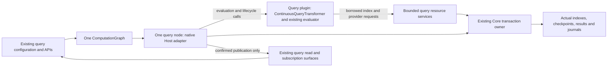

# Optional continuous-query plugin: design and implementation plan

**Status: implementation paused at the performance gate after the initial proof.**
**Date: 16 October 2026.**
**Code examined: Core `30c5df88a8047f904dd2f2abe2991465074a843a` and
Server `1906c439feca8f16bc5c9eafb3658187e3104808`.**

This is the design for review item 2 and the selected
[CW-43 query-plugin migration](computation-graph-remaining-work.md#cw-43-optional-native-query-plugin).
The initial investigation reached the requested complexity gate: the current
plugin interfaces cannot preserve all the query's storage and result-access
behavior. The user then approved designing the full dynamic plugin, including
those interface extensions, with **no implementation yet**.

The user subsequently authorized implementation and selected the policies in
section 10. These authorize migration of the named low-level Rust constructors,
not unrelated API changes, changed stored formats or acceptance of a performance
regression. The feasibility and complexity gates remain in force.

## 1. What this change must achieve

A host must be able to load continuous-query processing from a native plugin.
That plugin must wrap the existing `drasi-core` evaluator, not contain another
query engine or a reduced implementation of Cypher or GQL.

For ordinary users, query text, `queries:` configuration, source selections,
query-creation APIs, result reads and live subscriptions should remain unchanged.
The additional deployment requirement is having a compatible query plugin
available to the host.

Completion means all of the following:

- The continuous-query implementation and its plugin factory have their own
  component package, proposed as
  `components/computation-plugins/queries/continuous-query/`.
- The package builds as a real native dynamic library and advertises the
  **Query** role. It must not pretend to be a generic transformer to bypass
  missing query support.
- A host without the plugin can run graphs that do not contain queries.
  Requesting a query produces a clear missing-implementation error.
- A host with the plugin supports the existing query behavior, including
  persistent state, bootstrap, source transactions, scheduled work, recovery,
  shared storage, retained output and result subscriptions.
- Every query remains one processing component in the existing instance graph.
  Its existing helper components remain graph-owned. No `QueryInstance`,
  private query graph, additional scheduler or second evaluator is introduced.
- The ordinary factory path no longer supplies an unconditional built-in query
  implementation. No hidden fallback makes an absent plugin look present.

This work does not migrate all connectors, split child-process hosting,
reorganize the whole controller, implement distributed transactions, provide
safe hot unloading, or finish the wider shutdown-deadline work.

It also does not promise an evaluator-free `drasi-lib` dependency tree. Core
transaction and storage services still use `drasi-core`. Removing every such
dependency would be a different project.

## 2. What already exists, and what is missing

The processing shape is already suitable: `ContinuousQueryTransformer`
implements the graph's transformer operations. Native plugins already support
start, stop, transform, wakeups, continuations and delivery-completion callbacks.
Those mechanisms should be reused.

The missing pieces are the services around evaluation:

| Area | Present implementation | Missing at the plugin boundary |
|---|---|---|
| Factory selection | `FactoryRegistry::standard()` includes `ContinuousQueryFactory`. | Conditional query registration and verified query-plugin support. |
| Storage | The query receives a `ComputationIndexProvider` and actual index/transaction resources. | A bounded interface to those resources without sharing Rust objects. |
| Atomic work | `ComputationTransaction` and transaction groups coordinate state, checkpoints, output and participating journals. | Query evaluation inside that same host-owned operation. |
| Query reads | `QueryApi` and `QueryResultsCatalog` refer to concrete result-state objects. | A supported read boundary for a dynamically loaded query. |
| Bootstrap and progress | Query-owned providers and native provider/progress extensions already exist. | Safe consumption of those services by the query plugin. |
| Middleware | Query execution uses a host-supplied middleware registry. | Access to supported registered middleware without passing the registry itself. |
| Scheduling and replay | Query wakeups and retained-output delivery already exist. | Connecting these to the dynamic query's resource and read services. |

Both native metadata validation and Host construction currently reject the
Query role. Removing those checks alone would leave queries without their
required services.

There is an important reusable boundary in Core:
`QueryBuilder::try_build_evaluator()` creates the existing `QueryEvaluator`
without a transaction owner or background scheduler.
`QueryEvaluator::evaluate_changes()` explicitly expects its caller to own the
active index transaction. This makes the design below plausible without
replacing the evaluator. Its complete behavior across the new boundary still
needs the early proof in phase 1.

## 3. Proposed ownership model

Here, the **host** is Server or the application embedding DrasiLib. The
**transaction owner** is the existing Core object that controls the actual
storage operation, including commit, rollback and recovery-required state.



The Host adapter is the normal bridge between a dynamic component and its graph
node. It is not another query runtime. It must not start an independent
processing loop, keep a shadow graph, or own a second query evaluator.

### Responsibilities that belong in the query plugin

- Query language selection, parsing and binding to the existing function sets.
- The existing evaluator and query-specific interpretation of its results.
- Query-specific processing of ordinary changes, complete source transactions
  and due work, using the current algorithms.
- Production of prepared result changes and output metadata.
- The plugin-side adapters that let the evaluator use the supplied resources.

### Responsibilities that remain on the host side

- Graph membership, scheduling, lifecycle, generations and helper ownership.
- Actual index-provider construction, storage ownership and transaction groups.
- Commit/rollback authority, shared-journal participation and resource retirement.
- Existing ordinary query declarations, API configuration and error reporting.
- Public result access, subscription attachment and metrics, backed by the
  query's confirmed publication rather than a separately running projection.
- Plugin verification, installation, loading and process-lifetime library pins.

The extracted plugin must not depend on `drasi-lib` or `drasi-host-sdk`. The
native SDK and shared contracts must remain free of evaluator/parser
dependencies. The query component itself legitimately depends on the evaluator,
parsers and function libraries. Dependency checks must recognize that narrow
exception without weakening the checks for other native plugins.

## 4. Interfaces that must be designed and implemented

The names in this section describe responsibilities, not finalized Rust types,
entry-point names or numeric operation codes.

### 4.1 Query capability and factory negotiation

Add a separately versioned query extension using the existing native extension
pattern. Do not append fields to frozen ABI 1.0 tables or change the older
Source/Reaction ABI merely to add native query support.

The extension must describe the query factory's required services and expose
its query-specific operations. A Query factory is usable only after the Host
has validated both its metadata and the actual extension tables.

Preserve the existing transform, continuation, wakeup and control machinery.
Query capability is not the current `transactional` flag: that flag describes
a participant inside another component's transaction.

Factory description must remain configuration-aware: the existing query input
is either graph changes or complete source transactions, depending on
`execution.source_transactions`. The query extension must describe and validate
the actual configured ports without constructing indexes or starting work.
Fixed native metadata ports alone do not cover this requirement. Do not invent
a second user-facing query type to avoid it.

The existing `snapshot` capability describes replacing a sink's state; it must
not be reused to mean reading query results.

Construction must:

1. Verify the plugin and its compatible interfaces before creating query state.
2. Validate configuration, ports and required resource declarations.
3. Bind the actual instance, component, construction generation and resources.
4. Retain the required handles before use and revoke them during failed
   construction, cancellation, replacement or completed cleanup.
5. Reject missing capabilities explicitly, without substituting memory storage
   or returning empty query results.

Existing non-query plugins must continue to load unchanged. An old Host must
reject a new query plugin as unsupported, not misinterpret it as a transformer.
Process-lifetime library pinning remains unchanged.

### 4.2 Full query-index access, not just a key/value store

The current native transaction context is insufficient. Its element and
key/value operations do not cover the complete query index interfaces.

The resource contract must preserve these families:

| Resource family | Required behavior |
|---|---|
| Elements and joins | Element reads/writes/deletes, slot affinity, slot scans, inbound/outbound relationship scans and join setup. |
| Historical elements | As-of reads and version-range iteration for supported archive behavior. |
| Aggregation state | Result keys/owners, accumulator values, lazy sorted sets and exact value counts. |
| Result sequence | The existing sequence and source-change identity rules. |
| Scheduled work | Queue inspection and transactional insertion/removal/pop, preserving source provenance. |
| Recovery metadata | Checkpoints, configuration/reset/bootstrap markers and their current ownership rules. |
| Output | Retained output, live-result mutations, delivery progress and binding fingerprints. |
| Ownership | Actual provider identity, durability, cleanup and shared-transaction membership. |

Use producer-owned opaque handles and bounded serialized requests, as the
existing native transport does. A handle names one actual resource binding;
a matching path, arbitrary identifier or plugin-supplied durability claim is
not evidence of shared ownership.

Iteration needs explicit bounded cursors/pages. Cursors must retain their read
or operation scope, preserve read-your-writes, and close on cancellation.
Do not collect an unbounded index scan into one message.
The current native ceiling is 64 MiB per message, not a target allocation.
Larger logical reads need bounded chunking, not truncation or an increased
global ceiling.

Wire representations for result keys, accumulator values, joins and other
query-specific values must be explicitly versioned and round-trip tested.
Do not serialize Rust layouts or silently rely on evolving Core types having
the same representation in independently built libraries.

All required evaluator indexes must be supplied explicitly. The existing
builder's default in-memory indexes must not conceal a missing Host binding.
Errors from every index operation, including join setup, must reach the query
operation and prevent successful publication.

### 4.3 Keep commit authority in the existing owner

The proposed query plugin uses the transaction-free evaluator entry point.
It must not create a second `ComputationQuery` transaction owner around the
same resources.

The host-side query adapter uses the current `ComputationTransaction` and
transaction-group machinery. The plugin receives a borrowed resource scope for
one authorized operation; it does not receive a general begin/commit API.
The existing native transaction-participant contract remains unchanged.

For atomic input processing, the intended sequence is:

1. Validate input identity, schema, source-transaction bounds and recovery state.
2. Reserve required shared-output capacity before taking the storage gate.
3. Enter the existing Core transaction owner and bind the operation's resources.
4. Invoke plugin evaluation, serving its resource requests inside that operation.
5. Receive prepared result/output changes, not externally visible success.
6. Validate and stage checkpoints, retained output, live results and any actual
   shared-journal mutations through the existing owner.
7. Let that owner perform the one commit.
8. Make the committed result view available and release output through the
   graph's existing publication path.

The plugin must not publish a successful result merely because evaluation
returned. If commit fails or its outcome becomes uncertain, fence the affected
owner and query. If notification after a successful commit fails, do not roll
back or evaluate the input again: recover from committed state and retained
output after cleanup.

Preserve the explicitly supported non-atomic mode separately; do not silently
upgrade its guarantees or drop it. The existing Core public constructor
requires atomic resources, while its query-specific constructor also supports
the current non-atomic behavior. Reuse that behavior through a narrowly reviewed
adapter if necessary, not a fake no-op transaction implementation.

The first proof must establish that this arrangement preserves evaluator
initialization, shadow future-queue behavior, transaction-local reads and
failure recovery. If it requires another transaction coordinator or a rewrite
of evaluation, stop for a new decision.

### 4.4 Bootstrap, source progress, middleware and scheduled work

Keep providers and their actual resource ownership on the host side. The
existing native bootstrap/progress extensions are useful building blocks, but
they currently expose providers to the host; they do not by themselves supply
all the services a query plugin consumes.

The query service binding must support:

- Provider preparation, bounded snapshot polling, complete/empty snapshot
  markers, watermarks and successfully awaited provider cleanup.
- Bootstrap intent/completion and source progress in the actual query
  transaction, including retained-history failures and explicit resets.
- The supported host-registered middleware configuration and behavior inside
  the same processing operation. Passing `Arc<MiddlewareTypeRegistry>` across
  the boundary is not an option. Supporting only the built-in middleware while
  losing supported custom registrations is not completion.
- Committed scheduling inspection and the existing wakeup/continuation
  mechanisms. Waiting for due work must not hold a storage transaction open.

Keep ordinary event batches distinct from complete source transactions.
Preserve dedicated scheduled-notification handling; do not reserve a fake
source name or infer transaction completion from timing.

### 4.5 Result reads and subscription handover

Retain the public query APIs and the graph's existing query catalogue.
Introduce the smallest read adapter needed to stop those APIs depending on
the concrete in-process query state.

Required operations include configuration, readiness, result snapshot,
snapshot generation, retained-output reads, persistence information and
subscription attachment. Result reads must not acquire another evaluator.

A snapshot and its following live stream need one identifiable handover point:
the same constructed query generation, result sequence and producer identity.
Use the existing connected result outlet for live changes. Do not fabricate
subscriptions when an explicitly processing-only graph has no outlet.

Large snapshots and retained-output reads need bounded transfer without
truncation or inconsistent pages. Capture a stable read generation; either
complete it or report that it became unavailable. A quiet queue or an earlier
readiness check is not proof that a later snapshot is coherent.

Reuse the existing committed result view rather than running a second
asynchronous result-cache updater. Read facades must be non-owning with respect
to storage: holding an API object cannot keep a retired provider alive.
Replacement must invalidate old readers even if the component name is reused.

Preserve current result/error shapes, profiling metadata and the distinction
between query result sequence and replay transport sequence.

### 4.6 Lifecycle, replay and failure

The graph continues to own accepted operations and cleanup. Cancelling a
caller's wait is not permission to abandon accepted work.

Preserve ordinary query helper groups and all four ordinary stop paths.
Graceful stop drains submitted work; force is explicit and can require storage
recovery. The recent timeout/retry bookkeeping fix remains protected.

Retained query output must replay before new input, without reevaluation.
Only actual graph delivery completion may advance the saved delivery position.
Validate destination membership and real shared-storage ownership before
accepting changes to delivery bindings.

On panic, cancellation, failed rollback or uncertain commit, retain cleanup
ownership and expose the typed failure. Do not reuse an evaluator whose mutable
state may no longer match storage. All service handles, cursors and pending
operations must be revoked or joined before a replacement uses the resources.

The existing limitation on interrupting arbitrary synchronous native code
remains. Dynamic loading does not add a security sandbox.

## 5. Configuration and host integration

### Ordinary queries

Keep existing configuration, for example:

```yaml
queries:
  - id: high-temperature
    query: MATCH (s:Sensor) WHERE s.temperature > 75 RETURN s
    queryLanguage: Cypher
    sources:
      - sourceId: sensors
    autoStart: true
```

The storage, bootstrap, timer and result-service bindings are framework work,
not new fields the user must add to every query.

Keep `Query::cypher`, `Query::gql`, ordinary builder query configuration,
`core.add_query(...)` and the existing REST DTOs/endpoints. Plugin availability
must be checked through the host's registered factories, not a process-global
default or a second query manager.

### Server and embedded hosts

The recommended distribution default is to ship and load the query plugin with
the standard Server. Minimal/custom hosts can omit it. This is a proposed
packaging policy, not an implemented setting.

Reuse existing plugin directories, declared dependencies, lockfiles,
verification and loading. Do not add a second installation mechanism or silently
turn on network downloads; `autoInstallPlugins` is currently an explicit choice.
Normal verification must also apply to the bundled query plugin.

Wire factories before ordinary query construction on every supported path:

- Single-instance and multi-instance configuration startup.
- Programmatic Server/DrasiLib construction.
- Managed configuration initialization and restoration.
- REST instance creation, later query creation and replacement.
- Normal child-instance hosts, which load their own selected plugins.
- Direct native graphs and the supported embedded examples.

This needs actual wiring changes: Server currently adds ordinary queries while
building DrasiLib, but its explicit native-graph registration can occur after
that build. Registering the plugin only for the latter path would be incomplete.

With the plugin absent, non-query hosts must start normally. A requested query
must fail clearly without touching its saved processing state or silently
falling back to a built-in implementation. Preserve inspectable failed
declarations and the existing managed-definition acceptance rules.

## 6. Identity, saved state and compatibility

Preserve the logical implementation name `drasi/continuous-query`, its supported
configuration and port schemas, query IDs and output streams. Keep configuration
version 1 only if its meaning actually remains compatible.

In particular, retain ordinary queries' `lib-query/<hex query ID>` storage and
producer identities. Do not rename checkpoint keys, alter result ordering,
reset source positions or lose unconfirmed output as a side effect of moving
the code.

Plugin provenance is a separate issue. Current native metadata requires a
factory's plugin identity to match the loaded plugin; old saved native
definitions can refer to the built-in factory without that identity. A real
plugin cannot honestly present itself as the old built-in implementation.

The selected policy is to reject saved native definitions that still reference
the built-in query factory and provide guidance for the user to update those
references manually. Do not add an automatic or opt-in migration mechanism.
Keep ordinary query YAML unchanged and do not rewrite managed definitions or
processing state. A user-submitted replacement still goes through the existing
configuration acceptance and resource-retirement checks.

Rollback must be proved with the actual saved data and supported artifact pair.
A backup alone is not a recovery strategy. Do not promise that an older binary
can read new definitions or state until that case has been checked.

### Approved low-level Rust constructor migration

The ordinary APIs above can keep their signatures. The low-level constructors
are different: `ContinuousQueryTransformer::new*` and
`TransactionTransformer::query/from_query` currently construct or accept a
concrete built-in Rust object without receiving a plugin registry.

They cannot transparently select a dynamically loaded plugin with those
signatures and no host context. A global registry or hidden evaluator fallback
would conceal the problem rather than solve it.

The user selected a documented source migration for low-level native callers to
factory-based construction with an explicit host. Update the in-tree callers
and document the source changes for external callers. Do not add a linked
compatibility option or hidden built-in fallback.

Keep these APIs intact during the early interface proof so they remain a usable
baseline. Their approved migration happens with the replacement implementation,
not as a premature deletion that leaves no working path.

## 7. Implementation sequence

Each phase is a reviewable increment in the existing checkouts. No new sessions,
branches or worktrees are required. Commits and pushes require explicit
authorization. Implementation has been authorized; the gates below still apply.

### Phase 0: approve the boundaries and capture the baseline

Record the decisions in section 10. Inventory the direct constructor users,
factory-registration paths, index methods and saved-definition forms.
Capture exact expected outputs, state identities and current performance using
the committed baseline and matching binaries.

**Exit:** agreed public compatibility and saved-definition policies,
configuration defaults, matched baseline workloads and a complete
supported-behavior checklist. Measure the prototype before setting numerical
regression allowances, and stop for approval before accepting any regression.

### Phase 1: prove the difficult boundary before extracting the component

Build a test-only real dynamic-library slice using the current evaluator,
borrowed host indexes and the existing transaction owner. Do not enable
production Query loading merely to make a demonstration work.

Prove memory operation, then actual RocksDB commit/rollback and one query sharing
its transaction with a real QoS journal. Include read-your-writes, relationship
scans, aggregation, final results for a complete source transaction, one
scheduled update, cancellation and a confirmed result snapshot.

Measure resource-call counts, serialization cost, throughput, latency and memory
against the same direct-component workload. This is a feasibility proof, not a
claim that the entire plugin works.

**Exit:** the ownership model works with real storage and matched performance
measurements are available. Stop for the user's decision before accepting any
regression. Do not invent a new bulk query API to conceal per-index call costs.

### Phase 2: complete the versioned interfaces

Implement the agreed query capability, bounded resource requests, cursors,
provider bindings and query-read adapter. Keep Core/SDK dependency checks narrow
and preserve existing native plugin layouts.

Cover malformed metadata, absent capabilities, incorrect scope, expired handles,
oversized/deep values, cancellation and errors at every operation boundary.

**Exit:** every required index/provider/read operation has a defined contract
and focused tests; old non-query libraries still load.

### Phase 3: extract the existing query implementation

Move query-specific construction/evaluation/result preparation into the component
package, reusing the same Core evaluator. Move only genuinely shared descriptors
and wire contracts into the lightweight shared layer.

Keep graph lifecycle, the actual transaction owner, ordinary API configuration
and non-owning reads on the host side as specified above. Reuse or extract
existing helpers rather than copying recovery algorithms.

During development, the existing path is the comparison baseline. It must not
become a hidden runtime fallback in the final plugin-enabled path.

**Exit:** the real library runs both languages, all supported storage/publication
profiles, bootstrap, middleware, scheduled work and retained-output replay.

### Phase 4: connect every query API and host construction path

Supply the loaded query factory before ordinary assembly. Connect native query
read capabilities to the existing graph catalogue, snapshots, metrics and live
subscriptions. Preserve helper-group lifecycle and failed-query declarations.

Exercise ordinary and explicit-native queries together in the same instance,
with shared sources and unrelated sibling queries.

**Exit:** the unchanged public configuration/API workflows work with the plugin,
and meaningful query-free/missing-plugin cases work without it.

### Phase 5: qualify migration and public compatibility

Implement rejection and actionable manual-update guidance for old built-in
factory references, together with the selected low-level Rust API migration.
Use fixtures created by the baseline binary, not only fresh fixtures created
by the new code. No automatic saved-definition migration is authorized.

Include pending output, scheduled work, custom provider bindings, ordinary and
native identities, managed configuration, rejected replacement and storage
retirement. Verify any rollback path separately.

**Exit:** no silent reset, lost output, duplicate acceptance, falsely released
resource or unapproved public API break.

### Phase 6: packaging, full qualification and cutover

Integrate the query package with native discovery/build/publish/install tooling,
the standard Server distribution and example image builds. Add a query-specific
dependency allowance only where the evaluator is genuinely required.

Remove unconditional built-in query registration only after the new path passes
its compatibility and recovery gates. Ensure compatibility wrappers cannot
secretly recreate that fallback.

Rebuild the actual dynamic libraries and hosts. Run the protected suites and
the real GPU Lab and Move-a-Wall checks using Podman, retaining original demo
data and cleaning up only owned test projects.

Update query-specific developer, maintainer, configuration, architecture,
comparison and example documentation. Do not claim that this closes unrelated
CW items or all native connector migration.

**Exit:** complete present/absent-plugin behavior and current-binary evidence for
every promised query surface, with remaining limitations stated explicitly.

## 8. Required qualification

Existing tests are reusable foundations, not proof of the new dynamic boundary.
Tests that instantiate the Rust component directly must be complemented by
tests that load the actual independently built library.

| Area | Required result |
|---|---|
| Plugin optionality | Query-free operation without the library; clear failure for requested queries; success with the verified library; no hidden built-in fallback. |
| Existing query behavior | Exact Cypher/GQL results, joins, aggregation, deletion history, archive queries and supported middleware. |
| Source transactions | One complete committed configuration becomes visible; no intermediate transaction states; existing bounds and rejection behavior preserved. |
| Storage and recovery | Supported memory/persistent/custom providers, read-your-writes, rollback, uncertain commit, reset, actual process death and reopen. |
| Shared output | State, checkpoints, query output and actual shared-journal mutations commit together; false domain/membership claims rejected. |
| Bootstrap and scheduling | Complete and empty snapshots, delayed/failed bootstrap, retained-history errors, due work after restart and no progress inferred from quiet intervals. |
| Result access | Coherent snapshots, stable paged reads, retained history, exact snapshot/live handover and old-generation reader rejection. |
| Delivery | Pending output replays without evaluation; exact acceptance/delivery positions; binding changes preserve obligations. |
| Lifecycle | Current-thread and multi-thread runtimes, independent queries, all ordinary stop APIs, graceful timeout/retry, explicit force and retained cleanup ownership. |
| Compatibility | Baseline-produced state and configuration; approved low-level Rust APIs; public error and result shapes; existing non-query native libraries. |
| Server and examples | Startup, REST creation/read/update/removal, managed restoration, child hosts, GPU Lab full acceptance and Move-a-Wall API/SSE/browser behavior. |
| Performance and limits | Matched baseline/prototype measurements, explicit approval before accepting any regression, bounded buffers/cursors, fair control progress and no new overhead imposed on non-query components. |

Relevant existing starting points include:

- `lib/src/computation/v1/query_hosting_tests.rs` and
  `lib/src/computation/runtime/group_lifecycle_tests.rs`.
- `lib/tests/computation_query_{configuration,faults,recovery,responsiveness}.rs`,
  `memory_query_provider_isolation.rs` and the shared-storage/delivery tests.
- `lib-integration-tests/tests/computation_transaction_query.rs`,
  `query_output_atomicity.rs`, `query_output_wipe.rs` and
  `runtime_flavor_tests.rs`.
- Native Host lifecycle, admission, transaction, bootstrap, consumer and network
  tests, extended with actual query-plugin coverage.
- Server `tests/native_computation_test.rs`, configuration tests and both demo
  acceptance paths.

Use the existing formatting, Clippy, dependency and protected-test inventory
commands. Do not suppress a failing assertion, add sleeps as completion proof,
or count an unrun/ignored case as a pass.

## 9. Complexity and stop rules

The complete change is **high complexity**. The largest risks are preserving
the full index contract, shared transaction ownership, exact query-read behavior
and acceptable cost across the library boundary. The existing evaluator entry
point and native operation machinery reduce the work; they do not eliminate
those risks.

Stop and obtain direction if any phase requires:

- Another evaluator, graph, scheduler or independently maintained result model.
- A second transaction coordinator, fake shared-storage identity, commit access
  for ordinary participants, or passing Rust owners across the library boundary.
- Excluding a supported provider, middleware path, transaction mode, snapshot,
  subscription or recovery behavior to make the plugin appear complete.
- Unapproved public API changes or a general saved-state migration framework.
- Rewriting processing data or resetting queries to change plugin provenance.
- An incompatible change to existing native tables or the older plugin ABI.
- New operator-facing resource wiring for ordinary `queries:` entries.
- A measured regression requiring acceptance, or unbounded transfer/storage work
  to avoid implementing correct iteration.

No calendar estimate or performance acceptance percentage is asserted before
the feasibility proof and agreed budgets.

## 10. Approved implementation policies

**Implementation approved:** implement the full dynamic-plugin plan, keeping
evaluation in the plugin and actual transaction authority in the host. Preserve
ordinary query configuration and the standard Server's query-capable default.

**Low-level Rust APIs:** migrate callers to explicit factory-based creation.
The user approved the necessary source changes to the named constructors.
Do not introduce a linked compatibility option.

**Saved native definitions:** reject old built-in factory references and require
manual updates. Do not silently rewrite definitions or processing data, and do
not build a new migration mechanism.

**Performance:** measure the actual prototype against the existing path, then
stop for approval before accepting any regression. No numerical allowance has
been preapproved.

Phase 1 must validate the critical boundary before the larger extraction and
cutover. The authorization does not waive the complexity stop rules or authorize
commits, pushes, new branches or additional sessions.

## Initial implementation checkpoint: performance gate

The initial real-library proof evaluates projection and aggregation queries
using the existing evaluator and host-owned index operations. Its in-memory
results and row identities match direct evaluation on both Tokio runtime
flavors. The value-wire helper reuses the existing lossless query-value
representation; it does not use presentation JSON for grouping keys.

The optimized measurement ran five interleaved repetitions per workload and
execution path, with 2,000 measured inputs per repetition after warmup.
Both paths include the same input/result encoding. These are isolated
evaluator/resource-boundary measurements, not complete Server or application
throughput results.

| Workload | Direct average time per input | Dynamic average time per input | Time ratio |
|---|---|---|---|
| Projection | 13.209 microseconds | 128.448 microseconds | 9.724 times |
| Sum aggregation | 15.016 microseconds | 254.150 microseconds | 16.925 times |

Each time column is the median of the five per-run averages. The dynamic path
made seven resource calls per projection input and fifteen per aggregation
input. This is a material regression, not an accepted performance result.

Implementation is paused for the user's decision before expanding the proof or
changing production query routing. The full RocksDB/shared-journal, bootstrap,
scheduling, recovery, query API and deployment qualification remains undone.
Production Query plugin loading is still disabled and the existing built-in
query path remains in use.

The test-only entry point is deliberately not a production Query factory.
It currently has explicit bounds and excludes virtual-join setup; those limits
must not be presented as completed plugin support.

Exact measurements and release-binary hashes are retained in the session
artifacts `query-plugin-resource-proof-release.log` and
`query-plugin-resource-proof-summary.json`. All implementation changes remain
local and uncommitted.

## Code references

- [Current query implementation and factory](../src/computation/v1/query.rs)
- [Current standard factory registration](../src/computation/v1/factories.rs)
- [Existing transaction-free evaluator](../../core/src/query/evaluator.rs)
- [Existing evaluator builder](../../core/src/query/query_builder.rs)
- [Current query/transaction adapter](../../core/src/computation/query_adapter.rs)
- [Core transaction ownership](../../core/src/computation/operation.rs)
- [Actual index bundles and providers](../../core/src/computation/indexes.rs)
- [Shared transaction groups](../../core/src/computation/transaction_group.rs)
- [Native plugin operations](../../components/computation-plugin-sdk/src/component.rs)
- [Native metadata restrictions](../../components/computation-plugin-sdk/src/metadata.rs)
- [Existing participant state access](../../components/computation-plugin-sdk/src/transaction.rs)
- [Frozen native ABI and extension modules](../../components/computation-plugin-abi/src/lib.rs)
- [Host factory construction](../../components/host-sdk/src/computation/factory.rs)
- [Host transaction request handling](../../components/host-sdk/src/computation/transaction.rs)
- [Query API and result catalogue](../src/computation/v1/query_api.rs)
- [Result catalogue implementation](../src/computation/v1/query_catalog.rs)
- [Delivery and replay state](../src/computation/v1/query_delivery.rs)
- [Existing direct Rust constructors](../src/computation/v1/transaction_transformer.rs)
- [Server startup](../../../drasi-server/src/server.rs)
- [Server native factory assembly](../../../drasi-server/src/computation.rs)
- [Server query endpoints](../../../drasi-server/src/api/v1/handlers/query_handlers.rs)
- [Child-host assembly](../../components/instance-host/src/host.rs)
