# The drasi-lib developer guide

**drasi-lib is an embedded data-processing runtime for Rust applications.**
You connect **components** into a **computation graph** to ingest data, transform it,
maintain **state**, and perform actions. A graph can use custom processing logic,
**continuous queries** that maintain answers as data changes, or both. An extensible
library of **native plugins** connects the graph to external systems, handling
change detection or ingestion and notification delivery for supported
integrations. Your application controls the graph's configuration, resources,
and lifecycle.

This developer guide teaches you how to use drasi-lib to design, build, extend,
and operate data-processing applications. It covers the library's programming
model and capabilities, from data ingestion and component composition to
continuous queries, state, recovery, configuration, lifecycle management, and
deployment. The chapters build on one another, taking you from your first
working application to advanced processing and operational concerns.

You will apply these concepts by building **Stockroom**, a running example
application that keeps a live view of products that need replenishment.
Stockroom evolves throughout the guide: it starts as a complete in-memory
program, gains processing and operational controls, and learns to save its state
and finish work after a restart. The same techniques
apply to monitoring, data integration, event-driven automation, and other
embedded applications.

You should be comfortable with Rust, Cargo, and `async`/`await`. No prior knowledge
of Drasi, graph databases, or stream-processing frameworks is assumed.

Follow the main Stockroom path first; sections marked **Alternative** or
**Host profile** are choices, not additional steps required by that path.

| Running variant | What it teaches | What survives reopening |
|---|---|---|
| File lessons, beginning with `cargo run --locked` | Changing facts, queries, views and composition | The input file; processing is rebuilt |
| `--features persistence -- --state ...` in Part III | SQLite capture, query storage, retained alerts and saved reorders | Processing and consumer completion in the same state directory |
| `--features management -- managed ...` in Part IV | Saved definitions, factories and revisioned configuration | Configuration; this variant rebuilds its memory query from the file |

Read Parts I and II in order to build and operate an application. Continue with
Part III when it must survive a restart, and Part IV when it needs saved
configuration, reusable plugins, or process isolation. Each chapter explains
what its example adds, gives you something to run or change, and ends with a
summary. The appendices and linked API documentation are references, not
prerequisites.

Saving an application's configuration and saving the data it has processed are
different tasks. You can learn them separately; the recovery chapters explain
how to combine them.

## Contents

**Part I - Build a working application**

1. [Run your first application](#1-run-your-first-application)
2. [Model changing data](#2-model-changing-data)
3. [Write continuous queries](#3-write-continuous-queries)
4. [Maintain an application view](#4-maintain-an-application-view)

**Part II - Compose and operate**

5. [Compose a processing pipeline](#5-compose-a-processing-pipeline)
6. [Control flow, ordering, and memory](#6-control-flow-ordering-and-memory)
7. [Own the runtime lifecycle](#7-own-the-runtime-lifecycle)
8. [Observe and diagnose the application](#8-observe-and-diagnose-the-application)

**Part III - Make processing recoverable**

9. [Make query state durable](#9-make-query-state-durable)
10. [Join snapshots to live input](#10-join-snapshots-to-live-input)
11. [Retain input and replay output](#11-retain-input-and-replay-output)
12. [Complete business work](#12-complete-business-work)
13. [Preserve transactions](#13-preserve-transactions)
14. [Capstone: a recoverable Stockroom](#14-capstone-a-recoverable-stockroom)

**Part IV - Build a deployable application**

15. [Turn components into reusable factories](#15-turn-components-into-reusable-factories)
16. [Save and restore an application](#16-save-and-restore-an-application)
17. [Change a running application](#17-change-a-running-application)
18. [Package and isolate extensions](#18-package-and-isolate-extensions)

[Appendix A: Vocabulary](#appendix-a-vocabulary) |
[Appendix B: API and example navigation](#appendix-b-api-and-example-navigation) |
[Appendix C: Query-language essentials](#appendix-c-query-language-essentials)

## Part I - Build a working application

Many applications need a current picture of their data and a way to respond
when something important changes. drasi-lib lets you maintain state such as
running totals, current inventory, or devices needing attention, and connect
changes in that state to notifications and actions.

An extensible library of source and sink plugins connects that processing to
external systems. Sources automate the system-specific work of detecting or
receiving changes; sinks deliver results and notifications to external
destinations. For supported integrations, you configure and compose plugins
rather than develop custom change-capture and delivery code.

Continuous queries are a key use case. You declare the answer to maintain, and
the runtime reports additions, updates, and removals as input changes. A query
can join data from different external systems, maintain aggregates, and detect
time-based conditions without application code repeatedly fetching whole
datasets and comparing snapshots. You can also compose processing components
without a query, enabling live views, monitoring, data integration, and
event-driven workflows.

### 1. Run your first application

Keep Stockroom running while you edit an inventory file. You will lower a
product's quantity, see it enter the low-stock view, and restock it to make
the alert disappear. You control the input by editing and saving that file.

#### Copy and run the starter

Install Rust through rustup. Start in the root of the `drasi-core` checkout
containing this book. The examples use that checkout's APIs, rather than an
arbitrary crates.io release. To obtain this development edition:

```sh
git clone --branch agentofreality-parallel-computation-graph-recovery https://github.com/drasi-project/drasi-core.git drasi-core
cd drasi-core
```

If you already have this edition locally, use that checkout instead.
Keep the book and its `stockroom` folder together with the matching library
revision; a different branch or a registry package is not a substitute.

The book does not install a different library version for you. Build native libraries
from the same revision as the host application; shared-library interfaces and
record encodings must agree. These development APIs are not a promise of
compatibility with earlier binaries or saved formats.

The final directory name **`drasi-core`** is significant: the supplied Cargo
paths expect it beside your application. The [starter project](stockroom)
includes its manifest, lockfile, pinned toolchain, source, and data files.
From the root of that checkout, copy it to a fresh sibling directory:

```sh
cp -R lib/docs/developer-guide/stockroom ../stockroom
cd ../stockroom
cargo run --locked
```

**Platform status:** these PowerShell commands have not been verified end to end
on Windows. The local walkthroughs have been exercised on macOS; the repository's
book-checking job runs on Linux. Qualify your chosen platform and backend before
depending on them in a deployment.

In Windows PowerShell, use the same clone command, then:

```powershell
Copy-Item -Recurse lib/docs/developer-guide/stockroom ../stockroom
Set-Location ../stockroom
cargo run --locked
```

Use a destination that does not already exist. Keep `stockroom` and `drasi-core`
beside each other so the supplied dependency paths remain valid.

Your copy contains these lesson files:

```text
stockroom/
  Cargo.toml
  Cargo.lock
  rust-toolchain.toml
  rustfmt.toml
  inventory.json
  catalog.json
  encoded-inventory.json
  http-insert.json
  http-restock.json
  destination.json
  webhook_receiver.py
  src/
    main.rs
    cli.rs
    network.rs
    persistence.rs
    managed.rs
  tests/
    cli.rs
```

Begin with `inventory.json` and `src/main.rs`. The native-integration and recovery lessons use `src/network.rs`,
`src/persistence.rs`, and `src/managed.rs`. `src/cli.rs` owns terminal signals,
concise error reporting, and key generation. Cargo features select the optional
integration and storage dependencies.

#### Build prerequisites

The included `rust-toolchain.toml` selects the compiler. Rust needs the platform's
linker; the native-storage lessons also compile C/C++ code and use libclang:

| Platform | Initial build | SQLite/RocksDB lessons |
|---|---|---|
| macOS | Xcode Command Line Tools | The tools' C/C++ compiler and libclang normally suffice |
| Linux | C/C++ build tools, such as `build-essential` | Clang and libclang development libraries when absent |
| Windows | Visual Studio C++ Build Tools and a Windows SDK | A discoverable libclang; these instructions remain unqualified |

For example, Debian/Ubuntu's later native-build packages are
`build-essential clang libclang-dev`. If bindgen cannot locate libclang,
set `LIBCLANG_PATH` to the directory containing its shared library.
The starter and its selected normalization middleware do not require libjq.
libjq is needed only when you explicitly choose the jq middleware build.
The selected lessons do not require CMake.

Both the starter and repository root track `Cargo.lock`. Commands use `--locked`
so dependency resolution cannot silently change underneath a lesson. Use the
lockfile and source from the same revision. A lockfile mismatch is a setup
problem to resolve, rather than a reason to remove `--locked`.

The first build can take a little time. Once the application is ready, it prints:

```text
Starting Stockroom for low-stock. Press Ctrl-C to stop.
Ready. Watching inventory.json for saved changes.
```

Leave this terminal running. The first line always precedes result output;
an initial aggregate can appear before the final readiness line.

Stockroom sends diagnostic warnings to stderr and result lines to stdout.
For more diagnostics use `RUST_LOG=info cargo run --locked`; in PowerShell set
`$env:RUST_LOG = "info"` first. Stockroom sets up this logging itself before it
builds its instance; [Chapter 8](#own-the-applications-logging) explains how.

#### Make your first change

Open **your copied project's** `inventory.json` in an editor. It starts with:

```json
[
  {
    "sku": "bolts",
    "quantity": 8,
    "minimum": 5,
    "warehouse": "west"
  }
]
```

Quantity 8 is above minimum 5, so there is no low-stock result to print.
Change `quantity` from **8 to 3** and save the file. The running terminal shows:

```text
low-stock: [{"quantity":3,"sku":"bolts"}]
```

You changed the input, and the maintained answer changed with it. You did not
restart the application or ask it to run the query again.

Make the following edits one at a time, saving and observing the result after
each one:

| Edit `inventory.json` and save | Terminal output |
|---|---|
| Change quantity from 3 to 2 | `low-stock: [{"quantity":2,"sku":"bolts"}]` |
| Restock by changing quantity to 8 | `low-stock: []` |
| Lower quantity to 3 again | `low-stock: [{"quantity":3,"sku":"bolts"}]` |
| Remove the product object, leaving `[]` | `low-stock: []` |

Restocking removes a result even though the product still exists. Removing the
product also retracts its result, but for a different reason. Both changes
matter to a consumer maintaining the current low-stock view.

Try changing a quantity between two values above the minimum. There is no new
low-stock output: the input changed, but the answer did not. Saving the same
inventory again likewise produces no notification.

The file source checks for a valid snapshot every 250 milliseconds and emits
changes only for products that were added, modified, or removed. Invalid JSON
or a read error produces a warning and leaves the last valid inventory intact;
fix and save the file to continue. It samples the file's current state, so edits
between reads can be coalesced. It is not a durable change log.

Restore the original product with quantity 8 before continuing. Press **Ctrl-C**
when you want to stop; the application awaits runtime shutdown.

#### Understand the query

Here is the query:

```cypher
MATCH (p:Product)
WHERE p.quantity < p.minimum
RETURN p.sku AS sku, p.quantity AS quantity
```

`MATCH` finds product nodes. `WHERE` decides which products belong in the answer.
`RETURN` determines the fields visible to the application. Quantity changes
are input; membership and value changes in this answer are output.

#### Follow one change through the program

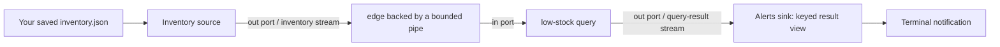

The runtime owns `Inventory`, the query, and `Alerts`. `Inventory` compares
valid file snapshots and turns product changes into graph messages. The query
updates its answer, and `Alerts` maintains and prints the resulting view.
Bounded graph pipes connect the components.

A **source** produces changes; a **query** or **transformer** processes them;
a **sink** consumes them. **Ports** name a component's inputs and outputs,
**edges** connect ports, and **pipes** implement transport and buffering.
A **stream** identifies one output's ordered emissions. Each component also
returns a **description** of what it guarantees, such as whether its progress
survives a restart, so the graph can check connections before data flows
([Chapter 5](#declare-what-a-component-guarantees)).
The sink is where the application reacts to changes. In the native API its
role is Sink; "reacting" describes what it does, not a separate plugin interface.

#### Build components and give them names

Stockroom implements a small native source and sink directly in Rust.
"Native" means that they implement the computation graph's processing traits;
they need not be separately loaded libraries. Each `DrasiLib` owns one graph.

Stockroom deliberately selects the supported Rust-linked query reference in
its source examples; it is not an implicit runtime fallback. Ordinary
Source/Query/Reaction applications explicitly register the native query plugin
with `with_query_factory`, `register_query_factory` or pipeline `query_factory`.
The [query plugin guide](../../../components/computation-plugins/transformers/query/README.md)
shows both static plugin registration and dynamic loading. Both paths reuse
the same Core evaluator and shared query implementation.

Use an existing native component when it supports your integration. The small
file source makes the first exercise self-contained; Chapter 5 replaces it
with a packaged HTTP source and adds an SSE notification sink without writing
network handlers.

The [complete source](stockroom/src/main.rs) and its adjacent modules form the
running companion for all four parts of the book. Source excerpts are checked
against that code; illustrative alternatives are separately marked and
compile-checked with their surrounding types. Its
memory-backed processing state and small file source are starting points:
storage providers and source/sink plugins support persistent state and other
external systems.

Each component has two separate values: a **name** for people and an **ID** for
the runtime. A `ComponentName`, such as `inventory`, is unique within the
instance and can be changed. A `ComponentId` is an immutable UUID. Connections
and stored state refer to IDs, so renaming a component does not disconnect it.

Normally you let Drasi assign IDs when accepting factory declarations; Chapter 15
shows that path. The first Stockroom intentionally constructs its objects
directly so you can follow their code without first learning factories. Its
small `component_id` helper supplies fixed example UUIDs, and its builder
explicitly permits external IDs. Those numeric values are arbitrary example
identities, not a way to turn names into UUIDs. Keep them unchanged when reopening
the persistent lesson's state. The saved-configuration lesson instead uses
library-assigned IDs and preserves them in its configuration store.

The first lesson explicitly constructs one linked `ContinuousQueryTransformer` for the low-stock
query. The companion's `low_stock_query` function creates it and obtains its
result handle:

<!-- excerpt: stockroom/src/main.rs#query-construction -->
```rust
let query = ContinuousQueryTransformer::new(
    ContinuousQueryDefinition {
        graph_id: GRAPH.into(),
        id: component_id(757),
        query: LOW_STOCK.into(),
        language: ComputationQueryLanguage::Cypher,
        output_stream: StreamId::try_new("low-stock/out")?,
        outbox_capacity: NonZeroUsize::new(128).expect("positive capacity"),
    },
    Arc::new(InMemoryComputationProvider),
)
.await?;
let results = query.results();
```

The imports, query text, and `GRAPH` are at the top of the companion.
`GRAPH` is `ComponentBatch::GRAPH_ID`, the public identity for the graph inside
`DrasiLib`. The application's instance ID is a separate scope. The memory
provider supplies the state needed to evaluate the query.
`outbox_capacity` bounds retained query emissions for result replay; it is not the
capacity of the connecting pipe. Chapter 6 separates the buffers and Part III
adds durable delivery tracking.
`query.results()` supplies the read handle used to await readiness and inspect
the maintained answer. Obtain it before moving the query into the component
batch. Later lessons introduce configurable construction and query settings.

`ComponentBatch` groups components and their connections. After constructing
the source and sink, the program adds them with the query:

<!-- illustration: component-members -->
```rust
let mut batch = ComponentBatch::builder()
    .source(ComponentName::try_new("inventory")?, Box::new(inventory))
    .transformer(ComponentName::try_new("low-stock")?, Box::new(query))
    .sink(ComponentName::try_new("alerts")?, Box::new(alerts));
```

An output has a named port and a stream identity. The companion's `endpoint`
helper builds a component/port pair. For example:

<!-- illustration: input-edge -->
```rust
batch = batch
    .bind_stream(
        endpoint(component_id(758), "out")?,
        StreamId::try_new("inventory/out")?,
    )
    .connect(
        EdgeDefinition::new(
            endpoint(component_id(758), "out")?,
            endpoint(component_id(757), "in")?,
        ),
        Box::new(BoundedPipeConfig { capacity: 8 }),
    );
```

The query output is bound and connected to the `in` port of the component named
`alerts` in the same way.
Declaring a port and connecting it are separate operations. Ports on known
components must have the declared names and compatible schemas; missing
dependencies can remain waiting for later connections.
`DrasiLib::start()` accepts those waits, so successful instance startup alone
does not establish that every component is processing. Stockroom bounds its
required components' readiness waits and reports the specific missing
connection when a deadline expires.

If a requested component fails to start, `start()` returns an error with a
`PartialStartError` cause.
Independent components may already be running, so inspect their observations and
call `stop()` or `shutdown()` before retrying. `is_running()` indicates that the
instance still owns started work; it does not certify every component's readiness.

Finally, the application gives the batch to its runtime owner:

<!-- excerpt: stockroom/src/main.rs#instance-build -->
```rust
let core = DrasiLib::builder()
    .with_allow_external_component_ids(true)
    .with_component_logging(component_logging()?)
    .with_id("stockroom")
    .with_components(batch.build()?)
    .build()
    .await?;
```

`DrasiLib` owns a **ComputationGraph**: the connected processing components,
their resources, and their lifecycle. Starting the instance drives the file
source, query, and sink together.

`with_component_logging` connects the instance to the logging that Stockroom
installed at the start of `main`, which writes to stderr because stdout carries
results. Without it, `build()` installs its own logger, and it fails when the
application already has one. [Chapter 8](#own-the-applications-logging) covers
logging.

#### Start, wait, and finish

Construction and execution are separate. Start the instance, then wait for
the components the application needs:

<!-- illustration: readiness -->
```rust
core.start().await?;
cli::wait_started(&core, "alerts", Duration::from_secs(5)).await?;
tokio::time::timeout(Duration::from_secs(5), results.wait_ready())
    .await
    .context("wait for query 'low-stock' readiness")??;
```

The complete program waits for all three components. Its `cli::wait_started`
helper includes the component name and observed dependency waits in timeout
errors. The two `?` operators on the query wait unwrap different failures:
an application deadline and a failed runtime operation.

Processing continues while `main` waits for Ctrl-C. Each query output updates
the sink's view; inputs that do not change the answer produce no output.
Saving the file is not a synchronous promise that processing has finished:
the terminal notification shows the view after the sink handles a result.

The application also observes component failures. If a required component fails
after startup, Stockroom reports it, awaits cleanup, and exits unsuccessfully;
this behavior is independent of `RUST_LOG`. A sink that is retrying a delivery
has not failed: Stockroom prints a notice and keeps running (Chapter 5).
On Ctrl-C, the program awaits `core.shutdown()` and reports any cleanup failure
before returning. This pattern matters even in a small program: Rust cannot
await runtime cleanup in `Drop`.

**Summary.** You have a complete embedded application with a live query, explicit
data connections, bounded queues, and awaited startup and shutdown. Next, make
the meaning of its input precise; query correctness begins with data identity.

**Try it.** Add a second product with a different SKU and quantity below its
minimum. Restock only the first product and predict which row remains.

### 2. Model changing data

Stockroom needs to distinguish a product changing from a different product
arriving. In this chapter, the input becomes a property graph with stable
identities, explicit update semantics, and source time.

#### Describe entities, not query results

A property graph contains **nodes** and **relationships**. Both have identity,
labels, properties, and an effective time. A node might represent a product or
warehouse; a relationship might say that a product is stored in a warehouse.
The source describes these facts. It should not pre-filter products using the
low-stock condition: a restock must still reach the query so it can remove the
old result.

The file source parses each entry as a `Product`. Its `element` method maps
the product fields to the graph, including the optional payload used by the
normalization lesson:

<!-- excerpt: stockroom/src/main.rs#product-element -->
```rust
impl Product {
    fn element(&self, time: u64) -> Element {
        let mut properties = serde_json::json!({
            "sku": self.sku,
            "quantity": self.quantity,
            "minimum": self.minimum,
            "warehouse": self.warehouse,
        });
        if let Some(payload) = &self.payload {
            properties["payload"] = serde_json::json!(payload);
        }
        Element::Node {
            metadata: metadata(&self.sku, time),
            properties: ElementPropertyMap::from(properties),
        }
    }
}
```

When a SKU first appears, the source emits `SourceChange::Insert`; when the
same SKU's full file image changes, it emits `SourceChange::Replace`. Removing a SKU
from the file produces `SourceChange::Delete`. Its metadata helper is:

<!-- excerpt: stockroom/src/main.rs#element-metadata -->
```rust
fn metadata(sku: &str, time: u64) -> ElementMetadata {
    ElementMetadata {
        reference: ElementReference::new("inventory", sku),
        labels: vec!["Product".into()].into(),
        effective_from: time,
    }
}
```

The element's identity is the pair **dataset namespace, element ID**, held in
`ElementReference`'s `namespace` and `element_id` fields. The namespace names a
set of data, not the UUID or editable name of a running component.
`inventory/bolts` and `catalog/bolts` are different elements. The `"Product"`
label describes the element's type; it does not identify an individual
product. A mutable property such as a display name is usually a poor element ID.
Renaming the `inventory` component leaves the `"inventory"` dataset namespace
unchanged. Conversely, changing that namespace makes the data describe different
elements even if the same component publishes it.

Use source-qualified references for relationship endpoints too.
`Element::Relation` contains `in_node` and `out_node` references as well as its
own metadata and properties. Changing a referenced node does not create a new
relationship identity. When the relationship itself has a business identity or
properties, publish it as an element rather than inferring it from equal values.

#### Distinguish inserts, patches, and deletions

The file source has a complete product image for each update. Other sources
may know only the changed fields. For a quantity-only update, they can send:

<!-- illustration: quantity-patch -->
```rust
fn quantity_update(sku: &str, quantity: i64, time: u64) -> SourceChange {
    SourceChange::Update {
        element: Element::Node {
            metadata: metadata(sku, time),
            properties: ElementPropertyMap::from(serde_json::json!({"quantity": quantity})),
        },
        removed_properties: std::collections::BTreeSet::new(),
    }
}
```

`removed_properties` names properties to delete from the element. It is empty
here because the update only sets `quantity`. An empty list is the usual case, but
it is explicit: removing a property is different from setting it to null.

The query retains `sku` and `minimum`. At the graph-change boundary:

| Change | Meaning |
|---|---|
| `Insert` | A full-row upsert. Repeating the same complete element is not another contribution to an aggregate. |
| `Update` | Merge the supplied properties into the element. Omitted properties remain. A supplied null stores null; a name in `removed_properties` removes that property. |
| `Replace` | Replace the element with the supplied full image: properties it omits are dropped, as one change rather than a delete followed by an insert. |
| `Delete` | Remove the element identified by its metadata. No property payload is required. |

The file is authoritative for each complete product row. `Replace` therefore
removes an optional `payload` when it disappears from the next saved image,
without changing the product's identity. A merge update with no explicit removals
would incorrectly retain that old property. The snapshot differ is:

<!-- excerpt: stockroom/src/main.rs#inventory-changes -->
```rust
fn inventory_changes<T: FileRow>(
    previous: &BTreeMap<String, T>,
    current: &BTreeMap<String, T>,
    time: u64,
) -> VecDeque<SourceChange> {
    let mut changes = VecDeque::new();
    for (sku, product) in current {
        match previous.get(sku) {
            None => changes.push_back(SourceChange::Insert {
                element: product.element(time),
            }),
            Some(old) if old != product => changes.push_back(SourceChange::Replace {
                element: product.element(time),
            }),
            Some(_) => {}
        }
    }
    for sku in previous.keys().filter(|sku| !current.contains_key(*sku)) {
        changes.push_back(SourceChange::Delete {
            metadata: row_metadata::<T>(sku, time),
        });
    }
    changes
}
```

Updates and deletions must use the original element reference. Generating a
new ID for each update creates different elements instead of updating one.
A live node and relationship cannot share one element identity; that collision
fails before modifying state.

Properties can contain scalars, lists, objects, temporal values, and the other
rich values Drasi represents (unsigned integers, durations, ranges and
references, for example). `ElementValue` and `ElementPropertyMap` preserve the
typed model, and the graph-change records carry those values without reducing
them to JSON. A string that looks like a date is still a string unless you
construct or parse a temporal value.

#### Follow an element into an envelope

An **element** is a domain fact: a Product node or a relationship. A **record**
is its schema-defined identity and encoded image. A **change operation** says
what to do with a record. A **change set** groups operations under one schema,
and a **ChangeEnvelope** carries that set with stream metadata and context:

```text
SourceChange / Element
  -> GraphChangeCodec
  -> ChangeEnvelope
       system metadata: emitting stream, sequence, optional timestamp, ordering
       change set: schema + identity + ordered operations
         operation: kind + record/reference + available images
       annotations and lineage: attribution and derivation context
```

The operation and the image answer different questions. `RecordImage::Full`
claims a complete image; `Patch` carries changes to known fields; `Partial`
contains only available information and does not claim completeness. Null is a
value, not a removal. A consumer must understand the image it receives.

| Domain change | Shared operation | How to apply it |
|---|---|---|
| `SourceChange::Insert` | Added with a full `after` image | Upsert the complete element |
| `SourceChange::Update` | Updated in Patch mode | Set supplied properties and remove explicitly named properties; keep other known fields |
| `SourceChange::Replace` | Updated in Replace mode with full `after` | Replace the old image, dropping omitted properties |
| `SourceChange::Delete` | Deleted with a validated record reference | Remove by identity; a before image is optional |
| Query result update | Updated in Replace mode with full result-node `after` | Replace that row in a keyed view; Chapter 4 uses this guarantee |

Applying a patch without a saved base can construct an element from the known
properties. That does not turn partial knowledge into a producer-authoritative
full image. Whether those fields suffice for a query or consumer is a separate
question.

The standard graph encoding preserves rich values, but enum tags can normalize:
canonical nonnegative integers use `Unsigned`, while negative integers use
`Signed`. This preserves numeric meaning; it is not a promise to preserve the
input language's integer variant. JSON remains a presentation boundary.

Several operations in one envelope are processed together by the receiving
contract, but collection alone is not proof of a database commit. A complete
source transaction also carries validated completeness metadata; Part III
introduces that separate promise.

<a id="keep-the-layers-of-identity-separate"></a>

#### Keep identity scopes separate

Start with three everyday distinctions:

| Value | Example | Meaning |
|---|---|---|
| Component name | `inventory` | Editable name used by application code and operators |
| Component ID | A `ComponentId` UUID | Stable identity used by graph connections and processing state |
| Element reference | `inventory/bolts` | A particular product in a dataset |

`ComponentName::try_new` validates a nonempty, case-sensitive name without
whitespace or control characters. It does not register a component.
`ComponentId::try_new` parses a UUID; it never hashes a name or looks one up.
A UUID-looking name is still a name. The typed APIs make the choice explicit:

<!-- illustration: component-selection -->
```rust
let name = ComponentName::try_new("low-stock")?;
let handle = core.component_by_name(&name)?;
let id = handle.id().clone();
let before = core.get_query_results_by_name(&name).await?;

core.rename_component_by_id(&id, ComponentName::try_new("needs-reorder")?)
    .await?;
let after = core.get_query_results_by_id(&id).await?;
```

The two reads can see different data if input changes between them, but they
address the same query. Names are unique across component kinds in an instance.
Renaming does not change connections, saved state, or an already obtained handle.
If another component later takes the old name, a new name lookup finds that
new component; an ID lookup still identifies the original.

Name-based operations resolve once to an ID when the operation is admitted.
A later rename or name reuse does not redirect an operation already in flight.
Use `*_by_name(&ComponentName)` for a current human-facing selection and
`*_by_id(&ComponentId)` when retaining a specific component's identity.
Handles additionally identify a construction generation, so replacing an
object can invalidate an old handle without changing the component's UUID.

Configuration uses the same explicit distinction:

<!-- illustration: component-references -->
```rust
use drasi_lib::config::ComponentReference;

fn references(id: ComponentId) -> anyhow::Result<()> {
    let by_name = ComponentReference::by_name(ComponentName::try_new("inventory")?);
    let by_id = ComponentReference::by_id(id);
    assert_eq!(serde_json::to_value(by_name)?, serde_json::json!("inventory"));
    assert!(serde_json::to_value(by_id)?.get("id").is_some());
    Ok(())
}
```

A JSON string selects a name; `{"id":"<uuid>"}` selects an ID. A port name such
as `out`, an output alias such as `low-stock`, and a `StreamId` are separate
values. Renaming a component does not rewrite those strings. This is why
Stockroom's data namespace and notification label can remain unchanged after
a component rename.

**Try it.** Run
`cargo test --locked component_identity_and_lifecycle -- --nocapture`.
The test renames a component, reuses its former name for a second component,
and proves that the original ID and handle still select the original object.
Chapter 7 explains the lifecycle trace printed by the same test.

Use those identities for everyday application code. The additional counters
used to resume delivery belong in
[Chapter 11](#distinguish-input-output-and-replay-positions), where you will have
a persistent application to apply them to.

#### Supply meaningful time

`effective_from` is the source's effective time in **milliseconds**. It is not
an output sequence or the time a downstream consumer happened to receive the
change. Stockroom timestamps changes when it reads a valid file snapshot, using
Unix epoch milliseconds. That is an observation time: the file source does not
claim to know the exact instant a person made each edit. A connector with an
upstream change timestamp should preserve that timestamp instead.

The evaluator reports and skips mutations that are strictly older than the
element's accepted source time. Equal-time changes follow admitted order.
Deleting an absent element still records the deletion's effective time, so an older
insertion cannot resurrect it after recovery. Those recorded times are not
automatically expired without an appropriate retention contract.

Do not use a receive timestamp to disguise unavailable source time. If an
upstream system cannot provide ordering or time guarantees, that limitation
belongs in the source's contract.

#### Publish through a native source

The graph calls the source's `next` method. Stockroom drains the changes from
its latest valid file comparison, then waits for another poll. Unchanged files
produce no changes. `FileSource<T>` shares this polling behavior between product
and warehouse files; `T::SOURCE` supplies `inventory` or `catalog`. Its publication
branch is:

<!-- excerpt: stockroom/src/main.rs#source-publication -->
```rust
if let Some(change) = self.pending.pop_front() {
    self.sequence = self.sequence.checked_add(1).context("sequence exhausted")?;
    return Ok(Some(OutputEnvelope {
        execution_context: Default::default(),
        port: PortId::try_new("out")?,
        envelope: GraphChangeCodec::encode_change(
            change,
            StreamId::try_new(format!("{}/out", T::SOURCE))?,
            self.sequence,
            None,
        )?,
    }));
}
```

`GraphChangeCodec` translates the typed graph change into a `ChangeEnvelope`.
The source does not write its own JSON wire format. `None` in the codec call
means that this example supplies no envelope-level source timestamp; the
element still has `effective_from`. A source-time merger needs that additional
timestamp, as Chapter 6 explains.

`execution_context` carries tracing metadata alongside the envelope. It is
never stored and never changes processing results. A source that receives
trace headers, such as an HTTP request's `traceparent`, builds it with
`ExecutionContext::from_w3c_headers`; the file source has no incoming trace, so
it uses the default. Transformers pass their input's context on to their
outputs, as `Audit` does in Chapter 5.
[Chapter 8](#enable-observability-in-your-application) shows how to export traces.

Returning `Ok(None)` means **finite exhaustion**, not "no data right now."
A listening source should wait while idle. A lost database connection should
surface an error or an explicit recovery operation, not masquerade as normal
end of input.

`Inventory` also implements `ComputationComponent`. Its descriptor declares
one output, `out`, with the `GraphChangeCodec` schema, and its description
says that its progress lives in memory; Chapter 5 explains descriptions. Its
`initialize` hook validates
and loads the file once for that object. A later stop/start preserves any changes still awaiting
emission. The graph owns the polling work, so the source has no independently
spawned watcher to stop or join. Chapter 7 shows all of its lifecycle hooks.

**Summary.** Stable source-qualified identity makes updates and deletions
meaningful. Explicit images and timestamps prevent accidental replacement,
stale resurrection, and invented ordering. The source now supplies facts the
query can maintain rather than approximations of the desired answer.

### 3. Write continuous queries

The first query finds individual low-stock products. Extend that answer to
warehouse totals, joined catalog data, and conditions that depend on time.
These are changes to the maintained calculation, not new polling loops.

#### Think in changing answer sets

For each accepted input, Drasi updates the query's graph and emits differences
in its answer. A change can add a result, change its values, remove it, or
produce no visible difference. One input can affect several result rows.

The low-stock query illustrates three cases:

| Input | Answer |
|---|---|
| Product quantity becomes 3, below minimum 5 | Add the product |
| Quantity becomes 2 | Change the existing answer row |
| Quantity becomes 8 | Remove the row, while retaining the product in query state |

An empty answer is a valid state. It does not mean the query is stopped.
Conversely, a running component is not evidence that an expected business
condition occurred.

`ComputationQueryLanguage::Cypher` and `ComputationQueryLanguage::Gql` select
the parser; both use the continuous evaluator. GQL is the graph query language,
not GraphQL. Use the syntax and functions supported by Drasi rather than
assuming compatibility with every feature of another graph database.

#### Aggregate by warehouse

The companion's products also have a `warehouse` property. Stop Stockroom with
Ctrl-C, restore the original one-product file with quantity 8, and restart your
copied project in aggregation mode:

```sh
cargo run --locked -- totals
```

This mode uses a query named `stock-by-warehouse`:

```cypher
MATCH (p:Product)
RETURN p.warehouse AS warehouse, sum(p.quantity) AS total
```

The non-aggregate projection groups the answer by warehouse. Its initial total
comes from the current file:

```text
stock-by-warehouse: [{"total":8.0,"warehouse":"west"}]
```

Change quantity to 3 and save. The total becomes 3.0. Change it to 2, then 8,
saving each time: both edits change the total, even though 8 did not belong in
the low-stock query's answer. Remove the product, leaving `[]`, and the
maintained total becomes 0.0.

When one product changes, the corresponding aggregate changes. It is not an
independent event to add to a counter in application code; the output describes
the new maintained total. This sum produces a floating-point value and a
default zero for the emptied group. Deleting the last product therefore does
not have the same output shape as deleting a low-stock match.

For grouped applications, include keys that identify the business group in
the projection. A terminal `sum` can keep a default-valued row after its last
contribution disappears, as this example does. To remove zero-total groups,
filter **after aggregation**:

```cypher
MATCH (p:Product)
WITH p.warehouse AS warehouse, sum(p.quantity) AS total
WHERE total > 0
RETURN warehouse, total
```

Keep the original `west` product at quantity 8. In `totals` mode, add a second
product with a distinct SKU, warehouse `east`, and quantity 3; save, then remove
only that second product and save again. The `east` group remains at 0.0 and
`west` remains at 8.0.

Repeat those edits with `cargo run --locked -- totals-filtered`. The `east`
row disappears, leaving only `west` at 8.0. The whole result becomes `[]` only
when every group fails the post-aggregation filter. This contrast separates
an empty group from an empty answer.
Optional matches can retain a result when a related record is absent; decide
how the application should represent those null values.

For a small ungrouped example, `MATCH (p:Product) RETURN sum(p.quantity) AS total`
illustrates the default-row boundary:

| Change | Maintained terminal sum |
|---|---|
| First product has quantity 0 | A visible row with total 0 is established |
| Delete that zero-valued product | The row stays 0; there is no visible 0-to-0 notification |
| Add a product with quantity 10 | The same maintained total becomes 10 |
| Delete it | The total returns to its default 0 rather than deleting the row |

An intermediate aggregate can have a different row lifecycle:
`MATCH (p:Product) WITH sum(p.quantity) AS total RETURN total` adds a zero row for
a first zero contributor and removes that row when the last contributor leaves.
Do not convert aggregate default flags into unconditional deletion instructions;
they describe contribution/default state, not a universal rule for every aggregate.

Continuous answers are not an ordered page. `ORDER BY`, `LIMIT`, and `SKIP`
are not supported. Sort and page a maintained application view when presenting
results to a user.

#### Join another source

Run the join lesson in your Stockroom directory:

```sh
cargo run --locked -- join
```

Set the product quantity to 3 and save `inventory.json`. The second source
reads the supplied `catalog.json`, which starts with
`{"code":"west","name":"West warehouse"}` inside an array. The result is:

```text
warehouse-alerts: [{"quantity":3,"sku":"bolts","warehouse":"West warehouse"}]
```

Change the warehouse name to `"West depot"` in `catalog.json` and save it.
The result changes even though you did not touch inventory. Remove the catalog
entry and the inner join retracts the row. Restore both files afterward.

Here `inventory` supplies products with `warehouse`, and `catalog`
supplies warehouses with `code` and `name`. Connect both sources to the
query's `in` port. They contribute elements to one query graph; they are not
two previously computed result sets.

If the sources do not publish relationship elements, declare a synthetic join:

<!-- illustration: synthetic-join -->
```rust
use drasi_lib::config::{QueryJoinConfig, QueryJoinKeyConfig};

let execution = QueryExecutionSettings {
    joins: vec![QueryJoinConfig {
        id: "STORED_IN".into(),
        keys: vec![
            QueryJoinKeyConfig {
                label: "Product".into(),
                property: "warehouse".into(),
            },
            QueryJoinKeyConfig {
                label: "Warehouse".into(),
                property: "code".into(),
            },
        ],
    }],
    ..Default::default()
};
```

The corresponding query is:

```cypher
MATCH (p:Product)-[:STORED_IN]->(w:Warehouse)
WHERE p.quantity < p.minimum
RETURN p.sku AS sku, p.quantity AS quantity, w.name AS warehouse
```

Construct it with `ContinuousQueryTransformer::new_configured`, passing the
definition, index provider, `QueryOptions::default()`, these execution settings,
and `None` for the optional middleware registry. The join is maintained when
either side changes.

The join declaration describes a relationship between equal key values. It does
not make keys unique or repair inconsistent identifiers. Prefer explicit
relationship records when the relationship has its own properties or business
lifecycle.

Adding a source name to configuration alone does not connect it to a native
query. Data routing still belongs to the graph. Later, `QueryExecutionSettings`
also selects source-specific middleware; those settings do not create data
edges.

#### Ask questions about time

Stockroom can wait until a product has remained below minimum for five seconds:

```sh
cargo run --locked -- sustained
```

Begin with quantity 8, lower it to 3, and save. Leave the file alone: after
five seconds the application emits a low-stock result. Restocking retracts
it. Try restocking before five seconds elapse; that short-lived shortage
does not become a sustained alert.

```cypher
MATCH (p:Product)
WHERE drasi.trueFor(p.quantity < p.minimum, duration({ seconds: 5 }))
RETURN p.sku AS sku
```

The query schedules reevaluation. It does not need another inventory update
or a periodic application task to wake it.

**Optional time-function catalogue.** The `trueFor` exercise above is complete.
For other conditions, `drasi.trueLater`
schedules a future condition; `drasi.trueNowOrLater` permits an immediate match
when appropriate; `drasi.trueUntil` supports expiry. These are distinct
policies, not alternative names for one timer. The
[heartbeat query examples](../../../shared-tests/src/use_cases/sensor_heartbeat/queries.rs)
show their time arguments in context.

**Recovery preview (Chapters 9 and 13).** Scheduled work shares the query's state
and publication boundary. In a durable
query, removing a due notification, reevaluating it, and saving its output
belong to the transaction. A scheduling hint is not itself a completed timer,
and it must not advance a real source's checkpoint.

#### Compare with previous and historical values

These optional function families are not required by the Stockroom progression.
`drasi.previousValue` and `drasi.previousDistinctValue` compare with preceding
values; `drasi.slidingWindow` supports rolling calculations. Historical element
versions are a different facility:

```cypher
MATCH (p:Product)
WITH p, drasi.getVersionByTimestamp(p, p.observed_at - 1) AS previous
RETURN p.sku AS sku, previous.quantity AS previous_quantity
```

Here `observed_at` is a supplied integer millisecond property.
`drasi.getVersionsByTimeRange` retrieves versions over an interval.
Version access requires an archive-enabled index provider; Chapter 9 shows
where to select that capability.

An archive contains versions Drasi received. It does not import the source
database's earlier history, and an in-memory archive does not survive process
loss. Saving historical versions and saving future scheduled work are separate
requirements.

For supported clauses, value types, and function families, use
[Appendix C](#appendix-c-query-language-essentials). The
[query examples](../../../shared-tests/src/use_cases) provide executable
cases for more involved expressions. Keep parser
choice, query text, joins, and middleware together when versioning an
application: all can change the meaning of saved query state.

**Summary.** Queries describe maintained answers over connected source data.
Joins, aggregation, and temporal conditions belong in that calculation; sorting
a display and performing business effects belong outside it. The next chapter
turns answer differences into a correct application view.

### 4. Maintain an application view

The application must distinguish two equal-looking rows, retract results that
stop matching, and avoid confusing a current snapshot with a live subscription.
Stockroom's in-memory result view is enough for a disposable display, provided
those rules are explicit.

#### Choose the reader for the job

Choose a starting-state and completion contract before choosing an API:

| Need | Interface | Starting state and failure policy |
|---|---|---|
| Inspect current rows once | `QueryResults::snapshot` or output-catalogue `snapshot()` | A point read, not a subscription |
| Observe future query changes | Native callback/channel, or `QueryResultsCatalog` plus connected outlet | No automatic current-state load; volatile channel/broadcast gaps need an explicit policy |
| Display current contents and then follow changes | Output catalogue `snapshot_and_follow` | One coordinated snapshot/live cut, bounded volatile lease; rebuild on gap/expiry |
| Restore a durable materialized view | `QueryReplayTransformer` plus `CheckpointedSink` and persisted view/progress | Strict replay or explicitly authorized snapshot replacement; Chapter 11 |
| Finish local durable work or a remote business effect | `DeliveryRunner` and the appropriate handler | Per-operation completion; remote effects additionally need destination idempotency/confirmation; Chapter 12 |

The first Stockroom starts its sink before sending file data, so its live-only
view sees the initial inserts. A viewer attached later cannot assume that a
subscription replays the current answer.

#### Use the native application callback

For in-process reactions, the library already supplies an application sink.
Run:

```sh
cargo run --locked --features callbacks -- callback
```

Lower a product's quantity and save. The callback prints
`callback: [{"quantity":3,"sku":"bolts"}]`. It receives the native input envelope,
updates the view, and completes directly in the graph's owned task.

`ResultView` is the small keyed result cache explained
[later in this chapter](#stockroom-result-view). Here the callback uses its
`apply` and `rows` methods to update and display that cache:

<!-- excerpt: stockroom/src/main.rs#application-callback -->
```rust
fn application_callback(view: watch::Sender<ResultView>) -> anyhow::Result<Box<dyn EnvelopeSink>> {
    use drasi_reaction_application::NativeApplicationReaction;
    let sink = NativeApplicationReaction::callback(
        component_id(759),
        QueryChangeCodec::schema().descriptor().clone(),
        move |input: InputEnvelope| {
            let view = view.clone();
            async move {
                let mut next = view.borrow().clone();
                next.apply(&input.envelope)
                    .map_err(DeliveryFailure::permanent)?;
                let message = format!("callback: {}\n", serde_json::to_string(&next.rows())?);
                let mut output = tokio::io::stdout();
                output.write_all(message.as_bytes()).await?;
                output.flush().await?;
                view.send_replace(next);
                Ok(())
            }
        },
    )?;
    Ok(Box::new(sink))
}
```

`NativeApplicationReaction::callback` reports Handled after the callback future
finishes. If the future returns an error, the graph treats it as a delivery
failure. `apply` fails only when the change itself cannot be read, and calling
again with the same change would fail the same way, so the callback marks that
error permanent with `DeliveryFailure::permanent`. Any other error, such as a
failed write to standard output, is transient: the graph keeps the change and
calls the callback again with the same envelope after a short delay. A callback
can therefore run more than once for one change. This one is safe to repeat
because each attempt starts from the published view and publishes only after
printing. Chapter 5 explains [delivery failures](#handle-delivery-failures) in
full.

`NativeApplicationReaction::channel` instead returns a bounded
`mpsc::Receiver<InputEnvelope>` for an application-owned consumer and reports
Accepted when the message enters that channel. Choose the channel when your
application needs to control its receiving loop; choose a callback for a direct
asynchronous action. Both are native interfaces despite the package's
`Reaction` name.

The channel alternative uses the same declared schema:

<!-- illustration: application-channel -->
```rust
use drasi_reaction_application::NativeApplicationReaction;

let (sink, mut receiver) = NativeApplicationReaction::channel(
    component_id(759),
    QueryChangeCodec::schema().descriptor().clone(),
    NonZeroUsize::new(64).expect("positive capacity"),
)?;
```

Connect `sink.input()` to the query output and add `sink` to the batch.
Your receiving loop awaits `receiver.recv()` and owns completion of any work
performed after receiving the envelope.

#### Act on each change

Run `cargo run --locked -- reorders` and repeat the quantity changes.
This mode maintains a local set of pending reorders as well as printing the
view. Entering low stock creates a reorder, a changed quantity revises it,
and leaving low stock cancels it:

```text
reorder created: {"quantity":3,"sku":"bolts"}
reorder revised: {"quantity":3,"sku":"bolts"} -> {"quantity":2,"sku":"bolts"}
reorder cancelled: {"quantity":2,"sku":"bolts"}
```

`reorder_messages` handles `ChangeOperation::Added`, `Updated`, and `Deleted`.
For an update, it decodes both `before` and `after`; for a deletion, it uses
the before image or the row retained under the same identity. That is how
the application can cancel an order even when the deleted input carries no
properties.

These are **local, volatile reorders**, not purchases sent to a supplier.
Chapter 12 adds durable completion and explains the additional destination
contract needed for remote effects.

#### Receive native query output

The query emits ordinary graph-change records: each result row is a node in the
query's own output namespace, not one of the source graph's elements. Its
properties are the `RETURN` aliases. `QueryChangeCodec::schema()` is the same
schema as `GraphChangeCodec::schema()`, so a sink that handles graph changes can
receive it. Stockroom's custom `Alerts` sink demonstrates the underlying trait:

<!-- excerpt: stockroom/src/main.rs#alert-sink -->
```rust
#[async_trait]
impl EnvelopeSink for Alerts {
    fn completion(&self) -> SinkCompletion {
        SinkCompletion::Handled
    }

    async fn handle(&mut self, input: InputEnvelope) -> anyhow::Result<()> {
        // A change this sink cannot read fails the same way on every retry,
        // so it is permanent. Output errors stay transient and are retried.
        let (view, message) = self.render(&input).map_err(DeliveryFailure::permanent)?;
        if self.display {
            self.output.write_all(message.as_bytes()).await?;
            self.output.flush().await?;
        }
        self.view.send_replace(view);
        Ok(())
    }
}
```

`handle` renders the change into the keyed view described below and a display
message, writes and flushes the message, and then publishes the new view. The
[complete implementation](stockroom/src/main.rs) of `render` also contains the
reorder and audit branches introduced in Chapter 5. Rendering fails only when
the change cannot be read, so `handle` marks that failure permanent; a failed
write stays transient and is retried, as in the callback above.

`Handled` means this sink finished its declared work: updating and printing a
volatile view. It does not mean the rows were saved to disk or a replenishment
order was placed. A sink that merely queues work for another worker must report
`Accepted` instead. Completion is about the promised work, not just successful
receipt.

The sink publishes the completed view through a Tokio watch channel so other
application code can observe its current state. Watch notifications can coalesce;
they are not a retained stream of every result change. Terminal writes use
`AsyncWriteExt` and are flushed before the new view is published.

#### Key the view by record identity

Two result rows can have identical values. Do not use JSON equality as their
identity, and do not derive identity from a field that may change. A result row
is a node whose `RecordId` combines the query output's dataset namespace with an
opaque row identity the query supplies. The identity bytes are not a column and
should not be parsed; treat the `RecordId` as the key. Two rows with equal values
therefore stay separate rows, and the namespace keeps two outputs from colliding.

The companion stores:

<a id="stockroom-result-view"></a>

<!-- excerpt: stockroom/src/main.rs#view-shape -->
```rust
#[derive(Clone, Default)]
struct ResultView(HashMap<RecordId, serde_json::Value>);
```

Its update method is:

Query result additions contain full result-node images. Query updates use
**Replace**, with a full new row and an optional before image; deletions carry
the row identity. Therefore this query-specific view can assign `after` directly.
It is **not** a general materializer for source patches: those must merge fields
and apply explicit property removals as described in Chapter 2.

<!-- excerpt: stockroom/src/main.rs#view-methods -->
```rust
impl ResultView {
    fn apply(&mut self, envelope: &ChangeEnvelope) -> anyhow::Result<()> {
        ensure!(
            !QueryChangeCodec::is_snapshot(envelope)
                && !QueryChangeCodec::is_progress_only(envelope),
            "this live-only view requires a coordinated recovery owner for resets"
        );
        // Publish the batch only after every row has decoded successfully.
        let mut next = self.0.clone();
        for operation in envelope.changes().operations() {
            match operation {
                ChangeOperation::Added { after, .. } | ChangeOperation::Updated { after, .. } => {
                    let row = QueryChangeCodec::decode_row(after)?;
                    next.insert(
                        after.identity().clone(),
                        QueryChangeCodec::row_values_to_json(&row.values),
                    );
                }
                ChangeOperation::Deleted { identity, .. } => {
                    next.remove(identity.identity());
                }
            }
        }
        self.0 = next;
        Ok(())
    }

    fn rows(&self) -> Vec<serde_json::Value> {
        let mut rows = self.0.values().cloned().collect::<Vec<_>>();
        rows.sort_by_cached_key(serde_json::Value::to_string);
        rows
    }
}
```

The temporary map prevents a decode failure midway through an envelope from
publishing a partial batch. It is suitable for this small view. A large view
should use an appropriate transactional or staged update mechanism rather than
copying its entire state for every change.

The delete path needs only identity. The update path uses the new row rather
than applying an assumed numeric increment. Aggregation updates additionally
carry row-kind information (`QueryRowKind::Aggregation`, with grouping keys and
default-value flags) in the envelope's query projection, available from
`QueryChangeCodec::projection`; it is not stored in the node. Preserve it when
implementing logic that depends on how the aggregate changed.

`decode_row` yields a `DecodedQueryRow`: typed `VariableValue` values keyed by
`RETURN` alias, the node's dataset and label, and its opaque identity. Some
identities can also expose an evaluator signature; application code should retain
the complete `RecordId`, not parse or reconstruct it from that implementation detail.
`DecodedQueryRow` does not contain a query
ID or row kind; those belong to the envelope. `row_values_to_json` is useful for
a JSON presentation. Keep the typed values when business logic depends on
temporal types, element references, or distinctions a JSON projection cannot
adequately represent.

#### Read current results without rerunning the query

Keep `query.results()` before transferring the query into the batch. After
readiness:

<!-- illustration: query-snapshot -->
```rust
let snapshot = results.snapshot()?;
let sequence = snapshot.as_of_sequence;
for record in snapshot.rows.values() {
    let row = QueryChangeCodec::decode_row(record)?;
    println!("{sequence}: {}", QueryChangeCodec::row_values_to_json(&row.values));
}
```

`QueryResultSnapshot` contains the output's `projector`, keyed records, a
logical output position, and a generation. The projector names the output scope
even when the snapshot is empty. `core.get_query_results_by_name(&ComponentName::try_new("low-stock")?).await?` is a convenient JSON
read for an inspection endpoint. Neither call executes the query again, and
neither establishes a live subscription.

The query's logical sequence counts output emissions, not products, source
events, or individual operations. Native replay can use a fresh transport
sequence while preserving the logical query sequence. Use
`QueryChangeCodec::query_sequence`, `query_generation`, and `metadata` instead
of inferring those identities from unrelated fields.

#### Consume live output asynchronously

Run `cargo run --locked -- stream`. Save a low-stock edit and see a logical
query sequence and operation count. The application is reading query envelopes
asynchronously rather than polling snapshots.

Construction registers the existing query with a catalog and connects an
outlet:

<!-- illustration: live-catalog -->
```rust
let catalog = QueryResultsCatalog::new(GRAPH)?;
let mut events = catalog.subscribe();
let query = query.with_result_catalog(&catalog)?;
let outlet = QueryResultsOutlet::new(
    component_id(761),
    catalog,
);
```

Add `outlet` as a sink and connect the query's output to `live-results/in`.
Subscribe before starting the graph, then await `events.recv()` in the
application's event loop. Each returned `ChangeEnvelope` supports the same
before/after decoding used for reorders. A reader handle alone does not publish
these events; the connected outlet does.

The catalog's subscription is a Tokio broadcast receiver that holds up to 256
envelopes. It applies no backpressure: a reader that falls further behind
receives `RecvError::Lagged` and has missed changes. Stockroom's stream lesson
then stops with `live result stream closed or lagged; rebuild the view`; a
long-lived viewer rebuilds through a coordinated path such as the one below.
A broadcast receiver is not durable consumer progress.

<a id="read-any-output-through-the-same-interface"></a>

#### Open a current-plus-live viewer

The output catalogue resolves source, query and transformer outputs by component
and port. Each output independently exposes its own snapshot, replay and
snapshot/live capabilities. Graph-change format alone does not promise a snapshot.

For a disposable viewer, capture the current contents and subsequent stream
together rather than reading a snapshot and then subscribing:

<!-- illustration: output-snapshot-follow -->
```rust
async fn open_live_view(
    drasi: &drasi_lib::DrasiLib,
) -> anyhow::Result<OutputSnapshotFollow> {
    let output = drasi.output_catalogue()?.resolve(&OutputEndpoint::new(
        component_id(757),
        PortId::try_new("out")?,
    ))?;
    Ok(output.snapshot_and_follow(OutputFollowLimits {
        max_envelopes: NonZeroUsize::new(8).expect("positive capacity"),
        max_bytes: NonZeroUsize::new(1024 * 1024).expect("positive bytes"),
        lifetime: std::time::Duration::from_secs(30),
    }).await?)
}
```

Call `into_parts()` for the snapshot and follow handle. Install the snapshot's
full records and cursor as one view, then apply envelopes from
`follow.next().await`. If the snapshot covers logical output 42, the captured
follow stream accounts for changes arriving during the read without applying
covered output twice. The cursor uses the output's logical sequence and epoch,
not its transport sequence.

This is a bounded **volatile lease**, not persisted consumer acknowledgement.
A lease is a temporary reservation for this reader's retained output.
A cursor includes an **epoch**, which identifies one output history, as well as
a position within it. A new history cannot be continued using an old cursor.
A query allows at most 64 leases, each bounded by its configured outbox capacity,
16 MiB and five minutes. Choose limits within those ceilings. Buffer overflow
returns `Gap`; the non-renewing deadline returns `LeaseExpired`. Neither silently
continues with missing changes or backpressures query processing. Drop the old
handle and capture a new snapshot when the viewer's rebuild policy allows it.
Dropping releases retention; cancelling a pending `next` does not consume its event.

`snapshot()` is a point read. `replay_after(cursor)` reads retained history.
`catch_up()` combines snapshot/history with gap and epoch checks but does not
subscribe to later changes. An unsupported capability fails explicitly. None
requires the producer to use a shared row store. Persistent views and business
effects need the different contracts in Chapters 11–12.

#### Test your application

Run tests from **your copied Stockroom project**:

```sh
cargo test --locked
cargo test --locked joined_view_changes
cargo test --locked native_outlet_stream
```

The tests write to temporary inventory/catalog files and use `watch::wait_for`
with a deadline to await the expected answer. They test additions, updates,
retractions, equal-valued rows with different identities, malformed input,
and both current-thread and multi-threaded executors.
The sustained-condition test waits for a real scheduled result without another
input edit. A fixed sleep followed by an unchecked read is not an equivalent test.

For applications using builder-declared queries, the optional `test-support`
feature provides `QueryTestControl`. Attach it before building with
`with_query_test_control_by_name`, passing a `ComponentName` and a cloned
control. After the query has applied your input, `advance_to` moves its test
clock forward and waits for due work and immediate output delivery;
`wake` checks due work without advancing time. This avoids wall-clock sleeps
in timer tests. It does not wait for downstream business effects or change
logical event timestamps. Stockroom's direct-constructor lesson uses the real
clock; the [query-control tests](../../tests/query_test_control.rs) show the
builder-based alternative.

**Try it.** Add a regression test for two low-stock products, then restock one.
Assert both the remaining view and the cancellation identity.

**Summary.** A result view is keyed state, not a list of notifications.
Use native row identity, apply additions, before/after updates and deletions,
and test both your current view and per-change actions. The native outlet
provides an asynchronous live stream; recovery adds a coordinated starting point.

## Part II - Compose and operate

### 5. Compose a processing pipeline

Connect Stockroom to external producers and consumers using native plugins,
and see what happens when a destination fails. Then add a processing step
before the query, declare what each component guarantees so the graph can
check connections, normalize real input, expand records, and perform work that
is not itself a query.

#### Connect existing native plugins

First replace the file source with a packaged native HTTP source and add a
packaged SSE sink. An external producer submits inventory changes, and an
external consumer receives result differences. Stockroom supplies configuration
and connections, not an HTTP server implementation.

From your `drasi-core` checkout, build just those two native libraries:

```sh
cargo build --locked -p drasi-computation-source-http -p drasi-computation-sink-sse --features dynamic-plugin
```

Return to your copied Stockroom project and run:

```sh
cargo run --locked --features plugins -- plugins ../drasi-core/target/debug
```

The first `plugins` selects Stockroom's lesson; the directory argument is the
directory of libraries you just built and trust. The code selects the platform's
`.dylib`, `.so`, or `.dll` filenames. It loads only those two explicit packages.
If Cargo uses a custom target directory, pass that directory's `debug` folder.
Optional HTTP and SSE port arguments follow the directory; for example,
`plugins ../drasi-core/target/debug 9084 9085` uses those two ports instead.

Wait for:

```text
Ready: HTTP input at 127.0.0.1:9080; SSE output at 127.0.0.1:9081/events.
```

In a second terminal, start the consumer before sending data:

```sh
curl -N http://127.0.0.1:9081/events
```

In a third terminal, from your copied Stockroom directory:

```sh
curl --fail-with-body -H "Content-Type: application/json" --data-binary @http-insert.json http://127.0.0.1:9080/sources/00000000-0000-0000-0000-0000000002f6/events
curl --fail-with-body -H "Content-Type: application/json" --data-binary @http-restock.json http://127.0.0.1:9080/sources/00000000-0000-0000-0000-0000000002f6/events
```

The source path uses the starter's `inventory` component UUID, not its name.

Use `curl.exe` in Windows PowerShell. The supplied JSON requests insert the
product at quantity 3 and update it to 8. Each SSE data message contains
`output` (the alias, component and port of the producing output), `sequence`,
`publishedAt` (the sink's own clock) and a `changes` array. Each change states its
`operation`, a canonical `identity`, and only the images the record carries. The
first request produces an `ADD` with `after`; a `REPLACE` carries the changed
row as `after` plus its `before`; the removal is a `DELETE` with `before`. There
is no query ID or row signature, so the same shape serves a source or a
transformer too. Heartbeat frames are transport liveness messages, not
inventory changes.

The HTTP response confirms volatile ingress acceptance. The SSE sink is also
volatile and **Accepted**: a disconnected browser receives no retained history,
and its receipt is not a supplier's completed action. Keep the endpoints local
for the exercise; deploy authentication/TLS before exposing private data.
Stop both curl and Stockroom with Ctrl-C when finished.

The source response's phrase `events processed successfully` and its
`events_processed` field refer to ingress acceptance. They do not confirm query
completion or downstream handling.

The implementation in [network.rs](stockroom/src/network.rs) follows one
native path:

```text
trusted library -> native factory -> validated specification -> ComponentBatch
```

`drasi_host_sdk::computation::load` supplies the native factory. Its
`specification` method validates configuration and supplies the component's
ports and schemas. Stockroom connects the source's graph-change output to the
query, then fans the query's output out to its local view and the SSE sink.

**Try it.** Inspect `http-insert.json`, change its ID and SKU to a second
product, and submit it. Verify that restocking one product retracts only
that product's result.

The HTTP lesson receives changes another application supplies. Database
change-data-capture (CDC) sources instead detect committed database changes.
SQLite captures writes through its source-owned connection; PostgreSQL and MySQL
use replication protocols. These are different capture boundaries, not
interchangeable SQL APIs. Part III uses the native SQLite handle.
The optional [integration profiles](#available-native-integrations) collect the
database setup, recovery-mode and qualification limits after those concepts have
been introduced.

#### Send changes to a webhook

The native HTTP sink supplies the outgoing integration. Build it from `drasi-core`:

```sh
cargo build --locked -p drasi-computation-sink-http --features dynamic-plugin
```

For a local observation endpoint, run the included receiver from your copied
Stockroom directory in a separate terminal:

```sh
python3 webhook_receiver.py
```

This optional receiver needs Python 3; on Windows use `py -3`. It prints received
JSON and replies with HTTP 200. You can use your own existing webhook endpoint
instead.

With the original inventory at quantity 8, run:

```sh
cargo run --locked --features plugins -- webhook ../drasi-core/target/debug http://127.0.0.1:9082/reorders
```

After `Connected live webhook destination` appears, lower the quantity and save.
The receiver prints the query-result addition. Restocking produces its deletion.
The application configured a native sink; it did not implement HTTP delivery.
Webhook payloads identify the `operation`, the producing `output`, the element
`identity` and the `sequence`. An addition has `after`, a deletion has `before`,
and a replacement has both.

The receiver's HTTP 200 acknowledges receipt and printing, not a durable
purchase. For external business effects, use the completion and idempotency
contract in Chapter 12.

[network.rs](stockroom/src/network.rs) configures the sink with three delivery
settings:

```json
{ "timeoutMs": 5000, "maxRetries": 0, "onPermanentFailure": "stall" }
```

`timeoutMs` bounds each request. `maxRetries` counts the extra attempts the
sink makes itself before it reports a failure; zero shows the graph's handling
straight away. `onPermanentFailure` decides what happens to a change the
destination will never accept.

**Try it.** Make a delivery fail and recover:

1. Stop the receiver with Ctrl-C, change quantity from 8 to 3, and save.
   Stockroom keeps running and prints a notice:

   ```text
   component 'webhook' is retrying: native error 3: HTTP delivery failed after 1 attempts: transient delivery failure: error sending request: client error (Connect): tcp connect error: Connection refused (os error 61)
   ```

   The end of the message comes from your operating system and varies.
2. Start the receiver again. It prints the held addition within the current
   retry delay (at most 30 seconds), and Stockroom prints
   `component 'webhook' recovered`. The change waited; it was not lost.
3. Stop Stockroom, restore quantity 8, and restart the receiver as
   `python3 webhook_receiver.py --reject`. It now answers every request with
   400 Bad Request. Start Stockroom and lower the quantity again. Retrying
   cannot fix a rejected request, so the sink stops at that change:

   ```text
   Stockroom: component 'webhook' failed: native error 3: permanent HTTP delivery failure: permanent delivery failure: HTTP destination returned status 400 Bad Request: rejected by --reject
   ```

   Stockroom shuts down and exits with a failing status.

If you press Ctrl-C while the webhook is retrying, the retry delay ends at once;
a request already in progress may take up to its five-second timeout. Shutdown
then reports the last delivery error, because one change was never delivered. The next section explains the rules behind these outcomes.

#### Handle delivery failures

When a sink's `handle` method returns an error, the graph looks for a
`DeliveryFailure` in the error's chain to decide what happens next:

| `handle` returns | The graph |
|---|---|
| `DeliveryFailure::transient(error)`, or an error with no `DeliveryFailure` | Keeps the input and calls `handle` again with the same input. The delay starts near 200 ms and doubles with each attempt, up to 30 s, with random jitter |
| `DeliveryFailure::transient_after(error, delay)` | Retries the same way, waiting at least `delay` (at most 10 minutes); use it for a destination's `Retry-After` |
| `DeliveryFailure::permanent(error)` | Applies the sink's permanent-failure policy |

A transient failure never skips an input; the graph retries until the
destination accepts it. Meanwhile the sink stays `Running`, its health is
`Degraded`, and its observed failure is the latest error, marked as a retryable
processing failure. A successful delivery clears it. Those are the states
Stockroom reports as `is retrying` and `recovered`;
[Chapter 8](#start-with-state-then-inspect-history) shows how it watches them. Pausing or stopping the sink ends the wait at once without
acknowledging the input.

A permanent failure means this input can never be delivered, for example
because the destination rejects its content. The sink's description, which
[Declare what a component guarantees](#declare-what-a-component-guarantees)
covers later in this chapter, declares what the graph does next:

| Policy | The graph |
|---|---|
| `PermanentFailurePolicy::Stall` (the default) | Stops at that input: the sink fails with a terminal processing failure and delivers nothing after it |
| `PermanentFailurePolicy::Skip` | Logs the failure, acknowledges the input without delivering it, counts it in `ObservedComponent::skipped_inputs`, and continues |

A sink declares Skip with `ComponentDescription::with_permanent_failure`; the
native HTTP sink exposes the same choice as `onPermanentFailure`. Choose Skip
only when losing that change is acceptable and someone watches the count.
Stall keeps every later change waiting until the problem is fixed.

A panic, an interrupted activation, or a terminal or unsupported
`LifecycleError` ([Chapter 7](#follow-an-object-from-creation-to-disposal)) from
`handle` fails the sink regardless of delivery class, because that activation
can no longer deliver anything.

Classify a failure where you understand it. Stockroom's `Alerts` sink and
callback mark a change they cannot read as permanent and leave output errors
transient ([Chapter 4](#4-maintain-an-application-view)). The HTTP sink treats
connection failures, timeouts and 5xx, 408, 409, 425 and 429 responses as
transient and other error statuses as permanent; see its
[delivery-failure reference](../../../components/computation-plugins/sinks/http/CONFIGURATION.md#delivery-failures).
A retried input may already be partly delivered, so make destination writes
idempotent; Chapter 12 shows how.

#### Add the audit step

Stop Stockroom with Ctrl-C, restore the original inventory with quantity 8,
and restart your copied project in audit mode:

```sh
cargo run --locked -- audit
```

Change quantity to 3 and save. The answer is unchanged, but the sink also
reports the annotation it received from an intermediate transformer:

```text
audit: checked-by=stockroom
low-stock: [{"quantity":3,"sku":"bolts"}]
```

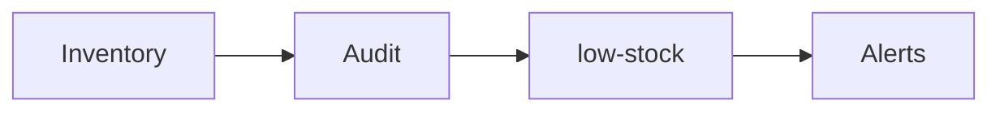

The `Audit` component has a graph-change input and output. Its transform method
derives a new envelope, assigns its own output stream and sequence, and appends
context:

<!-- excerpt: stockroom/src/main.rs#audit-transform -->
```rust
#[async_trait]
impl Transformer for Audit {
    async fn transform(&mut self, input: InputEnvelope) -> anyhow::Result<Vec<OutputEnvelope>> {
        let changes = GraphChangeCodec::decode_changes(&input.envelope)?;
        self.sequence = self.sequence.checked_add(1).context("sequence exhausted")?;
        let mut envelope = GraphChangeCodec::derive_changes(
            &input.envelope,
            &changes,
            StreamId::try_new("audit/out")?,
            self.sequence,
        )?;
        envelope.append_annotation(ContextEntry::try_new(
            self.descriptor.id().clone(),
            "checked-by",
            ContextValue::String("stockroom".into()),
        )?)?;
        Ok(vec![OutputEnvelope {
            execution_context: input.execution_context,
            port: PortId::try_new("out")?,
            envelope,
        }])
    }
}
```

This is the companion's complete `Transformer` implementation for `Audit`.
The original graph records keep their identities. The new envelope has the
transformer's emission identity and retains input context and lineage.
Appending an annotation affects this branch, not a sibling's envelope.
Repeated annotation keys are history entries, not assignments that overwrite
old entries.

Every component also implements `ComputationComponent`, which supplies its
description, its descriptor and its lifecycle hooks. `Audit` opens nothing and
runs no work of its own, so a macro writes its hooks:

<!-- excerpt: stockroom/src/main.rs#audit-component -->
```rust
#[async_trait]
impl ComputationComponent for Audit {
    fn description(&self) -> ComponentDescription {
        ComponentDescription::new(ProgressPersistence::Volatile)
            .with_outputs(&self.descriptor, OutputDescription::UNTRACKED)
    }

    fn descriptor(&self) -> &ComponentDescriptor {
        &self.descriptor
    }

    drasi_lib::passive_component_lifecycle!();
}
```

Its description says that its progress lives in memory and that its output
carries no producer identity of its own; [Declare what a component
guarantees](#declare-what-a-component-guarantees) explains both. Chapter 7
explains the six hooks and when to write them yourself.

The batch replaces `inventory -> low-stock` with two edges, adds the transformer,
and binds `audit/out`. It also verifies that the annotation reaches the query's
output. This is ordinary composition within the same `DrasiLib`, not a nested
runtime.

The annotation is not a durable audit record. This component has volatile
sequence state and does not claim a recovery contract. A durable audit trail
needs storage and a defined completion boundary.

#### Use component roles deliberately

The graph supports five kinds of work:

| Role | Processing contract |
|---|---|
| Source | `EnvelopeSource` produces envelopes |
| Transformer | `Transformer` consumes an envelope and produces zero or more outputs |
| Transformer used as a query | Maintains results; its descriptor identifies its semantic kind as Query |
| Sink | `EnvelopeSink` accepts or handles input without data outputs |
| Service | `ComputationService` runs an activity with no data ports |
| Bootstrap provider | `ComputationBootstrapper` serves snapshots on bootstrap outputs and has no data ports; see [Chapter 10](#connect-a-bootstrap-provider) |

These are the five execution roles of `ComponentRole`: Source, Transformer,
Sink, Service and BootstrapProvider. Query is a semantic kind of transformer,
not another role. All implement `ComputationComponent` for description and
lifecycle. Several complete pipelines can coexist in one instance. A pipeline can also
contain no query at all: normalization, routing, and custom calculations do
not require inventing query text.

Connections must agree on the **complete schema descriptor**, including
version, encoding, and definition. Stockroom's sources, middleware, and queries publish
the standard graph-change schema, and a query's result rows are ordinary nodes,
so their ordinary data can share graph-change inputs without format conversion.
The receiver must also support the event protocol: a graph schema does not
authorize scheduling controls or snapshot/progress recovery frames everywhere.

| Consumer surface | Accepted contract |
|---|---|
| Native sink | Standard graph changes from any source, transformer or query bound to it; no query projection required |
| Ordinary Reaction adapter | Query output converted to ordinary query results; source data is not a substitute |
| Query input | Graph-change data, plus separately configured initialization/transaction protocols when requested |

A custom schema connects directly to ports declaring the same complete schema,
provided both factories explicitly implement it. A multi-format factory can select
one supported format with a `ports` override, resolved before construction; see
[Choosing a port format](../computation-graph-schemas-ports-pipes.md#choosing-a-port-format).
Custom records need an intentional conversion into graph changes before a query
can read them.

#### Declare what a component guarantees

Every component describes itself through `ComputationComponent::description`.
The graph uses the returned `ComponentDescription` to check each connection
before any data flows and to decide how a sink's failures are handled.
Stockroom's file source declares:

<!-- excerpt: stockroom/src/main.rs#file-description -->
```rust
fn file_source_description(descriptor: &ComponentDescriptor) -> ComponentDescription {
    // Comparison state lives in memory, and outputs carry no producer identity
    // that survives a restart.
    ComponentDescription::new(ProgressPersistence::Volatile)
        .with_outputs(descriptor, OutputDescription::UNTRACKED)
}
```

A description answers three questions:

| Question | Declared with | Choices |
|---|---|---|
| Does the component's own progress survive a restart? | `ComponentDescription::new(...)` | `ProgressPersistence::Stateless`, `Volatile` or `Durable` |
| What producer identity does each output carry? | `.with_outputs(descriptor, ...)` | `OutputDescription::DURABLE`, `VOLATILE`, `UNTRACKED` or `RELAY` |
| What does each input require of the identity it receives? | `.with_inputs(descriptor, ...)` | `InputDelivery::Unkeyed`, `AtLeastOnce` or `ExactlyOnce` |

A **producer identity** names the stream an output publishes, so that a
consumer can key what it has received on it. A durable identity, and positions
within its stream, survive a restart; a volatile identity changes each time
the producer is constructed. An untracked output carries no identity of its
own. The file source and `Audit` attach no producer progress to what they
publish, so they declare `UNTRACKED`; a component that does, such as
middleware, declares `VOLATILE` or `DURABLE`. A relay
output carries its input's progress instead of its own. Queries declare
outputs that follow their index storage: an in-memory query's outputs are
volatile and a RocksDB query's outputs are durable (Chapter 9).

The graph checks each data edge when it binds it:

| The consumer's input declares | The producer's output must offer |
|---|---|
| `Unkeyed` | Anything |
| `AtLeastOnce` | A volatile or durable identity |
| `ExactlyOnce` | A durable identity, and replay from a committed position by the output itself or by a replaying pipe between them |

Stockroom's `Alerts` view keeps its rows in memory and does not key its input
on the producer:

<!-- excerpt: stockroom/src/main.rs#alert-description -->
```rust
fn alert_description(descriptor: &ComponentDescriptor) -> ComponentDescription {
    // The view lives in memory. Its input accepts changes from any producer;
    // it does not key delivery on the producer's identity.
    ComponentDescription::new(ProgressPersistence::Volatile)
        .with_inputs(descriptor, InputDelivery::Unkeyed)
}
```

An incompatible edge never carries data. The graph marks the edge failed, and
the consuming component fails with a terminal error that names the guarantee
its input needs; `start` reports it.

**Try it.** In `alert_description`, change `InputDelivery::Unkeyed` to
`InputDelivery::ExactlyOnce` and run `cargo run --locked`. Stockroom stops
before any data flows:

```text
Starting Stockroom for low-stock. Press Ctrl-C to stop.
Stockroom: component 'alerts' failed: input requires ExactlyOnce delivery keyed on producer identity, but the producer's output identity is Volatile
```

The in-memory query's output identity is volatile, which cannot support
exactly-once delivery. Change the input to `InputDelivery::AtLeastOnce` and
Stockroom starts, because a volatile identity is enough for at-least-once.
Restore `Unkeyed` when you finish. Chapter 12's durable reorder sink declares
`ExactlyOnce` and reads a durable query's output, so its edge is accepted.

`ComponentDescription::undeclared()` makes no claims: its progress and outputs
are undeclared, so its outputs satisfy no keyed input, its inputs are unkeyed,
and a sink uses the Stall policy. Declaring real facts lets the graph reject a
wrong connection before it loses data. A sink can also declare its
permanent-failure policy, as described in
[Handle delivery failures](#handle-delivery-failures). The graph checks each
edge when it binds, so changing what a component guarantees means replacing the
component (Chapter 17). A factory's `describe` method must return
the same description as the components it creates (Chapter 15). The
[description module](../../../components/computation-contracts/src/description.rs)
documents every field.

#### Chain maintained outputs

With a first query that returns a `total` alias,
a second query can read it as:

```cypher
MATCH (r:Result)
RETURN r.total AS total
```

The batch connects `first/out` to `second/in` like any other edge. `Result`
is the default label of a result node; the properties are the first query's
`RETURN` aliases. When the first query's answer is corrected, the second query
updates too, even if the correction carries an older business time, because the
query stream is ordered by its producer's output sequence rather than by the
clock. Use one query with `WITH` when that is enough; chain when the maintained
intermediate answer is itself useful.

**A live edge does not load existing state.** Query output contains changes,
not repeated full snapshots. Select the starting-state contract deliberately:

| Situation | Required starting boundary |
|---|---|
| Both explicit queries start empty, before any input | Connect and ready the downstream path before sending initial changes |
| Attach downstream after upstream already has rows | Bind live input before capturing a real snapshot; install the snapshot and skip buffered changes it covers |
| Reopen a volatile downstream query | Refresh its input view, including removals that happened while it was stopped |
| Resume a persistent downstream query | Validate the saved producer identity and replay after its committed cursor; do not substitute a new scan silently |
| Intentionally consume only future changes | Explicitly disable bootstrap for that input; do not treat missing snapshot support as an empty source |

In an explicit native `ComponentBatch`, a data edge establishes transport only.
To start from the upstream's current answer, also connect `upstream.snapshot` to
`downstream.bootstrap`, or attach a query-scoped provider;
[Chapter 10](#choose-where-a-querys-initial-data-comes-from) explains both.

The query builder makes both connections for you. Stockroom's `chain` lesson
adds a second query, `low-stock-count`, while `low-stock` is already running:

<!-- excerpt: stockroom/src/main.rs#late-query -->
```rust
async fn add_low_stock_count(
    core: &DrasiLib,
    bootstrap: bool,
) -> anyhow::Result<Vec<serde_json::Value>> {
    // `add_query` constructs queries with the instance's registered query factory.
    let reference = ImplementationIdentity::try_new("drasi/continuous-query", "1")?;
    let factory = FactoryRegistry::standard()
        .get(&reference)
        .context("reference query factory")?
        .clone();
    core.register_query_factory(factory)?;
    let name = ComponentName::try_new("low-stock-count")?;
    let query = core
        .add_query_with_handle(
            drasi_lib::Query::cypher(name.clone())
                .query("MATCH (r:Result) RETURN count(r) AS items")
                .from_input_by_name(ComponentName::try_new("low-stock")?)
                .enable_bootstrap(bootstrap)
                .build()?,
        )
        .await?;
    tokio::time::timeout(Duration::from_secs(10), query.wait_started())
        .await
        .context("wait for query 'low-stock-count' readiness")??;
    Ok(core.get_query_results_by_name(&name).await?)
}
```

`add_query` constructs a query with the instance's registered query factory.
Stockroom builds `low-stock` directly, so this lesson registers the reference
factory first. `from_input_by_name` connects `low-stock`'s output to the new
query's input. With bootstrap enabled, it also connects `low-stock`'s
`snapshot` output to the new query's `bootstrap` input. `wait_started` returns
after the new query has loaded that snapshot and is running.

**Try it.** Run `cargo run --locked -- chain`, then lower a quantity below its
minimum and save. As soon as `low-stock` has a row, Stockroom adds the second
query and prints its first answer:

```text
low-stock: [{"quantity":3,"sku":"bolts"}]
Added low-stock-count while low-stock had 1 row.
low-stock-count: [{"items":1}]
```

The new query counted a row that already existed; no change was needed. Stop
Stockroom and run `cargo run --locked -- chain --no-bootstrap`. The file still
holds the low quantity, so the second query is added right after startup, and
this time it starts empty:

```text
low-stock-count: []
```

Without the bootstrap edge, the new query sees only changes made after it
joined. It counts the existing row when that row next changes, and never counts
a row that does not change.

This uses the same query implementation as `low-stock`; the builder only
assembles its inputs. `from_input_port_by_name(component, port)` selects an
explicit output. Without a port, resolution uses the factory's declared primary
output or its only output; several outputs without a primary are an error.
YAML/JSON uses `inputs: [low-stock]` or `inputs: [{component: low-stock, port: out}]`;
`sources` and `sourceId` declarations are rejected.

With bootstrap enabled, the upstream query serves its committed results with
their output cursor while the live pipe is already bound, and the downstream
query skips the output that cursor covers. A persistent downstream query
cannot bootstrap from a volatile upstream.

After a restart, a volatile downstream query loads a fresh snapshot of the
upstream's answer. A persistent downstream query takes no fresh snapshot, and on
this path nothing replays the upstream output it had received but not yet
committed. An abrupt stop can therefore lose that output. The downstream query
detects the loss when the next upstream output arrives, fails with
`graph input logical progress has a gap`, and fails the same way after every
restart. AutoReset does not repair it, because the gap is found while
processing rather than at startup. Keep a chained query volatile when it must
survive an abrupt stop. The fix is tracked as
[CW-109](../computation-graph-remaining-work.md#cw-109). Choose `enable_bootstrap(false)` for future-only input.

Data connections form a directed acyclic graph. Control relationships, covered
in Chapter 7, carry readiness signals separately from the acyclic data path.

#### Normalize input with middleware

Suppose inventory arrives with a JSON string in `payload`, such as
`"{\"quantity\":3}"`. Keep the low-stock calculation unchanged by normalizing
that property before evaluation.

The starter's optional `payload` field and supplied `encoded-inventory.json`
make this exercise runnable:

```sh
cargo run --locked --features normalize -- normalize
```

The initial raw quantity is 8, but the payload contains quantity 3. The result
is low stock because normalization overwrites quantity with the parsed value.
Edit the string to `"{\"quantity\":8}"`, save, and watch the result retract.
Keep the surrounding JSON and its escaped string valid.

The `normalize` feature enables `middleware-parse-json` and
`middleware-promote`. A normalization component has this construction:

<!-- excerpt: stockroom/src/main.rs#normalization -->
```rust
fn normalization() -> anyhow::Result<MiddlewareTransformer> {
    MiddlewareTransformer::new(
        MiddlewareTransformerDefinition {
            id: component_id(760),
            output_stream: StreamId::try_new("normalize/out")?,
            middleware: serde_json::from_value(serde_json::json!([
                {"kind":"parse_json","name":"read-payload","config":{
                    "target_property":"payload","output_property":"parsed","on_error":"fail",
                    "max_json_size":65536,"max_nesting_depth":8
                }},
                {"kind":"promote","name":"quantity-at-root","config":{
                    "mappings":[{"path":"$.parsed.quantity","target_name":"quantity"}],
                    "on_conflict":"overwrite","on_error":"fail"
                }}
            ]))?,
            pipeline: vec!["read-payload".into(), "quantity-at-root".into()],
        },
        DrasiLib::default_middleware_registry(),
    )
}
```

Add it as a transformer, bind `normalize/out`, and connect
`inventory/out -> normalize/in -> low-stock/in`. Keep `sku` and `minimum`
in the input, or map them as well. A normalization pipeline cannot manufacture
business fields it was never supplied.

`middleware` declares named instances; `pipeline` selects them in execution
order. Declaring a middleware instance does not automatically run it.
Unknown kinds, duplicate names, and missing pipeline entries are errors.
The registry contains the implementations enabled in the build.

The same normalization can run inside a query by passing middleware definitions
and input-specific pipelines through `QueryExecutionSettings`, along with
the registry to `new_configured`. For example, an input entry is:

<!-- illustration: source-pipeline -->
```rust
drasi_lib::config::QueryInputConfig {
    component: drasi_lib::config::ComponentReference::Name(ComponentName::try_new("inventory")?),
    port: None,
    nodes: vec!["Product".into()],
    relations: vec![],
    pipeline: vec!["read-payload".into(), "quantity-at-root".into()],
}
```

Use a separate transformer when several downstream consumers need the same
normalized stream. Use query-local middleware when normalization belongs to
that query's processing state. In either case, native data connections still
determine which input reaches the query.

The input selector names the **immediate connected producer**, not the namespace
inside its records. The example above applies when `inventory/out` connects
directly to the query. After `inventory -> audit -> query`, select `audit` (and
its output port when needed), even though the records still name `inventory`.
API-owned source helpers map back to the declared ordinary input alias. The
host derives this scope from trusted port/stream bindings; it is not supplied
by arbitrary record metadata. Direct evaluator calls without an explicit input
scope retain namespace-based behavior.
The `nodes` and `relations` lists describe input subscription interests; they are
not a general-purpose filter installed on every native pipe. Apply the query's
`MATCH`/`WHERE` predicates or a deliberately chosen transformer for data selection,
and do not confuse declaration metadata with maintained filtering semantics.

#### Choose transformations by their data contract

| Middleware | Use in Stockroom | Important constraint |
|---|---|---|
| `decoder` | Decode base64, base64url, hex, URL, or JSON-escaped properties | Decoding text is not parsing it; order the parsing step afterward |
| `parse_json` | Interpret a string property as structured data | Bound input size and nesting; choose fail/skip behavior explicitly |
| `promote` | Copy nested values to named properties | Decide whether conflicting destination values overwrite, skip, or fail |
| `relabel` | Map upstream labels to the application's graph vocabulary | Labels on deletions must be normalized too |
| `map` | Select and reshape changes using JSONPath | A stateless event mapper (see below); preserve IDs and account for the fields available in delete images |
| `jq` | Express more elaborate selection and reshaping | A stateless event mapper; jq expressions have their own quoting and error behavior |
| `unwind` | Expand warehouse bins into maintained child nodes and relationships | Stable child keys and previous-element state are essential |

Each kind has a corresponding `middleware-*` Cargo feature.
`middleware-jq` uses system libjq; `middleware-bundled-jq` builds it.
Enable just the transformations the application uses.

`map` and `jq` are **event mappers**. Each rule looks only at the data in the
incoming event, keeps no memory of earlier input or output, and ignores an event
that makes no sense for it. A `Replace` maps to a `Replace` by default, and
`"op": "Replace"` can be configured. An update that carries property removals
cannot in general be mapped without knowing what came before, so that `update`
rule is skipped (a debug diagnostic is logged) rather than failing; explicit
rules that produce `Insert`, `Replace` or `Delete` can still run. A missing
selection or unmatched rule produces no mapped event, while a malformed change or
a failing configured expression is still an error. The domain API's `Future` notification is scheduled control, not a fifth
ordinary element mutation. Such controls pass through rather than being mapped.
Use an event mapper for
reshaping each event. If you need a *maintained* derived dataset (retracting
outputs that stop matching a filter, or re-keying outputs), that is a different,
stateful component: the
[view transformer](../../../components/computation-plugins/transformers/view/README.md).
Its `drasi.standard/view` factory reconstructs complete images, applies a
pipeline of declared stateless middleware (decoder, map, parse_json, promote,
relabel) and remembers the exact outputs to retract. Configure
map insert rules that produce complete projected images, rather than event
update/delete rules. The initial profile provides memory-backed snapshots and
volatile progress, not durable replay, input deduplication or bootstrap input.
Supply complete initial records and ordered lossless changes; a fresh instance
starts empty, whereas stop/start of the same object retains its view.

Unwind illustrates why apparently simple transformation can be stateful.
When a bin disappears from a warehouse's array, the old child must be deleted.
The transformer needs the previous parent and children to compute that change.
An omitted selected array is an empty selection, not "leave old children
unchanged." Later steps must preserve the identities and fields needed for the
next update.

`MiddlewareTransformer::new` keeps its state in memory. Its `new_durable`
constructor uses `DurableMiddlewareOptions` and an atomic persistent provider
to save prior elements, input progress, and output together. Durable outgoing
connections are required. A recoverable pipeline needs durable processing
state in the transformer as well as retained input and output.

The [middleware guide](../computation-graph-middleware.md) and
[middleware configurations](../../../middleware/README.md) provide larger
mapping examples and exact options.

Some calculations are packaged as native transformer plugins instead. Each
reads and writes standard graph changes, so any source or query can feed it,
and each is configured like the HTTP and SSE plugins earlier in this chapter:

| Transformer | Factory | Maintains |
|---|---|---|
| [Arithmetic](../../../components/computation-plugins/transformers/arithmetic/README.md) | `drasi.standard/arithmetic` | A calculated value, `(value + add) * multiply`, for each input record |
| [Policy](../../../components/computation-plugins/transformers/policy/README.md) | `drasi.standard/policy` | One decision record per input element, evaluated by your Rego policy |
| [Optimization](../../../components/computation-plugins/transformers/optimization/README.md) | `drasi.standard/optimization` | Solution, status and scenario rows of a linear or mixed-integer model, re-solved when its input data changes |
| [Geometry](../../../components/computation-plugins/transformers/geometry/README.md) | `drasi.standard/geometry` | One relation record for each pair of shapes that satisfies a configured spatial relation |
| [View](../../../components/computation-plugins/transformers/view/README.md) | `drasi.standard/view` | A retractable projection of its input, described above |

Use a query when the calculation is a pattern over graph data, and one of
these when it is a decision, a model or a geometric relation over the current
records.

#### Bound expansion and scheduled work

A transformer can emit no outputs to filter an input, or several to expand it.
Returning a huge vector keeps all those outputs in memory and can monopolize
processing. For incremental output, keep a bounded pending queue:

<!-- illustration: continuation-chunk -->
```rust
fn next_chunk(
    pending: &mut std::collections::VecDeque<OutputEnvelope>,
) -> Vec<OutputEnvelope> {
    let count = pending.len().min(64);
    pending.drain(..count).collect()
}
```

Return the first chunk from `transform`, report remaining work with
`has_pending_emissions`, and produce later chunks from `continue_transform`.
The graph completes the continuations before accepting another input or
acknowledging the original. Bound total retained expansion as well as the size
of each chunk.

For time-driven work, expose a `WakeupSource` and implement `on_wakeup`.
`wait` must suspend, not spin, until work may be ready; `has_pending` lets a
finite graph account for outstanding scheduled work. Persist both schedules
and their completion when timers must recover. A wall-clock alarm held only in
a Rust field is volatile.

For recoverable **native non-query work**, negotiate `scheduled_processing`
alongside indexed processing, committed input progress and wakeups. Use
`NativeProcessingContext` to request, replace or cancel work, then claim and
explicitly complete due work. `processing.scheduling().wakeup_source()` connects
the existing graph wakeup hook. Requests, state and retained output commit
together; only committed deadlines become visible. Incarnation tokens reject
stale completion after replacement or cancellation.

The qualified standalone profile uses atomic persistent RocksDB and persistent
checkpoints; memory/no-op and non-atomic bundles reject this capability.
Keys are bounded to 256 bytes, payloads to 64 KiB, outstanding requests to 4,096,
and encoded scheduling state to 1 MiB. A committed completion does not make
external delivery exactly once. The
[SDK scheduling guide](../../../components/computation-plugin-sdk/README.md)
and [real delayed-emission fixture](../../../components/host-sdk/tests/fixtures/native_scheduling.rs)
show the complete service contract. Query temporal functions already use the
shared committed wakeup policy; they do not require this optional capability.

A `ComputationService` can run a periodic health activity without data ports.
Its `run` future must yield, and its pause/stop hooks must account for any
workers it owns. Use a data source when the activity produces records that
belong in the pipeline instead.

**Summary.** Composition separates ingestion, normalization, calculation, and
consumption without adding another execution engine. Schemas and descriptions
keep boundaries explicit, and the graph checks every connection against them
before data flows. Sinks classify delivery failures, so an outage is retried
and a rejected change stops the pipeline deliberately. Continuations and
wakeups let components do bounded work. Next, choose how connected components
share capacity and ordering.

### 6. Control flow, ordering, and memory

Stockroom works while every component is fast. Now consider a burst of inventory
updates, a quiet catalog, or an alert consumer that slows down. Queue and ordering
choices determine what the application does under those conditions.

#### Size one concrete path

Use the `totals` lesson and add several products in one saved file. Each changed
product creates input work; a saved file is not necessarily one atomic source
transaction. In `build_application`, change the bounded pipe capacity from 8
to 1 and rerun. The answer is unchanged, but the source and query must wait
more frequently for the next component.

Choose capacity from the burst you need to absorb and the slowest required
consumer's service rate. If input averages 500 envelopes/second and a consumer
can pause for two seconds, at least 1,000 envelopes can accumulate before
considering existing backlog. Multiply by representative **complete envelope**
size and include component/backend overhead before deciding whether that
buffer fits. A sustained producer rate above consumer capacity needs more
processing capacity or a different policy, not an ever-growing queue.

**Try it.** Run `totals` with pipe capacity 1 and then 8. Save the same group of
product edits in each run. Verify that the final answer agrees, and identify
which buffers absorb the burst rather than treating larger capacity as faster
query evaluation.

#### Follow backpressure upstream

The first program uses bounded FIFO pipes. When `alerts` cannot finish writing
its output, its graph input fills, the query's forwarding waits, and pressure
eventually reaches `inventory`. This is useful: the producer cannot create an
unlimited hidden backlog in the graph pipes.

A buffer absorbs a temporary imbalance. Sustained throughput remains limited
by the slowest required stage. Count all buffering locations:
application channels, graph pipes, a transformer's pending output, retained
journals, and any destination client queues.

Keep three different purposes separate:

| Buffer | Holds | Freed by |
|---|---|---|
| Volatile input/dispatch queue | Work waiting to be received | The receiver taking work |
| Query outbox | Retained logical query emissions | Its retention and output-confirmation rules |
| Acknowledged journal | Work owed to required consumers | The required progress/retirement rules |

A queue slot becoming available is not evidence that business work completed.

#### Select a transport policy

Use `BoundedPipeConfig` for ordinary lossless-in-memory FIFO and backpressure.
Use `BroadcastPipeConfig` only when its lag policy fits the consumer:
Report fails visibly on lag; SkipWithNotification explicitly reports skipped
data and continues. A disposable dashboard can accept a rebuild after lag;
a replenishment order processor usually cannot.

`RetainedPipe` retains unacknowledged work through a supplied store.
`QosChannel` shares one journal among named subscribers with separate cursors.
Their persistence and recovery choices are developed in Chapter 11.
Retention under Backpressure preserves outstanding obligations; PruneOldest
deliberately trades them away.

Port `PipeRequirements` and graph-level `requirements` assert required
capabilities. Supply providers that implement them: a memory pipe
rejects a durable-acceptance requirement.

Fan-out shares immutable payloads but forwards in edge declaration order.
A slow required branch can backpressure its siblings through the producer.
Branches therefore share producer pressure. Partial fan-out is possible if an
earlier branch accepts before a later one fails.

#### Bound bytes as well as messages

For variable-sized input, replace a bounded edge's configuration with:

<!-- illustration: byte-pipe -->
```rust
ByteBoundedPipeConfig {
    capacity: 8,
    max_bytes: 1024 * 1024,
}
```

Both limits must be positive. The charge covers the complete binary envelope,
including identifiers, metadata, annotations, and lineage, not only the JSON
payload. Each independent fan-out pipe charges its own envelope.

An oversized envelope may occupy an otherwise empty byte-bounded pipe by itself.
The budget is therefore **not a maximum message size or a process-memory cap**.
Use bounded codecs and input validation for a hard message-size limit.
The budget excludes component state, work already received, serialization
scratch space, and backend caches.

Ranked and broadcast pipes remain count-bounded. The
[persistent journal limits](#bound-retained-history-and-caches) in Chapter 11 add
storage admission and decoded-cache limits once the retained owner is introduced.

#### Decide what "ordered" means

FIFO orders a producer's emissions by sequence. With several inputs, the
default `InputMergePolicy::Arrival` processes available work without imposing
a global source-time order.

`InputMergePolicy::EventTimeAcrossStreams` compares available stream heads.
It preserves each stream's order and does not wait for unseen input from a
quiet producer. `RankedInputPipeConfig` additionally uses a shared
ranked queue and declared source ranks; it is not a switch that makes unrelated
queues one globally ordered stream.

Each event also states how a receiving query treats stale changes
(`SystemMetadata::ordering`). Source data uses `ChangeOrdering::EventTime`: a
change older than the element's accepted time is skipped. A query's own output is
published with `ChangeOrdering::ProducerSequence`, so a downstream query follows
the producing query's validated output order and still applies a correction that
carries an older business time. Scheduled work is carried by a separate
event-local control, not by the data records. These are set by the producing
component; an application normally only chooses to connect or not.

Neither policy can move a late event before work already evaluated. If a
warehouse total must use a bounded source-time reorder window, make that
processing stage explicit.

#### Merge by source-change time

Place `SourceTimeMergeTransformer` before the query:

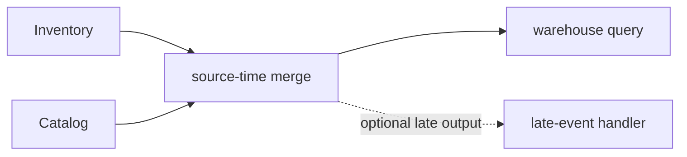

For example:

<!-- illustration: time-merge -->
```rust
let merger = SourceTimeMergeTransformer::new(
    SourceTimeMergeDefinition {
        graph_id: GRAPH.into(),
        id: component_id(771),
        sources: vec![
            StreamId::try_new("inventory/out")?,
            StreamId::try_new("catalog/out")?,
        ],
        output_stream: StreamId::try_new("merge/out")?,
        late_output_stream: None,
        reorder_window_ms: 2_000,
        max_wait_ms: 5_000,
        idle_timeout_ms: Some(10_000),
        max_buffered_events: NonZeroUsize::new(256).expect("positive capacity"),
        max_buffered_bytes: NonZeroUsize::new(1024 * 1024).expect("positive capacity"),
        late_policy: LateEventPolicy::FailAndRetain,
    },
    GraphChangeCodec::schema(),
)?;
let observations = merger.subscribe();
```

Connect both sources to `merge/in`, bind `merge/out`, and connect it to the
query. Every input needs `SystemMetadata::timestamp()` containing its
source-change time. In the first source, that means replacing the codec's
`None` timestamp argument with the source-supplied value. Element
`effective_from` is not an automatic substitute.

The merger can reorder timestamps within a source while requiring that
source's logical input sequences arrive in order. Ties use declared source
order and logical sequence among buffered events. A complete envelope remains
indivisible.

For early release, take the earliest buffered event by source time, declared
source rank, then logical sequence. Every **active** source must have an observed
maximum timestamp, and the candidate must be at or before **each maximum minus
`reorder_window_ms`**. An unseen source blocks early release until its idle grace
expires; there must still be at least one active source. A new event only raises,
never lowers, its source's observed maximum.

Separately, **any** expired residence deadline makes the earliest buffered event
eligible. This drains earlier source times first, even if the event whose deadline
expired is not first in timestamp order. Idle timeout is measured from source
activity, with a grace period at activation. Idleness is not proof that an earlier
event cannot arrive.

For the settings above, the following trace uses milliseconds, initially empty
buffers and uncongested output. Each source's logical sequences increase in arrival
order even where its timestamps do not:

| Residence clock | Arrival or timer | Decision |
|---|---|---|
| 0 | inventory time 10,000 | Hold: catalog has not yet been observed |
| 100 | inventory time 14,000 | Inventory cutoff is 12,000; catalog still blocks |
| 200 | catalog time 12,000 | Cutoffs are 12,000 and 10,000; emit inventory 10,000 |
| 300 | inventory time 13,000 | Its maximum remains 14,000; catalog cutoff still holds the remaining events |
| 400 | catalog time 16,000 | Cutoffs are 12,000 and 14,000; emit catalog 12,000, hold inventory 13,000 and 14,000 |
| 5,100 | The time-14,000 event reaches its 5,000-ms residence deadline | Emit time 13,000 first, then 14,000; the expired deadline makes the earlier event eligible too |
| 5,400 | Catalog time 16,000 reaches its deadline | Emit 16,000 even though the inventory cutoff has not advanced |
| 10,000 / 10,100 | Inventory times 20,000 then 22,000 | Hold 20,000 while catalog remains active |
| 10,400 | Catalog becomes idle, 10,000 ms after its last activity | Inventory's cutoff is 20,000; emit 20,000 without waiting for its residence deadline |

Equal timestamps use the declared source order and then logical sequence.
An event with time 19,999 arriving after the final emission is late, while equal
time is not late. If all sources become idle, only residence expiry can release
otherwise held work. Backpressure can delay every delivery in this trace:
`max_wait_ms` bounds eligibility, not completion at the consumer.

An input older than the emitted time frontier is late. FailAndRetain holds it
and reports a typed error; Route sends it to an explicitly connected `late`
output; Discard explicitly drops it and reports that choice. Routing late data
does not automatically correct answers already published by the query.

The count and byte limits include held and unconfirmed work. Unlike the
byte-bounded FIFO, this merger rejects an individually oversized input.
Capacity errors leave retry and input retention with the upstream owner.

`new_durable` adds atomic persistence of the buffer, progress, held input,
and unconfirmed output, with lossless durable output requirements.
Reconstruction validates the configuration and restarts residence waits;
downtime does not invent source progress. Its persistence cost grows with
the bounded saved window. The
[source-time merge guide](../computation-graph-time-merge.md)
details release rules and recovery.

#### Understand concurrency

Top-level native nodes run in independently scheduled, graph-owned Tokio tasks.
Mutable work on one component remains serialized. On a multi-threaded executor,
independent nodes can use different workers; on a current-thread executor,
they interleave but cannot perform CPU work on several cores at once.

Shared storage gates, graph shape, and slow consumers still constrain parallelism.
The runtime bounds continuously ready work per node, but it cannot preempt
an infinite synchronous loop inside custom code. Use asynchronous I/O and
bounded computation; merely placing a blocking call inside `async fn` does
not make it nonblocking.

**Summary.** Capacity controls burst absorption, ordering controls which
available change is next, and retention controls what can be recovered.
They are different decisions. Bounded work and explicit backpressure keep
Stockroom understandable when input or consumers stop behaving ideally.

### 7. Own the runtime lifecycle

An embedded runtime is part of the application's lifetime. Stockroom needs to
know when it is usable, stop without abandoning ownership, and distinguish an
idle source from a damaged component.

#### Follow an object from creation to disposal

A component definition is a recipe; a constructed Rust object is one instance
of that recipe. Drasi accepts the definition and assigns its ID before any
factory runs. It then constructs the object, reads its description, binds the
resources the object declared, checks each connected edge against the
descriptions at both ends ([Chapter 5](#declare-what-a-component-guarantees)),
and drives it through six **lifecycle hooks**: async methods of
`ComputationComponent` that the graph awaits. Rust's `Drop` cannot await, so
cleanup that performs I/O belongs in these hooks.

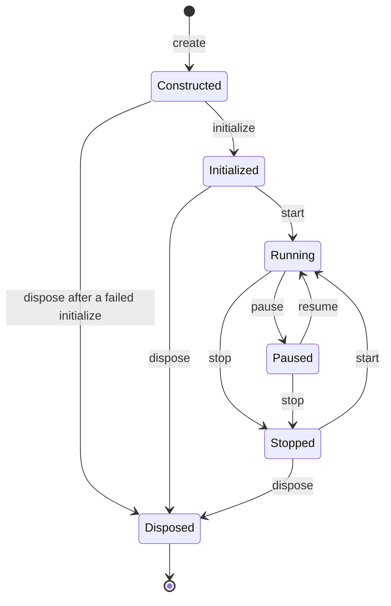

| Hook | When the graph calls it | Put this work here |
|---|---|---|
| `initialize(&InitializeContext)` | Once per object, after its resources are bound and before its first start | Open resources that last as long as the object; load and check initial data |
| `start(&StartContext)` | Each time the component is activated | Start the workers and connections used while processing |
| `pause(&PauseContext)` | When the graph holds processing at a safe point, for example to apply an update | Hold your own workers without closing anything |
| `resume(&ResumeContext)` | After a completed pause | Let held workers continue |
| `stop(&StopContext)` | Each time an activation ends, including after a failed start | Stop and join workers; keep what a later `start` needs |
| `dispose(&DisposeContext)` | Once, when the object is retired | Release everything the object holds; erase its saved data only when asked |

The graph calls processing methods such as `next`, `transform` and `handle`
only while the component is running: after `start` succeeds and before the next
`pause` or `stop`. Hooks and processing methods take `&mut self`, so they never
run concurrently on one object. A normal stop and start reuse the same
initialized object: `initialize` does not run again, and the component keeps its
ID. Keeping the object does not by itself keep all of its data; each component
documents which state survives a stop and start. `DrasiLib::shutdown` stops and
disposes every object, and the instance cannot be started again. It does not
delete stored data.

Failures follow the same shape:

- If `initialize` fails, the object never starts. The graph disposes it with
  `DisposeReason::InitializationFailure`, records the failure, and never
  initializes that object again. Trying again needs a new object: reconcile a
  factory-created component after fixing the cause, and correct its definition
  first if the failure was terminal. An object you supplied directly stays
  failed.
- If `start` fails or is cancelled, the object is left partly started, and the
  component cannot start again until it has been stopped. The graph runs `stop`
  when you stop the component or shut the instance down, so write `stop` to
  clean up after a partial start as well as a full one.
- If `stop` or `dispose` fails, the graph keeps the object and its unfinished
  cleanup, and does not start the component again until cleanup succeeds.
  A retried `dispose` receives the same reason and intent.

**Pausing** is temporary: the activation, its connections and its workers stay
in place. The graph itself stops calling processing methods, so a component
whose work happens only inside those calls has nothing to do in `pause` and
`resume`. A component that runs its own task must hold that task in `pause`.
If it cannot, it returns `Err(LifecycleError::unsupported("reason").into())`;
the graph then reports that the pause failed instead of assuming that the work
stopped.

A component that runs its own workers, such as a listener task, should also
report their failures. `worker_failures` returns a `WorkerFailures` handle whose
async `wait` method completes with the error when a worker of the current
activation fails. While the component is processing, the graph waits on it
next to the processing loop, so a dead worker fails the component promptly as
a retryable processing failure, even when no processing call is running. The
graph drops the wait at every operation boundary, so `wait` must be
cancellation-safe and still report a failure that happened while nobody was
waiting. Stockroom's components need none, because all their work happens in
calls the graph makes.

Each hook receives a context describing the call:

| Context method | Meaning |
|---|---|
| `cancellation()` | A `CancellationToken` that the graph cancels when it stops waiting for the current operation |
| `deadline()` | When the graph stops waiting; reaching it does not undo work already done |
| `StopContext::mode()` | `StopMode::Drain` for ordinary stops, shutdown and updates: finish in-flight work, then join workers. `StopMode::Abort` when the object has been quarantined, for example after it panicked: cancel promptly, then join |
| `DisposeContext::reason()` | `Shutdown`, `Removal`, `Replacement` or `InitializationFailure` |
| `DisposeContext::intent()` | `StateIntent::Preserve`, or `StateIntent::Erase` when the application explicitly asked to delete the component's data |

A slow hook should watch its token, for example in `tokio::select!`, and
return when it is cancelled. The token belongs to the graph operation that
called the hook, not to the component's activation: a worker started in `start`
needs its own token, which `stop` cancels before joining the worker. Keep the
worker's `JoinHandle` until the join completes, so that a cancelled `stop` can
be retried.

Only an explicit request to delete data produces `StateIntent::Erase`:

| Request | `dispose` receives |
|---|---|
| Omit the component from a desired definition | `Removal` with `Preserve` |
| `remove_source_by_name(name, false)` or `remove_reaction_by_name(name, false)` | `Removal` with `Preserve` |
| `remove_source_by_name(name, true)` or `remove_reaction_by_name(name, true)` | `Removal` with `Erase` |
| `remove_query_by_name(name)` | `Removal` with `Erase`; removing a query always deletes its saved state |
| `remove_component(id, ComponentRemoval { erase_data, .. })` | `Removal`, with `Erase` when `erase_data` is true or the component is a query |
| A `Recreate` update replaces the object | `Replacement` with `Preserve` |
| `DrasiLib::shutdown` or a failed `initialize` | `Shutdown` or `InitializationFailure`, always with `Preserve` |

`DrasiLib::remove_component` removes a source, query or reaction by ID and
waits until it has stopped and, when requested, its data is erased. It refuses
to remove a component that other components depend on. Set
`expected_revision` to reject the removal if the configuration has changed, and
reuse the same `request_id` to retry safely: a repeated request returns the
original receipt.

An erasing `dispose` deletes only state that this component saved itself, and
must be safe to repeat because a failed attempt is retried.

Hooks return `anyhow::Result<()>`. A plain error is reported as a terminal
failure of that operation; common transient I/O errors, such as a refused
connection, are reported as retryable. Return
`Err(LifecycleError::retryable(error).into())` when you know that retrying
could succeed.

Errors from processing methods follow the same classification, with one
exception. An error from a source's `next` or a transformer's `transform` fails
the component. An error from a sink's `handle` is a delivery failure instead:
the graph retries the input or applies the sink's permanent-failure policy
([Chapter 5](#handle-delivery-failures)).

Stockroom's file source shows the common case. Its work happens in
`initialize` and in the graph-driven `next` method:

<!-- excerpt: stockroom/src/main.rs#file-lifecycle -->
```rust
async fn initialize(&mut self, _context: &InitializeContext) -> anyhow::Result<()> {
    self.reload().await
}

// The graph drives `next`; this source owns no worker to start, pause or stop.
async fn start(&mut self, _context: &StartContext) -> anyhow::Result<()> {
    Ok(())
}

async fn pause(&mut self, _context: &PauseContext) -> anyhow::Result<()> {
    Ok(())
}

async fn resume(&mut self, _context: &ResumeContext) -> anyhow::Result<()> {
    Ok(())
}

async fn stop(&mut self, _context: &StopContext) -> anyhow::Result<()> {
    Ok(())
}

// The source saves nothing, so there is nothing to release or erase.
async fn dispose(&mut self, _context: &DisposeContext) -> anyhow::Result<()> {
    Ok(())
}
```

`initialize` validates and loads the file once for the object. The other hooks
have nothing to do: the graph drives polling, and the pending changes and
comparison state remain in the object between runs. The source saves no data,
so `dispose` succeeds for both intents.

A component with no lifecycle work at all, such as Chapter 5's `Audit`
transformer, can write all six hooks with `passive_component_lifecycle!()`.
The macro's hooks succeed, except that its `dispose` refuses an erase request
because the macro cannot know whether the component saved anything. Its `pause`
also succeeds immediately, so use it only for a component that runs no work of
its own. Chapter 12 shows the hooks of a component with saved state.

**Try it.** Run
`cargo test --locked component_identity_and_lifecycle -- --nocapture`.
The test creates a component through the library's ID allocator, starts it,
renames it, stops and starts it through its handle, then shuts the instance
down. Its probe records each hook, with the stop mode and the dispose reason
and intent:

```text
Lifecycle: ["initialize", "start", "stop(Drain)", "start", "stop(Drain)", "dispose(Shutdown, Preserve)"]
```

One UUID identifies the logical component. A **generation** identifies a
particular constructed object with that UUID. Replacement creates a new
generation; renaming and a normal stop and start do not.

#### Exercise startup and shutdown

Run the file lesson, save an invalid JSON fragment, and observe the warning.
Restore valid JSON and observe recovery without restarting. Then use Ctrl-C
and restart Stockroom. The file provides a new initial snapshot; the in-memory
query is rebuilt.

Now temporarily give two products the same SKU and start the application.
Initialization fails with `duplicate record key` instead of reporting readiness.
This distinguishes an invalid initial definition/data set from a recoverable
bad save while a previously valid source is running.

The graph's **revision** identifies an accepted topology version. A separate
configuration revision identifies the saved definition. Neither is a query
row count. Part IV uses these values to reject changes based on outdated state.

#### Separate acceptance, construction, and readiness

A successful addition accepts a component definition. It does not prove that
a database connection opened or that processing is ready.
`ComponentHandle::wait_created` waits for the created generation to be published;
`wait_started` observes successful activation. These methods observe progress;
they do not request a start. Bound waits with an application deadline and use
current observations or the failure monitor for continuing health checks.

A valid declaration can be accepted before all of its dependencies are usable.
Inspect the component's observed state and the running topology when readiness
does not arrive: check source and resource availability as well as port
connections. Repair the missing dependency while preserving auto-start settings
and explicit stops. Reserve retries for failures classified as retryable, rather
than treating every unready component as a failed constructor.

An empty graph and an unconnected declaration are valid starting points.
A connected output without its required stream binding is not: that connection
is rejected before processing starts. A successful `DrasiLib::start()` does not
mean every declared component is running; wait on the particular component you
need. The instance host remains available for management while dependencies are
missing after library startup returns.

**Try it.** In your copied `main.rs`, find the default edge list in
`build_application` and temporarily remove `(inventory_id, query_component_id.clone())`,
leaving `(query_component_id.clone(), alerts_component_id)`. Run `cargo run --locked`. The graph declaration and
instance start are accepted, but the inventory source waits for its output
connection. After the five-second readiness deadline, Stockroom reports
`wait for component 'inventory' readiness` and
`connection for '00000000-0000-0000-0000-0000000002f6:out'`, then exits unsuccessfully. Restore the edge,
rerun, and confirm that `Ready. Watching inventory.json` returns.

A failed definition remains inspectable. Retryable acquisition failures can be
retried after their cause is repaired; unchanged terminal validation failures
need a corrected definition. An instance can contain a running query, a failed
sink, and an unbound edge at the same time. Inspect per-component outcomes,
not just whether a graph handle exists.

Observed state separates realization, lifecycle, health, binding, and
availability. Running is not the same as healthy; a healthy source can be idle;
an exhausted finite source is not an unavailable listening source.

#### Read a readiness observation

Follow the missing-edge exercise through its distinct boundaries:

| Observation / wait | What is established | What is not established |
|---|---|---|
| `wait_created` | The requested generation is present as Created in a coherent registry publication | A connection, running worker or loaded query |
| `wait_started` | That generation completed activation | Continuing health, queue drain, or business completion |
| `QueryResults::wait_ready` | Query recovery/bootstrap initialization and output-delivery preparation completed | All pending input replay, output handoffs or consumer work completed |
| Business-state predicate with a deadline | The particular answer/state the application awaited | Completion of unrelated inputs, other branches or timers |

In the exercise, the inventory object can be realized while its required output
connection is missing. Inspect its **binding** and dependency wait instead of
diagnosing an unhealthy file parser. After repair it may be started and available
but idle because there is no edit to emit. During startup, inspect:

| Dimension | Question to ask in the observed component snapshot |
|---|---|
| Realization | Was this definition constructed, or is construction deferred/failed? |
| Lifecycle | Is this constructed object stopped, activating, running or stopping? |
| Health | Is it healthy, degraded or unavailable, and what failure is recorded? |
| Binding | Are required resources, streams and connections present, and did each edge pass its description check? |
| Availability | Can this component currently offer its service? |

Two cases show why these are separate. A sink retrying a delivery is Running
with Degraded health and a retryable failure; it has not failed. An edge that
fails its description check has binding state Failed, and its consumer fails
with a terminal error that names the guarantee its input needs.

Use `inspect_computation_inventory` / `inspect_computation_graph` and the named
component's dependency waits to answer those questions; Chapter 8 covers retained
observation history. Query readiness can coexist with pending replay, so continue
using the result predicate rather than assuming the ready flag means “caught up.”

#### Use readiness and control relationships

A component needing explicit readiness opts into
`requires_readiness_confirmation`. Its `bind_control` hook receives a
generation-bound `ComponentControl`; it calls `ready` only after the required
initialization is complete.

`require_downstream_ready` can hold upstream activation until required
consumers confirm readiness. Await that explicit boundary before sending input.

Control notifications communicate with authorized immediate neighbors through
`notify_downstream`, `notify_upstream`, or `notify_neighbor`. Ready/NotReady
describe readiness; Available/Unavailable describe availability.
A `ControlHandler` receives peer notifications independently of ordinary
mutable data operations.

Custom notifications can carry small configuration-independent signals, such
as "catalog refreshed." They are bounded control messages, not a bulk-data
transport or durable work queue. Replacement invalidates old generations and
connections. A handler may be cancelled when its connection becomes invalid;
that cannot undo an external action already performed.

#### Choose the right stop operation

| Operation | Purpose |
|---|---|
| Quiesce selected components | Park processing at supported safe boundaries while retaining ownership |
| `ComponentHandle::stop` or `DrasiLib::stop` | Stop processing and keep the initialized objects for a later start |
| `DrasiLib::shutdown` | Stop and dispose every object with `DisposeReason::Shutdown`, preserving saved state; this instance cannot restart |
| Standalone graph `dispose` | Release graph-owned resources after its run/cleanup boundary |
| Remove a component from the desired definition | Stop it and dispose it with `DisposeReason::Removal`, preserving its saved state |
| `remove_source_by_name(name, true)`, `remove_query_by_name(name)` or `remove_component` with `erase_data` | Stop the component, then dispose it with `StateIntent::Erase` so that it deletes the data it saved |

An explicit stop is respected rather than waited out. Starting an ordinary
reaction whose query was explicitly stopped fails at once with
`DependencyStoppedError`; start the query first, then retry. Other components
wait for a stopped dependency, and their start reports it as blocked, so bound
those starts with a readiness deadline.

Quiescence is not a universal drain. Work from selected producers drains to
the supported boundary, while other queued input can remain owned.
It does not prove every retained message or external effect completed.

Graceful stop accounts for admitted operations, continuations, and required
forwarding before stop hooks. A timeout reports unfinished work. It does not
mean that a write rolled back or that the application may open another owner
of the same resource.

Shared producers may still need their consumers' progress while draining.
The runtime keeps those owners and read capabilities alive until producer cleanup
finishes. For example, stopping SQLite closes new HTTP admission but drains
already accepted requests through its existing worker. Cancelling a stop waiter
does not abandon the accepted stop operation or authorize a replacement owner.
Unrelated cleanup remains independent; a failed producer is not permission to
retire the owners it still needs.

Saved state is deleted only by the explicit removal calls above; stopping,
pausing, replacing an object or shutting down never deletes it. A configuration
change that removes a component also has recovery obligations that need
separate consideration in Chapter 17.

#### Name resource owners before sharing them

A **resource** is a service a component uses, such as an index provider, a
bootstrap provider or a retained journal. A `ResourceSpecification` declares its
ID, role and ownership. A `ResourceHandle` is the typed service itself.
Declaring an IndexBackend does not open a database.

| Assembly step | Responsibility |
|---|---|
| Declare | Name the service and its role, lifetime and dependencies |
| Provide or construct | Supply the handle, or acquire it through a declared constructor |
| Resolve | Pass only declared handles of the required type/cardinality to the consumer |
| Clean up | Stop users before releasing their prerequisites; retain ownership after incomplete cleanup |

`ResourceOwnership::Graph` makes the resource's cleanup part of graph lifecycle.
Borrowed ownership leaves that lifetime with the outer application. A borrowed
user cannot keep a graph-owned prerequisite alive after its graph is disposed.

The persistent Stockroom will use these different relationships:

```text
data:       SQLite source -> query -> output journal -> alert consumer
progress:   SQLite source reads the QuerySourceProgress published by query
storage:    query uses query indexes; journal uses journal indexes;
            alert consumer uses its completion/business-state transaction owner
```

The data arrows are not resource-dependency declarations. Two index sets opened
from the same provider/path are not automatically one transaction. Pass the same
progress owner to the source and query, rather than constructing two
same-named owners. A cloned handle to that owner is appropriate; matching names
alone are not evidence.

Dependent resources declare prerequisite edges separately. For example, a
shared-storage journal depends on its storage group: construct the group
first and release it only after all journals/users finish cleanup. Replacement
can therefore reconstruct transitive users. Chapter 15 adds factory requirements
and saved recipes to this ownership model.

#### Preserve errors across cleanup

Public `DrasiLib` operations return `DrasiError`; graph APIs expose `GraphError`;
component and provider contracts commonly use `anyhow::Result`.
Use `DrasiError::classification()` for a public category and `downcast_ref()`
for retained typed causes.

An operation and its cleanup can both fail. `OperationFailures` retains every
cause even though the standard error source chain follows only the primary
one. Lifecycle reports likewise contain per-member failures.
`OperationSummary::CompletedWithFailures` requires inspecting the unsuccessful
members. Preserve the typed aggregate so callers can inspect every retained cause.

Instance-wide `start` can fail after independent components have already started.
Inspect the typed `PartialStartError`, retain the instance, and await `stop` or
`shutdown` as appropriate. A failed start is not a rollback of every component.
The lifecycle budget includes time spent waiting for admission and prerequisites,
not just the component hook. Cancelling or timing out the caller does not prove
that an already accepted operation stopped; the runtime retains that work and
its cleanup responsibility.

`ComputationCleanupError` can itself retain a failed construction or
registration owner. Keep it and await its `cleanup` operation. Rejected supplied
objects can be recovered through `RejectedAddition`; otherwise their cleanup
remains graph-owned.

Shutdown has two separate answers: whether it succeeded, and whether all of its
cleanup finished. `DrasiLib::shutdown_with_outcome` returns both in a
`ShutdownOutcome`. Its `completion` is `Complete` when every instance-owned
cleanup finished and `Incomplete` when some cleanup is still owned or could not
be confirmed; its `result` keeps the original typed failures. Check both
fields: cleanup can complete with an error. For example, shutting down while a
sink is still retrying a delivery completes its cleanup but returns that sink's
last delivery error, because the held input was never delivered. Use
`completion` to decide whether a replacement may reopen the same storage.

A protected component panic quarantines that generation. Successful cleanup
does not repair it; reconstruct a fresh instance. A task boundary does not
contain a process abort, unsafe native memory fault, or synchronous code that
never yields. Chapter 18 provides a process boundary for those concerns.

#### Own a standalone graph when appropriate

`ComputationGraph::builder` is useful for a finite pipeline or independently
owned computation. `start()` returns a caller-polled `GraphRun`; creating
the future alone does no work.

For cancellation, request `GraphControl::cancel` and continue awaiting the run.
Dropping an unfinished run leaves cleanup required; subsequently await
`shutdown` or `dispose`. Only naturally completed standalone runs can restart
with retained component ownership. This is different from a supported
`DrasiLib::stop`/`start` cycle.

Use a `ComponentBatch` when the pipeline belongs to an existing `DrasiLib`,
and obtain query handles from that owner.

**Summary.** A component's object moves through six awaited hooks, and every
failure has a defined next step. Readiness is an explicit boundary,
cancellation is a request, and cleanup is awaited work. Retain the owner after
unsuccessful operations instead of hiding it behind a timeout. These rules make
both recovery and live replacement possible.

<a id="observing-the-application"></a>

### 8. Observe and diagnose the application

When Stockroom stops producing the alerts you expect, first find where
processing stopped. Drasi reports the state of the running graph directly, so
start with its inspection APIs instead of keeping your own copy of that state.
This chapter then sets up logging, traces and metrics, and shows how to measure
progress.

#### Diagnose a real failure

Read each message together with the component and the operation that produced
it:

| Symptom or message | Where it failed | Next action |
|---|---|---|
| `invalid inventory JSON` / `duplicate record key` | File parsing | Correct the file. A startup error needs a restart; a later bad save keeps the last valid state |
| `normalize mode requires --features normalize` | Build configuration | Rerun with the lesson's feature enabled |
| `load trusted native library ...` | Plugin loading | Build the named native package and pass the directory that contains it |
| Address already in use during plugin startup | Resource acquisition | Release or reconfigure the conflicting listener; inspect the failed component rather than assuming the query failed |
| `wait for component '...' readiness` / `deadline has elapsed` | Incomplete startup | Read the missing connection or dependency named in the message; for query readiness, inspect bootstrap progress |
| `component 'webhook' is retrying: ...` | Outgoing delivery, transient failure | The component has not failed: the graph keeps the change and retries it. Restore the receiver; Stockroom prints `component 'webhook' recovered` after the next successful delivery |
| `component 'webhook' failed: ... permanent delivery failure ...` | Outgoing delivery, permanent failure | The destination rejected the change. Under its Stall policy the sink stops at that change, and Stockroom exits; correct the destination or the data, then restart |
| `shutting down computation graph: ... failed during handle: transient delivery failure ...` | Stopped while a sink was retrying | That change was never delivered. Restore the receiver before you stop Stockroom; Part III shows how to retain output until it is delivered |
| `create new key file ...: File exists` | Key generation | Keep the existing key or choose another output path |
| `query configuration changed; explicit reset/rebootstrap is required` | Persistent query identity | Keep the saved state and choose an explicit reset or rebuild |
| `live result stream closed or lagged; rebuild the view` | Volatile consumer | Rebuild the view from a fresh snapshot instead of continuing after the gap |
| `Saved reorders unavailable: enumeration index missing or stale` | Saved business-state format | Keep the per-record state; listing every saved reorder requires a matching view index |

[Handle delivery failures](#handle-delivery-failures) explains which delivery
failures the graph retries and which stop a sink.

For lifecycle detail, run `RUST_LOG=info cargo run --locked`. An empty result is
not a failure: a product above its minimum produces no low-stock row. The tests
in [Chapter 4](#test-your-application) wait for the expected business state and
fail after a bounded time if it never arrives.

Stockroom prints each failure on its own line, prefixed with `Stockroom:`, as
the outermost context followed by the root cause. When an operation such as
shutdown wraps a group of failures, each line keeps that outer context. A
cleanup failure that follows an earlier failure is printed as well, and the
process exits with status 1.

#### Start with state, then inspect history

`DrasiLib` answers questions about the running graph directly:

| Question | Call |
|---|---|
| Is the graph running, and at which revision? | `computation_info` |
| What is each component's current lifecycle, health, failure, and dependency wait? | `inspect_computation_graph`, then `ComputationInspector::snapshot` |
| What changed, and in which order? | `ComputationInspector::subscribe` for the latest state; `history` for up to the latest 256 publications |
| Which components, resources, and shared dependencies exist? | `inspect_computation_inventory` |
| Which queries exist, and which rows do they hold? | `list_queries`, `get_query_results_by_name` |

Each *publication* from the inspector is one consistent `ComputationInspection`:
a sequence number, the desired graph (what has been declared), and the observed
state of every component.

Stockroom's monitor, `cli::Health`, subscribes to the inspector before startup,
so it also sees failures that happen while the graph starts. It checks every
component in each publication, including components added later, such as a
webhook:

<!-- excerpt: stockroom/src/cli.rs#health-inspect -->
```rust
fn inspect(&mut self, snapshot: &ComputationInspection) -> anyhow::Result<()> {
    let mut failures = Vec::new();
    for (id, component) in &snapshot.observed.components {
        let label = snapshot
            .desired
            .component_by_id(id)
            .map_or_else(|| id.to_string(), |node| node.name.to_string());
        match &component.failure {
            // The graph keeps retrying this input; the component has not failed.
            Some(failure)
                if failure.phase == FailurePhase::Processing
                    && failure.disposition == FailureDisposition::Retryable
                    && component.lifecycle != ComponentLifecycle::Failed =>
            {
                if self.retrying.insert(id.clone()) {
                    let cause = delivery_cause(&failure.cause);
                    self.notice(format!("component '{label}' is retrying: {cause}"));
                }
            }
            Some(failure) => failures.push(
                anyhow::Error::new(GraphError::Reported {
                    cause: failure.cause.clone(),
                })
                .context(format!("component '{label}' failed")),
            ),
            None => {
                if self.retrying.remove(id) && component.health == ComponentHealth::Healthy {
                    self.notice(format!("component '{label}' recovered"));
                }
            }
        }
    }
    if failures.is_empty() {
        Ok(())
    } else {
        Err(
            drasi_lib::error::OperationFailures::new("Stockroom component failure", failures)
                .into(),
        )
    }
}
```

A sink that is retrying a delivery has not failed. Its lifecycle stays
`Running`, its health is `Degraded`, and its `failure` holds the last error as a
retryable `Processing` failure until a delivery succeeds
([Handle delivery failures](#handle-delivery-failures)). The monitor prints one
`is retrying` notice to stderr when retrying starts, and a `recovered` notice
when the failure has cleared and the component is `Healthy` again;
`delivery_cause` keeps the sink's own error and drops the graph's wrappers. Any
other failure is returned as `component '<name>' failed: <cause>`, and Stockroom
shuts down and exits. Dependency waits, and alerts that the persistence lesson
holds on purpose, are not failures.

A watch channel keeps only the latest publication, so a failure followed
quickly by cleanup could be missed between two reads. `Health::check` therefore
reads every publication since the last one it saw, using `history`. If the
publications it needs are no longer retained, it stops with
`component observation history was lost; stop and inspect the graph` instead of
assuming that the application stayed healthy. The monitor supervises one
running process; it is not a durable audit log.

An observation describes one *generation* of a component: one constructed
object. Keep the generation and the graph revision with anything you record,
because after a replacement the same name refers to a different object. If your
application runs its own health probes, report each result with
`GraphControl::report_health`, passing the graph revision and a
`HealthObservation` with the probed component's `generation` and `operation`.
The graph rejects a report for an earlier revision, generation, or operation, so
a probe of a replaced object cannot change its successor's health.

Lifecycle events, from `DrasiLib::subscribe_all_component_events`, explain
transitions such as a component starting or stopping. If your receiver misses
events, read the current snapshot instead of reconstructing state from the
events you have.

Distinguish three kinds of snapshot:

| Snapshot | Answers |
|---|---|
| Observed graph state | What is constructed, running, bound, or failing at this moment? |
| Query result snapshot | Which rows does the query hold, as of which output position? |
| Configuration snapshot | Which definitions and resource recipes describe the application? |

`QueryResultSnapshot` holds rows. `QueryConfigurationSnapshot` holds a query's
settings and status. A configuration export is not a backup of processing state.

`ComputationTopologySource` publishes the inspector's state as graph data, so a
continuous query can watch the application's own structure. Create it from a
`ComputationInspector`, or through its factory with a
`ComputationInspectionResource`. It follows the latest state; use `history` when
you need every transition. It reads the same publications as the inspector,
never changes components, and omits configuration values, secrets, and failure
messages.

<a id="own-the-applications-logging"></a>
<a id="install-tracing-once"></a>

#### Set up logging

Drasi writes log messages with the [`tracing`](https://docs.rs/tracing) and
`log` crates. A process has one global tracing *subscriber*, which filters
messages and writes them out; `log` records reach it through a bridge. Drasi
also keeps a short history of each component's messages that your application
can read. A `ComponentLogRuntime` captures that history from inside the
subscriber. You choose who installs the subscriber.

**Use Drasi's default.** If you do nothing, the first `build()` in the process
installs a subscriber that writes to stdout, together with the `log` bridge.
Its filter comes from `RUST_LOG`, read once at installation, and defaults to
`info`. Every later instance built the same way shares it, and
`DrasiLib::shutdown` leaves it running. To also see messages written before the
first `build()`, such as those from component constructors, call
`drasi_lib::init_default_subscriber()` at the start of `main`. It returns the
shared runtime, which `DrasiLib::component_logging()` also returns; you need
not keep it. Shutting that runtime down is final for the process: afterwards
`init_default_subscriber()` returns `LoggingError::Closed`, and every later
`build()` that relies on the default fails.

**Install your own.** Stockroom writes its results to stdout, so it cannot use
the default: log messages would be mixed into its output. It installs its own
subscriber, which writes to stderr and shows only warnings and errors unless
`RUST_LOG` sets another filter. An application that owns the subscriber:

1. Creates one `ComponentLogRuntime` and adds its `layer()` to the subscriber,
   next to the layers that write output. Each layer gets its own filter; a
   filter on the whole subscriber also removes the spans that carry component
   labels and traces.
2. Installs the subscriber, and the `log` bridge, before it builds any
   `DrasiLib`; `try_init()` from `tracing-subscriber` installs both.
3. Passes the same runtime to every builder with `with_component_logging`.

Without step 3, `build()` refuses to replace the subscriber or `log` logger
that is already installed. It fails with `automatic component logging failed`,
caused by `LoggingError::LoggerConflict` or `LoggingError::SubscriberConflict`,
and every later `build()` without a runtime in the process fails the same way.
In the opposite order, a `DrasiLib` built first installs the default
subscriber, and the application's `init()` then panics; `try_init()` returns an
error instead. A runtime whose `layer()` is not part of the installed
subscriber does not fail the build, but it captures no history from `tracing`
or `log` messages.

Stockroom's setup uses `tracing-subscriber` with its `env-filter` feature:

<!-- excerpt: stockroom/src/main.rs#host-tracing -->
```rust
async fn init_tracing() -> anyhow::Result<drasi_lib::ComponentLogRuntime> {
    use drasi_lib::observability::{ComponentLogRuntime, LogPolicy};
    use tracing_subscriber::{prelude::*, EnvFilter};

    let filter = match std::env::var("RUST_LOG") {
        Ok(value) => EnvFilter::try_new(value)?,
        Err(std::env::VarError::NotPresent) => EnvFilter::new("warn"),
        Err(error) => return Err(error.into()),
    };
    let logging = ComponentLogRuntime::new(LogPolicy::new(&filter.to_string())?)?;
    let setup: anyhow::Result<()> = (|| {
        tracing_subscriber::registry()
            .with(logging.layer())
            .with(
                tracing_subscriber::fmt::layer()
                    .with_writer(std::io::stderr)
                    .with_filter(filter),
            )
            .try_init()?;
        HOST_LOGGING
            .set(logging.clone())
            .map_err(|_| anyhow::anyhow!("host logging is already initialized"))?;
        Ok(())
    })();
    match setup {
        Ok(()) => Ok(logging),
        Err(error) => finish_logging(&logging, Err(error)).await,
    }
}
```

`run_cli` calls `init_tracing` once, before any component is constructed. The
`HOST_LOGGING` static keeps the runtime so that the `component_logging()` helper
can pass it to every builder: this is the
`.with_component_logging(component_logging()?)` call in
[Chapter 1](#build-components-and-give-them-names). When `init_tracing` has not
run, as in the starter's unit tests, `component_logging()` returns Drasi's
default runtime instead. `finish_logging` awaits `ComponentLogRuntime::shutdown`
with a two-second limit and reports a cleanup failure together with any earlier
error. `init_tracing` calls it when the subscriber cannot be installed, and
`run_cli` calls it after the application has shut down, whether or not the
application succeeded.

Logging is configured separately from traces and metrics. The default
`TelemetryProfile::Off` leaves logging on, and `RUST_LOG=off` does not stop a
trace export that has its own filter. Setting up logging never installs a
metrics recorder or exporter.

Drasi labels a message with its component when the message is written while
that component is working: in one of its hooks, during processing, or in code
those call. A task you spawn does not inherit that context. Start a
component's long-lived task with
`drasi_lib::context::workers::spawn_owned_component_worker`, which carries the
component's identity into the task, or attach the current span with
`tracing::Instrument::in_current_span`.
[Keep background work owned](#keep-background-work-owned) explains how to own
and join such tasks. Writing a component ID into the message text does not
label the message.

Your application can read the captured history.
`DrasiLib::subscribe_computation_logs_by_name` (or `_by_id`) returns a
component's most recent messages, up to 100, together with a live receiver. Its
first argument is the component's log category, a `ComponentLogType`. For a
native component this is its `ComponentRole`, except that a continuous query
uses `ComponentLogType::Query`; ordinary sources, queries, and reactions use
`Source`, `Query`, and `Reaction`. In Stockroom, use `ComponentLogType::Query`
for `low-stock` and `ComponentRole::Sink` for `alerts`. A category that does not
match the component is rejected. The receiver buffers 256 messages; a reader
that falls further behind receives `RecvError::Lagged` from `recv()` and then
continues with the oldest message still buffered. The history holds only
messages that pass the runtime's filter, which in Stockroom means warnings and
errors unless you change `RUST_LOG`. It is kept in memory for diagnosis; it is
not an audit log.

<a id="enable-observability-in-your-application"></a>

#### Enable observability in your application

Logs describe what one component did. *Traces* follow one change through the
graph, from the source that published it to the sink that handled it, and
*metrics* count and time the work. Drasi records traces and metrics only when
you select a *telemetry profile*, and it never exports them itself: your
application supplies the OpenTelemetry tracer, the metrics recorder, and the
endpoints that serve them.

| Profile | Records |
|---|---|
| `TelemetryProfile::Off` (default) | No traces or metrics; logging is unaffected |
| `TelemetryProfile::Basic` | Spans for publishing, processing, and handling each change, for bootstrap and scheduled work, and for lifecycle and control operations; component, source, queue, query, and reaction metrics |
| `TelemetryProfile::Debug` | Everything in Basic, plus detailed query spans (input and output preparation, evaluation, commit, finalization), pipe sends and acknowledgements, and output confirmation |
| `TelemetryProfile::Persistence` | Everything in Basic, plus query commit durations, outbox and live-result sizes, and reaction checkpoint-lag and recovery metrics; not Debug's spans |

Start with `Basic`, and switch to `Debug` while you investigate a problem. The
[observability example](../../examples/observability/src/main.rs) is a complete
host: with Podman running, `make observability-demo` in the `drasi-core`
checkout starts it with a local Jaeger and a metrics dashboard
([demo guide](../../examples/observability/README.md)). Its environment
variables, such as `TELEMETRY_PROFILE`, configure the example, not `DrasiLib`.
A host sets up telemetry in six steps:

1. **Add dependencies.** Enable the `otel-context` feature of `drasi-lib`, and
   use the OpenTelemetry versions it is built against: `opentelemetry`,
   `opentelemetry_sdk`, and `opentelemetry-otlp` 0.33.1, and
   `tracing-opentelemetry` 0.34.0. For metrics, add a recorder for the
   `metrics` 0.24 facade, such as `metrics-exporter-prometheus` 0.17. The
   example's [manifest](../../examples/observability/Cargo.toml) lists a working
   set. A host that exports only metrics needs neither OpenTelemetry nor the
   feature.
2. **Create the exporters.** Build an OpenTelemetry `SdkTracerProvider` with
   your span exporter and service name. Create the metrics recorder and wrap it
   in one `MetricRegistrationContext`, shared by every instance that uses that
   recorder; Drasi registers metrics through the context, so the recorder need
   not be installed globally. With `metrics-exporter-prometheus`,
   `PrometheusBuilder::build_recorder()` creates the recorder; serve its
   handle's `render()` output from your own `/metrics` endpoint, because
   creating the recorder starts no server.
3. **Install one subscriber before building any instance.** Combine the
   `ComponentLogRuntime` layer from [Set up logging](#set-up-logging) with a
   `tracing_opentelemetry` layer that uses a tracer from your provider. Give the
   OpenTelemetry layer its own filter that passes Drasi's operation spans:
   spans whose target is `TELEMETRY_TARGET` (`"drasi::telemetry"`) and whose
   name your settings allow, `settings.resolve()?.allows_span(name)`.
4. **Configure each instance.** Create
   `TelemetryOptions::new(TelemetrySettings::new(TelemetryProfile::Basic))`, then
   add `with_context_adapter(Arc::new(OpenTelemetryContextAdapter))`, which
   carries trace context from one component to the next, and
   `with_metric_context(...)`. Pass the options to the builder's
   `with_telemetry`, together with `with_component_logging` and an instance ID
   from `with_id`. Spans and metrics carry that ID as `instance_id`, and the
   default is `"drasi-lib"`, so give each instance its own. If the profile
   records metrics and the options have no metric registration context,
   `build()` fails with `invalid telemetry settings`. For traces alone, use
   `TelemetrySettings::new(profile).with_metrics(false)`; for metrics alone,
   `with_tracing(false)`.
5. **Verify.** Submit a change that produces a query result. Its trace contains
   `source.publish`, `query.process`, and `sink.handle` (`reaction.process` for
   an ordinary reaction), and metrics such as `drasi.component.calls` are
   labelled with `instance_id` and `component_id`. An input that arrives with
   W3C trace context, which the example's HTTP source accepts, continues the
   sender's trace. Metrics are never sampled, so they keep counting when
   sampling drops a trace.
6. **Shut down in order**, on error paths too. Stop inputs and await
   `shutdown()` on every instance. Then await `NativeSpanCollector::shutdown`,
   if you use one, and `ComponentLogRuntime::shutdown`. Finally shut down the
   tracer provider: `SdkTracerProvider::shutdown` blocks while it exports the
   remaining spans, so call it through `tokio::task::spawn_blocking`. Instance
   shutdown never shuts down a log runtime or span collector, because other
   instances may share them.

Components built with the
[native plugin SDK](../../../components/computation-plugin-sdk/README.md),
whether loaded from a library or registered through the Host SDK, record their
internal spans separately. To export those too, wrap your batch span processor
in `OpenTelemetrySpanProcessor::new(processor, sampler)`. Register a clone with
the provider through `with_span_processor` and its `sampler()` through
`with_sampler`, give another clone to `NativeSpanCollector::new`, and add the
collector with `TelemetryOptions::with_native_span_collector`. Root sampling
other than recording every trace (`TelemetrySettings::with_sampling`) needs
`TelemetrySampler` around your provider's sampler;
`OpenTelemetrySpanProcessor::sampler()` returns one. The
[telemetry reference](../../README.md#telemetry-foundations) describes every
span and metric, and [shared native telemetry](../../README.md#shared-native-telemetry)
covers the plugin requirements.

#### Follow pressure and progress

Pressure shows first in queues. With metrics enabled, each queue that supports
these measurements reports `drasi.queue.depth`, `drasi.queue.depth_max`,
`drasi.queue.blocked_enqueues`, and `drasi.queue.drops`, and
`drasi.queue.edge_info` names the graph edges the queue serves. Ordinary
queries and reactions also keep in-process counters that need no exporter:
`get_query_output_metrics_by_name`, `get_reaction_metrics_by_name`, and
`get_lifecycle_metrics`. Useful Stockroom signals include:

| Signal | What to investigate |
|---|---|
| Input pressure grows | Query or storage throughput, a blocked downstream branch, or a stopped consumer |
| The query advances but alerts do not | The sink's connection and lifecycle, whether it is retrying a delivery, and consumer completion |
| Retained history approaches capacity | The slowest required subscriber and its handled position |
| Startup waits indefinitely | Missing readiness, a failed resource acquisition, or an unfinished bootstrap |
| A replacement does not settle | Cleanup of the old object, stale handles, resource dependencies, or recovery obligations |

`DrasiLib::get_query_progress_metrics()` reports, for each ready query, the
input it has committed and the output it has produced. The call is synchronous
and performs no storage or network I/O, so you can make it from an OpenTelemetry
observable-instrument callback. It installs no exporter or meter provider.

| Field | Meaning |
|---|---|
| `input_sequences` | The committed logical position for each source or stream; not a receipt for incoming data or a count of results |
| `output_sequence` | The position of the produced results, at least as recent as the reported input; not an acknowledgement from a destination |
| `persistent` | Whether both input and output progress are stored persistently |
| `component_generation`, `component_operation`, `output_generation`, `config_hash` | Which object, operation, output state, and configuration the measurement describes |

An input that the query filters out advances input progress but not output
progress. Queries that are not ready, are stopped, or do not support progress
are left out, never reported as zero. A terminal graph or a failed read returns
an error; report that error rather than a zero or an earlier sample. Drasi
Server can export these values for you; see
[Configure Drasi Server telemetry](#configure-drasi-server-telemetry).

Progress alone does not show that a workload has finished. To show that a
finite workload is complete:

1. Stop accepting input, and account for scheduled work that has not run yet.
2. Record the last input that each relevant source accepted.
3. Wait until every required query reports that input as committed.
4. Confirm that each destination has recorded all output up to the resulting
   `output_sequence`, and finish writing any capture.

Take final snapshots only after these steps. Quiet output, matching record
counts, and a flushed log do not prove them. Counters from unrelated producers
cannot be compared either, because one input need not produce one output. If
your sources and destinations cannot report these positions, this procedure
cannot show completion.

Profiling metadata (`drasi_lib::profiling`) records the elapsed time between
stages: source to query, evaluation, output dispatch, and destination
completion. The intervals include queueing and storage, so they are not CPU
time, and a missing replay timing is unknown rather than zero. Profiling is off
by default (`ProfilingConfig::default()`); enabling it neither instruments a
custom source nor writes the measurements anywhere.

A graph that ingests telemetry can receive the telemetry it exports. Mark
exported records with the attribute `SOURCE_ORIGIN_ATTRIBUTE`
(`"drasi.source.origin"`) set to `SOURCE_ORIGIN_DERIVED` (`"derived"`), both in
`drasi_lib::sources`, and drop marked records at the ingesting source. The
[native OpenTelemetry source](../../../components/computation-plugins/sources/otel/CONFIGURATION.md)
drops them by default (`rejectDerived`).

#### Expose metadata without exposing secrets

Factories and schema descriptors let tools discover what a component accepts
before it starts. They do not validate data: a human-readable schema
description does not check incoming bytes, so keep validating records in code
([Validate custom records](#validate-custom-records)).

Two descriptor settings make inspection precise.
`ComponentDescriptor::with_plugin_identity` records which plugin provided a
component, and `with_semantic_kind` records what a component means, such as a
query, when it runs in another execution role, such as a transformer. A host
that reports the resources a component uses, with
`GraphControl::observe_resources`, passes the provider handles themselves:
Drasi never infers sharing from matching names or paths. Each report is
complete and replaces the previous one, so an empty report removes every
resource reported earlier.

To discover data, await `DrasiLib::get_source_schema_by_name` (or
`get_source_schema_by_id`) or `get_graph_schema`. Native database sources that
support schema discovery report the tables, fields, and types they have
captured, not their factory's configuration schema, and you can read the schema
while the source waits for data. A source without schema support reports none.
A failed read, or a read of a removed source, returns an error, and a schema
read from one generation never describes its replacement.

Configuration snapshots can contain secret values even when topology
inspection is safe to expose. Protect administrative endpoints, configuration
exports, logs, and key material according to what they contain. A credential
provider supplies your application's credentials for external systems; it does
not authenticate callers of your application's own control API.

**Summary.** Diagnose from the running graph's observed state and the component
that reported a failure, configure logging and telemetry deliberately, and
measure progress at the component that can prove it. Stockroom has a processing
pipeline and the information needed to diagnose it. The next part makes that
progress survive a restart.

## Part III - Make processing recoverable

This part develops one complete restartable Stockroom. Run the full path first,
then follow its storage, bootstrap, replay, and completion boundaries through
the next chapters. The same `inventory.json` remains your input; the application
adds native SQLite capture, persistent query storage, and retained alert output.

#### Follow one accepted input to completed work

The persistent path has several commits, not one transaction across the graph:

| Boundary | What it commits or establishes | What can still be unfinished |
|---|---|---|
| Source database transaction | Changed products and their source-journal entry | Query processing |
| Atomic query processing transaction | Query indexes, input checkpoint, live rows, result sequence and outbox | Forwarding to outgoing journals/consumers |
| Outgoing journal acceptance | A retained delivery obligation for its subscriber | Business handling |
| Transactional consumer operation | One business mutation and its completion record | Later operations in the batch |
| Completed consumer batch | All operations promised by that consumer | Unrelated branches or external work outside its contract |

SQLite's file synchronization groups one saved snapshot's mutations in a known
database commit. The source emits **one complete transaction envelope** containing
ordinary graph operations plus completeness metadata. The receiving query is
explicitly transaction-enabled with matching limits, so it does not publish a
half-applied source group. A snapshot load or arbitrary envelope batch does not
acquire that guarantee simply by containing several rows.

For one query input, processing proceeds in this order:

```text
source commit and retained input
  -> atomic query commit
  -> publish query results and committed QuerySourceProgress
  -> forward output to every required branch
  -> delivery-completion callback (downstream acceptance, not business completion)
  -> finish any continuations belonging to this same input
  -> optional graph handled-input progress and upstream Handled acknowledgement
```

Query committed progress can be visible before output forwarding finishes.
The graph's upstream delivery acknowledgement cannot pass unfinished forwarding
or continuations. A crash after query commit therefore replays retained output,
not the business calculation; journal replay receipts resolve a handoff whose
acceptance was recorded but whose confirmation was lost.
Downstream consumers have their own concurrent handling/acknowledgement path.
Their work may finish before or after the producer receives an acceptance; that
acceptance does not itself prove their business completion.

These are owner-specific boundaries. They do not provide a universal mapping
from arbitrary source counters to every output. To reason about final completion,
first establish a finite accepted-input cut, stop new producers, account for
scheduled work, and use the actual owners' progress/completion evidence. The
held-alert capstone supplies a concrete controlled boundary; quiet output alone
does not.

### 9. Make query state durable

Stockroom can rebuild its current inventory from the file, but that does not
restore query history, scheduled work, or unfinished alerts. This chapter adds
persistent query state; the following chapters protect input and output across
recovery.

All bindings in this part use `INSTANCE`, defined in `persistence.rs` as
`"stockroom-persistent"`. The instance builder, query recovery scope, consumer
scope, and alternative admission/progress examples use that same identifier.
The memory and managed lessons have their own instance namespaces.

#### Run the complete restartable path

Restore the original product at quantity 8. From your copied project, run:

```sh
cargo run --locked --features persistence -- --state ./state/stockroom
```

This feature builds SQLite and RocksDB and needs the native-build tools listed
in Chapter 1. The first build is longer; later runs reuse it.
Wait for readiness, change quantity to 3, and save. You will see:

```text
Saved reorder changes through query sequence 1.
Saved reorders: [{"sku":"bolts","quantity":3}]
low-stock: [{"quantity":3,"sku":"bolts"}]
```

Use Ctrl-C, then run the **same command with the same directory** again.
The application restores the low-stock answer before applying further file
changes. If the outgoing journal has no outstanding deliveries, it reports
`No pending alerts in the output journal at open.` It remains ready for edits rather
than waiting for an event that may never arrive.

Restock the product while the application is stopped, then restart it. The
file synchronization step compares against the saved database rows, submits
the changed quantity, and retracts the low-stock result.

**Lifecycle check.** While this persistent lesson is applying an edit, press
Ctrl-C. Its signal receiver remains owned while admitted work completes, and
healthy processing is quiesced before terminal cleanup. A failed or timed-out
cleanup is reported; it does not authorize another owner of the state directory.

The implementation is [persistence.rs](stockroom/src/persistence.rs):

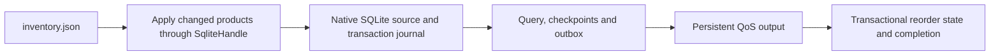

This is the whole pipeline, not a query backend substituted into an otherwise
volatile source. Native SQLite captures committed changes made through its
owned `SqliteHandle`. The file synchronization step performs one SQL transaction
per changed snapshot; it does not implement change capture itself.
Use that handle for writes while the source is running. Independent SQLite
connections do not run this connection's capture hooks.

The file remains a sampled current-state input. Saves missed between reads
are not retained history. Once its changes commit in SQLite, the source journal
retains them until the query's committed progress covers them.
The downstream state and handling survive process restart; disk loss and
remote supplier effects require separate designs.

Startup reports the output journal's pending count **before enabling consumer
delivery**. `Saved reorders` is read from the consumer's own transaction
owner, independently of the query result snapshot. A query can already contain
a low-stock row while its reorder is still awaiting handling.

The `--state` lesson accepts the original product fields. Keep optional
normalization payloads in `encoded-inventory.json`; this path deliberately
stores plain product rows. Invalid input stops this transactional path with
an explicit error; correct the file and reopen the same state directory.

#### Name the state that must survive

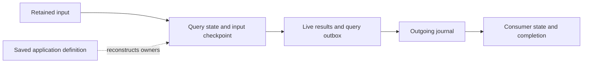

These stores answer different questions. Query indexes describe the graph and
evaluation state. A checkpoint says which input an owner committed. Live
results support current reads; an outbox retains output. A consumer completion
record says what that consumer finished. Saved configuration describes which
owners to reconstruct.

Saving one does not save the others. In particular, a persistent checkpoint
beside a volatile result view is not a recoverable consumer: after restart it
can skip work whose materialized state disappeared.

#### Select a computation index provider

The first example uses `InMemoryComputationProvider`. The starter's optional
`persistence` feature already selects this native backend:

```toml
drasi-index-rocksdb = { path = "../drasi-core/components/indexes/rocksdb", features = ["computation"] }
```

For a separate illustration, construct a provider with an application-owned
directory. The runnable `--state` lesson derives its paths from the supplied state
directory; do not switch it to this illustrative `./stockroom-state` path on reopen:

<!-- illustration: native-index-provider -->
```rust
use drasi_core::computation::ComputationIndexProvider;
use drasi_index_rocksdb::{
    computation::RocksDbComputationProvider, RocksDbMemoryBudget, RocksIndexOptions,
};

let budget = RocksDbMemoryBudget::from_total_budget_bytes(128 * 1024 * 1024)?;
let provider: Arc<dyn ComputationIndexProvider> = Arc::new(
    RocksDbComputationProvider::new(
        "./stockroom-state",
        RocksIndexOptions::new(false, false, budget),
    ),
);
```

The options select archive support, direct I/O, and the shared memory
budget. Set archive support to `true` when the historical version functions
from Chapter 3 require it. Cloning a budget shares its underlying cache and
write-buffer resources; constructing independent budgets does not.

The running lesson uses the provider together with SQLite's coordinated
bootstrap and retained source transactions. Keep those owners together when
adapting it. Replacing only the file lesson's query provider would leave its
volatile source sequence and comparison state unrecoverable.

For directly constructed queries, bind the stable enclosing scope before
registration or activation:

The running native query combines scope, transaction mode and the bound
progress/bootstrap owners. `limits` is the same `SourceTransactionLimits` used
by SQLite; the source's paired bootstrap and progress bindings are explained in
[Chapter 10](#follow-stockrooms-native-source).

<!-- excerpt: stockroom/src/persistence.rs#persistent-query -->
```rust
let query = ContinuousQueryTransformer::new_configured(
    ContinuousQueryDefinition {
        graph_id: GRAPH.into(),
        id: component_id(757),
        query: LOW_STOCK.into(),
        language: ComputationQueryLanguage::Cypher,
        output_stream: StreamId::try_new("low-stock/out")?,
        outbox_capacity: size(128),
    },
    provider.clone(),
    QueryOptions::default(),
    QueryExecutionSettings {
        source_transactions: Some(limits),
        ..Default::default()
    },
    None,
)
.await?
.with_recovery_scope(INSTANCE)?
.with_source_progress(progress)?
.with_bootstrap(bootstrap)
.with_delivery_tracking();
```

Keep the instance scope, graph ID, query ID, output stream, and storage directory
stable across reconstruction. A different instance should use its own storage
namespace. `with_id` alone does not partition every externally supplied
provider's filesystem path.

Because its state survives a restart, a RocksDB query also describes its output
as durable: the output keeps its producer identity and can replay from a
committed position. That is what lets an exactly-once consumer connect to it
([Chapter 5](#declare-what-a-component-guarantees)); an in-memory query's
output is volatile.

An index provider supplies `ComputationIndexes`: the index set, transaction
owner, supported checkpoint/live-result/outbox writers, durability evidence,
and asynchronous cleanup. Two writers using the same filename or a matching
transaction label are not necessarily participants in one transaction.

Component identity and storage location are separate. A `StorageScope` chooses
an application's storage namespace; a component's immutable ID selects its
state within that scope. `StorePartition::named` is available for application
data that does not belong to a component. Use typed partitions rather than
encoding names and UUIDs into interchangeable strings:

<!-- illustration: state-partition -->
```rust
fn component_preferences(id: ComponentId) -> drasi_lib::StorePartition {
    drasi_lib::StorePartition::component(id)
        .in_scope(&drasi_lib::StorageScope::new("stockroom"))
}
```

Changing the component's display name leaves this partition unchanged.
Reusing its former name for a new component does not give the new UUID access
to the original component's state. Backends encode the partition into physical
keys; application code should preserve the typed value and chosen scope.

#### Know what an atomic query commit includes

With a complete atomic provider, query state, the input checkpoint, result
sequence, live rows, and retained output commit together. A failed processing
transaction does not leave a committed input position that skips uncommitted
state.

`QueryOptions` defaults to Strict recovery and Atomic publication. Atomic
publication needs writers that participate in the transaction. The weaker NonAtomic mode
can commit core state before publishing output; incomplete publication then
requires recovery. It is not a way to obtain atomic behavior from an
incomplete provider.

The direct query reader can restore maintained results, but **saved results
are not automatic delivery confirmation**. To track and replay pending outgoing
handoffs, use the registered `ContinuousQueryFactory`, or enable delivery
tracking on a directly constructed query:

<!-- illustration: delivery-tracking -->
```rust
let query = query.with_delivery_tracking();
```

It remains one query component in the batch. The recoverable companion uses
this direct construction. The factory form is introduced in Chapter 15.
Both require the real retained connections and consumer contracts described
in the next chapters; neither makes an arbitrary external action atomic.

#### Choose recovery policy instead of hiding corruption

Strict recovery rejects incompatible configuration, incomplete bootstrap,
missing required history, or inconsistent saved state. That is useful
information: the process cannot truthfully continue from the requested
boundary.

AutoReset permits rebuilding when the applicable contract allows it.
Choose it only when the source can reconstruct the required state and a
rebuild is an acceptable application action. It requires a bootstrap
provider and refuses reset when persistent output has bound durable destinations.
Resolve the destinations and their pending obligations through an explicit
recovery plan; enabling AutoReset is not permission to discard them. It resets
the receiving query for supported reset conditions, not upstream source state.

Query text, language, source/pipeline configuration, joins, mutation semantics,
and output identity can affect recovery identity. A query edit is not always
an in-place update to saved data. Plan a migration or explicit rebuild instead
of changing storage names until startup succeeds.

#### State a failure boundary

`StorageDurability` reports separate evidence for process restart, power loss,
and storage loss. Each field is Guaranteed, NotGuaranteed, or Unknown.
The native RocksDB provider declares local process-restart survival; that
does not assert survival of power loss or losing its disk.

`RecoveryScope::MemoryLifetime` asks about the current lifetime.
`RecoveryScope::Failure(FailureMode::ProcessRestart)` asks about reconstruction
after process failure. Select the failure mode you need and can
support; a class name containing "persistent" is not evidence.

After assembling the relevant owners, add an explicit requirement:

The selected `consumer` names one boundary and all inputs contributing to it;
it does not silently enroll unrelated branches as required subscribers.

| Guarantee | Required evidence at that boundary |
|---|---|
| Acceptance | Success returned upstream protects the input at the selected failure scope |
| Replay | Accepted input can reach this boundary again after interruption |
| CommittedProcessing | Participating state, input progress and output commit together |
| Publication | Committed output reaches recoverable storage before its owner releases it |

For example, a persistent query followed by a volatile outgoing pipe cannot
satisfy process-restart Publication. A memory-only input path cannot establish
process-restart acceptance merely because the query's own indexes are durable.
These are assertions over the constructed contracts, not switches that install
the missing services.

<!-- illustration: recovery-requirement -->
```rust
let requirement = RecoveryRequirement {
    consumer: component_id(757),
    scope: RecoveryScope::Failure(
        drasi_core::interface::FailureMode::ProcessRestart,
    ),
    guarantees: [
        RecoveryGuarantee::Acceptance,
        RecoveryGuarantee::Replay,
        RecoveryGuarantee::CommittedProcessing,
        RecoveryGuarantee::Publication,
    ]
    .into(),
};
```

Pass it to the batch's `require_recovery`. The first in-memory Stockroom does
not satisfy this requirement. The runtime checks the constructed contracts
and storage along the selected path. Supply the journals, checkpoint writers,
and retry logic before asserting their guarantees; unknown evidence fails the
stronger requirement.

#### Use other storage services for their intended purpose

`StateStoreProvider` stores bytes under partition/key identities. It is useful
for application preferences and explicitly designed progress stores. Its batch
helpers are not a general multi-key transaction: some writes can succeed
before a later one fails. Use idempotent retry or a real transaction owner when
all-or-nothing state matters.

`WalProvider` stores input history under a `StorageScope` and source
`ComponentId`. This UUID is not the element's string dataset namespace.
Register the source before
appending, honor its capacity policy, and preserve the meaning of its allocated
sequence. The redb provider's `head_sequence()` reads the committed storage
counter, not an allocated-but-uncommitted sequence. It can remain positive after
old events have been pruned; that does not mean those events are still replayable.
Missing requested history fails explicitly, including a fully pruned log.
`WalSourceResource` and `WalReplaySource` can expose a WAL and processing
progress owner as a native replay source.

A WAL, query outbox, consumer progress store, and configuration store are not
interchangeable. Each proves completion only at its own boundary.

**Summary.** Persistence starts with a complete transaction owner and stable
identity. Strict recovery makes missing or incompatible state visible.
Query durability is necessary but not sufficient: the next step is a correct
initial snapshot and live-input handover.

### 10. Join snapshots to live input

Stockroom's file source begins with the current file. A source with separate
snapshot and live-change interfaces needs a coordinated boundary when loading
initial inventory: a database dump followed by a subscription can miss changes
made between the two, and applying both the dump and those changes can apply a
change twice.

**Bootstrap** is that initial load together with its **handover** to live or
replayed input. The component serving the snapshot also reports its **handover
boundary**: the source positions the snapshot covers. The consumer commits the
snapshot together with that boundary, then processes only input after it.

A query receives its initial data in one of two ways: over bootstrap edges from
other components in the graph, or from a provider object attached to the query
itself. Loaded native sources, including shared database sources, and query
chains use bootstrap edges, so this chapter explains them first. Stockroom's
persistent SQLite lesson uses the attached form, described in
[Follow Stockroom's native source](#follow-stockrooms-native-source).

#### Connect a bootstrap provider

A **bootstrap provider** is a component that serves snapshots and nothing else.
It has its own execution role, `BootstrapProvider`, the fifth beside Source,
Transformer, Sink and Service; see
[Use component roles deliberately](#use-component-roles-deliberately). A
provider has no data ports, so it never emits live changes.

Bootstrap data has its own kind of port. **Data ports** carry live envelopes,
and every declared data port must be connected. **Bootstrap ports**
(`PortKind::Bootstrap`) carry only snapshot sessions and may stay unconnected.
A bootstrap input is conventionally named `bootstrap` and a bootstrap output
`snapshot`:

| Component | Data ports | Bootstrap ports |
|---|---|---|
| Bootstrap provider | None | `snapshot` output |
| Source that relays snapshots | `out` | `bootstrap` input and `snapshot` output |
| Query (`ContinuousQueryTransformer`) | `in` and `out` | `bootstrap` input and `snapshot` output |

Every source loaded through the Host SDK has both bootstrap ports. A source
written in Rust declares them only when it relays snapshots, as described in
the next section. Sinks serve no snapshots.

A **bootstrap edge** connects a bootstrap output to a bootstrap input. For
`low-stock` to start from existing inventory, two bootstrap edges sit beside the
ordinary data edge:

```text
inventory-bootstrap.snapshot -> inventory.bootstrap    bootstrap edge
inventory.out                -> low-stock.in           data edge
inventory.snapshot           -> low-stock.bootstrap    bootstrap edge
```

Connect a bootstrap edge with the same `connect` call and the same kind of
bounded pipe as a data edge. The graph routes no live envelopes over it.
Instead, it hands each component the pipe ends of its bootstrap edges through
`ComputationComponent::bind_bootstrap`. Bootstrap edges take part in dependency
ordering and cycle checks, and inspection shows them like data edges.

The graph rejects bootstrap wiring that breaks these rules:

- A component reads bootstrap data on at most one bootstrap input.
- A source's `bootstrap` input accepts at most one provider and nothing else.
- A query bootstraps either from the `snapshot` outputs of producers whose data
  it also consumes, or from one provider connected directly to it, never from
  both.

When a bootstrap edge binds, the graph also compares facts both components
declare: the pairing protocol a provider requires, the source namespace and
element identities it serves, and the kinds of completion the consumer accepts.
A mismatch leaves that edge unbound and the consumer reporting a binding failure
until either side changes or the edge is removed; the graph change itself is
accepted and the rest of the graph keeps running. The
[native bootstrap provider standard](../../../components/computation-plugins/bootstrappers/NATIVE-BOOTSTRAP-PROVIDER-GUIDE.md#binding-checks)
lists the checks.

`BootstrapProviderComponent` turns a `ComputationBootstrapProvider`, the
interface described in
[Establish the handover before consuming rows](#establish-the-handover-before-consuming-rows),
into a provider node. Its `new(id, factory)` constructor creates a provider for
each session from the session's `BootstrapRequest` and stops it when the session
ends; `shared(id, provider)` serves every session from one provider. The node
declares no bootstrap facts unless you supply them with `with_description`, and
undeclared facts satisfy no requirement. Add a provider node to a
`ComponentBatch` with `component(name, specification, factory)`, where the
factory's `create` returns `ConstructedComponent::bootstrap_provider`. For a
loaded bootstrap library, that factory is the Host SDK's
[`NativeBootstrapNodeFactory`](../../../components/host-sdk/README.md#native-bootstrap-provider-nodes).

#### Follow one bootstrap session

The consumer drives each **bootstrap session**. When a query with bound
bootstrap inputs starts, it sends a `BootstrapRequest` upstream as a
[control notification](#use-readiness-and-control-relationships), one bootstrap
edge at a time. The request identifies the session and the query, says whether
the query stores its bootstrap state durably, carries any state this producer
returned to the query in an earlier session, and lists the node and relation
labels the query reads. The labels come from the query text and its input
selections. A query whose middleware or input pipelines can rename labels, or
that matches an unlabeled node or relation, sends no labels, which means
unrestricted. Providers select only the tables, endpoints or collections that
can produce a requested label.

The producer answers on the bootstrap edge to that one query: a begin marker,
the snapshot records, then a completion or a failure with its reason. A
completion carries the handover boundary as `BootstrapWatermark` values and can
carry state for the query to keep. Every message names its session, so the
query ignores messages from a session it no longer waits for.

A source between the provider and the query **relays** the session. It opens its
own session with the provider on its `bootstrap` input, passing on the query's
identity and labels, forwards the records and any failure, and then completes
with its handover boundary: the positions in its own live output that the
snapshot covers. The query commits the snapshot with that boundary and skips the
live changes it covers; later changes are ordinary input.

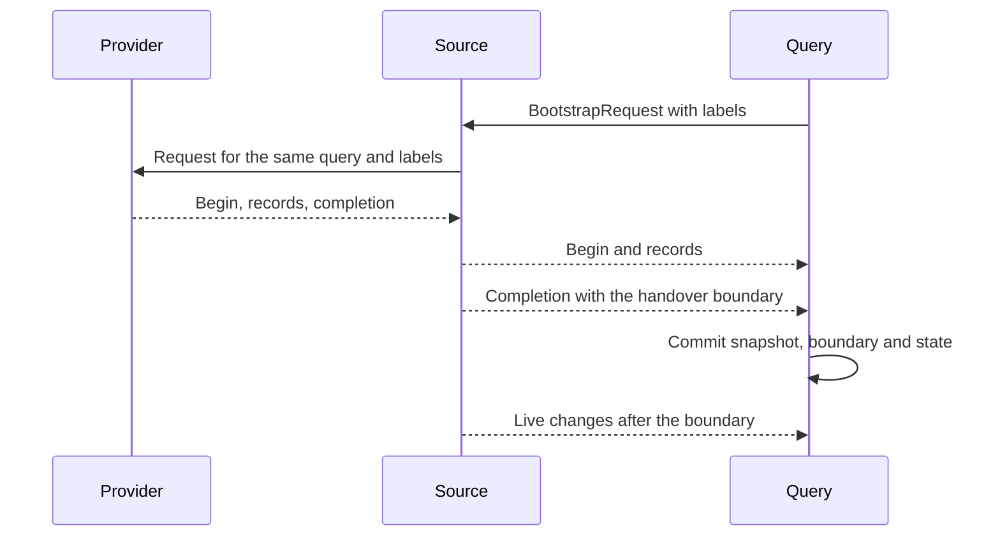

A session does not pause live output, with one exception. A relaying source
that is bound to its consumers' progress holds its live output on its very
first start, when none of them has saved progress for it or a completed
bootstrap, until the first relayed session completes. A source without progress
owners, such as the HTTP source, holds nothing.

A source loaded through the Host SDK hands over exactly the watermarks its
provider reports, and a paired provider reports positions in its source's own
output. A snapshot without watermarks, such as an HTTP or SQLite file snapshot,
establishes no cut: a change made while it is read can arrive both in the
snapshot and as live input. Keep writers quiet until such a load finishes, or
order initialization in the application.

A source written in Rust relays with `BootstrapRelay`. Create it with a handover
function that maps the provider's watermarks to the source's output positions.
Bind it in `bind_bootstrap`, return it from `control_handler`, call `hold_live`
on a first start, and await `live_released` before emitting live output.

#### Restart and join late

A persistent query that completed its bootstrap takes no fresh snapshot when it
restarts. It sends a *resume* request, with the state it saved, to each producer
that returned state. The producer restores that handover, such as a paired
source's live boundary, and completes without records; replay then continues
after the saved checkpoints. A volatile query instead rebuilds its view from a
fresh snapshot, including removals made while it was stopped. The table in
[Establish the handover before consuming rows](#establish-the-handover-before-consuming-rows)
lists every starting state.

A query added while its source is running is a **late joiner**. It gets its own
session and its own boundary. Other consumers keep receiving live changes, and
the late joiner skips the live changes its snapshot covers. Some sources
restrict late joining. Paired SQLite runs a snapshot and live writes under one
exclusive lease, and its shared consumer set changes only across a stop. Shared
PostgreSQL keeps its source stopped while a query enrolled later takes its
snapshot.

#### Choose where a query's initial data comes from

| Initial data from | Wiring | Use it for |
|---|---|---|
| Each input's `snapshot` output | `source.snapshot -> query.bootstrap` or `upstream.snapshot -> query.bootstrap` | Sources with providers, and query chains |
| One local provider | `provider.snapshot -> query.bootstrap` as the query's only bootstrap edge | A snapshot for an input that cannot relay one |
| An attached provider object | `with_bootstrap(provider)` | Inputs without bootstrap edges, such as Stockroom's SQLite source |

**Bootstrap from an upstream query.** Every query serves its committed results on
its `snapshot` output. Connect `upstream.snapshot -> downstream.bootstrap` beside
`upstream.out -> downstream.in`, and the downstream query starts from the
upstream's current answer. The completion carries the upstream's output cursor
as the boundary, so output covered by the snapshot is skipped. If the upstream's
results do not become ready in time, the session fails. A persistent query
cannot bootstrap from a volatile upstream query. One query can bootstrap from a
relaying source and an upstream query together; it reads their sessions in
turn. A persistent downstream query gets no replay of upstream output after a
restart; [Chain maintained outputs](#chain-maintained-outputs) explains the
consequence. The query builder connects these edges itself when bootstrap is enabled,
the query has no local provider, and an input component has a bootstrap output,
as in [Chain maintained outputs](#chain-maintained-outputs), where Stockroom's
`chain` lesson shows a query joining late with and without its bootstrap edge.

**Use one local provider.** A provider node connected directly to a query's
`bootstrap` input is that query's **local provider**. It must be the query's
only bootstrap edge, and the query never asks its inputs for snapshots. With the
query builder, name it with `Query::with_bootstrap_provider`
(`bootstrapProvider` in YAML or JSON). Bootstrap must be enabled, the provider
cannot also be a data input, and the builder connects the edge. One provider
node can serve several queries, each over its own edge and session. A local
provider has limits that a relaying source does not:

- A provider that serves a source's element namespace, such as an HTTP or
  SQLite file snapshot, takes that source from the graph: the single source the
  query reads. If the query reads several sources, or none, the edge fails to
  bind.
- A paired provider needs its source's relay, so it cannot be local.
- The query receives only the provider's own watermarks, so a snapshot without
  them gives no cut.

**Attach a provider object.** A directly constructed query also accepts a
provider without any graph edge:

<!-- illustration: bootstrap-binding -->
```rust
let query = query.with_bootstrap(bootstrap_provider);
```

`bootstrap_provider` is an `Arc<dyn ComputationBootstrapProvider>`; bind it
before the query starts. The query uses it for inputs that have no bootstrap
edge. When the query also has bound bootstrap edges, it combines the two as
children of one `CompositeBootstrapProvider`, described in
[Combine initial data from multiple inputs](#combine-initial-data-from-multiple-inputs).
The registered query factory accepts the same provider as a
`QueryBootstrapResource` under its `bootstrap` dependency.

#### Follow Stockroom's native source

Stockroom's persistent lesson uses the attached form. Its source,
`drasi_source_sqlite::native::SqliteSource`, declares only the `out` data port
and relays no sessions. `SqliteSource::coordinated` returns the source together
with a provider bound to the same database, configuration and progress owner,
and the lesson attaches that provider to `low-stock` with `with_bootstrap`.
Both use the one `QuerySourceProgress` owner for `low-stock`:

<!-- illustration: sqlite-bootstrap -->
```rust
let progress = Arc::new(QuerySourceProgress::new(
    GRAPH,
    component_id(757),
)?);
let (source, bootstrap) = SqliteSource::coordinated(
    component_id(758),
    StreamId::try_new("inventory/out")?,
    sqlite_config,
    progress.clone(),
)?;
let query = query
    .with_source_progress(progress)?
    .with_bootstrap(bootstrap)
    .with_delivery_tracking();
```

`SqliteSource` here is imported from `drasi_source_sqlite::native`.
`sqlite_config` is the bounded `SqliteConfig` in the companion: a file path,
the Product table, complete-transaction output, source-journal limits, and
operation/cleanup bounds. `query` was constructed with
`QueryExecutionSettings.source_transactions` using the same transaction limits.

On first use, the query records the initialization identity in its own storage
before the provider touches the database. The provider then creates or binds the
source journal and streams a consistent read of the existing rows, and the query
commits the completed handover with the source watermark. On reopen the
provider verifies that handover and the query's progress. The source admits no
SQL writes until the handover is committed, so no change can fall between the
snapshot and the journal; the lesson also waits for query readiness before its
first write. The application then applies file changes through
`source.handle()`. This is source-specific bootstrap code supplied by the
native component, not an application-owned snapshot race.

**Try it.** Run `cargo test --locked --features persistence held_alert_recovers`.
It closes and reconstructs the same native source, query, journal, and consumer,
including a reopen that submits no new input.

#### Establish the handover before consuming rows

Every provider implements `ComputationBootstrapProvider`, however it is
connected. A provider node calls it for each session; a query calls an attached
provider directly. The provider and its consumer cooperate in this order:

1. Prepare the source subscription and determine whether saved query state is
   reusable, needs a volatile refresh, or requires an explicit reset.
2. Establish whether this start has a real snapshot or only checkpoint-based
   replay.
3. Stream the snapshot while preserving the live-input boundary.
4. Complete any boundaries known only after the snapshot closes.
5. Commit the source watermarks, completed-bootstrap marker, and final
   initialization state together.

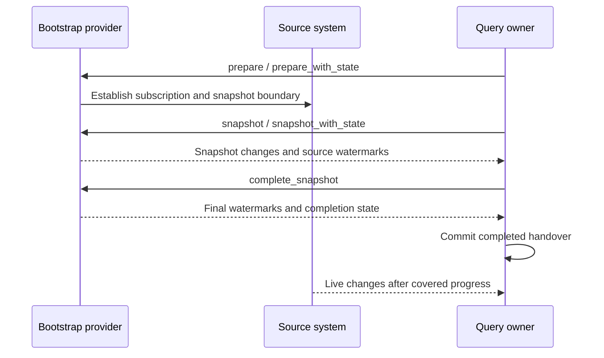

Ready, RefreshVolatile, and ResetRequired are different outcomes. Report a
database failure as a failure; an empty snapshot means the source was empty at
its boundary. `has_pending_snapshot` distinguishes a fresh initial load from a
replay-only start, which preserves completed initialization. Behind a provider
node, a session proceeds only from `Ready`: for a volatile query the node
retries a `RefreshVolatile` preparation once with empty state, and any other
outcome fails the session.

| Saved state at start | Initialization decision |
|---|---|
| No prior initialization | Establish a real snapshot/live cut and commit its covered watermarks |
| Completed reusable persistent state | Replay after the saved cursor; do not reload a fresh snapshot as though it were history |
| Completed volatile input view | Refresh current input, including deletions while stopped; the volatile refresh policy can apply under Strict |
| Interrupted persistent initialization | Remains incomplete; Strict does not declare it complete or silently erase it |
| Typed replay gap or changed producer epoch | Strict fails; AutoReset needs permission and a bootstrap provider, attached or over edges, and refuses a persistent reset with bound durable destinations |

Live pipes are already bound while the snapshot is captured. Buffered changes
covered by the boundary are skipped; later changes remain input work.
Completing bootstrap makes the query readable/ready but can leave replay to
process, as the [readiness table](#read-a-readiness-observation) explains.

#### Make watermarks describe real coverage

`ComputationBootstrapSnapshot` carries a stream of changes and
`BootstrapWatermark` values. Each watermark names the stream, optional source ID,
framework sequence, and optional opaque source position covered by the snapshot.
A watermark from a query's output snapshot names the upstream output's producer
identity instead of a source ID and position.

Those values must describe the same source boundary. A sequence number invented
from the number of rows in a dump is not necessarily a valid change-stream
position. Sequence zero is valid only when it is the true boundary, not a
default for "position unavailable." A relaying source's handover function
follows the same rule: the boundary it reports must be positions that the
provider's snapshot includes.

A completed query-wide bootstrap marker is not a checkpoint for every source.
One source can still need initialization when another already has valid saved
progress. Replay through intermediate components needs the progress of the
component that processes the input, not a match inferred from component names.

Connect live input through bounded paths during initialization. A provider
that buffers changes outside the graph must bound and own that buffer too.
Timeouts and capacity pressure are errors or explicit backpressure decisions,
not reasons to drop the oldest unseen changes.

#### Persist external initialization intent

Some sources must create external state, such as a replication subscription.
`prepare_with_state` and `snapshot_with_state` receive a borrowed
`BootstrapState` service in the query's own storage domain.

Write initialization intent **before** the external action. On restart, read
it to identify and verify the same subscription rather than creating another.
Return final handover bytes from `completion_state`; the query commits them
with the watermarks and completed marker.

For Stockroom, the bytes might identify a database subscription and its
snapshot boundary. Validate the recovered identity against the configured
database before reusing it. The state is bounded initialization metadata,
1 through 65,536 bytes, not an unrestricted application store.

Initialization metadata survives an explicit query reset so the provider can
reuse or release external state coherently. Deprovision removes it.
The borrowed service cannot escape its callback or become an independent writer.

Behind a provider node, these calls receive a session state holding what the
query saved for that producer. Each write returns to a persistent query as a
state marker. The query stores markers that arrive before its first snapshot
record at once, and each provider's final state when the bootstrap completes.
State that outlives a session, such as a replication slot, belongs to the
paired source, which removes it when the source is erased; name it from the
source's identity, never from provider configuration.

#### Bind replay to the query's progress owner

`QuerySourceProgress` publishes committed input progress. A source or bootstrap
provider using `SourceProgressReader` must return the supplied reader from
its recovery hook. Bind the query's own `QuerySourceProgressResource`, not
another owner with matching names, so both participants observe the same
transaction owner. At start, the query rejects a provider whose recovery reader
belongs to a different owner.

A read-only progress capability does not itself retain source history.
The source must separately guarantee that input after that progress remains
available for replay. State the retained-until-consumer boundary explicitly.

#### Finish snapshot cleanup

Dropping the snapshot stream must cancel its work. A provider with auxiliary
workers must implement `stop` and await them before query storage is released.
Retain incomplete cleanup after timeout or cancellation, and reject a second
snapshot owner until cleanup succeeds.

A provider node stops each session's provider when the session ends. Requests
that arrive before the node starts wait for it; stopping the node fails the
sessions in progress, and a disposed node rejects requests.

A successfully stopped paired provider can be replaced even if its old handle
is retained. That handle must not resume or cancel the replacement. Conversely,
dropping an active or failed-cleanup handle is not evidence that its workers
finished. A rejected replacement must leave a valid stopped original usable.

Verified retirement needs a stronger held lifecycle than a sampled successful
stop. For a provider bound to a query as a resource, `freeze_for_retirement`
prevents reuse while a configuration removal is being resolved;
[Chapter 17](#retire-a-managed-durable-path-without-discarding-work)
shows how management holds that exclusion.

This completes the single-owner Stockroom bootstrap path. Snapshot rows are not
automatically one upstream database transaction; preserve that distinction from
the complete source groups in [Chapter 13](#13-preserve-transactions).

#### Share a source without sharing its recovery owner

**Alternative: multiple consumers.** One inventory source can feed both
`low-stock` and a second audit query. Do not
create a source per query or make both queries publish through one progress
owner. Give each query its own `QuerySourceProgress`, bind it to that query,
and construct a `ConsumerProgressSet` from those owner objects, the graph ID
and the producer ID. The set retains 1 through 256 distinct owners. Matching
names or a separately allocated same-named owner are not equivalent bindings.

The producer observes each member's readiness, failure, reset generation and
handled position independently. It must keep enough history for every required
member. The slow member can therefore hold back upstream acknowledgement or
pin journal capacity; it cannot be silently dropped to let the source advance.
The graph checks that the declared owners really cover the required downstream
paths, including supported stateless intermediates.

Independent snapshots can cover different source positions. A source-defined
`InputPositionPolicy` compares those physical positions, and each query filters
replayed input against its own checkpoint. Do not take the minimum of unrelated
query counters or fabricate a combined checkpoint. Logical output positions
and original/immediate transport counters remain separate from that comparison.

Choose the source's shared interface and matching initialization contract. In
each coordinated mode, bind every consuming query's progress owner to the
shared source as its normal progress dependency, and connect one paired
provider node to the source's `bootstrap` input. The paired node declares no
progress dependency of its own: the source's coordinator opens a provider for
each query's session with that query's owner. Each query has its own bootstrap
edge from the source's `snapshot` output:

| Source | Shared recovery | Provider node on the source's `bootstrap` input |
|---|---|---|
| PostgreSQL rows | `drasi.postgres/shared-changes`; memory or persistent query progress | `drasi.postgres/shared-row-bootstrap` |
| PostgreSQL whole transactions | `drasi.postgres/shared-transactions`; every query atomic, persistent and transaction-enabled | `drasi.postgres/shared-transaction-bootstrap` |
| MySQL rows | `drasi.mysql/shared-changes` with `startFrom: snapshot`; memory or persistent query progress | `drasi.mysql/shared-row-bootstrap` |
| MySQL whole transactions | `drasi.mysql/shared-transactions` with `startFrom: snapshot`; atomic persistent queries | `drasi.mysql/shared-transaction-bootstrap` |
| MySQL positional rows | `drasi.mysql/shared-positional-changes`; per-query row checkpoints | None: no coordinated snapshot or commit-clock claim |
| SQLite | `drasi.sqlite/shared-transactions` with `coordinatedSnapshot: true`; persistent queries | `drasi.sqlite/shared-bootstrap` |

PostgreSQL's shared providers use independent temporary exported snapshots
and stream from the source's own slot: with the default managed ownership the
provider creates the source's derived slot if it does not exist yet, and with
external ownership the operator's slot must already exist. A provider never
resets or recreates that slot. Each query commits its own handover before the
source resumes. Whole transactions remain whole inputs; row-mode fan-out is not
a substitute for transaction-preserving processing.

Stockroom's lesson keeps its single-owner `SqliteSource::coordinated` path.
Shared modes have their own source identities and recovery records; do not
reopen single-owner state as shared state. In Rust, the shared counterpart is
`SqliteSource::coordinated_with_consumers`, whose `SqliteConsumerSnapshots`
returns each query's provider through `for_consumer`; each query attaches its
provider with `with_bootstrap`.
See the [PostgreSQL](../../../components/computation-plugins/sources/postgres/DESIGN.md#cursors-and-feedback),
[MySQL](../../../components/computation-plugins/sources/mysql/DESIGN.md#cursors-and-binding) and
[SQLite](../../../components/computation-plugins/sources/sqlite/DESIGN.md#ordering-checkpoints-and-recovery)
contracts for retention and enrollment rules.

#### Pair separately loaded SQLite components

**Host profile: separately loaded source and bootstrap libraries.** A loaded
SQLite source and its paired provider share one engine: the provider reads
through the source's own worker coordination and journal, not another
connection found by database path. Configure the journal source,
`drasi.sqlite/replay-transactions` or `drasi.sqlite/shared-transactions`, with
`coordinatedSnapshot: true`, and connect one `drasi.sqlite/coordinated-bootstrap`
or `drasi.sqlite/shared-bootstrap` provider node, respectively, to its
`bootstrap` input. When a provider is connected, the source creates its
library's coordinator from its own progress owners; there is no coordinator
resource to declare. Chapter 16 lists the complete bindings in
[source-owned database initialization](#declare-source-owned-database-initialization).

The unpaired `drasi.sqlite/file-bootstrap` reads the file directly. It reports
no watermark, so writers must stay quiet until the queries finish loading, and
it cannot replace coordinated persistent initialization. Neither provider
exposes SQL reads or writes through DrasiLib; the source's REST API, or its
`SqliteHandle` when the source crate is linked, remains the application
interface.

#### Combine initial data from multiple inputs

**Alternative: multiple initial datasets.** A query joining database inventory
with an HTTP catalog needs both initial datasets. Give each source its own
provider node and connect each source's `snapshot` output to the query's
`bootstrap` input, beside the data edges. The query reads the sessions in turn
and commits all of their boundaries and completion states with its
completed-bootstrap marker; a partial load remains incomplete.

This combines initialization protocols, not their guarantees. The HTTP snapshot
has no cut, so the application must keep catalog changes quiet until the query
has loaded, and the sources share no single snapshot instant. The
[PostgreSQL/HTTP example](https://github.com/drasi-project/drasi-server/tree/29ff787a28717bc760df9840d1f2264026a75263/examples/postgres)
wires one provider node per source with bootstrap edges from every input
source; the [Host profile](#declare-shared-progress-and-composed-bootstrap-resources)
in Chapter 16 shows the same edges.

A directly constructed query can combine provider objects instead: build a
`CompositeBootstrapProvider::new(instance, graph, query, providers)` and attach
it with `with_bootstrap`. The query builds the same composite itself when it has
both an attached provider and bound bootstrap edges. The composite:

- takes 1 through 32 distinct provider objects with distinct resource IDs;
  children that read query progress must share the query's one progress owner;
- streams the children in order without collecting their snapshots;
- stores each child's initialization state under its resource ID in one
  versioned record within the 65,536-byte bound, so keep the order and
  membership stable;
- commits the combined completion state and at most 256 distinct watermarks in
  the query's transaction;
- reports the strongest preparation outcome (`ResetRequired`, then
  `RefreshVolatile`, then `Ready`); after any other outcome than `Ready`, it
  stops and rearms every child, including those that returned `Ready`, before
  preparation retries;
- awaits cleanup of every child after cancellation or failure.

Strict incomplete persistent initialization still requires an explicit recovery
policy; composition does not authorize erasing it.

**Summary.** Bootstrap is a handover protocol, not just an initial load.
Providers are components connected by bootstrap edges or objects attached to
one query; either way, each consumer drives its own session and commits the
boundary its snapshot covers. Prepare subscriptions before consuming rows,
report truthful watermarks, retain external initialization identity, and await
cleanup. The query then starts from a recoverable boundary.

### 11. Retain input and replay output

Protect the intervals before a query accepts inventory and after it commits an
alert. The goal is not merely to have data somewhere on disk, but to know which
owner remains responsible for each unfinished handoff.

Stockroom's running persistent path retains input in the native SQLite source
and output in a QoS journal. This chapter explains its outgoing connection,
then shows two alternatives: admission for externally submitted input and
snapshot/outbox recovery for a materialized view.

#### Distinguish input, output, and replay positions

Suppose query output 7 contains operations 0 and 1 for two different products.
A retry may arrive at transport position 12 while still representing output 7.
It is the same business work arriving again, not a new order. Store the identity
returned by the relevant API instead of deducing it from an unrelated counter.

| Value | Identifies | Use |
|---|---|---|
| `ElementReference` / `RecordId` | A particular node, relationship or result row | Update the same data item |
| `ChangeSetId` and operation ordinal | A batch and an operation within it | Distinguish operations, including equal-valued records |
| Output stream and logical sequence | Emissions from one output | Order new output; one emission can contain several operations |
| Transport sequence | A particular delivery/re-emission stream position | Track transport, not deduplicate business effects |
| Source position | An upstream resume location, such as a database log position | Resume source history using that source's comparison rules |
| Output epoch / query output generation | The output provider's recovery identity | Decide whether a cursor belongs to the same output history |
| Component generation | One constructed object in the graph | Reject handles belonging to a replaced object |
| Graph/configuration revision | Accepted topology or saved-definition version | Reject stale configuration changes |

These are not interchangeable counters. A component's UUID is its stable
identity, not its processed-input position. Its editable name is neither.
Framework metadata belongs in `SystemMetadata`, business attributes in records.
Derive new envelopes rather than mutating shared input, preserving the attribution
and lineage required by the transformation.

| Event | What the consumer should do |
|---|---|
| Normal processing | Apply the next logical output in the current output history |
| Replay of committed output | Recognize the original logical output even if its transport sequence changes |
| Stop/start of the same query object | Retain its output identity; a bootstrap reset can still change its reset generation |
| Persistent query reopen | Validate the same scope, configuration, stores and reset generation before continuing |
| New volatile query object | Treat its output as a new history; old cursors cannot identify it |
| Component replacement | Acquire fresh component handles; a new object does not itself change a durable output epoch |
| Explicit query reset | Use an authorized rebuild/snapshot policy, not the old cursor |

A query's producer epoch is derived from its recovery identity and reset
generation. A volatile query also has a per-object publication identity, because
its data disappears with that object. A fully persistent query instead recovers
its checkpoints, outbox and live results from storage. Equal projected values
do not promise equal row IDs across every reset.
These query examples use the linked or indexed query implementation. A plugin
profile that explicitly discards its evaluator on stop has a different restart
contract; consult that profile before reusing a cursor.

#### Register a bounded codec

Persistent transport needs executable validators, not only schema names.
`EnvelopeCodec` is the bounded JSON envelope codec; `BinaryEnvelopeCodec` is the
binary alternative. Record payload encoding remains schema-specific.

<!-- illustration: envelope-codec -->
```rust
fn codec() -> anyhow::Result<EnvelopeCodec> {
    let mut codec = EnvelopeCodec::new(
        NonZeroUsize::new(1024 * 1024).expect("positive size"),
    );
    codec.register_schema(GraphChangeCodec::schema())?;
    Ok(codec)
}
```

Register every schema the path carries with a trusted executable
validator. Decoding validates both that schema and the outer encoding.

#### Protect query output handoff

This is the path the SQLite-backed Stockroom uses. Open its output journal with
replay receipts:

<!-- excerpt: stockroom/src/persistence.rs#output-journal -->
```rust
let journal = QosChannel::persistent_with_recovery(
    QosChannelDefinition {
        stream: StreamId::try_new("low-stock/out")?,
        capacity: size(128),
        durable: true,
        retention: RetentionPolicy::Backpressure,
        subscribers: [("alerts".into(), SubscriptionStart::Earliest)].into(),
    },
    provider.create_indexes(GRAPH, &component_id(767)).await?,
    codec()?,
    "low-stock",
    QosRecoveryOptions::Replay(ReplayOptions {
        failure_scope: FailureMode::ProcessRestart,
        receipt_capacity: size(128),
    }),
)
.await?;
```

A QoS channel appends once and keeps a cursor for each named subscriber. Its
lossless retention policy backpressures new work while required consumers are
behind. Give the graph this resource and use it on the edge:

<!-- illustration: journal-binding -->
```rust
let output_journal = ResourceId::try_new("output-journal")?;
let handle = journal.resource();
batch = batch
    .declare_resource(ResourceSpecification {
        id: output_journal.clone(),
        role: handle.role(),
        ownership: ResourceOwnership::Graph,
        binding: "output-journal".into(),
    })?
    .provide_resource(output_journal.clone(), handle)?
    .connect(
        EdgeDefinition::new(
            endpoint(component_id(757), "out")?,
            endpoint(component_id(759), "in")?,
        ),
        Box::new(journal.definition().pipe(output_journal, "alerts")),
    );
```

This **replaces** the bounded edge from the first application. Opening a
persistent channel does not make some other edge durable. The tracked query
retains committed output until every required destination accepts it. If the
process stops after journal acceptance but before confirmation, replay receipts
recognize the same logical output despite a new transport sequence.

Tracked destination membership includes component, port, subscriber and journal
identity. Keep those identities and delivery tracking enabled while output is
pending. An allowed replacement under the same destination identity inherits its
unfinished work.

Earliest, Latest and After select a **new** subscriber's starting position;
reconnecting an existing subscriber preserves its saved cursor. Disconnecting
does not retire it. Only explicit retirement or an intentional member-definition
change releases its obligation.

#### Acknowledge only the promised boundary

`EnqueueReceipt` proves acceptance, not handling. On failure, distinguish
NotAccepted from Unknown; cancellation can leave acceptance unknown too.
`send_batch` is not atomic: a failure can retain receipts for an accepted prefix
and envelopes that were never attempted.

A received `Delivery` may carry an `Acknowledgement`. Complete it with the
real handling outcome; dropping it does not acknowledge work. Acknowledged
subscribers have one outstanding delivery each, regardless of journal capacity.
The consumer in Chapter 12 commits its promised work before completing the batch.

#### Bound retained history and caches

Retained stores and non-shared QoS journals also support byte quotas. A journal
charges an envelope once, not per subscriber; lossless retention reclaims only
safely handled history. A smaller quota on reopen preserves existing obligations
and blocks new admission until safe pruning is possible.

`OutboxPageLimits` through `IndexedJournalOptions` or `QosJournalOptions` bounds
the decoded payload cache. Page bytes measure stored records; admission quotas
measure binary envelopes. Startup still validates complete history. The
shared-storage alternative in Chapter 13 has bounded history pages but
count-based admission reservations. Set limits on the resource owner
and preserve them in its reconstruction recipe; see
[journal resource limits](../computation-graph-qos.md#optional-journal-resource-limits).

**Try it.** Run with `--hold-alerts`, lower a quantity, and wait for the retained
alert message. Stop and reopen without that option. Compare the pending count
at open with the count on one more idle reopen. This separates stored output
from completed handling without relying on a timeout.

<a id="assemble-a-retained-path"></a>

#### Alternative: durable source admission

For an ingress protocol without its own durable change log, use graph-owned
admission instead of inventing another source WAL:

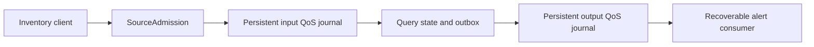

This replaces the input protocol, not the running lesson's SQLite journal.
Reuse the codec above and define a lossless input channel:

<!-- illustration: channel-definition -->
```rust
fn channel_definition(
    stream: &str,
    subscriber: &str,
) -> anyhow::Result<QosChannelDefinition> {
    Ok(QosChannelDefinition {
        stream: StreamId::try_new(stream)?,
        capacity: NonZeroUsize::new(32).expect("positive capacity"),
        durable: true,
        retention: RetentionPolicy::Backpressure,
        subscribers: [(subscriber.into(), SubscriptionStart::Earliest)].into(),
    })
}
```

A `RetainedPipe` is useful for a lower-level single-consumer retained connection.
Give independent consumers independent cursors, or use a QoS channel.

<a id="protect-source-admission"></a>

Open the input channel with producer admission:

<!-- illustration: source-admission -->
```rust
use drasi_core::interface::FailureMode;

let incoming = QosChannel::persistent_with_recovery(
    channel_definition("inventory/out", "low-stock")?,
    provider.create_indexes(GRAPH, &component_id(768)).await?,
    codec()?,
    "inventory",
    QosRecoveryOptions::Admission(AdmissionOptions {
        construction_scope: INSTANCE.into(),
        graph_id: GRAPH.into(),
        component_id: component_id(758),
        failure_scope: FailureMode::ProcessRestart,
        max_producers: NonZeroUsize::new(1).expect("positive capacity"),
        receipts_per_producer: NonZeroUsize::new(32).expect("positive capacity"),
    }),
)
.await?;
let admission = SourceAdmission::new(
    incoming.clone(),
    PortId::try_new("out")?,
)
.await?;
```

The instance scope must match the application's stable identity.
The persistent companion uses its own constant for that scope.
Declare/provide this input resource and select its subscriber pipe exactly as for
the output journal above. Admission receipts identify client submissions;
replay receipts identify the immediate persistent producer's output. The two modes
cannot coexist on one channel. Disabled is the default, and reopening must retain
the selected recovery contract.

A source exposing this service returns it from `EnvelopeSource::admission`.
The graph services its bounded mailbox; it does not also call `next` to publish
the same data. All source outputs must use the configured QoS channel.
Scope, schema, identity, and sequence validation precede its single admission
commit.

Its recovery hook describes the **channel it is bound to**, not an intended
guarantee:

<!-- illustration: admission-contract -->
```rust
fn recovery_contract(&self) -> ComponentRecovery {
    ComponentRecovery::admitted(self.admission.channel().durability())
        .replay_to_durable_delivery()
}
```

This is an alternative admission-backed source, not the SQLite source used by
`--state`. The native HTTP source supports binding that same service through
its `admission` resource; its durable routes use sessions and receipts rather
than the volatile events route from Chapter 5.

Register a producer, then submit consecutive client sequences:

<!-- illustration: admission-retry -->
```rust
admission.wait_active().await?;
let producer = admission
    .register_producer(component_id(769))
    .await?;
let first = admission.admit(&producer, 1, &input).await?;
let retry = admission.admit(&producer, 1, &input).await?;
ensure!(first == retry, "identical retry must return the original receipt");
```

Here `input` is the same encoded inventory envelope in both calls. The receipt
proves storage-backed acceptance at the configured failure scope, not query
completion or a business effect.

`admit` never waits. When the admission mailbox is full, or a subscriber is
committing its progress, it returns `Busy`; retry with the same session,
sequence and unchanged input. To wait for capacity instead, call `admit_wait`
and bound it with your own deadline:

<!-- illustration: admission-wait -->
```rust
let receipt = tokio::time::timeout(
    Duration::from_secs(5),
    admission.admit_wait(&producer, 2, &next),
)
.await
.context("the inventory journal stayed full")??;
```

`admit_wait` is woken by the admission service rather than polling, and follows
the same session, sequence and receipt rules as `admit`. It never carries a
request into a restarted activation. If the deadline cancels it before the write
starts, the input and its sequence remain unused. Once the write has started, a
lost response is uncertain in the same way as with `admit`: resolve it as
described below instead of resubmitting automatically.
`admit` and `admit_wait` take a `ChangeEnvelope`. When the input carries trace
context, wrap both in an `EnvelopeMessage` and call `admit_message` or
`admit_message_wait`; the context travels with the input but is never stored.
Wait for the admission service's own `wait_active` boundary after activating
the graph. Component startup alone does not establish that its admission mailbox
is ready. Before activation and while stopped, durable admission rejects sends;
it does not behave like a volatile application channel that buffers while stopped.

A graph can feed its own results back into a source, for example when a sink's
`handle` admits a follow-up change. Opt in with
`DrasiLibBuilder::with_feedback_shutdown(true)` and admit from the callback
through `SourceAdmission::feedback`. Shutdown then closes external admission
first and drains the finite feedback before it stops the graph; feedback that
never ends fails within the cleanup budget instead of being acknowledged.
Spawned workers and external callers keep using ordinary admission.

Retain the producer session, client sequence, and original content when a
response is lost. Resolve uncertainty with `producer_status`,
`admission_receipt`, or the identical retry. Changed or expired retries must
not become new input. Starting a new session to avoid an uncertain result can
duplicate business work.

Receipt history and producer counts are bounded. Plan capacity for the retry
window the client needs. State that finite retry window in the client contract
and retire producers explicitly when their obligations permit it.

<a id="bring-a-new-consumer-up-to-date"></a>

#### Alternative: bring a durable view up to date

Reading a snapshot and then subscribing leaves a gap in which changes can
be missed. Applying both a snapshot and overlapping output can apply the same
change twice. A correct handover must coordinate the live connection, snapshot
boundary, retained history, and consumer progress.

```mermaid
sequenceDiagram
    participant C as Consumer
    participant Q as Query output owner
    C->>Q: Establish live input before fetching recovery state
    Q-->>C: Keyed snapshot through S and retained output
    C->>C: Replace the view and complete its recovery boundary
    Q-->>C: Buffered and live output
    C->>C: Discard covered output; handle later sequences in order
```

The library supplies this machinery through `QueryReplayTransformer` and
`CheckpointedSink`; the next section connects them. `QueryResultsCatalog` with a
connected `QueryResultsOutlet` supports live query-result subscriptions.
A `QueryResults` reader alone is not such an outlet.

`results.replay(after)` reads bounded retained output after a logical sequence.
`recovery_view` reads a coherent recovery identity, snapshot, and optional
retained history. If the required range is unavailable, increasing a timeout
cannot recreate it. The application needs an explicit rebuild or gap policy.

A snapshot envelope means **replace the view**. A progress-only envelope
means a recovery decision without business rows; it is not permission to
silently skip work. Stockroom's simple live-only view cannot apply either:
`apply` fails, and the `Alerts` sink reports a permanent delivery failure that
stops it rather than pretending to implement recovery. Add a recovery-aware
owner before accepting them.

#### Recover a keyed view from a query outbox

An alternative for a restorable view is:

```text
query -> QueryReplayTransformer -> CheckpointedSink -> saved view
```

The replay transformer uses query state and retained output rather than
requiring a separate output journal. Replay and checkpointing must share the
same progress store:

<!-- illustration: checkpointed-view -->
```rust
fn recoverable_consumer(
    inner: Box<dyn EnvelopeSink>,
    results: QueryResults,
    store: Arc<dyn drasi_lib::StateStoreProvider>,
) -> anyhow::Result<(QueryReplayTransformer, CheckpointedSink)> {
    ensure!(
        inner.descriptor().id() == &component_id(759),
        "consumer identity must match its progress scope"
    );
    let progress: Arc<dyn ConsumerProgressStore> = Arc::new(
        StateStoreConsumerProgress::new(INSTANCE, &component_id(759), store)?,
    );
    let replay = QueryReplayTransformer::new(
        component_id(770),
        component_id(757),
        StreamId::try_new("alert-replay/out")?,
        results,
        progress.clone(),
        ConsumerRecoveryPolicy::Strict,
    );
    Ok((replay, CheckpointedSink::new(inner, progress)?))
}
```

Connect query output to replay, connect replay to the sink, and bind
`alert-replay/out`. `inner` must complete its promised work before
returning Handled. Stockroom's first `Alerts` handles a volatile view; adding
a persistent checkpoint would not make its rows durable. A snapshot-restorable
view must return a `SnapshotConsumer` from `EnvelopeSink::snapshot_consumer` for
each input port that supports it; a port without one rejects snapshots.

`CheckpointedSink` preserves input/control binding, readiness and batching, but
checkpoints each handled input rather than bypassing progress for a whole batch.
It cannot safely forward an inner retirement proof that excludes its progress
store, or permanently delete inner state while retaining old checkpoints; those
unsupported ownership combinations are explicit errors.

Persist the view itself as well as its checkpoint. For a key/value-backed view,
use stable record keys, idempotent upserts/deletes, and a dedicated data
partition. If snapshot replacement clears and rewrites that partition, an
interruption must retry the replacement before advancing progress. Keep its
checkpoint records in a separate partition.

Strict rejects a gap or incompatible identity. AutoReset replaces a supported
view from a snapshot. AutoSkipGap explicitly skips unavailable history and
requires the sink to allow that decision. Neither a progress marker nor an
empty change set independently authorizes skipped work.

Snapshots carry generation and recovery identity as well as sequence. Accept
continuation only when those identities match. This restores materialized
views; irreversible actions still need their destination-specific protocol.

**Summary.** Durable handoff requires retained responsibility, stable identity,
and truthful receipts at every boundary. Input admission, query output replay,
and consumer recovery solve different failure windows. Stockroom can now retain
an alert; the next chapter makes "handled" mean something durable.

### 12. Complete business work

An alert is not finished merely because it left a queue. Stockroom may update
application state or request replenishment from another system. Those two
destinations need different completion contracts.

#### Resume at the first unfinished operation

`DeliveryRunner` records the exact input identity/content before destination work
and advances only the completed operation prefix. If operation two fails, it
does not acknowledge past that failure. Keep the upstream envelope until the
whole batch finishes.

Operation keys combine stable consumer scope and logical producer identity, not
retry transport sequence or replacement configuration. A last-seen message
number written before handling is not equivalent. After interrupted handling,
stop and clean up the runner before reuse; await `shutdown` before releasing its
storage.

#### Construct the running consumer

Stockroom's `--state` mode uses a transactional reorder consumer. Its complete
runner construction is:

<!-- excerpt: stockroom/src/persistence.rs#delivery-runner -->
```rust
let indexes = provider.create_indexes(GRAPH, &component_id(759)).await?;
let contract = ComponentRecovery::transactional_consumer(&indexes)?;
let runner = Arc::new(Mutex::new(DeliveryRunner::new_transactional(
    DeliveryScope::new(INSTANCE.into(), GRAPH.into(), component_id(759))?,
    indexes,
    codec()?,
    DeliveryOptions {
        scope: RecoveryScope::Failure(FailureMode::ProcessRestart),
        max_streams: size(1),
        receipts_per_stream: size(128),
    },
)?));
```

The provider is the native RocksDB provider from Chapter 9. `codec` registers
the standard graph-change schema and a message-size limit. `DeliveryScope` names
the stable instance, graph, and consumer. The module's `size` helper constructs
positive `NonZeroUsize` bounds. The runner makes one attempt per delivery; when
a delivery fails transiently, the graph retries the same input in place
([Handle delivery failures](#handle-delivery-failures)).

The sink owns this runner, returns `contract` from `recovery_contract`, and
awaits `deliver_transactional` in `handle`. Its description declares durable
progress and an input that needs exactly-once delivery, because the runner keys
each delivery on the producer's identity and position:

<!-- excerpt: stockroom/src/persistence.rs#durable-description -->
```rust
fn description(&self) -> ComponentDescription {
    // Saved reorders survive a restart, and the runner's ledger keys each
    // delivery on the producer's identity, so the input needs a producer
    // whose identity and replay position also survive a restart.
    ComponentDescription::new(ProgressPersistence::Durable)
        .with_inputs(&self.descriptor, InputDelivery::ExactlyOnce)
}
```

The persistent query's output identity is durable and replays from its
committed position, so the edge passes the graph's check
([Chapter 5](#declare-what-a-component-guarantees)). Its lifecycle hooks show
what a component with saved state does at each boundary:

<!-- excerpt: stockroom/src/persistence.rs#durable-lifecycle -->
```rust
async fn start(&mut self, _context: &StartContext) -> anyhow::Result<()> {
    saved_reorders(&mut *self.runner.lock().await).await?;
    Ok(())
}

async fn pause(&mut self, _context: &PauseContext) -> anyhow::Result<()> {
    Ok(())
}

async fn resume(&mut self, _context: &ResumeContext) -> anyhow::Result<()> {
    Ok(())
}

async fn stop(&mut self, _context: &StopContext) -> anyhow::Result<()> {
    Ok(())
}

async fn dispose(&mut self, context: &DisposeContext) -> anyhow::Result<()> {
    ensure!(
        !context.erases_owned_state(),
        "the alert consumer does not erase its saved reorders"
    );
    self.runner.lock().await.shutdown().await
}
```

`start` reads the saved reorder view, so a damaged store fails activation
instead of failing on a later alert. `pause`, `resume` and `stop` have nothing
to do, because the graph drives `handle`. `dispose` closes the runner. A healthy
stop and start therefore keep the same transaction owner; closing it in `stop`
would leave the same initialized sink unusable after a restart. Stockroom never
asks this consumer to delete its data. If something did, refusing the erase
request is safer than reporting success while saved reorders remain. Run
`cargo test --locked --features persistence durable_consumer_stop_start`
to exercise this distinction.

`SaveReorder` updates a versioned, keyed reorder view and advances a handled
counter through the borrowed `TransactionContext`. The view and the operation's
completion share one storage transaction.

`DeliveryRunner::read_state` reads a named committed value through that same
owner and transaction gate. Stockroom uses it to print `Saved reorders` at
startup and after every completed batch. This is a read of business state,
not a projection of whichever rows the query currently matches.

**Try it.** Create a low-stock product, verify it appears in `Saved reorders`,
then restart without editing the file. Restock it and verify that the saved
view becomes `[]`. Repeat with `--hold-alerts`: the saved view stays empty until
the retained alert is handled.

Stored view versions and handled positions are validated. Per-record state
without a matching enumeration index continues to process and recover, while
the display reports that the full view is unavailable. It is never presented
as an empty saved view. Complete enumeration of such a store requires a planned
migration; use fresh directories for these exercises and preserve existing data.

#### Commit local business state with completion

For state entirely within one transaction owner, use
`DeliveryRunner::new_transactional` and `deliver_transactional`.
A `TransactionalDeliveryHandler` receives a borrowed `TransactionContext`.
Its business writes and one operation's completion commit together.

Stockroom derives each record key from both parts of its `RecordId`, not from
quantity, SKU display text or transport sequence:

<!-- excerpt: stockroom/src/persistence.rs#reorder-key -->
```rust
fn reorder_key(id: &RecordId) -> String {
    let bytes = id
        .value()
        .iter()
        .map(|byte| format!("{byte:02x}"))
        .collect::<String>();
    format!("reorder/{}/{bytes}", id.namespace())
}
```

The per-record entry stores quantity. For this small example, a second `reorders`
entry enumerates the view as `SavedReorders { version, handled, rows }`, whose rows
contain `SavedReorder { sku, quantity }`. `decode_reorders` validates version 1
and checks that its handled count agrees with the separately stored counter.
Only a new, zero-handled store is interpreted as an empty view; an older store
without a matching enumeration entry returns unavailable, not empty.

Here is the complete operation handler. Every read and write uses the runner's
borrowed transaction, including the enumeration index:

<!-- excerpt: stockroom/src/persistence.rs#save-reorder -->
```rust
#[async_trait]
impl TransactionalDeliveryHandler for SaveReorder {
    async fn handle(
        &self,
        item: DeliveryItem<'_>,
        state: &TransactionContext<'_>,
    ) -> anyhow::Result<()> {
        let mut reorders =
            decode_reorders(state.get("reorders").await?, state.get("handled").await?)?;
        match item.operation {
            ChangeOperation::Added { after, .. } | ChangeOperation::Updated { after, .. } => {
                let row = QueryChangeCodec::decode_row(after)?;
                let quantity = row
                    .values
                    .get("quantity")
                    .and_then(|value| value.as_i64())
                    .context("reorder requires integer quantity")?;
                let sku = row
                    .values
                    .get("sku")
                    .and_then(|value| value.as_str())
                    .context("reorder requires sku")?
                    .to_owned();
                let key = reorder_key(after.identity());
                state.put(&key, ElementValue::Integer(quantity)).await?;
                if let Some(reorders) = &mut reorders {
                    reorders.insert(key, SavedReorder { sku, quantity });
                }
            }
            ChangeOperation::Deleted { identity, .. } => {
                let key = reorder_key(identity.identity());
                state.remove(&key).await?;
                if let Some(reorders) = &mut reorders {
                    reorders.remove(&key);
                }
            }
        }
        let count = match state.get("handled").await? {
            None => 0,
            Some(ElementValue::Integer(value)) => value,
            value => anyhow::bail!("invalid handled counter: {value:?}"),
        };
        let handled = count.checked_add(1).context("handled counter exhausted")?;
        if let Some(rows) = reorders {
            state
                .put(
                    "reorders",
                    ElementValue::String(
                        serde_json::to_string(&SavedReorders {
                            version: 1,
                            handled,
                            rows,
                        })?
                        .into(),
                    ),
                )
                .await?;
        }
        state.put("handled", ElementValue::Integer(handled)).await?;
        Ok(())
    }
}
```

For an update to quantity 2, the record entry and enumeration row become 2,
the handled counter advances, and the runner commits those writes with this
operation's completion. A failure before commit leaves all of them uncommitted.
On deletion, both the record entry and its enumeration row disappear in that
same boundary. A crash after commit cannot leave the index behind the mutation.
For larger views, use an appropriately indexed transactional representation
rather than rewriting a serialized map per operation.

The sink calls the runner before publishing successful batch completion:

<!-- excerpt: stockroom/src/persistence.rs#durable-handle -->
```rust
if runner.recovery_required() {
    // An earlier commit's outcome is unknown. Only a runner reopened
    // from storage can tell, so stop instead of retrying here.
    return Err(LifecycleError::terminal(anyhow::anyhow!(
        "a reorder commit's outcome is unknown; restart Stockroom to resume from storage"
    ))
    .into());
}
runner.deliver_transactional(&input, &SaveReorder).await?;
let sequence = QueryChangeCodec::query_sequence(&input.envelope)?;
println!("Saved reorder changes through query sequence {sequence}.");
print_saved_reorders(&mut runner).await?;
self.completed.send_replace(sequence);
```

The first check handles an uncertain commit. If an earlier commit's outcome is
unknown, only a runner reopened from storage can tell whether it happened, and
retrying here could save the reorder twice. `handle` therefore returns a
terminal `LifecycleError`, which fails the sink instead of entering the graph's
delivery retry. Restarting Stockroom reopens the runner from storage and
resumes at the first unfinished operation.

The context supports named `get`/`put`/`remove` state and graph-element
operations. Keep all commit-sensitive state and writes in this borrowed
context for the duration of the callback. The owning transaction supplies the
commit boundary.

External calls cannot join this transaction. A handler that both saves a local
quantity and sends an email still needs a separate external-effect protocol.
Similarly, per-operation atomicity does not mean that every observer sees a
whole source transaction's effects simultaneously.

The runner persists its handling mode. Reopening external completion state as
transactional state, or the reverse, is not a supported reinterpretation.
Retry after confirmed rollback is different from retry after an uncertain
commit; uncertainty fences the owner until cleanup and recovery resolve it.

<a id="complete-an-external-action"></a>

#### Alternative: complete an external action

For an external destination, use `DeliveryRunner::new` with a `DeliveryHandler`,
not the local transaction handler. Define the destination contract explicitly:

<!-- illustration: external-handler -->
```rust
#[async_trait]
trait ConfirmedOrders: Send + Sync {
    async fn complete(
        &self,
        operation_id: &str,
        operation: &ChangeOperation,
    ) -> anyhow::Result<()>;
}

struct ReorderHandler(Arc<dyn ConfirmedOrders>);

#[async_trait]
impl DeliveryHandler for ReorderHandler {
    async fn handle(&mut self, item: DeliveryItem<'_>) -> anyhow::Result<()> {
        self.0.complete(&item.id.to_string(), item.operation).await
    }
}
```

`ConfirmedOrders` is supplied by the application. It must perform or verify the
action and use the stable operation ID for deduplication. Returning after an
untracked enqueue violates the contract; HTTP 202 normally proves queue acceptance,
not completed replenishment.

A remote action can succeed just before its acknowledgement is lost. The local
ledger cannot atomically commit that action. The destination must support
idempotency or confirmation lookup keyed by the same operation identity.
Transport success alone does not provide duplicate-effect protection.

Choose the failure scope and the stream and receipt bounds explicitly. The
runner makes one attempt per delivery and does not retry by itself. Tell the
graph what kind of failure occurred: wrap a destination outage in
`DeliveryFailure::transient`, or `transient_after` for a `Retry-After`, and the
graph retries the same input in place; wrap a rejection that retrying cannot
fix in `DeliveryFailure::permanent`
([Handle delivery failures](#handle-delivery-failures)). Repetition does not
repair invalid data or an unknown commit outcome.

For whole-envelope transport, `DeliveryBatch` and `DeliveryBatchIdentity` avoid
serializing the full envelope per operation. Before effects, the receiver derives
identity from decoded content and its configured consumer scope and compares
it with the request. A supplied digest is not proof. Network admission and
shutdown still need bounded ownership.

#### Expose an honest component contract

The sink reports Handled only after its runner completes the batch.
`ComponentRecovery::transactional_consumer(&indexes)` describes the
transactional state and completion that this runner provides. A sink using an
unrelated state store cannot acquire that guarantee by returning the same enum
value.

For external work, retain destination-specific confirmation evidence rather
than advertising a stronger recovery contract than the destination provides.
Recovery assertions verify declared and bound capabilities; they cannot prove
an opaque external system's behavior.

<a id="track-handled-input-without-claiming-persistence"></a>

#### Alternative: track handled input without persistence

A standalone transformer or ordinary `Handled` sink can participate in a
shared producer's required recovery boundary without becoming a query. Bind
its own `QuerySourceProgress` using
`ComponentRecovery::with_volatile_input_progress`; native Host factories expose
the equivalent optional `input_progress` Checkpoint dependency.

The graph publishes that owner's progress only after successful handling,
all output acceptances, continuations and completion callbacks. It also handles
batching and replay filtering. A failed or cancelled operation cannot publish
a handled prefix as if the whole operation succeeded. The plugin must not
advance the owner itself; the Host-only `input_progress` handle never crosses
the native interface.

This is **volatile** progress. A clean stop/start of the same instance retains
its handled prefix, but replacement or process failure is not persistent
recovery. It cannot satisfy a source that requires persistent consumers, and
it does not make external effects atomic. Accepted-only sinks, sources,
services, transaction participants and consumer-wrapper factories
cannot use this tracker. A transformer factory may support transactions while
also constructing a separate eligible standalone instance.

An upstream-facing `input_progress` owner and a downstream-facing
`consumer_progress` set serve different purposes. A transformer may need both:
one reports its own completed input; the other observes the owners receiving
its output. This supports transformer-to-transformer and transformer-to-sink
fan-out without adding another executor.

**Summary.** In the durable path, completion records business progress at the
selected failure boundary, not just receipt into a queue. Handled in general
means the consumer finished its declared work, which can be volatile.
Transactional handlers can commit local state with operation completion;
external handlers require destination confirmation and idempotency. Both retain
unfinished work rather than acknowledging past it.

### 13. Preserve transactions

Suppose a warehouse transfer decrements one bin and increments another in one
database commit. Stockroom should not publish a misleading intermediate total.
This chapter distinguishes a source transaction, a processing transaction, and
a shared producer/journal commit.

#### Observe the source transaction in Stockroom

Run the persistent lesson and put two different products into one saved
`inventory.json`. The file synchronization step uses one
`SqliteHandle::transaction` for that snapshot's changes. Native capture emits
one complete source transaction, and the query publishes the resulting batch
after applying both product mutations.

The `Saved reorder changes through query sequence ...` line identifies one
query emission, even when its batch contains two reorder operations.
`DeliveryRunner` completes those operations individually. A whole source
transaction and a whole consumer batch therefore remain distinct boundaries.
Use the transaction limits in `persistence.rs` when adapting the file to a
larger inventory.

#### Keep a source commit together

`SourceTransactionBuilder` assembles a complete committed group:

<!-- illustration: source-transaction -->
```rust
fn committed_group(
    changes: Vec<drasi_core::models::SourceChange>,
    transaction_id: bytes::Bytes,
    position: bytes::Bytes,
) -> anyhow::Result<SourceTransaction> {
    use std::num::NonZeroU64;

    let limits = SourceTransactionLimits {
        max_changes: NonZeroUsize::new(100).expect("positive limit"),
        max_bytes: NonZeroUsize::new(1024 * 1024).expect("positive limit"),
        max_duration_ms: NonZeroU64::new(5_000).expect("positive limit"),
    };
    let mut group = SourceTransactionBuilder::new(&component_id(758), limits)?;
    for change in changes {
        group.push(change)?;
    }
    Ok(group.commit(transaction_id, position)?)
}
```

Add `bytes = "1"` for this example. Call `commit` only when the source commit
is already known. `into_envelope` publishes the resulting group; replay uses
`into_replay_envelope`. The complete transaction is one graph-change envelope:
ordinary operations plus the current transaction-completeness metadata, not one
special payload record or independently acknowledged row envelopes.

If the source owns the database transaction, use `prepare` instead. The
`PreparedSourceTransaction` is inert: store its encoded bytes in the **same
source transaction** as the business changes, commit that transaction, and
only then call `confirm_committed`. A prepared value deliberately has no
publication API. On recovery, `SourceTransactionCodec::decode_committed`
validates a stored committed frame.

Bound count, complete encoded size, and assembly duration. Enforce the deadline
while waiting for source rows; a check on the next `push` cannot notice a
source that stalls forever. A rejected change poisons the entire assembly,
including its previously accepted prefix.

Transaction IDs contain 1 through 256 bytes; opaque source positions contain
1 through 65,536 bytes. The byte limit includes framing, identity, and position,
not just row payloads.

#### Configure the receiving query

Set `QueryExecutionSettings.source_transactions` to the accepted limits.
The input still uses the ordinary graph-change schema. Transaction mode requires
the current `drasi.source-transaction.v1` completeness metadata as well as
validating the operations and limits; matching data schemas alone do not prove
that a database transaction is complete. The receiving query requires atomic
publication.

All changes in a source group update query state and results in one processing
transaction. Input progress cannot advance through half of the group.
Changing admission limits to accommodate a larger group is different from
changing the grouped processing semantics.

A plain envelope batch, ordinary middleware expansion, or row-wise bootstrap
does not acquire this contract automatically.

#### Run several processing steps in one transaction

For a linear sequence of opt-in transformations, use `TransactionTransformer`:

```text
input -> [ decode -> normalize -> update application state ] -> output
          one transaction owner; no internal pipes
```

A `TransactionTransformerDefinition` gives the graph/component/output identity,
outbox capacity, and ordered `TransactionStepDefinition` values. Each step has
a stable ID, implementation identity, configuration version, and configuration.

For example, the decoder and parser from Chapter 5 can be registered through
`TransactionalTransformerRegistry::standard` and configured as two
`drasi/middleware-transformer` steps. Construction takes:

<!-- illustration: transaction-container -->
```rust
let transformer = TransactionTransformer::new(
    definition,
    registry,
    provider,
)
.await?;
```

Here `definition` is the linear-step definition, `registry` is an
`Arc<TransactionalTransformerRegistry>`, and `provider` is a complete persistent
computation provider. The
[transaction configuration example](../computation-graph-transactions.md#configure-a-sequence)
contains the full two-step definition.

Custom participants implement `TransactionalTransformer` through a
`TransactionalTransformerFactory`. Their `transform_in_transaction` method
receives a borrowed `TransactionContext` and returns one envelope. Filtering
returns an empty change set; expansion adds operations within that envelope.
Adjacent schemas must match exactly.

The context gives each step isolated state. Two steps using the key `"count"`
have separate counters and communicate through emitted records.
`derive` gives intermediate output the appropriate scoped identity and lineage.
The context exposes no independent begin/commit/rollback authority.

The container invokes the transaction-participant interface, rather than
ordinary lifecycle, timer, or worker hooks. Use configuration-only participants
whose mutable state is entirely in the supplied context. External effects and
background work belong outside this transaction.

The linear container requires persistent atomic storage and durable acknowledged
outputs. It is not an in-memory replacement for ordinary graph composition.
Query processing uses a complete query body with its full index bundle, not
a query squeezed into the restricted step-state interface. Containers cannot
be nested, and branches are not a linear transaction.

#### Commit a producer and its journals together

Separate-store output journals use the handoff and replay receipts from
Chapter 11. `SharedStorageGroup` is an opt-in alternative for one built-in
producer and its outgoing QoS journals sharing a proven Core transaction:

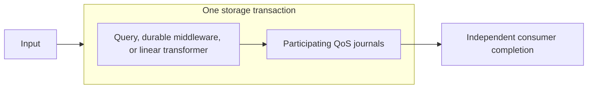

Create the group from a dedicated `ComputationIndexes` owner. Its resource
is the producer's IndexBackend dependency. Create channels through the group
and declare them as resources with a dependency on that same group.
Each participating edge names both the channel and shared owner:

<!-- illustration: shared-pipe -->
```rust
let pipe = channel.definition()
    .pipe(journal_resource_id, "alerts")
    .with_shared_storage(group_resource_id);
```

Capacity is reserved before processing, without holding the storage transaction
while waiting. Producer state, input progress, retained output, and participating
journal appends then commit together. Subsequent forwarding uses those committed
receipts instead of appending again.

A group has one processor and at most 256 active journals. Only the
participating journals join its commit; separate-store branches keep their
own handoff protocols.

Quiescing a healthy producer allows its journals to keep draining. Interrupting
active storage or losing a commit result can fence the whole group until cleanup
and reconstruction. Subscriber acknowledgement and retirement leases prevent
rebind from exposing half-finished progress changes.

**Boundary:** a shared commit covers the local producer and participating
journals. Cross-instance delivery, external effects, consumer visibility, and
existing-store migration remain separate responsibilities.

**Summary.** Preserve the boundary that matters: one known source commit, one
linear processing transaction, or one producer/journal transaction. None implies
a graph-wide transaction. Stockroom now has the contracts needed to preserve
both input consistency and unfinished output.

### 14. Capstone: a recoverable Stockroom

Complete the application by recovering an alert that was committed and delivered
to retained storage but never handled. This is the critical interval a simple
"save query rows and restart" design misses.

#### Run the complete retained application

Use the same Stockroom project, `inventory.json`, and persistent implementation
you ran in Chapter 9. Start with the product at quantity 8 and a fresh directory:

```sh
cargo run --locked --features persistence -- --state ./state/held --hold-alerts
```

Lower quantity to 3 and save. The query processes your change, but the consumer
deliberately stops before handling the retained output:

```text
Alert retained but not handled. Restart without --hold-alerts to complete it.
```

Use Ctrl-C. In this deliberately held mode, Stockroom drains and stops its
source and query first, explicitly interrupts the held consumer, then awaits
terminal cleanup. It reports the interruption rather than calling it successful
delivery; the journal remains pending. Normal runs use graceful shutdown.

Restart without the hold option:

```sh
cargo run --locked --features persistence -- --state ./state/held
```

Keep the same directory and leave the file unchanged. Before delivery resumes,
the application reports:

```text
Restored low-stock: [{"quantity":3,"sku":"bolts"}]
Saved reorders: []
Pending alerts in the output journal at open: 1.
```

The retained output then reaches `DeliveryRunner`. `SaveReorder` commits its
state and completion:

```text
Saved reorder changes through query sequence 1.
Saved reorders: [{"sku":"bolts","quantity":3}]
```

The file synchronization step finds no new product changes to submit. The
query's restored row and the saved reorder are separate observations, which
is why the startup report can show one before the other exists.

Stop and reopen once more. With the journal already handled, the application
prints `No pending alerts in the output journal at open.` and waits for new
edits. Now restock the product and confirm `Saved reorders: []` after completion.
Its stored state is observable; an empty query result alone would not
prove that the reorder was removed.

This is a controlled interrupted-handling and reconstruction exercise, not
a simulation of disk loss, every crash instruction, or every network failure.
It performs no remote replenishment request. An external destination still
needs the confirmation protocol from Chapter 12.

#### Explain every successful return

The application has several independently meaningful successes:

| Return or observation | Meaning |
|---|---|
| Native SQLite transaction completion | The product changes and source-journal entry committed together |
| Query checkpoint and result position | Query processing committed through that input |
| Outgoing journal acceptance | Query output is retained for its required subscriber |
| Transactional handler completion | Business state and that operation's completion committed together |
| Consumer batch completion | Every operation in that delivered batch completed |
| Configuration receipt | A definition and its identities were accepted, not necessarily constructed or started; durability depends on the store |
| Awaited shutdown | The reported owners completed cleanup; it is not retroactive proof of every business effect |

This table is also the basis of the application's external API. An endpoint
that returns after admission should promise admission. If it promises completed
replenishment, it must wait for or expose a way to establish that later boundary.

#### Test the failure windows that matter

Run the capstone's tests in your copied project:

```sh
cargo test --locked --features persistence held_alert_recovers
cargo test --locked
```

Application qualification goes beyond those examples. Exercise each boundary
with the provider and destination you deploy:

| Failure window | Required result |
|---|---|
| Admission response is lost after commit | The same session, sequence, and content resolve to the original receipt |
| Query fails before commit | Input progress does not skip uncommitted state |
| Query commits before output confirmation | Retained output replays without recomputing its business change |
| A later operation in a batch fails | Completion remains the successfully handled prefix |
| A transactional commit's outcome is unknown | The consumer stops instead of retrying; reopening its runner from storage resolves the outcome |
| A bootstrap edge's declared facts do not match | The edge stays unbound and the consumer reports a binding failure instead of starting without initial data |
| A destination is unavailable | The sink retries the same input in place and reports Degraded health until delivery succeeds |
| External effect succeeds but response is lost | Destination idempotency/lookup resolves the original operation |
| Snapshot loading is interrupted | Incomplete initialization is not declared complete |
| A required subscriber stalls | Lossless capacity backpressures instead of discarding its work |
| Shutdown or replacement times out | Old ownership remains tracked; a competing owner is not opened |
| Configuration acceptance is uncertain | The same request identity resolves the accepted revision |
| Recovery sees incompatible or damaged state | Startup fails explicitly rather than resetting silently |

Test meaningful input semantics too: duplicate full upserts, patch updates,
identity-only deletes, equal-valued rows with different identities, stale
source times, grouped totals, and temporal retractions.
Exercise both current-thread and multi-threaded Tokio runtimes when supporting
both hosts.

Measure boundedness under the intended workload. Include full envelope sizes,
retained membership, outbox growth, component-local expansion, backend memory,
and cleanup latency. A queue capacity is not an RSS bound; a fast demonstration
is not a production throughput or availability guarantee.

#### Operate a failed deployment without destroying evidence

When Stockroom cannot resume, first capture the desired revision, observed
component generations, retained error causes, and the relevant source/query/
consumer progress. Determine which owner still owes work.

Repair missing factories, credentials, or unavailable resources before changing
the saved definition. Resolve uncertain admissions and effects using their
original identities. Retry reconciliation only after the required ownership
and cleanup boundary permits it.

If a semantic change needs a rebuild, establish that the source can supply the
necessary data and that pending output is preserved or explicitly retired.
Preserve the original state and identity while diagnosing startup. A reset,
new namespace, or state deletion is a separate recovery decision with its own
data-retention requirements.

Back up configuration, keys, processing stores, and any required upstream
history as a coordinated recovery plan. A saved topology alone does not
contain products, pending alerts, or remote orders. Restoring one store to
an older position while leaving related completion state ahead can invalidate
the recovery boundary.

#### Choose the simplest sufficient deployment

A disposable live view can use the first program's bounded in-memory path.
A restartable calculation also needs source replay, suitable query storage,
and coordinated bootstrap. Reliable handling adds retained output and real
consumer completion. Saved deployments add reconstructible factories, resource
recipes, and protected configuration persistence.

Use separate processes when their failure boundary is required, not as a
substitute for those contracts. There is no general graph-wide transaction,
automatic exactly-once external effect, unlimited replay window, automatic
state migration, or distributed active-active runtime.

**Summary.** Stockroom is recoverable when every accepted input and committed
output remains owned until its promised boundary completes. That principle
connects the first source, the query, the journals, the consumer, and the host.
It is the basis for extending the application without weakening its guarantees.

## Part IV - Build a deployable application

### 15. Turn components into reusable factories

The first Stockroom constructs Rust objects directly. Deployment requires a
reproducible recipe: which implementation, which configuration, and which
resources should create each object. Refactor those choices without changing
the application's data contracts.

#### Follow the factory-backed Stockroom

The [managed lesson](stockroom/src/managed.rs) reconstructs the same file source,
query, and alert sink from specifications. It adds two small native factories:
`FileFactory` validates the source descriptor and path setting, and `AlertFactory`
creates the handled in-memory result view. The query uses the standard
`drasi/continuous-query` linked-reference factory explicitly. For the native
plugin path, obtain its authoring factory through `plugin.query_factory()` and
register the plugin's factories when restoring recipes; do not silently
substitute one implementation identity for the other.

Run `cargo test --locked --features management configuration_reopens` to build
and exercise this path before changing it. The test saves a definition, closes
its owner, opens it without resubmitting the seed, and verifies that an
unsupported query change leaves the accepted definition unchanged. It also
renames a source and verifies that the name and its assigned UUID survive reopen.
Construction support alone does not authorize updates. Chapter 16 runs the
saved-configuration path interactively.

#### Let the library assign component identities

An application should normally supply names and let Drasi allocate UUIDs.
The instance's `allow_external_component_ids` option is false by default and
cannot be changed by a component or a creation request. The direct-object
lessons opted in only because those objects already had IDs.

For a batch, `with_component_batch_factory` accepts a metadata-building closure
on the memory-backed builder; `create_components` accepts one on an existing
instance. The closure receives a `ComponentIds` allocator. Allocate each new
ID once, then use it consistently in the descriptor and edges. Prepare factory
specifications there, not initialized objects or database connections.

The managed lesson uses the same allocation pattern in
`create_managed_components`, which accepts complete saved recipes:

<!-- excerpt: stockroom/src/managed.rs#allocated-identities -->
```rust
let inventory_id = ids.allocate()?;
let query_id = ids.allocate()?;
let alerts_id = ids.allocate()?;
```

The configuration owner accepts those assignments, names, references and a
receipt before invoking component constructors. A matching request retry returns
the original assignments, even if a component has since been deleted; it does
not create the component again. A new component using an old name receives a
new identity. Factory code uses `ConstructionContext.component_id` rather than
deriving an ID from a name or hard-coding the first lesson's example UUID.

Names, IDs, stream names and data namespaces remain separate. The managed file
factory accepts the assigned ID but continues emitting Product elements in the
`inventory` dataset, including after a component rename.

This lesson persists **configuration**, while rebuilding its query state from
the file. The `--state` lesson persists **processing and completion**. They
teach separate ownership choices; enabling one does not silently enable the other.

#### Replace a constructor with a specification

Use the lesson's explicitly selected linked-reference factory for `low-stock`:

<!-- illustration: query-factory -->
```rust
let factories = FactoryRegistry::standard();
let factory = factories
    .get_by_name("drasi/continuous-query", Some("1"))?
    .clone();
let indexes = ResourceId::try_new("query-indexes")?;
let mut specification = factory.specification_from_config(
    component_id(757),
    serde_json::json!({
        "query": LOW_STOCK,
        "language": "cypher",
        "stream": "low-stock/out",
        "outbox_capacity": 128,
        "recovery": "strict",
        "publication": "atomic"
    }),
)?;
specification
    .dependencies
    .insert("indexes".into(), vec![indexes.clone()]);
```

The factory produces the query's exact descriptor and configuration schema.
The application supplies the real provider from Chapter 9:

<!-- illustration: provider-resource -->
```rust
let handle = ResourceHandle::new(
    ResourceRole::IndexBackend,
    Arc::new(QueryIndexProviderResource(provider.clone())),
);
batch = batch
    .declare_resource(ResourceSpecification {
        id: indexes.clone(),
        role: ResourceRole::IndexBackend,
        ownership: ResourceOwnership::Graph,
        binding: "query-indexes".into(),
    })?
    .provide_resource(indexes, handle)?
    .component(
        ComponentName::try_new("low-stock")?,
        specification,
        factory,
    );
```

This replaces the directly constructed query, rather than adding another
`low-stock` component. Retain its existing stream and connections.
The factory creates the graph-owned query with delivery tracking and the
enclosing instance scope. For result reads, use the instance query API or bind
a query catalog when the host needs that capability.

Register factories with `with_component_factories` on the builder when preparing
a managed host. Reuse the same registered factory `Arc` for bindings in a live
graph; another object with an identical implementation name is not automatically
the same factory owner.

The implementation version identifies code. The configuration version identifies
the recipe shape. Neither is a record-schema version, component generation,
or logical output sequence.

#### Implement an application factory

A custom `ComponentFactory` follows the same separation:

| Stage | Responsibility |
|---|---|
| Descriptor and schema discovery | Describe role, ports, implementation, configuration fields, and dependencies without I/O |
| Validation | Reject invalid configuration, scope, resource roles/types, and cardinality before acquisition |
| Description | Declare, without I/O, the guarantees the component will have, from its configuration and bound resources |
| Construction | Use the assigned UUID, supplied configuration and bound resources to create a component, without starting processing |
| Initialization | Prepare the object's lifetime resources once, after required binding |
| Activation | Perform repeatable start/readiness work under graph lifecycle ownership |

`describe` is required. It receives the same `ConstructionContext` that
construction will, including the declared capabilities of the bound resources,
and must not construct anything or perform I/O. The graph uses the result to
check dependencies against their resources and edges against their peers
([Chapter 5](#declare-what-a-component-guarantees)), then compares it with the
created component's own `description()`; a mismatch is a creation failure.
Stockroom's file factory calls the same function as the component, so the two
cannot drift apart:

<!-- excerpt: stockroom/src/managed.rs#describe-file-factory -->
```rust
fn describe(&self, context: &ConstructionContext) -> anyhow::Result<ComponentDescription> {
    Ok(file_source_description(&context.specification.descriptor))
}
```

`ConstructionContext` contains the component specification, enclosing identity,
resolved configuration, and declared resources. A factory asks for resources
by dependency name and concrete type; it does not search the host for an
arbitrarily named global object.

`ComponentCreationError` distinguishes retryable acquisition failures from
terminal invalid definitions. An unavailable service can be repaired and
retried; a bad descriptor needs correction.

Implement `configuration()` on components that can describe their settings.
The graph captures it at construction and reconfiguration boundaries.
Keep configuration stable during processing. Report a missing getter as
unavailable so the host retains the external binding.

A factory can also plan changes to a component it created. Its
`plan_update(current, proposed)` method compares two specifications, without
I/O, and returns a `ComponentUpdatePlan` or an error. The default rejects every
change: being able to construct a component does not mean that a running one
can be changed. Chapter 17 plans and applies a change to Stockroom's alert sink.

The managed lesson's `FileFactory` reads a saved path setting and constructs
the file source; `AlertFactory` constructs the in-memory view sink with an
optional `label` setting.
An admission-backed source or transactional sink follows the same pattern with
declared QoS or completion resources. Keep live handles out of serialized
configuration and save the recipes that reconstruct them.

#### Declare resource ownership and dependencies

Use the declaration/handle and lifetime model from
[Name resource owners before sharing them](#name-resource-owners-before-sharing-them).
Here factories make those requirements discoverable and reconstructible.

Use `ResourceRequirement::exactly_one::<T>` when a factory needs one typed
resource. Other cardinalities must be explicit. Dependencies can represent
storage, middleware, bootstrap, secrets, query catalogs, source progress,
retained pipes, or application-defined services.

For dependent resources, declare `resource_dependency` with the required role.
A journal depending on `SharedStorageGroup` is one example. Constructors receive
only the declared prerequisite handles; construction follows dependency
order, and cleanup runs in reverse.

Replacing a prerequisite reconstructs its transitive users when required.
Failed dependent cleanup retains the prerequisite owner. Preserve that dependency
lifecycle and identify shared ownership through the handles themselves.
`with_shared_identity` is for wrappers around the same underlying service, not a
way to claim that independent services share a transaction.

`ResourceConstructor::construct_with_dependencies` serves direct graph
construction. `ManagementResourceResolver::resolve_with_dependencies` serves
saved recipes. Acquisition has a bounded deadline, so partially acquired
sockets, files, and workers must remain cancellation-safe. A timeout does not
authorize leaking the partial owner and constructing a second one.

#### Resolve credentials and secrets explicitly

Credentials are contextual authentication material; secrets are named values.
`IdentityProvider` receives a `CredentialContext`, which can identify the
destination host, port, or database. Validate that destination before returning
its credential.

For application-controlled asynchronous credentials:

<!-- illustration: identity-provider -->
```rust
use drasi_lib::identity::{ApplicationIdentityProvider, Credentials, IdentityProvider};

fn warehouse_identity(
    secrets: Arc<dyn drasi_lib::SecretStoreProvider>,
) -> Arc<dyn IdentityProvider> {
    Arc::new(ApplicationIdentityProvider::new(move |context| {
        let host = context.get("hostname").map(str::to_owned);
        let secrets = secrets.clone();
        async move {
            ensure!(
                host.as_deref() == Some("warehouse.internal"),
                "unexpected credential destination"
            );
            Ok(Credentials::Token {
                username: "stockroom".into(),
                token: secrets.get_secret("warehouse-api-token").await?,
            })
        }
    }))
}
```

`PasswordIdentityProvider` handles a fixed username/password.
Fallible credential conversions distinguish password/token pairs from
certificate/key material. Native factories should declare and use the specific
identity resource they need; an instance default does not automatically wire
every custom factory.

For configuration, keep secrets as unresolved references:

<!-- illustration: secret-reference -->
```rust
let token = ConfigurationValue::Reference {
    resource: ResourceId::try_new("warehouse-secrets")?,
    key: "warehouse-api-token".into(),
    secret: true,
};
```

A secret configuration field requires a secret reference to a SecretStore
resource, not a plaintext literal. Resolution also requires the correctly typed
`ConfigurationResolverResource`, not merely a resource with a plausible name:

<!-- illustration: secret-resolver -->
```rust
struct SecretReferences(Arc<dyn drasi_lib::SecretStoreProvider>);

#[async_trait]
impl ConfigurationResolver for SecretReferences {
    fn validate_reference(&self, key: &str) -> anyhow::Result<()> {
        ensure!(!key.is_empty(), "empty secret key");
        Ok(())
    }

    async fn resolve(&self, key: &str) -> anyhow::Result<serde_json::Value> {
        Ok(serde_json::Value::String(self.0.get_secret(key).await?))
    }
}
```

Wrap that resolver in `ConfigurationResolverResource` inside a SecretStore
`ResourceHandle`. `validate_reference` is pure; `resolve` performs the lookup
during construction. Resolved values are runtime configuration, not values to
copy back into saved recipes or logs.

Changing a secret does not automatically refresh existing network connections.
Define reconnect or refresh behavior in the component's lifecycle.
Use a test memory secret store only when its volatility is acceptable.

#### Refresh native credentials on each start

**Host profile: optional native activation credentials.** This is separate from
the construction-time secret resolver above; it is not required by the managed
file lesson.

Factories that declare `HostServices::activation_credentials` can bind the Host's
`NativeIdentityResource` under their optional `identity` slot. The resource role
is `Identity`, and its concrete type matters: another Identity resource is not
interchangeable. Static applications can wrap their own `IdentityProvider`;
Host and Server use a `nativeIdentity` recipe containing the already loaded
provider's `PluginConfiguration`.

This path resolves credentials on **every start**, not during component
construction. Injected providers take precedence over configured providers;
literal-only startup is unchanged when no identity resource is bound.
Configured secret references remain references in saved definitions. The
MySQL and SQL Server procedure factories supply their exact configured hostname
and port; the Host provider returns bounded username/password or token data.
Certificates, provider errors and oversized credentials are rejected before
native startup, without falling back to literals or a previous credential.

Only private activation state receives the acquired values. The component's
declared configuration, graph identity and saved recipe remain unchanged.
Changing an ordinary `ConfigurationValue` secret reference alone does not enable
this refresh behavior; use the explicit identity resource. It also does not
reauthenticate an already open connection without the documented stop/start.
See the [Host identity recipe](../../../components/host-sdk/README.md#native-activation-identity).
Consumer-wrapper factories currently reject this dependency rather than ignore it.

**Summary.** Factories describe how to construct components; resource recipes
describe how to obtain their real dependencies. Keep configuration, identity,
and ownership separate. The application can now be represented as reconstructible
definitions rather than a collection of opaque Rust objects.

### 16. Save and restore an application

Processing state lets Stockroom recover its data. Saved desired configuration
lets the host reconstruct the application that owns that data, including
definitions that were accepted but failed to start.

Every initialized `DrasiLib` owns its accepted configuration, including the first
in-memory Stockroom. The default private memory store forgets that configuration
when the instance is destroyed. Supplying a durable store makes the accepted
definitions and UUID assignments survive reopening; it does not change who
owns configuration.

Use `create_computation_component` for one native factory declaration,
`create_components` for a process-local batch, or `create_managed_components`
for a batch of reconstructible recipes with an explicit revision and request ID.
A missing factory can leave an accepted declaration waiting, and a constructor
can fail after acceptance. Acceptance is not readiness.

`GraphConfigurationSnapshot::reconstructible_topology()` exports explicit
component, resource and pipe recipes with their original secret references.
It rejects opaque external bindings instead of inventing settings. Restore on
a clean instance with the same factory registry and resource resolver.
The [source-time merger](../computation-graph-time-merge.md) supplies a standard
versioned factory and Host/Server storage recipe. Pinned provider versions must
match; its durable mode needs independent persistent atomic storage and does
not migrate an older direct-constructor namespace or rewind its saved frontier.

#### Run a saved configuration

Create a private 32-byte configuration key once:

```sh
cargo run --locked -- keygen stockroom.key
```

`keygen` uses the operating system's cryptographic random generator, creates
the file exclusively, and refuses to overwrite an existing key. Unix files
are created with owner-only permissions. On Windows, use a directory restricted
to your account; that platform remains unqualified by these walkthroughs.
The key file is ignored by the starter's Git rules. Preserve it outside version
control and with your backups.

With the original product at quantity 8:

```sh
cargo run --locked --features management -- managed ./state/managed stockroom.key 10
```

The optional argument is named `threshold`. It sets one **global query threshold**
of 10 in place of each product's `minimum` for this managed query; it leaves
the input file's minimum fields unchanged. Quantity 8 now appears in the
low-stock view. Stop with Ctrl-C, then omit the threshold:

```sh
cargo run --locked --features management -- managed ./state/managed stockroom.key
```

The threshold is still 10: the accepted definition, not a newly generated
startup default, was restored. The printed configuration revision is unchanged.
This lesson's linked-reference query factory supports construction, not managed
query changes. Supplying the accepted threshold again is harmless; a different threshold is
rejected with an explanation instead of being mistaken for a new component.
Do not use a different threshold to update an existing deployment.
To try a different initial threshold, stop and use a separate configuration
directory, such as `./state/managed-five`, with threshold 5. Keep the original
directory to reopen its accepted threshold 10 definition.

The running process continues to watch `inventory.json`. The saved definition
contains its absolute path; keep that file available at the same path when
reopening, or deliberately update the source recipe.

This exercise's memory query provider rebuilds rows from the file. It does
not restore historical results or effects; those belong to the processing
recovery path in Part III.

#### Build a complete desired definition

`DesiredInstance` contains the assigned native `DesiredTopology` and any
ordinary component recipes. The topology describes
component factory specifications, streams, relationships, lifecycle policies,
resource declarations and recipes, and required recovery contracts.

For new components, prepare the factory-backed topology inside the allocation
callback. Build the batch before reading its definition:

<!-- excerpt: stockroom/src/managed.rs#desired-from-batch -->
```rust
let batch = batch.build()?;
Ok(batch.definition)
```

This requires a **reconstructible** batch. The first chapter's file source and
in-memory sink are supplied instances, not saved factories; copying that original
batch does not turn them into recipes. Convert all managed components and
their resources, preserve every connection, and register the implementations
needed to rebuild them.

The configuration owner validates and normalizes the representation without
opening external services.
A serialized object name cannot recreate an `Arc`, a worker, or a live database
transaction. Keep actual bindings outside the persisted document.

`ManagementResourceResolver` translates saved resource configurations into
actual handles. It owns application-specific policy such as allowed paths,
provider selection, credentials, and recovery-domain validation. Wrapping
another resolver must preserve those checks.

#### Choose memory or durable configuration

`ManagementOptions` groups factories, the resource resolver, and an optional
configuration store. Omitting the store selects the private memory store; it
does not disable management or allow a separate caller to mutate the graph's
configuration behind its owner.

| Choice | Can it survive a process restart? | What it may contain |
|---|---|---|
| Default memory configuration | No | Accepted definitions plus process-local factory and object bindings |
| Durable configuration store | Yes, under the store's guarantee | Reconstructible factory, resource and pipe recipes |

A persistent builder restores the store and rejects initial component additions
on the builder. Build it first, inspect the restored revision, and submit new
definitions through the configuration APIs. The memory builder can accept its
initial declarations together before constructors run.

The builder also exposes the services separately:

<!-- excerpt: stockroom/src/managed.rs#managed-builder -->
```rust
let core = DrasiLib::builder()
    .with_id("stockroom-managed")
    .with_component_logging(crate::component_logging()?)
    .with_component_factories(factories.clone())
    .with_management_resources(Arc::new(MemoryResources))
    .with_configuration_store(store)
    .build()
    .await?;
```

Here `factories` is the registered `FactoryRegistry`, `MemoryResources` implements
`ManagementResourceResolver` for the declared memory index provider, and `store`
is an `Arc<dyn ConfigurationStore>`. Use the same enclosing identity in all
processing and provider recipes for this managed instance.

The separate `drasi-state-store-redb` crate provides encrypted configuration
persistence. Add:

```toml
drasi-state-store-redb = { path = "../drasi-core/components/state_stores/redb", features = ["configuration"] }
```

Open `RedbConfigurationStore::new(path, key)` with an externally supplied
32-byte key and pass it to the builder. Retain the key outside the database and
preserve it across restart. Configuration encryption does not encrypt query
indexes, journals, backups, or every other file in the state directory.

The [managed Host example](../../../components/host-sdk/examples/managed_instance.rs)
shows concrete store opening, key-file ownership, and factory registration.
The storage implementation remains outside drasi-lib; the library depends
on the configuration-store contract.

#### Accept a revision, then reconcile it

Configuration acceptance and runtime convergence are two separate outcomes.
Here **convergence** means that the running objects and their bindings match the
accepted definition. The owner performs that work through **reconciliation**.
Neither word means "all business data has been processed."
The store accepts the definition and an idempotency receipt **before**
construction and lifecycle effects. That acceptance is durable only when the
selected store says so.

On the first managed startup, Stockroom submits new recipes and lets the owner
assign their IDs:

<!-- excerpt: stockroom/src/managed.rs#accept-created-components -->
```rust
core.create_managed_components(
    current.revision,
    request,
    move |ids| desired(ids, &path, threshold, &factories),
)
.await?;
```

`receipt.creation` records the resulting IDs and creation-time names.
For a single JSON-friendly declaration, `ComponentDefinition.id = None`
requests assignment. An explicit ID is allowed only if the instance creator
enabled external IDs. For mixed changes, `apply_configuration` accepts a
`ConfigurationRequest` containing new additions and optionally a replacement
definition for existing members.

Use `apply_desired_state` to update the existing assigned definition, not to
invent new IDs. Omitted existing components are removals. A same-name addition
is a conflict, not an update. A changed component specification is an update,
which the component's factory must plan; Chapter 17 shows one. This helper
waits for a reconciliation pass:

<!-- illustration: apply-configuration -->
```rust
async fn apply_configuration(
    core: &DrasiLib,
    expected_revision: u64,
    request_id: &str,
    desired: drasi_lib::management::DesiredInstance,
) -> anyhow::Result<()> {
    core.apply_desired_state(expected_revision, request_id, desired)
        .await?;
    let status = core.reconcile_desired_state().await?;
    ensure!(
        status.converged(),
        "accepted definition has not converged: {status:?}"
    );
    Ok(())
}
```

The caller should obtain a new request ID with
`new_configuration_request_id`, persist that ID with the intended request,
and use the current `desired_configuration().revision` as the expected
revision. Retry an uncertain submission with the same ID and identical content.
Use `configuration_receipt` to resolve the recorded outcome.

The interactive managed CLI simplifies the client side: it generates request
IDs but does not save them before submission. After an uncertain result, reopen
without a threshold override and inspect the accepted definition before issuing
another change. A service that must retry unattended should persist each request
ID and payload before submitting it, as this API-level example assumes.

A missing factory, busy socket, or unavailable database can leave a durable
accepted definition that has not converged. Preserve it while repairing the
dependency and reconciling. Register a new factory to satisfy a previously
unavailable implementation.

Reusing an ID with different content is an error. A revision mismatch protects
against overwriting a concurrent change. Generating a new request ID after a
lost response is not a substitute for resolving the first operation.

`receipt.durable` and `configuration_is_persistent` describe configuration
acceptance, not processing durability. `management_status` and
`status.converged()` describe reconciliation. Component readiness still has
its own boundary.

#### Restore without resubmitting a startup seed

On reconstruction, register the same required factories, supply the resource
resolver and store, and build with the same instance identity. The accepted
definition is authoritative, including an intentionally empty definition.
Use the startup seed only when accepted configuration is absent.

Failed definitions remain available for inspection and repair. Unsupported
configuration versions, unavailable secrets, and damaged encrypted records
fail explicitly; none should be interpreted as "no saved application."

All `DrasiLib` members use the configuration owner. Create definitions through
the creation APIs, rename through `rename_component_by_id` or `_by_name`,
and update assigned definitions through the configuration APIs.
The exposed graph control handle supports inspection and authorized lifecycle
operations, not bypassing configuration ownership with raw topology mutation.
Externally supplied resources remain under their declared lifetime; sharing
an `Arc` does not make it serializable.

Await instance shutdown before releasing the store or opening a replacement
owner. A cancelled storage waiter does not release an exclusive configuration
lease while its real operation is still running.

<a id="declare-shared-progress-and-composed-bootstrap-resources"></a>

#### Host profile: shared progress and graph bootstrap

This completes the basic managed Stockroom. The following **Host SDK/Server**
configuration extends it to the shared and multi-input protocols of
[Chapter 10](#10-join-snapshots-to-live-input); the file-backed managed lesson
does not need it.

A `consumerProgress` recipe groups downstream owners of **one producer**. This
JSON object is a recipe configuration, not a complete graph definition: declare
the resources, dependencies, factories and connections around it.
It contains already assigned component UUIDs, not name selectors. In this
illustration, `inventory`, `low-stock`, and `stock-audit` have the IDs ending in
`2f6`, `2f5`, and `300` respectively. Use the assignments returned by your
configuration owner. Resource IDs such as `low-stock-progress` remain separate
named resource keys.

<!-- json-example: consumer-progress -->
```json
{
  "kind": "consumerProgress",
  "producer": "00000000-0000-0000-0000-0000000002f6",
  "consumers": {
    "00000000-0000-0000-0000-0000000002f5": "low-stock-progress",
    "00000000-0000-0000-0000-000000000300": "stock-audit-progress"
  }
}
```

Declare this as a Checkpoint resource with exactly the two distinct Checkpoint
dependencies. Each member uses a `sourceProgress` recipe for its query component,
`{"kind":"sourceProgress","component":<query>,"indexes":<that query's index resource>}`,
with that index resource as its only dependency. A member declares the durability
its query's index resource declares, and the set is durable only when every member
is, so a source that needs durable consumer progress refuses a set with a volatile
query in it.
Bind the set to the source's `consumer_progress`, and each query's own member to
its `source_progress`. Eligible standalone transformers/Handled sinks instead
use their own `input_progress` slot.

In Host SDK and Server definitions, bootstrap data travels over graph edges;
there is no bootstrap resource recipe. A provider is a node with the
`BootstrapProvider` role and one `snapshot` output. Every loaded source has a
`bootstrap` input and a `snapshot` output. A query has a `bootstrap` input and
a `snapshot` output, which serves its committed results to downstream queries.
For one query to initialize from inventory and an HTTP catalog, connect each
provider to its source's `bootstrap` input and each source's `snapshot` output
to the query's `bootstrap` input, beside the two data edges:

```text
inventory-bootstrap.snapshot -> inventory.bootstrap
catalog-bootstrap.snapshot   -> catalog.bootstrap
inventory.snapshot           -> low-stock.bootstrap
catalog.snapshot             -> low-stock.bootstrap
inventory.out                -> low-stock.in
catalog.out                  -> low-stock.in
```

The query sends one bootstrap request per edge, reading the edges in turn. Each
source relays the request to its provider and returns the records only to the
requesting query. A loaded source hands over exactly the watermarks its provider
reports. A paired database provider reports positions in its source's output,
so the query skips live changes its snapshot covers. A quiescent provider, such
as `drasi.network/http-bootstrap`, reports none, so the catalog snapshot has no
cut; keep catalog changes quiet until the query has loaded. A durable provider
that is not paired with its source, one that reports watermarks or completion
state, lists the progress resource of every query it serves under its
`source_progress` dependency. A paired provider has no such dependency; it uses
the requesting query's owner from its source.

A query can instead use one local provider. Connect it directly to the query's
`bootstrap` input, or name it in an ordinary query's `bootstrapProvider` field;
that field references a provider component and is unrelated to an ordinary
source's own bootstrap provider setting. The query then never asks its inputs
for bootstrap data, and the inputs still need their data connections. A local
provider must be unpaired. A provider that serves a source's element namespace,
such as the HTTP snapshot, serves the single source its query reads, so for the
two-source query above its edge fails to bind; use one provider per source
instead.

Build canonical component specifications from the loaded factories' metadata
and keep secret `ConfigurationValue` references. Server's
`computation.graph.config` is literal JSON; a reference-shaped object there is
not a secret reference. Secret-bearing native definitions use canonical
`computation.definition`.

The [Trading example](https://github.com/drasi-project/drasi-server/tree/29ff787a28717bc760df9840d1f2264026a75263/examples/trading)
generates a complete fixed-member definition from its 11 queries and factory
metadata. It submits one `/computation/components` batch, then creates its SSE
reaction, using two shared PostgreSQL sources and one HTTP source. Each source
has a provider node on its `bootstrap` input, and a query with PostgreSQL and
HTTP inputs bootstraps from both sources; the application starts its price feed
only after its queries are running. Matching setup is idempotent;
partial/conflicting bundles are errors, not implicit membership replacement.

<a id="declare-source-owned-database-initialization"></a>

#### Host profile: source-owned database initialization

A paired database source coordinates its own initialization. SQLite shows the
bindings; the PostgreSQL, MySQL and SQL Server paired factories follow the same
pattern with their own protocols. Configure a `drasi.sqlite/replay-transactions`
or `drasi.sqlite/shared-transactions` source with `coordinatedSnapshot: true`,
and add one provider node from `drasi.sqlite/coordinated-bootstrap` or
`drasi.sqlite/shared-bootstrap` respectively, with an empty configuration
(`{}`); the source owns the path, tables, keys and stream. A source with a
provider on its `bootstrap` input creates its library's coordinator from its own
single `source_progress` owner or fixed `consumer_progress` set. There is no
coordinator resource or recipe to declare.

| Binding | Required relationship |
|---|---|
| Source `source_progress` or `consumer_progress` | The source's normal progress dependency |
| Paired provider node | No progress dependency of its own; it serves each session with the requesting query's owner from its source |
| Provider `snapshot` -> source `bootstrap` | The one paired provider for this source |
| Source `snapshot` -> query `bootstrap` | One bootstrap edge per consuming query |

The provider node finds the coordinator of the source it is connected to and
serves each session with the requesting query's progress owner. The Host
compares owner identity, not names or paths. The graph refuses an unpaired
provider on a coordinated source, and a paired provider on any other source,
when the edge binds.

The source holds its live output only on its first start, when none of its
queries has saved progress or a completed bootstrap; later sessions do not
pause it. SQLite adds a rule of its own: its snapshot and live SQL workers share
one exclusive lease, and live writes are admitted only after every required
snapshot completes. A shared source's consumer set is fixed, so adding a query
later means replacing that set; shared PostgreSQL keeps its source stopped
while such a query takes its snapshot.

See the [Host coordination contract](../../../components/host-sdk/README.md#native-source-bootstrap-coordination),
the [paired SQLite factories](../../../components/computation-plugins/bootstrappers/sqlite/README.md#source-paired-snapshots)
and the loaded factory metadata. These bindings serve Host SDK and Server
deployments; they are not Stockroom lessons or a general database-access API.

#### Keep configuration history intentional

Named snapshots support saving, loading, and restoring desired definitions.
Restoration submits a new configuration revision; it does **not** roll query
state or external effects back to the snapshot's date.

`list_configuration_snapshots(after, limit)` returns bounded pages.
`delete_configuration_snapshot(name, expected_revision)` protects against
deleting a different saved revision. Deleting a snapshot changes neither the
current application nor its processing state. There is no automatic age policy.

The redb store's default retains request receipts indefinitely. For bounded
history, `ConfigurationStoreOptions::receipt_batch_capacity` enables receipt
expiry by batch. Use store-generated request IDs, retain each one for retries,
and understand the boundary: generating an ID for a new batch can expire the
entire previous full batch, including unused IDs from it.

An expired receipt means the outcome is no longer retained, not that the
operation failed. A full batch rejects additional unused requests; an expired
or foreign ID cannot be reinterpreted as new work. Enabling this policy on an
existing store expires its older receipts and changes reopen requirements.
Choose it deliberately rather than treating it as harmless garbage collection.

#### Rotate configuration keys safely

`RedbConfigurationStore::rotate_key` rewrites live definitions, snapshots,
receipts, and policy metadata atomically. Provision and retain the replacement
key externally before starting. Close every configuration session first,
normally by awaiting all owning instances' shutdown.

If a commit is uncertain, the provider fences writes. Keep both keys and reopen
to determine which one is active before proceeding. Cancelling the caller
does not detach the underlying storage operation.

Rotation can require substantial temporary disk space. It does not erase old
free pages, backups, or filesystem snapshots. Protect those copies separately;
key rotation is not secure erasure.

**Summary.** Saved configuration is accepted intent, not a claim that the runtime
is ready. Revision checks and request receipts protect changes; factories and
resource resolvers make reconstruction possible. Configuration history and key
lifecycle remain explicit application responsibilities.

### 17. Change a running application

Stockroom needs a new alert destination while inventory continues to arrive.
Plan the change around component generations, dependency ownership, and retained
work rather than simply replacing an object in a map.

#### Add a new alert destination while running

Start the webhook receiver from Chapter 5, and build the native HTTP sink if
needed. Restore `inventory.json` to quantity 8 and `destination.json` to
`{"webhook": null}`. In your copied project:

```sh
cargo run --locked --features plugins -- live ../drasi-core/target/debug
```

Leave this process running. Set and save `destination.json`:

```json
{"webhook":"http://127.0.0.1:9082/reorders"}
```

After `Connected live webhook destination` appears, lower the product quantity
and save inventory. Both the original terminal view and the new webhook receive
the change. The source, query, and process were not restarted.

The implementation adds a stopped native sink, connects its input, and starts
that component. This order avoids reporting a usable destination before its
connection exists:

<!-- excerpt: stockroom/src/network.rs#live-webhook -->
```rust
pub(super) async fn add_webhook(
    core: &DrasiLib,
    directory: &Path,
    url: &str,
) -> anyhow::Result<()> {
    let factory = load_factory(
        directory,
        "drasi_computation_sink_http",
        "drasi.network/http-sink",
    )?;
    let query_id = core
        .component_by_name(&ComponentName::try_new("low-stock")?)?
        .id()
        .clone();
    let url = url.to_owned();
    let destination = url.clone();
    let receipt = core
        .create_components(move |ids| {
            let webhook_id = ids.allocate()?;
            let specification = factory
                .specification(
                    webhook_id.clone(),
                    serde_json::json!({
                        "outputs":{"low-stock":{"component":query_id,"port":"out"}},
                        "url":destination,
                        "timeoutMs":5000, "maxRetries":0, "onPermanentFailure":"stall"
                    }),
                )
                .map_err(|source| GraphError::Validation {
                    component: webhook_id.clone(),
                    source,
                })?;
            Ok(ComponentBatch::builder()
                .component(ComponentName::try_new("webhook")?, specification, factory)
                .connect(
                    EdgeDefinition::new(endpoint(query_id, "out")?, endpoint(webhook_id, "in")?),
                    Box::new(BoundedPipeConfig { capacity: 8 }),
                )
                .build()?
                .auto_start(false))
        })
        .await?;
    let component =
        cli::accepted_component(core, &receipt, &ComponentName::try_new("webhook")?).await?;
    tokio::time::timeout(Duration::from_secs(10), component.start())
        .await
        .context("wait for webhook readiness")??;
    println!("Connected live webhook destination: {url}");
    Ok(())
}
```

The exercise adds one destination. Existing results are not replayed
automatically to it; make a new inventory edit after connection. Replacing or
removing a destination requires the explicit policies below rather than simply
changing or clearing its URL. In this runnable lesson, changing or clearing an
already-connected URL reports an error and exits with a nonzero status.
A malformed JSON save instead reports `Destination unchanged` and keeps the
current destination while you repair the file. Delivery failures follow the
rules from Chapter 5: while the destination is unreachable the webhook retries
and Stockroom prints `is retrying`, and a rejected change stops the
application.
This batch is accepted through the same configuration owner as the original
components. `ids.allocate()` assigns the new destination its own UUID; the
existing query is selected by name once and connected by its resolved ID.
The receipt can arrive before the graph publishes the new component.
`cli::accepted_component` checks reconciliation errors and waits for that
assigned ID in the public inspection stream before obtaining its handle.
Then `start` waits for activation. A successful receipt alone would be too early
to announce the new webhook as ready.

#### Exercise revisioned changes

Run `cargo test --locked --features management configuration_reopens`.
The test renames the source, closes and reopens the configuration store, and
verifies that both the new name and original UUID are restored. It then verifies
that a raw graph mutation is rejected and an unsupported query-text update
leaves the accepted definition and revision unchanged. Read this test in
[managed.rs](stockroom/src/managed.rs).

Renaming is a metadata change: it neither reconstructs the component nor
touches its configuration. The query-text change is rejected because this
lesson's linked-reference query factory does not plan updates.

#### Change a component's configuration

Changing a running component's configuration changes what its object does, so
Drasi first **assesses** the change and then **applies** it at a safe point.
Stockroom's managed alert sink supports one such change: its `label`, the text
printed before each view.

Its factory plans the update. The plan says that the change can be made to the
running object while it is paused, and that the sink's data is preserved:

<!-- excerpt: stockroom/src/managed.rs#plan-alert-update -->
```rust
fn plan_update(
    &self,
    current: &ComponentSpecification,
    proposed: &ComponentSpecification,
) -> anyhow::Result<ComponentUpdatePlan> {
    self.validate(proposed)?;
    let without_label = |specification: &ComponentSpecification| {
        let mut specification = specification.clone();
        specification.configuration.remove("label");
        specification
    };
    ensure!(
        without_label(current) == without_label(proposed),
        "an alert update can change only its label"
    );
    Ok(ComponentUpdatePlan {
        mode: ComponentUpdateMode::InPlace,
        data: ComponentUpdateData::Preserve,
    })
}
```

`plan_update` only compares the two specifications; it must not perform I/O.
It removes `label` from both and requires everything else to be identical, so a
change to anything but the label is rejected. The `alert_plan_accepts_only_label_changes`
test checks both outcomes.

The sink applies an accepted change through `ComponentManagement`, which it
returns from its `management()` and `management_mut()` methods:

<!-- excerpt: stockroom/src/main.rs#apply-alert-update -->
```rust
fn alert_label(configuration: &BTreeMap<Arc<str>, serde_json::Value>) -> String {
    configuration
        .get("label")
        .and_then(serde_json::Value::as_str)
        .unwrap_or("low-stock")
        .to_owned()
}

#[async_trait]
impl ComponentManagement for Alerts {
    async fn apply(
        &mut self,
        _context: &ApplyContext,
        update: ComponentUpdateContext,
    ) -> std::result::Result<(), ApplyError> {
        self.label = alert_label(update.proposed.configuration());
        Ok(())
    }
}
```

`apply` reads the label exactly as the factory's `create` does, so the updated
object matches one constructed from the new definition. The test holds the
sink's handle as `alerts` and submits the change as a new desired definition:

<!-- excerpt: stockroom/src/managed.rs#relabel-alerts -->
```rust
let saved = core.desired_configuration()?;
let mut desired = saved.desired.clone();
let component = desired
    .topology
    .components
    .iter_mut()
    .find(|component| component.descriptor.id() == alerts.id())
    .context("saved topology omitted the alert sink")?;
let ComponentConstruction::Factory(specification) = &mut component.construction else {
    anyhow::bail!("the alert sink is not reconstructible");
};
specification.configuration.insert(
    "label".into(),
    ConfigurationValue::Literal(serde_json::json!("reorder")),
);
let receipt = core
    .apply_desired_state(saved.revision, "relabel-alerts", desired)
    .await?;
```

It then calls `reconcile_desired_state` until
`desired_configuration()?.pending_updates`, the list of accepted but unfinished
updates, is empty. Finally, it looks the sink up again with `component_by_id`.
A `ComponentHandle` keeps the generation it was created for, so only a fresh
lookup shows whether the object was replaced.

**Try it.** Run
`cargo test --locked --features management alert_label_updates_in_place -- --nocapture`:

```text
Accepted revision 2: InPlace update with Preserve data.
The running sink now reports label "reorder"; its generation is unchanged.
```

Then change `ComponentUpdateMode::InPlace` to `ComponentUpdateMode::Recreate`
in `plan_update` and run the test again. Predict which check fails before you
look. The update is still accepted, but the graph now replaces the sink with a
new object, so its generation changes and the test reports
`an in-place update keeps the same object`. Restore `InPlace` afterwards.

An update moves through three steps:

1. **Assess.** When `apply_desired_state` receives a changed specification,
   the configuration owner asks for a plan. If the component's object exists
   and implements `ComponentManagement::assess`, its answer comes first: a
   supported assessment becomes the plan, and an unsupported assessment or an
   error rejects the request. The factory's `plan_update` decides only when the
   object gives no answer: it returned `Ok(None)`, as Stockroom's sink does,
   provides no management, has not been constructed, or was busy with another
   operation. A rejected change leaves the accepted definition unchanged.
2. **Accept.** The new revision and the plan are recorded together, with a
   stable operation ID, in `receipt.updates`. This happens before any hook runs,
   so an update interrupted by a crash is resumed under the same operation ID
   when the configuration is reopened.
3. **Apply.** The graph establishes the plan's boundary and performs it:

| Plan `mode` | Boundary | What runs | Same object? |
|---|---|---|---|
| `InPlace` | Pause | `pause`, `ComponentManagement::apply`, `resume` | Yes |
| `Restart` | Stop | `stop`, `ComponentManagement::apply`, `start` | Yes |
| `Recreate` | Replace | `stop`, `dispose` with `DisposeReason::Replacement`, then the factory's `create`, `initialize` and `start` | No: a new generation with the same ID |

Before calling `apply`, the graph asks the object to assess the change again.
If the object now needs a stronger boundary, the update is refused rather than
applied at the wrong point. `apply` returns `ApplyError::Refused` or
`ApplyError::Failed` when it left the object unchanged, so the update can be
retried. `ApplyError::Damaged` means that the object cannot continue: the graph
quarantines it and reports the component as failed, rather than replacing it
automatically. If the object is still running, its later stop, for example
during shutdown, uses `StopMode::Abort`.

When it applies an `InPlace` or `Restart` update, the graph asks the factory to
describe the new configuration and checks that the updated object reports the
same description; a mismatch fails the update. The update keeps the component's
connections, so their edge checks are not repeated. Plan a change that alters
what the component guarantees as `Recreate`: the new object is described and
its edges are checked again. The native HTTP sink, for example, changes
`onPermanentFailure` only by replacement.

The plan's `data` field says what happens to the component's processing state.
Use `ComponentUpdateData::Preserve` unless the state must be rebuilt.
`Rebootstrap` (rebuild from a consistent snapshot) and `Reset` (discard the
state and start from the configured streaming or replay position) are accepted
only for a query whose factory supports rebuilding, with `Recreate`. Its
implementation, descriptor, role, completion, dependencies and output streams
must stay unchanged, and every downstream consumer must be able to accept the
reset.

For a persistent query, a changed query definition can require a migration
instead of ordinary replacement. Choose one of three explicit strategies:
rebuild from a source that can provide a consistent snapshot, run a new query
identity alongside the old one and cut consumers over after reconciliation,
or supply a storage migration you can validate. Preserve the old query's
pending output until its consumers finish or it is explicitly retired.

#### Change shared-source membership through the graph

A `ConsumerProgressSet` has fixed membership for its binding, not necessarily
for the lifetime of the application. To enroll, remove or reset a required
member, use explicit reconciliation: await the old producer's stop,
drain accepted input, replace the affected bindings, initialize new owners,
and resume only after all required owners are ready. Pausing calls to `next`
is insufficient: a source-owned connection could still acknowledge upstream
history while its consumer is being replaced.

Keep the existing owners of unchanged members and follow source-specific
retention rules. For example, SQLite will not remove a member still behind the
current journal head. Dropping a reader, observing a disconnected subscriber
or editing a stored member list cannot release an obligation. Failed cleanup
or uncertain configuration acceptance must keep the old ownership fenced.

The native shared-source qualification covers drained reconstruction and explicit
drain-barrier replacement, not cold reconstruction with undrained persistent
input-pipe frames. Do not infer the missing queued counters from handled
progress or erase the queue to make a replacement start.
The source-specific guide describes the supported recovery modes; a different
adapter or transport cannot establish this missing input-pipe guarantee.

#### Restart a component without replacing its definition

Use a handle for a stop/start of an existing component. Resolve the name once
so both operations address the same component even if its name changes:

<!-- illustration: restart-preview -->
```rust
let alerts = core.component_by_name(&ComponentName::try_new("alerts")?)?;
alerts.stop().await?;
alerts.start().await?;
```

This retains the initialized object and its ID; it does not update configuration
or delete owned state. A failure during stop must be resolved before restarting.
If another operation replaces the component, an old handle reports that it is
stale rather than controlling the replacement.

For `DrasiLib` topology changes, submit definitions through Chapter 16's
configuration APIs. `GraphControl::preview` / `reconcile` and
`ComponentAddition` are lower-level tools for a separately owned
`ComputationGraph`; they do not bypass the `DrasiLib` configuration owner.
A standalone preview is revision-bound and can also become stale when
observed lifecycle/resource state changes. Recompute it after `StalePreview`.
Selections can include exact members, dependencies, dependents, or the whole
graph. Keep new factories and resources as real `TopologyBindings`, not
just names.

#### State dependency policy

A relationship can require a prerequisite for creation, binding, or activation,
and can control failure propagation. For example:

<!-- illustration: relationship-policy -->
```rust
let policy = RelationshipPolicy {
    required_for_creation: true,
    activation: ActivationCoupling::RequiresRunning,
    propagate_failure: true,
    ..RelationshipPolicy::default()
};
let edge = EdgeDefinition::new(
    endpoint(component_id(758), "out")?,
    endpoint(component_id(757), "in")?,
);
batch = batch.relationship_policy(edge, policy);
```

This sets lifecycle policy on that data relationship; it does not connect a new
pipe. Keep the corresponding `.connect(...)` declaration. Defaults use independent
activation and no failure propagation. Binding is required, but creation need
not wait on the edge.
Consumer replacement does not automatically opt into rebind, and survival
without the relationship must be explicitly permitted.

`fence_producer_on_failure` is useful when continuing production after a
required consumer fails would violate the application boundary. These policies
affect lifecycle and ownership; they do not repair a failed business action.

Disjoint lifecycle work can progress while another component waits for cleanup.
Conflicting component/resource reservations still reject or wait according to
the operation's contract. Independent tasks are not permission for concurrent
mutable lifecycle calls on the same instance.

#### Choose removal semantics

| Policy | Intended result |
|---|---|
| Reject | Refuse a removal that breaks required relationships |
| Cascade | Include dependent components |
| Orphan | Keep only survivors whose policies permit the missing relationship |
| Drain | Require the supported outstanding work to reach its handling boundary |

No policy overrides unresolved persistent recovery obligations. A local empty
queue is insufficient drain evidence when a provider still retains replayable
or in-flight work.

To remove one source, query or reaction by ID, call
`DrasiLib::remove_component(id, ComponentRemoval { .. })`
([Chapter 7](#7-own-the-runtime-lifecycle)). It always uses Reject: a
component that others depend on stays until its dependents are removed. Give
the request an `expected_revision` and a `request_id`: a request based on
outdated configuration is rejected, and a retry returns the original receipt.

Changing query text can invalidate processing identity. Replacing a database
resource can invalidate more than the component directly named in the request.
Preserve transitive resource dependencies and plan a migration or explicit
rebuild for semantic changes.

#### Preserve recovery domains

A recovery domain is the set of owners whose saved progress, state,
and output must remain consistent. Source admission receipts, query outboxes,
subscriber cursors, scheduled work, and consumer completion can all constrain
retirement.

Normal retirement needs completed cleanup, proof that obligations are resolved,
and held exclusion against restarting or reusing the old owners while acceptance
is decided. A missing live handle is not evidence that disk state is empty.
Equal provider paths are not evidence that two handles represent the same
domain.

#### Retire a managed durable path without discarding work

**Alternative managed durable deployment:** this procedure applies when the
capstone's processing owners have been represented as managed factories/resources.
The `--state` CLI itself does not expose a managed-retirement command.

Suppose an accepted definition contains a query, its output journal and an
alert consumer. The journal still owes output 7 to alerts. Removing the query's
Rust object is insufficient: the query outbox, journal cursor, consumer ledger,
query indexes, source-progress/bootstrap owners and their users may form
one protected recovery domain. Let the resource resolver determine that complete
domain from the real bindings; do not construct it by matching directory names.

| Step | Application action | Observable consequence |
|---|---|---|
| 1. Fix a finite boundary | Stop admitting new application input; account for scheduled work and all required source/consumer paths | “Final output 7” is meaningful only for this controlled workload |
| 2. Complete the outstanding work | Let alerts handle output 7, using the journal and consumer evidence as in Chapter 14 | Saved reorders and the completion ledger advance; an empty local queue alone proves nothing |
| 3. Stop the instance | Await `core.stop()` successfully; verify the applied topology agrees with the previously accepted definition | Protected transitions require stopped owners, not merely paused `next` calls |
| 4. Prepare the request | Read the current desired revision; save a new configuration request ID with the complete desired definition removing the domain and all required users | Retry will identify this exact request, not a newly invented replacement |
| 5. Submit | Call `apply_desired_state(expected_revision, request_id, desired)` | Management obtains graph freezes and storage/journal/consumer/bootstrap retirement guards internally and checks drained state |
| 6. Resolve acceptance | Read the receipt/authoritative desired state, using the same request ID after uncertainty | A thrown error alone is not proof of rejection |
| 7. Reconcile known acceptance | Reconcile the accepted definition and inspect outcomes before restarting any surviving application paths | Removed generations stay fenced; no hidden processing-data deletion occurs |

The application does **not** build a public “proof object.” The management
transition holds the real owners while it commits desired configuration and then
reloads authoritative store state. Known changed state retires the held guards;
known unchanged state resumes them. An unreadable/uncertain store retains the
transition. Do not immediately restart old owners on an error: resolve the same
request and let management establish which definition is authoritative.

If alerts still owes output 7, normal retirement rejects the pending domain.
Resume/retry only after confirmed rejection and completed transition cleanup;
finish the work rather than deleting the journal. If stop itself times out, retain
the owner and complete cleanup before attempting a protected transition.

For intentional abandonment, the separate authorization below requires durable
configuration, the exact old revision and complete removal of exactly named
domains. It is not an in-place reset or a shortcut around failed cleanup.

#### Authorize intentional abandonment separately

Query/bootstrap and consumer owners expose their own retirement boundaries.
A successfully stopped bootstrap provider must remain frozen; a consumer
retirement proof must come from its own delivery ledger and completed
storage cleanup. Obtain replacement evidence from that existing owner.

For intentional abandonment, `RecoveryRetirementAuthorization` is a persisted,
revision-bound authorization naming exact complete resource/component domains
with `allow_data_loss`. It permits abandoning their obligations; it does not
reset, acknowledge, or delete stored processing data.

This authorization cannot excuse failed cleanup, missing owners, or
unhealthy transaction gates. Grant it only as a deliberate data-loss decision,
separate from startup error handling. Uncertain configuration acceptance retains retirement
ownership; only confirmed rejection permits resuming the old owners.

#### Escalate interruption without calling it recovery

`GraphControl::force_cancel_components` is explicit escalation for selected
components. It requires a complete registered resource domain and
separates interruption from cleanup in its report.

Successful cleanup does not prove rollback, delivery completion, or repair of
the interrupted generation. Reconstruct a fresh owner and resolve its stored
progress before retiring pending work or changing bindings. Unreported opaque
resource sharing cannot be made safe by selecting matching component names.

A process boundary can contain failures a task boundary cannot; it still does
not turn forced termination into successful drain.

#### Export useful definitions

`snapshot_configuration` and `snapshot_computation_configuration` expose
available configuration and reconstruction information. Use
`GraphConfigurationSnapshot::reconstructible_topology()` when an export must be
reconstructible, rather than merely descriptive. `GraphSnapshot::select` exports a
whole graph or subset, retaining explicit boundary relationships and resource
dependencies. Keep missing neighbors explicit at the subset boundary.

Available component configuration and provider recipes should be preserved.
Opaque external bindings remain explicitly unavailable. Preserve their
construction requirements and treat these exports as privileged data.

**Summary.** Live changes operate on revisions, generations, and real resource
owners. A configuration change is planned before it runs and applied at a pause,
a stop, or by replacing the object. Preview before mutation, inspect every
outcome, and preserve retained obligations through replacement. Stop, force,
reset, and permanent retirement are different decisions.

### 18. Package and isolate extensions

Stockroom's components can remain ordinary Rust code linked into the application,
be packaged as native dynamic libraries, or run in independently hosted
instances. Choose the boundary for deployment and failure isolation, not merely
for code organization.

#### Author native dynamic components

A **native plugin** is a library of components built with the plugin SDK. The
**host** is the application that loads the library through the Host SDK and
runs its components in a graph. Use these libraries for distinct purposes:

| Library | Responsibility |
|---|---|
| `drasi-lib` | Own the in-process graph, resources, and runtime lifecycle |
| `drasi-computation-contracts` | Share envelope, schema, codec, and service messages |
| `drasi-core-types` | Share graph and result values without the evaluator |
| `drasi-computation-plugin-sdk` | Implement native components and their factories, and export them |
| `drasi-host-sdk` | Verify and load native libraries, and connect their operations to graph-owned interfaces |

A plugin takes its data types from the contracts and core types rather than
from `drasi-lib`. The host's graph schedules all of its processing; a plugin
never runs a second executor. Each component implements `NativeComponent` and
the trait for its role:

| Role | Trait | Required processing methods |
|---|---|---|
| Source | `NativeSource` | `next`, which returns `None` only when the source is exhausted |
| Transformer | `NativeTransformer` | `transform`, from one input envelope to zero or more output envelopes |
| Sink | `NativeSink` | `completion`, which returns `Handled` or `Accepted` ([Chapter 4](#4-maintain-an-application-view)), and `handle` |
| Service | `NativeService` | `run` |

A sink whose deliveries the host's `DeliveryRunner` records implements
`DeliveryHandler` in place of `NativeSink`, or `NativeTransactionalConsumer` to
complete each operation in the host's transaction
([Chapter 12](#12-complete-business-work)). A transformer that joins the host's
transaction implements `TransactionalComponent`
([Chapter 13](#13-preserve-transactions)). Bootstrap providers have their own
factory trait, described in
[Serve bootstrap data from a plugin](#serve-bootstrap-data-from-a-plugin).

A native component has the same six lifecycle hooks as the in-process
components of [Chapter 7](#follow-an-object-from-creation-to-disposal), called
in the same order and with the same meaning. The plugin SDK differs in these
places:

| In-process component (`drasi-lib`) | Native plugin (`drasi-computation-plugin-sdk`) |
|---|---|
| Hooks return `anyhow::Result<()>` | Hooks return `LifecycleResult`. Classify a failure with `LifecycleError::retryable`, `terminal`, `unsupported` or `cancelled`; a plain `anyhow::Error` becomes a terminal failure |
| `start(&StartContext)` | `start(&mut StartContext)`. The context carries activation credentials when the factory declares them, and `activation_scope()` creates an owner for the activation's workers |
| `passive_component_lifecycle!()`, whose `dispose` refuses an erase request | `passive_lifecycle!()`, whose hooks all succeed |
| An explicit request to delete data reaches `dispose` as `StateIntent::Erase`, which the component honors or refuses | The host requests `StateIntent::Erase` only from a factory that declares `Capabilities::erases_owned_state` |
| `configuration()` can report that the configuration is unavailable | `configuration()` is required; the host validates its result against the factory's schema |
| `description()` declares the component's guarantees, and a factory's `describe` must declare the same | The factory's `describe` alone declares them; the host uses its answer as the component's description |
| `ComponentManagement` with `assess` and `apply` | `NativeManagement`, returned from `NativeComponent::management()` and declared with `Capabilities::management` and the supported `Capabilities::update_modes` |
| Factory `plan_update` returns a `ComponentUpdatePlan` | `Factory::update_planner()` returns an `UpdatePlanner`, whose `assess` returns an `Assessment` |

#### Implement the factory

A native factory implements the SDK's `Factory` trait. Its methods perform no
I/O, start no work and read no mutable external state; `create` only builds the
object:

| Method | Required | Returns |
|---|---|---|
| `metadata()` | Yes | `FactoryMetadata`: implementation name and version, role, configuration version and schema, ports and their schemas, a sink's completion, and `Capabilities` |
| `configuration_details()` | Yes | A description, default and allowed values for every configuration field |
| `describe(&DescribeRequest)` | Yes | The component's description for one configuration and the declared capabilities of its bound resources |
| `create(&CreateRequest, ControlSender, ServiceBindings)` | Yes | The inactive component, as a `CreatedComponent` |
| `update_planner()` | When `Capabilities::update_modes` is not empty | An `UpdatePlanner`, whose `assess(&UpdateRequest)` classifies a configuration change |
| `activation_credentials()` | When the factory declares activation credentials | The endpoint the host acquires credentials for |
| `bootstrap_coordination()` | When the factory declares bootstrap coordination | The coordinator that opens the source's paired bootstrap providers |

`describe` returns the component's **description**: what its progress, outputs
and inputs guarantee, and what it requires of its bound resources
([Declare what a component guarantees](#declare-what-a-component-guarantees)).
The host passes the answer to the graph unchanged and never interprets the
plugin's configuration. `DescribeRequest` has helpers for common cases, such as
`volatile_transformer()` and `unkeyed_sink(policy)`.

Describe the configuration once. A `ConfigDefinition`, built from
`ConfigOption`s, supplies both `FactoryMetadata::configuration` (from
`schema()`) and `configuration_details()` (from `details()`). Reuse the typed
configuration's default functions and limit constants instead of repeating
them. Native plugins share one convention:

- Keys are lowerCamelCase at every level, and every configuration type rejects
  unknown fields.
- Each published default equals the parser's default.
- Secrets are top-level fields marked with `ConfigOption::secret()`, because the
  host resolves secret references only at the top level. Descriptions and
  defaults never contain a secret value.
- A sink publishes its permanent-failure policy with
  `ConfigOption::on_permanent_failure()`
  ([Handle delivery failures](#handle-delivery-failures)).

The schema checks field types and published limits; the constructor still
validates relationships between fields and resources. Each component returns
the configuration it runs with from `NativeComponent::configuration()`. The host
validates it at construction and uses it to plan updates and to reconstruct the
component, so it must not be a second copy that can drift.

A factory that can change a running component returns an `UpdatePlanner`. Its
`assess` compares the current and proposed configurations and returns an
`Assessment`: unsupported, or supported at a pause, at a stop, or by replacing
the object, with the component's data preserved or reloaded. A pause or stop
boundary also requires `NativeManagement` on the component
([Change a component's configuration](#change-a-components-configuration)).

#### Declare host services

A native component never takes ownership of the graph's storage or progress;
it receives capabilities from the host instead. Its factory declares the
**host services** its components are constructed with once, in
`Capabilities::services` (a `HostServices` value). In a graph, the host binds
the declared services from the component's resource dependencies and passes
them together to `create` in `ServiceBindings`:

| `HostServices` field | Role | The component receives | Binding |
|---|---|---|---|
| `source_progress` | Source | `NativeSourceProgress`, a read-only view of one downstream query's committed progress | Optional |
| `consumer_progress` | Source or transformer | `NativeConsumerProgress`, the committed progress of each required consumer; membership is fixed per binding | Required |
| `source_admission` | Source with one output | `NativeAdmission`, which admits input into the host's QoS channel | Optional |
| `output_snapshot_reads` | Sink or transformer | `NativeOutputSnapshots`, committed snapshots of allow-listed outputs | Optional |
| `consumer` | `Handled` sink | Delivery through the host's `DeliveryRunner`, which records each completed operation | Required |
| `sink_batching` | Sink | Batches of inputs that the host collects, through `NativeSink::handle_batch` | — |
| `bootstrap_coordination` | Source | A coordinator for its paired bootstrap providers, from `Factory::bootstrap_coordination` | — |
| `activation_credentials` | Any | Credentials from an identity resource on each start and on an erasing dispose ([Refresh native credentials on each start](#refresh-native-credentials-on-each-start)) | Optional |

A transformer that uses the host's indexed processing declares
`Capabilities::indexed_processing` and always receives
`ServiceBindings::processing`. The SDK refuses a binding that the factory does
not declare and a construction that lacks a required one.

Each fact has one owner, so the host refuses to load a library whose services
name two owners of the same fact, such as admission together with a progress
service. A declared service never widens what the component guarantees:

- A source with a bound admission channel publishes only through it; the host
  does not call `next`.
- A progress reader does not by itself mean that the source retains its input
  for replay. A source declares its retention separately.
- A transaction participant has no commit operation, workers or external
  effects.
- A consumer's local completion record cannot make a remote effect atomic.

Other optional behavior, such as transaction participation, retained output,
output readers and instance management, is declared with `Capabilities` flags,
and a component returns the matching handler exactly when its factory declares
the flag. The
[native SDK guide](../../../components/computation-plugin-sdk/README.md#host-services)
describes each service, flag and refused combination.

#### Export and version the library

Register the factories and the record schemas they use with
`PluginDefinition::new(id, version, factories, schemas)`. A library that also
provides bootstrap factories uses `PluginDefinition::new_with_bootstrap`. Export
the definition with `export_computation_plugin!(definition())`, gated behind the
crate's `dynamic-plugin` feature so that a statically linked build does not
export duplicate symbols. The definition is built once, when the host first
reads the library's metadata, and the host refuses the library if:

- a factory declares host services that contradict each other;
- a factory declares update planning, activation credentials or bootstrap
  coordination without returning the matching implementation, or returns one
  that it does not declare;
- `configuration_details()` leaves a schema field undescribed;
- metadata breaks a role rule, for example by declaring the bootstrap ports
  that the host adds, or management without a pause or stop update mode.

These factory-level mismatches therefore fail when the library loads. A
component's own handlers and readers are checked when it is constructed.

The package needs both library crate types and explicit native-family metadata:

```toml
[lib]
crate-type = ["lib", "cdylib"]

[features]
dynamic-plugin = []

[package.metadata.drasi-plugin]
abi-family = "computation"
abi-version = "…" # the value of drasi_computation_plugin_abi::ABI_VERSION
kind = "source-example"
```

Set `abi-version` to the value of `ABI_VERSION` in
[`drasi-computation-plugin-abi`](../../../components/computation-plugin-abi/src/lib.rs),
never to the package version. The export macro embeds the same value in the
binary, so build and registry tools can identify a library's ABI without
loading it. Until the ABI reaches 1.0, a host loads only a library whose ABI
major and minor versions equal its own. The version alone does not prove that
the host and the library agree on every data definition, so build them from the
same source revision. Optional interfaces travel in separately versioned
extension tables, and a host rejects a malformed extension rather than falling
back to another interface.

Write diagnostics through the `log` facade, which the SDK re-exports as
`drasi_computation_plugin_sdk::log`. A loaded library forwards its records to
the host's logger; a statically linked plugin shares the host's facade. A
component must not install its own logger, tracing subscriber or exporter.

The [native SDK guide](../../../components/computation-plugin-sdk/README.md)
contains export and factory examples, and the
[source](../../../components/computation-plugins/sources/NATIVE-SOURCE-GUIDE.md),
[sink](../../../components/computation-plugins/sinks/NATIVE-SINK-GUIDE.md) and
[transformer](../../../components/computation-plugins/transformers/NATIVE-TRANSFORMER-GUIDE.md)
standards state what a production component must do. Exact ABI layouts and
signatures belong to those references, not to the application data model.

#### Serve bootstrap data from a plugin

A plugin serves initial data through bootstrap provider nodes
([Connect a bootstrap provider](#connect-a-bootstrap-provider)). It exports a
`BootstrapFactory` for each kind of provider. The Host SDK wraps each loaded
bootstrap factory in a provider-node factory (`NativeBootstrapNodeFactory`), and
`NativePlugin::register_factories` registers those beside the library's
component factories. A provider node's `snapshot` output connects over a
bootstrap edge to a source's `bootstrap` input, which relays each session, or
directly to one query or transformer as its local provider
([Choose where a query's initial data comes from](#choose-where-a-querys-initial-data-comes-from)).

The factory's required, pure `describe(&configuration)` declares the provider's
completion, pairing and element namespace, and the graph checks that
declaration against the receiving input when the edge binds. Each session gets
its own provider, of one of two kinds, and every hook of each is required. The
**consumer** is the query or transformer whose `bootstrap` input requested the
session:

| Provider | Trait | Contract |
|---|---|---|
| Quiescent | `QuiescentBootstrapProvider` | Streams records only: always ready, with no watermarks or completion state. It establishes no handover boundary, so its result is consistent only while writers are quiet |
| Durable | `DurableBootstrapProvider` | Prepares against the consumer's saved bootstrap state, streams records, reports the handover boundary after which live changes resume, and returns state that the consumer commits with that boundary |

A **paired** provider is opened by its source's coordinator from the source's
own settings, so its snapshot hands over to that source's live changes. Its
factory, usually `PairedBootstrapFactory`, takes no configuration, and the
source declares `HostServices::bootstrap_coordination`. Connect a paired
provider node to its source's `bootstrap` input; it cannot be a local provider.
The graph supplies a provider's served source and the requesting query's labels
from the graph relation, never from configuration. Without a graph edge,
`NativeBootstrapFactory::create_query_provider` builds an unpaired provider that
one query can use as an attached provider object. The
[bootstrap provider standard](../../../components/computation-plugins/bootstrappers/NATIVE-BOOTSTRAP-PROVIDER-GUIDE.md)
defines each declaration and binding check.

#### Keep background work owned

The graph already owns component processing tasks. Add auxiliary workers only
when a component needs them, such as a listener or a blocking I/O operation
with its own lifetime.

**Native plugin code:** use the worker helpers in `drasi-computation-contracts`,
not a dependency on the embedding runtime. They acquire a vacant owner slot
before spawning work:

<!-- illustration: owned-worker -->
```rust
async fn start_owned(
    slot: &tokio::sync::RwLock<Option<tokio::task::JoinHandle<()>>>,
    stop: tokio::sync::oneshot::Receiver<()>,
) -> anyhow::Result<()> {
    drasi_computation_contracts::workers::spawn_owned_worker(slot, async move {
        // Ends when the owner sends the stop signal or drops its sender.
        let _ = stop.await;
    })
    .await?;
    Ok(())
}
```

This example requires `drasi-computation-contracts` and Tokio. The starter's
development dependencies compile-check this native-plugin fragment; its
application code need not acquire another runtime. Its owner must signal the
worker and await a join. `spawn_owned_blocking_worker` applies the same
ownership-before-spawn rule to blocking work. Components linked into your
application can use the same helpers from `drasi_lib::context::workers`;
`spawn_owned_component_worker` also keeps the component's log label in the task
([Set up logging](#set-up-logging)).

`join_owned_worker` requests abort on timeout but retains the handle until the
worker exits. `join_owned_worker_gracefully` retains it without aborting, which
is appropriate when the worker owns submitted effects or connections that
must drain. Neither permits replacing an unfinished handle.

Keep handles in their owner slots until an awaited join completes. If that
wait is cancelled, the owner can finish cleanup later. Serialize
restart with cleanup, including after a timeout or cancellation.

In a native plugin, a worker that `spawn_owned_worker`, `try_spawn_owned_worker`
or `spawn_owned_blocking_worker` registers from inside a component operation,
such as `start` or `handle`, reports a panic to its component as soon as it
happens: the component fails with a retryable processing failure, and Retry,
or Stop then Start, begins a fresh activation. A panic in a worker started by
`spawn_owned_component_worker` or a plain `tokio::spawn` is seen only when the
worker is joined.

For workers that live exactly as long as one activation, the plugin SDK's
`ActivationScope` (in `drasi_computation_plugin_sdk::lifecycle`) does this
bookkeeping. Create it in `start` with `context.activation_scope()`, keep it in
the component, and spawn each worker through its `spawn` method:

- Each worker that reads, admits or emits on its own takes a `PauseGate` from
  `gate()` and calls `wait_running().await` wherever it holds no open unit of
  work. The call returns `false` once the activation stops, and the worker then
  exits. `PauseGate` is defined in `drasi_computation_contracts::pause`; the
  SDK's `lifecycle` module re-exports it.
- A path that admits work without being a worker, such as a request handler,
  watches `pause_requests()` and refuses new work while a pause is requested.
- The `pause` hook returns `scope.pause(context).await`, which completes once
  every gate has acknowledged the pause. If the hook's deadline passes (a
  retryable error) or the host cancels it, the request is withdrawn and the
  workers keep running. The `resume` hook calls `scope.resume()`.
- The `stop` hook returns `scope.stop(context).await`. It cancels the scope's
  `token()`, closes the gates, aborts the workers for `StopMode::Abort`, and
  joins them within the hook's deadline. Workers still running at the deadline
  stay owned, and the retryable error lets a later stop finish the join. A
  failed or panicked worker makes `stop` fail terminally once every worker has
  been joined; an aborted worker is not an error.

Keep the scope until `stop` succeeds, because dropping it aborts any worker it
still owns. A component that owns no instance or activation work implements
every hook with `passive_lifecycle!()` inside its `#[async_trait]` impl. Its
`pause` succeeds immediately, so such a component runs no workers that could
produce output while paused.

Pausing or stopping a service can drop its `run` future. Pause any
independently owned workers in `pause` and resume them in `resume`. A listener
cannot treat a dropped `run` future as proof that its connections stopped; it
returns `unsupported` from `pause` if it cannot hold them.

#### Validate custom records

Graph changes (including query results, which are ordinary nodes) use the standard codec. A custom binary
transformer can instead define a `SchemaDescriptor` and executable
`RecordValidator`. Validate both identity and payload; image-less deletions
still need identity validation.

For a one-byte quantity record, the core checks can be expressed as:

<!-- illustration: quantity-validator -->
```rust
struct QuantityValidator;

impl RecordValidator for QuantityValidator {
    fn validate_identity(
        &self,
        _schema: &SchemaDescriptor,
        id: &RecordId,
    ) -> std::result::Result<(), RecordValidationError> {
        if id.namespace() != "sku"
            || id.value().is_empty()
            || std::str::from_utf8(id.value()).is_err()
        {
            return Err(RecordValidationError::new("identity", "expected a UTF-8 sku"));
        }
        Ok(())
    }

    fn validate(
        &self,
        schema: &SchemaDescriptor,
        id: &RecordId,
        image: RecordImage,
        payload: &[u8],
    ) -> std::result::Result<(), RecordValidationError> {
        self.validate_identity(schema, id)?;
        if image != RecordImage::Full || payload.len() != 1 {
            return Err(RecordValidationError::new("image", "expected one full quantity byte"));
        }
        Ok(())
    }
}
```

Associate this validator with one exact descriptor through `Schema::new`;
construct records and references with their validating constructors. If one
validator is reused across descriptors, check the descriptor-specific contract
too. A schema name alone does not establish compatibility.

The [finite computation example](../../examples/computation_graph.rs) shows a
complete custom-binary source, transformations, and collecting sink.
Custom records connect directly to ports declaring the same schema. They do not
become query graph elements without a codec or an intentional conversion step,
because a query's input port declares graph-change.

#### Implement honest recovery and transport extensions

`ComponentRecovery` defaults to unknown. `stateless()` is valid only for
a deterministic transformation preserving replay identity without hidden state,
workers, timers, or external effects. Stateful processing must identify the
transaction and progress owner it relies on.

Durable producers bind their output destinations and confirm delivery.
Confirmation follows acceptance by every outgoing branch, not downstream
business handling. Retain unfinished output after failure or cancellation. A
native transformer declares `Capabilities::durable_output` and returns a
`NativeDurableOutput` handler: `delivery_completed` trims output that every
destination has accepted, and `resume_delivery` marks retained output for
replay once the host has bound the destinations again.

A custom `PipeProvider` supplies an owned sender, receiver, and lifecycle control,
along with side-effect-free capability descriptions. Bind the provider's state
through declared resource dependencies and validate it before creating the pipe.
Multicast must identify its shared journal and independent subscribers rather
than append once per edge.

Wake blocked senders/receivers on closure. `close` ends new admission while
permitting supported drain; `cancel` requests interruption.
`is_idle` must account for buffered, replayable, and provider-in-flight work
after the producer is parked. If the provider cannot prove that boundary,
return an error rather than infer drain from an empty local queue.

For explicit query scheduling, `QuerySchedulingResource` and
`QueryScheduledSource` connect a query's due-work view to typed
notifications. They do not invent source changes or destructively remove
scheduled work outside the query transaction.

#### Load trusted code at the host

The plugin and live-webhook lessons use
[network.rs](stockroom/src/network.rs). Its loader opens a library from the
directory given on the command line and selects one factory by implementation
name and version:

<!-- excerpt: stockroom/src/network.rs#load-native-factory -->
```rust
fn load_factory(
    directory: &Path,
    package: &str,
    implementation: &str,
) -> anyhow::Result<Arc<drasi_host_sdk::computation::NativeFactory>> {
    let path = library(directory, package);
    let plugin = drasi_host_sdk::computation::load(&path)
        .with_context(|| format!("load trusted native library {}", path.display()))?;
    plugin
        .factories()
        .iter()
        .find(|factory| {
            factory.metadata().implementation.name.as_ref() == implementation
                && factory.metadata().implementation.version.as_ref() == "1"
        })
        .cloned()
        .with_context(|| format!("native library does not export {implementation} version 1"))
}
```

This excerpt requires the Host SDK dependency and the `library` path helper
in that file. `computation::load` opens the library, installs the host's logger
in it, validates its metadata and ABI version, and returns a `NativePlugin`
that lists its factories. The selected `NativeFactory` creates validated
specifications that retain plugin provenance and exact configuration.

A native plugin is trusted in-process code, not a sandbox: loading a library
runs its code with the application's privileges. `load_factory` trusts the
directory it is given and does not check the content of the file it loads.
Verify a library independently of its path before loading it. The instance
host's plugin allowlist can pin each library's SHA-256 digest
([instance-host configuration](../../../components/instance-host/README.md#configuration-and-persistent-identity)),
and the Host SDK's registry client can verify a cosign signature when it
downloads a plugin
([signature verification](../../../components/host-sdk/README.md#oci-registry-and-signature-verification)).

Initialize the application's logging before loading any library. The host
installs its logger in each library as the library loads, with the maximum
log level in effect at that moment. Stockroom initializes logging before it
builds the application.

The host polls asynchronous plugin operations and owns cancellation.
Buffers and handles are released by their producing side; Rust futures,
trait objects, `Arc` values, and runtime internals do not cross the C boundary.
Use the SDK rather than designing ad hoc cross-library ownership.

An error that crosses the library boundary keeps its message behind a
`native error <code>:` prefix, where `<code>` is the ABI status (3 for an
ordinary failure). The host restores a sink's classification as a typed
`DeliveryFailure`, so a native sink's failures are retried, stalled or skipped
as described in [Handle delivery failures](#handle-delivery-failures).

Libraries stay loaded for the life of the process. There is no hot-unload
contract or general resource injection. A live update requires the factory's
declared planner and, at a pause or stop boundary, the component's management;
unsupported changes are rejected. A panic inside a component operation damages
that object: stop and dispose still run, but only a replacement object
processes again. A panic in a worker unwinds only that task and does not damage
the object ([Keep background work owned](#keep-background-work-owned)). An
abort or memory fault in native code can terminate the process.

To select the loaded native query implementation for the convenience query APIs,
register its authoring factory explicitly:

<!-- illustration: native-query-host -->
```rust
async fn query_host(path: &std::path::Path) -> anyhow::Result<DrasiLib> {
    let plugin = drasi_host_sdk::computation::load(path)?;
    let mut factories = FactoryRegistry::standard();
    plugin.register_factories(&mut factories)?;
    Ok(DrasiLib::builder()
        .with_component_factories(factories)
        .with_query_factory(plugin.query_factory()?)
        .build()
        .await?)
}
```

Registration makes the implementation available for saved recipes; selection
chooses the factory that builds `Query` declarations. Empty/source-only
instances need neither. An omitted or ambiguous query implementation is an
error, not a request to choose a hidden fallback.

#### Test a plugin with the conformance kit

The plugin SDK's conformance kit drives a source or sink factory through the
lifecycle scenarios that every production native component must pass. Enable
the SDK's `test-support` feature in the plugin's development dependencies and
build a suite from `drasi_computation_plugin_sdk::testing`:

- `SourceConformance::new(&factory, id)` tests a source. Its `SourceProbe`
  offers one event through the source's external interface (`offer`).
- `SinkConformance::new(&factory, id, inputs)` tests a sink. Its `SinkProbe`
  builds inputs (`input`), waits for deliveries (`expect_delivered`) and, when
  it can, makes the destination fail (`set_available`).

`id` is the component UUID as a string, and `inputs` are the input bindings
that the sink is constructed with. Each scenario is a method of the suite:

| Scenario | Checks |
|---|---|
| `lifecycle` | Start, restart, a pause that gates new work or returns `unsupported`, Drain and Abort stops, and disposal |
| `cancelled_start` (sources) | A start cancelled before it runs leaves nothing running |
| `retry_after_failure` (sinks) | A failed input is delivered by a later attempt without a restart |
| `erase` and `dispose_matrix` | Erasing disposal succeeds twice; every dispose reason, with each intent it permits, ends a fresh object |
| `dispose_after_failed_initialize` | Disposal ends an object whose initialization failed |
| `configuration_round_trip` | `configuration()` reproduces the constructed configuration, published defaults agree, and keys are lowerCamelCase |
| `assess_matrix` | The update boundary that the planner assigns to each proposed change |
| `apply` | In-place and restart updates of a running component |

Run the suites on both Tokio runtime flavors. To test the built library through
the C ABI, enable the Host SDK's `test-support` feature, load the factory with
`drasi_host_sdk::computation::conformance::LoadedTarget::load(path, "<implementation>")`,
and pass the target to `SourceConformance::with_target` or
`SinkConformance::with_target`. A loaded library acknowledges a repeated,
completed transition, such as a second start, instead of refusing it, so that
a host can retry after a lost reply; the kit checks that the component still
works afterwards. `apply` requires the linked factory.

The kit constructs components without host services, so it exercises a
factory's standalone path. Test services, the external system, security
boundaries and every recovery claim separately. There is no kit for
transformers; the
[transformer standard](../../../components/computation-plugins/transformers/NATIVE-TRANSFORMER-GUIDE.md#tests)
lists what each transformer's tests cover. The
[source](../../../components/computation-plugins/sources/NATIVE-SOURCE-GUIDE.md#tests)
and [sink](../../../components/computation-plugins/sinks/NATIVE-SINK-GUIDE.md#tests)
standards show complete suites.

#### Available native integrations

Each native component family is its own crate and library; build and load only
the libraries a graph uses. The
[component catalogue](../../../components/computation-plugins/README.md) lists
every crate and its build command. A crate's `plugin()` definition can also be
linked statically with `drasi_host_sdk::computation::NativePlugin::from_definition`,
which validates it like a loaded library. Choose a factory by its identity and
supported mode, not by package name alone.

Every native sink accepts standard graph changes from any source, transformer
or query bound to it, without a query projection, and refuses scheduling
controls and recovery frames
([sink input contract](../../../components/computation-plugins/SINKS.md)).
A reaction written against drasi-lib's ordinary `Reaction` interface instead
receives only query output, converted to query results. Every native sink also
accepts `onPermanentFailure` (`stall` or `skip`), and its completion is
`Handled` or `Accepted` as defined in
[Chapter 4](#4-maintain-an-application-view).

**Sources**

| Source | Factories | Captures | Completion or recovery boundary |
|---|---|---|---|
| [HTTP](../../../components/computation-plugins/sources/http/README.md) | `drasi.network/http-source` | Graph changes posted to its event and webhook routes | Accepted into a bounded volatile queue. With its admission bound to a persistent QoS channel, each event is committed before the response: at least once, or idempotently per client session and sequence. A batch reports its committed prefix |
| [gRPC](../../../components/computation-plugins/sources/grpc/README.md) | `drasi.network/grpc-source` | `SourceService` calls and streams, and `AdmissionService` client sessions | As for the HTTP source |
| [OpenTelemetry](../../../components/computation-plugins/sources/otel/README.md) | `drasi.network/otel-source` | OTLP metrics, spans and logs, projected into a bounded service graph | Accepted into a volatile queue; no replay or bootstrap |
| [SQLite](../../../components/computation-plugins/sources/sqlite/README.md) | `drasi.sqlite/{changes, transactions, replay-transactions, shared-transactions}` | Writes through the source's own REST API or Rust handle, as row changes or whole transactions | `changes` and `transactions` are volatile; the other two replay a source-owned journal to one persistent query or a fixed set of consumers |
| [PostgreSQL](../../../components/computation-plugins/sources/postgres/README.md) | `drasi/postgres-transactions`, `drasi.postgres/{changes, shared-changes, shared-transactions}` | Logical replication, as row changes or whole commits | One query or a fixed set of queries; whole-commit factories need atomic persistent queries |
| [MySQL](../../../components/computation-plugins/sources/mysql/README.md) | `drasi.mysql/{changes, untracked-transactions, transactions, shared-transactions, shared-changes, positional-changes, shared-positional-changes}` | The row-based binary log, as row changes, whole transactions or positional `@N` rows | `transactions` and `shared-transactions` need durable progress, and the shared row factories need it only with `persistent: true`; `changes`, `untracked-transactions` and `positional-changes` restart from `startFrom` |
| [SQL Server](../../../components/computation-plugins/sources/mssql/README.md) | `drasi.mssql/changes` | Change data capture tables, as row changes | A fixed set of consumers; its progress is as durable as the bound consumer progress |
| [Counter](../../../components/computation-plugins/sources/counter/README.md) | `drasi.standard/volatile-counter` | A finite example sequence | Volatile; reconstruction resets its position |
| [Bridge](../../../components/computation-plugins/sources/bridge/README.md) | `drasi.bridge/source` | Data sent by another instance's bridge sink | Volatile acceptance or durable receiver admission; a statically linked factory only |

**Bootstrap providers**

| Provider crate | Standalone snapshot | Paired with its source |
|---|---|---|
| [HTTP](../../../components/computation-plugins/bootstrappers/http/README.md) | `drasi.network/http-bootstrap`: REST responses mapped to elements, for an HTTP or gRPC source or a query | — |
| [PostgreSQL](../../../components/computation-plugins/bootstrappers/postgres/README.md) | `drasi.postgres/snapshot` | `drasi.postgres/{coordinated-bootstrap, coordinated-row-bootstrap, shared-row-bootstrap, shared-transaction-bootstrap}` |
| [MySQL](../../../components/computation-plugins/bootstrappers/mysql/README.md) | `drasi.mysql/snapshot` | `drasi.mysql/{coordinated-bootstrap, shared-transaction-bootstrap, shared-row-bootstrap}` |
| [SQL Server](../../../components/computation-plugins/bootstrappers/mssql/README.md) | `drasi.mssql/snapshot` | `drasi.mssql/bootstrap` |
| [SQLite](../../../components/computation-plugins/bootstrappers/sqlite/README.md) | `drasi.sqlite/file-bootstrap` | `drasi.sqlite/{coordinated-bootstrap, shared-bootstrap}` |

A standalone snapshot carries no handover position, so it is gap-free only while
writers are quiet. Use a paired provider when initial data must hand over to
replayed live changes. Connect a standalone provider node to a source's
`bootstrap` input or to one query as its local provider, and a paired one only
to the source it pairs with
([Choose where a query's initial data comes from](#choose-where-a-querys-initial-data-comes-from)).

**Transformers**

| Transformer | Factory | Use | Recovery |
|---|---|---|---|
| [Query](../../../components/computation-plugins/transformers/query/README.md) | `drasi.query/indexed` | Cypher and GQL continuous queries, selected as in [Load trusted code at the host](#load-trusted-code-at-the-host) | Volatile with an in-memory index. With a persistent index, it commits indexes, results and retained output together by default, and replays unconfirmed output after a restart |
| [Middleware](../../../components/computation-plugins/transformers/middleware/README.md) | `drasi.standard/middleware` | `decoder`, `map`, `parse_json`, `promote` and `relabel` steps | Volatile; optional quiescent bootstrap with `bootstrap: true` |
| [View](../../../components/computation-plugins/transformers/view/README.md) | `drasi.standard/view` | A maintained projection that retracts outputs that stop matching | Volatile, with memory-backed snapshots |
| [Policy](../../../components/computation-plugins/transformers/policy/README.md) | `drasi.standard/policy` | One Rego decision record per input element | Volatile, with memory-backed snapshots |
| [Optimization](../../../components/computation-plugins/transformers/optimization/README.md) | `drasi.standard/optimization` | A mixed-integer or linear model, re-solved in the background as inputs change | Volatile |
| [Geometry](../../../components/computation-plugins/transformers/geometry/README.md) | `drasi.standard/geometry` | Planar spatial relations between record sets | Volatile, with memory-backed snapshots |
| [Arithmetic](../../../components/computation-plugins/transformers/arithmetic/README.md) | `drasi.standard/arithmetic` | An example numeric transformation | Volatile; can join the host's transaction |

**Sinks**

| Sink | Factories | Delivers | Completion |
|---|---|---|---|
| [HTTP](../../../components/computation-plugins/sinks/http/README.md) | `drasi.network/http-sink` | One request per change, or per batch, shaped by optional templates | `Handled` when the destination returns a configured success status. The sink retries a retryable failure up to `maxRetries` more times (default 3) before reporting it to the graph, and sends a stable `x-drasi-delivery-id` |
| | `drasi.network/http-delivery` | Batches to an endpoint that confirms each one | A `DeliveryRunner` consumer, complete only on an exact `200` that echoes the batch identity |
| [gRPC](../../../components/computation-plugins/sinks/grpc/README.md) | `drasi.network/grpc-sink` | Ordered changes to `drasi.v1.ChangeService/ProcessChanges` | `Handled` when the receiver returns `success=true` with an exact `items_processed` count |
| [SSE](../../../components/computation-plugins/sinks/sse/README.md) | `drasi.network/sse-sink` | Server-Sent Events for browsers, plus `GET /snapshot/:alias` | `Accepted` into a volatile broadcast; clients receive only what is sent while they are connected |
| [Log](../../../components/computation-plugins/sinks/log/README.md) | `drasi.standard/log` | One line per change to the host's logger, stdout or stderr | `Handled` after the lines are emitted |
| [Capture](../../../components/computation-plugins/sinks/capture/README.md) | `drasi.standard/capture` | One JSON envelope per line in a file | `Handled` after write and flush, not fsync; replay can append duplicates |
| [Profiler](../../../components/computation-plugins/sinks/profiler/README.md) | `drasi.standard/profiler` | Latency statistics from query profiling metadata, as log records | `Handled` |
| Stored procedures: [PostgreSQL](../../../components/computation-plugins/sinks/storedproc-postgres/README.md), [MySQL](../../../components/computation-plugins/sinks/storedproc-mysql/README.md), [SQL Server](../../../components/computation-plugins/sinks/storedproc-mssql/README.md) | `drasi.{postgres,mysql,mssql}/storedproc` | One parameter-bound procedure call per change | A `DeliveryRunner` consumer. Each call commits with the sink's cursor row in one transaction, so a replay does not repeat it; a procedure that commits or rolls back on its own is refused. Under `skip`, an undeliverable operation is recorded in a dead-letter table |
| [Bridge](../../../components/computation-plugins/sinks/bridge/README.md) | `drasi.bridge/sink` | Data to another instance's bridge source | Volatile acceptance or durable receiver admission; a statically linked factory only |
| [Application callback or channel](../../../components/reactions/application/src/native.rs) | In-process only | Changes to a callback or channel in the embedding application | Callback completion or bounded channel acceptance |

Registering a factory does not qualify it. Selected MySQL and SQLite factories
are qualified statically linked, as rebuilt libraries and through Drasi Server,
on both Tokio runtime flavors. The PostgreSQL source, bootstrap and procedure
libraries have a live container suite that runs them statically linked and as
built libraries. The SQL Server libraries are verified only by unit tests and
database-free host checks, and are not qualified against a real server
([status](../../../components/computation-plugins/sources/mssql/README.md#qualification)).

| Database | Required setup |
|---|---|
| [SQLite](../../../components/computation-plugins/sources/sqlite/CONFIGURATION.md#prerequisites) | The source owns the database connection: writes go through its REST API or, when the crate is linked, its Rust handle. Replaying factories need a persistent query or a fixed set of consumers; paired initialization needs `coordinatedSnapshot: true` and a paired provider node on the source's `bootstrap` input |
| [PostgreSQL](../../../components/computation-plugins/sources/postgres/CONFIGURATION.md#server-prerequisites) | PostgreSQL 13 or later (15 for coordinated snapshots), `wal_level = logical`, a publication of inserts, updates and deletes without truncate, keyed tables, and a replication slot that the source creates or an operator provides |
| [MySQL](../../../components/computation-plugins/sources/mysql/CONFIGURATION.md#server-prerequisites) | MySQL 8.0.20 or later (5.7.9 for positional factories), row-based binary logging with full row images, and binary-log retention that covers the slowest consumer; MariaDB is not supported |
| [SQL Server](../../../components/computation-plugins/sources/mssql/CONFIGURATION.md#server-prerequisites) | SQL Server 2016 or later, or Azure SQL, with change data capture enabled on the database and each selected table, its capture job running, and the documented permissions. Coordinated snapshots also need an administrator-provisioned barrier table and `ALLOW_SNAPSHOT_ISOLATION ON` |

Stockroom uses the SQLite source through its Rust handle in Part III. A
separately loaded SQLite source accepts writes only through its own REST API;
`DrasiLib` provides no general SQL API. A running source that publishes its
data schema exposes it through `DrasiLib::get_source_schema_by_name` and
`get_graph_schema`.

Choose the MySQL positional factories explicitly for servers without full row
metadata, such as MySQL 5.7. They name properties by column position (`@N`),
need explicit key positions, fence the source when a selected table's catalog
changes, and offer no coordinated snapshot. MySQL cursors are binary-log
positions, so a failover to another server needs a new source. Procedure
templates bind every value as a parameter rather than interpolating SQL.

<a id="server-host-progress-metrics"></a>

#### Configure Drasi Server telemetry

**Drasi Server configuration, not embedded Rust configuration.** An embedding
application installs its own recorder and exporters
([Chapter 8](#8-observe-and-diagnose-the-application)). Drasi Server reads a
startup-only `telemetry` section at the root of its configuration, outside
`instances`, and applies it to every instance it runs, including native
queries:

```yaml
telemetry:
  profile: basic
  metrics:
    backend: prometheus
    prometheus:
      path: /metrics
```

This serves metrics on Server's management listener. Server adds no
authentication to that route, so restrict the network or place an
authenticating proxy in front of it. To push metrics instead, select
`backend: otlp` and set `metrics.otlp.endpoint` to a full metrics URL,
`protocol` to `http/protobuf`, and `exportInterval` and `exportTimeout` in
seconds (30 and 5 by default). A `tracing` endpoint exports traces of host
operations, including spans completed inside native plugins. `profile` selects
which measurements are recorded: `off`, `basic` (the default), `debug` or
`persistence`. `metrics.backend` defaults to `none`.

OTLP export keeps Drasi's dotted metric names, and Prometheus replaces the dots
with underscores. Counters include `drasi.query.events_processed`, gauges
include `drasi.queue.depth`, and duration histograms such as
`drasi.query.engine.duration` are in seconds. OTLP export also carries the
`drasi.query.progress.sequence` gauge, whose `drasi.progress.stage` attribute
is `input.committed` or `output.produced`; Prometheus does not export it.

A root `metrics` section is a separate exporter of that progress gauge alone,
as OTLP/HTTP JSON (`endpoint`, `exportIntervalMs` and `exportTimeoutMs`).
Server rejects a configuration that contains both `metrics` and a `telemetry`
section, even an empty one. With neither section, Server starts no exporter.

Change telemetry by editing the configuration and restarting; there is no live
reconfiguration API. These measurements describe processing, not completed
business work. The Server
[telemetry reference](https://github.com/drasi-project/drasi-server/blob/29ff787a28717bc760df9840d1f2264026a75263/docs/telemetry-configuration.md)
covers every field, limits, credentials and shutdown behavior.

#### Host independent instances

`drasi-instance-host` supplies a hosting library and executable. Each parent,
child, or grandchild embeds a normal `DrasiLib`. A portless supervisor service
owns a child process; separate bridge sources and sinks carry data.

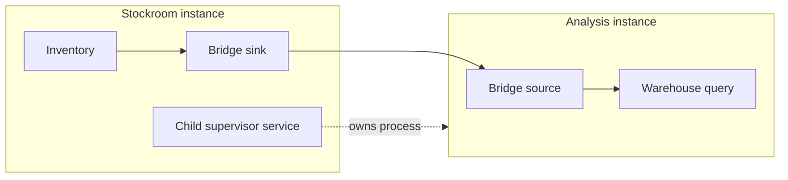

The data graph and supervision tree are different relationships.
This is not a remote `transform` call or a cross-process Rust resource handle.
Each instance owns its graph, storage namespace, and cleanup.

An instance-host manifest identifies the instance, private state directory,
explicit native-plugin allowlist, optional accepted-configuration store, index
providers, and desired topology. Each allowlist entry is an absolute library
path, optionally pinned to a SHA-256 digest that the host checks before loading
the library. The state directory is owner-only and process-exclusively locked.
Its stable identity survives process generations. The host verifies child
identity, generation, and readiness; a PID or open listener is not readiness.

Use distinct instance IDs and storage namespaces even when several instances
run in one process. A multi-threaded runtime shares execution resources;
a separate process supplies a different failure boundary. Neither choice
creates cross-instance transactions.

#### Select a bridge boundary

Native bridge endpoints support bounded local IPC and authenticated network
transport. Register source and sink factories only where needed. Bridge
endpoints are independently selectable static native factories; supervision
does not implicitly register or connect them.

| Profile | Successful delivery proves |
|---|---|
| Volatile | Acceptance into the bounded receiving queue |
| Durable | Receiver journal admission and its retry receipt committed at the selected failure scope |

Durable bridge handling is complete **at receiver admission**, not at completion
of the receiving query, subgraph, or external effect. The sender retains its
mapping and upstream obligation until that receipt is resolved and saved.
Timeout, disconnect, and a lost response leave uncertainty rather than proving
rejection.

Both peers must agree on link/endpoint identities, streams, schemas, limits,
and namespace policy. The link carries one graph-change format, used for source,
transformer and query data alike, plus complete source transactions. A query's
result nodes cross as ordinary nodes. Arbitrary plugin schemas, scheduled
signals (event-local controls), and query snapshot/progress recovery frames are
not portable bridge input.

The namespace allowlist names the element namespaces permitted to cross. A query
publishes in a derived dataset namespace (`drasi.output/<hash>`), not under its
query ID, so list each exported output's exact namespace next to the physical
source prefixes; the bridge infers no broader permission from query metadata. An
entry ending in `/` is a prefix; any other entry is one exact namespace. The
bridge does not automatically rename colliding source IDs. Mutual TLS
authenticates the configured peer, but does not establish global transaction
ownership or a completed business action.

Keep transaction containers and shared-storage groups inside one instance.
Never open another process's RocksDB directory to imitate a shared transaction.

#### Stop a composition at explicit cuts

For bidirectional data, stop order matters. Quiesce the complete upstream path
and outgoing bridge, seal its receiver admission boundary, stop the owned child,
and keep return ingress alive until the child finishes returning data.
Then drain the sealed receiving boundary and quiesce its consumers.

The instance host's `stop_stages` expresses those cuts. It retains unresolved
operations and child handles until exit/cleanup is established. A local
`DrasiLib::stop` alone is not proof that the entire composition drained.
An unresponsive remote peer cannot be assumed stopped.

Owned-local hosting supports Linux and macOS. It is not a Windows host or
a remote-machine provisioner. Process supervision and watchdogs are not
hard kernel resource isolation or a security sandbox. Force is explicit
whole-owned-instance termination; it may complete process cleanup while
leaving prior commit/effect outcomes unknown.

The [instance-host guide](../../../components/instance-host/README.md) and
[bridge guide](../../../components/computation-plugins/common/bridge/README.md)
provide manifest fields, resource recipes, and exact cut protocols.

#### Exercise the process boundary

The repository includes a two-process fixture that uses the same host and
bridge components. From the `drasi-core` root on Linux or macOS:

```sh
cargo build --locked --lib -p drasi-computation-source-counter -p drasi-computation-transformer-arithmetic -p drasi-computation-sink-capture --features dynamic-plugin
DRASI_NATIVE_PLUGIN_DIR="$PWD/target/debug" cargo test --locked -p drasi-instance-host --test processes real_bidirectional_native_data_drains_through_native_cuts_before_process_exit -- --exact --test-threads=1
```

If you set `CARGO_TARGET_DIR`, point `DRASI_NATIVE_PLUGIN_DIR` at its `debug`
directory instead. The fixture starts a parent and an owned child, sends
counter records to the child, adds 10 there, and returns the records to the
parent's capture sink. It requests shutdown while traffic is flowing and
checks the exact returned values through the agreed stopping position before
checking that both processes have exited.

Read the parent/child definitions in
[the process test](../../../components/instance-host/tests/processes.rs).
Trace the outgoing bridge, child transformer, and return bridge separately from
the child supervisor. This fixture is an executable isolation example;
Stockroom's CLI does not have a hidden multi-process mode.

**Summary.** Native SDKs preserve contracts across a library boundary; normal
DrasiLib instances and bridges preserve them across a process boundary. A
plugin declares its guarantees, host services and capabilities once. The host
checks those declarations when it loads the library, the graph checks them when
it binds edges and resources, and the conformance kit tests the lifecycle behind
them. Neither packaging nor isolation creates stronger delivery guarantees on
its own. The final application must still identify who owns every unfinished
action.

## Appendix A: Vocabulary

| Term | Meaning |
|---|---|
| Instance | One `DrasiLib` owner with its own application identity and runtime |
| ComputationGraph | The authoritative owner of components, connections, resources, and lifecycle |
| Component | A source, transformer, query, sink, service, or bootstrap provider in that graph |
| Component ID / name | Immutable UUID / exact editable name unique within an instance |
| Storage scope / partition | Where application state is stored / which component or named application store owns it |
| Output alias | A label for a selected output in a consumer's configuration; not its producing component's identity |
| Generation | One constructed object for a component; replacement invalidates old handles |
| Output epoch / query reset generation | Output recovery identities, separate from component generation; see [replay positions](#distinguish-input-output-and-replay-positions) |
| Element | A source-qualified graph node or relationship |
| Record | Immutable schema-defined identity and image bytes |
| Envelope | One identified change set with system metadata, context, and lineage |
| Stream | An ordered sequence emitted by one producer output |
| Port / edge / pipe | A data or bootstrap boundary of a component / a declared connection / its transport implementation |
| Component description | What a component guarantees: whether its progress survives a restart, the producer identity its outputs carry, and what its inputs require; the graph checks each edge against it |
| Producer identity | The identity of the stream an output publishes: durable (it and its positions survive a restart), volatile (it changes with each construction) or untracked (none) |
| Row signature | The evaluator's identity for a result row; it becomes the node's opaque identity within its output's dataset namespace, not its JSON value |
| Result node | The ordinary graph node a query publishes for one result row, with one property per `RETURN` alias |
| Dataset namespace | The data namespace stored in `ElementReference.namespace`; independent of component UUIDs and names |
| Bootstrap | Coordinated initial loading and handover to live/replayed input |
| Bootstrap provider | A component with the `BootstrapProvider` role and no data ports; it serves snapshots on a bootstrap output |
| Bootstrap edge | A connection from a bootstrap output to a bootstrap input; it carries bootstrap sessions, never live data |
| Bootstrap session | One consumer's snapshot request and the reply on that consumer's edge: begin, records, then completion or failure |
| Handover boundary | The source positions a snapshot covers, reported as watermarks at completion; the consumer skips live changes within it |
| Relay | A source that serves each downstream session from the provider on its `bootstrap` input and completes it with its own handover boundary |
| Snapshot output | A bootstrap output, conventionally `snapshot`, on which a provider or relaying source answers sessions and a query serves its committed results |
| Local provider | A provider connected directly to a query's `bootstrap` input; as the query's only bootstrap edge, the query's inputs are never asked |
| Late joiner | A consumer added while its source runs; it gets its own session and handover boundary |
| Composite bootstrap | Provider objects that `CompositeBootstrapProvider` combines for one query, with namespaced initialization state and one completion boundary |
| Checkpoint | A saved position proving only the owning processor's completion boundary |
| Consumer progress set | The independent input-progress owners required by one producer, not a merged checkpoint |
| Outbox | Retained committed output available for replay |
| Journal | Retained transport entries and the progress of their consumers |
| Admission | Acceptance of responsibility for input, possibly at a durable storage boundary |
| Handling | Completion of the work the consumer promises |
| Delivery failure | A sink's classified `handle` error: a transient failure is retried in place with backoff; a permanent one follows the sink's permanent-failure policy |
| Permanent-failure policy | Stall (stop at that input and fail the sink) or Skip (acknowledge it without delivering, and count it) |
| Recovery domain | The owners whose state and progress must remain consistent with each other |
| Desired / observed | Accepted intent / the realized and running state |
| Health | `Healthy`, `Degraded` (running with a retryable failure, such as a sink retrying a delivery), `Unavailable` or `Unknown` |
| Publication | One consistent `ComputationInspection`: a sequence number, the desired graph, and every component's observed state |
| Subscriber | The process's single global `tracing` collector, which filters log messages and spans and writes them out; see [Set up logging](#set-up-logging) |
| Component-log runtime | A `ComponentLogRuntime`: captures each component's recent log messages through its subscriber layer, for `subscribe_computation_logs_by_name` |
| Telemetry profile | Which traces and metrics Drasi records: `Off` (default), `Basic`, `Debug`, or `Persistence`; logging is configured separately |
| Metric registration context | A `MetricRegistrationContext`: one host metrics recorder and the instruments registered with it, shared by every instance that uses the recorder |
| Factory / resource | Code that constructs a component from a specification / a shared service it uses |
| Lifecycle hooks | `initialize` prepares an object once; `start` and `stop` begin and end an activation; `pause` and `resume` hold processing temporarily; `dispose` retires the object |
| Quiesce / erase | Park processing with ownership retained / dispose with `StateIntent::Erase`, deleting a component's saved data only on explicit request |
| Assess / apply | Decide whether and at which boundary a configuration change can be made / make an accepted change at that boundary |
| Update plan | A `ComponentUpdatePlan`: whether a change is made in place, across a stop, or by replacing the object, and what happens to its state |
| Fence | Prevent further use of an owner whose state or operation outcome cannot yet be trusted |
| Frontier | An accepted progress boundary, such as an element's latest effective time or a merger's emitted time |
| Watermark | A source boundary known to be covered by a coordinated snapshot |
| Receipt | A record of a particular accepted or completed operation at a named boundary |
| Lease | A retained right or reservation with an explicit lifetime, such as a bounded output reader or a storage-operation reservation |
| QoS channel | One retained channel with named subscribers, independent cursors, and explicit delivery/retention policy |
| Native plugin | A library of components built with `drasi-computation-plugin-sdk` and loaded by a host from a dynamic library, or linked statically; trusted in-process code, not a sandbox |
| Host (native) | The application that loads native libraries through `drasi-host-sdk` and runs their components in its graph |
| Host service | A graph-owned capability, such as committed progress or QoS admission, that a native factory declares once in `Capabilities::services` and receives at construction in `ServiceBindings` |
| Quiescent / durable provider | A bootstrap provider that only streams records, consistent while writers are quiet / one whose completion hands over to a saved source position and state |
| Paired provider | A bootstrap provider opened by its source's coordinator from the source's own settings, so its snapshot hands over to that source's live changes |
| Conformance kit | The plugin SDK's `testing` module (feature `test-support`) that runs standard lifecycle, erase, configuration and update scenarios against a native source or sink factory, linked or loaded |
| Reconciliation | Work that brings the running components and resources toward an accepted desired definition |

## Appendix B: API and example navigation

Use the generated API reference for signatures and exhaustive options:

```sh
cargo doc --locked -p drasi-lib --no-deps --open
```

The book supplies the application path; the reference supplies the catalog.

| Task | Public interface or focused companion |
|---|---|
| Embed and own an application | `DrasiLib`, `DrasiLibBuilder`; [Stockroom starter](stockroom) and [source](stockroom/src/main.rs) |
| Compose components and connections | `drasi_lib::computation::v1`; [schemas, ports, and pipes](../computation-graph-schemas-ports-pipes.md) |
| Create, find and rename components | `ComponentId`, `ComponentName`, `ComponentIds`, `component_by_name`, `component_by_id`, `rename_component_by_id`; [identity](#keep-identity-scopes-separate) |
| Manage an object's lifetime | `ComputationComponent`, `ComponentHandle`, `passive_component_lifecycle!`, `WorkerFailures`; [lifecycle hooks](#follow-an-object-from-creation-to-disposal) |
| Declare what a component guarantees | `ComponentDescription`, `ProgressPersistence`, `OutputDescription`, `InputDelivery`; [component descriptions](#declare-what-a-component-guarantees) |
| Handle sink delivery failures | `DeliveryFailure`, `PermanentFailurePolicy`, `ObservedComponent::skipped_inputs`; [delivery failures](#handle-delivery-failures) |
| Remove a component | `DrasiLib::remove_component`, `ComponentRemoval`; [removal and erase](#follow-an-object-from-creation-to-disposal) |
| Shut down and confirm cleanup | `DrasiLib::shutdown_with_outcome`, `ShutdownOutcome`; [cleanup errors](#preserve-errors-across-cleanup) |
| Change a running component's configuration | `ComponentFactory::plan_update`, `ComponentManagement`, `apply_desired_state`; native `UpdatePlanner`, `NativeManagement`; [assess and apply](#change-a-components-configuration) |
| Configure and read a native query | `ContinuousQueryDefinition`, `QueryExecutionSettings`, `QueryOptions`, `QueryResults` |
| Test time-dependent queries | `test-support`, `QueryTestControl`, `with_query_test_control_by_name`; [tests](../../tests/query_test_control.rs) |
| Select inputs through the ordinary query API | `Query::from_input_by_name`, `from_input_port_by_name`; [chaining and initialization](#chain-maintained-outputs) |
| Display current contents and follow changes | `DrasiLib::output_catalogue`, `snapshot_and_follow`; [volatile viewer](#open-a-current-plus-live-viewer) |
| Normalize data | `MiddlewareTransformer`; [middleware guide](../computation-graph-middleware.md) |
| Reorder source time | `SourceTimeMergeTransformer`; [time-merge guide](../computation-graph-time-merge.md) |
| Retain transport and retry identity | `QosChannel`, `SourceAdmission`, `RetainedPipe`; [QoS guide](../computation-graph-qos.md) |
| Share source recovery | `ConsumerProgressSet`, `InputPositionPolicy`; [Host bindings and recipes](../../../components/host-sdk/README.md#native-producer-consumer-progress) |
| Load initial data over the graph | `BootstrapProviderComponent`, `BootstrapRelay`, `Query::with_bootstrap_provider`; [bootstrap providers](#connect-a-bootstrap-provider) and [graph bootstrap](../../src/computation/v1/graph_bootstrap.rs) |
| Bootstrap a query from another query | The upstream query's `snapshot` output; [initial data sources](#choose-where-a-querys-initial-data-comes-from) |
| Attach or combine provider objects | `with_bootstrap`, `ComputationBootstrapProvider`, `CompositeBootstrapProvider`; [query bootstrap contracts](../../src/computation/v1/query_bootstrap.rs) |
| Pair source-owned initialization | Paired provider node on the source's `bootstrap` input; [Host coordination](../../../components/host-sdk/README.md#native-source-bootstrap-coordination) |
| Refresh native login credentials | `NativeIdentityResource`, `nativeIdentity`; [activation identity](../../../components/host-sdk/README.md#native-activation-identity) |
| Track ordinary handled input | `ComponentRecovery::with_volatile_input_progress`; [input-progress cases](../../tests/computation_input_progress.rs) |
| Recover a result view | `QueryReplayTransformer`, `CheckpointedSink`, `ConsumerProgressStore` |
| Complete consumer work | `DeliveryRunner`; [persistent Stockroom](stockroom/src/persistence.rs) |
| Preserve transactions | `SourceTransactionBuilder`, `TransactionTransformer`, `SharedStorageGroup`; [transaction guide](../computation-graph-transactions.md) |
| Supply state and credentials | `state_store`, `identity`, `secret_store`, `wal`; `ComputationIndexProvider` in `drasi-core` |
| Save desired configuration | `management`; [managed configuration](../managed-configuration.md) |
| Inspect running state | `DrasiLib::inspect_computation_graph`, `ComputationInspector`, `computation_info`, `inspect_computation_inventory`, `ComponentGraphView`; [health monitor](stockroom/src/cli.rs) |
| Discover source data | `DrasiLib::get_source_schema_by_name`, `get_graph_schema`; [metadata](#expose-metadata-without-exposing-secrets) |
| Configure logging and read component logs | `init_default_subscriber`, `ComponentLogRuntime`, `LogPolicy`, `DrasiLibBuilder::with_component_logging`, `DrasiLib::subscribe_computation_logs_by_name`; [Set up logging](#set-up-logging) |
| Export traces and metrics | `TelemetryOptions`, `TelemetrySettings`, `TelemetryProfile`, `MetricRegistrationContext`, `otel-context` feature; [setup steps](#enable-observability-in-your-application), [observability example](../../examples/observability/README.md), [telemetry reference](../../README.md#telemetry-foundations) |
| Observe committed query progress | `DrasiLib::get_query_progress_metrics`; [progress measurements](#follow-pressure-and-progress); [Drasi Server telemetry](#configure-drasi-server-telemetry) |
| Understand internal data representation and flow | [Internal data design](../computation-graph-data-design.md): records, standard schemas, transport, query transformations, persistence and replay |
| Handle public failures | `DrasiError`, `error::OperationFailures`, `GraphError`, lifecycle reports |
| Author and export a native plugin | `NativeComponent`, `NativeSource`, `NativeTransformer`, `NativeSink`, `NativeService`, `Factory`, `PluginDefinition`, `export_computation_plugin!`; [native authoring](#author-native-dynamic-components) and the [native SDK guide](../../../components/computation-plugin-sdk/README.md) |
| Declare native host services | `Capabilities::services`, `HostServices`, `ServiceBindings`; [host services](#declare-host-services) |
| Serve bootstrap data from a plugin | `BootstrapFactory`, `QuiescentBootstrapProvider`, `DurableBootstrapProvider`, `PairedBootstrapFactory`; [plugin bootstrap providers](#serve-bootstrap-data-from-a-plugin) |
| Own native plugin workers | `ActivationScope`, `PauseGate`, `passive_lifecycle!`, `drasi_computation_contracts::workers`; [owned workers](#keep-background-work-owned) |
| Load native libraries | `drasi_host_sdk::computation::load`, `NativePlugin`, `NativeFactory::specification`; [network.rs](stockroom/src/network.rs) and [Host SDK](../../../components/host-sdk/README.md#native-computationgraph-plugins) |
| Test a native plugin | `drasi_computation_plugin_sdk::testing` (`SourceConformance`, `SinkConformance`), `drasi_host_sdk::computation::conformance::LoadedTarget`; [conformance kit](#test-a-plugin-with-the-conformance-kit) |
| Choose a native integration | [Native component catalogue](../../../components/computation-plugins/README.md); [integration tables](#available-native-integrations) |
| Host independent processes | [Instance host](../../../components/instance-host/README.md) and [bridges](../../../components/computation-plugins/common/bridge/README.md) |
| Change the library implementation | [Maintainer's guide](../computation-graph-maintainers-guide.md) |

For book maintenance, `python3 lib/docs/developer-guide/check_book.py --test --network`
checks local links and source-linked excerpts, compiles every Rust fence with
explicit surrounding types, then runs the starter's default and extended
lesson tests in a fresh copy. The `--network` option builds the three native
network libraries and exercises HTTP/SSE payloads, webhook delivery, retry,
recovery and rejection, and live destination changes through the real
application with logging disabled.
These bounded smoke tests use local endpoints and temporary files, and run on
Linux/macOS; Windows remains unqualified. Omit `--network` to run only the
book and starter checks. The combined command is part of the repository test workflow.
JSON fences are syntax-checked, and the named Host resource recipes are also
deserialized into their public Rust configuration types.
The marked excerpts are compared with their compiled source; contextual
fragments receive the values named by their surrounding lesson. Compile-only
fragments are not executed as additional applications.

## Appendix C: Query-language essentials

Drasi's Cypher and GQL parsers target continuous graph calculations. Choose
`ComputationQueryLanguage::Cypher` or `ComputationQueryLanguage::Gql` when
constructing the query. GQL means Graph Query Language, not GraphQL.
The language choice and supported functions are part of the query's
configuration identity.

### Clauses and patterns

| Construct | Use |
|---|---|
| `MATCH (p:Product)` | Select nodes by label and bind a variable |
| `MATCH (p)-[:STORED_IN]->(w)` | Follow a relationship, including a declared synthetic join |
| `OPTIONAL MATCH` | Preserve a row when the optional part is absent; missing values are null |
| `WHERE` | Filter input bindings or rows after a `WITH` |
| `WITH` | Project intermediate values and group aggregates for later clauses |
| `RETURN` | Define the maintained result fields and aliases |
| Aggregates such as `sum`, `count`, `min`, `max`, `avg`, `collect` | Maintain values over the implicit group formed by non-aggregate expressions |

A continuous result is a changing set of rows. Sort and page a local view;
`ORDER BY`, `LIMIT`, and `SKIP` are not supported by this query model.
Query clauses read and calculate; mutations enter through source changes rather
than query-language writes to an external database.

The parsers share an evaluator but are not promises of the entire Neo4j or
ISO GQL product surface. Validate the query at construction and keep
a regression test for expressions your application relies on.

Variable-length relationship patterns such as `[:DEPENDS_ON*1..3]` are not a
supported traversal feature. Query construction rejects quantified patterns,
including `*1`, even when the parser recognizes their syntax. Use unquantified
single-edge relationships or explicit fixed chains instead; bounds are never
silently treated as one edge.

### Values and comparisons

Graph properties include null, booleans, signed integers, floating-point numbers,
strings, lists, objects, and supported date/time/duration values. Query results
can also contain elements and element references. Native `VariableValue`
preserves these distinctions; JSON is a presentation boundary, not the full
type system.

Use explicit conversion when input is textual. `"3"` is a string, not an
integer quantity. Temporal strings likewise need parsing or typed construction.
Use `IS NULL` and deliberate fallback expressions such as `coalesce` for
optional data; missing related data is not an empty string or numeric zero.
The starter's `sum(p.quantity)` returns a floating-point total, so its JSON
result is `3.0` even when the input was integer `3`.

### Function families

| Need | Starting points |
|---|---|
| Numeric calculation | Arithmetic operators, `abs`, `ceil`, `floor`, `round` |
| Conversion and missing values | `toInteger`, `toFloat`, `toString`, `coalesce` in Cypher |
| Strings and collections | `size`, supported string functions, list expressions and aggregate `collect` |
| Time values | `date`, `datetime`, `duration` and the supported temporal constructors for the chosen language |
| Delayed/expiring conditions | `drasi.trueFor`, `drasi.trueLater`, `drasi.trueNowOrLater`, `drasi.trueUntil` |
| Previous/rolling values | `drasi.previousValue`, `drasi.previousDistinctValue`, `drasi.slidingWindow` |
| Historical element versions | `drasi.getVersionByTimestamp`, `drasi.getVersionsByTimeRange`, with an archive-enabled provider |

Function spellings and argument rules can differ between Cypher and GQL.
The [language function registrations](../../../functions-cypher/src/lib.rs)
and [GQL registrations](../../../functions-gql/src/lib.rs) are the exact
implementation inventory for this checkout. Use them with the
[executable language examples](../../../shared-tests/src) when choosing an
expression beyond the book's tested queries.

### More than one query

Fan one source output into several query components, each with a distinct
component ID and output stream. Each query owns its own indexes and result
identity. The application's slowest required downstream path can still apply
backpressure; independent queries are not a promise of isolated resources.

Chaining needs no conversion: a query's output is ordinary graph-change data,
so connect it to the second query's `in` port. Each result row is a node with the
`Result` label (or its configured `result.label`) whose properties are the first query's `RETURN` aliases. Result
nodes retract with ordinary deletions when the upstream row retracts, and the
second query evaluates them with the same evaluator as any source. Use a single
query with `WITH` when the calculation fits one query; chain when the maintained
intermediate state is itself a useful application boundary. Queries still have no
`ORDER BY`, `LIMIT` or `SKIP`.

For input selection, the ordinary query builder and the snapshot/live starting
boundary, use [Chain maintained outputs](#chain-maintained-outputs). Query syntax
alone does not decide how a new consumer obtains existing producer state.
