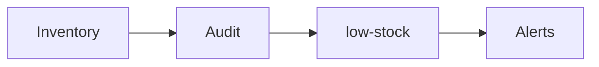
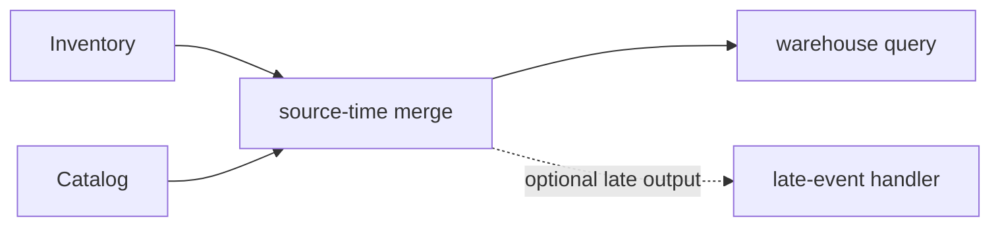
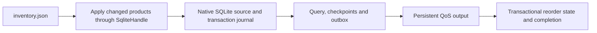
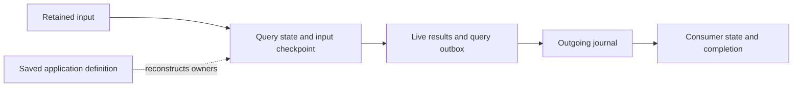
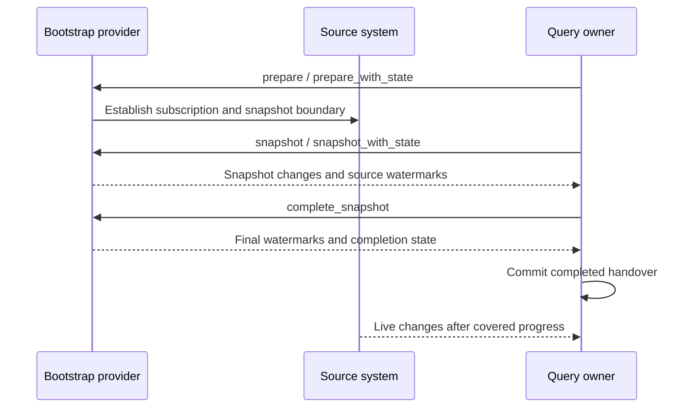
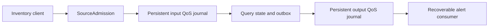
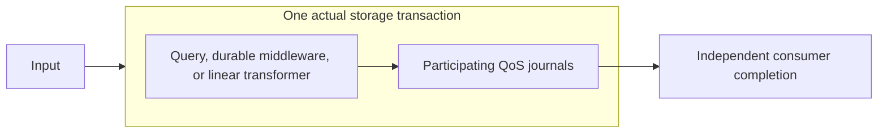
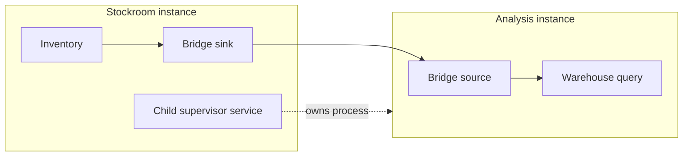

# The drasi-lib developer guide

**Development API guide.** This guide describes the current checkout, including
native MySQL/SQLite components, shared hosting, query-progress measurements and the
unified graph-change data contract (queries publish ordinary result nodes). Use
matching Core/Server sources and rebuilt plugin libraries; an older published
commit or registry binary does not contain all of these interfaces, and earlier
native wire or query-row formats are not read.

**drasi-lib is an embedded data-processing runtime for Rust applications.**
You connect **components** into a **computation graph** to ingest data, transform it,
maintain **state**, and perform actions. A graph can use custom processing logic,
**continuous queries** that maintain answers as data changes, or both. An extensible
library of **native plugins** connects the graph to external systems, handling
change detection or ingestion and notification delivery for supported
integrations. Your application controls the graph's configuration, resources,
and lifecycle.

This developer guide teaches you how to use drasi-lib to design, build, extend,
and operate data-processing applications. It covers the library's programming
model and capabilities, from data ingestion and component composition to
continuous queries, state, recovery, configuration, lifecycle management, and
deployment. The chapters build on one another, taking you from your first
working application to advanced processing and operational concerns.

You will apply these concepts by building **Stockroom**, a running example
application that keeps a live view of products that need replenishment.
Stockroom evolves throughout the guide: it starts as a complete in-memory
program, gains processing and operational controls, and develops the storage
and delivery contracts needed to recover unfinished work. The same techniques
apply to monitoring, data integration, event-driven automation, and other
embedded applications.

You should be comfortable with Rust, Cargo, and `async`/`await`. No prior knowledge
of Drasi, graph databases, or stream-processing frameworks is assumed.

## Contents

**Part I - Build a working application**

1. [Run your first application](#1-run-your-first-application)
2. [Model changing data](#2-model-changing-data)
3. [Write continuous queries](#3-write-continuous-queries)
4. [Maintain an application view](#4-maintain-an-application-view)

**Part II - Compose and operate**

5. [Compose a processing pipeline](#5-compose-a-processing-pipeline)
6. [Control flow, ordering, and memory](#6-control-flow-ordering-and-memory)
7. [Own the runtime lifecycle](#7-own-the-runtime-lifecycle)
8. [Observe and diagnose the application](#8-observe-and-diagnose-the-application)

**Part III - Make processing recoverable**

9. [Make query state durable](#9-make-query-state-durable)
10. [Join snapshots to live input](#10-join-snapshots-to-live-input)
11. [Retain input and replay output](#11-retain-input-and-replay-output)
12. [Complete business work](#12-complete-business-work)
13. [Preserve transactions](#13-preserve-transactions)
14. [Capstone: a recoverable Stockroom](#14-capstone-a-recoverable-stockroom)

**Part IV - Build a deployable application**

15. [Turn components into reusable factories](#15-turn-components-into-reusable-factories)
16. [Save and restore an application](#16-save-and-restore-an-application)
17. [Change a running application](#17-change-a-running-application)
18. [Package and isolate extensions](#18-package-and-isolate-extensions)

[Appendix A: Vocabulary](#appendix-a-vocabulary) |
[Appendix B: API and example navigation](#appendix-b-api-and-example-navigation) |
[Appendix C: Query-language essentials](#appendix-c-query-language-essentials)

## Part I - Build a working application

Many applications need a current picture of their data and a way to respond
when something important changes. drasi-lib lets you maintain state such as
running totals, current inventory, or devices needing attention, and connect
changes in that state to notifications and actions.

An extensible library of source and sink plugins connects that processing to
external systems. Sources automate the system-specific work of detecting or
receiving changes; sinks deliver results and notifications to external
destinations. For supported integrations, you configure and compose plugins
rather than develop custom change-capture and delivery code.

Continuous queries are a key use case. You declare the answer to maintain, and
the runtime reports additions, updates, and removals as input changes. A query
can join data from different external systems, maintain aggregates, and detect
time-based conditions without application code repeatedly fetching whole
datasets and comparing snapshots. You can also compose processing components
without a query, enabling live views, monitoring, data integration, and
event-driven workflows.

### 1. Run your first application

Keep Stockroom running while you edit an inventory file. You will lower a
product's quantity, see it enter the low-stock view, and restock it to make
the alert disappear. You control the input by editing and saving that file.

#### Copy and run the starter

Install Rust through rustup. This book targets the native APIs on the
`agentofreality-parallel-computation-graph` branch; the examples use that source
checkout, not an arbitrary crates.io release. If you do not already have it:

```sh
git clone --branch agentofreality-parallel-computation-graph https://github.com/drasi-project/drasi-core.git drasi-core
cd drasi-core
```

The final directory name **`drasi-core`** is significant: the supplied Cargo
paths expect it beside your application. The [starter project](stockroom)
includes its manifest, lockfile, pinned toolchain, source, and data files.
From the root of that checkout, copy it to a fresh sibling directory:

```sh
cp -R lib/docs/developer-guide/stockroom ../stockroom
cd ../stockroom
cargo run --locked
```

**Platform status:** these PowerShell commands have not been verified end to end
on Windows. The local walkthroughs have been exercised on macOS; the repository's
book-checking job runs on Linux. Qualify your chosen platform and backend before
depending on them in a deployment.

In Windows PowerShell, use the same clone command, then:

```powershell
Copy-Item -Recurse lib/docs/developer-guide/stockroom ../stockroom
Set-Location ../stockroom
cargo run --locked
```

Use a destination that does not already exist. Keep `stockroom` and `drasi-core`
beside each other so the supplied dependency paths remain valid.

Your copy contains these lesson files:

```text
stockroom/
  Cargo.toml
  Cargo.lock
  rust-toolchain.toml
  rustfmt.toml
  inventory.json
  catalog.json
  encoded-inventory.json
  http-insert.json
  http-restock.json
  destination.json
  webhook_receiver.py
  src/
    main.rs
    cli.rs
    network.rs
    persistence.rs
    managed.rs
  tests/
    cli.rs
```

Begin with `inventory.json` and `src/main.rs`. The native-integration and recovery lessons use `src/network.rs`,
`src/persistence.rs`, and `src/managed.rs`. `src/cli.rs` owns terminal signals,
concise error reporting, and key generation. Cargo features select the optional
integration and storage dependencies.

#### Build prerequisites

The included `rust-toolchain.toml` selects the compiler. Rust needs the platform's
linker; the native-storage lessons also compile C/C++ code and use libclang:

| Platform | Initial build | SQLite/RocksDB lessons |
|---|---|---|
| macOS | Xcode Command Line Tools | The tools' C/C++ compiler and libclang normally suffice |
| Linux | C/C++ build tools, such as `build-essential` | Clang and libclang development libraries when absent |
| Windows | Visual Studio C++ Build Tools and a Windows SDK | A discoverable libclang; these instructions remain unqualified |

For example, Debian/Ubuntu's later native-build packages are
`build-essential clang libclang-dev`. If bindgen cannot locate libclang,
set `LIBCLANG_PATH` to the directory containing its shared library.
The starter and its selected normalization middleware do not require libjq.
libjq is needed only when you explicitly choose the jq middleware build.
The selected lessons do not require CMake.

The starter commits its own lockfile, so its commands use `--locked`.
The repository-root lockfile is not distributed; workspace build/reference
commands in this book allow Cargo to create it.

The first build can take a little time. Once the application is ready, it prints:

```text
Starting Stockroom for low-stock. Press Ctrl-C to stop.
Ready. Watching inventory.json for saved changes.
```

Leave this terminal running. The first line always precedes result output;
an initial aggregate can appear before the final readiness line.

#### Own the application's logging

Stockroom installs its tracing subscriber **before constructing `DrasiLib`**.
Its `init_tracing` function defaults to warning-level diagnostic logs on stderr,
and includes `ComponentLogLayer` for Drasi's component log capture. The result
lines on stdout are application output, not INFO logs.

Use `RUST_LOG=info cargo run --locked` for diagnostics, or in PowerShell set
`$env:RUST_LOG = "info"` before running. At INFO level you can see
`__component_graph__`, an internal inspection source the runtime supplies.

In another host application, configure tracing once before creating the runtime.
Otherwise Drasi attempts to install its default global subscriber; subsequently
calling an infallible `.init()` on another subscriber can panic. Integrate the
log layer into the host's existing subscriber instead. Chapter 8 explains capture
and subscriptions in more detail.

#### Make your first change

Open **your copied project's** `inventory.json` in an editor. It starts with:

```json
[
  {
    "sku": "bolts",
    "quantity": 8,
    "minimum": 5,
    "warehouse": "west"
  }
]
```

Quantity 8 is above minimum 5, so there is no low-stock result to print.
Change `quantity` from **8 to 3** and save the file. The running terminal shows:

```text
low-stock: [{"quantity":3,"sku":"bolts"}]
```

You changed the input, and the maintained answer changed with it. You did not
restart the application or ask it to run the query again.

Make the following edits one at a time, saving and observing the result after
each one:

| Edit `inventory.json` and save | Terminal output |
|---|---|
| Change quantity from 3 to 2 | `low-stock: [{"quantity":2,"sku":"bolts"}]` |
| Restock by changing quantity to 8 | `low-stock: []` |
| Lower quantity to 3 again | `low-stock: [{"quantity":3,"sku":"bolts"}]` |
| Remove the product object, leaving `[]` | `low-stock: []` |

Restocking removes a result even though the product still exists. Removing the
product also retracts its result, but for a different reason. Both changes
matter to a consumer maintaining the current low-stock view.

Try changing a quantity between two values above the minimum. There is no new
low-stock output: the input changed, but the answer did not. Saving the same
inventory again likewise produces no notification.

The file source checks for a valid snapshot every 250 milliseconds and emits
changes only for products that were added, modified, or removed. Invalid JSON
or a read error produces a warning and leaves the last valid inventory intact;
fix and save the file to continue. It samples the file's current state, so edits
between reads can be coalesced. It is not a durable change log.

Restore the original product with quantity 8 before continuing. Press **Ctrl-C**
when you want to stop; the application awaits runtime shutdown.

#### Understand the query

Here is the query:

```cypher
MATCH (p:Product)
WHERE p.quantity < p.minimum
RETURN p.sku AS sku, p.quantity AS quantity
```

`MATCH` finds product nodes. `WHERE` decides which products belong in the answer.
`RETURN` determines the fields visible to the application. Quantity changes
are input; membership and value changes in this answer are output.

#### Follow one change through the program


The runtime owns `Inventory`, the query, and `Alerts`. `Inventory` compares
valid file snapshots and turns product changes into graph messages. The query
updates its answer, and `Alerts` maintains and prints the resulting view.
Bounded graph pipes connect the components.

A **source** produces changes; a **query** or **transformer** processes them;
a **sink** consumes them. **Ports** name a component's inputs and outputs,
**edges** connect ports, and **pipes** implement transport and buffering.
A **stream** identifies one output's ordered emissions.
The sink is where the application reacts to changes. In the native API its
role is Sink; "reacting" describes what it does, not a separate plugin interface.

Use an existing native component when it supports your integration. The small
file source makes the first exercise self-contained; Chapter 5 replaces it
with a packaged HTTP source and adds an SSE notification sink without writing
network handlers.

The [complete source](stockroom/src/main.rs) and its adjacent modules form the
running companion for all four parts of the book. Source excerpts are checked
against that code; illustrative alternatives are separately marked and
compile-checked with their surrounding types. Its
memory-backed processing state and small file source are starting points:
storage providers and source/sink plugins support persistent state and other
external systems.

The first lesson constructs one `ContinuousQueryTransformer` for the low-stock
query. The companion's `low_stock_query` function creates it and obtains its
result handle:

<!-- excerpt: stockroom/src/main.rs#query-construction -->
```rust
let query = ContinuousQueryTransformer::new(
    ContinuousQueryDefinition {
        graph_id: GRAPH.into(),
        id: ComponentId::try_new("low-stock")?,
        query: LOW_STOCK.into(),
        language: ComputationQueryLanguage::Cypher,
        output_stream: StreamId::try_new("low-stock/out")?,
        outbox_capacity: NonZeroUsize::new(128).expect("positive capacity"),
    },
    Arc::new(InMemoryComputationProvider),
)
.await?;
let results = query.results();
```

The imports, query text, and `GRAPH` are at the top of the companion.
`GRAPH` is `ComponentBatch::GRAPH_ID`, the public identity for the graph inside
`DrasiLib`. The application's instance ID is a separate scope. The memory
provider supplies the state needed to evaluate the query.
`query.results()` supplies the read handle used to await readiness and inspect
the maintained answer. Obtain it before moving the query into the component
batch. Later lessons introduce configurable construction and query settings.

`ComponentBatch` groups components and their connections. After constructing
the source and sink, the program adds them with the query:

<!-- illustration: component-members -->
```rust
let mut batch = ComponentBatch::builder()
    .source(Box::new(inventory))
    .query(Box::new(query))
    .sink(Box::new(alerts));
```

An output has a named port and a stream identity. The companion's `endpoint`
helper builds a component/port pair. For example:

<!-- illustration: input-edge -->
```rust
batch = batch
    .bind_stream(
        endpoint("inventory", "out")?,
        StreamId::try_new("inventory/out")?,
    )
    .connect(
        EdgeDefinition::new(
            endpoint("inventory", "out")?,
            endpoint("low-stock", "in")?,
        ),
        Box::new(BoundedPipeConfig { capacity: 8 }),
    );
```

The query output is bound and connected to `alerts/in` in the same way.
Declaring a port and connecting it are separate operations. Ports on known
components must have the declared names and compatible schemas; missing
dependencies can remain waiting for later connections.
`DrasiLib::start()` accepts those waits, so successful instance startup alone
does not establish that every component is processing. Stockroom bounds its
required components' readiness waits and reports the specific missing
connection when a deadline expires.

Finally, the application gives the batch to its runtime owner:

<!-- excerpt: stockroom/src/main.rs#instance-build -->
```rust
let core = DrasiLib::builder()
    .with_id("stockroom")
    .with_components(batch.build()?)
    .build()
    .await?;
```

`DrasiLib` owns a **ComputationGraph**: the connected processing components,
their resources, and their lifecycle. Starting the instance drives the file
source, query, and sink together.

#### Start, wait, and finish

Construction and execution are separate. Start the instance, then wait for
the components the application needs:

<!-- illustration: readiness -->
```rust
core.start().await?;
cli::wait_started(&core, "alerts", Duration::from_secs(5)).await?;
tokio::time::timeout(Duration::from_secs(5), results.wait_ready())
    .await
    .context("wait for query 'low-stock' readiness")??;
```

The complete program waits for all three components. Its `cli::wait_started`
helper includes the component name and observed dependency waits in timeout
errors. The two `?` operators on the query wait unwrap different failures:
an application deadline and a failed runtime operation.

Processing continues while `main` waits for Ctrl-C. Each query output updates
the sink's view; inputs that do not change the answer produce no output.
Saving the file is not a synchronous promise that processing has finished:
the terminal notification shows the view after the sink handles a result.

The application also observes component failures. If a required component fails
after startup, Stockroom reports it, awaits cleanup, and exits unsuccessfully;
this behavior is independent of `RUST_LOG`.
On Ctrl-C, the program awaits `core.shutdown()` and reports any cleanup failure
before returning. This pattern matters even in a small program: Rust cannot
await runtime cleanup in `Drop`.

**Summary.** You have a complete embedded application with a live query, explicit
data connections, bounded queues, and awaited startup and shutdown. Next, make
the meaning of its input precise; query correctness begins with data identity.

**Try it.** Add a second product with a different SKU and quantity below its
minimum. Restock only the first product and predict which row remains.

### 2. Model changing data

Stockroom needs to distinguish a product changing from a different product
arriving. In this chapter, the input becomes a property graph with stable
identities, explicit update semantics, and source time.

#### Describe entities, not query results

A property graph contains **nodes** and **relationships**. Both have identity,
labels, properties, and an effective time. A node might represent a product or
warehouse; a relationship might say that a product is stored in a warehouse.
The source describes these facts. It should not pre-filter products using the
low-stock condition: a restock must still reach the query so it can remove the
old result.

The file source parses each entry as a `Product`. Its `element` method maps
the product fields to the graph, including the optional payload used by the
normalization lesson:

<!-- excerpt: stockroom/src/main.rs#product-element -->
```rust
impl Product {
    fn element(&self, time: u64) -> Element {
        let mut properties = serde_json::json!({
            "sku": self.sku,
            "quantity": self.quantity,
            "minimum": self.minimum,
            "warehouse": self.warehouse,
        });
        if let Some(payload) = &self.payload {
            properties["payload"] = serde_json::json!(payload);
        }
        Element::Node {
            metadata: metadata(&self.sku, time),
            properties: ElementPropertyMap::from(properties),
        }
    }
}
```

When a SKU first appears, the source emits `SourceChange::Insert`; when the
same SKU's properties change, it emits `SourceChange::Update`. Removing a SKU
from the file produces `SourceChange::Delete`. Its metadata helper is:

<!-- excerpt: stockroom/src/main.rs#element-metadata -->
```rust
fn metadata(sku: &str, time: u64) -> ElementMetadata {
    ElementMetadata {
        reference: ElementReference::new("inventory", sku),
        labels: vec!["Product".into()].into(),
        effective_from: time,
    }
}
```

The element's identity is the pair **source ID, element ID**.
`inventory/bolts` and `catalog/bolts` are different elements. The `"Product"`
label describes the element's type; it does not identify an individual
product. A mutable property such as a display name is usually a poor element ID.

Use source-qualified references for relationship endpoints too.
`Element::Relation` contains `in_node` and `out_node` references as well as its
own metadata and properties. Changing a referenced node does not create a new
relationship identity. When the relationship itself has a business identity or
properties, publish it as an element rather than inferring it from equal values.

#### Distinguish inserts, patches, and deletions

The file source has a complete product image for each update. Other sources
may know only the changed fields. For a quantity-only update, they can send:

<!-- illustration: quantity-patch -->
```rust
fn quantity_update(sku: &str, quantity: i64, time: u64) -> SourceChange {
    SourceChange::Update {
        element: Element::Node {
            metadata: metadata(sku, time),
            properties: ElementPropertyMap::from(serde_json::json!({"quantity": quantity})),
        },
        removed_properties: BTreeSet::new(),
    }
}
```

`removed_properties` names properties to delete from the element. It is empty
here because the update only sets `quantity`. An empty list is the usual case, but
it is explicit: removing a property is different from setting it to null.

The query retains `sku` and `minimum`. At the graph-change boundary:

| Change | Meaning |
|---|---|
| `Insert` | A full-row upsert. Repeating the same complete element is not another contribution to an aggregate. |
| `Update` | Merge the supplied properties into the element. Omitted properties remain. A supplied null stores null; a name in `removed_properties` removes that property. |
| `Replace` | Replace the element with the supplied full image: properties it omits are dropped, as one change rather than a delete followed by an insert. |
| `Delete` | Remove the element identified by its metadata. No property payload is required. |

Updates and deletions must use the original element reference. Generating a
new ID for each update creates different elements instead of updating one.
A live node and relationship cannot share one element identity; that collision
fails before modifying state.

Properties can contain scalars, lists, objects, temporal values, and the other
rich values Drasi represents (unsigned integers, durations, ranges and
references, for example). `ElementValue` and `ElementPropertyMap` preserve the
typed model, and the graph-change records carry those values without reducing
them to JSON. A string that looks like a date is still a string unless you
construct or parse a temporal value.

#### Supply meaningful time

`effective_from` is the source's effective time in **milliseconds**. It is not
an output sequence or the time a downstream consumer happened to receive the
change. Stockroom timestamps changes when it reads a valid file snapshot, using
Unix epoch milliseconds. That is an observation time: the file source does not
claim to know the exact instant a person made each edit. A connector with an
upstream change timestamp should preserve that timestamp instead.

The evaluator reports and skips mutations that are strictly older than the
element's accepted source time. Equal-time changes follow admitted order.
Deleting an absent element still records a source-time frontier, so an older
insertion cannot resurrect it after recovery. Those frontiers are not
automatically expired without an appropriate retention contract.

Do not use a receive timestamp to disguise unavailable source time. If an
upstream system cannot provide ordering or time guarantees, that limitation
belongs in the source's contract.

#### Publish through a native source

The graph calls the source's `next` method. Stockroom drains the changes from
its latest valid file comparison, then waits for another poll. Unchanged files
produce no changes. `FileSource<T>` shares this polling behavior between product
and warehouse files; `T::SOURCE` supplies `inventory` or `catalog`. Its publication
branch is:

<!-- excerpt: stockroom/src/main.rs#source-publication -->
```rust
if let Some(change) = self.pending.pop_front() {
    self.sequence = self.sequence.checked_add(1).context("sequence exhausted")?;
    return Ok(Some(OutputEnvelope {
        port: PortId::try_new("out")?,
        envelope: GraphChangeCodec::encode_change(
            change,
            StreamId::try_new(format!("{}/out", T::SOURCE))?,
            self.sequence,
            None,
        )?,
    }));
}
```

`GraphChangeCodec` translates the typed graph change into a `ChangeEnvelope`.
The source does not write its own JSON wire format. `None` in the codec call
means that this example supplies no envelope-level source timestamp; the
element still has `effective_from`. A source-time merger needs that additional
timestamp, as Chapter 6 explains.

Returning `Ok(None)` means **finite exhaustion**, not "no data right now."
A listening source should wait while idle. A lost database connection should
surface an error or an explicit recovery operation, not masquerade as normal
end of input.

`Inventory` also implements `ComputationComponent`. Its descriptor declares
one output, `out`, with the `GraphChangeCodec` schema. Its first start validates
and loads the file. A later stop/start preserves any changes still awaiting
emission. The graph owns the polling work, so the source has no independently
spawned watcher to stop or join.

**Summary.** Stable source-qualified identity makes updates and deletions
meaningful. Explicit images and timestamps prevent accidental replacement,
stale resurrection, and invented ordering. The source now supplies facts the
query can maintain rather than approximations of the desired answer.

### 3. Write continuous queries

The first query finds individual low-stock products. Extend that answer to
warehouse totals, joined catalog data, and conditions that depend on time.
These are changes to the maintained calculation, not new polling loops.

#### Think in changing answer sets

For each accepted input, Drasi updates the query's graph and emits differences
in its answer. A change can add a result, change its values, remove it, or
produce no visible difference. One input can affect several result rows.

The low-stock query illustrates three cases:

| Input | Answer |
|---|---|
| Product quantity becomes 3, below minimum 5 | Add the product |
| Quantity becomes 2 | Change the existing answer row |
| Quantity becomes 8 | Remove the row, while retaining the product in query state |

An empty answer is a valid state. It does not mean the query is stopped.
Conversely, a running component is not evidence that an expected business
condition occurred.

`ComputationQueryLanguage::Cypher` and `ComputationQueryLanguage::Gql` select
the parser; both use the continuous evaluator. GQL is the graph query language,
not GraphQL. Use the syntax and functions supported by Drasi rather than
assuming compatibility with every feature of another graph database.

#### Aggregate by warehouse

The companion's products also have a `warehouse` property. Stop Stockroom with
Ctrl-C, restore the original one-product file with quantity 8, and restart your
copied project in aggregation mode:

```sh
cargo run --locked -- totals
```

This mode uses a query named `stock-by-warehouse`:

```cypher
MATCH (p:Product)
RETURN p.warehouse AS warehouse, sum(p.quantity) AS total
```

The non-aggregate projection groups the answer by warehouse. Its initial total
comes from the current file:

```text
stock-by-warehouse: [{"total":8.0,"warehouse":"west"}]
```

Change quantity to 3 and save. The total becomes 3.0. Change it to 2, then 8,
saving each time: both edits change the total, even though 8 did not belong in
the low-stock query's answer. Remove the product, leaving `[]`, and the
maintained total becomes 0.0.

When one product changes, the corresponding aggregate changes. It is not an
independent event to add to a counter in application code; the output describes
the new maintained total. This sum produces a floating-point value and a
default zero for the emptied group. Deleting the last product therefore does
not have the same output shape as deleting a low-stock match.

For grouped applications, include keys that identify the business group in
the projection. A terminal `sum` can keep a default-valued row after its last
contribution disappears, as this example does. To remove zero-total groups,
filter **after aggregation**:

```cypher
MATCH (p:Product)
WITH p.warehouse AS warehouse, sum(p.quantity) AS total
WHERE total > 0
RETURN warehouse, total
```

Keep the original `west` product at quantity 8. In `totals` mode, add a second
product with a distinct SKU, warehouse `east`, and quantity 3; save, then remove
only that second product and save again. The `east` group remains at 0.0 and
`west` remains at 8.0.

Repeat those edits with `cargo run --locked -- totals-filtered`. The `east`
row disappears, leaving only `west` at 8.0. The whole result becomes `[]` only
when every group fails the post-aggregation filter. This contrast separates
an empty group from an empty answer.
Optional matches can retain a result when a related record is absent; decide
how the application should represent those null values.

Continuous answers are not an ordered page. `ORDER BY`, `LIMIT`, and `SKIP`
are not supported. Sort and page a maintained application view when presenting
results to a user.

#### Join another source

Run the join lesson in your Stockroom directory:

```sh
cargo run --locked -- join
```

Set the product quantity to 3 and save `inventory.json`. The second source
reads the supplied `catalog.json`, which starts with
`{"code":"west","name":"West warehouse"}` inside an array. The result is:

```text
warehouse-alerts: [{"quantity":3,"sku":"bolts","warehouse":"West warehouse"}]
```

Change the warehouse name to `"West depot"` in `catalog.json` and save it.
The result changes even though you did not touch inventory. Remove the catalog
entry and the inner join retracts the row. Restore both files afterward.

Here `inventory` supplies products with `warehouse`, and `catalog`
supplies warehouses with `code` and `name`. Connect both sources to the
query's `in` port. They contribute elements to one query graph; they are not
two previously computed result sets.

If the sources do not publish relationship elements, declare a synthetic join:

<!-- illustration: synthetic-join -->
```rust
use drasi_lib::config::{QueryJoinConfig, QueryJoinKeyConfig};

let execution = QueryExecutionSettings {
    joins: vec![QueryJoinConfig {
        id: "STORED_IN".into(),
        keys: vec![
            QueryJoinKeyConfig {
                label: "Product".into(),
                property: "warehouse".into(),
            },
            QueryJoinKeyConfig {
                label: "Warehouse".into(),
                property: "code".into(),
            },
        ],
    }],
    ..Default::default()
};
```

The corresponding query is:

```cypher
MATCH (p:Product)-[:STORED_IN]->(w:Warehouse)
WHERE p.quantity < p.minimum
RETURN p.sku AS sku, p.quantity AS quantity, w.name AS warehouse
```

Construct it with `ContinuousQueryTransformer::new_configured`, passing the
definition, index provider, `QueryOptions::default()`, these execution settings,
and `None` for the optional middleware registry. The join is maintained when
either side changes.

The join declaration describes a relationship between equal key values. It does
not make keys unique or repair inconsistent identifiers. Prefer actual
relationship records when the relationship has its own properties or business
lifecycle.

Adding a source name to configuration alone does not connect it to a native
query. Data routing still belongs to the graph. Later, `QueryExecutionSettings`
also selects source-specific middleware; those settings do not create data
edges.

#### Ask questions about time

Stockroom can wait until a product has remained below minimum for five seconds:

```sh
cargo run --locked -- sustained
```

Begin with quantity 8, lower it to 3, and save. Leave the file alone: after
five seconds the application emits a low-stock result. Restocking retracts
it. Try restocking before five seconds elapse; that short-lived shortage
does not become a sustained alert.

```cypher
MATCH (p:Product)
WHERE drasi.trueFor(p.quantity < p.minimum, duration({ seconds: 5 }))
RETURN p.sku AS sku
```

The query schedules reevaluation. It does not need another inventory update
or a periodic application task to wake it.

Choose the time function for the condition you mean. `drasi.trueLater`
schedules a future condition; `drasi.trueNowOrLater` permits an immediate match
when appropriate; `drasi.trueUntil` supports expiry. These are distinct
policies, not alternative names for one timer. The
[heartbeat query examples](../../../shared-tests/src/use_cases/sensor_heartbeat/queries.rs)
show their time arguments in context.

Scheduled work shares the query's state and publication boundary. In a durable
query, removing a due notification, reevaluating it, and saving its output
belong to the transaction. A scheduling hint is not itself a completed timer,
and it must not advance a real source's checkpoint.

#### Compare with previous and historical values

`drasi.previousValue` and `drasi.previousDistinctValue` compare with preceding
values; `drasi.slidingWindow` supports rolling calculations. Historical element
versions are a different facility:

```cypher
MATCH (p:Product)
WITH p, drasi.getVersionByTimestamp(p, p.observed_at - 1) AS previous
RETURN p.sku AS sku, previous.quantity AS previous_quantity
```

Here `observed_at` is a supplied integer millisecond property.
`drasi.getVersionsByTimeRange` retrieves versions over an interval.
Version access requires an archive-enabled index provider; Chapter 9 shows
where to select that capability.

An archive contains versions Drasi received. It does not import the source
database's earlier history, and an in-memory archive does not survive process
loss. Saving historical versions and saving future scheduled work are separate
requirements.

For supported clauses, value types, and function families, use
[Appendix C](#appendix-c-query-language-essentials). The
[query examples](../../../shared-tests/src/use_cases) provide executable
cases for more involved expressions. Keep parser
choice, query text, joins, and middleware together when versioning an
application: all can change the meaning of saved query state.

**Summary.** Queries describe maintained answers over connected source data.
Joins, aggregation, and temporal conditions belong in that calculation; sorting
a display and performing business effects belong outside it. The next chapter
turns answer differences into a correct application view.

### 4. Maintain an application view

The application must distinguish two equal-looking rows, retract results that
stop matching, and avoid confusing a current snapshot with a live subscription.
Stockroom's in-memory result view is enough for a disposable display, provided
those rules are explicit.

#### Use the native application callback

For in-process reactions, the library already supplies an application sink.
Run:

```sh
cargo run --locked --features callbacks -- callback
```

Lower a product's quantity and save. The callback prints
`callback: [{"quantity":3,"sku":"bolts"}]`. It receives the native input envelope,
updates the view, and completes directly in the graph's owned task.

`ResultView` is the small keyed result cache explained
[later in this chapter](#stockroom-result-view). Here the callback uses its
`apply` and `rows` methods to update and display that cache:

<!-- excerpt: stockroom/src/main.rs#application-callback -->
```rust
fn application_callback(view: watch::Sender<ResultView>) -> anyhow::Result<Box<dyn EnvelopeSink>> {
    use drasi_reaction_application::NativeApplicationReaction;
    let sink = NativeApplicationReaction::callback(
        "alerts",
        QueryChangeCodec::schema().descriptor().clone(),
        move |input: InputEnvelope| {
            let view = view.clone();
            async move {
                let mut next = view.borrow().clone();
                next.apply(&input.envelope)?;
                let message = format!("callback: {}\n", serde_json::to_string(&next.rows())?);
                let mut output = tokio::io::stdout();
                output.write_all(message.as_bytes()).await?;
                output.flush().await?;
                view.send_replace(next);
                Ok(())
            }
        },
    )?;
    Ok(Box::new(sink))
}
```

`NativeApplicationReaction::callback` reports Handled after the callback future
finishes. `NativeApplicationReaction::channel` instead returns a bounded
`mpsc::Receiver<InputEnvelope>` for an application-owned consumer and reports
Accepted when the message enters that channel. Choose the channel when your
application needs to control its receiving loop; choose a callback for a direct
asynchronous action. Both are native interfaces despite the package's
`Reaction` name.

The channel alternative uses the same declared schema:

<!-- illustration: application-channel -->
```rust
use drasi_reaction_application::NativeApplicationReaction;

let (sink, mut receiver) = NativeApplicationReaction::channel(
    "alerts",
    QueryChangeCodec::schema().descriptor().clone(),
    NonZeroUsize::new(64).expect("positive capacity"),
)?;
```

Connect `sink.input()` to the query output and add `sink` to the batch.
Your receiving loop awaits `receiver.recv()` and owns completion of any work
performed after receiving the envelope.

#### Act on each change

Run `cargo run --locked -- reorders` and repeat the quantity changes.
This mode maintains a local set of pending reorders as well as printing the
view. Entering low stock creates a reorder, a changed quantity revises it,
and leaving low stock cancels it:

```text
reorder created: {"quantity":3,"sku":"bolts"}
reorder revised: {"quantity":3,"sku":"bolts"} -> {"quantity":2,"sku":"bolts"}
reorder cancelled: {"quantity":2,"sku":"bolts"}
```

`reorder_messages` handles `ChangeOperation::Added`, `Updated`, and `Deleted`.
For an update, it decodes both `before` and `after`; for a deletion, it uses
the before image or the row retained under the same identity. That is how
the application can cancel an order even when the deleted input carries no
properties.

These are **local, volatile reorders**, not purchases sent to a supplier.
Chapter 12 adds durable completion and explains the additional destination
contract needed for remote effects.

#### Receive native query output

The query emits ordinary graph-change records: each result row is a node in the
query's own output namespace, not one of the source graph's elements. Its
properties are the `RETURN` aliases. `QueryChangeCodec::schema()` is the same
schema as `GraphChangeCodec::schema()`, so a sink that handles graph changes can
receive it. Stockroom's custom `Alerts` sink demonstrates the underlying trait.
The full implementation also handles the optional reorder, audit, and display
branches:

<!-- excerpt: stockroom/src/main.rs#alert-sink -->
```rust
#[async_trait]
impl EnvelopeSink for Alerts {
    fn completion(&self) -> SinkCompletion {
        SinkCompletion::Handled
    }

    async fn handle(&mut self, input: InputEnvelope) -> anyhow::Result<()> {
        let mut view = self.view.borrow().clone();
        let mut message = String::new();
        if self.reorders {
            message.push_str(&reorder_messages(&input.envelope, &view)?);
        }
        view.apply(&input.envelope)?;
        if self.audit {
            ensure!(
                input
                    .envelope
                    .annotations()
                    .entries()
                    .any(|entry| entry.contributor() == "audit"
                        && entry.key() == "checked-by"
                        && entry.value() == ContextValue::String("stockroom".into())),
                "audit context was not preserved"
            );
            message.push_str("audit: checked-by=stockroom\n");
        }
        if self.display {
            message.push_str(&format!(
                "{}: {}\n",
                self.query_id,
                serde_json::to_string(&view.rows())?
            ));
            self.output.write_all(message.as_bytes()).await?;
            self.output.flush().await?;
        }
        self.view.send_replace(view);
        Ok(())
    }
}
```

`Handled` means this sink finished its declared work: updating and printing a
volatile view. It does not mean the rows were saved to disk or a replenishment
order was placed. A sink that merely queues work for another worker must report
`Accepted` instead. Completion is about the promised work, not just successful
receipt.

The sink publishes the completed view through a Tokio watch channel so other
application code can observe its current state. Watch notifications can coalesce;
they are not a retained stream of every result change. Terminal writes use
`AsyncWriteExt` and are flushed before the new view is published.

#### Key the view by record identity

Two result rows can have identical values. Do not use JSON equality as their
identity, and do not derive identity from a field that may change. A result row
is a node whose `RecordId` combines the query output's dataset namespace with an
opaque row identity the query supplies. The identity bytes are not a column and
should not be parsed; treat the `RecordId` as the key. Two rows with equal values
therefore stay separate rows, and the namespace keeps two outputs from colliding.

The companion stores:

<a id="stockroom-result-view"></a>

<!-- excerpt: stockroom/src/main.rs#view-shape -->
```rust
#[derive(Clone, Default)]
struct ResultView(HashMap<RecordId, serde_json::Value>);
```

Its update method is:

<!-- excerpt: stockroom/src/main.rs#view-methods -->
```rust
impl ResultView {
    fn apply(&mut self, envelope: &ChangeEnvelope) -> anyhow::Result<()> {
        ensure!(
            !QueryChangeCodec::is_snapshot(envelope)
                && !QueryChangeCodec::is_progress_only(envelope),
            "this live-only view requires a coordinated recovery owner for resets"
        );
        // Publish the batch only after every row has decoded successfully.
        let mut next = self.0.clone();
        for operation in envelope.changes().operations() {
            match operation {
                ChangeOperation::Added { after, .. } | ChangeOperation::Updated { after, .. } => {
                    let row = QueryChangeCodec::decode_row(after)?;
                    next.insert(
                        after.identity().clone(),
                        QueryChangeCodec::row_values_to_json(&row.values),
                    );
                }
                ChangeOperation::Deleted { identity, .. } => {
                    next.remove(identity.identity());
                }
            }
        }
        self.0 = next;
        Ok(())
    }

    fn rows(&self) -> Vec<serde_json::Value> {
        let mut rows = self.0.values().cloned().collect::<Vec<_>>();
        rows.sort_by_cached_key(serde_json::Value::to_string);
        rows
    }
}
```

The temporary map prevents a decode failure midway through an envelope from
publishing a partial batch. It is suitable for this small view. A large view
should use an appropriate transactional or staged update mechanism rather than
copying its entire state for every change.

The delete path needs only identity. The update path uses the new row rather
than applying an assumed numeric increment. Aggregation updates additionally
carry row-kind information (`QueryRowKind::Aggregation`, with grouping keys and
default-value flags) in the envelope's query projection, available from
`QueryChangeCodec::projection`; it is not stored in the node. Preserve it when
implementing logic that depends on how the aggregate changed.

`decode_row` yields a `DecodedQueryRow`: typed `VariableValue` values keyed by
`RETURN` alias, the node's dataset and label, its opaque identity, and the
evaluator signature when the identity is exactly one. It does not contain a query
ID or row kind; those belong to the envelope. `row_values_to_json` is useful for
a JSON presentation. Keep the typed values when business logic depends on
temporal types, element references, or distinctions a JSON projection cannot
adequately represent.

#### Read current results without rerunning the query

Keep `query.results()` before transferring the query into the batch. After
readiness:

<!-- illustration: query-snapshot -->
```rust
let snapshot = results.snapshot()?;
let sequence = snapshot.as_of_sequence;
for record in snapshot.rows.values() {
    let row = QueryChangeCodec::decode_row(record)?;
    println!("{sequence}: {}", QueryChangeCodec::row_values_to_json(&row.values));
}
```

`QueryResultSnapshot` contains the output's `projector`, keyed records, a
logical output position, and a generation. The projector names the output scope
even when the snapshot is empty. `core.get_query_results("low-stock").await?` is a convenient JSON
read for an inspection endpoint. Neither call executes the query again, and
neither establishes a live subscription.

The query's logical sequence counts output emissions, not products, source
events, or individual operations. Native replay can use a fresh transport
sequence while preserving the logical query sequence. Use
`QueryChangeCodec::query_sequence`, `query_generation`, and `metadata` instead
of inferring those identities from unrelated fields.

#### Consume live output asynchronously

Run `cargo run --locked -- stream`. Save a low-stock edit and see a logical
query sequence and operation count. The application is reading query envelopes
asynchronously rather than polling snapshots.

Construction registers the existing query with a catalog and connects an
actual outlet:

<!-- illustration: live-catalog -->
```rust
let catalog = QueryResultsCatalog::new(GRAPH)?;
let mut events = catalog.subscribe();
let query = query.with_result_catalog(&catalog)?;
let outlet = QueryResultsOutlet::new(
    ComponentId::try_new("live-results")?,
    catalog,
);
```

Add `outlet` as a sink and connect the query's output to `live-results/in`.
Subscribe before starting the graph, then await `events.recv()` in the
application's event loop. Each returned `ChangeEnvelope` supports the same
before/after decoding used for reorders. A reader handle alone does not publish
these events; the connected outlet does.

The catalog's broadcast subscription is a volatile live stream. On lag, report
the gap and rebuild through a coordinated snapshot/replay path. Chapter 11
teaches that handover; a broadcast receiver is not durable consumer progress.

#### Test your application

Run tests from **your copied Stockroom project**:

```sh
cargo test --locked
cargo test --locked joined_view_changes
cargo test --locked native_outlet_stream
```

The tests write to temporary inventory/catalog files and use `watch::wait_for`
with a deadline to await the actual answer. They test additions, updates,
retractions, equal-valued rows with different identities, malformed input,
and both current-thread and multi-threaded executors.
The sustained-condition test waits for a real scheduled result without another
input edit. A fixed sleep followed by an unchecked read is not an equivalent test.

**Try it.** Add a regression test for two low-stock products, then restock one.
Assert both the remaining view and the cancellation identity.

**Summary.** A result view is keyed state, not a list of notifications.
Use native row identity, apply additions, before/after updates and deletions,
and test both your current view and per-change actions. The native outlet
provides an asynchronous live stream; recovery adds a coordinated starting point.

## Part II - Compose and operate

### 5. Compose a processing pipeline

Connect Stockroom to external producers and consumers using native plugins.
Then add a processing step before its query, normalize real input, expand
records, and perform work that is not itself a query.

#### Connect existing native plugins

First replace the file source with a packaged native HTTP source and add a
packaged SSE sink. An external producer submits inventory changes, and an
external consumer receives result differences. Stockroom supplies configuration
and connections, not an HTTP server implementation.

From your `drasi-core` checkout, build just those two native libraries:

```sh
cargo build -p drasi-computation-source-http -p drasi-computation-sink-sse --features dynamic-plugin
```

Return to your copied Stockroom project and run:

```sh
cargo run --locked --features plugins -- plugins ../drasi-core/target/debug
```

The first `plugins` selects Stockroom's lesson; the directory argument is the
directory of libraries you just built and trust. The code selects the platform's
`.dylib`, `.so`, or `.dll` filenames. It loads only those two explicit packages.
If Cargo uses a custom target directory, pass that directory's `debug` folder.
Optional HTTP and SSE port arguments follow the directory; for example,
`plugins ../drasi-core/target/debug 9084 9085` uses those two ports instead.

Wait for:

```text
Ready: HTTP input at 127.0.0.1:9080; SSE output at 127.0.0.1:9081/events.
```

In a second terminal, start the consumer before sending data:

```sh
curl -N http://127.0.0.1:9081/events
```

In a third terminal, from your copied Stockroom directory:

```sh
curl --fail-with-body -H "Content-Type: application/json" --data-binary @http-insert.json http://127.0.0.1:9080/sources/inventory/events
curl --fail-with-body -H "Content-Type: application/json" --data-binary @http-restock.json http://127.0.0.1:9080/sources/inventory/events
```

Use `curl.exe` in Windows PowerShell. The supplied JSON requests insert the
product at quantity 3 and update it to 8. Each SSE data message contains
`output` (the alias, component and port of the producing output), `sequence`,
`publishedAt` (the sink's own clock) and a `changes` array. Each change states its
`operation`, a canonical `identity`, and only the images the record carries. The
first request produces an `ADD` with `after`; a `REPLACE` carries the changed
row as `after` plus its `before`; the removal is a `DELETE` with `before`. There
is no query ID or row signature, so the same shape serves a source or a
transformer too. Heartbeat frames are transport liveness messages, not
inventory changes.

The HTTP response confirms volatile ingress acceptance. The SSE sink is also
volatile and **Accepted**: a disconnected browser receives no retained history,
and its receipt is not a supplier's completed action. Keep the endpoints local
for the exercise; deploy authentication/TLS before exposing private data.
Stop both curl and Stockroom with Ctrl-C when finished.

The source response's phrase `events processed successfully` and its
`events_processed` field refer to ingress acceptance. They do not confirm query
completion or downstream handling.

The implementation in [network.rs](stockroom/src/network.rs) follows one
native path:

```text
trusted library -> native factory -> validated specification -> ComponentBatch
```

`drasi_host_sdk::computation::load` supplies the native factory. Its
`specification` method validates configuration and supplies the component's
ports and schemas. Stockroom connects the source's graph-change output to the
query, then fans the query's output out to its local view and the SSE sink.

**Try it.** Inspect `http-insert.json`, change its ID and SKU to a second
product, and submit it. Verify that restocking one product retracts only
that product's result.

#### Send changes to a webhook

The native HTTP sink supplies the outgoing integration. Build it from `drasi-core`:

```sh
cargo build -p drasi-computation-sink-http --features dynamic-plugin
```

For a local observation endpoint, run the included receiver from your copied
Stockroom directory in a separate terminal:

```sh
python3 webhook_receiver.py
```

This optional receiver needs Python 3; on Windows use `py -3`. It prints received
JSON and replies with HTTP 200. You can use your own existing webhook endpoint
instead.

With the original inventory at quantity 8, run:

```sh
cargo run --locked --features plugins -- webhook ../drasi-core/target/debug http://127.0.0.1:9082/reorders
```

After `Connected live webhook destination` appears, lower the quantity and save.
The receiver prints the query-result addition. Restocking produces its deletion.
The application configured a native sink; it did not implement HTTP delivery.
Webhook payloads identify the `operation`, the producing `output`, the element
`identity` and the `sequence`. An addition has `after`, a deletion has `before`,
and a replacement has both.

The observation receiver acknowledges receipt and printing, not a durable
purchase. For external business effects, use the completion/idempotency contract
in Chapter 12. With strict handling and zero retries, a failed request fails
the webhook component. Stockroom observes that failure, prints
`component 'webhook' failed` with its cause, awaits shutdown, and exits with a
nonzero status, even with `RUST_LOG=off`. Zero retries chooses the delivery
policy; application supervision makes the failure visible.

**Try it.** Stop the receiver, change quantity from 8 to 3, and save.
Expect Stockroom to report the webhook failure and exit unsuccessfully.
Restart the receiver, restore quantity 8, restart Stockroom, and repeat the
edit to see successful delivery.

#### Available native integrations

Native plugins and in-process components use the same graph-owned processing
contracts. Dynamic packaging is optional; a statically linked native factory
also works. Choose the actual native implementation for an integration rather
than assuming every connector package exposes every execution mode.
For databases, SQLite captures writes through its source-owned connection,
whereas PostgreSQL and MySQL use replication protocols. Those are different
capture boundaries, not interchangeable APIs. The Stockroom lesson keeps its
direct Rust SQLite handle; separately hosted SQLite sources can expose the
existing REST interface. Neither introduces a general SQL API on DrasiLib.

These are native component surfaces, rather than a count of every historical
connector package. Some are dynamically packaged; others are statically linked
Rust components:

| Integration | Input/output and use | Completion or recovery boundary |
|---|---|---|
| Native application callback/channel | In-process envelope sink with an explicit schema | Callback completion or bounded volatile channel acceptance |
| HTTP source | Graph changes submitted by an external application | Volatile acceptance by default; optional admission service |
| HTTP sink | Query-result notifications to a webhook | HTTP outcome under the configured policy; destination effects need their own contract |
| gRPC source/sink | Native graph-change ingress and query-result egress | Explicit transport acceptance and configured handling policies |
| SSE sink | Live query-result notifications to browser/stream clients | Volatile acceptance; reconnecting clients need a current view |
| Capture sink | Graph-change envelopes written to a file | Write/flush completion; it accepts any graph-change envelope, including query output (result nodes) |
| SQLite source/bootstrap | Committed changes through the original Rust handle/callbacks or source-owned REST; file or paired initial loading | Ordinary changes/transactions, or journal-backed single/shared persistent owners; file initialization requires quiescent writers |
| PostgreSQL sources | Committed row changes or complete transactions, selected by factory | Configured-slot shared recovery or the distinct single-owner modes; whole-transaction queries require atomic persistent progress |
| MySQL source/bootstrap | Ordinary rows, complete transactions, or explicit MySQL 5.7 positional rows; coordinated or standalone initial loading | Actual single/fixed-member progress, partial-row replay and retained history; positional rows do not claim FULL metadata, coordinated snapshots or commit clocks |
| MySQL stored-procedure sink | Parameterized actions for query changes | Handled after actual command responses; owned cancellation/cleanup, but no exactly-once effects or blind retry of a submitted call |
| SQL Server source/bootstrap/sink | Native CDC, standalone/coordinated loading and parameterized procedures are implemented | Real-database qualification is deferred; permission, large sink-batch and orphan-marker gaps remain. Do not select it as a qualified production replacement. |
| Middleware transformer | Parsing, mapping, relabeling and other graph-change normalization | Memory, durable, or transactional configuration |
| Inter-instance bridge source/sink | Data between independently owned instances | Explicit volatile or durable receiver-admission profile |

The [native component packages](../../../components/computation-plugins/README.md)
and [application sink API](../../../components/reactions/application/src/native.rs)
describe their exact configurations and schemas. The result-notification sinks
(HTTP, gRPC, SSE) need a current query output and reject plain source changes;
the capture sink writes any graph-change envelope.

Database capture requires its source-specific setup:

| Integration | Native interface | What the host must supply |
|---|---|---|
| [SQLite](../../../components/computation-plugins/sources/sqlite/README.md) | Independent source/bootstrap libraries and the preserved `drasi_source_sqlite::native::SqliteSource` Rust API | Source-owned SQL/REST; actual persistent owner/set for replay; `nativeSourceBootstrap` and per-query providers for paired initialization |
| [PostgreSQL](../../../components/computation-plugins/sources/postgres/README.md) | Independent native source and bootstrap factories | Matching row/transaction modes, explicit publication/slot settings and actual owners; shared row mode also supports memory queries without a process-restart guarantee |
| [MySQL](../../../components/computation-plugins/sources/mysql/README.md) | Independent source, bootstrap and stored-procedure libraries | Choose row/transaction/positional semantics explicitly; supply actual owners, binlog retention and matching bootstrap resources where supported |
| [SQL Server](../../../components/computation-plugins/sources/mssql/README.md) | Independent native libraries, not yet database-qualified | Explicit CDC/permission setup; coordinated snapshots require a pre-provisioned marker and locking contract. Qualification remains deferred. |

The selected MySQL and SQLite source/bootstrap/sink roles have actual static,
rebuilt-dynamic and Server qualification on both Tokio runtimes. SQLite has no
legacy reaction to migrate. Source data schemas use the ordinary DrasiLib/Server
inspection APIs through a separate native read capability.

Choose a MySQL positional factory explicitly when using limited-metadata
binlogs. Its `@N` properties, matching-catalog history checks and checkpoint
namespace differ from the FULL-metadata factories. A parsed GTID start does not
make file-bound partial cursors failover-portable. Stored-procedure templates
bind values rather than interpolate SQL; errors and uncertain submitted effects
are not silently dropped or blindly retried.

The HTTP lesson receives changes another application supplies. A database CDC
plugin instead detects committed changes through its database protocol. Choosing
the source changes how input is obtained; query and sink composition stay native.

#### Add the audit step

Stop Stockroom with Ctrl-C, restore the original inventory with quantity 8,
and restart your copied project in audit mode:

```sh
cargo run --locked -- audit
```

Change quantity to 3 and save. The answer is unchanged, but the sink also
reports the annotation it received from an intermediate transformer:

```text
audit: checked-by=stockroom
low-stock: [{"quantity":3,"sku":"bolts"}]
```



The `Audit` component has a graph-change input and output. Its transform method
derives a new envelope, assigns its own output stream and sequence, and appends
context:

<!-- excerpt: stockroom/src/main.rs#audit-transform -->
```rust
#[async_trait]
impl Transformer for Audit {
    async fn transform(&mut self, input: InputEnvelope) -> anyhow::Result<Vec<OutputEnvelope>> {
        let changes = GraphChangeCodec::decode_changes(&input.envelope)?;
        self.sequence = self.sequence.checked_add(1).context("sequence exhausted")?;
        let mut envelope = GraphChangeCodec::derive_changes(
            &input.envelope,
            &changes,
            StreamId::try_new("audit/out")?,
            self.sequence,
        )?;
        envelope.append_annotation(ContextEntry::try_new(
            self.descriptor.id().clone(),
            "checked-by",
            ContextValue::String("stockroom".into()),
        )?)?;
        Ok(vec![OutputEnvelope {
            port: PortId::try_new("out")?,
            envelope,
        }])
    }
}
```

This is the companion's complete `Transformer` implementation for `Audit`.
The original graph records keep their identities. The new envelope has the
transformer's emission identity and retains input context and lineage.
Appending an annotation affects this branch, not a sibling's envelope.
Repeated annotation keys are history entries, not assignments that overwrite
old entries.

The batch replaces `inventory -> low-stock` with two edges, adds the transformer,
and binds `audit/out`. It also verifies that the annotation reaches the query's
output. This is ordinary composition within the same `DrasiLib`, not a nested
runtime.

The annotation is not a durable audit record. This component has volatile
sequence state and does not claim a recovery contract. A durable audit trail
needs storage and a defined completion boundary.

#### Use component roles deliberately

The graph supports several kinds of work:

| Role | Processing contract |
|---|---|
| Source | `EnvelopeSource` produces envelopes |
| Transformer | `Transformer` consumes an envelope and produces zero or more outputs |
| Query | A query component maintains results using the transformer data boundary |
| Sink | `EnvelopeSink` accepts or handles input without data outputs |
| Service | `ComputationService` runs an activity with no data ports |

All implement `ComputationComponent` for description and lifecycle.
Several complete pipelines can coexist in one instance. A pipeline can also
contain no query at all: normalization, routing, and custom calculations do
not require inventing query text.

Connections must agree on the **complete schema descriptor**, including
version, encoding, and definition. Sources, middleware, and queries all publish
the standard graph-change schema, and a query's result rows are ordinary nodes,
so any of them can connect to a graph-change input, including another query, with
no conversion step. For example, with a first query that returns a `total` alias,
a second query can read it as:

```cypher
MATCH (r:Result)
RETURN r.total AS total
```

and the batch connects `first/out` to `second/in` like any other edge. `Result`
is the default label of a result node; the properties are the first query's
`RETURN` aliases. When the first query's answer is corrected, the second query
updates too, even if the correction carries an older business time, because the
query stream is ordered by its producer's output sequence rather than by the
clock. Compatible schemas do not mean every sink accepts every graph change:
sinks that report query results (HTTP, gRPC, SSE) require a current query output.
A custom schema connects directly to any port that declares the same complete
schema, provided the factories on both ends explicitly declare and implement it.
A factory that implements several formats on one port can let configuration pick
one with a `ports` override, resolved and validated before construction; see
[Choosing a port format](../computation-graph-schemas-ports-pipes.md#choosing-a-port-format).
Only a genuinely different format needs an intentional conversion: a query's
input port declares graph-change, so custom records must be converted into graph
changes before a query can read them.

Data connections form a directed acyclic graph. Control relationships, covered
in Chapter 7, carry readiness signals separately from the acyclic data path.

#### Normalize input with middleware

Suppose inventory arrives with a JSON string in `payload`, such as
`"{\"quantity\":3}"`. Keep the low-stock calculation unchanged by normalizing
that property before evaluation.

The starter's optional `payload` field and supplied `encoded-inventory.json`
make this exercise runnable:

```sh
cargo run --locked --features normalize -- normalize
```

The initial raw quantity is 8, but the payload contains quantity 3. The result
is low stock because normalization overwrites quantity with the parsed value.
Edit the string to `"{\"quantity\":8}"`, save, and watch the result retract.
Keep the surrounding JSON and its escaped string valid.

The `normalize` feature enables `middleware-parse-json` and
`middleware-promote`. A normalization component has this construction:

<!-- excerpt: stockroom/src/main.rs#normalization -->
```rust
fn normalization() -> anyhow::Result<MiddlewareTransformer> {
    MiddlewareTransformer::new(
        MiddlewareTransformerDefinition {
            id: ComponentId::try_new("normalize")?,
            output_stream: StreamId::try_new("normalize/out")?,
            middleware: serde_json::from_value(serde_json::json!([
                {"kind":"parse_json","name":"read-payload","config":{
                    "target_property":"payload","output_property":"parsed","on_error":"fail",
                    "max_json_size":65536,"max_nesting_depth":8
                }},
                {"kind":"promote","name":"quantity-at-root","config":{
                    "mappings":[{"path":"$.parsed.quantity","target_name":"quantity"}],
                    "on_conflict":"overwrite","on_error":"fail"
                }}
            ]))?,
            pipeline: vec!["read-payload".into(), "quantity-at-root".into()],
        },
        DrasiLib::default_middleware_registry(),
    )
}
```

Add it as a transformer, bind `normalize/out`, and connect
`inventory/out -> normalize/in -> low-stock/in`. Keep `sku` and `minimum`
in the input, or map them as well. A normalization pipeline cannot manufacture
business fields it was never supplied.

`middleware` declares named instances; `pipeline` selects them in execution
order. Declaring a middleware instance does not automatically run it.
Unknown kinds, duplicate names, and missing pipeline entries are errors.
The registry contains the implementations enabled in the build.

The same normalization can run inside a query by passing middleware definitions
and input-specific pipelines through `QueryExecutionSettings`, along with
the registry to `new_configured`. For example, an input entry is:

<!-- illustration: source-pipeline -->
```rust
drasi_lib::config::QueryInputConfig {
    component: "inventory".into(),
    port: None,
    nodes: vec!["Product".into()],
    relations: vec![],
    pipeline: vec!["read-payload".into(), "quantity-at-root".into()],
}
```

Use a separate transformer when several downstream consumers need the same
normalized stream. Use query-local middleware when normalization belongs to
that query's processing state. In either case, native data connections still
determine which input reaches the query.

#### Choose transformations by their data contract

| Middleware | Use in Stockroom | Important constraint |
|---|---|---|
| `decoder` | Decode base64, base64url, hex, URL, or JSON-escaped properties | Decoding text is not parsing it; order the parsing step afterward |
| `parse_json` | Interpret a string property as structured data | Bound input size and nesting; choose fail/skip behavior explicitly |
| `promote` | Copy nested values to named properties | Decide whether conflicting destination values overwrite, skip, or fail |
| `relabel` | Map upstream labels to the application's graph vocabulary | Labels on deletions must be normalized too |
| `map` | Select and reshape changes using JSONPath | A stateless event mapper (see below); preserve IDs and account for the fields available in delete images |
| `jq` | Express more elaborate selection and reshaping | A stateless event mapper; jq expressions have their own quoting and error behavior |
| `unwind` | Expand warehouse bins into maintained child nodes and relationships | Stable child keys and previous-element state are essential |

Each kind has a corresponding `middleware-*` Cargo feature.
`middleware-jq` uses system libjq; `middleware-bundled-jq` builds it.
Enable just the transformations the application uses.

`map` and `jq` are **event mappers**. Each rule looks only at the data in the
incoming event, keeps no memory of earlier input or output, and ignores an event
that makes no sense for it. A `Replace` maps to a `Replace` by default, and
`"op": "Replace"` can be configured. An update that carries property removals
cannot in general be mapped without knowing what came before, so that `update`
rule is skipped (a debug diagnostic is logged) rather than failing; explicit
rules that produce `Insert`, `Replace` or `Delete` can still run. A missing
selection or unmatched rule produces no mapped event, while a malformed change or
a failing configured expression is still an error. `Future` changes are not
mapped and pass through, so scheduled work is unaffected. Use an event mapper for
reshaping each event. If you need a *maintained* derived dataset (retracting
outputs that stop matching a filter, or re-keying outputs), that is a different,
stateful component: a view transform, planned as
[CW-68](../computation-graph-remaining-work.md#cw-68) and not available today.

Unwind illustrates why apparently simple transformation can be stateful.
When a bin disappears from a warehouse's array, the old child must be deleted.
The transformer needs the previous parent and children to compute that change.
An omitted selected array is an empty selection, not "leave old children
unchanged." Later steps must preserve the identities and fields needed for the
next update.

`MiddlewareTransformer::new` keeps its state in memory. Its `new_durable`
constructor uses `DurableMiddlewareOptions` and an atomic persistent provider
to save prior elements, input progress, and output together. Durable outgoing
connections are required. A recoverable pipeline needs durable processing
state in the transformer as well as retained input and output.

The [middleware guide](../computation-graph-middleware.md) and
[middleware configurations](../../../middleware/README.md) provide larger
mapping examples and exact options.

#### Bound expansion and scheduled work

A transformer can emit no outputs to filter an input, or several to expand it.
Returning a huge vector keeps all those outputs in memory and can monopolize
processing. For incremental output, keep a bounded pending queue:

<!-- illustration: continuation-chunk -->
```rust
fn next_chunk(
    pending: &mut std::collections::VecDeque<OutputEnvelope>,
) -> Vec<OutputEnvelope> {
    let count = pending.len().min(64);
    pending.drain(..count).collect()
}
```

Return the first chunk from `transform`, report remaining work with
`has_pending_emissions`, and produce later chunks from `continue_transform`.
The graph completes the continuations before accepting another input or
acknowledging the original. Bound total retained expansion as well as the size
of each chunk.

For time-driven work, expose a `WakeupSource` and implement `on_wakeup`.
`wait` must actually suspend until work may be ready; `has_pending` lets a
finite graph account for outstanding scheduled work. Persist both schedules
and their completion when timers must recover. A wall-clock alarm held only in
a Rust field is volatile.

A `ComputationService` can run a periodic health activity without data ports.
Its `run` future must yield, and its quiesce/stop hooks must account for any
workers it owns. Use a data source when the activity produces records that
belong in the pipeline instead.

**Summary.** Composition separates ingestion, normalization, calculation, and
consumption without adding another execution engine. Schemas keep boundaries
explicit; continuations and wakeups let components do bounded work. Next,
choose how connected components share capacity and ordering.

### 6. Control flow, ordering, and memory

Stockroom works while every component is fast. Now consider a burst of inventory
updates, a quiet catalog, or an alert consumer that slows down. Queue and ordering
choices determine what the application does under those conditions.

#### Size one concrete path

Use the `totals` lesson and add several products in one saved file. Each changed
product creates input work; a saved file is not necessarily one atomic source
transaction. In `build_application`, change the bounded pipe capacity from 8
to 1 and rerun. The answer is unchanged, but the source and query must wait
more frequently for the next component.

Choose capacity from the burst you need to absorb and the slowest required
consumer's service rate. If input averages 500 envelopes/second and a consumer
can pause for two seconds, at least 1,000 envelopes can accumulate before
considering existing backlog. Multiply by representative **complete envelope**
size and include component/backend overhead before deciding whether that
buffer fits. A sustained producer rate above consumer capacity needs more
processing capacity or a different policy, not an ever-growing queue.

**Try it.** Run `totals` with pipe capacity 1 and then 8. Save the same group of
product edits in each run. Verify that the final answer agrees, and identify
which buffers absorb the burst rather than treating larger capacity as faster
query evaluation.

#### Follow backpressure upstream

The first program uses bounded FIFO pipes. When `alerts` cannot finish writing
its output, its graph input fills, the query's forwarding waits, and pressure
eventually reaches `inventory`. This is useful: the producer cannot create an
unlimited hidden backlog in the graph pipes.

A buffer absorbs a temporary imbalance. Sustained throughput remains limited
by the slowest required stage. Count all buffering locations:
application channels, graph pipes, a transformer's pending output, retained
journals, and any destination client queues.

Keep three different purposes separate:

| Buffer | Holds | Freed by |
|---|---|---|
| Volatile input/dispatch queue | Work waiting to be received | The receiver taking work |
| Query outbox | Retained logical query emissions | Its retention and output-confirmation rules |
| Acknowledged journal | Work owed to required consumers | The required progress/retirement rules |

A queue slot becoming available is not evidence that business work completed.

#### Select a transport policy

Use `BoundedPipeConfig` for ordinary lossless-in-memory FIFO and backpressure.
Use `BroadcastPipeConfig` only when its lag policy fits the consumer:
Report fails visibly on lag; SkipWithNotification explicitly reports skipped
data and continues. A disposable dashboard can accept a rebuild after lag;
a replenishment order processor usually cannot.

`RetainedPipe` retains unacknowledged work through a supplied store.
`QosChannel` shares one journal among named subscribers with separate cursors.
Their persistence and recovery choices are developed in Chapter 11.
Retention under Backpressure preserves outstanding obligations; PruneOldest
deliberately trades them away.

Port `PipeRequirements` and graph-level `requirements` assert required
capabilities. Supply providers that actually implement them: a memory pipe
rejects a durable-acceptance requirement.

Fan-out shares immutable payloads but forwards in edge declaration order.
A slow required branch can backpressure its siblings through the producer.
Branches therefore share producer pressure. Partial fan-out is possible if an
earlier branch accepts before a later one fails.

#### Bound bytes as well as messages

For variable-sized input, replace a bounded edge's configuration with:

<!-- illustration: byte-pipe -->
```rust
ByteBoundedPipeConfig {
    capacity: 8,
    max_bytes: 1024 * 1024,
}
```

Both limits must be positive. The charge covers the complete binary envelope,
including identifiers, metadata, annotations, and lineage, not only the JSON
payload. Each independent fan-out pipe charges its own envelope.

An oversized envelope may occupy an otherwise empty byte-bounded pipe by itself.
The budget is therefore **not a maximum message size or a process-memory cap**.
Use bounded codecs and input validation for a hard message-size limit.
The budget excludes component state, work already received, serialization
scratch space, and backend caches.

Retained stores and non-shared QoS journals have optional byte quotas too.
The journal charges an envelope once, not once per subscriber. Under lossless
retention, only safely handled history can be reclaimed. Reopening with a
smaller quota preserves existing obligations and blocks new admission until
safe pruning is possible.

Persistent journals can use `OutboxPageLimits` through `IndexedJournalOptions`
or `QosJournalOptions` to bound the decoded payload cache. Page bytes measure
stored records; admission quotas measure binary envelopes. Startup validates
the complete history even with paging enabled.

Shared-storage QoS has bounded history pages but count-based admission
reservations. Ranked and broadcast pipes remain count-bounded. Select these
limits at the actual resource owner and preserve them in its reconstruction
recipe. See [journal resource limits](../computation-graph-qos.md#optional-journal-resource-limits)
for the supported constructors.

#### Decide what "ordered" means

FIFO orders a producer's emissions by sequence. With several inputs, the
default `InputMergePolicy::Arrival` processes available work without imposing
a global source-time order.

`InputMergePolicy::EventTimeAcrossStreams` compares available stream heads.
It preserves each stream's order and does not wait for unseen input from a
quiet producer. `RankedInputPipeConfig` additionally uses an actual shared
ranked queue and declared source ranks; it is not a switch that makes unrelated
queues one globally ordered stream.

Each event also states how a receiving query treats stale changes
(`SystemMetadata::ordering`). Source data uses `ChangeOrdering::EventTime`: a
change older than the element's accepted time is skipped. A query's own output is
published with `ChangeOrdering::ProducerSequence`, so a downstream query follows
the producing query's validated output order and still applies a correction that
carries an older business time. Scheduled work is carried by a separate
event-local control, not by the data records. These are set by the producing
component; an application normally only chooses to connect or not.

Neither policy can move a late event before work already evaluated. If a
warehouse total must use a bounded source-time reorder window, make that
processing stage explicit.

#### Merge by source-change time

Place `SourceTimeMergeTransformer` before the query:



For example:

<!-- illustration: time-merge -->
```rust
let merger = SourceTimeMergeTransformer::new(
    SourceTimeMergeDefinition {
        graph_id: GRAPH.into(),
        id: ComponentId::try_new("merge")?,
        sources: vec![
            StreamId::try_new("inventory/out")?,
            StreamId::try_new("catalog/out")?,
        ],
        output_stream: StreamId::try_new("merge/out")?,
        late_output_stream: None,
        reorder_window_ms: 2_000,
        max_wait_ms: 5_000,
        idle_timeout_ms: Some(10_000),
        max_buffered_events: NonZeroUsize::new(256).expect("positive capacity"),
        max_buffered_bytes: NonZeroUsize::new(1024 * 1024).expect("positive capacity"),
        late_policy: LateEventPolicy::FailAndRetain,
    },
    GraphChangeCodec::schema(),
)?;
let observations = merger.subscribe();
```

Connect both sources to `merge/in`, bind `merge/out`, and connect it to the
query. Every input needs `SystemMetadata::timestamp()` containing its actual
source-change time. In the first source, that means replacing the codec's
`None` timestamp argument with the source-supplied value. Element
`effective_from` is not an automatic substitute.

The merger can reorder timestamps within a source while requiring that
source's logical input sequences arrive in order. Ties use declared source
order and logical sequence among buffered events. A complete envelope remains
indivisible.

An event becomes eligible when all active sources' observed progress permits
early release, or when its maximum residence wait expires. Optional idle
detection prevents a silent source from blocking the early-release calculation
forever. Idleness is not a watermark proving there can be no earlier event.
`max_wait_ms` is an eligibility bound, not a delivery deadline under
backpressure.

An input older than the emitted time frontier is late. FailAndRetain holds it
and reports a typed error; Route sends it to an explicitly connected `late`
output; Discard explicitly drops it and reports that choice. Routing late data
does not automatically correct answers already published by the query.

The count and byte limits include held and unconfirmed work. Unlike the
byte-bounded FIFO, this merger rejects an individually oversized input.
Capacity errors leave retry and input retention with the upstream owner.

`new_durable` adds atomic persistence of the buffer, progress, held input,
and unconfirmed output, with lossless durable output requirements.
Reconstruction validates the configuration and restarts residence waits;
downtime does not invent source progress. Its persistence cost grows with
the bounded saved window. The
[source-time merge guide](../computation-graph-time-merge.md)
details release rules and recovery.

#### Understand concurrency

Top-level native nodes run in independently scheduled, graph-owned Tokio tasks.
Mutable work on one component remains serialized. On a multi-threaded executor,
independent nodes can use different workers; on a current-thread executor,
they interleave but cannot perform CPU work on several cores at once.

Shared storage gates, graph shape, and slow consumers still constrain parallelism.
The runtime bounds continuously ready work per node, but it cannot preempt
an infinite synchronous loop inside custom code. Use asynchronous I/O and
bounded computation; merely placing a blocking call inside `async fn` does
not make it nonblocking.

**Summary.** Capacity controls burst absorption, ordering controls which
available change is next, and retention controls what can be recovered.
They are different decisions. Bounded work and explicit backpressure keep
Stockroom understandable when input or consumers stop behaving ideally.

### 7. Own the runtime lifecycle

An embedded runtime is part of the application's lifetime. Stockroom needs to
know when it is usable, stop without abandoning ownership, and distinguish an
idle source from a damaged component.

#### Exercise startup and shutdown

Run the file lesson, save an invalid JSON fragment, and observe the warning.
Restore valid JSON and observe recovery without restarting. Then use Ctrl-C
and restart Stockroom. The file provides a new initial snapshot; the in-memory
query is rebuilt.

Now temporarily give two products the same SKU and start the application.
Startup fails with `duplicate record key` instead of reporting readiness.
This distinguishes an invalid initial definition/data set from a recoverable
bad save while a previously valid source is running.

An object's **generation** identifies one constructed incarnation. The graph's
**revision** identifies an accepted topology version. These are ownership
coordinates, not query row numbers. You will use them for replacement in
Part IV; routine application code can begin with `start`, readiness waits,
and awaited `shutdown`.

#### Separate acceptance, construction, and readiness

A successful addition accepts a component definition. It does not prove that
a database connection opened or that processing is ready.
`ComponentHandle::wait_created` waits for construction; `wait_started` waits
for the running boundary. Bound waits with an application deadline.

A valid declaration can be accepted before all of its dependencies are usable.
Inspect the component's observed state and the actual topology when readiness
does not arrive: check source and resource availability as well as port
connections. Repair the missing dependency while preserving auto-start settings
and explicit stops. Reserve retries for failures classified as retryable, rather
than treating every unready component as a failed constructor.

An empty graph and an unconnected declaration are valid starting points.
A connected output without its required stream binding is not: that connection
is rejected before processing starts. A successful `DrasiLib::start()` does not
mean every declared component is running; wait on the particular component you
need. The instance host remains available for management while dependencies are
missing after library startup returns.

**Try it.** In your copied `main.rs`, find the default edge list in
`build_application` and temporarily remove `("inventory", query_id)`, leaving
`(query_id, "alerts")`. Run `cargo run --locked`. The graph declaration and
instance start are accepted, but the inventory source waits for its output
connection. After the five-second readiness deadline, Stockroom reports
`wait for component 'inventory' readiness` and
`connection for 'inventory:out'`, then exits unsuccessfully. Restore the edge,
rerun, and confirm that `Ready. Watching inventory.json` returns.

Then stop the persistent lesson with Ctrl-C while it is applying an edit.
Its signal receiver remains owned while work completes, and the healthy graph
is quiesced before terminal cleanup.

A failed definition remains inspectable. Retryable acquisition failures can be
retried after their cause is repaired; unchanged terminal validation failures
need a corrected definition. An instance can contain a running query, a failed
sink, and an unbound edge at the same time. Inspect per-component outcomes,
not just whether a graph handle exists.

Observed state separates realization, lifecycle, health, binding, and
availability. Running is not the same as healthy; a healthy source can be idle;
an exhausted finite source is not an unavailable listening source.

#### Use readiness and control relationships

A component needing explicit readiness opts into
`requires_readiness_confirmation`. Its `bind_control` hook receives a
generation-bound `ComponentControl`; it calls `ready` only after the required
initialization is complete.

`require_downstream_ready` can hold upstream activation until required
consumers confirm readiness. Await that explicit boundary before sending input.

Control notifications communicate with authorized immediate neighbors through
`notify_downstream`, `notify_upstream`, or `notify_neighbor`. Ready/NotReady
describe readiness; Available/Unavailable describe availability.
A `ControlHandler` receives peer notifications independently of ordinary
mutable data operations.

Custom notifications can carry small configuration-independent signals, such
as "catalog refreshed." They are bounded control messages, not a bulk-data
transport or durable work queue. Replacement invalidates old generations and
connections. A handler may be cancelled when its connection becomes invalid;
that cannot undo an external action already performed.

#### Choose the right stop operation

| Operation | Purpose |
|---|---|
| Quiesce selected components | Park processing at supported safe boundaries while retaining ownership |
| Stop components or `DrasiLib::stop` | Stop processing with awaited lifecycle work; the instance supports a later start |
| `DrasiLib::shutdown` | Perform terminal instance cleanup |
| Standalone graph `dispose` | Release graph-owned resources after its run/cleanup boundary |
| Deprovision | Permanently remove component-owned processing state |

Quiescence is not a universal drain. Work from selected producers drains to
the supported boundary, while other queued input can remain owned.
It does not prove every retained message or external effect completed.

Graceful stop accounts for admitted operations, continuations, and required
forwarding before stop hooks. A timeout reports unfinished work. It does not
mean that a write rolled back or that the application may open another owner
of the same resource.

Shared producers may still need their consumers' actual progress while draining.
The runtime keeps those owners and read capabilities alive until producer cleanup
finishes. For example, stopping SQLite closes new HTTP admission but drains
already accepted requests through its existing worker. Cancelling a stop waiter
does not abandon the accepted stop operation or authorize a replacement owner.
Unrelated cleanup remains independent; a failed producer is not permission to
retire the owners it still needs.

Deprovision is not a pause button. Similarly, a configuration change that
removes a component is not an ordinary stop; its recovery obligations need
separate consideration in Chapter 17.

#### Preserve errors across cleanup

Public `DrasiLib` operations return `DrasiError`; graph APIs expose `GraphError`;
component and provider contracts commonly use `anyhow::Result`.
Use `DrasiError::classification()` for a public category and `downcast_ref()`
for retained typed causes.

An operation and its cleanup can both fail. `OperationFailures` retains every
cause even though the standard error source chain follows only the primary
one. Lifecycle reports likewise contain per-member failures.
`OperationSummary::CompletedWithFailures` requires inspecting the unsuccessful
members. Preserve the typed aggregate so callers can inspect every retained cause.

`ComputationCleanupError` can itself retain a failed construction or
registration owner. Keep it and await its `cleanup` operation. Rejected supplied
objects can be recovered through `RejectedAddition`; otherwise their cleanup
remains graph-owned.

A protected component panic quarantines that generation. Successful cleanup
does not repair it; reconstruct a fresh instance. A task boundary does not
contain a process abort, unsafe native memory fault, or synchronous code that
never yields. Chapter 18 provides a process boundary for those concerns.

#### Own a standalone graph when appropriate

`ComputationGraph::builder` is useful for a finite pipeline or independently
owned computation. `start()` returns a caller-polled `GraphRun`; creating
the future alone does no work.

For cancellation, request `GraphControl::cancel` and continue awaiting the run.
Dropping an unfinished run leaves cleanup required; subsequently await
`shutdown` or `dispose`. Only naturally completed standalone runs can restart
with retained component ownership. This is different from a supported
`DrasiLib::stop`/`start` cycle.

Use a `ComponentBatch` when the pipeline belongs to an existing `DrasiLib`,
and obtain query handles from that owner.

**Summary.** Readiness is an explicit boundary, cancellation is a request, and
cleanup is awaited work. Retain the owner after unsuccessful operations instead
of hiding it behind a timeout. These rules make both recovery and live
replacement possible.

<a id="observing-the-application"></a>

### 8. Observe and diagnose the application

When Stockroom stops producing expected alerts, first establish where progress
stopped. Observation should expose the actual running owners and their
boundaries, not maintain another copy of the graph.

#### Diagnose a real failure

Use the message together with the component and phase that produced it:

| Symptom or message | Likely boundary | Next action |
|---|---|---|
| `invalid inventory JSON` / `duplicate record key` | File parsing | Correct the file; startup errors need a new start, while later bad saves retain the last valid state |
| `normalize mode requires --features normalize` | Build configuration | Rerun with the lesson's feature enabled |
| `load trusted native library ...` | Plugin loading | Build the named native package and pass its actual target directory |
| Address already in use during plugin startup | Resource acquisition | Release or reconfigure the conflicting listener; inspect the failed component rather than assuming the query failed |
| `wait for component '...' readiness` / `deadline has elapsed` | Incomplete startup | Read the named missing connection or dependency; for query readiness, inspect bootstrap progress |
| `component 'webhook' failed` | Outgoing delivery | Restore the receiver or correct its URL; strict handling stops the application on failure |
| `create new key file ...: File exists` | Key generation | Preserve the existing key or choose a different output path |
| `query configuration changed; explicit reset/rebootstrap is required` | Persistent query identity | Preserve state and choose an explicit migration/rebuild plan |
| `live result stream closed or lagged; rebuild the view` | Volatile consumer | Reestablish a coordinated view rather than applying a missing tail |
| `Saved reorders unavailable: enumeration index missing or stale` | Saved business-state format | Preserve the per-record state; complete enumeration requires a matching view index |

Run `RUST_LOG=info cargo run --locked` to see lifecycle details. Avoid interpreting
an empty result as failure: a valid product above minimum produces no low-stock
row. Tests in Chapter 4 wait for the expected business state and report a bounded
failure when that state never arrives.

The CLI prints the outer useful operation context and root cause together,
retaining the relevant component or file path without repeating framework
wrappers. It returns a failing exit status and retains typed work/cleanup
errors internally, so a cleanup failure is not lost behind an earlier failure.
Diagnostic logging supplies additional lifecycle detail.

#### Start with state, then inspect history

Use `inspect_computation_inventory`, `inspect_computation_graph`, and
`computation_info` for native inventory and topology. `ComputationInspector`
and the control handle expose coherent observed snapshots and bounded change
history. `list_queries` and `get_query_results` provide application-oriented
query inspection.

Stockroom's `cli::Health` subscribes before startup and observes failures
through the existing graph inspector. It includes destinations added later.
Because a watch can coalesce a failure followed by cleanup, the monitor reads
each retained publication, not just the latest state. If that bounded history
has been evicted, it reports the observation gap and stops rather than claiming
the application remained healthy. This is application supervision, not a
durable audit log. Ordinary dependency waits and intentionally held alerts
are not component failures.

Include component generation and graph revision in observations. A health probe
belongs to the incarnation it inspected; `report_health` checks that revision,
generation, and ownership before accepting the observation.

Distinguish three kinds of snapshot:

| Snapshot | Answers |
|---|---|
| Observed graph state | What is constructed, running, bound, or failing now? |
| Query result snapshot | What rows are maintained through this output position? |
| Configuration snapshot | What definitions and resource recipes describe the application? |

`QueryResultSnapshot` is about rows. `QueryConfigurationSnapshot` is about
settings and status. A configuration export is not a processing-state backup.

`ComputationTopologySource` can publish topology as graph data using an actual
`ComputationInspectionResource`, allowing continuous queries over the running
application's structure. It observes the authoritative registry; it is not
a second mutable owner of components.

#### Install tracing once

For a small host that lets Drasi initialize tracing, use
`observability::get_or_init_global_registry`. If your application already
owns the subscriber, integrate `ComponentLogLayer` into that setup instead.
An existing global subscriber cannot be retrofitted by installing another one.

Stockroom already includes `tracing-subscriber` with its `env-filter` feature.
Its setup is:

<!-- excerpt: stockroom/src/main.rs#host-tracing -->
```rust
fn init_tracing() -> anyhow::Result<()> {
    use drasi_lib::observability::{get_or_init_global_registry, ComponentLogLayer};
    use tracing_subscriber::{prelude::*, EnvFilter};

    let filter = match std::env::var("RUST_LOG") {
        Ok(value) => EnvFilter::try_new(value)?,
        Err(std::env::VarError::NotPresent) => EnvFilter::new("warn"),
        Err(error) => return Err(error.into()),
    };
    let (layer, reload) = tracing_subscriber::reload::Layer::new(None::<ComponentLogLayer>);
    tracing_subscriber::registry()
        .with(filter)
        .with(layer)
        .with(tracing_subscriber::fmt::layer().with_writer(std::io::stderr))
        .try_init()?;
    reload.reload(Some(ComponentLogLayer::new(get_or_init_global_registry())))?;
    Ok(())
}
```

Call it once, before constructing components. The reload slot lets the host install
its subscriber before initializing the shared Drasi log worker.

Component spans carry `component_id`, `component_type`, and `instance_id`.
Preserve that span when spawning auxiliary work, for example by instrumenting
the future. Merely placing a component ID in an arbitrary message field does
not establish component log routing.

`subscribe_computation_logs` supplies recent history plus a live receiver
for the actual Source, Transformer, Query, Sink, or Service category.
Use `ComponentRole` or `ComponentLogType` when selecting it.
Handle receiver lag explicitly. Log channels are bounded and diagnostic;
they are not a durable audit ledger.

Lifecycle-event history and subscriptions explain transitions. Use the current
observed snapshot to recover the authoritative state after a missed event.

#### Follow pressure and progress

Inspect queue occupancy, native pipe metrics, query output metrics, and
lifecycle metrics at their respective owners. Useful Stockroom signals include:

| Signal | What to investigate |
|---|---|
| Input pressure grows | Query/storage throughput, blocked downstream branches, or a stopped consumer |
| Query advances but alerts do not | Outgoing bindings, sink lifecycle, and consumer completion |
| Retained history approaches capacity | The slowest required subscriber and its handled cursor |
| Startup waits indefinitely | Missing readiness, failed acquisition, or incomplete bootstrap |
| A replacement fails to settle | Old-owner cleanup, stale handles, resource dependencies, or recovery obligations |

Your application chooses a metrics exporter or endpoint and exposes the
measurements it needs.

`DrasiLib::get_query_progress_metrics()` is a synchronous read of actual query
input and output progress. It performs no storage or network I/O, so an embedding
application can call it from an OpenTelemetry observable-instrument callback.
It does not install an exporter or replace a global meter provider.

| Value | Meaning |
|---|---|
| `input_sequences` | The committed logical position for each source or stream; not an ingress receipt or count of results |
| `output_sequence` | The produced result position, at least as recent as the reported input; not a destination acknowledgement |
| `persistent` | Whether both input and output progress use persistent storage |
| Component generation/operation, output generation and configuration hash | Which component and output state the measurement describes |

An input filtered out by the query still advances input progress, but not output
progress. Unready, stopped or unsupported queries are omitted, never reported as
zero. A terminal graph or a failed read returns an error. Do not replace that
error with zero or reuse an old collector sample as a fresh observation.

When hosting through **Drasi Server**, add this optional section at the root of
the Server configuration, outside `instances`:

```yaml
metrics:
  endpoint: "${OTEL_METRICS_ENDPOINT:-http://127.0.0.1:4318/v1/metrics}"
  exportIntervalMs: 1000
  exportTimeoutMs: 1000
```

This sends OTLP/HTTP JSON to an existing collector; it does not start one. The
`drasi.progress` scope exports `drasi.query.progress.sequence` with
`drasi.progress.stage` set to `input.committed` or `output.produced`. Input points
identify the source/stream. All points carry instance/query and component/output
identity; `service.instance.id` changes when the metrics runtime is reconstructed.
See the [Server metrics reference](https://github.com/drasi-project/drasi-server/blob/006b038cffffd948cd54d4b4fb71f57e5e27aa02/README.md#opentelemetry-progress-metrics)
for limits, attributes and authentication settings.

With `metrics` absent, Server creates no metrics exporter or worker. When enabled,
a restart creates a new provider and reads progress from the actual reconstructed
queries, not from the collector. Change the endpoint or intervals by updating
configuration and restarting Server; there is no live metrics-reconfiguration API.
Export failures are logged, and shutdown failures are returned. Export and SDK
shutdown run away from the application's Tokio executor; cancelled cleanup
retains the worker. This first slice does not export all-component throughput,
latency, queue pressure or completed destination work.

Progress does not, by itself, mean a workload is finished. Establish the last
input actually sent, wait for every required query to commit it, verify each
destination recorded all output through the resulting output position, and
finalize the capture. Account separately for scheduled work and take final
snapshots at that completed boundary. Quiet output, matching record counts and
logger flush alone cannot prove these steps.

Profiling metadata measures elapsed intervals, including queueing and storage,
not CPU time. Source-to-query delay, evaluation, output dispatch, and destination
completion are distinct intervals. Missing replay timing is not a zero-duration
measurement. `ProfilingConfig` is disabled by default; configuring sampling does
not itself instrument a custom source or install an output writer.

Keep generated telemetry out of its own ingestion path to avoid feedback.
Telemetry sources can identify those records with
`SOURCE_ORIGIN_ATTRIBUTE = "drasi.source.origin"` and
`SOURCE_ORIGIN_DERIVED = "derived"` when that would create a feedback loop.

#### Expose metadata without exposing secrets

Factories and schema descriptors support discovery before activation.
Executable record validation remains necessary; a human-readable schema
description does not validate incoming bytes.

`ComponentDescriptor::with_plugin_identity` records explicit plugin provenance.
`with_semantic_kind` distinguishes the component's meaning from a wrapper's
execution role. Resource observations must identify actual provider handles,
not infer sharing from names or paths. A newer complete resource observation
replaces the previous inventory, including when the new inventory is empty.

For data discovery, await `DrasiLib::get_source_schema` or `get_graph_schema`.
Supported native database sources report actual captured tables/fields/types,
not their factory's configuration schema. Reads remain available while `next()`
waits for data. A source without a schema capability can report no schema;
failed or retired reads remain errors, and an old read cannot describe a
replacement as though it were the old source.

Configuration snapshots can contain sensitive values, even when ordinary
topology inspection is safe to expose. Protect administrative endpoints,
configuration exports, logs, and key material according to their contents.
A credential provider does not authenticate your application's control API.

**Summary.** Observe the actual generation, distinguish state from history,
and measure progress at the owner that can prove it. Stockroom now has both
a processing pipeline and the operational information needed to diagnose it.
The next part makes that progress survive reconstruction.

## Part III - Make processing recoverable

This part develops one complete restartable Stockroom. Run the full path first,
then follow its storage, bootstrap, replay, and completion boundaries through
the next chapters. The same `inventory.json` remains your input; the application
adds native SQLite capture, persistent query storage, and retained alert output.

### 9. Make query state durable

Stockroom can rebuild its current inventory from the file, but that does not
restore query history, scheduled work, or unfinished alerts. This chapter adds
persistent query state; the following chapters protect input and output across
recovery.

All bindings in this part use `INSTANCE`, defined in `persistence.rs` as
`"stockroom-persistent"`. The instance builder, query recovery scope, consumer
scope, and alternative admission/progress examples use that same identifier.
The memory and managed lessons have their own instance namespaces.

#### Run the complete restartable path

Restore the original product at quantity 8. From your copied project, run:

```sh
cargo run --locked --features persistence -- --state ./state/stockroom
```

This feature builds SQLite and RocksDB and needs the native-build tools listed
in Chapter 1. The first build is longer; later runs reuse it.
Wait for readiness, change quantity to 3, and save. You will see:

```text
Saved reorder changes through query sequence 1.
Saved reorders: [{"sku":"bolts","quantity":3}]
low-stock: [{"quantity":3,"sku":"bolts"}]
```

Use Ctrl-C, then run the **same command with the same directory** again.
The application restores the low-stock answer before applying further file
changes. If the outgoing journal has no outstanding deliveries, it reports
`No pending alerts in the output journal at open.` It remains ready for edits rather
than waiting for an event that may never arrive.

Restock the product while the application is stopped, then restart it. The
file synchronization step compares against the saved database rows, submits
the changed quantity, and retracts the low-stock result.

The implementation is [persistence.rs](stockroom/src/persistence.rs):



This is the whole pipeline, not a query backend substituted into an otherwise
volatile source. Native SQLite captures committed changes made through its
owned `SqliteHandle`. The file synchronization step performs one SQL transaction
per changed snapshot; it does not implement change capture itself.
Use that handle for writes while the source is running. Independent SQLite
connections do not run this connection's capture hooks.

The file remains a sampled current-state input. Saves missed between reads
are not retained history. Once its changes commit in SQLite, the source journal
retains them until the query's actual committed progress covers them.
The downstream state and handling survive process restart; disk loss and
remote supplier effects require separate designs.

Startup reports the output journal's pending count **before enabling consumer
delivery**. `Saved reorders` is read from the consumer's actual transaction
owner, independently of the query result snapshot. A query can already contain
a low-stock row while its reorder is still awaiting handling.

The `--state` lesson accepts the original product fields. Keep optional
normalization payloads in `encoded-inventory.json`; this path deliberately
stores plain product rows. Invalid input stops this transactional path with
an explicit error; correct the file and reopen the same state directory.

#### Name the state that must survive



These stores answer different questions. Query indexes describe the graph and
evaluation state. A checkpoint says which input an owner committed. Live
results support current reads; an outbox retains output. A consumer completion
record says what that consumer finished. Saved configuration describes which
owners to reconstruct.

Saving one does not save the others. In particular, a persistent checkpoint
beside a volatile result view is not a recoverable consumer: after restart it
can skip work whose materialized state disappeared.

#### Select a computation index provider

The first example uses `InMemoryComputationProvider`. The starter's optional
`persistence` feature already selects this native backend:

```toml
drasi-index-rocksdb = { path = "../drasi-core/components/indexes/rocksdb", features = ["computation"] }
```

With an application-owned storage directory, construct:

<!-- illustration: native-index-provider -->
```rust
use drasi_core::computation::ComputationIndexProvider;
use drasi_index_rocksdb::{
    computation::RocksDbComputationProvider, RocksDbMemoryBudget, RocksIndexOptions,
};

let budget = RocksDbMemoryBudget::from_total_budget_bytes(128 * 1024 * 1024)?;
let provider: Arc<dyn ComputationIndexProvider> = Arc::new(
    RocksDbComputationProvider::new(
        "./stockroom-state",
        RocksIndexOptions::new(false, false, budget),
    ),
);
```

The options select archive support, direct I/O, and the actual shared memory
budget. Set archive support to `true` when the historical version functions
from Chapter 3 require it. Cloning a budget shares its underlying cache and
write-buffer resources; constructing independent budgets does not.

The running lesson uses the provider together with SQLite's coordinated
bootstrap and retained source transactions. Keep those owners together when
adapting it. Replacing only the file lesson's query provider would leave its
volatile source sequence and comparison state unrecoverable.

For directly constructed queries, bind the stable enclosing scope before
registration or activation:

<!-- illustration: query-scope -->
```rust
let query = ContinuousQueryTransformer::new(definition, provider.clone())
    .await?
    .with_recovery_scope(INSTANCE)?;
```

Here `definition` is a `ContinuousQueryDefinition` with the same low-stock
calculation. The persistent lesson additionally configures its input for
complete source transactions and binds the source progress/bootstrap services.
Keep the instance scope, graph ID, query ID, output stream, and storage directory
stable across reconstruction. A different instance should use its own storage
namespace. `with_id` alone does not partition every externally supplied
provider's filesystem path.

An index provider supplies `ComputationIndexes`: the index set, transaction
owner, supported checkpoint/live-result/outbox writers, durability evidence,
and asynchronous cleanup. Two writers using the same filename or a matching
transaction label are not necessarily participants in one transaction.

#### Know what an atomic query commit includes

With a complete atomic provider, query state, the input checkpoint, result
sequence, live rows, and retained output commit together. A failed processing
transaction does not leave a committed input position that skips uncommitted
state.

`QueryOptions` defaults to Strict recovery and Atomic publication. Atomic
publication needs actual participating writers. The weaker NonAtomic mode
can commit core state before publishing output; incomplete publication then
requires recovery. It is not a way to obtain atomic behavior from an
incomplete provider.

The direct query reader can restore maintained results, but **saved results
are not automatic delivery confirmation**. To track and replay pending outgoing
handoffs, use the registered `ContinuousQueryFactory`, or enable delivery
tracking on a directly constructed query:

<!-- illustration: delivery-tracking -->
```rust
let query = query.with_delivery_tracking();
```

It remains one query component in the batch. The recoverable companion uses
this direct construction. The factory form is introduced in Chapter 15.
Both require the real retained connections and consumer contracts described
in the next chapters; neither makes an arbitrary external action atomic.

#### Choose recovery policy instead of hiding corruption

Strict recovery rejects incompatible configuration, incomplete bootstrap,
missing required history, or inconsistent saved state. That is useful
information: the process cannot truthfully continue from the requested
boundary.

AutoReset permits rebuilding when the applicable contract allows it.
Choose it only when the source can reconstruct the required state and a
rebuild is an acceptable application action. Preserve pending tracked output
through the reset or resolve its obligations explicitly first.

Query text, language, source/pipeline configuration, joins, mutation semantics,
and output identity can affect recovery identity. A query edit is not always
an in-place update to saved data. Plan a migration or explicit rebuild instead
of changing storage names until startup succeeds.

#### State a failure boundary

`StorageDurability` reports separate evidence for process restart, power loss,
and storage loss. Each field is Guaranteed, NotGuaranteed, or Unknown.
The native RocksDB provider declares local process-restart survival; that
does not assert survival of power loss or losing its disk.

`RecoveryScope::MemoryLifetime` asks about the current lifetime.
`RecoveryScope::Failure(FailureMode::ProcessRestart)` asks about reconstruction
after process failure. Select the failure mode you actually need and can
support; a class name containing "persistent" is not evidence.

After assembling the relevant owners, add an explicit requirement:

<!-- illustration: recovery-requirement -->
```rust
let requirement = RecoveryRequirement {
    consumer: ComponentId::try_new("low-stock")?,
    scope: RecoveryScope::Failure(
        drasi_core::interface::FailureMode::ProcessRestart,
    ),
    guarantees: [
        RecoveryGuarantee::Acceptance,
        RecoveryGuarantee::Replay,
        RecoveryGuarantee::CommittedProcessing,
        RecoveryGuarantee::Publication,
    ]
    .into(),
};
```

Pass it to the batch's `require_recovery`. The first in-memory Stockroom does
not satisfy this requirement. The runtime checks actual constructed contracts
and storage along the selected path. Supply the journals, checkpoint writers,
and retry logic before asserting their guarantees; unknown evidence fails the
stronger requirement.

#### Use other storage services for their actual purpose

`StateStoreProvider` stores bytes under partition/key identities. It is useful
for application preferences and explicitly designed progress stores. Its batch
helpers are not a general multi-key transaction: some writes can succeed
before a later one fails. Use idempotent retry or a real transaction owner when
all-or-nothing state matters.

`WalProvider` stores partitioned input history. Register a partition before
appending, honor its capacity policy, and preserve the meaning of its allocated
sequence. The redb provider's `head_sequence()` reads the committed storage
counter, not an allocated-but-uncommitted sequence. It can remain positive after
old events have been pruned; that does not mean those events are still replayable.
Missing requested history fails explicitly, including a fully pruned log.
`WalSourceResource` and `WalReplaySource` can expose an actual WAL and processing
progress owner as a native replay source.

Ordinary HTTP/gRPC sources protect retained WAL input while their initial query
subscriptions are restored. The first fast subscriber cannot authorize deletion
of data still needed by a slower one. Replay registration is protected against
pruning, and stop awaits submitted pruning work. If you host these plugins
directly rather than through DrasiLib, call `on_subscriptions_complete()` only
after establishing every required initial subscription; a timer is not a
replacement for that signal. See the
[source-authoring contract](../../../components/sources/README.md#pattern-b--transient-source-with-drasi-wal-durability).

A WAL, query outbox, consumer progress store, and configuration store are not
interchangeable. Each proves completion only at its own boundary.

**Summary.** Persistence starts with a complete transaction owner and stable
identity. Strict recovery makes missing or incompatible state visible.
Query durability is necessary but not sufficient: the next step is a correct
initial snapshot and live-input handover.

### 10. Join snapshots to live input

Stockroom's file source begins with the current file. A source with separate
snapshot and live-change interfaces needs a coordinated boundary when loading
initial inventory: a database dump followed by a subscription can miss changes
between the two.

#### Follow Stockroom's native source

The persistent lesson creates one `QuerySourceProgress` owner for `low-stock`.
It passes that same owner to `SqliteSource::coordinated`, which returns both
the native source and its paired bootstrap provider:

<!-- illustration: sqlite-bootstrap -->
```rust
let progress = Arc::new(QuerySourceProgress::new(
    GRAPH,
    ComponentId::try_new("low-stock")?,
)?);
let (source, bootstrap) = SqliteSource::coordinated(
    ComponentId::try_new("inventory")?,
    StreamId::try_new("inventory/out")?,
    sqlite_config,
    progress.clone(),
)?;
let query = query
    .with_source_progress(progress)?
    .with_bootstrap(bootstrap)
    .with_delivery_tracking();
```

`SqliteSource` here is imported from `drasi_source_sqlite::native`.
`sqlite_config` is the bounded `SqliteConfig` in the companion: a file path,
the Product table, complete-transaction output, source-journal limits, and
operation/cleanup bounds. `query` was constructed with
`QueryExecutionSettings.source_transactions` using the same transaction limits.

On first use, the provider coordinates the initial database rows with a
committed handover. On reopen it verifies that handover and the query's actual
progress before permitting source writes. The application then uses
`source.handle()` to apply file changes. This is source-specific bootstrap
code supplied by the native component, not an application-owned snapshot race.

**Try it.** Run `cargo test --locked --features persistence held_alert_recovers`.
It closes and reconstructs the same native source, query, journal, and consumer,
including a reopen that submits no new input.

#### Establish the handover before consuming rows

A `ComputationBootstrapProvider` belongs to the query's initialization lifecycle.
Bind it before starting a directly constructed query:

<!-- illustration: bootstrap-binding -->
```rust
let query = query.with_bootstrap(bootstrap_provider);
```

`bootstrap_provider` is an `Arc<dyn ComputationBootstrapProvider>` implemented
for the source's snapshot and change-stream protocol. Factory construction
instead binds it through a `QueryBootstrapResource`.

The provider and query cooperate in this order:

1. Prepare the source subscription and determine whether saved query state is
   reusable, needs a volatile refresh, or requires an explicit reset.
2. Establish whether this start has a real snapshot or only checkpoint-based
   replay.
3. Stream the snapshot while preserving the live-input boundary.
4. Complete any boundaries known only after the snapshot closes.
5. Commit the source watermarks, completed-bootstrap marker, and final
   initialization state together.



Ready, RefreshVolatile, and ResetRequired are different outcomes. Report a
database failure as a failure; an empty snapshot means the source was genuinely
empty at its boundary. `has_pending_snapshot` distinguishes a new initial load
from a replay-only start, which preserves completed initialization.

#### Make watermarks describe real coverage

`ComputationBootstrapSnapshot` carries a stream of changes and
`BootstrapWatermark` values. Each watermark names the stream, optional source ID,
framework sequence, and optional opaque source position covered by the snapshot.

Those values must describe the same source boundary. A sequence number invented
from the number of rows in a dump is not necessarily a valid change-stream
position. Sequence zero is valid only when it is the actual boundary, not a
default for "position unavailable."

A completed query-wide bootstrap marker is not a checkpoint for every source.
One source can still need initialization when another already has valid saved
progress. Native replay through intermediate components also needs the actual
processing owner's progress, not an inferred match between component names.

Connect live input through bounded paths during initialization. A provider
that buffers changes outside the graph must bound and own that buffer too.
Timeouts and capacity pressure are errors or explicit backpressure decisions,
not reasons to drop the oldest unseen changes.

#### Persist external initialization intent

Some sources must create external state, such as a replication subscription.
`prepare_with_state` and `snapshot_with_state` receive a borrowed
`BootstrapState` service in the query's actual storage domain.

Write initialization intent **before** the external action. On restart, read
it to identify and verify the same subscription rather than creating another.
Return final handover bytes from `completion_state`; the query commits them
with the watermarks and completed marker.

For Stockroom, the bytes might identify a database subscription and its
snapshot boundary. Validate the recovered identity against the configured
database before reusing it. The state is bounded initialization metadata,
1 through 65,536 bytes, not an unrestricted application store.

Initialization metadata survives an explicit query reset so the provider can
reuse or release external state coherently. Deprovision removes it.
The borrowed service cannot escape its callback or become an independent writer.

#### Bind replay to the actual progress owner

`QuerySourceProgress` publishes committed input progress. A source or bootstrap
provider using `SourceProgressReader` must return the supplied reader from
its recovery hook. Bind the real `QuerySourceProgressResource` so both
participants observe the same transaction owner.

A read-only progress capability does not itself retain source history.
The source must separately guarantee that input after that progress remains
available for replay. State the retained-until-consumer boundary explicitly.

#### Share a source without sharing its recovery owner

One inventory source can feed both `low-stock` and a second audit query. Do not
create a source per query or make both queries publish through one progress
owner. Give each query its own `QuerySourceProgress`, bind it to that query,
and construct a `ConsumerProgressSet` from those actual owners, the graph ID
and the producer ID. The set retains 1 through 256 distinct owners. Matching
names or a newly allocated same-named owner are not equivalent bindings.

The producer observes each member's readiness, failure, reset generation and
handled position independently. It must keep enough history for every required
member. The slow member can therefore hold back upstream acknowledgement or
pin journal capacity; it cannot be silently dropped to let the source advance.
The graph checks that the declared owners really cover the required downstream
paths, including supported stateless intermediates.

Independent snapshots can cover different source positions. A source-defined
`InputPositionPolicy` compares those physical positions, and each query filters
replayed input against its own checkpoint. Do not take the minimum of unrelated
query counters or fabricate a combined checkpoint. Logical output positions
and original/immediate transport counters remain separate from that comparison.

Choose the source's shared interface and matching initialization contract:

| Source | Shared recovery and initialization |
|---|---|
| PostgreSQL rows | `drasi.postgres/shared-changes` with one `drasi.postgres/shared-row-bootstrap` per query; memory or persistent progress as configured |
| PostgreSQL whole transactions | `drasi.postgres/shared-transactions` with one `drasi.postgres/shared-transaction-bootstrap` per query; every query must be atomic, persistent and transaction-enabled |
| MySQL rows | `drasi.mysql/shared-changes` with one `drasi.mysql/shared-row-bootstrap` per query; memory or persistent owners as configured |
| MySQL whole transactions | `drasi.mysql/shared-transactions` with one `drasi.mysql/shared-transaction-bootstrap` per query; actual atomic persistent owners |
| MySQL positional rows | `drasi.mysql/shared-positional-changes` preserves real per-query row checkpoints, but has no coordinated snapshot or commit-clock claim |
| SQLite | `drasi.sqlite/shared-transactions` with source-owned coordination and one `drasi.sqlite/shared-bootstrap` per actual persistent query owner |

PostgreSQL's shared providers use independent temporary exported snapshots.
They do not reset, recreate or claim managed ownership of the configured live
slot. Each query commits its own handover before the source resumes. Whole
transactions remain whole inputs; row-mode fan-out is not a substitute for
transaction-preserving processing.

The existing Stockroom lesson deliberately keeps its single-owner
`SqliteSource::coordinated` path. Shared modes have their own source identities
and recovery records; do not reopen single-owner state as shared state.
See the [PostgreSQL](../../../components/computation-plugins/sources/postgres/README.md#shared-ordinary-row-queries),
[MySQL](../../../components/computation-plugins/sources/mysql/README.md#row-recovery) and
[SQLite](../../../components/computation-plugins/sources/sqlite/README.md#rust-handles-and-internal-coordination)
contracts for retention and enrollment rules.

#### Pair separately loaded SQLite components

Paired initialization must use the actual source's worker coordination and
journal, not another connection found by database path. Set
`coordinated_snapshot: true` on a replay/shared SQLite source and bind one
graph-owned source/bootstrap coordinator. Each query gets a separate provider
for its actual progress owner. The source library owns the engine; the bootstrap
library acquires its existing provider through the narrow native interface.

Bootstrap readers can inspect the real members before live-source readiness.
Live processing keeps its own separately activated reader binding. A matching
name is not proof that either reader belongs to the right owner. Chapter 16
shows the resource relationships.

The independent `drasi.sqlite/file-bootstrap` remains useful for ordinary
loading with quiescent writers. It has no source-journal watermark and cannot
replace coordinated persistent initialization. This internal pairing does not
expose SQL reads or writes through DrasiLib; original Rust handles/callbacks and
the source's REST API remain the application interfaces.

#### Combine initial data from multiple inputs

A query joining database inventory with an HTTP catalog needs both initial
datasets. Use `CompositeBootstrapProvider` to wrap the real query-scoped
providers, then attach the composite through the query's existing
`with_bootstrap` method. Supply the instance, graph and query scope, and an
ordered list of distinct resource IDs and actual provider handles. There are
1 through 32 children, not a new bootstrap slot or query runtime.

Recovery-bearing children must use the same actual query progress owner.
The composite streams their rows without collecting every snapshot in memory.
It namespaces initialization metadata by child resource ID, preserving that
order and membership in a versioned record bounded by 65,536 bytes. Combined
completion state and at most 256 distinct watermarks commit through the
existing query transaction. Partial loading is still incomplete.

Preparation preserves the strongest requested action: `ResetRequired`, then
`RefreshVolatile`, then `Ready`. If any child needs reset or refresh, every
child is stopped and rearmed before preparation retries, including a child
that had returned `Ready`. Strict incomplete persistent initialization still
requires an explicit recovery policy; composition does not authorize erasing it.
Cancellation and failure require awaited cleanup of the actual children.

This combines initialization protocols, not their external guarantees. An HTTP
snapshot and live prices do not acquire durable replay, atomic delivery, or a
single cross-database snapshot instant. The
[real PostgreSQL/HTTP example](https://github.com/drasi-project/drasi-server/tree/15dafa225ac76ba9868452a7082f693027621ad7/examples/postgres)
demonstrates the supported combination. Chapter 16 shows its managed recipe.

#### Finish snapshot cleanup

Dropping the snapshot stream must cancel its work. A provider with auxiliary
workers must implement `stop` and await them before query storage is released.
Retain incomplete cleanup after timeout or cancellation, and reject a second
snapshot owner until cleanup succeeds.

A successfully stopped paired provider can be replaced even if its old handle
is retained. That handle must not resume or cancel the replacement. Conversely,
dropping an active or failed-cleanup handle is not evidence that its workers
finished. A rejected replacement must leave a valid stopped original usable.

Verified retirement needs a stronger held lifecycle than a sampled successful
stop. `freeze_for_retirement` prevents reuse while a configuration removal is
being resolved. Chapter 17 explains why that exclusion matters.

Snapshot rows are not automatically one upstream database transaction.
If Stockroom needs transaction-preserving input, use the distinct protocol
in Chapter 13.

**Summary.** Bootstrap is a handover protocol, not just an initial file load.
Prepare subscriptions before consuming rows, commit truthful watermarks, retain
external initialization identity, and await cleanup. The query can now establish
a recoverable starting point.

### 11. Retain input and replay output

Protect the intervals before a query accepts inventory and after it commits an
alert. The goal is not merely to have data somewhere on disk, but to know which
owner remains responsible for each unfinished handoff.

Stockroom's running persistent path retains input in the native SQLite source
and output in a QoS journal. This chapter explains its outgoing connection,
then shows two alternatives: admission for externally submitted input and
snapshot/outbox recovery for a materialized view.

**Try it.** Run with `--hold-alerts`, lower a quantity, and wait for the retained
alert message. Stop and reopen without that option. Compare the pending count
at open with the count on one more idle reopen. This separates stored output
from completed handling without relying on a timeout.

#### Assemble a retained path

For an ingress protocol without its own durable change log, use graph-owned
admission instead of inventing another source WAL:



A QoS channel appends once and maintains independent progress for its named
subscribers. It is not a collection of unrelated per-edge queues.

Define a lossless channel:

<!-- illustration: channel-definition -->
```rust
fn channel_definition(
    stream: &str,
    subscriber: &str,
) -> anyhow::Result<QosChannelDefinition> {
    Ok(QosChannelDefinition {
        stream: StreamId::try_new(stream)?,
        capacity: NonZeroUsize::new(32).expect("positive capacity"),
        durable: true,
        retention: RetentionPolicy::Backpressure,
        subscribers: [(subscriber.into(), SubscriptionStart::Earliest)].into(),
    })
}
```

Earliest, Latest, and After select a **new** subscriber's starting position.
Reconnecting an existing subscriber preserves its saved cursor.
Disconnecting does not retire it. Explicit retirement or a member-definition
change releases its obligation; a full lossless journal backpressures while
required subscribers still owe work.

A `RetainedPipe` is useful for a lower-level single-consumer retained connection.
Give independent consumers independent cursors, or use a QoS channel.

#### Register a bounded codec

Persistent transport needs an explicit set of executable schemas:

<!-- illustration: envelope-codec -->
```rust
fn codec() -> anyhow::Result<EnvelopeCodec> {
    let mut codec = EnvelopeCodec::new(
        NonZeroUsize::new(1024 * 1024).expect("positive size"),
    );
    codec.register_schema(GraphChangeCodec::schema())?;
    Ok(codec)
}
```

`EnvelopeCodec` is the bounded JSON envelope codec; `BinaryEnvelopeCodec` is
the binary alternative. Record payload encoding remains schema-specific.
Register every schema the path actually carries with a trusted executable
validator. Decoding validates that schema as well as the outer encoding.

#### Protect source admission

Open the input channel with producer admission:

<!-- illustration: source-admission -->
```rust
use drasi_core::interface::FailureMode;

let incoming = QosChannel::persistent_with_recovery(
    channel_definition("inventory/out", "low-stock")?,
    provider.create_indexes(GRAPH, "input-journal").await?,
    codec()?,
    "inventory",
    QosRecoveryOptions::Admission(AdmissionOptions {
        construction_scope: INSTANCE.into(),
        graph_id: GRAPH.into(),
        component_id: ComponentId::try_new("inventory")?,
        failure_scope: FailureMode::ProcessRestart,
        max_producers: NonZeroUsize::new(1).expect("positive capacity"),
        receipts_per_producer: NonZeroUsize::new(32).expect("positive capacity"),
    }),
)
.await?;
let admission = SourceAdmission::new(
    incoming.clone(),
    PortId::try_new("out")?,
)
.await?;
```

The instance scope must match the actual application's stable identity.
The persistent companion uses its own constant for that scope.

A source exposing this service returns it from `EnvelopeSource::admission`.
The graph services its bounded mailbox; it does not also call `next` to publish
the same data. All source outputs must use the actual configured QoS channel.
Scope, schema, identity, and sequence validation precede its single admission
commit.

Its recovery hook describes the **actual bound channel**, not an intended
guarantee:

<!-- illustration: admission-contract -->
```rust
fn recovery_contract(&self) -> ComponentRecovery {
    ComponentRecovery::admitted(self.admission.channel().durability())
        .replay_to_durable_delivery()
}
```

This is an alternative admission-backed source, not the SQLite source used by
`--state`. The native HTTP source supports binding that same service through
its `admission` resource; its durable routes use sessions and receipts rather
than the volatile events route from Chapter 5.

Register a producer, then submit consecutive client sequences:

<!-- illustration: admission-retry -->
```rust
let producer = admission
    .register_producer(ComponentId::try_new("stockroom-app")?)
    .await?;
let first = admission.admit(&producer, 1, &input).await?;
let retry = admission.admit(&producer, 1, &input).await?;
ensure!(first == retry, "identical retry must return the original receipt");
```

Here `input` is the same encoded inventory envelope in both calls. The receipt
proves storage-backed acceptance at the configured failure scope, not query
completion or a business effect.

Retain the producer session, client sequence, and original content when a
response is lost. Resolve uncertainty with `producer_status`,
`admission_receipt`, or the identical retry. Changed or expired retries must
not become new input. Starting a new session to avoid an uncertain result can
duplicate business work.

Receipt history and producer counts are bounded. Plan capacity for the retry
window the client needs. State that finite retry window in the client contract
and retire producers explicitly when their obligations permit it.

#### Protect query output handoff

Open the output journal with replay receipts:

<!-- excerpt: stockroom/src/persistence.rs#output-journal -->
```rust
let journal = QosChannel::persistent_with_recovery(
    QosChannelDefinition {
        stream: StreamId::try_new("low-stock/out")?,
        capacity: size(128),
        durable: true,
        retention: RetentionPolicy::Backpressure,
        subscribers: [("alerts".into(), SubscriptionStart::Earliest)].into(),
    },
    provider.create_indexes(GRAPH, "output-journal").await?,
    codec()?,
    "low-stock",
    QosRecoveryOptions::Replay(ReplayOptions {
        failure_scope: FailureMode::ProcessRestart,
        receipt_capacity: size(128),
    }),
)
.await?;
```

Admission identifies client submissions. Replay receipts identify output from
the immediate persistent producer. They are different modes and cannot coexist
on one channel. Disabled is the default; reopening must preserve the explicitly
selected recovery contract.

Give the graph the actual resource and use it on the edge:

<!-- illustration: journal-binding -->
```rust
let output_journal = ResourceId::try_new("output-journal")?;
let handle = journal.resource();
batch = batch
    .declare_resource(ResourceSpecification {
        id: output_journal.clone(),
        role: handle.role(),
        ownership: ResourceOwnership::Graph,
        binding: "output-journal".into(),
    })?
    .provide_resource(output_journal.clone(), handle)?
    .connect(
        EdgeDefinition::new(
            endpoint("low-stock", "out")?,
            endpoint("alerts", "in")?,
        ),
        Box::new(journal.definition().pipe(output_journal, "alerts")),
    );
```

This **replaces** the corresponding bounded edge from the first application.
Declare and bind the input channel similarly. Constructing a persistent channel
without using its pipe does not make a different edge durable.

The tracked query retains committed output until every required outgoing
destination accepts it. If the process stops after journal acceptance but
before confirmation, replay receipts recognize the same logical output.
Its fresh transport sequence is not a new business emission.

Tracked destination membership includes component, port, subscriber, and
journal identity. Keep those identities and tracking enabled while output is
pending. A replacement destination under the same allowed identity inherits
the unfinished work.

#### Bring a new consumer up to date

Reading a snapshot and then subscribing leaves a gap in which changes can
be missed. Applying both a snapshot and overlapping output can apply the same
change twice. A correct handover must coordinate the live connection, snapshot
boundary, retained history, and consumer progress.

```mermaid
sequenceDiagram
    participant C as Consumer
    participant Q as Query output owner
    C->>Q: Establish live input before fetching recovery state
    Q-->>C: Keyed snapshot through S and retained output
    C->>C: Replace the view and complete its recovery boundary
    Q-->>C: Buffered and live output
    C->>C: Discard covered output; handle later sequences in order
```

The library supplies this machinery through `QueryReplayTransformer` and
`CheckpointedSink`; the next section connects them. `QueryResultsCatalog` with a
connected `QueryResultsOutlet` supports live query-result subscriptions.
A `QueryResults` reader alone is not such an outlet.

`results.replay(after)` reads bounded retained output after a logical sequence.
`recovery_view` reads a coherent recovery identity, snapshot, and optional
retained history. If the required range is unavailable, increasing a timeout
cannot recreate it. The application needs an explicit rebuild or gap policy.

A snapshot envelope means **replace the view**. A progress-only envelope
means a recovery decision without business rows; it is not permission to
silently skip work. Stockroom's simple live-only view rejects both rather than
pretending to implement recovery. Add a recovery-aware owner before accepting
them.

#### Recover a keyed view from a query outbox

An alternative for a restorable view is:

```text
query -> QueryReplayTransformer -> CheckpointedSink -> saved view
```

The replay transformer uses query state and retained output rather than
requiring a separate output journal. Replay and checkpointing must share the
same progress store:

<!-- illustration: checkpointed-view -->
```rust
fn recoverable_consumer(
    inner: Box<dyn EnvelopeSink>,
    results: QueryResults,
    store: Arc<dyn drasi_lib::StateStoreProvider>,
) -> anyhow::Result<(QueryReplayTransformer, CheckpointedSink)> {
    ensure!(
        inner.descriptor().id().as_str() == "alerts",
        "consumer identity must match its progress scope"
    );
    let progress: Arc<dyn ConsumerProgressStore> = Arc::new(
        StateStoreConsumerProgress::new(INSTANCE, "alerts", store)?,
    );
    let replay = QueryReplayTransformer::new(
        ComponentId::try_new("alert-replay")?,
        "low-stock".into(),
        StreamId::try_new("alert-replay/out")?,
        results,
        progress.clone(),
        ConsumerRecoveryPolicy::Strict,
    );
    Ok((replay, CheckpointedSink::new(inner, progress)?))
}
```

Connect query output to replay, connect replay to the sink, and bind
`alert-replay/out`. `inner` must actually complete its promised work before
returning Handled. Stockroom's first `Alerts` handles a volatile view; adding
a persistent checkpoint would not make its rows durable. A snapshot-restorable
view must return a `SnapshotConsumer` from `EnvelopeSink::snapshot_consumer` for
each input port that supports it; a port without one rejects snapshots.

Persist the view itself as well as its checkpoint. For a key/value-backed view,
use stable record keys, idempotent upserts/deletes, and a dedicated data
partition. If snapshot replacement clears and rewrites that partition, an
interruption must retry the replacement before advancing progress. Keep its
checkpoint records in a separate partition.

Strict rejects a gap or incompatible identity. AutoReset replaces a supported
view from a snapshot. AutoSkipGap explicitly skips unavailable history and
requires the sink to allow that decision. Neither a progress marker nor an
empty change set independently authorizes skipped work.

Snapshots carry generation and recovery identity as well as sequence. Accept
continuation only when those identities match. This restores materialized
views; irreversible actions still need their destination-specific protocol.

#### Read any output through the same interface

`DrasiLib::output_catalogue()` resolves source, query and transformer outputs
by component and port, without knowing their internal storage. Each output
independently registers snapshot, replay and snapshot/live capabilities.
A source may offer none; a query supplies these over its existing result state.
Discovery reports the actual providers, not a promise inferred from graph-change
format or persistence.

For a live viewer, capture current contents and the subsequent stream together:

<!-- illustration: output-snapshot-follow -->
```rust
async fn open_live_view(
    drasi: &drasi_lib::DrasiLib,
) -> anyhow::Result<OutputSnapshotFollow> {
    let output = drasi.output_catalogue()?.resolve(&OutputEndpoint::new(
        ComponentId::try_new("low-stock")?,
        PortId::try_new("out")?,
    ))?;
    Ok(output.snapshot_and_follow(OutputFollowLimits {
        max_envelopes: NonZeroUsize::new(8).expect("positive capacity"),
        max_bytes: NonZeroUsize::new(1024 * 1024).expect("positive bytes"),
        lifetime: std::time::Duration::from_secs(30),
    }).await?)
}
```

Call `into_parts()` to obtain the snapshot and its follow handle. Install the
snapshot's full records and cursor as one view, then apply each envelope from
`follow.next().await`. Changes arriving while the snapshot is being read are
retained within the lease's limits. A cursor uses the producer's logical
sequence and epoch, not an envelope's re-emission transport sequence.

Choose limits within the provider's ceilings. A query permits up to 64 leases,
each bounded by its configured outbox capacity, 16 MiB and five minutes.
Exceeding a live buffer produces an explicit `Gap`; reaching its non-renewing
deadline produces `LeaseExpired`. Neither silently discards changes and carries
on, and neither blocks query processing. Drop the old handle and capture a new
snapshot if the viewer's policy permits rebuilding. Dropping releases retention;
cancelling a pending `next` does not consume its event.

This bounded, volatile viewer is not the durable consumer protocol above.
`snapshot()` is a point read, `replay_after(cursor)` reads retained history, and
`catch_up()` combines the two with gap/epoch checks but does not subscribe to
later output. A component without the requested capability fails explicitly.
None of these interfaces requires a component to use a shared row store.

#### Acknowledge only the promised boundary

Transport acceptance and consumer acknowledgement are separate.
`EnqueueReceipt` reports acceptance; on send failure, NotAccepted and Unknown
must be distinguished. A cancelled waiter can also leave acceptance unknown.
`send_batch` is not atomic; failure can retain receipts for an accepted prefix
and envelopes that were never attempted.

A received `Delivery` may carry an `Acknowledgement`. Complete it with the
actual handling outcome. Dropping it does not acknowledge work. Acknowledged
subscribers have one outstanding delivery each; larger journal capacity does
not change that processing contract.

**Summary.** Durable handoff requires retained responsibility, stable identity,
and truthful receipts at every boundary. Input admission, query output replay,
and consumer recovery solve different failure windows. Stockroom can now retain
an alert; the next chapter makes "handled" mean something durable.

### 12. Complete business work

An alert is not finished merely because it left a queue. Stockroom may update
application state or request replenishment from another system. Those two
destinations need different completion contracts.

#### Construct the running consumer

Stockroom's `--state` mode uses a transactional reorder consumer. Its complete
runner construction is:

<!-- excerpt: stockroom/src/persistence.rs#delivery-runner -->
```rust
let indexes = provider.create_indexes(GRAPH, "reorder-completion").await?;
let contract = ComponentRecovery::transactional_consumer(&indexes)?;
let runner = Arc::new(Mutex::new(DeliveryRunner::new_transactional(
    DeliveryScope::new(
        INSTANCE.into(),
        GRAPH.into(),
        ComponentId::try_new("alerts")?,
    )?,
    indexes,
    codec()?,
    DeliveryOptions {
        scope: RecoveryScope::Failure(FailureMode::ProcessRestart),
        max_streams: size(1),
        receipts_per_stream: size(128),
        retry: DeliveryRetryPolicy::default(),
    },
)?));
```

The provider is the native RocksDB provider from Chapter 9. `codec` registers
the standard graph-change schema and a message-size limit. `DeliveryScope` names
the stable instance, graph, and consumer. The module's `size` helper constructs
positive `NonZeroUsize` bounds. `DeliveryRetryPolicy::default` makes
one attempt; a retry policy is not implied by persistence.

The sink owns this runner, returns `contract` from `recovery_contract`, awaits
`deliver_transactional`, and shuts the runner down in its stop hook.
`SaveReorder` updates a versioned, keyed reorder view and advances a handled
counter through the borrowed `TransactionContext`. The view and the operation's
completion share the same actual storage transaction.

`DeliveryRunner::read_state` reads a named committed value through that same
owner and transaction gate. Stockroom uses it to print `Saved reorders` at
startup and after every completed batch. This is a read of business state,
not a projection of whichever rows the query currently matches.

**Try it.** Create a low-stock product, verify it appears in `Saved reorders`,
then restart without editing the file. Restock it and verify that the saved
view becomes `[]`. Repeat with `--hold-alerts`: the saved view stays empty until
the retained alert is actually handled.

Stored view versions and handled positions are validated. Per-record state
without a matching enumeration index continues to process and recover, while
the display reports that the full view is unavailable. It is never presented
as an empty saved view. Complete enumeration of such a store requires a planned
migration; use fresh directories for these exercises and preserve existing data.

#### Resume at the first unfinished operation

`DeliveryRunner` owns bounded per-operation completion state for a native sink.
It records exact input identity and content before destination work, then
advances only the completed prefix. If operation two fails, the remaining
operations stay pending.

Keep the upstream envelope until the whole batch finishes. After interrupted
handling, stop and clean up the owner before reuse or reconstruction.
Await the runner's `shutdown` before releasing its storage.

Operation keys include stable consumer scope and logical producer identity.
They do not depend on a retry's transport sequence or a replacement's
configuration. Retaining only a last-seen message number before handling is
not an equivalent implementation.

#### Complete an external action

For an external destination, use `DeliveryRunner::new` with a
`DeliveryHandler`. Define the application boundary explicitly:

<!-- illustration: external-handler -->
```rust
#[async_trait]
trait ConfirmedOrders: Send + Sync {
    async fn complete(
        &self,
        operation_id: &str,
        operation: &ChangeOperation,
    ) -> anyhow::Result<()>;
}

struct ReorderHandler(Arc<dyn ConfirmedOrders>);

#[async_trait]
impl DeliveryHandler for ReorderHandler {
    async fn handle(&mut self, item: DeliveryItem<'_>) -> anyhow::Result<()> {
        self.0.complete(&item.id.to_string(), item.operation).await
    }
}
```

`ConfirmedOrders` is an application-supplied destination contract. Its
implementation must perform or verify the action and use the stable operation
ID for deduplication. Returning after enqueueing work in an untracked local
worker violates the contract. An HTTP 202 response generally proves queue
acceptance, not completed replenishment.

A remote action can succeed just before the process loses its acknowledgement.
The local completion ledger cannot atomically commit that remote action.
The destination needs idempotency or a confirmation lookup keyed by the same
operation identity. That destination protocol, rather than HTTP transport alone,
provides the duplicate-effect protection.

Choose `DeliveryOptions` with an explicit failure scope, stream/receipt bounds,
and retry policy. The default makes one attempt with no delay. Implement
`retryable` only for known transient failures; invalid data and unknown commit
outcomes are not repaired by blind repetition.

For whole-envelope remote transport, `DeliveryBatch` and `DeliveryBatchIdentity`
avoid serializing the envelope once per operation. The receiver must derive
identity from the decoded content and its configured consumer scope, compare
it with the request, and only then perform effects. A caller-supplied digest
is not proof. Network admission and shutdown still need their own bounded
ownership.

#### Commit local business state with completion

For state entirely within one actual transaction owner, use
`DeliveryRunner::new_transactional` and `deliver_transactional`.
A `TransactionalDeliveryHandler` receives a borrowed `TransactionContext`.
Its business writes and one operation's completion commit together.

Stockroom's persistent handler saves the current alert quantity under a stable
record key, or removes that key on a deletion. It also increments a handled
count inside the same context:

<!-- illustration: handled-counter -->
```rust
async fn count_handled(state: &TransactionContext<'_>) -> anyhow::Result<()> {
    use drasi_core::models::ElementValue;

    let count = match state.get("handled").await? {
        None => 0,
        Some(ElementValue::Integer(value)) => value,
        value => anyhow::bail!("invalid handled count: {value:?}"),
    };
    state
        .put("handled", ElementValue::Integer(count + 1))
        .await?;
    Ok(())
}
```

Call this from the handler after applying the operation, as the complete
[`SaveReorder` implementation](stockroom/src/persistence.rs)
does. If the transaction fails, both the business mutation and completion
remain uncommitted.

The context supports named `get`/`put`/`remove` state and graph-element
operations. Keep all commit-sensitive state and writes in this borrowed
context for the duration of the callback. The owning transaction supplies the
commit boundary.

External calls cannot join this transaction. A handler that both saves a local
quantity and sends an email still needs a separate external-effect protocol.
Similarly, per-operation atomicity does not mean that every observer sees a
whole source transaction's effects simultaneously.

The runner persists its handling mode. Reopening external completion state as
transactional state, or the reverse, is not a supported reinterpretation.
Retry after confirmed rollback is different from retry after an uncertain
commit; uncertainty fences the owner until cleanup and recovery resolve it.

#### Expose an honest component contract

The sink reports Handled only after its runner completes the batch.
`ComponentRecovery::transactional_consumer(&indexes)` describes actual
transactional state/completion ownership. A sink using an unrelated state store
cannot acquire that guarantee by returning the same enum value.

For external work, retain destination-specific confirmation evidence rather
than advertising a stronger recovery contract than the destination provides.
Recovery assertions verify declared and bound capabilities; they cannot prove
an opaque external system's behavior.

#### Track handled input without claiming persistence

A standalone transformer or ordinary `Handled` sink can participate in a
shared producer's required recovery boundary without becoming a query. Bind
its own `QuerySourceProgress` using
`ComponentRecovery::with_volatile_input_progress`; native Host factories expose
the equivalent optional `input_progress` Checkpoint dependency.

The graph publishes that owner's progress only after successful handling,
all output acceptances, continuations and completion callbacks. It also handles
batching and replay filtering. A failed or cancelled operation cannot publish
a handled prefix as if the whole operation succeeded. The plugin must not
advance the owner itself; the Host-only `input_progress` handle never crosses
the native interface.

This is **volatile** progress. A clean stop/start of the same instance retains
its handled prefix, but replacement or process failure is not persistent
recovery. It cannot satisfy a source that requires persistent consumers, and
it does not make external effects atomic. Accepted-only sinks, sources,
services, actual transaction participants and consumer-wrapper factories
cannot use this tracker. A transformer factory may support transactions while
also constructing a separate eligible standalone instance.

An upstream-facing `input_progress` owner and a downstream-facing
`consumer_progress` set serve different purposes. A transformer may need both:
one reports its own completed input; the other observes the owners receiving
its output. This supports transformer-to-transformer and transformer-to-sink
fan-out without adding another executor.

**Summary.** Completion is durable business progress, not receipt into another
queue. Transactional handlers can commit local state with operation completion;
external handlers require destination confirmation and idempotency. Both retain
unfinished work rather than acknowledging past it.

### 13. Preserve transactions

Suppose a warehouse transfer decrements one bin and increments another in one
database commit. Stockroom should not publish a misleading intermediate total.
This chapter distinguishes a source transaction, a processing transaction, and
a shared producer/journal commit.

#### Observe the source transaction in Stockroom

Run the persistent lesson and put two different products into one saved
`inventory.json`. The file synchronization step uses one
`SqliteHandle::transaction` for that snapshot's changes. Native capture emits
one complete source transaction, and the query publishes the resulting batch
after applying both product mutations.

The `Saved reorder changes through query sequence ...` line identifies one
query emission, even when its batch contains two reorder operations.
`DeliveryRunner` completes those operations individually. A whole source
transaction and a whole consumer batch therefore remain distinct boundaries.
Use the transaction limits in `persistence.rs` when adapting the file to a
larger inventory.

#### Keep a source commit together

`SourceTransactionBuilder` assembles a complete committed group:

<!-- illustration: source-transaction -->
```rust
fn committed_group(
    changes: Vec<drasi_core::models::SourceChange>,
    transaction_id: bytes::Bytes,
    position: bytes::Bytes,
) -> anyhow::Result<SourceTransaction> {
    use std::num::NonZeroU64;

    let limits = SourceTransactionLimits {
        max_changes: NonZeroUsize::new(100).expect("positive limit"),
        max_bytes: NonZeroUsize::new(1024 * 1024).expect("positive limit"),
        max_duration_ms: NonZeroU64::new(5_000).expect("positive limit"),
    };
    let mut group = SourceTransactionBuilder::new("inventory", limits)?;
    for change in changes {
        group.push(change)?;
    }
    Ok(group.commit(transaction_id, position)?)
}
```

Add `bytes = "1"` for this example. Call `commit` only when the source commit
is already known. `into_envelope` publishes the resulting group; replay uses
`into_replay_envelope`. The complete transaction is one typed record, not
independently acknowledged row envelopes.

If the source owns the database transaction, use `prepare` instead. The
`PreparedSourceTransaction` is inert: store its encoded bytes in the **same
source transaction** as the business changes, commit that transaction, and
only then call `confirm_committed`. A prepared value deliberately has no
publication API. On recovery, `SourceTransactionCodec::decode_committed`
validates a stored committed frame.

Bound count, complete encoded size, and assembly duration. Enforce the deadline
while waiting for source rows; a check on the next `push` cannot notice a
source that stalls forever. A rejected change poisons the entire assembly,
including its previously accepted prefix.

Transaction IDs contain 1 through 256 bytes; opaque source positions contain
1 through 65,536 bytes. The byte limit includes framing, identity, and position,
not just row payloads.

#### Configure the receiving query

Set `QueryExecutionSettings.source_transactions` to the accepted limits.
The input still uses the ordinary graph-change schema. Transaction mode requires
the current `drasi.source-transaction.v1` completeness metadata as well as
validating the operations and limits; matching data schemas alone do not prove
that a database transaction is complete. The receiving query requires atomic
publication.

All changes in a source group update query state and results in one processing
transaction. Input progress cannot advance through half of the group.
Changing admission limits to accommodate a larger group is different from
changing the grouped processing semantics.

A plain envelope batch, ordinary middleware expansion, or row-wise bootstrap
does not acquire this contract automatically.

#### Run several processing steps in one transaction

For a linear sequence of opt-in transformations, use `TransactionTransformer`:

```text
input -> [ decode -> normalize -> update application state ] -> output
          one transaction owner; no internal pipes
```

A `TransactionTransformerDefinition` gives the graph/component/output identity,
outbox capacity, and ordered `TransactionStepDefinition` values. Each step has
a stable ID, implementation identity, configuration version, and configuration.

For example, the decoder and parser from Chapter 5 can be registered through
`TransactionalTransformerRegistry::standard` and configured as two
`drasi/middleware-transformer` steps. Construction takes:

<!-- illustration: transaction-container -->
```rust
let transformer = TransactionTransformer::new(
    definition,
    registry,
    provider,
)
.await?;
```

Here `definition` is the linear-step definition, `registry` is an
`Arc<TransactionalTransformerRegistry>`, and `provider` is a complete persistent
computation provider. The
[transaction configuration example](../computation-graph-transactions.md#configure-a-sequence)
contains the full two-step definition.

Custom participants implement `TransactionalTransformer` through a
`TransactionalTransformerFactory`. Their `transform_in_transaction` method
receives a borrowed `TransactionContext` and returns one envelope. Filtering
returns an empty change set; expansion adds operations within that envelope.
Adjacent schemas must match exactly.

The context gives each step isolated state. Two steps using the key `"count"`
have separate counters and communicate through emitted records.
`derive` gives intermediate output the appropriate scoped identity and lineage.
The context exposes no independent begin/commit/rollback authority.

The container invokes the transaction-participant interface, rather than
ordinary lifecycle, timer, or worker hooks. Use configuration-only participants
whose mutable state is entirely in the supplied context. External effects and
background work belong outside this transaction.

The linear container requires persistent atomic storage and durable acknowledged
outputs. It is not an in-memory replacement for ordinary graph composition.
Query processing uses a complete query body with its full index bundle, not
a query squeezed into the restricted step-state interface. Containers cannot
be nested, and branches are not a linear transaction.

#### Commit a producer and its journals together

Separate-store output journals use the handoff and replay receipts from
Chapter 11. `SharedStorageGroup` is an opt-in alternative for one built-in
producer and its outgoing QoS journals sharing a proven Core transaction:



Create the group from a dedicated `ComputationIndexes` owner. Its resource
is the producer's IndexBackend dependency. Create channels through the group
and declare them as resources with a dependency on that same group.
Each participating edge names both the channel and shared owner:

<!-- illustration: shared-pipe -->
```rust
let pipe = channel.definition()
    .pipe(journal_resource_id, "alerts")
    .with_shared_storage(group_resource_id);
```

Capacity is reserved before processing, without holding the storage transaction
while waiting. Producer state, input progress, retained output, and participating
journal appends then commit together. Subsequent forwarding uses those committed
receipts instead of appending again.

A group has one processor and at most 256 active journals. Only the actual
participating journals join its commit; separate-store branches keep their
own handoff protocols.

Quiescing a healthy producer allows its journals to keep draining. Interrupting
active storage or losing a commit result can fence the whole group until cleanup
and reconstruction. Subscriber acknowledgement and retirement leases prevent
rebind from exposing half-finished progress changes.

**Boundary:** a shared commit covers the local producer and participating
journals. Cross-instance delivery, external effects, consumer visibility, and
existing-store migration remain separate responsibilities.

**Summary.** Preserve the boundary that matters: one known source commit, one
linear processing transaction, or one producer/journal transaction. None implies
a graph-wide transaction. Stockroom now has the contracts needed to preserve
both input consistency and unfinished output.

### 14. Capstone: a recoverable Stockroom

Complete the application by recovering an alert that was committed and delivered
to retained storage but never handled. This is the critical interval a simple
"save query rows and restart" design misses.

#### Run the complete retained application

Use the same Stockroom project, `inventory.json`, and persistent implementation
you ran in Chapter 9. Start with the product at quantity 8 and a fresh directory:

```sh
cargo run --locked --features persistence -- --state ./state/held --hold-alerts
```

Lower quantity to 3 and save. The query processes your change, but the consumer
deliberately stops before handling the retained output:

```text
Alert retained but not handled. Restart without --hold-alerts to complete it.
```

Use Ctrl-C. In this deliberately held mode, Stockroom drains and stops its
source and query first, explicitly interrupts the held consumer, then awaits
terminal cleanup. It reports the interruption rather than calling it successful
delivery; the journal remains pending. Normal runs use graceful shutdown.

Restart without the hold option:

```sh
cargo run --locked --features persistence -- --state ./state/held
```

Keep the same directory and leave the file unchanged. Before delivery resumes,
the application reports:

```text
Restored low-stock: [{"quantity":3,"sku":"bolts"}]
Saved reorders: []
Pending alerts in the output journal at open: 1.
```

The retained output then reaches `DeliveryRunner`. `SaveReorder` commits its
state and completion:

```text
Saved reorder changes through query sequence 1.
Saved reorders: [{"sku":"bolts","quantity":3}]
```

The file synchronization step finds no new product changes to submit. The
query's restored row and the saved reorder are separate observations, which
is why the startup report can show one before the other exists.

Stop and reopen once more. With the journal already handled, the application
prints `No pending alerts in the output journal at open.` and waits for new
edits. Now restock the product and confirm `Saved reorders: []` after completion.
Its actual stored state is observable; an empty query result alone would not
prove that the reorder was removed.

This is a controlled interrupted-handling and reconstruction exercise, not
a simulation of disk loss, every crash instruction, or every network failure.
It performs no remote replenishment request. An external destination still
needs the confirmation protocol from Chapter 12.

#### Explain every successful return

The application has several independently meaningful successes:

| Return or observation | Meaning |
|---|---|
| Native SQLite transaction completion | The product changes and source-journal entry committed together |
| Query checkpoint and result position | Query processing committed through that input |
| Outgoing journal acceptance | Query output is retained for its required subscriber |
| Transactional handler completion | Business state and that operation's completion committed together |
| Consumer batch completion | Every operation in that delivered batch completed |
| Configuration receipt, when management is enabled | A desired definition was accepted, not necessarily started |
| Awaited shutdown | The reported owners completed cleanup; it is not retroactive proof of every business effect |

This table is also the basis of the application's external API. An endpoint
that returns after admission should promise admission. If it promises completed
replenishment, it must wait for or expose a way to establish that later boundary.

#### Test the failure windows that matter

Run the capstone's tests in your copied project:

```sh
cargo test --locked --features persistence held_alert_recovers
cargo test --locked
```

Application qualification goes beyond those examples. Exercise each boundary
with the actual provider and destination:

| Failure window | Required result |
|---|---|
| Admission response is lost after commit | The same session, sequence, and content resolve to the original receipt |
| Query fails before commit | Input progress does not skip uncommitted state |
| Query commits before output confirmation | Retained output replays without recomputing its business change |
| A later operation in a batch fails | Completion remains the successfully handled prefix |
| External effect succeeds but response is lost | Destination idempotency/lookup resolves the original operation |
| Snapshot loading is interrupted | Incomplete initialization is not declared complete |
| A required subscriber stalls | Lossless capacity backpressures instead of discarding its work |
| Shutdown or replacement times out | Old ownership remains tracked; a competing owner is not opened |
| Configuration acceptance is uncertain | The same request identity resolves the accepted revision |
| Recovery sees incompatible or damaged state | Startup fails explicitly rather than resetting silently |

Test meaningful input semantics too: duplicate full upserts, patch updates,
identity-only deletes, equal-valued rows with different identities, stale
source times, grouped totals, and temporal retractions.
Exercise both current-thread and multi-threaded Tokio runtimes when supporting
both hosts.

The [completed Building Comfort reference and recovery](https://github.com/drasi-project/test-infra/tree/13c24c57f5c0f4bd4fb56ae493d0bd9359e9cd57/e2e-test-framework/examples/recovery_comparison/goldens/building-comfort-small-v2)
is an example of that evidence with the external Server and rebuilt ordinary
gRPC adapters. Both queries processed 100,000 inputs; after SIGKILL, the aggregate
restored input 88,748 and replayed 11,252 remaining events. Exact delivery and
independently checked final snapshots matched the completed reference. This is
the standard-gRPC/source-WAL profile, not proof for every native pipe, transport,
effect or crash window. The wider application matrix still needs its own runs.

Measure boundedness under the intended workload. Include full envelope sizes,
retained membership, outbox growth, component-local expansion, backend memory,
and cleanup latency. A queue capacity is not an RSS bound; a fast demonstration
is not a production throughput or availability guarantee.

#### Operate a failed deployment without destroying evidence

When Stockroom cannot resume, first capture the desired revision, observed
component generations, retained error causes, and the relevant source/query/
consumer progress. Determine which owner still owes work.

Repair missing factories, credentials, or unavailable resources before changing
the saved definition. Resolve uncertain admissions and effects using their
original identities. Retry reconciliation only after the required ownership
and cleanup boundary permits it.

If a semantic change needs a rebuild, establish that the source can supply the
necessary data and that pending output is preserved or explicitly retired.
Preserve the original state and identity while diagnosing startup. A reset,
new namespace, or state deletion is a separate recovery decision with its own
data-retention requirements.

Back up configuration, keys, processing stores, and any required upstream
history as a coordinated recovery plan. A saved topology alone does not
contain products, pending alerts, or remote orders. Restoring one store to
an older position while leaving related completion state ahead can invalidate
the recovery boundary.

#### Choose the simplest sufficient deployment

A disposable live view can use the first program's bounded in-memory path.
A restartable calculation also needs source replay, suitable query storage,
and coordinated bootstrap. Reliable handling adds retained output and actual
consumer completion. Saved deployments add reconstructible factories, resource
recipes, and protected configuration persistence.

Use separate processes when their failure boundary is required, not as a
substitute for those contracts. There is no general graph-wide transaction,
automatic exactly-once external effect, unlimited replay window, automatic
state migration, or distributed active-active runtime.

**Summary.** Stockroom is recoverable when every accepted input and committed
output remains owned until its promised boundary completes. That principle
connects the first source, the query, the journals, the consumer, and the host.
It is the basis for extending the application without weakening its guarantees.

## Part IV - Build a deployable application

### 15. Turn components into reusable factories

The first Stockroom constructs Rust objects directly. Deployment requires a
reproducible recipe: which implementation, which configuration, and which
resources should create each object. Refactor those choices without changing
the application's data contracts.

#### Follow the factory-backed Stockroom

The [managed lesson](stockroom/src/managed.rs) reconstructs the same file source,
query, and alert sink from specifications. It adds two small native factories:
`FileFactory` validates the source descriptor and path setting, and `AlertFactory`
creates the handled in-memory result view. The query uses the standard
`drasi/continuous-query` factory.

Run `cargo test --locked --features management configuration_reopens` to build
and exercise this path before changing it. The test saves a definition, closes
its owner, opens it without resubmitting the seed, and applies a revisioned
query change. Chapter 16 runs it interactively.

This lesson persists **configuration**, while rebuilding its query state from
the file. The `--state` lesson persists **processing and completion**. They
teach separate ownership choices; enabling one does not silently enable the other.

#### Replace a constructor with a specification

Use the standard query factory for `low-stock`:

<!-- illustration: query-factory -->
```rust
let factories = FactoryRegistry::standard();
let factory = factories
    .get_by_name("drasi/continuous-query", Some("1"))?
    .clone();
let indexes = ResourceId::try_new("query-indexes")?;
let mut specification = factory.specification_from_config(
    ComponentId::try_new("low-stock")?,
    serde_json::json!({
        "query": LOW_STOCK,
        "language": "cypher",
        "stream": "low-stock/out",
        "outbox_capacity": 128,
        "recovery": "strict",
        "publication": "atomic"
    }),
)?;
specification
    .dependencies
    .insert("indexes".into(), vec![indexes.clone()]);
```

The factory produces the query's exact descriptor and configuration schema.
The application supplies the real provider from Chapter 9:

<!-- illustration: provider-resource -->
```rust
let handle = ResourceHandle::new(
    ResourceRole::IndexBackend,
    Arc::new(QueryIndexProviderResource(provider.clone())),
);
batch = batch
    .declare_resource(ResourceSpecification {
        id: indexes.clone(),
        role: ResourceRole::IndexBackend,
        ownership: ResourceOwnership::Graph,
        binding: "query-indexes".into(),
    })?
    .provide_resource(indexes, handle)?
    .component(specification, factory);
```

This replaces the directly constructed query, rather than adding another
`low-stock` component. Retain its existing stream and connections.
The factory creates the graph-owned query with delivery tracking and the
enclosing instance scope. For result reads, use the instance query API or bind
a query catalog when the host needs that capability.

Register factories with `with_component_factories` on the builder when preparing
a managed host. Reuse the same registered factory `Arc` for bindings in a live
graph; another object with an identical implementation name is not automatically
the same factory owner.

The implementation version identifies code. The configuration version identifies
the recipe shape. Neither is a record-schema version, component generation,
or logical output sequence.

#### Implement an application factory

A custom `ComponentFactory` follows the same separation:

| Stage | Responsibility |
|---|---|
| Descriptor and schema discovery | Describe role, ports, implementation, configuration fields, and dependencies without I/O |
| Validation | Reject invalid configuration, scope, resource roles/types, and cardinality before acquisition |
| Construction | Use the supplied configuration and actual resources to create a component, without starting processing |
| Activation | Perform the component's start/readiness work under graph lifecycle ownership |

`ConstructionContext` contains the component specification, enclosing identity,
resolved configuration, and declared resources. A factory asks for resources
by dependency name and concrete type; it does not search the host for an
arbitrarily named global object.

`ComponentCreationError` distinguishes retryable acquisition failures from
terminal invalid definitions. An unavailable service can be repaired and
retried; a bad descriptor needs correction.

Implement `configuration()` on components that can describe their settings.
The graph captures it at construction and reconfiguration boundaries.
Keep configuration stable during processing. Report a missing getter as
unavailable so the host retains the external binding.

In-place reconfiguration requires the factory to opt into
`supports_reconfiguration` and the component to implement `reconfigure`.
The descriptor must remain unchanged. Replacing the component is a different
operation and creates a new generation.

The managed lesson's `FileFactory` reads a saved path setting and constructs
the file source; `AlertFactory` constructs the in-memory view sink.
An admission-backed source or transactional sink follows the same pattern with
declared QoS or completion resources. Keep live handles out of serialized
configuration and save the recipes that reconstruct them.

#### Declare resource ownership and dependencies

A `ResourceSpecification` is a declaration. A `ResourceHandle` is an actual
typed service. Declaring an IndexBackend does not open a database; declaring
an Identity resource does not acquire credentials.

Graph ownership makes cleanup part of graph lifecycle through the resource's
cleanup contract. Borrowed ownership means an outer application owns that
lifetime. A borrowed user's prerequisites must outlive that user.

Use `ResourceRequirement::exactly_one::<T>` when a factory needs one typed
resource. Other cardinalities must be explicit. Dependencies can represent
storage, middleware, bootstrap, secrets, query catalogs, source progress,
retained pipes, or application-defined services.

For dependent resources, declare `resource_dependency` with the required role.
A journal depending on `SharedStorageGroup` is one example. Constructors receive
only the actual declared prerequisite handles; construction follows dependency
order, and cleanup runs in reverse.

Replacing a prerequisite reconstructs its transitive users when required.
Failed dependent cleanup retains the prerequisite owner. Preserve that dependency
lifecycle and identify shared ownership through the actual handles.
`with_shared_identity` is for wrappers around the same actual service, not a
way to claim that independent services share a transaction.

`ResourceConstructor::construct_with_dependencies` serves direct graph
construction. `ManagementResourceResolver::resolve_with_dependencies` serves
saved recipes. Acquisition has a bounded deadline, so partially acquired
sockets, files, and workers must remain cancellation-safe. A timeout does not
authorize leaking the partial owner and constructing a second one.

#### Resolve credentials and secrets explicitly

Credentials are contextual authentication material; secrets are named values.
`IdentityProvider` receives a `CredentialContext`, which can identify the
destination host, port, or database. Validate that destination before returning
its credential.

For application-controlled asynchronous credentials:

<!-- illustration: identity-provider -->
```rust
use drasi_lib::identity::{ApplicationIdentityProvider, Credentials, IdentityProvider};

fn warehouse_identity(
    secrets: Arc<dyn drasi_lib::SecretStoreProvider>,
) -> Arc<dyn IdentityProvider> {
    Arc::new(ApplicationIdentityProvider::new(move |context| {
        let host = context.get("hostname").map(str::to_owned);
        let secrets = secrets.clone();
        async move {
            ensure!(
                host.as_deref() == Some("warehouse.internal"),
                "unexpected credential destination"
            );
            Ok(Credentials::Token {
                username: "stockroom".into(),
                token: secrets.get_secret("warehouse-api-token").await?,
            })
        }
    }))
}
```

`PasswordIdentityProvider` handles a fixed username/password.
Fallible credential conversions distinguish password/token pairs from
certificate/key material. Native factories should declare and use the actual
identity resource they need; an instance default does not automatically wire
every custom factory.

For configuration, keep secrets as unresolved references:

<!-- illustration: secret-reference -->
```rust
let token = ConfigurationValue::Reference {
    resource: ResourceId::try_new("warehouse-secrets")?,
    key: "warehouse-api-token".into(),
    secret: true,
};
```

A secret configuration field requires a secret reference to a SecretStore
resource, not a plaintext literal. Resolution also requires the correctly typed
`ConfigurationResolverResource`, not merely a resource with a plausible name:

<!-- illustration: secret-resolver -->
```rust
struct SecretReferences(Arc<dyn drasi_lib::SecretStoreProvider>);

#[async_trait]
impl ConfigurationResolver for SecretReferences {
    fn validate_reference(&self, key: &str) -> anyhow::Result<()> {
        ensure!(!key.is_empty(), "empty secret key");
        Ok(())
    }

    async fn resolve(&self, key: &str) -> anyhow::Result<serde_json::Value> {
        Ok(serde_json::Value::String(self.0.get_secret(key).await?))
    }
}
```

Wrap that resolver in `ConfigurationResolverResource` inside a SecretStore
`ResourceHandle`. `validate_reference` is pure; `resolve` performs the lookup
during construction. Resolved values are runtime configuration, not values to
copy back into saved recipes or logs.

Changing a secret does not automatically refresh existing network connections.
Define reconnect or refresh behavior in the component's lifecycle.
Use a test memory secret store only when its volatility is acceptable.

#### Refresh native credentials on each start

Factories opting into `activation_credentials_v1` can bind the Host's
`NativeIdentityResource` under their optional `identity` slot. The resource role
is `Identity`, and its concrete type matters: another Identity resource is not
interchangeable. Static applications can wrap their actual `IdentityProvider`;
Host and Server use a `nativeIdentity` recipe containing the already loaded
provider's `PluginConfiguration`.

This path resolves credentials on **every start**, not during component
construction. Injected providers take precedence over configured providers;
literal-only startup is unchanged when no identity resource is bound.
Configured secret references remain references in saved definitions. The
MySQL and SQL Server procedure factories supply their exact configured hostname
and port; the Host provider returns bounded username/password or token data.
Certificates, provider errors and oversized credentials are rejected before
native startup, without falling back to literals or a previous credential.

Only private activation state receives the acquired values. The component's
declared configuration, graph identity and saved recipe remain unchanged.
Changing an ordinary `ConfigurationValue` secret reference alone does not enable
this refresh behavior; use the explicit identity resource. It also does not
reauthenticate an already open connection without the documented stop/start.
See the [Host identity recipe](../../../components/host-sdk/README.md#native-activation-identity).
Consumer-wrapper factories currently reject this dependency rather than ignore it.

**Summary.** Factories describe how to construct components; resource recipes
describe how to obtain their real dependencies. Keep configuration, identity,
and ownership separate. The application can now be represented as reconstructible
definitions rather than a collection of opaque Rust objects.

### 16. Save and restore an application

Processing state lets Stockroom recover its data. Saved desired configuration
lets the host reconstruct the application that owns that data, including
definitions that were accepted but failed to start.

#### Run a saved configuration

Create a private 32-byte configuration key once:

```sh
cargo run --locked -- keygen stockroom.key
```

`keygen` uses the operating system's cryptographic random generator, creates
the file exclusively, and refuses to overwrite an existing key. Unix files
are created with owner-only permissions. On Windows, use a directory restricted
to your account; that platform remains unqualified by these walkthroughs.
The key file is ignored by the starter's Git rules. Preserve it outside version
control and with your backups.

With the original product at quantity 8:

```sh
cargo run --locked --features management -- managed ./state/managed stockroom.key 10
```

The optional argument is named `threshold`. It sets one **global query threshold**
of 10 in place of each product's `minimum` for this managed query; it leaves
the input file's minimum fields unchanged. Quantity 8 now appears in the
low-stock view. Stop with Ctrl-C, then omit the threshold:

```sh
cargo run --locked --features management -- managed ./state/managed stockroom.key
```

The threshold is still 10: the accepted definition, not a newly generated
startup default, was restored. The printed configuration revision is unchanged.
To submit a different definition, stop and run with an explicit threshold 5.
That accepts a new revision; omitting the argument on subsequent starts
preserves it.

The running process continues to watch `inventory.json`. The saved definition
contains its absolute path; keep that file available at the same path when
reopening, or deliberately update the source recipe.

This exercise's memory query provider rebuilds rows from the file. It does
not restore historical results or effects; those belong to the processing
recovery path in Part III.

#### Build a complete desired definition

`DesiredInstance` contains a native `DesiredTopology`. The topology describes
component factory specifications, streams, relationships, lifecycle policies,
resource declarations and recipes, and required recovery contracts.

After assembling a factory-backed batch builder, build it before reading the
resulting definition:

<!-- excerpt: stockroom/src/managed.rs#desired-from-batch -->
```rust
let batch = batch.build()?;
DesiredInstance::from(batch.definition).normalized()
```

This requires a **reconstructible** batch. The first chapter's file source and
in-memory sink are supplied instances, not saved factories; copying that original
batch does not turn them into recipes. Convert all managed components and
their resources, preserve every connection, and register the implementations
needed to rebuild them.

Normalization validates the representation without opening external services.
A serialized object name cannot recreate an `Arc`, a worker, or a live database
transaction. Keep actual bindings outside the persisted document.

`ManagementResourceResolver` translates saved resource configurations into
actual handles. It owns application-specific policy such as allowed paths,
provider selection, credentials, and recovery-domain validation. Wrapping
another resolver must preserve those checks.

#### Declare shared progress and composed bootstrap resources

Host SDK and Server resolvers distinguish progress from initialization. A
`consumerProgress` recipe groups the downstream owners of **one producer**;
a `compositeBootstrap` recipe groups the initializers of **one query**.
These JSON objects are recipe configurations, not complete graph definitions.
The enclosing definition must declare their resources, dependencies, factories
and connections.

For a shared inventory source, the progress-set recipe is:

```json
{
  "kind": "consumerProgress",
  "producer": "inventory",
  "consumers": {
    "low-stock": "low-stock-progress",
    "stock-audit": "stock-audit-progress"
  }
}
```

Declare it as a Checkpoint resource with exactly those two distinct Checkpoint
dependencies. Each member resource uses a `sourceProgress` recipe for its actual
component. Bind the set to the source's `consumer_progress` slot and each query's
own member resource to its `source_progress` slot. An eligible standalone
transformer or Handled sink instead uses its own `input_progress` slot.

For `low-stock` to initialize from inventory and an HTTP catalog:

```json
{
  "kind": "compositeBootstrap",
  "component": "low-stock",
  "providers": ["inventory-bootstrap", "catalog-bootstrap"]
}
```

Declare this as a graph-owned Bootstrap resource with exactly the listed
distinct Bootstrap dependencies. Those child recipes must resolve the actual
providers for `low-stock`; their progress-bearing bindings use its same
`low-stock-progress` owner. Bind only the composite resource to the query's
single `bootstrap` slot. Other queries require their own initialization
providers, not the same composite under a different name.

Use actual factory metadata to construct canonical component specifications,
and retain secret `ConfigurationValue` references. Server's readable
`computation.graph.config` is literal JSON; a reference-shaped object there
does not become a secret reference. Secret-bearing native definitions use
canonical `computation.definition`.

The [Trading example](https://github.com/drasi-project/drasi-server/tree/15dafa225ac76ba9868452a7082f693027621ad7/examples/trading)
generates its complete fixed-member definition from the actual 11 app queries
and factory metadata. App setup submits one batch through the existing
`/computation/components` endpoint, then creates its SSE reaction. It uses two
shared PostgreSQL sources and one HTTP source, with PG/HTTP initialization
where needed. Repeating a matching setup is idempotent; a partial or conflicting
bundle is an explicit error, not implicit membership replacement.

#### Declare source-owned database initialization

For paired SQLite loading, `nativeSourceBootstrap` creates a graph-owned
Bootstrap resource using the **source** factory's actual identity and canonical
configuration, including plugin provenance. It depends on either the actual
single `sourceProgress` resource or the fixed `consumerProgress` resource, plus
any declared configuration dependencies.

| Binding | Required relationship |
|---|---|
| Source `source_bootstrap` | The coordinator resource; keep the source's normal progress dependency too |
| Per-query `nativeBootstrap` | `sourceBootstrap` names that coordinator; `sourceProgress` names the query's actual owner |
| Query `bootstrap` and `source_progress` | The paired provider and that same query progress resource |

Each paired bootstrap resource declares its coordinator as a Bootstrap dependency
and its query owner as a Checkpoint dependency. The source and provider
configuration/scope must match the coordinator, and the Host validates actual
owner identity rather than IDs or paths. Resource dependency order keeps the
coordinator alive through source/provider cleanup.

Use the [Host coordination recipe](../../../components/host-sdk/README.md#internal-native-sourcebootstrap-coordination)
and the loaded factories' metadata, not handwritten guesses about provenance.
In the matching Server checkout, `examples/native-sqlite.rs` generates file,
single-owner and shared definitions; `examples/native-mysql.rs` generates the
MySQL deployment. SQL Server's generator is available but its database
qualification remains deferred. These are separate Server consumers, not extra
Stockroom lessons or a new database-access API.

#### Enable management at the host boundary

`ManagementOptions` groups factories, the resource resolver, and an optional
configuration store. Without a store, desired configuration exists only in
memory.

The builder also exposes the services separately:

<!-- excerpt: stockroom/src/managed.rs#managed-builder -->
```rust
let core = DrasiLib::builder()
    .with_id("stockroom-managed")
    .with_component_factories(factories.clone())
    .with_management_resources(Arc::new(MemoryResources))
    .with_configuration_store(store)
    .build()
    .await?;
```

Here `factories` is the registered `FactoryRegistry`, `MemoryResources` implements
`ManagementResourceResolver` for the declared memory index provider, and `store`
is an `Arc<dyn ConfigurationStore>`. Use the same enclosing identity in all
processing and provider recipes for this managed instance.

The separate `drasi-state-store-redb` crate provides encrypted configuration
persistence. Add:

```toml
drasi-state-store-redb = { path = "../drasi-core/components/state_stores/redb", features = ["configuration"] }
```

Open `RedbConfigurationStore::new(path, key)` with an externally supplied
32-byte key and pass it to the builder. Retain the key outside the database and
preserve it across restart. Configuration encryption does not encrypt query
indexes, journals, backups, or every other file in the state directory.

The [managed Host example](../../../components/host-sdk/examples/managed_instance.rs)
shows concrete store opening, key-file ownership, and factory registration.
The storage implementation remains outside drasi-lib; the library depends
on the configuration-store contract.

#### Accept a revision, then reconcile it

Configuration acceptance and runtime convergence are two separate outcomes.
The store commits the definition and an idempotency receipt **before**
construction and lifecycle effects.

This helper waits for a reconciliation pass:

<!-- illustration: apply-configuration -->
```rust
async fn apply_configuration(
    core: &DrasiLib,
    expected_revision: u64,
    request_id: &str,
    desired: drasi_lib::management::DesiredInstance,
) -> anyhow::Result<()> {
    core.apply_desired_state(expected_revision, request_id, desired)
        .await?;
    let status = core.reconcile_desired_state().await?;
    ensure!(
        status.converged(),
        "accepted definition has not converged: {status:?}"
    );
    Ok(())
}
```

The caller should obtain a new request ID with
`new_configuration_request_id`, persist that ID with the intended request,
and use the current `desired_configuration().revision` as the expected
revision. Retry an uncertain submission with the same ID and identical content.
Use `configuration_receipt` to resolve the recorded outcome.

The interactive managed CLI simplifies the client side: it generates request
IDs but does not save them before submission. After an uncertain result, reopen
without a threshold override and inspect the accepted definition before issuing
another change. A service that must retry unattended should persist each request
ID and payload before submitting it, as this API-level example assumes.

A missing factory, busy socket, or unavailable database can leave a durable
accepted definition that has not converged. Preserve it while repairing the
dependency and reconciling. Register a new factory to satisfy a previously
unavailable implementation.

Reusing an ID with different content is an error. A revision mismatch protects
against overwriting a concurrent change. Generating a new request ID after a
lost response is not a substitute for resolving the first operation.

`receipt.durable` and `configuration_is_persistent` describe configuration
acceptance, not processing durability. `management_status` and
`status.converged()` describe reconciliation. Component readiness still has
its own boundary.

#### Restore without resubmitting a startup seed

On reconstruction, register the same required factories, supply the resource
resolver and store, and build with the same instance identity. The accepted
definition is authoritative, including an intentionally empty definition.
Use the startup seed only when accepted configuration is absent.

Failed definitions remain available for inspection and repair. Unsupported
configuration versions, unavailable secrets, and damaged encrypted records
fail explicitly; none should be interpreted as "no saved application."

Managed configuration mutations go through `apply_desired_state`.
Imperative configuration changes to managed members are rejected.
Unmanaged components and instance-provided services are preserved by managed
reconciliation, but they are not thereby serialized for reconstruction.

Await instance shutdown before releasing the store or opening a replacement
owner. A cancelled storage waiter does not release an exclusive configuration
lease while its real operation is still running.

#### Keep configuration history intentional

Named snapshots support saving, loading, and restoring desired definitions.
Restoration submits a new configuration revision; it does **not** roll query
state or external effects back to the snapshot's date.

`list_configuration_snapshots(after, limit)` returns bounded pages.
`delete_configuration_snapshot(name, expected_revision)` protects against
deleting a different saved revision. Deleting a snapshot changes neither the
current application nor its processing state. There is no automatic age policy.

The redb store's default retains request receipts indefinitely. For bounded
history, `ConfigurationStoreOptions::receipt_batch_capacity` enables receipt
expiry by batch. Use store-generated request IDs, retain each one for retries,
and understand the boundary: generating an ID for a new batch can expire the
entire previous full batch, including unused IDs from it.

An expired receipt means the outcome is no longer retained, not that the
operation failed. A full batch rejects additional unused requests; an expired
or foreign ID cannot be reinterpreted as new work. Enabling this policy on an
existing store expires its older receipts and changes reopen requirements.
Choose it deliberately rather than treating it as harmless garbage collection.

#### Rotate configuration keys safely

`RedbConfigurationStore::rotate_key` rewrites live definitions, snapshots,
receipts, and policy metadata atomically. Provision and retain the replacement
key externally before starting. Close every configuration session first,
normally by awaiting all owning instances' shutdown.

If a commit is uncertain, the provider fences writes. Keep both keys and reopen
to determine which one is active before proceeding. Cancelling the caller
does not detach the underlying storage operation.

Rotation can require substantial temporary disk space. It does not erase old
free pages, backups, or filesystem snapshots. Protect those copies separately;
key rotation is not secure erasure.

**Summary.** Saved configuration is accepted intent, not a claim that the runtime
is ready. Revision checks and request receipts protect changes; factories and
resource resolvers make reconstruction possible. Configuration history and key
lifecycle remain explicit application responsibilities.

### 17. Change a running application

Stockroom needs a new alert destination while inventory continues to arrive.
Plan the change around component generations, dependency ownership, and retained
work rather than simply replacing an object in a map.

#### Add a new alert destination while running

Start the webhook receiver from Chapter 5, and build the native HTTP sink if
needed. Restore `inventory.json` to quantity 8 and `destination.json` to
`{"webhook": null}`. In your copied project:

```sh
cargo run --locked --features plugins -- live ../drasi-core/target/debug
```

Leave this process running. Set and save `destination.json`:

```json
{"webhook":"http://127.0.0.1:9082/reorders"}
```

After `Connected live webhook destination` appears, lower the product quantity
and save inventory. Both the original terminal view and the new webhook receive
the change. The source, query, and process were not restarted.

The implementation adds a stopped native sink, connects its input, and starts
that component. This order avoids reporting a usable destination before its
connection exists:

<!-- excerpt: stockroom/src/network.rs#live-webhook -->
```rust
pub(super) async fn add_webhook(
    core: &DrasiLib,
    directory: &Path,
    url: &str,
) -> anyhow::Result<()> {
    let factory = load_factory(
        directory,
        "drasi_computation_sink_http",
        "drasi.network/http-sink",
    )?;
    let specification = factory.specification(
        ComponentId::try_new("webhook")?,
        serde_json::json!({
            "outputs":{"low-stock":{"component":"low-stock","port":"out"}},
            "url":url,
            "timeoutMs":5000, "maxRetries":0, "failurePolicy":"strict"
        }),
    )?;
    let addition = ComponentBatch::builder()
        .component(specification, factory)
        .connect(
            EdgeDefinition::new(endpoint("low-stock", "out")?, endpoint("webhook", "in")?),
            Box::new(BoundedPipeConfig { capacity: 8 }),
        )
        .build()?
        .auto_start(false);
    core.add_components(addition).await?;
    let component = core.computation_component("webhook")?;
    tokio::time::timeout(Duration::from_secs(10), component.start())
        .await
        .context("wait for webhook readiness")??;
    println!("Connected live webhook destination: {url}");
    Ok(())
}
```

The exercise adds one destination. Existing results are not replayed
automatically to it; make a new inventory edit after connection. Replacing or
removing a destination requires the explicit policies below rather than simply
changing or clearing its URL. In this runnable lesson, changing or clearing an
already-connected URL reports an error and exits with a nonzero status.
A malformed JSON save instead reports `Destination unchanged` and keeps the
current destination while you repair the file. A delivery failure also stops
the application, using the same supervision as Chapter 5.
Managed members use desired-state updates instead.

#### Exercise revisioned changes

Run `cargo test --locked --features management configuration_reopens`.
The test first verifies that an imperative graph mutation is rejected for
managed members. It then changes the saved query specification through
`apply_desired_state`, waits for convergence, and checks that the revision
advanced. Read this test in [managed.rs](stockroom/src/managed.rs) as the
working counterpart to the unmanaged control example below.

For a persistent query, a changed query definition can require a migration
instead of ordinary replacement. Choose one of three explicit strategies:
rebuild from a source that can provide a consistent snapshot, run a new query
identity alongside the old one and cut consumers over after reconciliation,
or supply a storage migration you can validate. Preserve the old query's
pending output until its consumers finish or it is explicitly retired.

#### Change shared-source membership through the graph

A `ConsumerProgressSet` has fixed membership for its binding, not necessarily
for the lifetime of the application. To enroll, remove or reset a required
member, use explicit reconciliation: await the old producer's actual stop,
drain accepted input, replace the affected bindings, initialize new owners,
and resume only after all required owners are ready. Pausing calls to `next`
is insufficient: a source-owned connection could still acknowledge upstream
history while its consumer is being replaced.

Keep the actual owners of unchanged members and follow source-specific
retention rules. For example, SQLite will not remove a member still behind the
current journal head. Dropping a reader, observing a disconnected subscriber
or editing a stored member list cannot release an obligation. Failed cleanup
or uncertain configuration acceptance must keep the old ownership fenced.

The native shared-source qualification covers drained reconstruction and explicit
drain-barrier replacement, not cold reconstruction with undrained persistent
input-pipe frames. Do not infer the missing queued counters from handled
progress or erase the queue to make a replacement start.
The ordinary gRPC source-WAL recovery case described in Chapter 14 is a separate
supported path; it does not close this native input-pipe limitation.

#### Preview changes to unmanaged topology

For unmanaged native components, obtain graph control and preview against the
current desired revision:

<!-- illustration: restart-preview -->
```rust
let control = core.computation_control()?;
let preview = control.preview(
    control.desired_snapshot().revision,
    vec![DesiredMutation::Restart(GraphSelection::Exact(vec![
        ComponentId::try_new("alerts")?,
    ]))],
)
.await?;
let report = control
    .reconcile(preview, TopologyBindings::default())
    .await?;
ensure!(
    report.summary == OperationSummary::Completed,
    "graph change failed: {:?}",
    report.failures
);
```

This requests a restart, not replacement or deprovision. Another accepted
change can invalidate the preview's revision. New implementations and resources
belong in `TopologyBindings` as actual factories, instances, constructors,
and pipe providers, not just serialized names.

For managed members, submit the corresponding desired definition through the
configuration API from Chapter 16. That API preserves accepted managed ownership.

Selections can name exact members, dependencies, dependents, or the whole graph.
Updates require supported in-place reconfiguration. Replacement reconstructs
an owner even when its visible description is unchanged. Retry concerns a
retained failed operation, not permission to start a second owner of resources
whose cleanup is unfinished.

`ComponentAddition` supports incremental construction with resources, stream
bindings, readiness, and auto-start policy. Deferred activation lets a host
finish valid wiring before starting. A returned handle is generation-bound;
an old handle cannot silently control its replacement.

#### State dependency policy

A relationship can require a prerequisite for creation, binding, or activation,
and can control failure propagation. For example:

<!-- illustration: relationship-policy -->
```rust
let policy = RelationshipPolicy {
    required_for_creation: true,
    activation: ActivationCoupling::RequiresRunning,
    propagate_failure: true,
    ..RelationshipPolicy::default()
};
```

Apply the policy explicitly to the intended edge. Defaults use independent activation and no failure
propagation. Binding is required, but creation need not wait on the edge.
Consumer replacement does not automatically opt into rebind, and survival
without the relationship must be explicitly permitted.

`fence_producer_on_failure` is useful when continuing production after a
required consumer fails would violate the application boundary. These policies
affect lifecycle and ownership; they do not repair a failed business action.

Disjoint lifecycle work can progress while another component waits for cleanup.
Conflicting component/resource reservations still reject or wait according to
the operation's contract. Independent tasks are not permission for concurrent
mutable lifecycle calls on the same instance.

#### Choose removal semantics

| Policy | Intended result |
|---|---|
| Reject | Refuse a removal that breaks required relationships |
| Cascade | Include dependent components |
| Orphan | Keep only survivors whose policies permit the missing relationship |
| Drain | Require the supported outstanding work to reach its handling boundary |

No policy overrides unresolved persistent recovery obligations. A local empty
queue is insufficient drain evidence when a provider still retains replayable
or in-flight work.

Changing query text can invalidate processing identity. Replacing a database
resource can invalidate more than the component directly named in the request.
Preserve transitive resource dependencies and plan a migration or explicit
rebuild for semantic changes.

#### Preserve recovery domains

A recovery domain is the actual set of owners whose saved progress, state,
and output must remain consistent. Source admission receipts, query outboxes,
subscriber cursors, scheduled work, and consumer completion can all constrain
retirement.

Normal retirement needs completed cleanup, proof that obligations are resolved,
and held exclusion against restarting or reusing the old owners while acceptance
is decided. A missing live handle is not evidence that disk state is empty.
Equal provider paths are not evidence that two handles represent the same
domain.

Query/bootstrap and consumer owners expose their own retirement boundaries.
A successfully stopped bootstrap provider must remain frozen; a consumer
retirement proof must come from its actual delivery ledger and completed
storage cleanup. Obtain replacement evidence from that existing owner.

For intentional abandonment, `RecoveryRetirementAuthorization` is a persisted,
revision-bound authorization naming exact complete resource/component domains
with `allow_data_loss`. It permits abandoning their obligations; it does not
reset, acknowledge, or delete stored processing data.

This authorization cannot excuse failed cleanup, missing actual owners, or
unhealthy transaction gates. Grant it only as a deliberate data-loss decision,
separate from startup error handling. Uncertain configuration acceptance retains retirement
ownership; only confirmed rejection permits resuming the old owners.

#### Escalate interruption without calling it recovery

`GraphControl::force_cancel_components` is explicit escalation for selected
components. It requires a complete registered actual resource domain and
separates interruption from cleanup in its report.

Successful cleanup does not prove rollback, delivery completion, or repair of
the interrupted generation. Reconstruct a fresh owner and resolve its stored
progress before retiring pending work or changing bindings. Unreported opaque
resource sharing cannot be made safe by selecting matching component names.

A process boundary can contain failures a task boundary cannot; it still does
not turn forced termination into successful drain.

#### Export useful definitions

`snapshot_configuration` and `snapshot_computation_configuration` expose
application reconstruction information. `GraphSnapshot::select` exports a
whole graph or subset, retaining explicit boundary relationships and resource
dependencies. Keep missing neighbors explicit at the subset boundary.

Available component configuration and provider recipes should be preserved.
Opaque external bindings remain explicitly unavailable. Preserve their actual
construction requirements and treat these exports as privileged data.

**Summary.** Live changes operate on revisions, generations, and real resource
owners. Preview before mutation, inspect every outcome, and preserve retained
obligations through replacement. Stop, force, reset, and permanent retirement
are different decisions.

### 18. Package and isolate extensions

Stockroom's components can remain ordinary Rust code linked into the application,
be packaged as native dynamic libraries, or run in independently hosted
instances. Choose the boundary for deployment and failure isolation, not merely
for code organization.

#### Author native dynamic components

Use these libraries for distinct purposes:

| Library | Responsibility |
|---|---|
| `drasi-lib` | Own the in-process graph, resources, and runtime lifecycle |
| `drasi-computation-contracts` | Share envelope, schema, codec, and service messages |
| `drasi-core-types` | Share graph and result values without the evaluator |
| `drasi-computation-plugin-sdk` | Implement native dynamic components and export factories |
| `drasi-host-sdk` | Verify/load native libraries and connect their operations to graph-owned interfaces |

A plugin implements `NativeComponent` and the appropriate `NativeSource`,
`NativeTransformer`, `NativeSink`, or `NativeService` contract.
Its factory publishes configuration-only metadata and returns the corresponding
created component. It does not depend on drasi-lib merely to obtain data types,
and it does not own another query executor.

Keep metadata discovery and constructors free of I/O and processing tasks.
Declare ports, schemas, completion, configuration version, and capabilities
truthfully. Implement the component's actual `configuration()` hook rather
than relying on a second mutable copy of its settings.

Register factories and executable schemas in a `PluginDefinition` and export
with `export_computation_plugin!` behind the crate's `dynamic-plugin` feature.
The package needs `lib`/`cdylib` crate types and explicit computation-family
metadata. Match the SDK's ABI version rather than substituting the package
version.

`ConfigDefinition` can supply both a typed configuration schema and field
descriptions, defaults, bounds, and allowed values. Reuse actual typed defaults;
keep secret values out of descriptions and defaults. Cross-field and resource
constraints still need constructor validation.

The [native SDK guide](../../../components/computation-plugin-sdk/README.md)
contains export and factory examples. Exact ABI layouts and signatures belong
to that reference, not to the application data model.

#### Keep the layers of identity separate

An envelope carries a change set, stream metadata, and context:

| Identity | What it identifies |
|---|---|
| `ElementReference` | A node or relationship in a source namespace; for a query result, its output's dataset namespace plus an opaque row identity |
| `RecordId` | A schema-defined record; its namespace and bytes are both significant |
| `ChangeSetId` and operation ordinal | One identified group of changes and each operation's place in that group |
| Stream and sequence | A producer's ordered emissions from one output |
| Source position | An opaque upstream resume position, if the source supplies one |

One output owns one stream. Its new emissions must have increasing sequences;
gaps can be valid. Preserve increasing progress across reconnects and bind each
logical identity to the same content on retries.

A `ChangeOperation` is Added, Updated, or Deleted. Records describe their
image as Full, Patch, or Partial, and updates explicitly distinguish Patch
from Replace. A Patch sets the properties it lists (null is a value) and names
any properties to remove separately; a Replace carries the complete element.
Consumers must support the image they receive. A delete may
contain only a validated `RecordReference`, with no before image.

`SystemMetadata` belongs to the framework boundary; business attributes belong
in records. Append context for attribution, and derive a new envelope when
creating new output. Keep the shared input immutable.

Putting several changes in a collection does not prove that their source
committed them atomically. Whole source transactions have a separate contract
in Chapter 13.

#### Keep background work owned

The graph already owns component processing tasks. Add auxiliary workers only
when a component genuinely needs them, such as a listener or blocking I/O
operation with a separate lifetime.

The helpers in `drasi_lib::context::workers` acquire a vacant owner slot
before spawning work:

<!-- illustration: owned-worker -->
```rust
async fn start_owned(
    slot: &tokio::sync::RwLock<Option<tokio::task::JoinHandle<()>>>,
    stop: tokio::sync::oneshot::Receiver<()>,
) -> anyhow::Result<()> {
    drasi_lib::context::workers::spawn_owned_worker(slot, async move {
        if stop.await.is_err() {
            tracing::warn!("worker stop owner was dropped");
        }
    })
    .await?;
    Ok(())
}
```

This example requires a `tracing` dependency. Its owner must subsequently signal
the worker and await a join. `spawn_owned_blocking_worker` applies the same
ownership-before-spawn rule to blocking work.

`join_owned_worker` requests abort on timeout but retains the handle until
actual exit. `join_owned_worker_gracefully` retains it without aborting, which
is appropriate when the worker owns submitted effects or connections that
must drain. Neither permits replacing an unfinished handle.

Keep handles in their owner slots until an awaited join completes. If that
wait is cancelled, the owner can finish cleanup later. Serialize
restart with cleanup, including after a timeout or cancellation.

For services, quiescence can drop the `run` future. Pause any independently
owned workers in `quiesce` and resume them when processing resumes.
A clean no-worker service can use the default hook; a listener cannot treat
dropping its controller future as proof that its connections stopped.

#### Validate custom records

Graph changes (including query results, which are ordinary nodes) use the standard codec. A custom binary
transformer can instead define a `SchemaDescriptor` and executable
`RecordValidator`. Validate both identity and payload; image-less deletions
still need identity validation.

For a one-byte quantity record, the core checks can be expressed as:

<!-- illustration: quantity-validator -->
```rust
struct QuantityValidator;

impl RecordValidator for QuantityValidator {
    fn validate_identity(
        &self,
        _schema: &SchemaDescriptor,
        id: &RecordId,
    ) -> std::result::Result<(), RecordValidationError> {
        if id.namespace() != "sku"
            || id.value().is_empty()
            || std::str::from_utf8(id.value()).is_err()
        {
            return Err(RecordValidationError::new("identity", "expected a UTF-8 sku"));
        }
        Ok(())
    }

    fn validate(
        &self,
        schema: &SchemaDescriptor,
        id: &RecordId,
        image: RecordImage,
        payload: &[u8],
    ) -> std::result::Result<(), RecordValidationError> {
        self.validate_identity(schema, id)?;
        if image != RecordImage::Full || payload.len() != 1 {
            return Err(RecordValidationError::new("image", "expected one full quantity byte"));
        }
        Ok(())
    }
}
```

Associate this validator with one exact descriptor through `Schema::new`;
construct records and references with their validating constructors. If one
validator is reused across descriptors, check the descriptor-specific contract
too. A schema name alone does not establish compatibility.

The [finite computation example](../../examples/computation_graph.rs) shows a
complete custom-binary source, transformations, and collecting sink.
Custom records connect directly to ports declaring the same schema. They do not
become query graph elements without a codec or an intentional conversion step,
because a query's input port declares graph-change.

#### Implement honest recovery and transport extensions

`ComponentRecovery` defaults to unknown. `stateless()` is valid only for
a deterministic transformation preserving replay identity without hidden state,
workers, timers, or external effects. Stateful processing must identify its
actual transaction and progress owner.

Durable producers implement output-destination binding and delivery completion.
Confirmation follows acceptance by every outgoing branch, not downstream
business handling. Retain unfinished output after failure or cancellation.

A custom `PipeProvider` supplies an owned sender, receiver, and lifecycle control,
along with side-effect-free capability descriptions. Bind actual provider state
through declared resource dependencies and validate it before creating the pipe.
Multicast must identify its shared journal and independent subscribers rather
than append once per edge.

Wake blocked senders/receivers on closure. `close` ends new admission while
permitting supported drain; `cancel` requests interruption.
`is_idle` must account for buffered, replayable, and provider-in-flight work
after the producer is parked. If the provider cannot prove that boundary,
return an error rather than infer drain from an empty local queue.

For explicit query scheduling, `QuerySchedulingResource` and
`QueryScheduledSource` connect the actual query's due-work view to typed
notifications. They do not invent source changes or destructively remove
scheduled work outside the query transaction.

#### Negotiate optional plugin services

Native plugins can opt into host-owned services without acquiring graph or
storage ownership:

| Service | Plugin capability and boundary |
|---|---|
| Transaction participation | A borrowed `NativeTransactionContext` for isolated step state; no independent commit or external effects |
| Consumer completion | External or transactional mode backed by the host's `DeliveryRunner` |
| Source admission | A revocable `NativeAdmission` capability backed by the actual outgoing QoS channel |
| Source progress | A read-only view of the actual processing owner's committed progress |
| Consumer progress set | `NativeConsumerProgress` exposes each required actual owner separately; membership is fixed per binding |
| Input-position comparison | One retained immutable source-defined policy for independent replay filtering, not a generic minimum sequence |
| Query bootstrap | A query-owned provider with bounded snapshot/state operations and awaited cleanup |
| Source data schema | Independent `SourceSchemaReader` over actual source data; bounded and fenced across activation changes |
| Source/bootstrap coordination | The source-owned engine lends a provider for an actual query owner; no SQL or general-purpose service API |
| Activation credentials | Host resolves the actual identity provider for each start and supplies ephemeral credentials; no provider trait or acquired secret enters saved configuration |

Consumer progress and its optional position policy use the separate
`drasi_computation_plugin_consumer_progress_v1` extension. Base ABI `1.0.0`,
wire `1` and the existing recovery interface are unchanged. Opt-in producer
factories require the actual `consumer_progress` resource and cannot mix it
with single-owner progress or source admission. Constructors retain the
capability without reading/subscribing until start. Stop fences new work but
keeps readers needed by accepted operations until owned cleanup succeeds; only
then are those readers retired. A coordinator's separate bootstrap bindings can
be active before the live source starts. The graph validates the complete path.

Admission mode has no alternate `next` publication path. A progress reader
does not itself guarantee source retention. A transaction participant may not
start its own workers. A consumer's local completion ledger cannot make a
remote effect atomic.

These services are negotiated and validated; a capability flag does not upgrade
an implementation. Unsupported requested services fail rather than silently
falling back to a weaker boundary.

#### Load trusted code at the host

The plugin and live-webhook lessons use
[network.rs](stockroom/src/network.rs). Its loader selects an explicitly named
native factory from a library the application has authorized:

<!-- excerpt: stockroom/src/network.rs#load-native-factory -->
```rust
fn load_factory(
    directory: &Path,
    package: &str,
    implementation: &str,
) -> anyhow::Result<Arc<drasi_host_sdk::computation::NativeFactory>> {
    let path = library(directory, package);
    let plugin = drasi_host_sdk::computation::load(&path)
        .with_context(|| format!("load trusted native library {}", path.display()))?;
    plugin
        .factories()
        .iter()
        .find(|factory| {
            factory.metadata().implementation.name.as_ref() == implementation
                && factory.metadata().implementation.version.as_ref() == "1"
        })
        .cloned()
        .with_context(|| format!("native library does not export {implementation} version 1"))
}
```

This excerpt requires the Host SDK dependency and the `library` path helper
in that file. The returned native factory creates validated specifications
that retain plugin provenance and exact
configuration. Authorize and verify executable code independently of any saved
path before loading it.

The host polls asynchronous plugin operations and owns cancellation.
Buffers and handles are released by their producing side; Rust futures,
trait objects, `Arc` values, and runtime internals do not cross the C boundary.
Use the SDK rather than designing ad hoc cross-library ownership.

Libraries are pinned for process lifetime. There is no general hot-unload
contract, arbitrary dynamic query-role hosting, unrestricted resource injection,
or in-place dynamic reconfiguration. A native plugin is trusted in-process code,
not a sandbox. A contained panic still requires a fresh component generation;
native aborts and memory faults can terminate the process.

#### Host independent instances

`drasi-instance-host` supplies a hosting library and executable. Each parent,
child, or grandchild embeds a normal `DrasiLib`. A portless supervisor service
owns a child process; separate bridge sources and sinks carry data.



The data graph and supervision tree are different relationships.
This is not a remote `transform` call or a cross-process Rust resource handle.
Each instance owns its graph, storage namespace, and cleanup.

An instance-host manifest identifies the instance, private state directory,
explicit native-plugin allowlist, optional accepted-configuration store, index
providers, and desired topology. The state directory is owner-only and
process-exclusively locked. Its stable identity survives process generations.
The host verifies child identity, generation, and readiness; a PID or open
listener is not readiness.

Use distinct instance IDs and storage namespaces even when several instances
run in one process. A multi-threaded runtime shares execution resources;
a separate process supplies a different failure boundary. Neither choice
creates cross-instance transactions.

#### Select a bridge boundary

Native bridge endpoints support bounded local IPC and authenticated network
transport. Register source and sink factories only where needed. Bridge
endpoints are independently selectable static native factories; supervision
does not implicitly register or connect them.

| Profile | Successful delivery proves |
|---|---|
| Volatile | Acceptance into the bounded receiving queue |
| Durable | Receiver journal admission and its retry receipt committed at the selected failure scope |

Durable bridge handling is complete **at receiver admission**, not at completion
of the receiving query, subgraph, or external effect. The sender retains its
mapping and upstream obligation until that receipt is resolved and saved.
Timeout, disconnect, and a lost response leave uncertainty rather than proving
rejection.

Both peers must agree on link/endpoint identities, streams, schemas, limits,
and namespace policy. The link carries one graph-change format, used for source,
transformer and query data alike, plus complete source transactions. A query's
result nodes cross as ordinary nodes. Arbitrary plugin schemas, scheduled
signals (event-local controls), and query snapshot/progress recovery frames are
not portable bridge input.

The namespace allowlist names the element namespaces permitted to cross. A query
publishes in a derived dataset namespace (`drasi.output/<hash>`), not under its
query ID, so list each exported output's exact namespace next to the physical
source prefixes; the bridge infers no broader permission from query metadata. An
entry ending in `/` is a prefix; any other entry is one exact namespace. The
bridge does not automatically rename colliding source IDs. Mutual TLS
authenticates the configured peer, but does not establish global transaction
ownership or a completed business action.

Keep transaction containers and shared-storage groups inside one instance.
Never open another process's RocksDB directory to imitate a shared transaction.

#### Stop a composition at explicit cuts

For bidirectional data, stop order matters. Quiesce the complete upstream path
and outgoing bridge, seal its receiver admission boundary, stop the owned child,
and keep return ingress alive until the child finishes returning data.
Then drain the sealed receiving boundary and quiesce its consumers.

The instance host's `stop_stages` expresses those cuts. It retains unresolved
operations and child handles until exit/cleanup is established. A local
`DrasiLib::stop` alone is not proof that the entire composition drained.
An unresponsive remote peer cannot be assumed stopped.

Owned-local hosting supports Linux and macOS. It is not a Windows host or
a remote-machine provisioner. Process supervision and watchdogs are not
hard kernel resource isolation or a security sandbox. Force is explicit
whole-owned-instance termination; it may complete process cleanup while
leaving prior commit/effect outcomes unknown.

The [instance-host guide](../../../components/instance-host/README.md) and
[bridge guide](../../../components/computation-plugins/common/bridge/README.md)
provide manifest fields, resource recipes, and exact cut protocols.

**Summary.** Native SDKs preserve contracts across a library boundary; normal
DrasiLib instances and bridges preserve them across a process boundary.
Neither packaging nor isolation creates stronger delivery guarantees on its
own. The final application must still identify who owns every unfinished action.

## Appendix A: Vocabulary

| Term | Meaning |
|---|---|
| Instance | One `DrasiLib` owner with its own application identity and runtime |
| ComputationGraph | The authoritative owner of components, connections, resources, and lifecycle |
| Component | A source, transformer, query, sink, or service in that graph |
| Generation | One incarnation of a component; replacement invalidates old handles |
| Element | A source-qualified graph node or relationship |
| Record | Immutable schema-defined identity and image bytes |
| Envelope | One identified change set with system metadata, context, and lineage |
| Stream | An ordered sequence emitted by one producer output |
| Port / edge / pipe | A component boundary / a declared connection / its transport implementation |
| Row signature | The evaluator's identity for a result row; it becomes the node's opaque identity within its output's dataset namespace, not its JSON value |
| Result node | The ordinary graph node a query publishes for one result row, with one property per `RETURN` alias |
| Dataset namespace | The bounded, scoped `source_id` of a derived output's nodes, so two outputs never share identities |
| Bootstrap | Coordinated initial loading and handover to live/replayed input |
| Composite bootstrap | Ordered query-scoped providers with namespaced initialization state and one existing query completion boundary |
| Checkpoint | A saved position proving only the owning processor's completion boundary |
| Consumer progress set | The actual independent input-progress owners required by one producer, not a merged checkpoint |
| Outbox | Retained committed output available for replay |
| Journal | Retained transport entries and the progress of their consumers |
| Admission | Acceptance of responsibility for input, possibly at a durable storage boundary |
| Handling | Completion of the work the consumer actually promises |
| Recovery domain | Actual owners whose state and progress must remain consistent |
| Desired / observed | Accepted intent / the realized and running state |
| Factory / resource | A reconstructible constructor / an actual supplied service |
| Quiesce / deprovision | Park processing with ownership retained / permanently remove owned state |
| Fence | Prevent further use of an owner whose state or operation outcome cannot yet be trusted |
| Frontier | An accepted progress boundary, such as an element's latest effective time or a merger's emitted time |
| Watermark | A source boundary known to be covered by a coordinated snapshot |
| Receipt | A record of a particular accepted or completed operation at a named boundary |
| Lease | Held ownership/exclusion that prevents competing users until the operation is resolved |
| QoS channel | One retained channel with named subscribers, independent cursors, and explicit delivery/retention policy |
| Native plugin | A packaged component using the native processing contracts, statically linked or hosted through the native SDK |
| Reconciliation | Work that brings actual components/resources toward an accepted desired definition |

## Appendix B: API and example navigation

Use the generated API reference for signatures and exhaustive options:

```sh
cargo doc -p drasi-lib --no-deps --open
```

The book supplies the application path; the reference supplies the catalog.

| Task | Public interface or focused companion |
|---|---|
| Embed and own an application | `DrasiLib`, `DrasiLibBuilder`; [Stockroom starter](stockroom) and [source](stockroom/src/main.rs) |
| Compose components and connections | `drasi_lib::computation::v1`; [schemas, ports, and pipes](../computation-graph-schemas-ports-pipes.md) |
| Configure and read a native query | `ContinuousQueryDefinition`, `QueryExecutionSettings`, `QueryOptions`, `QueryResults` |
| Normalize data | `MiddlewareTransformer`; [middleware guide](../computation-graph-middleware.md) |
| Reorder source time | `SourceTimeMergeTransformer`; [time-merge guide](../computation-graph-time-merge.md) |
| Retain transport and retry identity | `QosChannel`, `SourceAdmission`, `RetainedPipe`; [QoS guide](../computation-graph-qos.md) |
| Share source recovery | `ConsumerProgressSet`, `InputPositionPolicy`; [Host bindings and recipes](../../../components/host-sdk/README.md#native-producer-consumer-progress) |
| Combine initial snapshots | `CompositeBootstrapProvider`; [query bootstrap contracts](../../src/computation/v1/query_bootstrap.rs) |
| Pair source-owned initialization | `NativeSourceBootstrapResource`; [Host coordination recipes](../../../components/host-sdk/README.md#internal-native-sourcebootstrap-coordination) |
| Refresh native login credentials | `NativeIdentityResource`, `nativeIdentity`; [activation identity](../../../components/host-sdk/README.md#native-activation-identity) |
| Track ordinary handled input | `ComponentRecovery::with_volatile_input_progress`; [input-progress cases](../../tests/computation_input_progress.rs) |
| Recover a result view | `QueryReplayTransformer`, `CheckpointedSink`, `ConsumerProgressStore` |
| Complete consumer work | `DeliveryRunner`; [persistent Stockroom](stockroom/src/persistence.rs) |
| Preserve transactions | `SourceTransactionBuilder`, `TransactionTransformer`, `SharedStorageGroup`; [transaction guide](../computation-graph-transactions.md) |
| Supply state and credentials | `state_store`, `identity`, `secret_store`, `wal`; `ComputationIndexProvider` in `drasi-core` |
| Save desired configuration | `management`; [managed configuration](../managed-configuration.md) |
| Inspect and observe | `ComputationInspector`, `ComponentGraphView`, `DrasiLib::get_source_schema`, `get_graph_schema`, `observability`, `metrics`, `profiling` |
| Observe committed query progress | `DrasiLib::get_query_progress_metrics`; [progress measurements](#follow-pressure-and-progress) and Server's optional OTLP exporter |
| Understand internal data representation and flow | [Internal data design](../computation-graph-data-design.md): records, standard schemas, transport, query transformations, persistence and replay |
| Handle public failures | `DrasiError`, `error::OperationFailures`, `GraphError`, lifecycle reports |
| Package native code | [Native plugin SDK](../../../components/computation-plugin-sdk/README.md) and [Host SDK](../../../components/host-sdk/README.md) |
| Host independent processes | [Instance host](../../../components/instance-host/README.md) and [bridges](../../../components/computation-plugins/common/bridge/README.md) |
| Change the library implementation | [Maintainer's guide](../computation-graph-maintainers-guide.md) |

For book maintenance, `python3 lib/docs/developer-guide/check_book.py --test --network`
checks local links and source-linked excerpts, compiles every Rust fence with
explicit surrounding types, then runs the starter's default and extended
lesson tests in a fresh copy. The `--network` option builds the three native
network libraries and exercises HTTP/SSE payloads, webhook delivery and failure,
and live destination changes through the real application with logging disabled.
These bounded smoke tests use local endpoints and temporary files, and run on
Linux/macOS; Windows remains unqualified. Omit `--network` to run only the
book and starter checks. The combined command is part of the repository test workflow.
The marked excerpts are compared with their compiled source; contextual
fragments receive the values named by their surrounding lesson. Compile-only
fragments are not executed as additional applications.

## Appendix C: Query-language essentials

Drasi's Cypher and GQL parsers target continuous graph calculations. Choose
`ComputationQueryLanguage::Cypher` or `ComputationQueryLanguage::Gql` when
constructing the query. GQL means Graph Query Language, not GraphQL.
The language choice and supported functions are part of the query's
configuration identity.

### Clauses and patterns

| Construct | Use |
|---|---|
| `MATCH (p:Product)` | Select nodes by label and bind a variable |
| `MATCH (p)-[:STORED_IN]->(w)` | Follow a relationship, including a declared synthetic join |
| `OPTIONAL MATCH` | Preserve a row when the optional part is absent; missing values are null |
| `WHERE` | Filter input bindings or rows after a `WITH` |
| `WITH` | Project intermediate values and group aggregates for later clauses |
| `RETURN` | Define the maintained result fields and aliases |
| Aggregates such as `sum`, `count`, `min`, `max`, `avg`, `collect` | Maintain values over the implicit group formed by non-aggregate expressions |

A continuous result is a changing set of rows. Sort and page a local view;
`ORDER BY`, `LIMIT`, and `SKIP` are not supported by this query model.
Query clauses read and calculate; mutations enter through source changes rather
than query-language writes to an external database.

The parsers share an evaluator but are not promises of the entire Neo4j or
ISO GQL product surface. Validate the actual query at construction and keep
a regression test for expressions your application relies on.

Variable-length relationship patterns such as `[:DEPENDS_ON*1..3]` are not a
qualified traversal feature in this checkout: some forms parse, but the current
match planner discards their hop bounds. Use supported fixed-length patterns
instead; [CW-13](../computation-graph-remaining-work.md#cw-13) tracks explicit
rejection or correct execution rather than silently treating them as one edge.

### Values and comparisons

Graph properties include null, booleans, signed integers, floating-point numbers,
strings, lists, objects, and supported date/time/duration values. Query results
can also contain elements and element references. Native `VariableValue`
preserves these distinctions; JSON is a presentation boundary, not the full
type system.

Use explicit conversion when input is textual. `"3"` is a string, not an
integer quantity. Temporal strings likewise need parsing or typed construction.
Use `IS NULL` and deliberate fallback expressions such as `coalesce` for
optional data; missing related data is not an empty string or numeric zero.
The starter's `sum(p.quantity)` returns a floating-point total, so its JSON
result is `3.0` even when the input was integer `3`.

### Function families

| Need | Starting points |
|---|---|
| Numeric calculation | Arithmetic operators, `abs`, `ceil`, `floor`, `round` |
| Conversion and missing values | `toInteger`, `toFloat`, `toString`, `coalesce` in Cypher |
| Strings and collections | `size`, supported string functions, list expressions and aggregate `collect` |
| Time values | `date`, `datetime`, `duration` and the supported temporal constructors for the chosen language |
| Delayed/expiring conditions | `drasi.trueFor`, `drasi.trueLater`, `drasi.trueNowOrLater`, `drasi.trueUntil` |
| Previous/rolling values | `drasi.previousValue`, `drasi.previousDistinctValue`, `drasi.slidingWindow` |
| Historical element versions | `drasi.getVersionByTimestamp`, `drasi.getVersionsByTimeRange`, with an archive-enabled provider |

Function spellings and argument rules can differ between Cypher and GQL.
The [language function registrations](../../../functions-cypher/src/lib.rs)
and [GQL registrations](../../../functions-gql/src/lib.rs) are the exact
implementation inventory for this checkout. Use them with the
[executable language examples](../../../shared-tests/src) when choosing an
expression beyond the book's tested queries.

### More than one query

Fan one source output into several query components, each with a distinct
component ID and output stream. Each query owns its own indexes and result
identity. The application's slowest required downstream path can still apply
backpressure; independent queries are not a promise of isolated resources.

Chaining needs no conversion: a query's output is ordinary graph-change data,
so connect it to the second query's `in` port. Each result row is a node with the
`Result` label (or its configured `result.label`) whose properties are the first query's `RETURN` aliases. Result
nodes retract with ordinary deletions when the upstream row retracts, and the
second query evaluates them with the same evaluator as any source. Use a single
query with `WITH` when the calculation fits one query; chain when the maintained
intermediate state is itself a useful application boundary. Queries still have no
`ORDER BY`, `LIMIT` or `SKIP`.

The ordinary query API can name that same output without spelling out pipes:

<!-- illustration: chained-query-input -->
```rust
async fn add_low_stock_count(drasi: &drasi_lib::DrasiLib) -> anyhow::Result<()> {
    drasi.add_query(
        drasi_lib::Query::cypher("low-stock-count")
            .query("MATCH (r:Result) RETURN count(r) AS Items")
            .from_input("low-stock")
            .with_result_label("LowStockCount")
            .build(),
    ).await?;
    Ok(())
}
```

`from_input_port(component, port)` selects an explicit output. With no port,
resolution uses the factory's declared primary output or its only output; several
outputs without a primary are an error, not a first-port guess. YAML/JSON uses
`inputs: [low-stock]` or an expanded entry such as
`inputs: [{component: low-stock, port: out}]`. Old `sources`/`sourceId` query
declarations are not accepted.

Initialization is independent of format. With bootstrap enabled, a native
producer must supply a real snapshot; its live pipe is already bound before
snapshot capture. Buffered changes covered by the snapshot are skipped using
its producer epoch and logical position. A volatile downstream query rebuilds
that input view on restart. A persistent downstream query resumes from retained
output through `ReplayProvider`; a retention gap or changed epoch fails under
Strict, while explicit AutoReset permits rebuilding from a current snapshot.
These services do not add a shared materializer to the producer. Choose
`enable_bootstrap(false)` explicitly for a future-events-only input rather than
treating a missing snapshot capability as an empty initial dataset.
