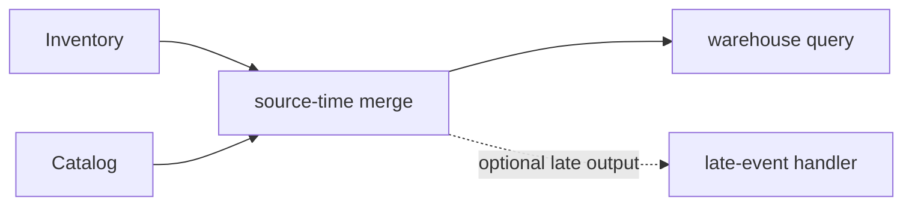
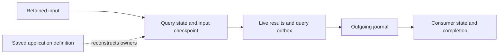
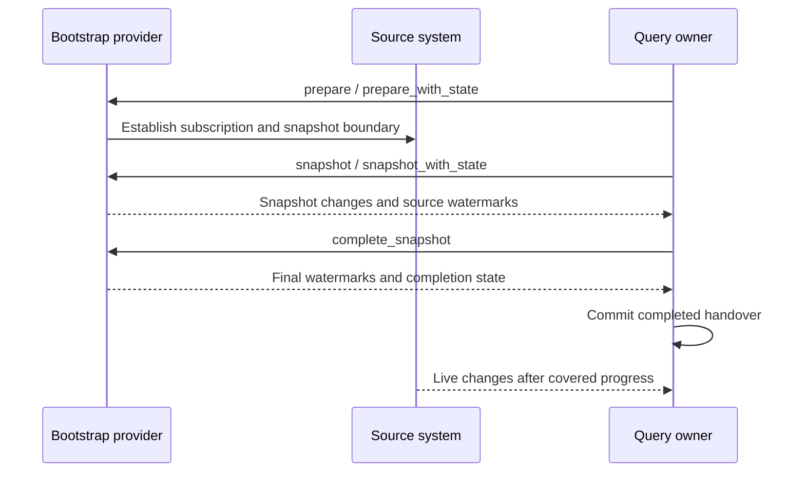
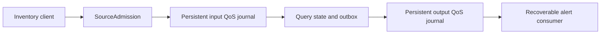
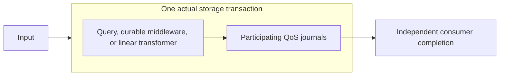
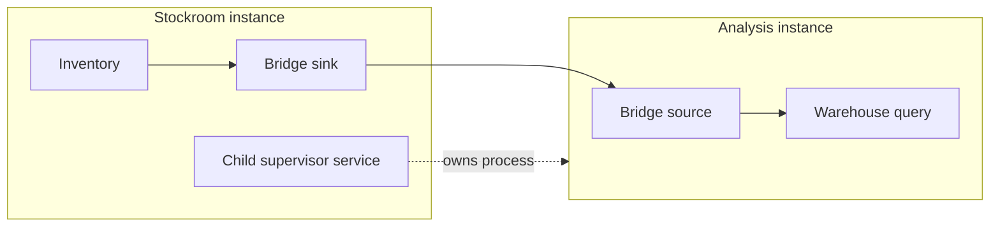

# The drasi-lib developer guide

**drasi-lib is an embedded data-processing runtime for Rust applications.**
You connect components into a computation graph to ingest data, transform it,
maintain state, and perform actions. A graph can use custom processing logic,
continuous queries that maintain answers as data changes, or both. An extensible
library of plugin components connects the graph to external systems, handling
change detection or ingestion and notification delivery for supported
integrations. Your application controls the graph's configuration, resources,
and lifecycle.

This developer guide teaches you how to use drasi-lib to design, build, extend,
and operate data-processing applications. It covers the library's programming
model and capabilities, from data ingestion and component composition to
continuous queries, state, recovery, configuration, lifecycle management, and
deployment. The chapters build on one another, taking you from your first
working application to advanced processing and operational concerns.

You will apply these concepts by building **Stockroom**, a running example
application that keeps a live view of products that need replenishment.
Stockroom evolves throughout the guide: it starts as a complete in-memory
program, gains processing and operational controls, and develops the storage
and delivery contracts needed to recover unfinished work. The same techniques
apply to monitoring, data integration, event-driven automation, and other
embedded applications.

You should be comfortable with Rust, Cargo, and `async`/`await`. No prior knowledge
of Drasi, graph databases, or stream-processing frameworks is assumed.

## Contents

**Part I - Build a working application**

1. [Run your first application](#1-run-your-first-application)
2. [Model changing data](#2-model-changing-data)
3. [Write continuous queries](#3-write-continuous-queries)
4. [Maintain an application view](#4-maintain-an-application-view)

**Part II - Compose and operate**

5. [Compose a processing pipeline](#5-compose-a-processing-pipeline)
6. [Control flow, ordering, and memory](#6-control-flow-ordering-and-memory)
7. [Own the runtime lifecycle](#7-own-the-runtime-lifecycle)
8. [Observe and diagnose the application](#8-observe-and-diagnose-the-application)

**Part III - Make processing recoverable**

9. [Make query state durable](#9-make-query-state-durable)
10. [Join snapshots to live input](#10-join-snapshots-to-live-input)
11. [Retain input and replay output](#11-retain-input-and-replay-output)
12. [Complete business work](#12-complete-business-work)
13. [Preserve transactions](#13-preserve-transactions)

**Part IV - Build a deployable application**

14. [Turn components into reusable factories](#14-turn-components-into-reusable-factories)
15. [Save and restore an application](#15-save-and-restore-an-application)
16. [Change a running application](#16-change-a-running-application)
17. [Package and isolate extensions](#17-package-and-isolate-extensions)
18. [Capstone: a recoverable Stockroom](#18-capstone-a-recoverable-stockroom)

[Appendix A: Vocabulary](#appendix-a-vocabulary) |
[Appendix B: API and example navigation](#appendix-b-api-and-example-navigation)

## Part I - Build a working application

Many applications need a current picture of their data and a way to respond
when something important changes. drasi-lib lets you maintain state such as
running totals, current inventory, or devices needing attention, and connect
changes in that state to notifications and actions.

An extensible library of source and sink plugins connects that processing to
external systems. Sources automate the system-specific work of detecting or
receiving changes; sinks deliver results and notifications to external
destinations. For supported integrations, you configure and compose plugins
rather than develop custom change-capture and delivery code.

Continuous queries are a key use case. You declare the answer to maintain, and
the runtime reports additions, updates, and removals as input changes. A query
can join data from different external systems, maintain aggregates, and detect
time-based conditions without application code repeatedly fetching whole
datasets and comparing snapshots. You can also compose processing components
without a query, enabling live views, monitoring, data integration, and
event-driven workflows.

### 1. Run your first application

Keep Stockroom running while you edit an inventory file. You will lower a
product's quantity, see it enter the low-stock view, and restock it to make
the alert disappear. You control the input by editing and saving that file.

#### Copy and run the starter

Install Rust through rustup and obtain a `drasi-core` checkout containing this
book. The [starter project](stockroom) includes its Cargo manifest, lockfile,
toolchain selection, source code, and initial inventory. Its path dependencies
are already configured for a project beside that checkout.

From the root of `drasi-core`, copy the whole project to a fresh sibling
directory:

```sh
cp -R lib/docs/developer-guide/stockroom ../stockroom
cd ../stockroom
RUST_LOG=warn cargo run --locked
```

Use a destination that does not already exist. Keep `stockroom` and `drasi-core`
beside each other so the supplied dependency paths remain valid.

Your copy contains:

```text
stockroom/
  Cargo.toml
  Cargo.lock
  rust-toolchain.toml
  rustfmt.toml
  inventory.json
  src/main.rs
```

The first build can take a little time. Once the application is ready, it prints:

```text
Watching inventory.json for low-stock. Save the file to change inventory; press Ctrl-C to stop.
```

Leave this terminal running. `RUST_LOG=warn` suppresses routine runtime logs
while leaving warnings and application output visible.

#### Make your first change

Open **your copied project's** `inventory.json` in an editor. It starts with:

```json
[
  {
    "sku": "bolts",
    "quantity": 8,
    "minimum": 5,
    "warehouse": "west"
  }
]
```

Quantity 8 is above minimum 5, so there is no low-stock result to print.
Change `quantity` from **8 to 3** and save the file. The running terminal shows:

```text
low-stock: [{"quantity":3,"sku":"bolts"}]
```

You changed the input, and the maintained answer changed with it. You did not
restart the application or ask it to run the query again.

Make the following edits one at a time, saving and observing the result after
each one:

| Edit `inventory.json` and save | Terminal output |
|---|---|
| Change quantity from 3 to 2 | `low-stock: [{"quantity":2,"sku":"bolts"}]` |
| Restock by changing quantity to 8 | `low-stock: []` |
| Lower quantity to 3 again | `low-stock: [{"quantity":3,"sku":"bolts"}]` |
| Remove the product object, leaving `[]` | `low-stock: []` |

Restocking removes a result even though the product still exists. Removing the
product also retracts its result, but for a different reason. Both changes
matter to a consumer maintaining the current low-stock view.

Try changing a quantity between two values above the minimum. There is no new
low-stock output: the input changed, but the answer did not. Saving the same
inventory again likewise produces no notification.

The file source checks for a valid snapshot every 250 milliseconds and emits
changes only for products that were added, modified, or removed. Invalid JSON
or a read error produces a warning and leaves the last valid inventory intact;
fix and save the file to continue. It samples the file's current state, so edits
between reads can be coalesced. It is not a durable change log.

Restore the original product with quantity 8 before continuing. Press **Ctrl-C**
when you want to stop; the application awaits runtime shutdown.

#### Understand the query

Here is the query:

```cypher
MATCH (p:Product)
WHERE p.quantity < p.minimum
RETURN p.sku AS sku, p.quantity AS quantity
```

`MATCH` finds product nodes. `WHERE` decides which products belong in the answer.
`RETURN` determines the fields visible to the application. Quantity changes
are input; membership and value changes in this answer are output.

#### Follow one change through the program


The runtime owns `Inventory`, the query, and `Alerts`. `Inventory` compares
valid file snapshots and turns product changes into graph messages. The query
updates its answer, and `Alerts` maintains and prints the resulting view.
Bounded graph pipes connect the components.

The [complete source](stockroom/src/main.rs) is the running companion for
the first two parts of the book. The following excerpts explain pieces of that
program; you do not need to assemble another application from them. Its
memory-backed processing state and small file source are starting points:
storage providers and source/sink plugins support persistent state and other
external systems.

The query is a `ContinuousQueryTransformer`:

```rust
let query = ContinuousQueryTransformer::new(
    ContinuousQueryDefinition {
        graph_id: GRAPH.into(),
        id: ComponentId::try_new("low-stock")?,
        query: LOW_STOCK.into(),
        language: ComputationQueryLanguage::Cypher,
        output_stream: StreamId::try_new("low-stock/out")?,
        outbox_capacity: NonZeroUsize::new(128).expect("positive capacity"),
    },
    Arc::new(InMemoryComputationProvider),
)
.await?;
let results = query.results();
```

The imports, `LOW_STOCK`, and `GRAPH` are at the top of the companion.
`GRAPH` is `"__drasi_lib_runtime__"`, the graph identity used by a
`ComponentBatch` inside `DrasiLib`. It is not the application's instance ID.
The memory provider supplies the state needed to evaluate the query.

`ComponentBatch` groups components and their connections. After constructing
the source and sink, the program adds them with the query:

```rust
let mut batch = ComponentBatch::builder()
    .source(Box::new(inventory))
    .query(Box::new(query))
    .sink(Box::new(alerts));
```

An output has a named port and a stream identity. The companion's `endpoint`
helper builds a component/port pair. For example:

```rust
batch = batch
    .bind_stream(
        endpoint("inventory", "out")?,
        StreamId::try_new("inventory/out")?,
    )
    .connect(
        EdgeDefinition::new(
            endpoint("inventory", "out")?,
            endpoint("low-stock", "in")?,
        ),
        Box::new(BoundedPipeConfig { capacity: 8 }),
    );
```

The query output is bound and connected to `alerts/in` in the same way.
Every declared port must be connected. The batch checks that producers and
consumers agree on their data format; a misspelled port or incompatible
connection is an error, not a disconnected pipeline that quietly does nothing.

Finally, the application gives the batch to its runtime owner:

```rust
let core = DrasiLib::builder()
    .with_id("stockroom")
    .with_components(batch.build()?)
    .build()
    .await?;
```

`DrasiLib` owns a **ComputationGraph**: the connected processing components,
their resources, and their lifecycle. Starting the instance drives the file
source, query, and sink together.

#### Start, wait, and finish

Construction and execution are separate. Start the instance, then wait for
the components the application needs:

```rust
core.start().await?;
tokio::time::timeout(
    Duration::from_secs(5),
    core.computation_component("alerts")?.wait_started(),
)
.await??;
tokio::time::timeout(Duration::from_secs(5), results.wait_ready()).await??;
```

The complete program waits for all three components. The two `?` operators
unwrap different failures: an application deadline and a failed runtime
operation.

Processing continues while `main` waits for Ctrl-C. Each query output updates
the sink's view; inputs that do not change the answer produce no output.
Saving the file is not a synchronous promise that processing has finished:
the terminal notification shows the view after the sink handles a result.

On Ctrl-C, the program awaits `core.shutdown()` and reports any cleanup failure
before returning. This pattern matters even in a small program: Rust cannot
await runtime cleanup in `Drop`.

**Summary.** You have a complete embedded application with a live query, explicit
data connections, bounded queues, and awaited startup and shutdown. Next, make
the meaning of its input precise; query correctness begins with data identity.

### 2. Model changing data

Stockroom needs to distinguish a product changing from a different product
arriving. In this chapter, the input becomes a property graph with stable
identities, explicit update semantics, and source time.

#### Describe entities, not query results

A property graph contains **nodes** and **relationships**. Both have identity,
labels, properties, and an effective time. A node might represent a product or
warehouse; a relationship might say that a product is stored in a warehouse.
The source describes these facts. It should not pre-filter products using the
low-stock condition: a restock must still reach the query so it can remove the
old result.

The file source parses each entry as a `Product`. Its `element` method maps
that product to the graph:

```rust
impl Product {
    fn element(&self, time: u64) -> Element {
        Element::Node {
            metadata: metadata(&self.sku, time),
            properties: ElementPropertyMap::from(serde_json::json!({
                "sku": self.sku,
                "quantity": self.quantity,
                "minimum": self.minimum,
                "warehouse": self.warehouse,
            })),
        }
    }
}
```

When a SKU first appears, the source emits `SourceChange::Insert`; when the
same SKU's properties change, it emits `SourceChange::Update`. Removing a SKU
from the file produces `SourceChange::Delete`. Its metadata helper is:

```rust
fn metadata(sku: &str, time: u64) -> ElementMetadata {
    ElementMetadata {
        reference: ElementReference::new("inventory", sku),
        labels: vec!["Product".into()].into(),
        effective_from: time,
    }
}
```

The element's identity is the pair **source ID, element ID**.
`inventory/bolts` and `catalog/bolts` are different elements. The `"Product"`
label describes the element's type; it does not identify an individual
product. A mutable property such as a display name is usually a poor element ID.

Use source-qualified references for relationship endpoints too.
`Element::Relation` contains `in_node` and `out_node` references as well as its
own metadata and properties. Changing a referenced node does not create a new
relationship identity. When the relationship itself has a business identity or
properties, publish it as an element rather than inferring it from equal values.

#### Distinguish inserts, patches, and deletions

The file source has a complete product image for each update. Other sources
may know only the changed fields. For a quantity-only update, they can send:

```rust
fn quantity_update(sku: &str, quantity: i64, time: u64) -> SourceChange {
    SourceChange::Update {
        element: Element::Node {
            metadata: metadata(sku, time),
            properties: ElementPropertyMap::from(serde_json::json!({"quantity": quantity})),
        },
    }
}
```

The query retains `sku` and `minimum`. At the graph-change boundary:

| Change | Meaning |
|---|---|
| `Insert` | A full-row upsert. Repeating the same complete element is not another contribution to an aggregate. |
| `Update` | Merge the supplied properties into the element. Omitted properties remain; a supplied null clears a property. |
| `Delete` | Remove the element identified by its metadata. No property payload is required. |

Updates and deletions must use the original element reference. Generating a
new ID for each update creates different elements instead of updating one.
A live node and relationship cannot share one element identity; that collision
fails before modifying state.

Properties can contain scalars, lists, objects, and supported temporal values.
`ElementValue` and `ElementPropertyMap` preserve the typed model. A string that
looks like a date is still a string unless you construct or parse a temporal
value.

#### Supply meaningful time

`effective_from` is the source's effective time in **milliseconds**. It is not
an output sequence or the time a downstream consumer happened to receive the
change. Stockroom timestamps changes when it reads a valid file snapshot, using
Unix epoch milliseconds. That is an observation time: the file source does not
claim to know the exact instant a person made each edit. A connector with an
upstream change timestamp should preserve that timestamp instead.

The evaluator reports and skips mutations that are strictly older than the
element's accepted source time. Equal-time changes follow admitted order.
Deleting an absent element still records a source-time frontier, so an older
insertion cannot resurrect it after recovery. Those frontiers are not
automatically expired without an appropriate retention contract.

Do not use a receive timestamp to disguise unavailable source time. If an
upstream system cannot provide ordering or time guarantees, that limitation
belongs in the source's contract.

#### Publish through a native source

The graph calls the source's `next` method. Stockroom drains the changes from
its latest valid file comparison, then waits for another poll. Unchanged files
produce no changes. Its publication branch is:

```rust
if let Some(change) = self.pending.pop_front() {
    self.sequence = self.sequence.checked_add(1).context("sequence exhausted")?;
    return Ok(Some(OutputEnvelope {
        port: PortId::try_new("out")?,
        envelope: GraphChangeCodec::encode_change(
            change,
            StreamId::try_new("inventory/out")?,
            self.sequence,
            None,
        )?,
    }));
}
```

`GraphChangeCodec` translates the typed graph change into a `ChangeEnvelope`.
The source does not write its own JSON wire format. `None` in the codec call
means that this example supplies no envelope-level source timestamp; the
element still has `effective_from`. A source-time merger needs that additional
timestamp, as Chapter 6 explains.

Returning `Ok(None)` means **finite exhaustion**, not "no data right now."
A listening source should wait while idle. A lost database connection should
surface an error or an explicit recovery operation, not masquerade as normal
end of input.

`Inventory` also implements `ComputationComponent`. Its descriptor declares
one output, `out`, with the `GraphChangeCodec` schema. Its first start validates
and loads the file. A later stop/start preserves any changes still awaiting
emission. The graph owns the polling work, so the source has no independently
spawned watcher to stop or join.

#### Keep the layers of identity separate

An envelope carries a change set, stream metadata, and context:

| Identity | What it identifies |
|---|---|
| `ElementReference` | A node or relationship in a source namespace |
| `RecordId` | A schema-defined record; its namespace and bytes are both significant |
| `ChangeSetId` and operation ordinal | One identified group of changes and each operation's place in that group |
| Stream and sequence | A producer's ordered emissions from one output |
| Source position | An opaque upstream resume position, if the source supplies one |

One output owns one stream. Its new emissions must have increasing sequences;
gaps can be valid, but regression is not. A reconnect must not silently reuse
an old logical identity for different content.

A `ChangeOperation` is Added, Updated, or Deleted. Records describe their
image as Full, Patch, or Partial, and updates explicitly distinguish Patch
from Replace. Consumers must support the image they receive. A delete may
contain only a validated `RecordReference`, with no before image.

`SystemMetadata` belongs to the framework boundary; business attributes belong
in records. Append context for attribution, and derive a new envelope when
creating new output. Do not mutate an input shared with another branch.

Putting several changes in a collection does not prove that their source
committed them atomically. Whole source transactions have a separate contract
in Chapter 13.

**Summary.** Stable source-qualified identity makes updates and deletions
meaningful. Explicit images and timestamps prevent accidental replacement,
stale resurrection, and invented ordering. The source now supplies facts the
query can maintain rather than approximations of the desired answer.

### 3. Write continuous queries

The first query finds individual low-stock products. Extend that answer to
warehouse totals, joined catalog data, and conditions that depend on time.
These are changes to the maintained calculation, not new polling loops.

#### Think in changing answer sets

For each accepted input, Drasi updates the query's graph and emits differences
in its answer. A change can add a result, change its values, remove it, or
produce no visible difference. One input can affect several result rows.

The low-stock query illustrates three cases:

| Input | Answer |
|---|---|
| Product quantity becomes 3, below minimum 5 | Add the product |
| Quantity becomes 2 | Change the existing answer row |
| Quantity becomes 8 | Remove the row, while retaining the product in query state |

An empty answer is a valid state. It does not mean the query is stopped.
Conversely, a running component is not evidence that an expected business
condition occurred.

`ComputationQueryLanguage::Cypher` and `ComputationQueryLanguage::Gql` select
the parser; both use the continuous evaluator. GQL is the graph query language,
not GraphQL. Use the syntax and functions supported by Drasi rather than
assuming compatibility with every feature of another graph database.

#### Aggregate by warehouse

The companion's products also have a `warehouse` property. Stop Stockroom with
Ctrl-C, restore the original one-product file with quantity 8, and restart your
copied project in aggregation mode:

```sh
RUST_LOG=warn cargo run --locked -- totals
```

This mode uses a query named `stock-by-warehouse`:

```cypher
MATCH (p:Product)
RETURN p.warehouse AS warehouse, sum(p.quantity) AS total
```

The non-aggregate projection groups the answer by warehouse. Its initial total
comes from the current file:

```text
stock-by-warehouse: [{"total":8.0,"warehouse":"west"}]
```

Change quantity to 3 and save. The total becomes 3.0. Change it to 2, then 8,
saving each time: both edits change the total, even though 8 did not belong in
the low-stock query's answer. Remove the product, leaving `[]`, and the
maintained total becomes 0.0.

When one product changes, the corresponding aggregate changes. It is not an
independent event to add to a counter in application code; the output describes
the new maintained total. This sum produces a floating-point value and a
default zero for the emptied group. Deleting the last product therefore does
not have the same output shape as deleting a low-stock match.

For grouped applications, include keys that identify the business group in
the projection. Handle group creation and disappearance as well as updates.
Optional matches can retain a result when a related record is absent; decide
how the application should represent those null values.

Continuous answers are not an ordered page. `ORDER BY`, `LIMIT`, and `SKIP`
are not supported. Sort and page a maintained application view when presenting
results to a user.

#### Join another source

Suppose `inventory` supplies products with `warehouse_code`, and `catalog`
supplies warehouses with `code` and `name`. Connect both sources to the
query's `in` port. They contribute elements to one query graph; they are not
two previously computed result sets.

If the sources do not publish relationship elements, declare a synthetic join:

```rust
use drasi_lib::config::{QueryJoinConfig, QueryJoinKeyConfig};

let execution = QueryExecutionSettings {
    joins: vec![QueryJoinConfig {
        id: "STORED_IN".into(),
        keys: vec![
            QueryJoinKeyConfig {
                label: "Product".into(),
                property: "warehouse_code".into(),
            },
            QueryJoinKeyConfig {
                label: "Warehouse".into(),
                property: "code".into(),
            },
        ],
    }],
    ..Default::default()
};
```

The corresponding query is:

```cypher
MATCH (p:Product)-[:STORED_IN]->(w:Warehouse)
WHERE p.quantity < p.minimum
RETURN p.sku AS sku, p.quantity AS quantity, w.name AS warehouse
```

Construct it with `ContinuousQueryTransformer::new_configured`, passing the
definition, index provider, `QueryOptions::default()`, these execution settings,
and `None` for the optional middleware registry. The join is maintained when
either side changes.

The join declaration describes a relationship between equal key values. It does
not make keys unique or repair inconsistent identifiers. Prefer actual
relationship records when the relationship has its own properties or business
lifecycle.

Adding a source name to configuration alone does not connect it to a native
query. Data routing still belongs to the graph. Later, `QueryExecutionSettings`
also selects source-specific middleware; those settings do not create data
edges.

#### Ask questions about time

Stockroom can wait until a product has remained below minimum for five seconds:

```cypher
MATCH (p:Product)
WHERE drasi.trueFor(p.quantity < p.minimum, duration({ seconds: 5 }))
RETURN p.sku AS sku
```

The query schedules reevaluation. It does not need another inventory update
or a periodic application task to wake it.

Choose the time function for the condition you mean. `drasi.trueLater`
schedules a future condition; `drasi.trueNowOrLater` permits an immediate match
when appropriate; `drasi.trueUntil` supports expiry. These are distinct
policies, not alternative names for one timer. The
[heartbeat query examples](../../../shared-tests/src/use_cases/sensor_heartbeat/queries.rs)
show their time arguments in context.

Scheduled work shares the query's state and publication boundary. In a durable
query, removing a due notification, reevaluating it, and saving its output
belong to the transaction. A scheduling hint is not itself a completed timer,
and it must not advance a real source's checkpoint.

#### Compare with previous and historical values

`drasi.previousValue` and `drasi.previousDistinctValue` compare with preceding
values; `drasi.slidingWindow` supports rolling calculations. Historical element
versions are a different facility:

```cypher
MATCH (p:Product)
WITH p, drasi.getVersionByTimestamp(p, p.observed_at - 1) AS previous
RETURN p.sku AS sku, previous.quantity AS previous_quantity
```

Here `observed_at` is a supplied integer millisecond property.
`drasi.getVersionsByTimeRange` retrieves versions over an interval.
Version access requires an archive-enabled index provider; Chapter 9 shows
where to select that capability.

An archive contains versions Drasi received. It does not import the source
database's earlier history, and an in-memory archive does not survive process
loss. Saving historical versions and saving future scheduled work are separate
requirements.

For additional language constructs, consult the
[query examples](../../../shared-tests/src/use_cases) and the
[Cypher](../../../functions-cypher/src/lib.rs) and
[GQL](../../../functions-gql/src/lib.rs) function registrations. Keep parser
choice, query text, joins, and middleware together when versioning an
application: all can change the meaning of saved query state.

**Summary.** Queries describe maintained answers over connected source data.
Joins, aggregation, and temporal conditions belong in that calculation; sorting
a display and performing business effects belong outside it. The next chapter
turns answer differences into a correct application view.

### 4. Maintain an application view

The application must distinguish two equal-looking rows, retract results that
stop matching, and avoid confusing a current snapshot with a live subscription.
Stockroom's in-memory result view is enough for a disposable display, provided
those rules are explicit.

#### Receive native query output

The query emits `QueryChangeCodec` records, not source graph elements. Stockroom's
`Alerts` sink updates a keyed view and prints it. Its normal handling path is:

```rust
#[async_trait]
impl EnvelopeSink for Alerts {
    fn completion(&self) -> SinkCompletion {
        SinkCompletion::Handled
    }

    async fn handle(&mut self, input: InputEnvelope) -> anyhow::Result<()> {
        let mut view = self.view.borrow().clone();
        view.apply(&input.envelope)?;
        let message = format!(
            "{}: {}\n",
            self.query_id,
            serde_json::to_string(&view.rows())?
        );
        self.output.write_all(message.as_bytes()).await?;
        self.output.flush().await?;
        self.view.send_replace(view);
        Ok(())
    }
}
```

`Handled` means this sink finished its declared work: updating and printing a
volatile view. It does not mean the rows were saved to disk or a replenishment
order was placed. A sink that merely queues work for another worker must report
`Accepted` instead. Completion is about the promised work, not just successful
receipt.

The sink publishes the completed view through a Tokio watch channel so other
application code can observe its current state. Watch notifications can coalesce;
they are not a retained stream of every result change. Terminal writes use
`AsyncWriteExt` and are flushed before the new view is published.

#### Key the view by record identity

Two result rows can have identical values. Do not use JSON equality as their
identity, and do not derive identity from a field that may change.
`QueryChangeCodec` includes the query namespace and row signature in each
record's `RecordId`.

The companion stores:

```rust
#[derive(Clone, Default)]
struct ResultView(HashMap<RecordId, serde_json::Value>);
```

Its update method is:

```rust
impl ResultView {
    fn apply(&mut self, envelope: &ChangeEnvelope) -> anyhow::Result<()> {
        ensure!(
            !QueryChangeCodec::is_snapshot(envelope)
                && !QueryChangeCodec::is_progress_only(envelope),
            "this live-only view requires a coordinated recovery owner for resets"
        );
        let mut next = self.0.clone();
        for operation in envelope.changes().operations() {
            match operation {
                ChangeOperation::Added { after, .. }
                | ChangeOperation::Updated { after, .. } => {
                    let row = QueryChangeCodec::decode_row(after)?;
                    next.insert(
                        after.identity().clone(),
                        QueryChangeCodec::row_values_to_json(&row.values),
                    );
                }
                ChangeOperation::Deleted { identity, .. } => {
                    next.remove(identity.identity());
                }
            }
        }
        self.0 = next;
        Ok(())
    }
}
```

The temporary map prevents a decode failure midway through an envelope from
publishing a partial batch. It is suitable for this small view. A large view
should use an appropriate transactional or staged update mechanism rather than
copying its entire state for every change.

The delete path needs only identity. The update path uses the new row rather
than applying an assumed numeric increment. Aggregation updates additionally
carry `QueryRowKind::Aggregation` metadata, including grouping and default-value
information; preserve it when implementing logic that depends on how the
aggregate changed.

`decode_row` yields typed `VariableValue` values, a query ID, a signature, and
a row kind. `row_values_to_json` is useful for a JSON presentation. Keep the
typed values when business logic depends on temporal types, element references,
or distinctions a JSON projection cannot adequately represent.

#### Read current results without rerunning the query

Keep `query.results()` before transferring the query into the batch. After
readiness:

```rust
let snapshot = results.snapshot()?;
let sequence = snapshot.as_of_sequence;
for record in snapshot.rows.values() {
    let row = QueryChangeCodec::decode_row(record)?;
    println!("{sequence}: {}", QueryChangeCodec::row_values_to_json(&row.values));
}
```

`QueryResultSnapshot` contains keyed records, a logical output position, and a
generation. `core.get_query_results("low-stock").await?` is a convenient JSON
read for an inspection endpoint. Neither call executes the query again, and
neither establishes a live subscription.

The query's logical sequence counts output emissions, not products, source
events, or individual operations. Native replay can use a fresh transport
sequence while preserving the logical query sequence. Use
`QueryChangeCodec::query_sequence`, `query_generation`, and `metadata` instead
of inferring those identities from unrelated fields.

#### Bring a new consumer up to date

Reading a snapshot and then subscribing leaves a gap in which changes can
be missed. Applying both a snapshot and overlapping output can apply the same
change twice. A correct handover must coordinate the live connection, snapshot
boundary, retained history, and consumer progress.

```mermaid
sequenceDiagram
    participant C as Consumer
    participant Q as Query output owner
    C->>Q: Establish live input before fetching recovery state
    Q-->>C: Keyed snapshot through S and retained output
    C->>C: Replace the view and complete its recovery boundary
    Q-->>C: Buffered and live output
    C->>C: Discard covered output; handle later sequences in order
```

The library supplies this machinery through `QueryReplayTransformer` and
`CheckpointedSink`; Chapter 11 connects them. `QueryResultsCatalog` with a
connected `QueryResultsOutlet` supports live query-result subscriptions.
A `QueryResults` reader alone is not such an outlet.

`results.replay(after)` reads bounded retained output after a logical sequence.
`recovery_view` reads a coherent recovery identity, snapshot, and optional
retained history. If the required range is unavailable, increasing a timeout
cannot recreate it. The application needs an explicit rebuild or gap policy.

A snapshot envelope means **replace the view**. A progress-only envelope
means a recovery decision without business rows; it is not permission to
silently skip work. Stockroom's simple live-only view rejects both rather than
pretending to implement recovery. Add a recovery-aware owner before accepting
them.

**Summary.** A result view is keyed state, not a list of notifications.
Use native row identity, apply all operation kinds, and distinguish query
position from transport position. A late-joining or restartable consumer needs
coordinated recovery, not merely another call to read current rows.

## Part II - Compose and operate

### 5. Compose a processing pipeline

Add a processing step before Stockroom's query without changing its answer.
Then use the same connection model to normalize real input, expand records,
and perform work that is not itself a query.

#### Add the audit step

Stop Stockroom with Ctrl-C, restore the original inventory with quantity 8,
and restart your copied project in audit mode:

```sh
RUST_LOG=warn cargo run --locked -- audit
```

Change quantity to 3 and save. The answer is unchanged, but the sink also
reports the annotation it received from an intermediate transformer:

```text
audit: checked-by=stockroom
low-stock: [{"quantity":3,"sku":"bolts"}]
```


The `Audit` component has a graph-change input and output. Its transform method
derives a new envelope, assigns its own output stream and sequence, and appends
context:

```rust
let changes = GraphChangeCodec::decode_changes(&input.envelope)?;
self.sequence = self.sequence.checked_add(1).context("sequence exhausted")?;
let mut envelope = GraphChangeCodec::derive_changes(
    &input.envelope,
    &changes,
    StreamId::try_new("audit/out")?,
    self.sequence,
)?;
envelope.append_annotation(ContextEntry::try_new(
    self.descriptor.id().clone(),
    "checked-by",
    ContextValue::String("stockroom".into()),
)?)?;
Ok(vec![OutputEnvelope {
    port: PortId::try_new("out")?,
    envelope,
}])
```

These are statements inside `Audit::transform` in the companion.
The original graph records keep their identities. The new envelope has the
transformer's emission identity and retains input context and lineage.
Appending an annotation affects this branch, not a sibling's envelope.
Repeated annotation keys are history entries, not assignments that overwrite
old entries.

The batch replaces `inventory -> low-stock` with two edges, adds the transformer,
and binds `audit/out`. It also verifies that the annotation reaches the query's
output. This is ordinary composition within the same `DrasiLib`, not a nested
runtime.

The annotation is not a durable audit record. This component has volatile
sequence state and does not claim a recovery contract. A durable audit trail
needs storage and a defined completion boundary.

#### Use component roles deliberately

The graph supports several kinds of work:

| Role | Processing contract |
|---|---|
| Source | `EnvelopeSource` produces envelopes |
| Transformer | `Transformer` consumes an envelope and produces zero or more outputs |
| Query | A query component maintains results using the transformer data boundary |
| Sink | `EnvelopeSink` accepts or handles input without data outputs |
| Service | `ComputationService` runs an activity with no data ports |

All implement `ComputationComponent` for description and lifecycle.
Several complete pipelines can coexist in one instance. A pipeline can also
contain no query at all: normalization, routing, and custom calculations do
not require inventing query text.

Connections must agree on the **complete schema descriptor**, including
version, encoding, and definition. A query-result record is not a graph node,
even if both contain a property called `quantity`. To feed one query's results
into another query, explicitly map rows into graph changes with stable
identities and correct deletion handling. Do not connect incompatible ports
and expect implicit conversion.

Data connections form a directed acyclic graph. Control relationships, covered
in Chapter 7, have a different purpose; do not create a data cycle to carry
readiness signals.

#### Normalize input with middleware

Suppose inventory arrives with a JSON string in `payload`, such as
`"{\"quantity\":3}"`. Keep the low-stock calculation unchanged by normalizing
that property before evaluation.

For the file-based application, first extend `Product` and `Product::element`
to carry that property. The starter's input model accepts only its declared
product fields; adding an unknown JSON field alone is not enough.

Add the required features to the application's existing `drasi-lib` dependency:

```toml
drasi-lib = { path = "../drasi-core/lib", features = [
    "middleware-parse-json",
    "middleware-promote"
] }
```

Construct a normalization component:

```rust
let normalize = MiddlewareTransformer::new(
    MiddlewareTransformerDefinition {
        id: ComponentId::try_new("normalize")?,
        output_stream: StreamId::try_new("normalize/out")?,
        middleware: serde_json::from_value(serde_json::json!([
            {
                "kind": "parse_json",
                "name": "read-payload",
                "config": {
                    "target_property": "payload",
                    "output_property": "parsed",
                    "on_error": "fail",
                    "max_json_size": 65536,
                    "max_nesting_depth": 8
                }
            },
            {
                "kind": "promote",
                "name": "quantity-at-root",
                "config": {
                    "mappings": [{
                        "path": "$.parsed.quantity",
                        "target_name": "quantity"
                    }],
                    "on_conflict": "overwrite",
                    "on_error": "fail"
                }
            }
        ]))?,
        pipeline: vec!["read-payload".into(), "quantity-at-root".into()],
    },
    DrasiLib::default_middleware_registry(),
)?;
```

Add it as a transformer, bind `normalize/out`, and connect
`inventory/out -> normalize/in -> low-stock/in`. Keep `sku` and `minimum`
in the input, or map them as well. A normalization pipeline cannot manufacture
business fields it was never supplied.

`middleware` declares named instances; `pipeline` selects them in execution
order. Declaring a middleware instance does not automatically run it.
Unknown kinds, duplicate names, and missing pipeline entries are errors.
The registry contains the implementations enabled in the build.

The same normalization can run inside a query by passing middleware definitions
and source-specific pipelines through `QueryExecutionSettings`, along with
the registry to `new_configured`. For example, a source entry is:

```rust
drasi_lib::config::SourceSubscriptionConfig {
    source_id: "inventory".into(),
    nodes: vec!["Product".into()],
    relations: vec![],
    pipeline: vec!["read-payload".into(), "quantity-at-root".into()],
}
```

Use a separate transformer when several downstream consumers need the same
normalized stream. Use query-local middleware when normalization belongs to
that query's processing state. In either case, native data connections still
determine which input reaches the query.

#### Choose transformations by their data contract

| Middleware | Use in Stockroom | Important constraint |
|---|---|---|
| `decoder` | Decode base64, base64url, hex, URL, or JSON-escaped properties | Decoding text is not parsing it; order the parsing step afterward |
| `parse_json` | Interpret a string property as structured data | Bound input size and nesting; choose fail/skip behavior explicitly |
| `promote` | Copy nested values to named properties | Decide whether conflicting destination values overwrite, skip, or fail |
| `relabel` | Map upstream labels to the application's graph vocabulary | Labels on deletions must be normalized too |
| `map` | Select and reshape changes using JSONPath | Preserve IDs and account for the fields available in delete images |
| `jq` | Express more elaborate selection and reshaping | jq expressions have their own quoting and error behavior |
| `unwind` | Expand warehouse bins into maintained child nodes and relationships | Stable child keys and previous-element state are essential |

Each kind has a corresponding `middleware-*` Cargo feature.
`middleware-jq` uses system libjq; `middleware-bundled-jq` builds it.
Do not enable every feature as a setup shortcut when the application needs
only two transformations.

Unwind illustrates why apparently simple transformation can be stateful.
When a bin disappears from a warehouse's array, the old child must be deleted.
The transformer needs the previous parent and children to compute that change.
An omitted selected array is an empty selection, not "leave old children
unchanged." Later steps must preserve the identities and fields needed for the
next update.

`MiddlewareTransformer::new` keeps its state in memory. Its `new_durable`
constructor uses `DurableMiddlewareOptions` and an atomic persistent provider
to save prior elements, input progress, and output together. Durable outgoing
connections are required. Two durable pipes around a volatile stateful
transformer do not make the middle of the pipeline recoverable.

The [middleware guide](../computation-graph-middleware.md) and
[middleware configurations](../../../middleware/README.md) provide larger
mapping examples and exact options.

#### Bound expansion and scheduled work

A transformer can emit no outputs to filter an input, or several to expand it.
Returning a huge vector keeps all those outputs in memory and can monopolize
processing. For incremental output, keep a bounded pending queue:

```rust
fn next_chunk(
    pending: &mut std::collections::VecDeque<OutputEnvelope>,
) -> Vec<OutputEnvelope> {
    let count = pending.len().min(64);
    pending.drain(..count).collect()
}
```

Return the first chunk from `transform`, report remaining work with
`has_pending_emissions`, and produce later chunks from `continue_transform`.
The graph completes the continuations before accepting another input or
acknowledging the original. Bound the retained queue too: small chunks do not
justify unlimited total expansion.

For time-driven work, expose a `WakeupSource` and implement `on_wakeup`.
`wait` must actually suspend until work may be ready; `has_pending` lets a
finite graph account for outstanding scheduled work. Persist both schedules
and their completion when timers must recover. A wall-clock alarm held only in
a Rust field is volatile.

A `ComputationService` can run a periodic health activity without data ports.
Its `run` future must yield, and its quiesce/stop hooks must account for any
workers it owns. Use a data source when the activity produces records that
belong in the pipeline instead.

**Summary.** Composition separates ingestion, normalization, calculation, and
consumption without adding another execution engine. Schemas keep boundaries
explicit; continuations and wakeups let components do bounded work. Next,
choose how connected components share capacity and ordering.

### 6. Control flow, ordering, and memory

Stockroom works while every component is fast. Now consider a burst of inventory
updates, a quiet catalog, or an alert consumer that slows down. Queue and ordering
choices determine what the application does under those conditions.

#### Follow backpressure upstream

The first program uses bounded FIFO pipes. When `alerts` cannot finish writing
its output, its graph input fills, the query's forwarding waits, and pressure
eventually reaches `inventory`. This is useful: the producer cannot create an
unlimited hidden backlog in the graph pipes.

A buffer absorbs a temporary imbalance. It does not increase the sustained
throughput of the slowest required stage. Count all buffering locations:
application channels, graph pipes, a transformer's pending output, retained
journals, and any destination client queues.

Keep three different purposes separate:

| Buffer | Holds | Freed by |
|---|---|---|
| Volatile input/dispatch queue | Work waiting to be received | The receiver taking work |
| Query outbox | Retained logical query emissions | Its retention and output-confirmation rules |
| Acknowledged journal | Work owed to required consumers | The required progress/retirement rules |

A queue slot becoming available is not evidence that business work completed.

#### Select a transport policy

Use `BoundedPipeConfig` for ordinary lossless-in-memory FIFO and backpressure.
Use `BroadcastPipeConfig` only when its lag policy fits the consumer:
Report fails visibly on lag; SkipWithNotification explicitly reports skipped
data and continues. A disposable dashboard can accept a rebuild after lag;
a replenishment order processor usually cannot.

`RetainedPipe` retains unacknowledged work through a supplied store.
`QosChannel` shares one journal among named subscribers with separate cursors.
Their persistence and recovery choices are developed in Chapter 11.
Retention under Backpressure preserves outstanding obligations; PruneOldest
deliberately trades them away.

Port `PipeRequirements` and graph-level `requirements` assert required
capabilities. They do not add those capabilities to a provider. A memory pipe
must reject a durable-acceptance requirement rather than accept the declaration
and continue with weaker behavior.

Fan-out shares immutable payloads but forwards in edge declaration order.
A slow required branch can backpressure its siblings through the producer.
Adding independent edges does not guarantee branch isolation, and partial
fan-out is possible if an earlier branch accepts before a later one fails.

#### Bound bytes as well as messages

For variable-sized input, replace a bounded edge's configuration with:

```rust
ByteBoundedPipeConfig {
    capacity: 8,
    max_bytes: 1024 * 1024,
}
```

Both limits must be positive. The charge covers the complete binary envelope,
including identifiers, metadata, annotations, and lineage, not only the JSON
payload. Each independent fan-out pipe charges its own envelope.

An oversized envelope may occupy an otherwise empty byte-bounded pipe by itself.
The budget is therefore **not a maximum message size or a process-memory cap**.
Use bounded codecs and input validation for a hard message-size limit.
The budget excludes component state, work already received, serialization
scratch space, and backend caches.

Retained stores and non-shared QoS journals have optional byte quotas too.
The journal charges an envelope once, not once per subscriber. Under lossless
retention, only safely handled history can be reclaimed. Reopening with a
smaller quota preserves existing obligations and blocks new admission until
safe pruning is possible.

Persistent journals can use `OutboxPageLimits` through `IndexedJournalOptions`
or `QosJournalOptions` to bound the decoded payload cache. Page bytes measure
stored records, while admission quotas measure binary envelopes; they are
different quantities. Startup still validates the complete history. Paging
does not make it safe to ignore damaged older entries.

Shared-storage QoS has bounded history pages but count-based admission
reservations. Ranked and broadcast pipes remain count-bounded. Select these
limits at the actual resource owner and preserve them in its reconstruction
recipe. See [journal resource limits](../computation-graph-qos.md#optional-journal-resource-limits)
for the supported constructors.

#### Decide what "ordered" means

FIFO orders a producer's emissions by sequence. With several inputs, the
default `InputMergePolicy::Arrival` processes available work without imposing
a global source-time order.

`InputMergePolicy::EventTimeAcrossStreams` compares available stream heads.
It preserves each stream's order and does not wait for unseen input from a
quiet producer. `RankedInputPipeConfig` additionally uses an actual shared
ranked queue and declared source ranks; it is not a switch that makes unrelated
queues one globally ordered stream.

Neither policy can move a late event before work already evaluated. If a
warehouse total must use a bounded source-time reorder window, make that
processing stage explicit.

#### Merge by source-change time

Place `SourceTimeMergeTransformer` before the query:



For example:

```rust
let merger = SourceTimeMergeTransformer::new(
    SourceTimeMergeDefinition {
        graph_id: GRAPH.into(),
        id: ComponentId::try_new("merge")?,
        sources: vec![
            StreamId::try_new("inventory/out")?,
            StreamId::try_new("catalog/out")?,
        ],
        output_stream: StreamId::try_new("merge/out")?,
        late_output_stream: None,
        reorder_window_ms: 2_000,
        max_wait_ms: 5_000,
        idle_timeout_ms: Some(10_000),
        max_buffered_events: NonZeroUsize::new(256).expect("positive capacity"),
        max_buffered_bytes: NonZeroUsize::new(1024 * 1024).expect("positive capacity"),
        late_policy: LateEventPolicy::FailAndRetain,
    },
    GraphChangeCodec::schema(),
)?;
let observations = merger.subscribe();
```

Connect both sources to `merge/in`, bind `merge/out`, and connect it to the
query. Every input needs `SystemMetadata::timestamp()` containing its actual
source-change time. In the first source, that means replacing the codec's
`None` timestamp argument with the source-supplied value. Element
`effective_from` is not an automatic substitute.

The merger can reorder timestamps within a source while requiring that
source's logical input sequences arrive in order. Ties use declared source
order and logical sequence among buffered events. A complete envelope remains
indivisible.

An event becomes eligible when all active sources' observed progress permits
early release, or when its maximum residence wait expires. Optional idle
detection prevents a silent source from blocking the early-release calculation
forever. Idleness is not a watermark proving there can be no earlier event.
`max_wait_ms` is an eligibility bound, not a delivery deadline under
backpressure.

An input older than the emitted time frontier is late. FailAndRetain holds it
and reports a typed error; Route sends it to an explicitly connected `late`
output; Discard explicitly drops it and reports that choice. Routing late data
does not automatically correct answers already published by the query.

The count and byte limits include held and unconfirmed work. Unlike the
byte-bounded FIFO, this merger rejects an individually oversized input.
Capacity errors do not create an overflow queue or an implicit retry policy.
The upstream owner must retain input if it needs another attempt.

`new_durable` adds atomic persistence of the buffer, progress, held input,
and unconfirmed output, with lossless durable output requirements.
Reconstruction validates the configuration and restarts residence waits;
downtime does not invent source progress. Its persistence cost grows with
the bounded saved window. The
[source-time merge guide](../computation-graph-time-merge.md)
details release rules and recovery.

#### Understand concurrency

Top-level native nodes run in independently scheduled, graph-owned Tokio tasks.
Mutable work on one component remains serialized. On a multi-threaded executor,
independent nodes can use different workers; on a current-thread executor,
they interleave but cannot perform CPU work on several cores at once.

Shared storage gates, graph shape, and slow consumers still constrain parallelism.
The runtime bounds continuously ready work per node, but it cannot preempt
an infinite synchronous loop inside custom code. Use asynchronous I/O and
bounded computation; merely placing a blocking call inside `async fn` does
not make it nonblocking.

**Summary.** Capacity controls burst absorption, ordering controls which
available change is next, and retention controls what can be recovered.
They are different decisions. Bounded work and explicit backpressure keep
Stockroom understandable when input or consumers stop behaving ideally.

### 7. Own the runtime lifecycle

An embedded runtime is part of the application's lifetime. Stockroom needs to
know when it is usable, stop without abandoning ownership, and distinguish an
idle source from a damaged component.

#### Separate acceptance, construction, and readiness

A successful addition accepts a component definition. It does not prove that
a database connection opened or that processing is ready.
`ComponentHandle::wait_created` waits for construction; `wait_started` waits
for the running boundary. Bound waits with an application deadline.

A failed definition remains inspectable. Retryable acquisition failures can be
retried after their cause is repaired; unchanged terminal validation failures
need a corrected definition. An instance can contain a running query, a failed
sink, and an unbound edge at the same time. Inspect per-component outcomes,
not just whether a graph handle exists.

Observed state separates realization, lifecycle, health, binding, and
availability. Running is not the same as healthy; a healthy source can be idle;
an exhausted finite source is not an unavailable listening source.

#### Use readiness and control relationships

A component needing explicit readiness opts into
`requires_readiness_confirmation`. Its `bind_control` hook receives a
generation-bound `ComponentControl`; it calls `ready` only after the required
initialization is complete.

`require_downstream_ready` can hold upstream activation until required
consumers confirm readiness. Do not depend on construction order or add an
arbitrary sleep before sending input.

Control notifications communicate with authorized immediate neighbors through
`notify_downstream`, `notify_upstream`, or `notify_neighbor`. Ready/NotReady
describe readiness; Available/Unavailable describe availability.
A `ControlHandler` receives peer notifications independently of ordinary
mutable data operations.

Custom notifications can carry small configuration-independent signals, such
as "catalog refreshed." They are bounded control messages, not a bulk-data
transport or durable work queue. Replacement invalidates old generations and
connections. A handler may be cancelled when its connection becomes invalid;
that cannot undo an external action already performed.

#### Choose the right stop operation

| Operation | Purpose |
|---|---|
| Quiesce selected components | Park processing at supported safe boundaries while retaining ownership |
| Stop components or `DrasiLib::stop` | Stop processing with awaited lifecycle work; the instance supports a later start |
| `DrasiLib::shutdown` | Perform terminal instance cleanup |
| Standalone graph `dispose` | Release graph-owned resources after its run/cleanup boundary |
| Deprovision | Permanently remove component-owned processing state |

Quiescence is not a universal drain. Work from selected producers drains to
the supported boundary, while other queued input can remain owned.
It does not prove every retained message or external effect completed.

Graceful stop accounts for admitted operations, continuations, and required
forwarding before stop hooks. A timeout reports unfinished work. It does not
mean that a write rolled back or that the application may open another owner
of the same resource.

Deprovision is not a pause button. Similarly, a configuration change that
removes a component is not an ordinary stop; its recovery obligations need
separate consideration in Chapter 16.

#### Keep background work owned

The graph already owns component processing tasks. Add auxiliary workers only
when a component genuinely needs them, such as a listener or blocking I/O
operation with a separate lifetime.

The helpers in `drasi_lib::context::workers` acquire a vacant owner slot
before spawning work:

```rust
async fn start_owned(
    slot: &tokio::sync::RwLock<Option<tokio::task::JoinHandle<()>>>,
    stop: tokio::sync::oneshot::Receiver<()>,
) -> anyhow::Result<()> {
    drasi_lib::context::workers::spawn_owned_worker(slot, async move {
        if stop.await.is_err() {
            tracing::warn!("worker stop owner was dropped");
        }
    })
    .await?;
    Ok(())
}
```

This example requires a `tracing` dependency. Its owner must subsequently signal
the worker and await a join. `spawn_owned_blocking_worker` applies the same
ownership-before-spawn rule to blocking work.

`join_owned_worker` requests abort on timeout but retains the handle until
actual exit. `join_owned_worker_gracefully` retains it without aborting, which
is appropriate when the worker owns submitted effects or connections that
must drain. Neither permits replacing an unfinished handle.

Do not take or drain handles out of their slots before an awaited join. If that
wait is cancelled, ownership must still be available for cleanup. Serialize
restart with cleanup, including after a timeout or cancellation.

For services, quiescence can drop the `run` future. Pause any independently
owned workers in `quiesce` and resume them when processing resumes.
A clean no-worker service can use the default hook; a listener cannot treat
dropping its controller future as proof that its connections stopped.

#### Preserve errors across cleanup

Public `DrasiLib` operations return `DrasiError`; graph APIs expose `GraphError`;
component and provider contracts commonly use `anyhow::Result`.
Use `DrasiError::classification()` for a public category and `downcast_ref()`
for retained typed causes.

An operation and its cleanup can both fail. `OperationFailures` retains every
cause even though the standard error source chain follows only the primary
one. Lifecycle reports likewise contain per-member failures.
`OperationSummary::CompletedWithFailures` is not success for all members.
Do not collapse a typed aggregate into a formatted string.

`ComputationCleanupError` can itself retain a failed construction or
registration owner. Keep it and await its `cleanup` operation. Rejected supplied
objects can be recovered through `RejectedAddition`; otherwise their cleanup
remains graph-owned.

A protected component panic quarantines that generation. Successful cleanup
does not repair it; reconstruct a fresh instance. A task boundary does not
contain a process abort, unsafe native memory fault, or synchronous code that
never yields. Chapter 17 provides a process boundary for those concerns.

#### Own a standalone graph when appropriate

`ComputationGraph::builder` is useful for a finite pipeline or independently
owned computation. `start()` returns a caller-polled `GraphRun`; creating
the future alone does no work.

For cancellation, request `GraphControl::cancel` and continue awaiting the run.
Dropping an unfinished run leaves cleanup required; subsequently await
`shutdown` or `dispose`. Only naturally completed standalone runs can restart
with retained component ownership. This is different from a supported
`DrasiLib::stop`/`start` cycle.

Use a `ComponentBatch` when the pipeline belongs to an existing `DrasiLib`.
Do not introduce another graph merely to obtain a handle to one query.

**Summary.** Readiness is an explicit boundary, cancellation is a request, and
cleanup is awaited work. Retain the owner after unsuccessful operations instead
of hiding it behind a timeout. These rules make both recovery and live
replacement possible.

<a id="observing-the-application"></a>

### 8. Observe and diagnose the application

When Stockroom stops producing expected alerts, first establish where progress
stopped. Observation should expose the actual running owners and their
boundaries, not maintain another copy of the graph.

#### Start with state, then inspect history

Use `inspect_computation_inventory`, `inspect_computation_graph`, and
`computation_info` for native inventory and topology. `ComputationInspector`
and the control handle expose coherent observed snapshots and bounded change
history. `list_queries` and `get_query_results` provide application-oriented
query inspection.

Include component generation and graph revision in observations. A health
probe started before replacement must not report on the new incarnation.
`report_health` checks the applicable revision, generation, and ownership.

Distinguish three kinds of snapshot:

| Snapshot | Answers |
|---|---|
| Observed graph state | What is constructed, running, bound, or failing now? |
| Query result snapshot | What rows are maintained through this output position? |
| Configuration snapshot | What definitions and resource recipes describe the application? |

`QueryResultSnapshot` is about rows. `QueryConfigurationSnapshot` is about
settings and status. A configuration export is not a processing-state backup.

`ComputationTopologySource` can publish topology as graph data using an actual
`ComputationInspectionResource`, allowing continuous queries over the running
application's structure. It observes the authoritative registry; it is not
a second mutable owner of components.

#### Install tracing once

For a small host that lets Drasi initialize tracing, use
`observability::get_or_init_global_registry`. If your application already
owns the subscriber, integrate `ComponentLogLayer` into that setup instead.
An existing global subscriber cannot be retrofitted by installing another one.

Add `tracing = "0.1"` and `tracing-subscriber = "0.3"` to use this host setup:

```rust
fn init_host_tracing() -> anyhow::Result<()> {
    use drasi_lib::observability::{
        get_or_init_global_registry, ComponentLogLayer,
    };
    use tracing_subscriber::prelude::*;

    let (layer, reload) =
        tracing_subscriber::reload::Layer::new(None::<ComponentLogLayer>);
    tracing_subscriber::registry()
        .with(layer)
        .with(tracing_subscriber::fmt::layer())
        .try_init()?;
    reload.reload(Some(ComponentLogLayer::new(get_or_init_global_registry())))?;
    Ok(())
}
```

Call it before constructing components. The reload slot lets the host install
its subscriber before initializing the shared Drasi log worker.

Component spans carry `component_id`, `component_type`, and `instance_id`.
Preserve that span when spawning auxiliary work, for example by instrumenting
the future. Merely placing a component ID in an arbitrary message field does
not establish component log routing.

`subscribe_computation_logs` supplies recent history plus a live receiver
for the actual Source, Transformer, Query, Sink, or Service category.
Use `ComponentRole` or `ComponentLogType` when selecting it.
Handle receiver lag explicitly. Log channels are bounded and diagnostic;
they are not a durable audit ledger.

Lifecycle-event history and subscriptions can explain transitions, but the
current observed snapshot is authoritative. A consumer that missed an event
must not infer that the transition never happened.

#### Follow pressure and progress

Inspect queue occupancy, native pipe metrics, query output metrics, and
lifecycle metrics at their respective owners. Useful Stockroom signals include:

| Signal | What to investigate |
|---|---|
| Input pressure grows | Query/storage throughput, blocked downstream branches, or a stopped consumer |
| Query advances but alerts do not | Outgoing bindings, sink lifecycle, and consumer completion |
| Retained history approaches capacity | The slowest required subscriber and its handled cursor |
| Startup waits indefinitely | Missing readiness, failed acquisition, or incomplete bootstrap |
| A replacement fails to settle | Old-owner cleanup, stale handles, resource dependencies, or recovery obligations |

Metrics do not automatically install an exporter or a Prometheus endpoint.
Your application chooses how to expose them.

Profiling metadata measures elapsed intervals, including queueing and storage,
not CPU time. Source-to-query delay, evaluation, output dispatch, and destination
completion are distinct intervals. Missing replay timing is not a zero-duration
measurement. `ProfilingConfig` is disabled by default; configuring sampling does
not itself instrument a custom source or install an output writer.

Do not feed Drasi-generated telemetry back into the same ingestion path.
Telemetry sources should reject records marked with
`SOURCE_ORIGIN_ATTRIBUTE = "drasi.source.origin"` and
`SOURCE_ORIGIN_DERIVED = "derived"` when that would create a feedback loop.

#### Expose metadata without exposing secrets

Factories and schema descriptors support discovery before activation.
Executable record validation remains necessary; a human-readable schema
description does not validate incoming bytes.

`ComponentDescriptor::with_plugin_identity` records explicit plugin provenance.
`with_semantic_kind` distinguishes the component's meaning from a wrapper's
execution role. Resource observations must identify actual provider handles,
not infer sharing from names or paths. A newer complete resource observation
replaces the previous inventory, including when the new inventory is empty.

Configuration snapshots can contain sensitive values, even when ordinary
topology inspection is safe to expose. Protect administrative endpoints,
configuration exports, logs, and key material according to their contents.
A credential provider does not authenticate your application's control API.

**Summary.** Observe the actual generation, distinguish state from history,
and measure progress at the owner that can prove it. Stockroom now has both
a processing pipeline and the operational information needed to diagnose it.
The next part makes that progress survive reconstruction.

## Part III - Make processing recoverable

### 9. Make query state durable

Stockroom can rebuild its current inventory from the file, but that does not
restore query history, scheduled work, or unfinished alerts. This chapter adds
persistent query state; the following chapters protect input and output across
recovery.

#### Name the state that must survive



These stores answer different questions. Query indexes describe the graph and
evaluation state. A checkpoint says which input an owner committed. Live
results support current reads; an outbox retains output. A consumer completion
record says what that consumer finished. Saved configuration describes which
owners to reconstruct.

Saving one does not save the others. In particular, a persistent checkpoint
beside a volatile result view is not a recoverable consumer: after restart it
can skip work whose materialized state disappeared.

#### Select a computation index provider

The first example uses `InMemoryComputationProvider`. For native RocksDB
storage, add this dependency:

```toml
drasi-index-rocksdb = { path = "../drasi-core/components/indexes/rocksdb", features = ["computation"] }
```

With an application-owned storage directory, construct:

```rust
use drasi_core::computation::ComputationIndexProvider;
use drasi_index_rocksdb::{
    computation::RocksDbComputationProvider, RocksDbMemoryBudget, RocksIndexOptions,
};

let budget = RocksDbMemoryBudget::from_total_budget_bytes(128 * 1024 * 1024)?;
let provider: Arc<dyn ComputationIndexProvider> = Arc::new(
    RocksDbComputationProvider::new(
        "./stockroom-state",
        RocksIndexOptions::new(false, false, budget),
    ),
);
```

The options select archive support, direct I/O, and the actual shared memory
budget. Set archive support to `true` when the historical version functions
from Chapter 3 require it. Cloning a budget shares its underlying cache and
write-buffer resources; constructing independent budgets does not.

Use this provider when constructing a query with recoverable input. The starter's
file source keeps its comparison state and emission sequence in memory; replacing
the query provider alone does not make that source replayable. Before reusing a
persistent query across restarts, add the coordinated bootstrap or retained-input
wiring from Chapters 10 and 11.

For directly constructed queries, bind the stable enclosing scope before
registration or activation:

```rust
let query = ContinuousQueryTransformer::new(definition, provider.clone())
    .await?
    .with_recovery_scope("stockroom")?;
```

Here `definition` is the `ContinuousQueryDefinition` from the first application.
Keep the instance scope, graph ID, query ID, output stream, and storage directory
stable across reconstruction. A different instance should use its own storage
namespace. `with_id` alone does not partition every externally supplied
provider's filesystem path.

An index provider supplies `ComputationIndexes`: the index set, transaction
owner, supported checkpoint/live-result/outbox writers, durability evidence,
and asynchronous cleanup. Two writers using the same filename or a matching
transaction label are not necessarily participants in one transaction.

#### Know what an atomic query commit includes

With a complete atomic provider, query state, the input checkpoint, result
sequence, live rows, and retained output commit together. A failed processing
transaction does not leave a committed input position that skips uncommitted
state.

`QueryOptions` defaults to Strict recovery and Atomic publication. Atomic
publication needs actual participating writers. The weaker NonAtomic mode
can commit core state before publishing output; incomplete publication then
requires recovery. It is not a way to obtain atomic behavior from an
incomplete provider.

The direct query reader can restore maintained results, but **saved results
are not automatic delivery confirmation**. To track and replay pending outgoing
handoffs, use the registered `ContinuousQueryFactory`, or enable delivery
tracking on a directly constructed query:

```rust
let query = query.with_delivery_tracking();
```

It remains one query component in the batch. The recoverable companion uses
this direct construction. The factory form is introduced in Chapter 14.
Both require the real retained connections and consumer contracts described
in the next chapters; neither makes an arbitrary external action atomic.

#### Choose recovery policy instead of hiding corruption

Strict recovery rejects incompatible configuration, incomplete bootstrap,
missing required history, or inconsistent saved state. That is useful
information: the process cannot truthfully continue from the requested
boundary.

AutoReset permits rebuilding when the applicable contract allows it.
Choose it only when the source can reconstruct the required state and a
rebuild is an acceptable application action. Pending tracked output must not
be discarded to make a reset succeed.

Query text, language, source/pipeline configuration, joins, mutation semantics,
and output identity can affect recovery identity. A query edit is not always
an in-place update to saved data. Plan a migration or explicit rebuild instead
of changing storage names until startup succeeds.

#### State a failure boundary

`StorageDurability` reports separate evidence for process restart, power loss,
and storage loss. Each field is Guaranteed, NotGuaranteed, or Unknown.
The native RocksDB provider declares local process-restart survival; that
does not assert survival of power loss or losing its disk.

`RecoveryScope::MemoryLifetime` asks about the current lifetime.
`RecoveryScope::Failure(FailureMode::ProcessRestart)` asks about reconstruction
after process failure. Select the failure mode you actually need and can
support; a class name containing "persistent" is not evidence.

After assembling the relevant owners, add an explicit requirement:

```rust
let requirement = RecoveryRequirement {
    consumer: ComponentId::try_new("low-stock")?,
    scope: RecoveryScope::Failure(
        drasi_core::interface::FailureMode::ProcessRestart,
    ),
    guarantees: [
        RecoveryGuarantee::Acceptance,
        RecoveryGuarantee::Replay,
        RecoveryGuarantee::CommittedProcessing,
        RecoveryGuarantee::Publication,
    ]
    .into(),
};
```

Pass it to the batch's `require_recovery`. The first in-memory Stockroom does
not satisfy this requirement. The runtime checks actual constructed contracts
and storage along the selected path; assertions do not install journals,
checkpoint writers, or retry logic. Unknown evidence cannot satisfy a stronger
requirement.

#### Use other storage services for their actual purpose

`StateStoreProvider` stores bytes under partition/key identities. It is useful
for application preferences and explicitly designed progress stores. Its batch
helpers are not a general multi-key transaction: some writes can succeed
before a later one fails. Use idempotent retry or a real transaction owner when
all-or-nothing state matters.

`WalProvider` stores partitioned input history. Register a partition before
appending, honor its capacity policy, and preserve the meaning of its allocated
sequence. A head sequence can exceed the last persisted event after a failed
write. `WalSourceResource` and `WalReplaySource` can expose an actual WAL and
processing progress owner as a native replay source.

A WAL, query outbox, consumer progress store, and configuration store are not
interchangeable. Each proves completion only at its own boundary.

**Summary.** Persistence starts with a complete transaction owner and stable
identity. Strict recovery makes missing or incompatible state visible.
Query durability is necessary but not sufficient: the next step is a correct
initial snapshot and live-input handover.

### 10. Join snapshots to live input

Stockroom's file source begins with the current file. A source with separate
snapshot and live-change interfaces needs a coordinated boundary when loading
initial inventory: a database dump followed by a subscription can miss changes
between the two.

#### Establish the handover before consuming rows

A `ComputationBootstrapProvider` belongs to the query's initialization lifecycle.
Bind it before starting a directly constructed query:

```rust
let query = query.with_bootstrap(bootstrap_provider);
```

`bootstrap_provider` is an `Arc<dyn ComputationBootstrapProvider>` implemented
for the source's snapshot and change-stream protocol. Factory construction
instead binds it through a `QueryBootstrapResource`.

The provider and query cooperate in this order:

1. Prepare the source subscription and determine whether saved query state is
   reusable, needs a volatile refresh, or requires an explicit reset.
2. Establish whether this start has a real snapshot or only checkpoint-based
   replay.
3. Stream the snapshot while preserving the live-input boundary.
4. Complete any boundaries known only after the snapshot closes.
5. Commit the source watermarks, completed-bootstrap marker, and final
   initialization state together.



Ready, RefreshVolatile, and ResetRequired are different outcomes.
A provider must not return an empty successful snapshot after a database
failure. `has_pending_snapshot` distinguishes a new initial load from a
replay-only start, which must not mark completed initialization incomplete.

#### Make watermarks describe real coverage

`ComputationBootstrapSnapshot` carries a stream of changes and
`BootstrapWatermark` values. Each watermark names the stream, optional source ID,
framework sequence, and optional opaque source position covered by the snapshot.

Those values must describe the same source boundary. A sequence number invented
from the number of rows in a dump is not necessarily a valid change-stream
position. Sequence zero is valid only when it is the actual boundary, not a
default for "position unavailable."

A completed query-wide bootstrap marker is not a checkpoint for every source.
One source can still need initialization when another already has valid saved
progress. Native replay through intermediate components also needs the actual
processing owner's progress, not an inferred match between component names.

Connect live input through bounded paths during initialization. A provider
that buffers changes outside the graph must bound and own that buffer too.
Timeouts and capacity pressure are errors or explicit backpressure decisions,
not reasons to drop the oldest unseen changes.

#### Persist external initialization intent

Some sources must create external state, such as a replication subscription.
`prepare_with_state` and `snapshot_with_state` receive a borrowed
`BootstrapState` service in the query's actual storage domain.

Write initialization intent **before** the external action. On restart, read
it to identify and verify the same subscription rather than creating another.
Return final handover bytes from `completion_state`; the query commits them
with the watermarks and completed marker.

For Stockroom, the bytes might identify a database subscription and its
snapshot boundary. Validate the recovered identity against the configured
database before reusing it. The state is bounded initialization metadata,
1 through 65,536 bytes, not an unrestricted application store.

Initialization metadata survives an explicit query reset so the provider can
reuse or release external state coherently. Deprovision removes it.
The borrowed service cannot escape its callback or become an independent writer.

#### Bind replay to the actual progress owner

`QuerySourceProgress` publishes committed input progress. A source or bootstrap
provider using `SourceProgressReader` must return the supplied reader from
its recovery hook. Bind the real `QuerySourceProgressResource`; matching
graph/query strings do not prove that two handles observe the same transaction.

A read-only progress capability does not itself retain source history.
The source must separately guarantee that input after that progress remains
available for replay. State the retained-until-consumer boundary explicitly.

#### Finish snapshot cleanup

Dropping the snapshot stream must cancel its work. A provider with auxiliary
workers must implement `stop` and await them before query storage is released.
Retain incomplete cleanup after timeout or cancellation, and reject a second
snapshot owner until cleanup succeeds.

Verified retirement needs a stronger held lifecycle than a sampled successful
stop. `freeze_for_retirement` prevents reuse while a configuration removal is
being resolved. Chapter 16 explains why that exclusion matters.

Snapshot rows are not automatically one upstream database transaction.
If Stockroom needs transaction-preserving input, use the distinct protocol
in Chapter 13.

**Summary.** Bootstrap is a handover protocol, not just an initial file load.
Prepare subscriptions before consuming rows, commit truthful watermarks, retain
external initialization identity, and await cleanup. The query can now establish
a recoverable starting point.

### 11. Retain input and replay output

Protect the intervals before a query accepts inventory and after it commits an
alert. The goal is not merely to have data somewhere on disk, but to know which
owner remains responsible for each unfinished handoff.

#### Assemble a retained path

The recoverable Stockroom uses:



A QoS channel appends once and maintains independent progress for its named
subscribers. It is not a collection of unrelated per-edge queues.

Define a lossless channel:

```rust
fn channel_definition(
    stream: &str,
    subscriber: &str,
) -> anyhow::Result<QosChannelDefinition> {
    Ok(QosChannelDefinition {
        stream: StreamId::try_new(stream)?,
        capacity: NonZeroUsize::new(32).expect("positive capacity"),
        durable: true,
        retention: RetentionPolicy::Backpressure,
        subscribers: [(subscriber.into(), SubscriptionStart::Earliest)].into(),
    })
}
```

Earliest, Latest, and After select a **new** subscriber's starting position.
Reconnecting an existing subscriber preserves its saved cursor.
Disconnecting does not retire it. Explicit retirement or a member-definition
change releases its obligation; a full lossless journal backpressures while
required subscribers still owe work.

A `RetainedPipe` is useful for a lower-level single-consumer retained connection.
Do not share its one progress cursor between independent consumers.

#### Register a bounded codec

Persistent transport needs an explicit set of executable schemas:

```rust
fn codec() -> anyhow::Result<EnvelopeCodec> {
    let mut codec = EnvelopeCodec::new(
        NonZeroUsize::new(1024 * 1024).expect("positive size"),
    );
    codec.register_schema(GraphChangeCodec::schema())?;
    codec.register_schema(QueryChangeCodec::schema())?;
    Ok(codec)
}
```

`EnvelopeCodec` is the bounded JSON envelope codec; `BinaryEnvelopeCodec` is
the binary alternative. Record payload encoding remains schema-specific.
Unknown schemas must not pass merely because the outer bytes deserialize.
Include every schema the path actually carries, and no executable validator
from an untrusted producer.

#### Protect source admission

Open the input channel with producer admission:

```rust
use drasi_core::interface::FailureMode;

let incoming = QosChannel::persistent_with_recovery(
    channel_definition("inventory/out", "low-stock")?,
    provider.create_indexes(GRAPH, "input-journal").await?,
    codec()?,
    "inventory",
    QosRecoveryOptions::Admission(AdmissionOptions {
        construction_scope: "stockroom".into(),
        graph_id: GRAPH.into(),
        component_id: ComponentId::try_new("inventory")?,
        failure_scope: FailureMode::ProcessRestart,
        max_producers: NonZeroUsize::new(1).expect("positive capacity"),
        receipts_per_producer: NonZeroUsize::new(32).expect("positive capacity"),
    }),
)
.await?;
let admission = SourceAdmission::new(
    incoming.clone(),
    PortId::try_new("out")?,
)
.await?;
```

The instance scope must match the actual application's stable identity.
The persistent companion uses its own constant for that scope.

A source exposing this service returns it from `EnvelopeSource::admission`.
The graph services its bounded mailbox; it does not also call `next` to publish
the same data. All source outputs must use the actual configured QoS channel.
Scope, schema, identity, and sequence validation precede its single admission
commit.

Register a producer, then submit consecutive client sequences:

```rust
let producer = admission
    .register_producer(ComponentId::try_new("stockroom-app")?)
    .await?;
let first = admission.admit(&producer, 1, &input).await?;
let retry = admission.admit(&producer, 1, &input).await?;
ensure!(first == retry, "identical retry must return the original receipt");
```

Here `input` is the same encoded inventory envelope in both calls. The receipt
proves storage-backed acceptance at the configured failure scope, not query
completion or a business effect.

Retain the producer session, client sequence, and original content when a
response is lost. Resolve uncertainty with `producer_status`,
`admission_receipt`, or the identical retry. Changed or expired retries must
not become new input. Starting a new session to avoid an uncertain result can
duplicate business work.

Receipt history and producer counts are bounded. Plan capacity for the retry
window the client needs; do not promise unlimited idempotency. Producer
retirement is explicit, not a consequence of disconnecting a client.

#### Protect query output handoff

Open the output journal with replay receipts:

```rust
let outgoing = QosChannel::persistent_with_recovery(
    channel_definition("low-stock/out", "alerts")?,
    provider.create_indexes(GRAPH, "output-journal").await?,
    codec()?,
    "low-stock",
    QosRecoveryOptions::Replay(ReplayOptions {
        failure_scope: FailureMode::ProcessRestart,
        receipt_capacity: NonZeroUsize::new(32).expect("positive capacity"),
    }),
)
.await?;
```

Admission identifies client submissions. Replay receipts identify output from
the immediate persistent producer. They are different modes and cannot coexist
on one channel. Disabled is the default; reopening must preserve the explicitly
selected recovery contract.

Give the graph the actual resource and use it on the edge:

```rust
let output_journal = ResourceId::try_new("output-journal")?;
let handle = outgoing.resource();
batch = batch
    .declare_resource(ResourceSpecification {
        id: output_journal.clone(),
        role: handle.role(),
        ownership: ResourceOwnership::Graph,
        binding: "output-journal".into(),
    })?
    .provide_resource(output_journal.clone(), handle)?
    .connect(
        EdgeDefinition::new(
            endpoint("low-stock", "out")?,
            endpoint("alerts", "in")?,
        ),
        Box::new(outgoing.definition().pipe(output_journal, "alerts")),
    );
```

This **replaces** the corresponding bounded edge from the first application.
Declare and bind the input channel similarly. Constructing a persistent channel
without using its pipe does not make a different edge durable.

The tracked query retains committed output until every required outgoing
destination accepts it. If the process stops after journal acceptance but
before confirmation, replay receipts recognize the same logical output.
Its fresh transport sequence is not a new business emission.

Tracked destination membership includes component, port, subscriber, and
journal identity. While output is pending, do not change those identities,
disable tracking, or reset the query to discard its obligations. A replacement
destination implementation under the same allowed identity does not erase
unfinished work.

#### Recover a keyed view from a query outbox

An alternative for a restorable view is:

```text
query -> QueryReplayTransformer -> CheckpointedSink -> saved view
```

The replay transformer uses query state and retained output rather than
requiring a separate output journal. Replay and checkpointing must share the
same progress store:

```rust
fn recoverable_consumer(
    inner: Box<dyn EnvelopeSink>,
    results: QueryResults,
    store: Arc<dyn drasi_lib::StateStoreProvider>,
) -> anyhow::Result<(QueryReplayTransformer, CheckpointedSink)> {
    ensure!(
        inner.descriptor().id().as_str() == "alerts",
        "consumer identity must match its progress scope"
    );
    let progress: Arc<dyn ConsumerProgressStore> = Arc::new(
        StateStoreConsumerProgress::new("stockroom", "alerts", store)?,
    );
    let replay = QueryReplayTransformer::new(
        ComponentId::try_new("alert-replay")?,
        "low-stock".into(),
        StreamId::try_new("alert-replay/out")?,
        results,
        progress.clone(),
        ConsumerRecoveryPolicy::Strict,
    );
    Ok((replay, CheckpointedSink::new(inner, progress)?))
}
```

Connect query output to replay, connect replay to the sink, and bind
`alert-replay/out`. `inner` must actually complete its promised work before
returning Handled. Stockroom's first `Alerts` handles a volatile view; adding
a persistent checkpoint would not make its rows durable. A snapshot-restorable
view must implement `supports_snapshot` and `replace_snapshot`.

Persist the view itself as well as its checkpoint. For a key/value-backed view,
use stable record keys, idempotent upserts/deletes, and a dedicated data
partition. If snapshot replacement clears and rewrites that partition, an
interruption must retry the replacement before advancing progress. Do not put
checkpoint records in the partition being cleared.

Strict rejects a gap or incompatible identity. AutoReset replaces a supported
view from a snapshot. AutoSkipGap explicitly skips unavailable history and
requires the sink to allow that decision. Neither a progress marker nor an
empty change set independently authorizes skipped work.

Snapshots carry generation and recovery identity as well as sequence. A
checkpoint from an unrelated replacement must not masquerade as continuation.
This is useful for reconstructible views; it is not a way to undo emails or
other irreversible actions.

#### Acknowledge only the promised boundary

Transport acceptance and consumer acknowledgement are separate.
`EnqueueReceipt` reports acceptance; on send failure, NotAccepted and Unknown
must be distinguished. A cancelled waiter can also leave acceptance unknown.
`send_batch` is not atomic; failure can retain receipts for an accepted prefix
and envelopes that were never attempted.

A received `Delivery` may carry an `Acknowledgement`. Complete it with the
actual handling outcome. Dropping it does not acknowledge work. Acknowledged
subscribers have one outstanding delivery each; larger journal capacity does
not change that processing contract.

**Summary.** Durable handoff requires retained responsibility, stable identity,
and truthful receipts at every boundary. Input admission, query output replay,
and consumer recovery solve different failure windows. Stockroom can now retain
an alert; the next chapter makes "handled" mean something durable.

### 12. Complete business work

An alert is not finished merely because it left a queue. Stockroom may update
application state or request replenishment from another system. Those two
destinations need different completion contracts.

#### Resume at the first unfinished operation

`DeliveryRunner` owns bounded per-operation completion state for a native sink.
It records exact input identity and content before destination work, then
advances only the completed prefix. If operation two fails, operation three
must not be treated as complete.

Keep the upstream envelope until the whole batch finishes. After interrupted
handling, stop and clean up the owner before reuse or reconstruction.
Await the runner's `shutdown` before releasing its storage.

Operation keys include stable consumer scope and logical producer identity.
They do not depend on a retry's transport sequence or a replacement's
configuration. Retaining only a last-seen message number before handling is
not an equivalent implementation.

#### Complete an external action

For an external destination, use `DeliveryRunner::new` with a
`DeliveryHandler`. Define the application boundary explicitly:

```rust
#[async_trait]
trait ConfirmedOrders: Send + Sync {
    async fn complete(
        &self,
        operation_id: &str,
        operation: &ChangeOperation,
    ) -> anyhow::Result<()>;
}

struct ReorderHandler(Arc<dyn ConfirmedOrders>);

#[async_trait]
impl DeliveryHandler for ReorderHandler {
    async fn handle(&mut self, item: DeliveryItem<'_>) -> anyhow::Result<()> {
        self.0.complete(&item.id.to_string(), item.operation).await
    }
}
```

`ConfirmedOrders` is an application-supplied destination contract. Its
implementation must perform or verify the action and use the stable operation
ID for deduplication. Returning after enqueueing work in an untracked local
worker violates the contract. An HTTP 202 response generally proves queue
acceptance, not completed replenishment.

A remote action can succeed just before the process loses its acknowledgement.
The local completion ledger cannot atomically commit that remote action.
The destination needs idempotency or a confirmation lookup keyed by the same
operation identity. Do not describe this as automatic exactly-once HTTP delivery.

Choose `DeliveryOptions` with an explicit failure scope, stream/receipt bounds,
and retry policy. The default makes one attempt with no delay. Implement
`retryable` only for known transient failures; invalid data and unknown commit
outcomes are not repaired by blind repetition.

For whole-envelope remote transport, `DeliveryBatch` and `DeliveryBatchIdentity`
avoid serializing the envelope once per operation. The receiver must derive
identity from the decoded content and its configured consumer scope, compare
it with the request, and only then perform effects. A caller-supplied digest
is not proof. Network admission and shutdown still need their own bounded
ownership.

#### Commit local business state with completion

For state entirely within one actual transaction owner, use
`DeliveryRunner::new_transactional` and `deliver_transactional`.
A `TransactionalDeliveryHandler` receives a borrowed `TransactionContext`.
Its business writes and one operation's completion commit together.

Stockroom's persistent handler saves the current alert quantity under a stable
record key, or removes that key on a deletion. It also increments a handled
count inside the same context:

```rust
async fn count_handled(state: &TransactionContext<'_>) -> anyhow::Result<()> {
    use drasi_core::models::ElementValue;

    let count = match state.get("handled").await? {
        None => 0,
        Some(ElementValue::Integer(value)) => value,
        value => anyhow::bail!("invalid handled count: {value:?}"),
    };
    state
        .put("handled", ElementValue::Integer(count + 1))
        .await?;
    Ok(())
}
```

Call this from the handler after applying the operation, as the complete
[`SaveAlert` implementation](../../examples/stockroom_native_persistent.rs)
does. If the transaction fails, both the business mutation and completion
remain uncommitted.

The context supports named `get`/`put`/`remove` state and graph-element
operations. It is borrowed for one callback, not a provider the handler can
retain. Do not start nested transactions, write through an independent store,
or keep commit-sensitive counters in mutable handler fields.

External calls cannot join this transaction. A handler that both saves a local
quantity and sends an email still needs a separate external-effect protocol.
Similarly, per-operation atomicity does not mean that every observer sees a
whole source transaction's effects simultaneously.

The runner persists its handling mode. Reopening external completion state as
transactional state, or the reverse, is not a supported reinterpretation.
Retry after confirmed rollback is different from retry after an uncertain
commit; uncertainty fences the owner until cleanup and recovery resolve it.

#### Expose an honest component contract

The sink reports Handled only after its runner completes the batch.
`ComponentRecovery::transactional_consumer(&indexes)` describes actual
transactional state/completion ownership. A sink using an unrelated state store
cannot acquire that guarantee by returning the same enum value.

For external work, retain destination-specific confirmation evidence rather
than advertising a stronger recovery contract than the destination provides.
Recovery assertions verify declared and bound capabilities; they cannot prove
an opaque external system's behavior.

**Summary.** Completion is durable business progress, not receipt into another
queue. Transactional handlers can commit local state with operation completion;
external handlers require destination confirmation and idempotency. Both retain
unfinished work rather than acknowledging past it.

### 13. Preserve transactions

Suppose a warehouse transfer decrements one bin and increments another in one
database commit. Stockroom should not publish a misleading intermediate total.
This chapter distinguishes a source transaction, a processing transaction, and
a shared producer/journal commit.

#### Keep a source commit together

`SourceTransactionBuilder` assembles a complete committed group:

```rust
fn committed_group(
    changes: Vec<drasi_core::models::SourceChange>,
    transaction_id: bytes::Bytes,
    position: bytes::Bytes,
) -> anyhow::Result<SourceTransaction> {
    use std::num::NonZeroU64;

    let limits = SourceTransactionLimits {
        max_changes: NonZeroUsize::new(100).expect("positive limit"),
        max_bytes: NonZeroUsize::new(1024 * 1024).expect("positive limit"),
        max_duration_ms: NonZeroU64::new(5_000).expect("positive limit"),
    };
    let mut group = SourceTransactionBuilder::new("inventory", limits)?;
    for change in changes {
        group.push(change)?;
    }
    Ok(group.commit(transaction_id, position)?)
}
```

Add `bytes = "1"` for this example. Call `commit` only when the source commit
is already known. `into_envelope` publishes the resulting group; replay uses
`into_replay_envelope`. The complete transaction is one typed record, not
independently acknowledged row envelopes.

If the source owns the database transaction, use `prepare` instead. The
`PreparedSourceTransaction` is inert: store its encoded bytes in the **same
source transaction** as the business changes, commit that transaction, and
only then call `confirm_committed`. A prepared value deliberately has no
publication API. On recovery, `SourceTransactionCodec::decode_committed`
validates a stored committed frame.

Bound count, complete encoded size, and assembly duration. Enforce the deadline
while waiting for source rows; a check on the next `push` cannot notice a
source that stalls forever. A rejected change poisons the assembly. Do not
publish the previously accepted prefix.

Transaction IDs contain 1 through 256 bytes; opaque source positions contain
1 through 65,536 bytes. The byte limit includes framing, identity, and position,
not just row payloads.

#### Configure the receiving query

Set `QueryExecutionSettings.source_transactions` to the accepted limits.
The definition's input descriptor then uses `SourceTransactionCodec`, not
`GraphChangeCodec`. Source and query ports must agree on that schema.
The receiving query requires atomic publication.

All changes in a source group update query state and results in one processing
transaction. Input progress cannot advance through half of the group.
Changing admission limits to accommodate a larger group is different from
changing the grouped processing semantics.

A plain envelope batch, ordinary middleware expansion, or row-wise bootstrap
does not acquire this contract automatically.

#### Run several processing steps in one transaction

For a linear sequence of opt-in transformations, use `TransactionTransformer`:

```text
input -> [ decode -> normalize -> update application state ] -> output
          one transaction owner; no internal pipes
```

A `TransactionTransformerDefinition` gives the graph/component/output identity,
outbox capacity, and ordered `TransactionStepDefinition` values. Each step has
a stable ID, implementation identity, configuration version, and configuration.

For example, the decoder and parser from Chapter 5 can be registered through
`TransactionalTransformerRegistry::standard` and configured as two
`drasi/middleware-transformer` steps. Construction takes:

```rust
let transformer = TransactionTransformer::new(
    definition,
    registry,
    provider,
)
.await?;
```

Here `definition` is the linear-step definition, `registry` is an
`Arc<TransactionalTransformerRegistry>`, and `provider` is a complete persistent
computation provider. The
[transaction configuration example](../computation-graph-transactions.md#configure-a-sequence)
contains the full two-step definition.

Custom participants implement `TransactionalTransformer` through a
`TransactionalTransformerFactory`. Their `transform_in_transaction` method
receives a borrowed `TransactionContext` and returns one envelope. Filtering
returns an empty change set; expansion adds operations within that envelope.
Adjacent schemas must match exactly.

The context gives each step isolated state. Two steps using the key `"count"`
do not share one counter; they communicate through emitted records.
`derive` gives intermediate output the appropriate scoped identity and lineage.
The context exposes no independent begin/commit/rollback authority.

The container does not invoke each step's ordinary lifecycle, timer, or worker
hooks. A participant must be configuration-only, with no external effects,
background writes, or commit-sensitive private fields. Arbitrary transformers
do not become transactional merely by appearing in the list.

The linear container requires persistent atomic storage and durable acknowledged
outputs. It is not an in-memory replacement for ordinary graph composition.
Query processing uses a complete query body with its full index bundle, not
a query squeezed into the restricted step-state interface. Containers cannot
be nested, and branches are not a linear transaction.

#### Commit a producer and its journals together

Separate-store output journals use the handoff and replay receipts from
Chapter 11. `SharedStorageGroup` is an opt-in alternative for one built-in
producer and its outgoing QoS journals sharing a proven Core transaction:



Create the group from a dedicated `ComputationIndexes` owner. Its resource
is the producer's IndexBackend dependency. Create channels through the group
and declare them as resources with a dependency on that same group.
Each participating edge names both the channel and shared owner:

```rust
let pipe = channel.definition()
    .pipe(journal_resource_id, "alerts")
    .with_shared_storage(group_resource_id);
```

Capacity is reserved before processing, without holding the storage transaction
while waiting. Producer state, input progress, retained output, and participating
journal appends then commit together. Subsequent forwarding uses those committed
receipts instead of appending again.

A group has one processor and at most 256 active journals. Separate-store
branches may coexist, but they do not join this commit. Matching paths or names
on independent providers cannot establish a shared transaction.

Quiescing a healthy producer allows its journals to keep draining. Interrupting
active storage or losing a commit result can fence the whole group until cleanup
and reconstruction. Subscriber acknowledgement and retirement leases prevent
rebind from exposing half-finished progress changes.

Shared commits do not provide cross-instance transactions, atomic external
effects, or simultaneous visibility at all consumers. They also do not migrate
existing standalone storage automatically.

**Summary.** Preserve the boundary that matters: one known source commit, one
linear processing transaction, or one producer/journal transaction. None implies
a graph-wide transaction. Stockroom now has the contracts needed to preserve
both input consistency and unfinished output.

## Part IV - Build a deployable application

### 14. Turn components into reusable factories

The first Stockroom constructs Rust objects directly. Deployment requires a
reproducible recipe: which implementation, which configuration, and which
resources should create each object. Refactor those choices without changing
the application's data contracts.

#### Replace a constructor with a specification

Use the standard query factory for `low-stock`:

```rust
let factories = FactoryRegistry::standard();
let factory = factories
    .get_by_name("drasi/continuous-query", Some("1"))?
    .clone();
let indexes = ResourceId::try_new("query-indexes")?;
let mut specification = factory.specification_from_config(
    ComponentId::try_new("low-stock")?,
    serde_json::json!({
        "query": LOW_STOCK,
        "language": "cypher",
        "stream": "low-stock/out",
        "outbox_capacity": 128,
        "recovery": "strict",
        "publication": "atomic"
    }),
)?;
specification
    .dependencies
    .insert("indexes".into(), vec![indexes.clone()]);
```

The factory produces the query's exact descriptor and configuration schema.
The application supplies the real provider from Chapter 9:

```rust
let handle = ResourceHandle::new(
    ResourceRole::IndexBackend,
    Arc::new(QueryIndexProviderResource(provider.clone())),
);
batch = batch
    .declare_resource(ResourceSpecification {
        id: indexes.clone(),
        role: ResourceRole::IndexBackend,
        ownership: ResourceOwnership::Graph,
        binding: "query-indexes".into(),
    })?
    .provide_resource(indexes, handle)?
    .component(specification, factory);
```

This replaces the directly constructed query, rather than adding another
`low-stock` component. Retain its existing stream and connections.
The factory creates the graph-owned query with delivery tracking and the
enclosing instance scope. For result reads, use the instance query API or bind
a query catalog when the host needs that capability.

Register factories with `with_component_factories` on the builder when preparing
a managed host. Reuse the same registered factory `Arc` for bindings in a live
graph; another object with an identical implementation name is not automatically
the same factory owner.

The implementation version identifies code. The configuration version identifies
the recipe shape. Neither is a record-schema version, component generation,
or logical output sequence.

#### Implement an application factory

A custom `ComponentFactory` follows the same separation:

| Stage | Responsibility |
|---|---|
| Descriptor and schema discovery | Describe role, ports, implementation, configuration fields, and dependencies without I/O |
| Validation | Reject invalid configuration, scope, resource roles/types, and cardinality before acquisition |
| Construction | Use the supplied configuration and actual resources to create a component, without starting processing |
| Activation | Perform the component's start/readiness work under graph lifecycle ownership |

`ConstructionContext` contains the component specification, enclosing identity,
resolved configuration, and declared resources. A factory asks for resources
by dependency name and concrete type; it does not search the host for an
arbitrarily named global object.

`ComponentCreationError` distinguishes retryable acquisition failures from
terminal invalid definitions. An unavailable service can be repaired and
retried; a bad descriptor needs correction.

Implement `configuration()` on components that can describe their settings.
The graph captures it at construction and reconfiguration boundaries.
Configuration must not change during data processing, and a missing getter
must remain explicitly unavailable rather than invent an empty recipe.

In-place reconfiguration requires the factory to opt into
`supports_reconfiguration` and the component to implement `reconfigure`.
The descriptor must remain unchanged. Replacing the component is a different
operation and creates a new generation.

Stockroom's source factory can construct an admission-backed `Inventory` from
a declared QoS resource; its sink factory can construct an `Alerts` owner with
a declared completion provider. In both cases, keep the channel or storage
handle out of serialized configuration. Save the recipe that reconstructs it.

#### Declare resource ownership and dependencies

A `ResourceSpecification` is a declaration. A `ResourceHandle` is an actual
typed service. Declaring an IndexBackend does not open a database; declaring
an Identity resource does not acquire credentials.

Graph ownership makes cleanup part of graph lifecycle through the resource's
cleanup contract. Borrowed ownership means an outer application owns that
lifetime. A borrowed user must not retain a graph-owned prerequisite that can
be removed underneath it.

Use `ResourceRequirement::exactly_one::<T>` when a factory needs one typed
resource. Other cardinalities must be explicit. Dependencies can represent
storage, middleware, bootstrap, secrets, query catalogs, source progress,
retained pipes, or application-defined services.

For dependent resources, declare `resource_dependency` with the required role.
A journal depending on `SharedStorageGroup` is one example. Constructors receive
only the actual declared prerequisite handles; construction follows dependency
order, and cleanup runs in reverse.

Replacing a prerequisite reconstructs its transitive users when required.
Failed dependent cleanup retains the prerequisite owner. Do not replace that
lifecycle with a host cache, or infer shared ownership from equal strings.
`with_shared_identity` is for wrappers around the same actual service, not a
way to claim that independent services share a transaction.

`ResourceConstructor::construct_with_dependencies` serves direct graph
construction. `ManagementResourceResolver::resolve_with_dependencies` serves
saved recipes. Acquisition has a bounded deadline, so partially acquired
sockets, files, and workers must remain cancellation-safe. A timeout does not
authorize leaking the partial owner and constructing a second one.

#### Resolve credentials and secrets explicitly

Credentials are contextual authentication material; secrets are named values.
`IdentityProvider` receives a `CredentialContext`, which can identify the
destination host, port, or database. A provider must not return a credential
for an unintended destination.

For application-controlled asynchronous credentials:

```rust
use drasi_lib::identity::{ApplicationIdentityProvider, Credentials, IdentityProvider};

fn warehouse_identity(
    secrets: Arc<dyn drasi_lib::SecretStoreProvider>,
) -> Arc<dyn IdentityProvider> {
    Arc::new(ApplicationIdentityProvider::new(move |context| {
        let host = context.get("hostname").map(str::to_owned);
        let secrets = secrets.clone();
        async move {
            ensure!(
                host.as_deref() == Some("warehouse.internal"),
                "unexpected credential destination"
            );
            Ok(Credentials::Token {
                username: "stockroom".into(),
                token: secrets.get_secret("warehouse-api-token").await?,
            })
        }
    }))
}
```

`PasswordIdentityProvider` handles a fixed username/password.
Fallible credential conversions distinguish password/token pairs from
certificate/key material. Native factories should declare and use the actual
identity resource they need; an instance default does not automatically wire
every custom factory.

For configuration, keep secrets as unresolved references:

```rust
let token = ConfigurationValue::Reference {
    resource: ResourceId::try_new("warehouse-secrets")?,
    key: "warehouse-api-token".into(),
    secret: true,
};
```

A secret configuration field requires a secret reference to a SecretStore
resource, not a plaintext literal. Resolution also requires the correctly typed
`ConfigurationResolverResource`, not merely a resource with a plausible name:

```rust
struct SecretReferences(Arc<dyn drasi_lib::SecretStoreProvider>);

#[async_trait]
impl ConfigurationResolver for SecretReferences {
    fn validate_reference(&self, key: &str) -> anyhow::Result<()> {
        ensure!(!key.is_empty(), "empty secret key");
        Ok(())
    }

    async fn resolve(&self, key: &str) -> anyhow::Result<serde_json::Value> {
        Ok(serde_json::Value::String(self.0.get_secret(key).await?))
    }
}
```

Wrap that resolver in `ConfigurationResolverResource` inside a SecretStore
`ResourceHandle`. `validate_reference` is pure; `resolve` performs the lookup
during construction. Resolved values are runtime configuration, not values to
copy back into saved recipes or logs.

Changing a secret does not automatically refresh existing network connections.
Define reconnect or refresh behavior in the component's lifecycle.
Use a test memory secret store only when its volatility is acceptable.

**Summary.** Factories describe how to construct components; resource recipes
describe how to obtain their real dependencies. Keep configuration, identity,
and ownership separate. The application can now be represented as reconstructible
definitions rather than a collection of opaque Rust objects.

### 15. Save and restore an application

Processing state lets Stockroom recover its data. Saved desired configuration
lets the host reconstruct the application that owns that data, including
definitions that were accepted but failed to start.

#### Build a complete desired definition

`DesiredInstance` contains a native `DesiredTopology`. The topology describes
component factory specifications, streams, relationships, lifecycle policies,
resource declarations and recipes, and required recovery contracts.

After assembling a factory-backed batch, its public definition can be used:

```rust
let desired = drasi_lib::management::DesiredInstance::from(
    batch.definition.clone(),
)
.normalized()?;
```

This requires a **reconstructible** batch. The first chapter's file source and
in-memory sink are supplied instances, not saved factories; copying that original
batch does not turn them into recipes. Convert all managed components and
their resources, preserve every connection, and register the implementations
needed to rebuild them.

Normalization validates the representation without opening external services.
A serialized object name cannot recreate an `Arc`, a worker, or a live database
transaction. Keep actual bindings outside the persisted document.

`ManagementResourceResolver` translates saved resource configurations into
actual handles. It owns application-specific policy such as allowed paths,
provider selection, credentials, and recovery-domain validation. Wrapping
another resolver must preserve those checks.

#### Enable management at the host boundary

`ManagementOptions` groups factories, the resource resolver, and an optional
configuration store. Without a store, desired configuration exists only in
memory. There is no separate `management` Cargo feature.

The builder also exposes the services separately:

```rust
let core = DrasiLib::builder()
    .with_id("stockroom-managed")
    .with_component_factories(factories)
    .with_management_resources(resources)
    .with_configuration_store(store)
    .build()
    .await?;
```

Here `factories` is the registered `FactoryRegistry`, `resources` is an
`Arc<dyn ManagementResourceResolver>`, and `store` is an
`Arc<dyn ConfigurationStore>`. Use the same enclosing identity in all
processing and provider recipes.

The separate `drasi-state-store-redb` crate provides encrypted configuration
persistence. Add:

```toml
drasi-state-store-redb = { path = "../drasi-core/components/state_stores/redb", features = ["configuration"] }
```

Open `RedbConfigurationStore::new(path, key)` with an externally supplied
32-byte key and pass it to the builder. Retain the key outside the database and
preserve it across restart. Configuration encryption does not encrypt query
indexes, journals, backups, or every other file in the state directory.

The [managed Host example](../../../components/host-sdk/examples/managed_instance.rs)
shows concrete store opening, key-file ownership, and factory registration.
The storage implementation remains outside drasi-lib; the library depends
on the configuration-store contract.

#### Accept a revision, then reconcile it

Configuration acceptance and runtime convergence are two separate outcomes.
The store commits the definition and an idempotency receipt **before**
construction and lifecycle effects.

This helper waits for a reconciliation pass:

```rust
async fn apply_configuration(
    core: &DrasiLib,
    expected_revision: u64,
    request_id: &str,
    desired: drasi_lib::management::DesiredInstance,
) -> anyhow::Result<()> {
    core.apply_desired_state(expected_revision, request_id, desired)
        .await?;
    let status = core.reconcile_desired_state().await?;
    ensure!(
        status.converged(),
        "accepted definition has not converged: {status:?}"
    );
    Ok(())
}
```

The caller should obtain a new request ID with
`new_configuration_request_id`, persist that ID with the intended request,
and use the current `desired_configuration().revision` as the expected
revision. Retry an uncertain submission with the same ID and identical content.
Use `configuration_receipt` to resolve the recorded outcome.

A missing factory, busy socket, or unavailable database can leave a durable
accepted definition that has not converged. Repair the dependency and reconcile;
do not replace the definition with an empty graph. A new factory can be
registered to satisfy a previously unavailable implementation.

Reusing an ID with different content is an error. A revision mismatch protects
against overwriting a concurrent change. Generating a new request ID after a
lost response is not a substitute for resolving the first operation.

`receipt.durable` and `configuration_is_persistent` describe configuration
acceptance, not processing durability. `management_status` and
`status.converged()` describe reconciliation. Component readiness still has
its own boundary.

#### Restore without resubmitting a startup seed

On reconstruction, register the same required factories, supply the resource
resolver and store, and build with the same instance identity. The accepted
definition is authoritative, including an intentionally empty definition.
An old startup seed must not overwrite it.

Failed definitions remain available for inspection and repair. Unsupported
configuration versions, unavailable secrets, and damaged encrypted records
fail explicitly; none should be interpreted as "no saved application."

Managed configuration mutations go through `apply_desired_state`.
Imperative configuration changes to managed members are rejected.
Unmanaged components and instance-provided services are preserved by managed
reconciliation, but they are not thereby serialized for reconstruction.

Await instance shutdown before releasing the store or opening a replacement
owner. A cancelled storage waiter does not release an exclusive configuration
lease while its real operation is still running.

#### Keep configuration history intentional

Named snapshots support saving, loading, and restoring desired definitions.
Restoration submits a new configuration revision; it does **not** roll query
state or external effects back to the snapshot's date.

`list_configuration_snapshots(after, limit)` returns bounded pages.
`delete_configuration_snapshot(name, expected_revision)` protects against
deleting a different saved revision. Deleting a snapshot changes neither the
current application nor its processing state. There is no automatic age policy.

The redb store's default retains request receipts indefinitely. For bounded
history, `ConfigurationStoreOptions::receipt_batch_capacity` enables receipt
expiry by batch. Use store-generated request IDs, retain each one for retries,
and understand the boundary: generating an ID for a new batch can expire the
entire previous full batch, including unused IDs from it.

An expired receipt means the outcome is no longer retained, not that the
operation failed. A full batch rejects additional unused requests; an expired
or foreign ID cannot be reinterpreted as new work. Enabling this policy on an
existing store expires its older receipts and changes reopen requirements.
Choose it deliberately rather than treating it as harmless garbage collection.

#### Rotate configuration keys safely

`RedbConfigurationStore::rotate_key` rewrites live definitions, snapshots,
receipts, and policy metadata atomically. Provision and retain the replacement
key externally before starting. Close every configuration session first,
normally by awaiting all owning instances' shutdown.

If a commit is uncertain, the provider fences writes. Keep both keys and reopen
to determine which one is active before proceeding. Cancelling the caller
does not detach the underlying storage operation.

Rotation can require substantial temporary disk space. It does not erase old
free pages, backups, or filesystem snapshots. Protect those copies separately;
key rotation is not secure erasure.

**Summary.** Saved configuration is accepted intent, not a claim that the runtime
is ready. Revision checks and request receipts protect changes; factories and
resource resolvers make reconstruction possible. Configuration history and key
lifecycle remain explicit application responsibilities.

### 16. Change a running application

Stockroom needs a new alert destination while inventory continues to arrive.
Plan the change around component generations, dependency ownership, and retained
work rather than simply replacing an object in a map.

#### Preview changes to unmanaged topology

For unmanaged native components, obtain graph control and preview against the
current desired revision:

```rust
let control = core.computation_control()?;
let preview = control.preview(
    control.desired_snapshot().revision,
    vec![DesiredMutation::Restart(GraphSelection::Exact(vec![
        ComponentId::try_new("alerts")?,
    ]))],
)
.await?;
let report = control
    .reconcile(preview, TopologyBindings::default())
    .await?;
ensure!(
    report.summary == OperationSummary::Completed,
    "graph change failed: {:?}",
    report.failures
);
```

This requests a restart, not replacement or deprovision. Another accepted
change can invalidate the preview's revision. New implementations and resources
belong in `TopologyBindings` as actual factories, instances, constructors,
and pipe providers, not just serialized names.

For managed members, submit the corresponding desired definition through the
configuration API from Chapter 15. Do not use imperative reconciliation to
bypass accepted managed ownership.

Selections can name exact members, dependencies, dependents, or the whole graph.
Updates require supported in-place reconfiguration. Replacement reconstructs
an owner even when its visible description is unchanged. Retry concerns a
retained failed operation, not permission to start a second owner of resources
whose cleanup is unfinished.

`ComponentAddition` supports incremental construction with resources, stream
bindings, readiness, and auto-start policy. Deferred activation lets a host
finish valid wiring before starting. A returned handle is generation-bound;
an old handle cannot silently control its replacement.

#### State dependency policy

A relationship can require a prerequisite for creation, binding, or activation,
and can control failure propagation. For example:

```rust
let policy = RelationshipPolicy {
    required_for_creation: true,
    activation: ActivationCoupling::RequiresRunning,
    propagate_failure: true,
    ..RelationshipPolicy::default()
};
```

Apply the policy to the intended edge; do not assume that all relationships
have these semantics. Defaults use independent activation and no failure
propagation. Binding is required, but creation need not wait on the edge.
Consumer replacement does not automatically opt into rebind, and survival
without the relationship must be explicitly permitted.

`fence_producer_on_failure` is useful when continuing production after a
required consumer fails would violate the application boundary. These policies
affect lifecycle and ownership; they do not repair a failed business action.

Disjoint lifecycle work can progress while another component waits for cleanup.
Conflicting component/resource reservations still reject or wait according to
the operation's contract. Independent tasks are not permission for concurrent
mutable lifecycle calls on the same instance.

#### Choose removal semantics

| Policy | Intended result |
|---|---|
| Reject | Refuse a removal that breaks required relationships |
| Cascade | Include dependent components |
| Orphan | Keep only survivors whose policies permit the missing relationship |
| Drain | Require the supported outstanding work to reach its handling boundary |

No policy overrides unresolved persistent recovery obligations. A local empty
queue is insufficient drain evidence when a provider still retains replayable
or in-flight work.

Changing query text can invalidate processing identity. Replacing a database
resource can invalidate more than the component directly named in the request.
Preserve transitive resource dependencies and plan a migration or explicit
rebuild for semantic changes.

#### Preserve recovery domains

A recovery domain is the actual set of owners whose saved progress, state,
and output must remain consistent. Source admission receipts, query outboxes,
subscriber cursors, scheduled work, and consumer completion can all constrain
retirement.

Normal retirement needs completed cleanup, proof that obligations are resolved,
and held exclusion against restarting or reusing the old owners while acceptance
is decided. A missing live handle is not evidence that disk state is empty.
Equal provider paths are not evidence that two handles represent the same
domain.

Query/bootstrap and consumer owners expose their own retirement boundaries.
A successfully stopped bootstrap provider must remain frozen; a consumer
retirement proof must come from its actual delivery ledger and completed
storage cleanup. Do not construct another runner merely to manufacture
replacement evidence.

For intentional abandonment, `RecoveryRetirementAuthorization` is a persisted,
revision-bound authorization naming exact complete resource/component domains
with `allow_data_loss`. It permits abandoning their obligations; it does not
reset, acknowledge, or delete stored processing data.

This authorization cannot excuse failed cleanup, missing actual owners, or
unhealthy transaction gates. It must not be generated automatically after
a startup error. Uncertain configuration acceptance retains retirement
ownership; only confirmed rejection permits resuming the old owners.

#### Escalate interruption without calling it recovery

`GraphControl::force_cancel_components` is explicit escalation for selected
components. It requires a complete registered actual resource domain and
separates interruption from cleanup in its report.

Successful cleanup does not prove rollback, delivery completion, or repair of
the interrupted generation. Reconstruct a fresh owner and resolve its stored
progress before retiring pending work or changing bindings. Unreported opaque
resource sharing cannot be made safe by selecting matching component names.

A process boundary can contain failures a task boundary cannot; it still does
not turn forced termination into successful drain.

#### Export useful definitions

`snapshot_configuration` and `snapshot_computation_configuration` expose
application reconstruction information. `GraphSnapshot::select` exports a
whole graph or subset, retaining explicit boundary relationships and resource
dependencies. Do not turn missing neighbors into invented external components.

Available component configuration and provider recipes should be preserved.
Opaque external bindings remain explicitly unavailable; snapshots must not
guess their construction. Treat these exports as privileged data.

**Summary.** Live changes operate on revisions, generations, and real resource
owners. Preview before mutation, inspect every outcome, and preserve retained
obligations through replacement. Stop, force, reset, and permanent retirement
are different decisions.

### 17. Package and isolate extensions

Stockroom's components can remain ordinary Rust code linked into the application,
be packaged as native dynamic libraries, or run in independently hosted
instances. Choose the boundary for deployment and failure isolation, not merely
for code organization.

#### Author native dynamic components

Use these libraries for distinct purposes:

| Library | Responsibility |
|---|---|
| `drasi-lib` | Own the in-process graph, resources, and runtime lifecycle |
| `drasi-computation-contracts` | Share envelope, schema, codec, and service messages |
| `drasi-core-types` | Share graph and result values without the evaluator |
| `drasi-computation-plugin-sdk` | Implement native dynamic components and export factories |
| `drasi-host-sdk` | Verify/load native libraries and connect their operations to graph-owned interfaces |

A plugin implements `NativeComponent` and the appropriate `NativeSource`,
`NativeTransformer`, `NativeSink`, or `NativeService` contract.
Its factory publishes configuration-only metadata and returns the corresponding
created component. It does not depend on drasi-lib merely to obtain data types,
and it does not own another query executor.

Keep metadata discovery and constructors free of I/O and processing tasks.
Declare ports, schemas, completion, configuration version, and capabilities
truthfully. Implement the component's actual `configuration()` hook rather
than relying on a second mutable copy of its settings.

Register factories and executable schemas in a `PluginDefinition` and export
with `export_computation_plugin!` behind the crate's `dynamic-plugin` feature.
The package needs `lib`/`cdylib` crate types and explicit computation-family
metadata. Match the SDK's ABI version rather than substituting the package
version.

`ConfigDefinition` can supply both a typed configuration schema and field
descriptions, defaults, bounds, and allowed values. Reuse actual typed defaults;
descriptions must not contain secret defaults. Cross-field and resource
constraints still need constructor validation.

The [native SDK guide](../../../components/computation-plugin-sdk/README.md)
contains export and factory examples. Exact ABI layouts and signatures belong
to that reference, not to the application data model.

#### Validate custom records

Graph changes and query rows use the standard codecs. A custom binary
transformer can instead define a `SchemaDescriptor` and executable
`RecordValidator`. Validate both identity and payload; image-less deletions
still need identity validation.

For a one-byte quantity record, the core checks can be expressed as:

```rust
struct QuantityValidator;

impl RecordValidator for QuantityValidator {
    fn validate_identity(
        &self,
        _schema: &SchemaDescriptor,
        id: &RecordId,
    ) -> std::result::Result<(), RecordValidationError> {
        if id.namespace() != "sku"
            || id.value().is_empty()
            || std::str::from_utf8(id.value()).is_err()
        {
            return Err(RecordValidationError::new("identity", "expected a UTF-8 sku"));
        }
        Ok(())
    }

    fn validate(
        &self,
        schema: &SchemaDescriptor,
        id: &RecordId,
        image: RecordImage,
        payload: &[u8],
    ) -> std::result::Result<(), RecordValidationError> {
        self.validate_identity(schema, id)?;
        if image != RecordImage::Full || payload.len() != 1 {
            return Err(RecordValidationError::new("image", "expected one full quantity byte"));
        }
        Ok(())
    }
}
```

Associate this validator with one exact descriptor through `Schema::new`;
construct records and references with their validating constructors. If one
validator is reused across descriptors, check the descriptor-specific contract
too. A schema name alone does not establish compatibility.

The [finite computation example](../../examples/computation_graph.rs) shows a
complete custom-binary source, transformations, and collecting sink.
Custom records do not become query graph elements without an explicit codec
or conversion step.

#### Implement honest recovery and transport extensions

`ComponentRecovery` defaults to unknown. `stateless()` is valid only for
a deterministic transformation preserving replay identity without hidden state,
workers, timers, or external effects. Stateful processing must identify its
actual transaction and progress owner.

Durable producers implement output-destination binding and delivery completion.
Confirmation follows acceptance by every outgoing branch, not downstream
business handling. Retain unfinished output after failure or cancellation.

A custom `PipeProvider` supplies an owned sender, receiver, and lifecycle control,
along with side-effect-free capability descriptions. Bind actual provider state
through declared resource dependencies and validate it before creating the pipe.
Multicast must identify its shared journal and independent subscribers rather
than append once per edge.

Wake blocked senders/receivers on closure. `close` ends new admission while
permitting supported drain; `cancel` requests interruption.
`is_idle` must account for buffered, replayable, and provider-in-flight work
after the producer is parked. If the provider cannot prove that boundary,
return an error rather than infer drain from an empty local queue.

For explicit query scheduling, `QuerySchedulingResource` and
`QueryScheduledSource` connect the actual query's due-work view to typed
notifications. They do not invent source changes or destructively remove
scheduled work outside the query transaction.

#### Negotiate optional plugin services

Native plugins can opt into host-owned services without acquiring graph or
storage ownership:

| Service | Plugin capability and boundary |
|---|---|
| Transaction participation | A borrowed `NativeTransactionContext` for isolated step state; no independent commit or external effects |
| Consumer completion | External or transactional mode backed by the host's `DeliveryRunner` |
| Source admission | A revocable `NativeAdmission` capability backed by the actual outgoing QoS channel |
| Source progress | A read-only view of the actual processing owner's committed progress |
| Query bootstrap | A query-owned provider with bounded snapshot/state operations and awaited cleanup |

Admission mode has no alternate `next` publication path. A progress reader
does not itself guarantee source retention. A transaction participant may not
start its own workers. A consumer's local completion ledger cannot make a
remote effect atomic.

These services are negotiated and validated; a capability flag does not upgrade
an implementation. Unsupported requested services fail rather than silently
falling back to a weaker boundary.

#### Load trusted code at the host

After verifying and authorizing a specific library path, a host can register it:

```rust
let plugin = drasi_host_sdk::computation::load(path)?;
plugin.register_factories(&mut factories)?;
```

This excerpt requires the Host SDK dependency and an existing factory registry.
Use its native factory specifications to retain plugin provenance and exact
configuration. Loading a saved path must not authorize downloading or executing
arbitrary code.

The host polls asynchronous plugin operations and owns cancellation.
Buffers and handles are released by their producing side; Rust futures,
trait objects, `Arc` values, and runtime internals do not cross the C boundary.
Use the SDK rather than designing ad hoc cross-library ownership.

Libraries are pinned for process lifetime. There is no general hot-unload
contract, arbitrary dynamic query-role hosting, unrestricted resource injection,
or in-place dynamic reconfiguration. A native plugin is trusted in-process code,
not a sandbox. A contained panic still requires a fresh component generation;
native aborts and memory faults can terminate the process.

#### Host independent instances

`drasi-instance-host` supplies a hosting library and executable. Each parent,
child, or grandchild embeds a normal `DrasiLib`. A portless supervisor service
owns a child process; separate bridge sources and sinks carry data.



The data graph and supervision tree are different relationships.
This is not a remote `transform` call or a cross-process Rust resource handle.
Each instance owns its graph, storage namespace, and cleanup.

An instance-host manifest identifies the instance, private state directory,
explicit native-plugin allowlist, optional accepted-configuration store, index
providers, and desired topology. The state directory is owner-only and
process-exclusively locked. Its stable identity survives process generations.
The host verifies child identity, generation, and readiness; a PID or open
listener is not readiness.

Use distinct instance IDs and storage namespaces even when several instances
run in one process. A multi-threaded runtime shares execution resources;
a separate process supplies a different failure boundary. Neither choice
creates cross-instance transactions.

#### Select a bridge boundary

Native bridge endpoints support bounded local IPC and authenticated network
transport. Register source and sink factories only where needed. Bridge
endpoints are independently selectable static native factories; supervision
does not implicitly register or connect them.

| Profile | Successful delivery proves |
|---|---|
| Volatile | Acceptance into the bounded receiving queue |
| Durable | Receiver journal admission and its retry receipt committed at the selected failure scope |

Durable bridge handling is complete **at receiver admission**, not at completion
of the receiving query, subgraph, or external effect. The sender retains its
mapping and upstream obligation until that receipt is resolved and saved.
Timeout, disconnect, and a lost response leave uncertainty rather than proving
rejection.

Both peers must agree on link/endpoint identities, streams, schemas, limits,
and namespace policy. Standard graph changes, supported query rows, and complete
source transactions can cross. Arbitrary plugin schemas, scheduled signals,
and query snapshot/progress control frames are not portable bridge input.

Namespace prefixes allocate authority; the bridge does not automatically rename
colliding source IDs. Mutual TLS authenticates the configured peer, but does
not establish global transaction ownership or a completed business action.

Keep transaction containers and shared-storage groups inside one instance.
Never open another process's RocksDB directory to imitate a shared transaction.

#### Stop a composition at explicit cuts

For bidirectional data, stop order matters. Quiesce the complete upstream path
and outgoing bridge, seal its receiver admission boundary, stop the owned child,
and keep return ingress alive until the child finishes returning data.
Then drain the sealed receiving boundary and quiesce its consumers.

The instance host's `stop_stages` expresses those cuts. It retains unresolved
operations and child handles until exit/cleanup is established. A local
`DrasiLib::stop` alone is not proof that the entire composition drained.
An unresponsive remote peer cannot be assumed stopped.

Owned-local hosting supports Linux and macOS. It is not a Windows host or
a remote-machine provisioner. Process supervision and watchdogs are not
hard kernel resource isolation or a security sandbox. Force is explicit
whole-owned-instance termination; it may complete process cleanup while
leaving prior commit/effect outcomes unknown.

The [instance-host guide](../../../components/instance-host/README.md) and
[bridge guide](../../../components/computation-plugins/common/bridge/README.md)
provide manifest fields, resource recipes, and exact cut protocols.

**Summary.** Native SDKs preserve contracts across a library boundary; normal
DrasiLib instances and bridges preserve them across a process boundary.
Neither packaging nor isolation creates stronger delivery guarantees on its
own. The final application must still identify who owns every unfinished action.

### 18. Capstone: a recoverable Stockroom

Complete the application by recovering an alert that was committed and delivered
to retained storage but never handled. This is the critical interval a simple
"save query rows and restart" design misses.

#### Run the complete retained application

The executable is
[`stockroom_native_persistent.rs`](../../examples/stockroom_native_persistent.rs).
It contains the admission-backed source, two persistent QoS journals, query
body, and transactional `SaveAlert` consumer developed in Part III.

From `drasi-core`, run the following pair once, using a fresh state directory:

```sh
cargo run --locked -p drasi-lib --example stockroom_native_persistent -- ./native-stockroom-state stage
cargo run --locked -p drasi-lib --example stockroom_native_persistent -- ./native-stockroom-state resume
```

This companion needs the RocksDB native build prerequisites from Chapter 1.
Keep the same directory between the two commands. Do not substitute a new
directory for `resume`; that would test a new application rather than recovery.

The first run prints:

```text
retained one alert without handling it
```

It submits one product through a producer session, retries the identical
submission, and checks that the receipt is unchanged. The query maintains the
low-stock row, and its output reaches the retained journal. The sink deliberately
does not complete handling before the instance shuts down.

The second run submits no inventory and prints:

```text
restored and handled the retained alert without resubmitting inventory
```

The query restores its maintained answer. The retained alert reaches
`DeliveryRunner`, and `SaveAlert` commits its business state and operation
completion. The companion checks that one operation completed.

This is a controlled interrupted-handling and reconstruction exercise, not
a simulation of disk loss, every crash instruction, or every network failure.
It performs no remote replenishment request. An external destination still
needs the confirmation protocol from Chapter 12.

#### Explain every successful return

The application has several independently meaningful successes:

| Return or observation | Meaning |
|---|---|
| Producer admission receipt | The input and retry receipt were accepted by the configured journal |
| Query checkpoint and result position | Query processing committed through that input |
| Outgoing journal acceptance | Query output is retained for its required subscriber |
| Transactional handler completion | Business state and that operation's completion committed together |
| Consumer batch completion | Every operation in that delivered batch completed |
| Configuration receipt, when management is enabled | A desired definition was accepted, not necessarily started |
| Awaited shutdown | The reported owners completed cleanup; it is not retroactive proof of every business effect |

This table is also the basis of the application's external API. An endpoint
that returns after admission should promise admission. If it promises completed
replenishment, it must wait for or expose a way to establish that later boundary.

#### Test the failure windows that matter

The native starter's focused tests run with:

```sh
cargo test --locked -p drasi-lib --example stockroom_native
cargo test --locked -p drasi-lib --example stockroom_native_persistent
```

Application qualification goes beyond those examples. Exercise each boundary
with the actual provider and destination:

| Failure window | Required result |
|---|---|
| Admission response is lost after commit | The same session, sequence, and content resolve to the original receipt |
| Query fails before commit | Input progress does not skip uncommitted state |
| Query commits before output confirmation | Retained output replays without recomputing its business change |
| A later operation in a batch fails | Completion remains the successfully handled prefix |
| External effect succeeds but response is lost | Destination idempotency/lookup resolves the original operation |
| Snapshot loading is interrupted | Incomplete initialization is not declared complete |
| A required subscriber stalls | Lossless capacity backpressures instead of discarding its work |
| Shutdown or replacement times out | Old ownership remains tracked; a competing owner is not opened |
| Configuration acceptance is uncertain | The same request identity resolves the accepted revision |
| Recovery sees incompatible or damaged state | Startup fails explicitly rather than resetting silently |

Test meaningful input semantics too: duplicate full upserts, patch updates,
identity-only deletes, equal-valued rows with different identities, stale
source times, grouped totals, and temporal retractions.
Exercise both current-thread and multi-threaded Tokio runtimes when supporting
both hosts.

Measure boundedness under the intended workload. Include full envelope sizes,
retained membership, outbox growth, component-local expansion, backend memory,
and cleanup latency. A queue capacity is not an RSS bound; a fast demonstration
is not a production throughput or availability guarantee.

#### Operate a failed deployment without destroying evidence

When Stockroom cannot resume, first capture the desired revision, observed
component generations, retained error causes, and the relevant source/query/
consumer progress. Determine which owner still owes work.

Repair missing factories, credentials, or unavailable resources before changing
the saved definition. Resolve uncertain admissions and effects using their
original identities. Retry reconciliation only after the required ownership
and cleanup boundary permits it.

If a semantic change needs a rebuild, establish that the source can supply the
necessary data and that pending output is preserved or explicitly retired.
Do not delete a state directory, choose a fresh namespace, or enable AutoReset
merely to suppress a startup failure.

Back up configuration, keys, processing stores, and any required upstream
history as a coordinated recovery plan. A saved topology alone does not
contain products, pending alerts, or remote orders. Restoring one store to
an older position while leaving related completion state ahead can invalidate
the recovery boundary.

#### Choose the simplest sufficient deployment

A disposable live view can use the first program's bounded in-memory path.
A restartable calculation also needs source replay, suitable query storage,
and coordinated bootstrap. Reliable handling adds retained output and actual
consumer completion. Saved deployments add reconstructible factories, resource
recipes, and protected configuration persistence.

Use separate processes when their failure boundary is required, not as a
substitute for those contracts. There is no general graph-wide transaction,
automatic exactly-once external effect, unlimited replay window, automatic
state migration, or distributed active-active runtime.

**Summary.** Stockroom is recoverable when every accepted input and committed
output remains owned until its promised boundary completes. That principle
connects the first source, the query, the journals, the consumer, and the host.
It is the basis for extending the application without weakening its guarantees.

## Appendix A: Vocabulary

| Term | Meaning |
|---|---|
| Instance | One `DrasiLib` owner with its own application identity and runtime |
| ComputationGraph | The authoritative owner of components, connections, resources, and lifecycle |
| Component | A source, transformer, query, sink, or service in that graph |
| Generation | One incarnation of a component; replacement invalidates old handles |
| Element | A source-qualified graph node or relationship |
| Record | Immutable schema-defined identity and image bytes |
| Envelope | One identified change set with system metadata, context, and lineage |
| Stream | An ordered sequence emitted by one producer output |
| Port / edge / pipe | A component boundary / a declared connection / its transport implementation |
| Row signature | A query result's identity within its query namespace, not its JSON value |
| Bootstrap | Coordinated initial loading and handover to live/replayed input |
| Checkpoint | A saved position proving only the owning processor's completion boundary |
| Outbox | Retained committed output available for replay |
| Journal | Retained transport entries and the progress of their consumers |
| Admission | Acceptance of responsibility for input, possibly at a durable storage boundary |
| Handling | Completion of the work the consumer actually promises |
| Recovery domain | Actual owners whose state and progress must remain consistent |
| Desired / observed | Accepted intent / the realized and running state |
| Factory / resource | A reconstructible constructor / an actual supplied service |
| Quiesce / deprovision | Park processing with ownership retained / permanently remove owned state |

## Appendix B: API and example navigation

Use the generated API reference for signatures and exhaustive options:

```sh
cargo doc --locked -p drasi-lib --no-deps --open
```

The book supplies the application path; the reference supplies the catalog.

| Task | Public interface or focused companion |
|---|---|
| Embed and own an application | `DrasiLib`, `DrasiLibBuilder`; [Stockroom starter](stockroom) and [source](stockroom/src/main.rs) |
| Compose components and connections | `drasi_lib::computation::v1`; [schemas, ports, and pipes](../computation-graph-schemas-ports-pipes.md) |
| Configure and read a native query | `ContinuousQueryDefinition`, `QueryExecutionSettings`, `QueryOptions`, `QueryResults` |
| Normalize data | `MiddlewareTransformer`; [middleware guide](../computation-graph-middleware.md) |
| Reorder source time | `SourceTimeMergeTransformer`; [time-merge guide](../computation-graph-time-merge.md) |
| Retain transport and retry identity | `QosChannel`, `SourceAdmission`, `RetainedPipe`; [QoS guide](../computation-graph-qos.md) |
| Recover a result view | `QueryReplayTransformer`, `CheckpointedSink`, `ConsumerProgressStore` |
| Complete consumer work | `DeliveryRunner`; [recoverable Stockroom](../../examples/stockroom_native_persistent.rs) |
| Preserve transactions | `SourceTransactionBuilder`, `TransactionTransformer`, `SharedStorageGroup`; [transaction guide](../computation-graph-transactions.md) |
| Supply state and credentials | `state_store`, `identity`, `secret_store`, `wal`; `ComputationIndexProvider` in `drasi-core` |
| Save desired configuration | `management`; [managed configuration](../managed-configuration.md) |
| Inspect and observe | `ComputationInspector`, `ComponentGraphView`, `observability`, `metrics`, `profiling` |
| Handle public failures | `DrasiError`, `error::OperationFailures`, `GraphError`, lifecycle reports |
| Package native code | [Native plugin SDK](../../../components/computation-plugin-sdk/README.md) and [Host SDK](../../../components/host-sdk/README.md) |
| Host independent processes | [Instance host](../../../components/instance-host/README.md) and [bridges](../../../components/computation-plugins/common/bridge/README.md) |
| Change the library implementation | [Maintainer's guide](../computation-graph-maintainers-guide.md) |
